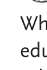
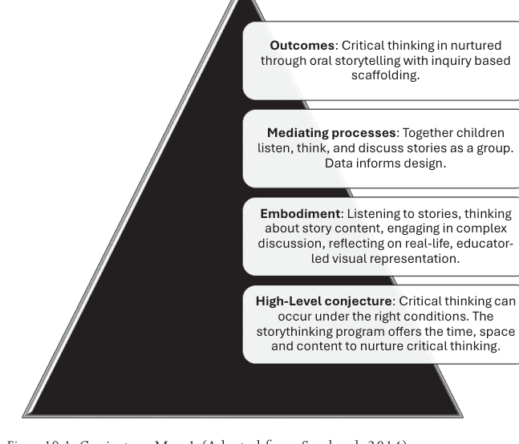

## 第一阶段 分析与评估

## 找到需要解决的正确问题

## 上下文中的示例

Sam 和 Freddy 是人工智能领域的科研人员。他们构建了一个非常出色的聊天机器人工具，该工具为在实习的大学生生成自我反思的提示和回应，因为研究文献指出，学生在实习中需要以对话的方式反思自己的实践，以便发展和改进实践。他们希望用一组正在进行首次实习的小学实习教师来测试该工具的有效性。因此，他们设计了一项研究，让实习教师在白天使用他们的聊天机器人仅十分钟来反思自己的教学，并测量学生在研究前后自我效能感，并进行几次焦点小组。大学讲师对尝试该工具感兴趣，因此允许 Sam 和 Freddy 运行他们的干预。然而，当研究团队进入实地时，他们发现大多数实习教师根本没有使用该工具。白天，他们没有时间坐在电脑前。有些人在晚上尝试使用聊天机器人，但他们专注于计划，只有少数人给予足够的时间。试验结束时，在焦点小组中，学生告诉他们，当他们使用时聊天机器人是有用的，但因为它没有被评估、没有与他们的虚拟学习环境（VLE）集成、也不在他们的手机上，他们根本没有时间和精力去使用它。它没有满足他们的任何需求。

如果 Sam 和 Freddy 最初就先观察一些学生，或甚至只是与他们谈谈从一开始的挑战，他们的聊天机器人设计将会截然不同。事实上，也许他们根本就不会制作聊天机器人。阅读本章，以免你们犯同样的错误。

## 为什么？找到需要解决的正确问题

> 我们失败更多是因为我们解决了错误的问题，而不是因为我们对正确的问题给出了错误的解决方案。
> 
> (Ackoff, 1974, p. 8)

Ackoff 常谈论做错事做得更对的影响。这只会让我们更错。做对事做错，至少会带来学习。DBR 的这一阶段侧重于为你工作的情境识别需要解决的正确问题。研究文献和前沿综述将识别相关的理论构念、知识空白、在其他情境中已被证明有效的内容，以及目前可用的解决方案。它们并不会告诉你太多关于你正在工作的特定情境的信息。然而。它们也最有可能不会告诉你关于你研究情境中人们的生活经历的任何信息。它们不会帮助你识别对你情境中的人们来说什么是需要解决的正确问题，或在这个情境中需要解决的最佳研究问题。为了使其具体化，请考虑以下上下文中的下一个示例。

在教育研究中，强烈关注识别研究问题。教育研究教科书通常将其呈现为线性

## 上下文中的示例

学生参与度是一个研究领域庞大且具有一些非常强大的理论，这些理论建立在广泛的实证证据基础之上。还有一系列干预措施和工具已被证明在各种情境下对学生参与度结果产生积极影响。假设你的研究情境是一所位于北爱尔兰农村地区的非教派学校，那里学校缺勤率很高（通常被用作学生参与度的代理指标）。这个后冲突环境的社会和历史复杂性，加上后数字社会中农村环境的额外复杂性，意味着其他情境中行之有效的培养学生参与度的方法在这里可能根本不可行，而且该环境中个体的需求与其他人并不等同或可比较。因此，在这种情况下，找到需要解决的正确问题对于学生参与度而言至关重要——它可能与校车有关，也可能与农业日历的要求、学校食堂食物质量、教职工关系或各种其他问题有关，但如果不与环境中的人们交谈，研究人员就不知道从何开始。

过程：阅读文献，缩小焦点，概述你的研究目标，并据此写出清晰且具体的科研问题。作为研究人员，我们知道现实中这一过程非常混乱。优秀的研究问题是通过广泛的研究得出的——既包括桌面研究，也包括实地研究。

在设计本位研究（DBR）中，定义研究问题明确不是线性的。它是一个迭代过程。初始指导问题在整个研究过程中会被不断完善和发展。虽然总体研究目标可能保持不变，但随着需要解决的正确问题变得更加清晰，具体可研究的问题可能会发生变化。在上述示例中，研究目标可能表述为：

本研究旨在与利益相关者合作，开发、实施并测试一项干预措施，以减少北爱尔兰农村学校环境中的学校缺勤率。

通过在 DBR 周期 1 中进行彻底的需求发现阶段，可能变得明显的是，学生大多在校时参与度高且心情愉快，但学校日历与该地区的农业日历相冲突，许多学生在秋季需要帮农，导致开学初教师与学生之间产生大量冲突，破坏了师生关系。这一初始阶段可能会解决研究人员对后冲突情况所持的假设。结果，DBR 周期 1 中的具体研究问题可能变为：

改变学校日历和课表如何影响北爱尔兰农村学校环境中的学校缺勤率和师生关系？

随着研究的进展，研究问题可能会进一步发展，甚至如果初始假设在研究中未得到验证，可能会完全改变。

在本章中，我们概述了如何在你的 DBR 项目中找到需要解决的正确问题。请记住，这只是目前对正确问题的最佳近似，为了推进，你将不断回到这个问题并迭代这一过程，以完善你的“需要解决的正确问题”。

## 本阶段目标

本阶段的目标是找到需要解决的正确问题，并将其表述为最佳的研究问题来解决。我们在本阶段结束时需要的不是完美的问题，而是一个足够好以便开始的问题。这必须与项目合作伙伴在情境中完成，因此你可以将此目标分解为若干子目标：

- 在研究情境中与合作伙伴建立并深化信任关系；
- 了解情境以及合作伙伴在关注领域的需要；
- 综合这些信息，以便找到现在最重要需要解决的问题。

## 术语

这一过程阶段——确定需要解决的问题或需要解决的研究问题——是良好设计的基础，进而也是良好 DBR 的基础。设计思维和以人为本设计中对这一阶段有许多名称，并且根据所使用的设计模型，它可能涵盖设计过程中的一个或多个阶段：

- IDEO 设计框架：灵感；
- IDEO 的设计思维七步：提出问题 – 收集灵感 – 综合行动；
- 斯坦福大学 D-School 设计思维工具包：共情与定义；
- 斯坦福大学 D-School 流程：需求发现；
- 企业设计思维工具包（IBM）：观察；
- 系统思维：获得清晰度，重构。

在产品设计中，它可能接近用户研究或市场研究或人因研究。然而，设计思维方法与产品设计之间的关键区别在于，前者将研究情境中的人们置于活动中心，在所有层面上都参与其中。

术语可能会改变，但这些不同框架中的基本流程是相同的。这一阶段是关于试图深入理解你研究情境中人们的需求和生活体验，并将所有这些提炼成现在最佳、可行的待回答问题或需要解决的正确问题。

本章阐述了工作的心态和方法，重点关注 DBR 流程的这一特定阶段。

## 寻找正确问题的思维方式

我们首先关注心态，因为它们在我们开始之前就框定了我们如何对待合作伙伴和具体方法论。DBR 需求发现阶段的关键心态是：

- 以人为本；
- 富有同理心；
- 好奇；
- 意识到自己的偏见；
- 对不完美和模糊性持开放态度。

> **暂停并反思**
> 
> 停下来想一想，这些心态对你来说是否自然。给自己每项心态打分并写下来，以便在最后回顾。

### 以人为本

采取以人为本的方法是所有 DBR 工作的基础取向。它不仅仅是学习者为中心、儿童为中心或教师为中心；它是人类为中心。这要求我们作为研究人员，以整体方式关注研究情境中的人们，承认并探索他们在自己生活中可能扮演的多种角色（父母、教师、学习者、朋友、同伴、导师）。作为教育研究者，这种心态使我们远离对特定教育角色的狭隘关注，而是将每个人置于其生活中相互作用的多个系统的中心。如果我们希望以系统的方式来处理这一整体视角并对其进行理论化，生物生态系统理论（Bronfenbrenner & Morris, 2006）可以提供一个有用的理论框架。它可以帮助我们作为研究人员，保持对研究情境和研究合作伙伴作为在该情境中动态行动者的整体观点的关注。

> **暂停并反思**
> 
> 这在本阶段的实践中意味着什么？
> 
> 我们必须寻求了解研究合作伙伴的更多信息，而不仅仅是他们在研究情境中的特定角色。我们必须尝试观察研究合作伙伴的更多内容，而不仅仅是他们在研究狭窄情境中的行为。如果我们的研究情境是一所学校，我们能否了解他们上学前做什么、如何上学、上学时不在学校做什么、他们在学校的感觉与生活其他方面相比如何，等等？他们不仅仅是学校体验，所以我们如何与他们一起探索这一点？显然，这需要信任和分享的关系，而这对 DBR 研究的所有阶段都至关重要。
> 回到本章开头学生-教师的例子：
> 有多少学生教师有兼职工作来资助他们的学业？
> 有多少人除了学业之外还有照顾责任？
> 有多少人是高水平运动员，在学业之外还有训练和比赛承诺？
> 他们生活的这些部分如何影响他们的学业，从而我们需要作为本项目的一部分来解决什么？

### 富有同理心

在以人为本设计和设计思维中，这一项目阶段通常被称为“共情”（D-School）。Sam 和 Freddy 的场景非常典型地反映了多年来产品设计和开发的情况，产品设计师提出了很棒的产品，但最终没人想要它们，没人能使用它们，或它们在部署的地方无法工作。

在第 1 章中，我们给出了 1985 年新可乐设计灾难的经典例子。设计在某种程度上出现的这些史诗级失败，往往可以追溯到设计师不理解或没有同理心于他们打算使用产品的人的问题。设计师认为自己知道人们想要什么，却甚至没有问他们。教育中存在类似的实施失败的悠久历史，其中来自一个情境的循证干预措施在部署到不同情境时失败。这可能归因于实施质量，但通常归因于一系列情境因素（Domitrovich et al., 2008）。简单来说，干预措施并非为其使用情境而设计。DBR 流程的这一阶段不仅涉及询问合作伙伴他们需要什么，还努力深入了解他们，以便你能通过讨论和协作帮助他们确定他们需要什么。

同理心是本研究阶段的核心。Helen Reiss（2017）有力地论证了同理心对人类

生存，因为它是亲社会行为和互助的驱动力，而这些行为支撑着社会。她讨论了同理心中涉及的一些复杂过程，这些过程“使我们能够感知他人的情绪，在情感和认知上与之共鸣，理解他人的视角，并区分我们自己的情绪和他人的情绪”（p. 74）。在过去，甚至在当今的流行话语中，同理心被认为是一种天生的特质，是你天生拥有或不拥有的东西，事实上，最近的神经学证据表明同理心有神经生物学基础（Harris, 2007）。对于有参与式研究经验的研究者来说，这已经是他们工作的核心原则，他们可能会觉得这是自己身份的核心部分。然而，同理心不仅仅是我们与生俱来的部分。研究已明确证明，同理心的神经生物学通路可以通过行动得到加强；也就是说，同理心是可以学习的（Phillips et al., 2013）。

在 DBR 中，对同理心的关注不仅仅是理论上的考虑，而是一个非常实际的问题，它驱动着我们作为研究者的行动。第 5 章强调了在 DBR 中与合作伙伴建立关系的重要性，以及我们如何在 DBR 项目中积极构建这些关系。在本章中，我们关注 DBR 循环的第 1 阶段，在此阶段，我们积极寻求与研究合作伙伴建立同理心，以便深入了解他们的背景和需求，从而正确协商研究中需要解决的正确问题。这涉及积极参与，以了解他们如何做事以及为什么，他们如何看待世界，以及对他们而言什么是重要和有意义的。

Batson et al. (2007) 识别了同理心的一些基本前提。这项工作强调，当我们重视他人并尝试从他们的角度出发时，同理心会增强。这在 DBR 研究中很重要，因为它指出了我们作为研究者应培养的倾向，也指出了我们应采取的活动，以便更好地了解研究过程中的合作伙伴。首先，我们积极努力去重视我们的合作伙伴——阐明并承认他们在研究过程中的价值。其次，我们应该尝试考虑走在他们鞋子里是什么感觉，从他们的角度出发，并在他们的世界中生活。在 DBR 研究过程的这一阶段，方法论侧重于如何进行同理性探究。这种心态有助于你避免以自我为中心的陷阱，即为自己设计而不是为研究合作伙伴设计。

## Be Curious

与同理心一样，这种心态对研究阶段至关重要，并贯穿于方法论中。从好奇心出发，而非评判，使我们能够实现本章开头设定的所有目标：它使我们能够建立信任关系，因为它表明了对合作伙伴所说内容的明确兴趣，并且使我们能够参与必要的探索，以深入了解研究背景以及其中人们的生活体验。

好奇心的词典定义是“渴望了解或学习某事”（2025）。更精确地说，Wagstaff et al. (2021, p. 363) 将其定义为“渴望知识和感官体验，从而激发探索行为”。这种为了学习而进行调查和探索的取向对于 DBR 中的好奇心心态至关重要。

与同理心一样，这是一种驱动行动的心态。最简单地说，就是在问题前加上“我很好奇”这一短语。它清楚地告诉你的研究合作伙伴，你只是想学习；你不是想评判或批评或评估；你只是真的很好奇，想了解他们的世界、他们的经历和他们的需求。

## Be Aware of Your Own Lens

我们所有人都有自己的视角和偏见，这些会影响我们看待世界的方式。没有人能摆脱这一点，无论是达赖喇嘛还是最小的孩子。我们都受过去所有经历的积累影响。这种心态承认这一点并寻求解决其对研究活动的影响。这关乎偏见，偏见可以是负面的，也可以是正面的，但永远不是中立的。同理心和好奇心都是应对偏见的工具，帮助我们以不带评判的态度、带着对他们世界开放学习的态度去接触研究合作伙伴。

需要有意识的努力来揭示和解决偏见。如果你独自工作，你可以通过回答诸如“我在这种背景下、与这些人、在这份工作中等的生命经历是什么？”等问题，将这些偏见明确化给你自己。这也可以与他人一起完成，你可以邀请你的研究合作伙伴和 fellow 研究者充当你的偏见检查者，在你可能需要记住承认并尝试放下自己的偏见时提醒你。你也可以主动成为他们的温和偏见检查者。

## Be Open to Imperfection and Ambiguity

正如我们在其他章节中所强调的，我们从一开始就想强调，虽然我们将 DBR 呈现为离散的线性阶段，但现实并非线性。它是流动的和迭代的。每个阶段的过程和结果都会指导研究者是否需要向前或向后移动，以获得更好的问题或更好的解决方案。每个阶段投入的时间也可能因迭代而大不相同。在初始 DBR 循环中，识别要解决的正确问题的第一阶段通常相当长，需要大量工作来理解和同理研究合作伙伴及其需求和经历。后续的迭代可能更短，与较少数量的合作伙伴合作，或者可能再次扩展以涉及更多合作伙伴和其他背景。作为研究者，你需要对在项目特定时刻的需求而在阶段之间来回切换保持开放。你需要接受“足够好”的问题的不完美和模糊性，并继续前进。

### PRACTICAL TIP

这些心态都可以概括为：注意并保持专注。当你与他们在一起、与他们交谈或观察时，他们是你的宇宙的中心，而不是你和你的生活，而是你的研究合作伙伴、他们的生活体验和他们的需求。即使你认为自己知道答案，认为自己已经见过一切，也请将全部注意力放在你的研究合作伙伴身上，这将带来足以推进的洞见。

## PAUSE AND REFLECT

在你进行研究的下一步之前，先停下来反思这些心态。回顾你在预任务中对每个心态的评分。对于你评分最低的心态，现在考虑我如何在该研究项目中践行这种心态。我可以在研究这一阶段的实践中做些什么来采用这种心态？

## KEY TAKEAWAY

在 DBR 这一阶段，暂停你的评判和分析，沉浸在你的研究合作伙伴的生活体验中。积极运用好奇心、同理心和开放性的提示——这些心态是可以学习的。

## Methodologies: Getting a Question That Is Good Enough to Start

**Why?** 这里的目标不是找到完美的问题。那是不可能的。目标是制定一个足够好的问题来开始或继续。DBR 过程的各个方面，包括这个指导问题，都需要在整个项目中不断迭代和重新构建。完善、拓宽、缩小或以其他方式改变问题与迭代解决方案一样是过程的一部分。所以不要对你的问题过于执着，而要对它如何改变以开启新视角和激发想法保持开放。

**How?** 那么我们如何得到一个足够好的开始问题呢？在 DBR 项目的这一阶段，作为研究者，我们有多种方法可供使用，我们将在下面探讨：我们可以直接询问研究合作伙伴他们在调查、访谈和焦点小组中的经历，我们可以*observe*研究环境以及合作伙伴在其中的活动，我们可以请研究合作伙伴通过日志记录、照片发声研究或出声思维协议为我们*document*研究环境或特定活动，或者我们进入该研究环境并尝试亲自*experience*它。在此阶段，重要的是生成丰富的、借鉴不同视角和经历的数据。通常研究者会根据研究背景的适当性组合使用其中几种方法。

如果其中一些方法感觉只是同一方法的略微不同版本，你是对的；它们就是。它们是变体：实现同一最终目标的不同方式，即深入了解研究背景下的研究合作伙伴。因此，思考你的合作伙伴以及对你来说了解他们背景、情况和需求的最佳方式。然后思考你到底想要

is appropriate, ethical, and feasible for you to do. Then get ready to **走进世界** with curiosity and empathy and try to step into the shoes of your research partners to learn more about their experiences in that world.

**PRACTICAL TIP**

One key point to remember: *people don’t always say what they do/mean, and they don’t always do what they say.* As researchers we need to allow for this and expect this in our methodologies, seeking out ways to dig into what we hear and observe for surprises, contradictions, and patterns.

### *The Pre-Work*

At this stage of the research, you will have established who your research partners are and have begun to develop a relationship of trust with them (Chapter 4). You will also have done extensive desk-based work on the theoretical and empirical research base in your area of study (Chapter 5) and established the theoretical framework for your study. You are now getting ready to get out in the field and learn about the research partners and the context you are working in with openness, curiosity, and empathy. Here are some key things to do as you set out your preparation.

### *Ethics*

Remember, this is a research project, not a design project. If you plan to do anything with human subjects (talk to them, record them, observe them, etc.), you need ethical approval from your institution. You will need to follow the guidance from your institution on good research practices. You will need to think about consent: who needs to provide consent and how they can do this. Bear in mind that you may be in a setting where not all of the individuals are directly involved in the research. You will need to design your use of observations or videos or other data capture to adapt to this. As regards data protection, you need to be compliant with the legislative requirements in your jurisdiction. Again, you will need to design your data generation and storage to take account of this. The good thing about the ethics process is that it requires you to slow down and think carefully about the range of ways you want to work with your partners, how you can record this and how you will design these opportunities so that you build trust and empathy between the people involved.

## Consider Your Own Lens

Research is not a neutral act, and no researcher comes to a research project as a blank sheet. Reflexivity is crucial in any research project. As part of the ethics process, you should be required to consider what biases you may bring to this area of study yourself and how you intend to mitigate the effects of this. Before you go out into the field, you need to put these mitigations into practice and document how you are doing this. We cannot come to the world with no lens, no biases. But we can strive to reduce the impact of this on our research.

## Piloting Your Instruments

For all of the methods below, you will need to pilot your questions, instructions, and processes before you get fully out in the field. This is noted for every method below. It is so important and so easily forgotten that we are calling it out explicitly here again as part of your pre-work. You want to make sure that after all the work of getting out in the field to generate data that you have the data you need. Small-scale pilots can mean the difference between success and failure for a research project. Run a pilot so that you can be sure that you are asking the right people the right things to give you the insights that you need to progress your project.

## PRACTICAL TIPS: YOUR PREPARATION CHECKLIST

+   1. Do I have a clear theoretical framework for this, as theory will drive the design and selection of research instruments?
+   2. Do I have the appropriate ethical approval for this?
+   3. What are my own assumptions and preconceptions and biases, and how can I work with them to overcome these?
+   4. Have I engaged with the most appropriate research partners for this?
+   5. How can I develop a relationship of trust with these partners so they are willing to share with me and each other?
+   6. Where is the best place to engage with these people?
+   7. How am I going to record the data generated in this phase (e.g., audio recording, video recording, observation rubrics, field notes, screen capture, journals, etc.)?
+   8. What is my failsafe for making sure the data are recorded sufficiently well (e.g., 2 recorders, recorder + notetaker, etc.)?

## The Methods

In this phase of a DBR project, it is about getting out into the world to find out about our research context and find the right problem to solve. There are a number of methods available to us as researchers to generate data that will inform this need-finding phase.

Research is all about making choices. When it comes to choosing your methods, every method has advantages and disadvantages, and your job as a researcher is to weigh up the pros and cons and select the methods that are best suited to your needs and the research context. In this phase of DBR research, you need to allow space for the unexpected or the unplanned. Your methods cannot be too fully structured as that would entail that you know exactly what you are looking for. In fact, the point in the need-finding phase is that you do not know exactly what you are looking for yet. You are looking for the best question to address for now. Most often, you will layer multiple methods to generate different perspectives and refine or expand your understanding of the setting and the needs of your research partners. These methods can be used in a linear way, using one method to expand, narrow, or change the focus for subsequent methods. They can also be used in parallel to generate alternative perspectives that are triangulated and integrated through analysis. In this section, we will look at:

- Questionnaires;
- Interviews (individual, group, and focus group);
- Observation;
- Self-documentation;
- Experiential research.

We explore what they offer the DBR researcher and how to use them in this phase of a DBR project.

## Questionnaires

The questionnaire has long been a staple of social science research. It is a flexible, cheap, and relatively easy method to collect data from research participants in any kind of research study. A questionnaire can include standardised question scales and a range of closed and open question types. It can be administered in-person, on paper, over the phone, or online. It offers a low-cost and adaptable data generation method for researchers.

In this phase of DBR, the goal is to develop a rich and deep understanding of the research context. Questionnaires are a valuable tool for this because:

+   1. They are relatively easy to use.
+   2. They are not very time-consuming.
+   3. They can reach a large number of people and therefore can provide a broad overview of the research context.
+   4. They can gather both quantitative and qualitative data and so can provide some depth as well as breadth in developing the overview of the research context.
+   5. They can focus on particular aspects of the context closely.
+   6. They can focus on the theoretical basis for the study by drawing on standardised instruments from the empirical research base or to support the design of the questionnaire.

For the student engagement example above, there are a number of questionnaire instruments that have been used in the research literature on engagement that could be administered relatively quickly to the whole school population online and would provide a very useful baseline profile of engagement in the research context.

A good questionnaire is clear, succinct, valid, reliable, and interesting enough for the participants to finish. However, questionnaires do have a number of limitations:

+   1. It can take significant time and effort to design a good questionnaire, as this involves crafting individual question items, structuring and sequencing items, and assessing their validity and reliability.
+   2. Existing standardised and validated questionnaire instruments may not be available or may not be appropriate to the research context.

3. 即使包含开放性问题，问卷在提供观点深度和丰富性方面也有限制。它们之所以有价值，是因为简短且易于完成，正因如此，从中产生的数据可能简短且略显单薄。

4. 问卷回答会受到反应偏差效应影响，人们出于各种原因提供不准确或误导性的回答，从希望符合研究者期望的愿望（良好受访者效应）到问卷中问题的近期性或顺序效应。这些效应必须在问卷设计中得到缓解。

5. 可能很难让人们对问卷作出回应，并且需要花费时间和精力来积累你想要的回答数量。

6. 最后，也可能是最重要的一点，人们只能基于他们所知道或有意识意识到的内容作出回应。有时人们对你在研究情境中试图识别的问题或困难并不自觉，而这可能只有通过观察才能显现。或者他们可能会以现有可得资源为框架来表达他们想要或需要的东西。亨利·福特的名言——可能从未由他本人说过——很好地说明了这一观点：“如果我问我的客户他们想要什么，他们会说一匹更快的马。”

对问卷利弊的回顾凸显了准备工作对成功使用问卷至关重要。如果你决定使用问卷，可以通过非常谨慎的问卷设计和试测来减轻大部分风险，而这需要时间和精力。如果综合考虑，问卷是你与研究伙伴在你的研究情境中使用的合适工具，那么以下是一些做与不做的建议，以充分利用这一宝贵方法：

## PRACTICAL TIPS: DOS AND DON’TS

### Dos

- 仔细规划你的问卷：查找你所在领域的现有工具，使用你的理论框架来聚焦条目，确保你问的是你想了解的内容，确定你需要的 demographic 信息，考虑反应偏差效应，评估效度和信度。
- 试测你的问卷：尽可能多次试测，以确保人们回答的是你认为你在问他们的问题。思维出声协议对此非常有用，因为它们可以突出问卷条目中措辞不佳、模糊或误解之处。它们还能很好地表明问卷实际完成所需的时间。
- 根据需要提出开放性问题。开放性问题越多，问卷数据越丰富。
- 考虑研究伙伴的语言和读写需求：在起草问题时使用简明英语指南；如有必要，将问卷翻译成研究伙伴的主要语言；为在线问卷突出大声朗读选项。
- 尽可能让人们更容易作出回应。提供多种格式的问卷（纸质、在线、电话）；提供宽裕的回应时间；让问卷尽可能精简快捷。
- 如合适，提供参与者后续跟进的机会。

### Don'ts

- 不要提问引导性问题。
- 不要忘记在需要时包含重要的 demographic 问题（如年龄、性别等）。
- 不要让问卷太长，因为人们不会完成它。利用试测检查问卷所需时间。每一秒你都拥有参与者的注意力，因此要充分利用：不要问不需要的问题；不要问太多开放性问题。

## Interviews (Individual, Group, and Focus Group)

社会科学研究的另一项基本方法，访谈是生成有关研究情境数据的非常有用的方式。这种方法是通过直接与人沟通来了解更多关于研究情境的信息。访谈最常见的模式是口头交流，通常面对面进行。然而，还有许多其他选择。它可以是面对面、电话或在线进行。沟通可以使用多种媒介。它可以是口头的、书面的，或使用视觉、符号或其组合，具体取决于研究情境和研究伙伴的适用性。作为研究者，我们必须记住访谈是一种社会性相遇。它既是与研究伙伴发展和深化关系的机会，也是生成研究情境数据的机会。好奇心和同理心的思维方式在进行富有成效和深刻的访谈时尤为重要——在讨论中保持开放、好奇和不带评判。

访谈和焦点小组比调查耗时更多，但可以提供更丰富、更深入的视角。此外，它们更具灵活性，因为研究者可以深入探讨访谈中出现的有趣领域。访谈中有很多选项和变化，使这种方法对任何研究都高度灵活和适应性强。

### PRACTICAL TIP

你可以问自己一些问题来决定如何构建你的访谈和焦点小组，包括：

- 我应该进行个人访谈还是让人们聚集在小组中？
- 我应该与研究伙伴面对面交流，还是通过电话或在线交流？
- 我应该使用什么媒介？口头、书面、视觉媒介，或这些的组合？
- 交流应该是同步的（即时相互沟通）还是异步的（在一段较长时间内提问并获得回应）？
- 我是否应为研究伙伴提供在访谈中使用其他语言的选项？

你对这些问题的回答将由你对研究情境的了解、你与研究伙伴的初步接触，以及你对什么能为 DBR 项目提供最有价值见解的考量来指导。

对于本章开头提到的学生参与度示例，研究情境中有许多人值得与之交谈，但我们必须仔细考虑如何组织这些访谈，以便在现有资源下做到最好。

## INDIVIDUAL OR GROUP?

个人访谈可以提供极大的深度，并允许我们深入探讨个人与个体的特定经历。这可以从个人角度提供对研究情境的非常丰富的视角。你可以确定这个人的声音作为研究的一部分被听见，因为他们不必像在小组环境中那样竞争发言空间。因此，个人访谈对于倾听来自少数群体或边缘群体的参与者的声音，或只是那些在研究环境中权力较少的人的声音，如学校环境中的教育支持人员而言，具有价值，甚至是必不可少的。如果讨论的焦点是个人或敏感的，个人访谈可能最适合允许对个人可能不愿在小组面前讨论的话题进行诚实和开放的沟通。它还允许比在小组环境中更深入地探索经历的个人方面。此外，由于这只是“一对一”访谈，组织后勤可以最好地配合参与者安排。

然而，在某些情况下，小组访谈可能更合适。小组访谈中的小组互动可以产生有趣的见解：小组成员可以提出问题并追寻你自己可能没有想到的方向。小组参与者可以对同一问题或经历提供多种视角，这既能加深理解，也能提供对比或对提出观点的额外验证。相反，小组访谈可能导致“群体思维”或“统一口径”回应，即小组成员不愿或无法在小组环境中提出异议的声音。在小组环境中，一些声音可能占主导，而其他声音可能因各种原因被沉默。因此，小组访谈需要熟练的引导，以确保所有声音都被听见并为不同观点提供空间。仔细考虑小组构成也很重要，以促进积极互动并减少任何有问题的群体动态。最后，从后勤角度看，小组访谈比个人访谈更容易也更难组织。虽然小组访谈允许你一次与更多人交谈，但找到适合所有人的时间和地点可能非常困难，因此安排访谈日程可能耗费大量时间。

## 面对面还是不面对面？

无论您选择个人访谈还是小组访谈，您都可以选择面对面进行访谈或在线进行访谈（包括电话和基于网络的访谈）。当然，这些选项各有利弊。面对面访谈允许对非语言线索和肢体语言做出更大的反应。与在线访谈相比，面对面环境中出现技术困难的可能性更少，而在线访谈可能会遇到连接和其他问题。视情况而定，与在线访谈者可能出现的干扰相比，在面对面环境中保持专注可能更容易。即使人们越来越习惯在线互动，在在线环境中管理轮流发言和讨论仍然可能很困难。例如，在面对面环境中利用沉默为回应创造空间可能更容易，而在线上的沉默可能被误解为分心或连接问题。然而，尽管存在这些缺点，在线选项通常对更广泛的研究人员和研究合作伙伴来说更易于获取。在线提供更大的灵活性和便利性，因为它对时间和空间问题的依赖性较小。由于研究人员或参与者无需旅行时间，因此效率大大提高。研究人员和参与者可以从他们自己选择的、感到安全舒适的场所参与其中。因此，以及由于可以选择不共享视频，在线选项对于讨论更敏感的话题可能很有用。谈到通常难以接触到的群体时，您需要仔细考虑哪种选项会使人们更容易参与。例如，如果群体地理位置偏远或由于其活动性质而可用时间有限，例如轮班工作或夜班工人，在线可能更容易。然而，如果群体难以接触是因为他们是边缘化或脆弱人群，那么在他们熟悉且非常容易到达的场所进行面对面访谈可能更有利于支持他们的参与。对于所有研究合作伙伴，您需要设身处地为他们着想，了解哪种参与方式最适合他们，而作为研究人员，您的任务是尝试创造这种面对面或在线的环境。

## 使用什么媒介？

最常见的是访谈是口头互动，可以根据同意情况以及可用的技术和设备进行音频或视频记录。然而，还有其他选择。研究合作伙伴可能喜欢或需要使用其他媒介，例如书面输出、绘画、视觉材料，或手势和标志，作为表达的替代或补充方式。合作伙伴可能还有不同的语言，包括手语，他们希望用来表达自己。这些表达意义的替代方法可以非常丰富且富有洞察力，并允许那些否则可能无法或不愿参与的人参与。

而不是口头访谈，可以进行电子邮件或短信交流作为书面访谈。这在受访者可能需要一些时间来考虑和构思答案时特别有帮助。这也可以允许问题或答案使用多种语言。使用翻译工具可以促进这一点，并且比现场口译更可行。受访者可以提供视觉表现而不是口头表现来回答问题，例如绘画。这对年幼的儿童尤其有效。在面对面和在线访谈中，媒介可以结合起来提供丰富的交流方式，然后可以一起分析。例如，参与者可以被邀请在实体或虚拟便签或白板上写下他们的想法。在线白板为参与者提供了以多种方式贡献的机会（绘画、便签、图形、图像）除了语音之外，所有口头和书面互动都可以被记录。对于小组访谈，这尤其有用，因为它可以让人们同时分享他们的想法，即使其中一些人没有机会发言。这种输入可以作为一个可用的选项而没有结构，也可以作为旨在引发讨论的工作坊格式的一部分而有结构。一些结构化格式的例子包括：

- **“公交站”或“旋转木马”策略**：这是一种应用于研究场景的合作学习策略。您决定三个到四个关键问题，将其写在真实或虚拟墙上的站点上。小组被分成两到三人的小组，每个小组被分配一个问题。每个小组讨论并在墙上写下对他们问题的回应。然后小组轮流到下一个板块，阅读问题和回应并讨论并为讨论添加新内容。到最后，每个人都将有机会回应每个问题并与整个小组就此进行讨论——无论是同步还是异步地阅读之前的回应。

- **待办任务（JTBD）工作坊**：这在行业创新工作坊中常用，并应用于研究场景。这里的关键见解是，与其问人们需要什么，不如问他们做什么——他们需要或想要完成的任务。这些任务会随着时间推移而持续存在（例如，烹饪食物、旅行、取暖）。它将视角从人们如何做事转变为他们通过这些行动试图完成什么。在 JTBD 工作坊中，访谈者可能会探索研究文本中的例行程序或流程，并寻找其中的“痛点”——困难或障碍。工作坊可以使用 JTBD 画布，参与者可以在上面以书面形式提供输入，或由主持人总结。画布设置了任务步骤、成功标准、情感和情况的部分。作为示例，教师视角的一个任务可能是“我希望我班上的孩子取得进步。”这个任务的一部分是对孩子们提供反馈，说明他们的进步情况。

- **三步访谈**：这又是另一种可以部署在这里的合作学习方法论。在此方法中，参与者以三人小组互相访谈，轮流担任访谈者、受访者和记录员。经过三次迭代后，每个小组整合并总结他们讨论的内容并反馈。

这些结构化格式的另一个优势是，它允许研究合作伙伴在他们分享讨论时实时考虑从讨论中产生的内容，并整合回应。

对于所有这些访谈选项，保持好奇心并富有同理心并继续倾听。

## 实用技巧：该做和不该做

### 该做

- 仔细规划您的问题和材料，借鉴您的理论框架以提供重点。
- 以好奇心（而非评判）为主导：使用诸如“我好奇”，“我想知道”等短语。
- 始终以尊重的态度进行讨论，并考虑访谈的时间和地点以及您提问的措辞。
- 提供您问题的理由：我问这个原因是……
- 使用适合您受访者的语言。使用简明英语指南可以帮助您避免行话和复杂语言。当您与儿童、与访谈者母语不同的人，或因任何原因可能因语言而遇到理解或参与障碍的人合作时，要特别警惕。
- 提问开放式问题：
  - 运用所有感官：“它看起来、感觉、听起来怎么样？”
  - 运用情感：“你感觉如何？”
  - 深挖：使用五个为什么。
- 根据需要为您的研究合作伙伴提供不同的表达媒介，并确保您可以记录这些：说话、写作、绘画、手势、姿势等。
- 愿意偏离脚本。这源于以好奇心为主导。如果回应令人惊讶或有趣或不寻常，您可以跟随这一方向，而不是严格遵循问题安排。
- 记得按录音！理想情况下，使用两种不同的设备录制访谈，以防其中一个选项失败。

在小组设置中：
- 仔细考虑您可以或应该在小组中召集谁。考虑权力动态、官方角色、跨文化方面等。
- 在开始时就保密、尊重沟通以及对所有声音的开放性设定基本规则。
- 尽量确保小组中参与度均衡。

### 不该做

- 不要引导参与者的答案：例如，“你可能认为……”。
- 不要争论或辩论或强加你的意见。这不是关于你。

在小组设置中：
- 不要让一个声音占据主导。
- 不要让声音被淹没或听不到。
- 在小组访谈中不要害怕出现分歧，因为这些分歧可以提供真正的洞见。但要支持在小组规则和谨慎引导下进行尊重的开放讨论。

## 观察

观察或许是深入理解研究情境的最有价值的方法。它要求你将自己置身于情境中，亲身观察并记录周围的活动。它让你看到人们实际做了什么，而不仅仅是他们所说或认为自己做了什么。它可以让你注意到研究伙伴可能并未有意识到的方面。观察尤其有价值，因为它能让你这位研究者走进真实世界及其所有的复杂性和矛盾性中。它们是自然主义的，并且能让你汇集其他方法无法获得的各类信息。

观察并非没有缺点。你只能观察当下存在的现象，而非之前发生或之后会发生的事情。你只能观察可观察到的内容——而非与可观察事件相关的不可观察的动机或其他内部方面。在真实环境中进行观察可能很困难，因为它需要持续的专注，而此时可能同时发生着多种事件和活动。观察者带入任务的视角或偏见也可能成问题。可能最重要的是反应性问题，即观察者仅凭其在场就可能影响或改变被观察的情境。因此，除非你采取措施融入背景或通过参与成为真实世界情境的一部分，否则很难观察到“自然”的活动。

许多这些缺点都可以通过仔细的准备、规划以及与其他方法的三角互证来解决。规划和试运行观察的重点和记录对于成功的观察至关重要。有必要仔细考虑要观察情境的哪些方面以及如何最好地记录这些方面。你的理论框架可以帮助你确定关注点，甚至可能提供有用的观察量规供你采用或改编。一旦你知道想要关注什么，就需要考虑如何随着时间保持这种关注。观察可以从使用明确量规或编码方案的完全结构化观察，到完全非结构化的即时记录和事后整理笔记之间形成一个连续体。中间还有半结构化观察，可能使用松散的量规或方案，允许在观察期间做额外笔记。在所有情况下，你都应记录日期、时间、地点以及分析所需的任何其他关键细节，例如在场人员。绘制地图以提供事后观察的背景也很实用：例如，教室布局以及你在其中的位置。在获得适当同意的情况下，照片对于记录人工制品、物体甚至情境中的人物也极其宝贵。结构化观察可以借鉴研究文献中现有的编码方案、量规或时间表（例如，教师-学生互动类型），也可以由你设计以明确指定需要记录的内容。时间表应非常具体并附有清晰的说明，以便在不同时间以及不同人员之间保持一致地使用。然而，非结构化观察没有任何结构。它们允许使用自由文本，通过描述性形容词、比较级、高度具体或可视化的词语仔细记录情境的关键方面。在此考虑所有感官是有用的：情境看起来、听起来、闻起来、感觉起来、尝起来如何？重要的是要具体并回答观察相关的所有 WH 问题：何时、何地、何事、谁。在面部表情和肢体语言所能观察到的范围内，尽量记录关注对象的人的情绪。半结构化观察可以使用基本方案来引导观察者的注意力，但不会过于规定或限制。例如，POEMS（人员、物体、环境、信息、服务）方案在以人为中心的设计中经常使用。Cohen 等人（2017）提供了大量观察框架和指南的 useful overview，供你考虑并视情况采用。对于半结构化和非结构化观察，你可能需要在现场观察后很快撰写实地笔记，以在进行过程中形成解释和分析的连续记录。当然，并非所有观察都必须在当下记录。视频录制提供了事后观察和分析的机会。研究情境的照片，有人或无人，都可以在分析阶段提供宝贵的数据。屏幕捕获在记录基于计算机的活动时价值巨大，例如学生如何进行写作任务，或教师如何通过学习管理系统提供反馈。请记住，观察可以是狭窄的也可以是宽泛的。它们可以聚焦于非常具体的活动：做作业、批改评估、打开教室设备、课堂互动等。

研究者通常从非结构化观察开始，以便更多地了解环境，并据此制定更结构化的量规用于进一步观察。为了确保你充分探索研究情境，你需要四处走动并前往情境内的不同区域。你可以尝试“放大、缩小”技巧来改变视角并在不同层级或不同焦点下进行观察，随着进展而变化。例如，你可能会放大关注午餐室中的某个人，或缩小以获得从上方的鸟瞰视角。在此需求发现阶段，重要的是要从情境中产生足够的观察数据，以便通过分析识别研究情境中的问题和需求。在此需求发现阶段，你正在寻找惊喜或不寻常的行为或变通方法或矛盾，因为这些可能指向研究情境中未得到满足的潜在需求。何时知道观察已足够？当你开始认识或预测重复出现的行为时，你可能已达到“饱和”。当你注意到一些惊喜，或能解释某种不寻常行为或矛盾时，你可能正在锁定当前研究情境中最值得解决的问题。

## 实践提示：应该与不应该

应该
- 1. 仔细规划你的观察时间表——即使它是相当非结构化的。
- 2. 试运行并练习你的观察时间表和流程——这并不容易。
- 3. 记录观察发生地点和时间的关键信息。
- 4. 记录任何关键事件、令人惊讶或不寻常的行为，或人们所说与所做之间的任何矛盾。
- 5. 记录可能作为行为线索的物体和人工制品。
- 6. 使用照片、视频、屏幕捕获和其他媒体来捕获观察数据以供后续分析（如果你已获得这些的同意）。
- 7. 要具体且具描述性。
- 8. 在观察后尽快撰写额外的实地笔记。

不应该
- 1. 除非你明确是参与者，否则不要干预正在发生的事情。
- 2. 不要对你无法观察到的内容做出假设（例如，某种行为背后的动机）。你可以在访谈中跟进并询问研究伙伴这些不可观察的方面。
- 3. 除非在多次观察中重复出现，否则不要假设你所看到的是该情境的典型情况。

## 自我记录

探索研究情境的另一种方法是请你的研究伙伴通过文本、照片、视频或任何其他合适的制品来记录他们自己的经历。这可能极具价值，因为它产生了完全来自研究伙伴视角的研究情境数据。不管你多么仔细地观察一个情境，你都无法透过他人的眼睛看世界。通过自我记录，你直接获得了研究伙伴对世界的看法。在观察中，你必须努力不让自己的偏见影响你所看到的内容。在自我记录中，不存在你排除研究伙伴独特视角和焦点的这个问题。自我记录允许研究伙伴分享他们在研究情境中认为有意义的内容。例如，你作为外部观察者在学校拍摄的照片可能与教师或学生拍摄的照片非常不同，因为他们会聚焦于他们认为在该学校中重要、困难或有趣的内容。此过程确实需要讨论，也许还需要培训，以便你和你的伙伴对哪些事物相关且重要以便记录有清晰的理解。数据也可能需要进行三角互证

通过观察或访谈，因为研究伙伴产生的制品在脱离上下文的情况下可能难以分析。从实际角度来看，自文档化比观察更有优势：研究情境是研究伙伴在正常生活中花费时间的地方，因此他们可以生成的数据时间跨度比你亲自观察所能实现的时间更长。此外，他们会参与该情境的正常活动，并且可以从内部记录这些活动，而不会产生任何观察者效应。然而，自文档化对你的研究伙伴来说是一项艰苦的工作。他们需要非常致力于项目目标，才能在较长一段时间内维持这种工作量。因此，至关重要的是，你要与研究伙伴共同开发并试行你的自文档化方法，以便他们尽可能轻松地将其整合到自己的正常流程或工作流程中。例如，教师可能没有时间在白天用电脑输入观察记录，但也许他们可以在装进口袋或包里的一个小笔记本上记下几行字。或者学生可能不想写下他们在学校认为重要的事情，但他们不介意拍下自己在学校最喜欢的地方的照片并与你分享。

## PRACTICAL TIPS: DOS AND DON'TS

Dos
- 1. 思考自文档化相关的伦理和同意问题，特别是如果你与儿童和年轻人合作。
- 2. 与你的研究伙伴一起确定自文档化的重点和机制。
- 3. 基于这种合作，提供非常明确的说明。
- 4. 保持适度的期望——自文档化是一项艰苦的工作，人们可能没有时间和精力去做。

Don’ts
- 1. 不要忘记数据保护限制，特别是对于图像或视频。
- 2. 不要要求太多。
- 3. 不要忘记进行试点，以确保你要求人们做的事情是清晰、可行的且有用的。

## Experiential Research

这种方法借鉴的是设计思维，而非教育研究方法。在设计思维中，这被称为沉浸式共情。此处的目标是让你沉浸在研究情境中，并亲自在该情境中开展活动和流程，以便更全面地理解并与研究伙伴产生共鸣。跟随一名学生是很好的例子。如果你的研究情境是一所学校，拿一份典型的学生课表并在一天内跟随它。这可以让你体验学校一天的心理、身体、感官和社会需求：从一个班级到另一个班级在心理和身体上的移动是什么感觉，一天中有多少时间可以与他人互动，你在哪里、何时可以吃东西或休息，你在哪里或何时可以活动、站立或行走。没有亲身经历，就很难理解或共情该情境中的年轻学习者。重要的是尽可能多地让自己沉浸在环境中：慢慢来，穿合适的衣服，带合适的设备，在可能的情况下参与活动。也可能需要模拟体验的某些方面，以使其尽可能完整。例如，如果你视力受损、饥饿、有行动不便、不会教学语言或记下黑板上的内容有困难，学校一天的体验会是怎样的？你可以尽力采取措施模拟这些体验。当然，让自己完全沉浸在体验中在现实性方面存在局限，但即使迈出这一步，完全走出去并嵌入真实的研究情境中也是有价值的，可以产生洞见并促进共情。

## PRACTICAL TIPS: DOS AND DON'TS

Dos
- 1. 考虑你的个人偏见以及如何减轻其影响。
- 2. 仔细规划沉浸式活动。你可能需要观察该情境以确定何时何地加入以及你需要什么。
- 3. 沉浸于当下。这就像承担参与者-观察者的角色，但这里的核心重点是当下的参与，以亲身体验和感受身处该环境是什么感觉。
- 4. 尽可能在体验后立即记录你的观察。

Don'ts
- 1. 不要分析——尽量保持沉浸在当下，稍后再分析。
- 2. 不要假设你的体验是“典型”体验，因为你的体验只是模拟的且时间有限。

## KEY TAKEAWAY

记住，人们所说的不总是与他们所做、所想或所感受的一样。使用多种方法来尝试探索完整的共情地图，即说-想-感受-做。

## Analysis and Synthesis

DBR 阶段的目标并不是寻找解决方案；它仍然完全是关于找到在当前研究情境中需要解决的最佳问题。 我们讨论过的所有方法都会从多个角度产生大量关于研究情境的数据。本需求发现阶段步骤的目的是提炼所有洞见，以便在设计阶段识别一个好的待解决问题。这个阶段完全是关于综合你已完成的共情工作的学习。用教育研究术语来说，这是分析阶段，借鉴相关的分析工具，如适用（主题分析、会话分析、内容分析、视觉分析等）。在设计思维术语中，这被称为为行动综合洞见。有许多针对不同数据类型的数据分析指南，可以帮助你识别研究伙伴在其特定情境中的需求。你正在寻找数据中的一致性和矛盾，以加深对研究情境的理解。你在数据中识别出的挑战、问题、障碍、变通方法或痛点

可以构成一个待解决的问题或一个当前未满足的需求。你应该与研究伙伴讨论这些问题，以验证你的假设和结论，因为他们是研究情境的专家。你的分析几乎肯定会产生许多关于最佳待解决问题候选。所有这些可能的问题或需求都应记录下来，以供本阶段的最后一步：从你发现的众多问题中确定一个在下一阶段解决的问题。

对于这最后一步，候选问题应进行分类、聚类、整合和优先排序，最好与你的研究伙伴和研究团队一起进行（即使只有你和你的导师）。这可以通过面对面或在线的工作坊形式进行，使用便签、情节摘要、照片或其他对已识别问题的表示，以便与你的伙伴一起处理。初始的分类、聚类和整合任务将缩小问题空间。然而，为了优先排序和选择，你需要应用约束和判断。一些约束与可行性有关，其他与影响有关，还有一些与期望有关。对于这一步，你和你的研究伙伴需要明确你的约束（预算、时间、控制、可能的影响等），并基于此优先排序和选择最合适的问题来解决，如下面的示例所示。在此阶段非常重要的一点是选择一个你和你的研究伙伴都支持并有动力解决的问题。没有这种动力，你的 DBR 项目可能会失去动力而无法进展。

### EXAMPLE IN CONTEXT

在对北爱尔兰农村学校情境中学生参与度问题进行调查、访谈和观察后，在研究情境中识别出若干问题。这些包括：
- 1. 该地区公共交通有限，只有一条公交线路经过学校，9.30 到达（比学校开始时间晚 45 分钟）。
- 2. 学校公交线路服务于多所学校，在某些线路上学生必须在 7 点离开家才能在 8.45 到达。
- 3. 由于课程表安排原因，学生白天有两个十分钟的休息时间和 30 分钟的午餐时间。因此，他们通常只有

没有时间吃东西或进行活动休息，只能二选一。这对学生的情绪产生负面影响。

- 4. 学生必须使用公共空间进行所有休息，但学校公共区域的座位并不多。

所有这些问题都被发现会负面影响学生的参与度。然而问题 1 和 2 超出了学校或研究人员能够改变的控制范围。问题 4 可能需要大量资金来解决。相比之下，问题 3 是学校有能力改变的，不需要花费任何费用，并且可能对学生参与度的整体问题产生影响。因此，在与学校的研究合作伙伴合作后，研究团队决定在下一个设计阶段专注于设计更符合学生需求的学校时间表。

本阶段的产出必须为设计阶段提供输入。你的目标是识别研究背景下当前最需要解决的问题，并为设计下一阶段清晰地阐述这一问题。凭借对研究背景的丰富概述以及你希望与研究合作伙伴一起解决的已识别问题，你已准备好进入 DBR 研究的下一阶段：设计你的解决方案。

## KEY TAKEAWAY

本阶段 DBR 的目标不是寻找解决方案。而是找到当前最需要解决的问题。请记住：问题不必完美；它只需要足够好以便开始。你将能够通过项目周期对其进行完善和发展。

## Chapter Summary

本章聚焦于 DBR 的关键第一阶段：在你的特定研究背景中寻找正确的问题来解决。与其寻求完美的问题，目标是发现一个有意义、可操作且植根于研究合作伙伴的现实和需求的问题。这个“目前最好的问题”作为进入设计阶段的跳板，并将在探究和合作的迭代周期中不断演进。接近这一阶段，人本中心的心态——同理心、好奇心和自我意识——会让你更接近这一目标。所概述的方法提供了灵活的选项，可以层层叠加，帮助你超越假设，深入理解合作伙伴的需求。请记住，在此阶段你不是在寻找理想的解决方案，而是在寻找能够推动设计阶段前进的有力问题。保持开放，保持好奇，并倾听你的研究合作伙伴，你就会成功。

## References

Ackoff, R. L. (1974). Redesigning the future: A systems approach to societal problems. John Wiley & Sons.

Batson, C. D., Eklund, J. H., Chermok, V. L., Hoyt, J. L., & Ortiz, B. G. (2007). An additional antecedent of empathic concern: Valuing the welfare of the person in need. American Psychological Association. https://doi.org/10.1037/0022-3514.93.1.65.

Bronfenbrenner, U., & Morris, P. A. (2006). The bioecological model of human development. In W. Damon, and R. M. Lerner (Eds.), Handbook of child psychology: Theoretical models of human development (Vol. 1, 6th ed., pp. 793–828). John Wiley & Sons Inc.

Cohen, L., Manion, L., & Morrison, K. (2017). Research methods in education (8th ed.). Routledge. https://doi.org/10.4324/9781315456539

D-School. An introduction to design thinking PROCESS GUIDE. Hasso Plattner Institute of Design at Stanford University. https://s3-eu-west-1.amazonaws.com/ih-materials/uploads/Introduction-to-design-thinking.pdf.

Domitrovich, C. E., Bradshaw, C. P., Poduska, J. M., Hoagwood, K., Buckley, J. A., Olin, S., Romanelli, L. H., Leaf, P. J., Greenberg, M. T., & Ialongo, N. S. (2008). Maximizing the implementation quality of evidence-based preventive interventions in schools: A conceptual framework. Advances in School Mental Health Promotion, 1(3), 6–28. https://doi.org/10.1080/1754730X.2008.9715730.

Harris, J. (2007). The evolutionary neurobiology, emergence and facilitation of empathy. In T. F. D. Farrow, & P. W. R. Woodruff (Eds.), Empathy in mental illness (pp. 168–186). Cambridge University Press. https://doi.org/10.1017/CBO9780511543753.011.

Phillips, M., Lorie, A., Kelley, J., Gray, S., & Riess, H. (2013). Long-term effects of empathy training in surgery residents: A one year follow-up study. European Journal for Person Centered Healthcare, 1, 326. https://doi.org/10.5750/ejpch.v1i2.666.

Reiss, H. (2017). The science of empathy. Journal of Patient Experience, 4(2), 74–77. https://doi.org/10.1177/2374373517699267.

Wagstaff, M. F., Flores, G. L., Ahmed, R., & Villanueva, S. (2021). Measures of curiosity: A literature review. Human Resource Development Quarterly, 32(3), 363–389. https://doi.org/10.1002/hrdq.21417.

## 8

## PHASE 2 DESIGN AND DEVELOPMENT OF EDUCATIONAL INTERVENTIONS

### EXAMPLE IN CONTEXT

Dara 和 Luca 已完成了他们在后基础数学教育领域的设计型研究 DBR 项目的第一阶段。他们对学生参与度和数学学习的相关文献进行了系统综述，并对相关领域进行了更广泛的叙事综述。他们还回顾了用于支持中学数学学习的数字工具的最新技术。 他们与研究合作伙伴（包括学生、教师、学校领导和政策制定者）进行的需求发现工作确定了本阶段需要解决的以下问题：学生经常难以看到数学，尤其是微积分，与他们日常生活的相关性，这负面影响了他们的动机和参与度。这与文献中的发现一致，文献强调将数学概念情境化以增强学生理解和兴趣的重要性。那么下一步是什么？Dara 和 Luca 现在需要利用他们的理论和经验知识，以及研究合作伙伴的专业知识，来设计一个在他们研究中的后基础学校环境约束下可行的解决方案。

## Introduction

本章聚焦于 DBR 的设计阶段。在前一阶段确定了“目前最需要解决的问题”之后，本设计阶段创造性地生成、完善和制定针对该问题的可能、可行的解决方案。本阶段大量借鉴了设计思维、系统思维、未来思维和以人为本设计的心态和方法论，以便设计中的最佳实践能够指导教育研究。它仍然牢牢植根于教育理论，也确保设计以证据和理论为依据。在本章中，我们探讨了本设计阶段的关键心态以及我们迭代进行的三个步骤，以更接近解决方案：(1) 生成想法，(2) 完善和发展想法，(3) 使其具体化——原型制作。在每次迭代中，我们所学到的知识将帮助我们改进，无论是向前推进到下一阶段，还是向后移动以改变或完善所选的问题空间或解决方案。所有这些步骤的目标都是学习更多，并更接近成功解决研究合作伙伴在其背景下的需求。

## Mindsets for the Design Phase

### Stay Curious

好奇心是 DBR 中的关键心态：保持对可能发生的事情的开放，而不是固守我们的假设。保持好奇意味着拥抱不确定性，并愿意探索意想不到的事情。这种心态也邀请一种游戏精神，我们在其中进行创造性探索而不惧怕失败，尝试各种可能性并进行实验。好奇心和游戏精神帮助我们放下评判，并想象可能偏离我们自身经验和假设的解决方案和未来。设计思维不是关于第一次就做对，而是关于尝试、从中学习并在迭代中前进。在本设计阶段，重要的是腾出空间

为了偶然性、玩乐和开放性，这可能带来意想不到的见解和更有意义的情境敏感解决方案。

## 反复迭代，再次迭代

设计过程本质上是迭代的。我们一开始放宽思路，产生大量想法；然后将其缩小以进行原型设计；然后通过原型使其具体化，以便学习并推动下一次迭代，并在此基础上汲取新的学习。这种思维方式认识到，设计是通过失败和成功的迭代来改进的，所有这些都会产生学习。迭代也可以让我们回到之前的阶段，以完善或改变要解决的核心问题。DBR是非线性的。你必须保持开放和好奇，以从情境和过程中学到什么。

## 行动导向：使其具体化

这种思维方式对DBR的设计阶段至关重要，因为想法会通过原型设计在早期变得具体化。这里的目标再次不是完美，而是快速构建你想法的版本以获得反馈。原型可以是纸质原型或草图或角色扮演或线框图或分镜。它需要是你想法的一个可行表现，你可以对其进行测试并获得反馈。原型活动的成果不是成功或失败；而是学习到什么将使你能够继续前进，无论是通过完善还是通过改变你的问题或改进你的想法或原型。

### 暂停并反思
在你开始研究中的这一创造性设计阶段之前，先停下来反思这些思维方式并问自己：
我在这个研究阶段可以做些什么来在实践中采用这种思维方式？

## 培养创造性环境

在DBR项目的这一阶段，任务涉及创造力，以构思并设想解决可能非常复杂问题的解决方案。

研究中对创造力的定义在将原创性或新颖性视为创造性过程的关键方面是一致的（Runco & Jaeger, 2012）。此外，它们还纳入了有用性或更近期的满意度维度，以解决创造性行为和产出适当性或充分性的内部和外部认可（Abraham, 2025）。本节阐述如何创造一个环境，有利于产生和完善新颖的想法，这些想法在解决已识别的问题空间方面令人满意且有用。

## 核心原则

一些核心原则支撑着创造性环境的建立。首先，每个人都可以创造。甚至有一些证据表明，我们的大脑可能被硬连线为在创造性活动中获得乐趣（Oh et al., 2020），这可能表明创造力甚至是我们物种在数千年中生存和适应的进化特征。此外，有证据表明，有一些特质，特别是开放性，与创造力相关；也就是说，有些人可能天生比其他人更具创造力（Feist, 2019）。此外，来自实证研究的广泛证据表明，创造力是一种可以通过练习培养、学习和发展的技能（Runco, 2014）。支持创造力的一些因素包括开放、 playful、非结构化探索和非评判性的态度和环境（Bateson, 2015; Runco, 2014）。抑制创造力的因素包括限制性结构和约束，或过早或广泛的评判和批评。在DBR中，尤其是在教育研究的理论和实证证据基础上牢牢建立的情况下，重要的是要承认知识在创造性过程中发挥着关键和积极的作用（Kenett, 2025）。建立创造性环境要求我们在生成性和限制性约束之间取得平衡，这可能因个人和群体以及社会文化背景而异。

## 为创造力做准备

作为DBR研究人员，在这一设计阶段，我们可以采取一些实际步骤来优化创造力的潜力。我们可以规划物理或虚拟空间以及将促进开放性、好奇心和 playful 的活动类型：

- 不要使用用于常规或标准工作的空间。你甚至可以使用这样的手法，让人们把他们的正常角色和关注点留在物理或虚拟的候室中——把你日常的帽子挂在创意室外。
- 为探索留出空间。确保空间本身具有探索工具和玩具——从简单的白板和记号笔到乐高或橡皮泥。拥有可移动或灵活的家具在这里非常有用，这样人们就可以根据需要四处移动。
- 营造氛围：创造性的破冰活动可以帮助降低紧张和抑制，从而允许更多冒险。这里的可能性无穷无尽，你需要仔细考虑你的目的、受众和情境，以便选择合适的选项。一些简单选项包括：
  - 人际宾果，让人们相互连接；
  - 我们能用这个做什么？选择一个日常物品，如玻璃杯或钢笔，让人们想出该物品的最多种或最奇怪的用途；
  - 混搭：把大量日常物品或产品的名称放在帽子里，让人们挑出2个并尽可能多地想出将这两个元素结合起来创造新事物的想法。
- 设定一些基本规则：这可以通过讨论或示范来实现。创造性探索最关键的基本规则是“所有想法都受欢迎”——即使是那些疯狂的想法。这里的基本规则是在你明确寻求它之前暂停评判或评估或批评。
- 有意使用语言。你如何表述创造性提示对于保持开放和可能性态度至关重要。以下提示在设计界已得到确立，以提示创造性活动、促进开放性并暂停评判：
  - 我们如何……？
  - 如果……会怎样？
  - 是的，而且……（而不是“不，但”）
  - 在什么世界里这可能是真的？
- 使用约束来激发创造力。例如：
  - 让人们画类比——尤其是来自自然或遥远领域的类比。
  - 设想基于真实体验的未来场景，例如，“想象你学生的10年后的毕业。”
- 走出去探索：有证据表明，到大自然中去和进行身体运动可以促进创造性思维。

## 创造力中的个人与群体

关于单独或协作解决设计挑战的研究可以追溯数十年。这里的核心问题是：是团队设计更好还是个人设计更好？答案是两者兼有，因为两者都有利有弊。有证据表明，作为群体创造力衡量标准的集体智力可能大于个人智力（Woolley et al., 2010）。创新和创造力可以从多个个体之间想法的重组中富有成效地产生（Johnson, 2010）。更具体地说，更多样化的团队可能比个人或更同质的团队更有效地解决问题（Kurtzberg & Amabile, 2001）。然而，也有证据表明，团队有时会通过社会影响力，即群体思维，趋向于不太理想的解决方案（Mason & Watts, 2012）。对于创造性努力，个人和集体活动的结合可以优化群体的集体智力，同时解决社会影响的负面影响（Bernstein et al., 2018）。这一设计阶段的最佳组织应允许个人有空间和时间去想象并提出自己的想法，并将集体聚集在一起以扩展、结合和重新设想这些想法，从而实现创造性解决方案。AI提供了支持创造性过程的机会，但也可能产生“群体思维”效应（Lazar et al., 2025）。关于我们如何最好地利用这一点的证据仍在形成中（Meincke et al., 2025）。在将人类和算法集体聚集起来解决设计挑战时，我们必须注意反思我们如何共同工作以产生高质量、多样化的想法。

DBR 在整个过程中被构建为一个明确的协作过程。我们的研究合作伙伴在研究的各个阶段都至关重要，尤其是在这个设计阶段。你的研究合作伙伴带来了来自研究情境的专业知识，以及他们各自多元的视角。这些视角在生成和完善想法以解决你在上一阶段识别出的问题时具有极大的价值。这个设计过程通常被称为共同创造：让“利益相关者”参与设计为其使用而设的解决方案的过程。下面为每个阶段概述的过程，使我们作为 DBR 研究者能够真实地参与共同创造，而不仅仅是象征性的咨询。我们的研究合作伙伴就是我们的设计团队，我们可以准备头脑风暴和设计活动，以利用我们集体的能量和创造力来获得更好的解决方案。

## PAUSE AND REFLECT

在你开始设计活动之前，请考虑以下问题：
在这个阶段，谁需要加入你的设计团队，他们需要什么支持或培训才能充分参与设计过程？
你有哪些可用的实体或虚拟空间，哪一个最适合创造性、开放且富有趣味的设计过程？
你如何结构化和促进设计过程活动，以最大化设计团队的能量、趣味性和创造力？这可以从关于你需要多少茶和咖啡这样非常实际的问题，到这个群体最合适的破冰活动是什么。

## KEY TAKEAWAY

创造力并非自动发生。你需要为其规划适当的条件。

## Steps in the Design Process

设计过程的这个阶段是我们需要发挥创造力、想象并构建针对我们通过需求发现所识别的问题的可能解决方案的地方。这个过程通过发散和收敛思维的循环来设计并原型化解决复杂问题的创造性方案。

这分为三个阶段推进：

- 1. 生成想法（发散思维）；
- 2. 完善想法（收敛思维）；
- 3. 使想法具体化以学习更多（原型制作）。

带着开放、好奇心甚至趣味性地推进这些阶段，并做好准备接受第一个解决方案不会是最终方案，你正走在正确的轨道上。

## Step 1: Generating Ideas

DBR 设计阶段的第一阶段是头脑风暴——生成广泛的想法。目标是生成尽可能多的想法，进行发散并拓宽范围。在此阶段数量很重要。我们不对质量、适当性、规模或任何方面进行评估或评判。我们只是拓宽我们的思考。所有想法，无论多么疯狂、显而易见、困难或愚蠢，都受欢迎。我们能生成的想法越多，就越可能解锁新的可能性。

这里的基础过程是头脑风暴，但可以根据我们对 DBR 项目特定情境下与研究合作伙伴有效头脑风暴的理解，以不同的方式组织。在此过程中我们可以操纵许多参数：个人与集体活动、线上与线下；异步与同步、持续时间和顺序；工具；框架以及如何突破习惯性思维。无论格式如何，一些基础原则有助于确保过程富有成效。IDEO，设计思维的领导者，概述了有效头脑风暴的七条关键规则（IDEO, 2025）：

- PRACTICAL TIPS
- 1. Defer judgement — avoid evaluating ideas too early.
- 2. Encourage wild ideas — the more imaginative, the better.
- 3. Build on the ideas of others – use “yes, and…” rather than “but.”
- 4. Stay focused on the topic – keep the energy directed.
- 5. One conversation at a time – ensure every voice is heard.
- 6. Go for quantity – set ambitious goals and exceed them.
- 7. Use visuals or other media – drawing or modelling can unlock new thinking.

在本节中，我们列出了具体的策略和技巧，以构建利用这七条规则的头脑风暴过程，并生成大量想法，使我们超越平庸和可预测性，以解决我们希望解决的复杂问题。

## Articulate the Focus

头脑风暴最重要的方面是清晰地阐述焦点，以保持人们在正轨上。“我们如何” How Might We，HMW 问题可以在鼓励开放心态的同时提供有针对性的焦点。这种方式的提问也暗示了多种可能的解决方案，而不是单一的解决方案。在上面关于数学参与的例子中，我们可以从一个类似的 HMW 问题开始：

### How Might We Help Learners Feel That Calculus Is Relevant to Their Real Lives?

这个问题聚焦于我们通过需求发现工作识别出的问题：学生缺乏参与，因为他们看不到数学的相关性或实用性。HMW 问题不涉及任何可能的解决方案，而是专注于明确的结果并以积极的方式表述。HMW 问题需要练习才能以这种方式表述。下表演示了起草多个 HMW 问题以得出一个聚焦、开放、广泛且积极表述的用于头脑风暴工作的问题的有用性。

| HMW Question | Is It Good? | Why? |
|---|---|---|
| How might we get learners more engaged in maths? | No | It is too broad and doesn't reflect the insight from the need-finding phase |
| How might we use learners' pastimes to help them see the relevance of calculus? | No | It includes a solution (use learners' pastimes) and so limits the solution space |
| How might we keep learners on task in calculus class? | No | It focuses on a symptom, not a cause of disengagement. It does not focus on the main desired outcome. |
| How might we help learners feel less disconnected from calculus? | No | It is phrased negatively |
| How might we help learners feel that calculus is relevant to their real lives? | Yes | It focuses on the problem we identified and our desired outcome; it is broad, it is phrased positively and does not include a solution |

一旦我们为头脑风暴活动明确了焦点，我们就可以着手构建想法生成过程，以最好地适应我们研究合作伙伴的配置。

## Working Alone and in Teams

头脑风暴可能最有效的方式是个体和集体活动的结合。这个阶段应为个体输入和创造性能量提供空间，但它也依赖于多样性：将具有不同背景、经验和视角的人聚集在一起，帮助我们摆脱习惯性思维并探索新方向。个体活动可以在整体集体工作坊中进行结构化，如下面的 6-3-5 脑力写作方法，或可以异步管理，让个人独立生成想法并记录下来，然后在稍后阶段作为集体聚集在一起。当存在可能需要在集体中仔细梳理的权力动态时，例如，工人-经理；学生-教师；不同社区，这甚至可以匿名管理。

对于集体活动，特别重要的是要明确规则 1，推迟评判。研究者-引导者在这一阶段的角色是创造一个无风险、无评判的空间，让每个人都能平等参与，想法能够建设性和创造性地建立在彼此之上。上面我们讨论了团队构成的重要性以及在开始头脑风暴会议前放下传统角色。在头脑风暴会议中，某些活动结构可以为每个个体的声音被听见提供空间：例如，思考-配对-分享：和 6-3-5 脑力写作。集体活动也需要结构或框架，以确保团体能够建设性且无评判地建立在想法之上。我们可以使用建立在想法之上的提示，这会暂停评判并以积极的方式框定想法的开发。例如，使用提示“是的，而且”比“不，但是”更开放、更有利于想法的开发。

研究者-引导者应仔细考虑需要聚集在一起生成可能解决方案的研究合作伙伴，他们的需求、现有关系、视角和目标。许多因素会影响参与：年龄、残疾、性别规范、种族、角色等等。一些研究合作伙伴可能需要特别的支持或培训才能充分参与。这是研究者-引导者的责任，确保在设计阶段研究合作伙伴之间参与的适当性和公平性。本阶段的头脑风暴活动必须安排、结构化并实施以实现这一目标。

## Working with Flexible Materials

这个头脑风暴阶段的最终目标是拥有大量想法以输入到收敛阶段。重要的是要考虑参与者将如何呈现、收集和展示他们的想法。面对面环境中最有价值的工具之一是使用简单的便利贴。遵循每张便利贴一个想法的规则，它们就成为设计发散和收敛阶段的灵活机制。它们允许参与者以文本或视觉或两者形式呈现他们的想法。它们可以收集并展示在垂直或水平空间上，最重要的是，它们可以在你进入设计过程的收敛阶段时轻松重新分组、分类、优先排序和操作。还有其他工具，如白板和墙壁、翻页纸，以及其他工具用于

representation that can be used, but few are quite as flexible as the post-it. You will, of course, also need markers in multiple colours if you have them available. In an online setting, you can replicate the post-it model with online tools such as Miro and Mural. Remember, if you are planning to run your ideation sessions online, you need to be sure your participants are as familiar with entering, navigating, and using the online space as they are with post-its and markers. You may need to provide training or direct people to tutorials to make sure you can use the time you have with your participants productively for ideation and not waste it in technical troubleshooting.

## Keeping the Focus

There are a number of ways to keep the level of focus high in an ideation session. These techniques are not unique to ideation, and for those readers who are educators, you will recognise these as techniques to maintain classroom focus on tasks. Setting a time limit and keeping it visible and live is always a useful technique to focus attention. If you have multiple groups working on the same or similar problems, competition can also be a useful tool to drive focus: for example, which group will get the most/best/wildest ideas. To avoid getting sidetracked, the “Parking Lot” space can be a useful tool so that all participants have a space to park ideas that may be interesting and worth remembering but are off topic. It can also be effective for focus to use short bursts of activity or alternate activities of different kinds (working alone together, working collaboratively, working visually, working in text). Finally, movement, even if it is just standing up, is always useful to maintain energy and to focus or re-focus attention on a task.

## Stretching beyond the Usual

At this ideation stage, we want all the ideas, especially the new, unusual, and crazy ones, to open up possible creative solutions. It can be useful to have a person in the group, and it could be you to add in some truly mad ideas early on to get people in the headspace to include their wilder ideas. Playfulness is a powerful catalyst for creativity and can help to create a space where divergent thinking can flourish. Playful activities can help relax participants and allow for more creative exploration; for example,

idea mash-ups where you pick two ideas at random and generate new ideas by combining the two selected. We can also stretch beyond our comfort zone using time. For example, setting a timer for five minutes and pushing ideas as far as possible can help break through the obvious and reach the unexpected.

Generating ideas is not just about novel creation; it can be about seeing things in different ways or combining ideas constructively. One mechanism to stretch this aspect can be using analogies: ask participants to look for analogies in nature, for example, that they could use to generate new ideas for your domain. Creating space to challenge assumptions and consider different timescales (e.g., designing for people who haven’t been born yet) can also lead to more innovative outcomes. When a group finds it difficult to set aside real-world constraints, you can use prompts like: “In what world could this be true?” or “what would need to be true?” or even “what if...?” to stretch the boundaries of what is imagined as possible. These prompts can allow groups to approach an ideation task with more openness and creativity as constraints are reframed as malleable or changeable.

We can also draw on the methodologies of Futures’ Thinking, framing the ideation phase as envisioning possible futures. These activities can help to imagine futures where the problem identified in the need-finding phase has been addressed, and we can back-cast from this to what needs to happen in the present to make this future possible. This can allow us to think imaginatively and long-term as we are envisioning for an unknown future, not ideating for the known and constrained present. It is important to keep these activities concrete and grounded. First, it is useful to identify a time horizon that is far enough away to allow for possibilities but near enough to remain connected to our present. There is no perfect timeframe, as some areas move faster than others. For education, as change can be slow, a 10–20-year horizon can be productive. Second, it is critical to anchor the future to the personal experiences of you and your partners. For example, we might invite people to imagine their birthday in ten years’ time and what they might be doing and who might be there and what would be important to them at that time. Anchoring the future in real experiences can help that creative leap into possible futures. We can use the framing statement, “In what world could this be true?” to step into the space of possible futures.

## Bringing It All Together: An Example

The 6-3-5 brainwriting technique can be used to bring all of these characteristics together in a productive way. It is useful in maintaining focus and attention on the central goal while allowing individual and collective activity and can be structured to stretch ideas beyond the usual. This iterative brainstorming technique takes 30 minutes and generates at least 108 ideas. People are in groups of 6. Each person writes down three ideas (at least) in their space over five minutes. After these five minutes, the group rotates so that each person moves to another person’s ideas’ space and reads their ideas and spends five minutes in that space generating at least three more ideas that build on the previous ones. At the end of 30 minutes (six cycles), there should be 18 ideas in each space, a total of 108 ideas overall. The first cycle allows each individual to generate ideas on their own, and from that point on, they are building on the ideas of others, using them as inspiration for new or modified ideas. The five-minute timeframe is just long enough to be slightly uncomfortable – this pushes individuals to stretch their capacity to generate new ideas. The core focus can be any of the starting prompts, such as a “how might we” question or a futures’ envisioning prompt or any other productive, but focused, prompt to generate ideas.

KEY TAKEAWAY
Prepare and plan carefully for your ideation sessions. The venue, the people, the structure of activities, the phrasing of prompts, the type of materials you use – all of this requires careful consideration in advance so that in the moment, all those present can engage and focus with openness and creativity on the task at hand.

## Step 2: Refining and Selecting Ideas

This step in the design process involves transitioning from divergent to convergent thinking. The goal is to identify the best idea to prototype from all of the many ideas generated. This process is similar to the categorisation, consolidation, and prioritisation activity at the previous phase to identify

the best problem to solve. The criteria for categorisation and prioritisation may be different for this solution design phase.

The first step is to cluster ideas and eliminate repetition. This should allow you to identify some core areas or dimensions of the solution space. At this stage, you can look to combine ideas productively – looking for which ideas could be addressed within the same solution. This stage can also explore improvements or evolutions of ideas that are prompted by the clustering of different ideas within the same theme. It is also useful at this stage to look explicitly for gaps. You can look back to the problem space and see if there are any aspects of that which are not addressed at all in the ideas generated and take some time to focus on ideas in that space with your design team to fill the gap. This activity will allow you to refine and improve the ideas you have generated so that you are beginning to distil down to a core of productive and creative ideas. The image below from a Miro board for a Family Digital Literacy project illustrates how ideas were categorised, and colour-coded and connected to begin to get to the core of what a solution in this space might look like (Figure 8.1).

From this more refined but still broad range of ideas, it is necessary to begin the evaluation of which ideas are “better.” Better, of course, will mean different things in different projects. The evaluation criteria might include impact, novelty, feasibility, cost, or time. It is best to begin with a measure of quality first to identify the strongest ideas and then move to which of these might be feasible. The research literature can also be applied here to identify ideas that already have a strong empirical evidence base and so may be more effective. Figure 8.2 shows how you can use voting (the dots on the right-hand side of the board) to rank order different idea clusters for prototyping. Screening ideas based on which ones have a reasonable chance of success should only be done rarely, as this runs a high risk of eliminating novel solutions. Remember that the goal here is not to find the best idea but to find the best idea to prototype and trial quickly in order to generate new learning to inform the design. For this reason, at the early stages, feasibility should not be a major concern, as you will not need to design a full version, just a light prototype for testing.

Having refined, clustered, and screened your ideas down to the few most exciting concepts, it is time to begin to fill out the concepts more fully. You should be able to describe or sketch or articulate the

## Figure 8.1 Categorising Board

向他人传达概念，并持续从研究参与者那里获取反馈，以提出修改建议并评估他们的偏好。在此完善之后，与研究参与者一起选择最佳概念以进入原型制作阶段。你的选择应综合所有反馈、想法测试、优先级网格、评估标准和偏好。此时最重要的是能够用证据证明你的选择并推介你的想法，解释它将如何解决你在第一阶段识别出的需求。这将使你始终聚焦于研究合作伙伴、研究情境，以及为现实世界中的真实人群解决真实需求。

## Step 3: Making It Tangible

DBR 设计阶段的最后一步，可直接进入评估阶段，是原型制作，即将前一步确定的概念具体化。此步骤的目标是制作出足够具体以便快速测试的东西。原型制作的目的不是追求完美。它不是为了制作最终产品或流程或系统。它甚至也不是为了制作一个可行的版本。原型制作的目的是获取反馈和学习。制作你想法中最简化的版本，以便通过测试获得反馈。使你的设计想法具体化以便进行测试，以便了解什么有效、什么无效，以及该想法是否确实在现实世界中解决了已识别的需求。只需构建足够的内容，以便能够探索人们如何与你的想法互动，以及它如何在研究情境中运作。在早期阶段，失败和成功同等宝贵，因为两者都能让你更深入地了解研究情境、合作伙伴以及你希望解决的问题。如同 DBR 的所有阶段，你可以向前推进到评估，也可以向后回到探索、需求发现或设计。DBR 以迭代方式解决现实世界复杂问题：我们需要对重新审视问题定义保持开放，但我们也可以接受评估的第一个解决方案可能不是最终方案。

原型制作应快速且廉价，尤其是在早期的 DBR 周期中。随着你通过 DBR 周期不断趋向更优解，你可以从低保真原型转向高保真原型。低保真原型提供了你想法的版本，可能不完整或简化，但足以真实到可以从研究合作伙伴和其他研究情境中的人那里收集反馈。由于原型是简化版本，你需要确定从第一个原型开始必须包含的关键方面。例如，如果你正在构建一个生成自动反馈的工具，用户界面是相关的，但你需要原型化的最重要功能可能是自动反馈部分。

有许多低保真原型的选择，足以真实到可以开始。一个简单的草图或图表可以概述一个想法的关键特征以供讨论。纸质原型可以代表物理对象的关键特征。分镜板可用于原型化新流程或概述某人如何与新想法互动。对于软件工具，线框原型提供了工具的关键特征的简要轮廓，例如网站或应用。你也可以通过角色扮演来原型化新想法，甚至在真实世界环境中进行。这里的关键方面是速度：快速使你的想法具体化，以便你可以及早开始评估它们如何运作，并在需要时进行修改、完善和重新审视。

随着你通过 DBR 周期迭代并更接近可行解决方案，你的原型及其评估将变得更高保真。对于物理对象，你可以使用 3D 打印构建工作原型。对于软件，你可能构建一个可用的用户界面。对于流程，你可能在小规模上制定在现实世界中使用的协议和指导。原型的细节程度和功能性将随着你通过 DBR 周期推进以及解决方案得到优化而增加。你将根据设计进展的程度来规划原型的小规模试点和评估。在早期的 DBR 周期中，你将构建低保真原型，用于与较少的人进行小规模试点和评估，并使用适合此阶段的研究工具。例如，你可能只与少数研究合作伙伴一起试用原型，同时 DBR 研究者进行观察和访谈，以探索他们的体验。在后期的 DBR 周期中，你将构建更高保真原型用于更大规模的试点和评估。在最终的 DBR 周期中，试点和评估可以设计为实验或准实验研究，使用对照组来尝试建立原型使用与解决研究情境中核心问题的期望结果之间的因果关系。关于评估的章节探讨了如何在研究情境的现实世界中规划和实施适合不同 DBR 周期的评估。

## KEY TAKEAWAY

对于设计阶段，请让多元的声音参与任务，建立创造力的结构和条件，然后尽情享受乐趣！

## Chapter Summary

在本章中，我们将 DBR 的设计阶段探索为一个动态的、迭代的和协作的过程，其根植于创造力、好奇心和循证实践。通过拥抱开放、趣味性和行动偏好等心态，并通过结构化的头脑风暴、完善和原型制作，研究人员可以与研究合作伙伴共同创造有意义的教育干预措施。本章强调了培养创造性环境的重要性，利用个人和集体智慧，并使用低保真原型以快速学习和适应。最终，这一阶段不是为了找到完美的解决方案，而是为了生成可操作的解决方案，使我们更接近在情境中解决现实世界教育挑战。

## References

Abraham, A. (2025). Why the standard definition of creativity fails to capture the creative act. Theory & Psychology, 35(1), 40–60. https://doi.org/10.1177/09593543421290232.

Bateson, P. (2015). Playfulness and creativity. Current Biology, 25(1), R12–R16. https://doi.org/10.1016/j.cub.2014.09.009.

Bernstein, E., Shore, J., & Lazer, D. (2018). How intermittent breaks in interaction improve collective intelligence. Proceedings of the National Academy of Sciences, 115(35), 8734–8739. https://doi.org/10.1073/pnas.1802407115.

Feist, G. J. (2019). Creativity and the Big Two model of personality: Plasticity and stability. Current Opinion in Behavioral Sciences, 27, 31–35. https://doi.org/10.1016/j.cobeha.2018.07.005.

IDEO. (2025, 28 March 2025). 7 Simple rules of brainstorming for better ideas & stronger collaboration. https://www.ideou.com/blogs/inspiration/7-simple-rules-of-brainstorming.

Johnson, S. (2010). Where good ideas come from: The natural history of innovation/Steven Johnson. Penguin Books.

Kenett, Y. N. (2025). The role of knowledge in creative thinking. Creativity Research Journal, 37(2), 242–249. https://doi.org/10.1080/10400419.2024.2322858.

Kurtzberg, T., & Amabile, T. (2001). From guilford to creative synergy: Opening the black box of team-level creativity. Creativity Research Journal, 13, 285–294. https://doi.org/10.1207/S15326934CRJ1334_06.

Lazar, M., Lifshitz, H., Ayoubi, C., & Emuna, H. (2025). Would Archimedes shout “Eureka” with algorithms? The hidden hand of algorithmic design in idea generation, the creation of ideation bubbles, and how experts can burst them. Academy of Management Journal, 68(5), 881–906. https://doi.org/10.5465/amj.2023.1307.

Mason, W., & Watts, D. J. (2012). Collaborative learning in networks. Proceedings of the National Academy of Sciences, 109(3), 764–769. https://doi.org/doi:10.1073/pnas.1110069108.

Meincke, L., Nave, G., & Terwiesch, C. (2025). ChatGPT decreases idea diversity in brainstorming. Nature Human Behaviour, 9(6), 1107–1109. https://doi.org/10.1038/s41562-025-02173-x.

Oh, Y., Chesebrough, C., Erickson, B., Zhang, F., & Kounios, J. (2020). An insight-related neural reward signal. NeuroImage, 214, 116757. https://doi.org/10.1016/j.neuroimage.2020.116757.

Runco, M. (2014). Creativity: Theories and themes: Research, development, and practice. https://doi.org/10.1016/C2012-0-06920-7.

Runco, M., & Jaeger, G. J. (2012). The standard definition of creativity. Creativity Research Journal, 24(1), 92–96. https://doi.org/10.1080/10400419.2012.650092.

Woolley, A., Chabris, C., Pentland, A., Hashmi, N., & Malone, T. (2010). Evidence of a collective intelligence factor in the performance of human groups. Science (New York, N.Y.), 330, 686–688. https://doi.org/10.1126/science.1193147.

## 9

## 第三阶段 基于设计的干预实施

## 上下文示例：设定场景

在一所大型大学教师教育项目第一学期，一组讲师引入了一种新的方法来培养准教师的数学课程设计技能。与通过传统讲座传授内容不同，他们尝试开展一系列小型、基于实践的工作坊，学生在其中协作规划、微型教学并反思短小的数学课程。这些课程由教师和校内导师共同设计，以确保与课堂现实保持一致。随着实施的开始，一些学生在这种积极的动手形式中表现良好，而另一些学生则难以应对开放式任务的不确定性。这些早期的紧张关系标志着一个迭代过程的开始，该过程将随着时间的推移塑造干预措施的完善。

## 引言

设计型研究（DBR）的实施阶段是理论见解和设计干预在真实教育情境中进行测试和完善的阶段。实施在 DBR 中并非线性部署，而是迭代的，并以测试、反馈和修订的循环为标志（Anderson & Shattuck, 2012）。在这个关键阶段，研究人员和教育工作者合作，在真实环境如课堂、学校或社区中引入创新。通过这一过程，干预措施对其可行性、有效性和可持续性进行评估。

本章为 DBR 的实施阶段提供概念框架和实践策略。它借鉴多样化的案例来说明迭代设计、情境响应性和紧密的研究者-教育工作者合作伙伴关系如何是有效教育创新的核心。此外，它还包括反思提示、清单和工具，帮助研究人员和教育工作者应对常见的实施挑战。

## DBR 中的实施：连接设计与实践

实施阶段对 DBR 至关重要，因为它将探究从理论发展推进到真实实践，产生可为设计和改进的持续循环提供信息的实证数据（Barab & Squire, 2004）。通过将干预置于真实的教育情境中，实施使研究人员和教育工作者能够发现情境特定的挑战和机会，并调整设计以更好地服务多样化的学习者（Reeves, 2000）。至关重要的是，实施不是一次性测试，而是一个迭代过程：每个循环都提供反馈以指导完善，确保干预措施在随时间推移中保持稳健和相关（Wang & Hannafin, 2005）。

以这种方式，实施充当实践试验台，在此理论假设得到检验，创新受到压力测试，想法逐步得到打磨。它通过确保设计不仅以证据为基础，而且在现实世界的复杂性中可行，从而架起研究与实践之间的桥梁（Fixsen et al., 2005）。DBR 将实施嵌入到设计、实施、分析和再设计的更广泛循环中。与在单次试验后得出最终结论不同，实施产生连续的证据轮次，既完善实践又重新审视理论。因此，每一次实施都不是被视为成功或失败的判断，而是加深理解的机会。这种观点在 McKenney 和 Reeves（2012）的模型中得到体现，其中实施涵盖分析和探索、设计和构建，以及评估和反思。被描绘为连续的滑动尺度过程，它从小规模试点开始，随着设计的成熟而在复杂性和范围上扩展，强化了其在 DBR 所有阶段中的整合作用。

由于实施发生在动态情境中，灵活性至关重要。DBR 预期并拥抱意外事件，例如技术故障、学习者参与度的波动或意想不到的解读，将其作为宝贵的洞察来源。这些时刻不被视为干扰，而是推动完善的数据。因此，每一轮实施既是实践试验，也是理论反思的场所，同时加强设计并扩展我们对学习如何在情境中展开的理解。

本章更深入地审视实施阶段，重点关注塑造其成功的关键维度，包括：

- 试点作为切入点的角色，
- 理解实施为迭代探究的重要性，
- 平衡忠实度与灵活性的重要性，
- 通过合作加强研究者与教育工作者关系，
- 实施教育干预的最佳实践，
- 实施阶段相关挑战的识别与应对。

实施的自然起点是试点，小规模试验提供低风险的机会来测试可行性、识别实际障碍，并在向更大规模实施推进前获得早期见解。

## 试点：从小开始

在开展全面实施之前，进行试点研究在 DBR 中至关重要。试点允许研究团队在较小、可管理的规模上测试干预，以识别潜在问题、评估可行性，并根据初步发现完善干预设计（Collins, 1992; McKenney & Reeves, 2019）。它作为初步的低风险阶段，使研究人员能够识别或预见挑战，从而在投入大量资源之前优化干预措施。

### 为什么要试点干预？

试点教育干预具有多重优势：

- **早期识别问题**：小规模试验揭示可能扰乱更大规模实施的技术、后勤和教学挑战（Damschroder et al., 2009）。
- **可行性评估**：试点研究揭示干预是否适合现有教育结构，以及是否能切实实现预期成果。
- **完善机会**：试点研究的数据为改进提供即时见解，提升整体质量和相关性（Sandoval, 2014）。
- **利益相关者认可**：成功的试点可以通过展示干预的潜在有效性来建立合作伙伴之间的信任，从而在后续推广期间减轻抵制（Coburn & Penuel, 2016）。

## 上下文示例

在教师教育项目中，工作坊系列以 40 名准教师的单一队列为试点启动。这种小规模试验使讲师和校内导师能够观察从讲座式授课向基于实践工作坊的转变在受控环境中如何展开。试点揭示了若干问题：一些学生在协作规划任务中表现良好，而另一些学生则难以应对开放式结构；课程计划通常富有创造性，但缺乏与课程目标的一致性；且课程内的时间管理存在困难。

这些发现极具价值。团队没有过早推广，而是利用试点在考虑更广泛推广前引入规划模板、提供示范课程摘录，并使反思活动更加紧密结构化。有限的规模也让

合作伙伴——项目负责人和合作学校——认为可以在不破坏更广泛项目的情况下进行调整。通过先进行试点，团队获得了信心和信誉，为未来的迭代奠定了基础。

## 试点实践技巧
- 选择具有代表性的试点地点，以反映预期实施环境的差异性。
- 明确试点有效性的评估目标和评估标准。
- 在整个试点过程中积极让教育工作者参与，以持续收集形成性反馈。
- 利用试点数据在推广前系统地记录和完善干预要素。

## 暂停并反思 ...
- 你的干预措施中哪些具体要素需要进行试点测试？
- 你将如何系统地收集并利用试点参与者的反馈？

## 将实施理解为迭代探究

在 DBR 实施阶段的核心是对探究进行迭代完善的承诺。与“一种设计适合所有”的方法不同，DBR 强调多个实施周期，遵循以下顺序：

design → implement → evaluate → redesign

每个周期不仅是对设计的检验，也是探究过程，将实施转变为理论和实践共同学习的活跃场所。迭代确保见解不会在某个时间点冻结，而是不断被重新审视、检验和重塑。这种循环探究承认教育环境固有的复杂性，其中在一种情境中似乎有效的干预措施在另一种情境中可能会暴露局限性。通过在每个周期后带着新证据有意地回到设计，研究人员及其合作伙伴创造了机会来[content]

合作伙伴——项目负责人和合作学校——认为可以在不破坏更广泛项目的情况下进行调整。通过先进行试点，团队获得了信心和信誉，为未来的迭代奠定了基础。

## PRACTICAL TIPS FOR PILOTING
- Select representative pilot sites that reflect the diversity of intended implementation contexts.
- Clearly define objectives and evaluation criteria for assessing pilot effectiveness.
- Engage educators actively throughout the pilot to gather formative feedback continuously.
- Use pilot data to systematically document and refine intervention elements before scaling.

## PAUSE AND REFLECT ...
- What specific elements of your intervention would benefit from pilot testing?
- How will you systematically gather and utilise feedback from pilot participants?

## Understanding Implementation as an Iterative Enquiry

At the core of the implementation phase of DBR is a commitment to iterative refinement through enquiry. Instead of a “one design fits all” approach, DBR emphasises multiple cycles of implementation that follow the sequence:

design → implement → evaluate → redesign

Each cycle is not only a test of the design but also an enquiry process, transforming implementation into an active site of learning for both theory and practice. Iteration ensures that insights are not frozen at a single point in time but are continually revisited, tested, and reshaped. This cyclical enquiry acknowledges the inherent complexity of educational settings, where an intervention that appears effective in one context may reveal limitations in another. By intentionally returning to the design with fresh evidence after each cycle, researchers and their partners create opportunities to sharpen theoretical assumptions, enhance usability, and adapt to contextual demands. Over time, the accumulation of these enquiry-driven cycles produces both a more resilient intervention and a more nuanced understanding of how and why it works.

It is almost inevitable that some form of mid-course adjustment will occur during a cycle of implementation. If nothing changes, then little enquiry, and thus little learning about the design, can take place, and opportunities for improvement may be lost. A skilled DBR researcher recognises areas for adaptation and makes these adjustments both visible and discussable. Rather than quietly deviating from the plan, educators should communicate with the research team about what was altered and why (e.g., “I skipped Activity 3 today because the children were deeply engaged in Activity 2 and I didn’t want to interrupt the discussion”). These rationales are invaluable data: they may signal a design flaw (e.g., redundancy in activities) or highlight a contextual opportunity that was successfully leveraged (e.g., extending peer dialogue). By systematically documenting such changes through quick field notes, post-lesson debriefs, or reflective logs, the team can later enquire into which adaptations strengthened the intervention and which require rethinking.

Cumulative, multi-cycle iteration has been shown to strengthen both the credibility of the design and theoretical generalisability, as researchers refine conjectures through successive rounds of implementation (Zheng et al., 2022). Each cycle builds on the previous one, allowing design teams to move beyond surface-level adjustments towards identifying deeper, cross-context patterns in how and why an intervention works. This cumulative approach transforms iteration from a series of isolated trials into a coherent programme of enquiry, where evidence gradually converges to support robust design principles. Over time, the accumulation of cycles produces both stronger empirical warrants for design decisions and richer theoretical contributions about learning processes. In this way, iteration functions not merely as a practical mechanism for improvement but as a central strategy for generating and validating knowledge within DBR.

## PAUSE AND REFLECT ...
- What is your process for capturing and interpreting adaptations?
- Could unexpected outcomes be pointing to a deeper theoretical misalignment?

## Evaluating and Reflecting between Cycles

After each implementation cycle, the research team should convene to examine the data and decide on design modifications. This stage is not simply about reviewing whether the intervention “worked,” but about interrogating how and why particular outcomes emerged. The aim is to surface the relationship between design decisions, contextual variables, and observed learning processes, ensuring that subsequent redesigns are grounded in evidence rather than intuition.

## PAUSE AND REFLECT ...
- What worked well and should be preserved or amplified?
- What did not work as intended and why?
- What unexpected data/findings/results emerged?

Reflection sessions benefit from triangulation, where multiple sources of data are considered together to provide a more holistic understanding. For example, comparing pre-/post-assessments with teacher observation notes and student reflections may reveal discrepancies that sharpen insights. A positive shift in assessment scores might be tempered by field notes indicating uneven participation, while student interviews might highlight aspects of the intervention that were particularly engaging – or confusing. Triangulation encourages the team to look beyond surface-level outcomes and probe the mechanisms that underpinned them.

In many DBR projects, these meetings become collaborative spaces for knowledge-building. Educators bring experiential evidence from classrooms, while researchers contribute theoretical perspectives and methodological tools. This interplay helps uncover not only what needs to change in the next cycle but also whether assumptions underlying the design require rethinking. For instance, an intervention designed to improve collaborative writing may reveal that students lacked the prerequisite oral language skills to benefit fully from group work. In this case, the theoretical conjecture that structured collaboration directly supports writing development might need to be reframed, leading to adjustments in both the practical design and the underlying model.

### EXAMPLE IN CONTEXT

In the pre-service educator vignette, the research team reviewed lesson plans, student reflections, and mentor observations following the first round of workshops. While the data showed high levels of creativity and engagement, mentors consistently noted weak curricular alignment in student plans. The analysis suggested that students needed clearer models of how to connect innovative ideas to curriculum requirements. As a result, the next cycle incorporated exemplar lessons and structured planning templates. These refinements were not only practical adjustments but also theoretical clarifications, deepening the team’s understanding of how novice educators learn to integrate creativity with curricular fidelity.

## PAUSE AND REFLECT ...
- What is the clearest evidence of impact from this cycle?
- Do the observed outcomes align with your theoretical rationale?
- What needs to change – materials, delivery, or underlying assumptions?
- How can different forms of data (quantitative and qualitative) be integrated to tell a coherent story?
- What emerging patterns or surprises might signal the need for a more fundamental redesign?

## Documenting the Evolution of Design

Throughout the implementation process, maintaining clear records of changes and their rationale is vital. Documentation does more than capture what was altered; it creates a transparent account of why decisions were made and how they shaped the intervention over time. This transparency is central to DBR: it allows others to see whether the refinements might be relevant to their own context and supports validity by showing the logical link between evidence and design changes. Careful records also guard against “design drift,” where incremental adjustments risk straying from the intervention’s core goals. By tracking changes explicitly, teams can remain faithful to their central aims while still allowing flexibility.

### EXAMPLE IN CONTEXT

In the pre-service educator vignette, the first round of workshops (Cycle 1) revealed that student lesson plans were poorly aligned with curriculum standards. To address this, in Cycle 2, the team introduced exemplar lessons and planning templates. A simple design log captured this shift:
- Cycle 1: Collaborative planning tasks produced imaginative ideas, but most plans showed weak curricular alignment.
- Cycle 2: Added structured lesson templates and two exemplar plans. Mentor feedback noted improved alignment, with 70% of plans now meeting curriculum criteria.

This design log helped the team see the direct link between the design change (adding exemplars/templates) and the observed improvement (better alignment). It also kept the intervention anchored to its original goal of supporting novice educators to integrate creativity with fidelity while showing clearly how and why adjustments were made.

Such documentation not only keeps everyone on the same page but also allows others (and you, in the future!) to understand the evolution of the design. It contributes to the transparency and validity of DBR – readers of your research can judge whether the changes and results might apply to their own context. Documentation also guards against drift over iterations;

# 表 9.1 设计变更日志

| 周期 | 所作更改 | 理由 | 证据/结果 |
|---|---|---|---|
| 周期 1 | 在此记录关键变更 | 为什么需要该变更？ | 什么数据支持了该变更？ |
|  |  |  |  |
|  |  |  |  |
|  |  |  |  |

通过追踪变更，你可以确保干预的核心目标在适应发生时仍保持聚焦。表 9.1 中的示例设计日志为此提供了支持。

> 关键要点
> 将每次实施视为一次学习机会。计划进行多个周期并为分析和重新设计分配时间。通过在实施和完善之间循环，你增加了干预措施有效、能够在现实世界复杂性面前保持韧性并以经过充分检验的关于其如何以及为何有效的工作理论为基础的可能性。

## 实施中平衡灵活性与保真度

在 DBR 实施阶段的核心挑战是，在保真度，即忠于干预的核心设计，以及灵活性，即适应多样化教育环境的现实之间取得平衡。DBR 并非将二者视为相互竞争的优先事项，而是将其视为互补。成功往往取决于在允许进行深思熟虑的适应以确保其在实践中有效运作的同时，保留设计的本质特征（McKenney & Reeves, 2019; Penuel et al., 2011）。

没有两个教室或机构是相同的。学习者带来不同的背景、能力和兴趣；教育者在经验和教学风格上各不相同；学校、大学和社区环境中的资源也各不相同。制度期望、课程要求和更广泛的政策压力也会塑造实施。这些差异意味着即使是最精心开发的干预措施，在没有调整的情况下也不太可能无缝转移。DBR 不将这种差异视为对有效性的威胁，而是将情境视为一个核心设计变量（Barab & Squire, 2004; Reeves, 2000）。关键不在于抵制情境影响，而在于预见到它们并从一开始就为适应留出空间。

在此，广泛思考“情境”是有帮助的。它不仅是教室的物理空间，还包括学习文化、时间表的节奏、可用基础设施以及社区的更广泛期望。实施开始时，这些因素不可避免地与设计相互作用。例如，基于讨论的活动可能在习惯对话的研讨小组中蓬勃发展，但在学习者不愿发言的环境中却会受挫。同样，数字工具可能在技术丰富的大学中非常有效，但在资源不足的环境中会遇到连接或设备共享的挑战。DBR 邀请研究人员将这些场景视为设计空间的一部分，而非对保真度的挑战。可以进行适应，同时保持其根本目标不变，例如，如果带宽有限，就用有结构的课堂辩论替代在线讨论论坛，或为不熟悉协作对话的课堂提供句型提示以支架参与。重要的是设计的原则（例如，促进积极讨论、确保即时反馈）得以保留，即使交付方式发生变化（Sandoval, 2014）。

这种思维方式将适应定位为学习的契机。当干预措施根据当地需求进行调整时，例如将材料翻译成学习者的第一语言、将示例情境化为文化背景或重新安排时间表以便将较长的活动分散到多个较短的课时中，这些变更会产生关于设计原则如何在不同情境中实现的洞见（Jurow & Gutiérrez, 2016）。记录此类适应使得有可能区分必须保持不变的核心组成部分和可以改变而不损害干预完整性的灵活组成部分（Fixsen et al., 2005）。

最终，平衡保真度和灵活性与其说是妥协，不如说是 intentionality。DBR 实践者被要求问：设计的哪些要素对于实现其目标至关重要？哪些可以适应以使干预措施在此特定情境中可行？回答这些问题能够同时实现严谨的研究和有意义的、情境敏感的实践。

## 核心组成部分 vs 可适应组成部分

为了同时保持保真度和灵活性，区分设计的**核心组成部分**和**可适应组成部分**很重要。

- **核心组成部分**是承载干预预期产生学习效果的理论基础的本质特征。它们代表设计的“活性成分”。如果被移除或显著改变，其预期效果很可能受到损害。
- **可适应组成部分**是可以根据特定情境进行修改而不会损害干预完整性的要素。它们可以在形式、时机或交付方式上发生变化，只要其根本目的保持不变。

这种区分为在实地管理变更提供了一个实用的框架。通过明确指出哪些方面是不可协商的，哪些可以量身定制，DBR 团队使教育者能够在保留干预理论一致性的同时对干预措施做出响应式适应（Fixsen et al., 2005; McKenney & Reeves, 2019）。

## 从实施科学中学习

虽然 DBR 强调迭代、情境敏感的设计，但它可以受益于实施科学领域开发的见解，该领域致力于理解创新如何在现实环境中被采纳、适应和维持。实施科学提供了结构化框架来分析和支持有前景干预措施的推广，特别是在处理保真度与灵活性之间的张力时，这是 DBR 实施的核心关注点。

为了支持 DBR 实施中的原则性适应和监控，实施科学提供了几种实用的工具和协议。一个有用的工具是 IDEA 决策树（Iterative Decision-Making for Evaluation of Adaptations，适应评估的迭代决策制定），由 Miller et al.（2020）提出。IDEA 树指导用户在进行适应时经过关键决策点：评估适应是否必要、是否影响核心机制、是否有试点数据或利益相关者反馈可用，以及变更是否可以逆转或需要正式批准。通过使这些决策点明确化，IDEA 树帮助团队避免临时或不透明的适应选择，并在保真度和变化之间保持平衡的透明度（Miller et al., 2020）。

另一个互补的工具是 FRAME（Framework for Reporting Adaptations and Modifications – Expanded，报告适应和修改的框架 - 扩展版），由 Wiltsey Stirman et al.（2019）开发。FRAME 是一个分类法和结构化报告框架，用于记录适应：何时做出（预先计划或反应性）、谁做出的、修改了什么（内容、情境、交付等）以及背后的理由。使用 FRAME（或可比的适应日志）鼓励在实施周期中对变更进行系统记录，这反过来支持对哪些适应有益、哪些损害了保真度的后续比较分析。

最后，在最近的实践中，MODIFI 方法（Making Optimal Decisions for Intervention Flexibility during Implementation，实施期间干预灵活性的最优决策制定）已被开发（Brewer et al., 2024）。MODIFI 是一个实用工具，帮助教育者和研究人员在实施期间决定何时以及如何调整干预措施，而不损害其核心有效性。它指导用户通过一系列问题来确定变更是否必要、是否影响干预的关键部分以及可能产生什么后果。目标是在由于情境因素（如时间限制、学习者需求或资源限制）需要调整时，支持实时做出深思熟虑、明智的决策。通过使用 MODIFI，团队可以在保持干预有效所必需的本质特征的同时，对挑战做出灵活响应。

通过将 IDEA、FRAME 和 MODIFI 等工具嵌入你的 DBR 实施周期，你可以加强适应决策的严谨性。这些工具通过为以透明、可追溯和分析上有用方式驾驭混乱的现实世界变化提供结构化支架，补充了 DBR 的迭代、设计导向哲学。这些框架补充了设计型实施研究（DBIR）的最新模型，后者强调长期、基于信任的伙伴关系、共同的问题界定和能力建设常规（例如，协同设计周期、联合工作计划和用于改进的数据使用）以在一段时间内维持创新（Penuel & Toch, 2023）。

DBIR 将注意力从“设计在这里是否有效？”转移到“系统如何学会在不同环境中使其可靠地发挥作用？”优先考虑实施基础设施、角色清晰度和用于改进的测量。实践中，这意味着培养本地倡导者，建立辅导和专业发展结构，并使政策和资源保持一致，以便适应在保持核心原则忠实的同时支持规模化和持久性。

## 上下文中的示例

回到在职前教师的案例中，干预措施的核心是工作坊，在工作坊中学习者协作规划并反思数学课。核心要素包括在职前教师之间的积极协作；将课程设计与关键数学概念和课程目标相联系的结构化机会；以及教学实践、反馈和反思的循环。

这些特征不可协商，因为它们承载着干预措施的理论基础，即帮助新手教师通过实践和通过批判性反思其与课程期望相关的实践来学习数学教学法。

与此同时，出现了几个可适应的要素：

- 协作的形式（两人一组、三人一组或更大团体）；
- 工作坊的时长和频率（单次较长时段 vs 更短、重复的课程）；
- 作为范例使用的数学任务类型（解题活动、基于教具的任务或现实世界应用）。

在一个班级中，时间限制促使团队将较长的工作坊拆分为较短的每周课程。在另一个班级中，范例取自度量和代数主题，以更紧密地与学习者即将到来的学校实习相契合。这些调整回应了当地需求，同时没有削弱干预措施的理论支柱。

通过明确区分核心要素和可适应要素，团队为研究人员和参与者提供了清晰性。这不仅加强了实施，还产生了宝贵的见解，说明该设计如何在不同教师教育情境中进行调整，同时不失去其本质特征。

在设计研究中，这样的区分使干预措施能够在不同环境中传播，同时仍锚定于其理论依据。它们也有助于在实践者中建立信任，使其能够在不担心“破坏”设计的情况下进行本地调整。随着时间的推移，记录可适应要素如何在不同情境中变化，丰富了理论和实践，展示了核心原则可以实现的多种方式。

## 实用提示

为参与者制定一份简单的指南或矩阵，说明你的干预措施中哪些部分是核心，哪些是灵活的。这可以成为强大的沟通和培训工具。通过事先明确识别这些，你为参与者提供了在何处可以灵活发挥的指导。

## 暂停并反思 ...

- 在你的情境中，什么可能会损害保真度，你又如何可以减轻这些风险？
- 你将如何确保你的干预措施保持其基本要素？

## 研究人员与实践者之间的协作

有效的设计研究依赖于研究人员与实施干预措施的教育工作者之间真正的协作。这种伙伴关系并非边缘性的；它是推动整个过程的引擎。如果没有牢固的关系信任和共同拥有，即使是最精心设计的干预措施在遇到课堂或讲堂的现实时也可能 falter。

至关重要的是，设计研究不是对学校或教育工作者进行的研究，而是与他们一起进行的研究。教育工作者作为共同设计者、共同实施者和共同学习者参与其中，带来与研究者的方法论专长同样宝贵的情境专业知识（Anderson & Shattuck, 2012）。这将设计研究与诸如行动研究等相关方法区分开来：虽然两者都重视实践者之声，但设计研究将协作置于严谨、设计驱动探究的核心，确保干预措施既有理论基础又切实可行。正如 Bakker（2018）所强调的，设计研究是“与教育工作者一起，为教育工作者”进行的研究。这一原则在实施期间变得尤为突出，此时设计在真实情境中接受考验。

从这个意义上说，协作不仅仅是设计研究的理想特征；它是成功的条件。实施周期依赖于开放的对话、相互尊重以及认识到教育工作者和研究人员都在为知识建构做出贡献。因此，设计研究的人文层面不仅仅关乎设计中的伙伴关系，更关乎在将想法付诸实践时共同应对不确定性、调整和反思。

## 共同设计与共同拥有

在实施阶段，协作通常采取共同设计会议和持续对话的形式。在此阶段，研究人员带来来自理论或先前研究的想法，而教育工作者则贡献实践智慧以及对现实世界互动的不断增长的知识，例如什么能吸引学生、什么符合学校文化、以及必须考虑的限制（时间、课程、资源）。理想情况下，干预措施并不是交给教育工作者的东西；相反，它是一段共同设计的发现之旅。当教育工作者帮助塑造干预措施时，他们更投入于以保真度和洞察力实施它，这进而促进了对研究设计和过程的共同拥有。

## 上下文中的示例

当教师教育项目中的第一轮数学工作坊开始时，大学讲师与校本导师之间的协作很快被证明至关重要。讲师带来了将数学概念与课程标准联系起来的任务设计的强大理论框架，而导师则提供了关于在职前教师在学校实习期间通常遇到困难的实践见解。

随着周期的展开，出现了意想不到的问题：学生对创造性解题活动充满热情，但常常忽视明确课程联系的机会。研究团队和导师没有将其视为失败，而是在每次课程后会面以交流笔记。导师的观察提供了学生如何进行规划的细致细节，而讲师则分析了学生的反思和课程草案。他们共同决定引入由大学和学校员工共同开发的范例课程片段，确保其既在理论上扎实，又植根于课堂现实。

这种迭代伙伴关系说明了实施阶段的成功并不仅在于某一群体的专业知识。正是讲师与导师之间的对话——理论与实践的融合——使干预措施能够富有成效地适应并保持对其根本目标的忠实。

设计研究中卓越协作的标志是持续、清晰的沟通。在实施阶段，明智的做法是安排定期检查（每周简短会议甚至非正式聊天）以讨论干预措施的进展。这些会议可以在问题变得严重之前将其浮出水面。例如，一位教育工作者可能会报告学生在两节课后对某些指示感到困惑，而不是等待更长时间才表达感受和担忧。这种沟通互动使团队能够调整结构或策略，或修改指示，或在下一节课中提供额外示例。持续的沟通也有助于保持与目标的一致性；它让每个人都了解教师即兴做出的任何调整及其背后的理由。这为迭代过程提供养分——到你正式结束一个周期时，通过这些对话，大部分反思可能已经在进行中。一些团队会保留一份共享日志或在线文档，让教育工作者记录与干预措施相关的日常经历，研究人员可以回应或以问题作批注。这创造了丰富的共享记录，并强化了共同探究的感觉。

## 暂停并反思 ...

- 你多久会听到来自你的实施合作伙伴的消息？
- 变化是实时沟通还是事后才沟通？

## 早期建立角色与规范

在实施过程中，角色与规范的清晰度变得具有操作性：谁做什么、何时做、在何种权限下做？由于 DBR 邀请灵活、响应情境的行动，角色与规范应在第一个周期之前明确协商并记录下来，然后在各周期之间重新审视。

明确界限地界定角色至关重要。课堂教育者（教师或讲师）通常承担教学的主要责任，并有权做出即时决策，例如调整节奏或处理行为。研究人员或设计负责人负责维护干预措施的完整性、管理数据收集，并在周期之间协调再设计。同样重要的是建立协作规范。团队应决定沟通的频率和形式，例如每次课程后进行简短的回顾，以及每周结束时进行更长的分析会议。

反馈的规范也很重要：描述性证据应在评价性判断之前提出，讨论应区分发生了什么以及如何解读。提前就适应协议达成一致也是明智的。例如，教育者应有权对低风险的即时变更做出裁量，例如重新表述提示、延长讨论或更换资源。中等影响的变更，例如重新排序活动或替换范例，应在课程之间标记并由团队审阅。高影响的变更，如移除核心要素或更改评估工具，可能需要在周期之间获得团队的明确批准。此过程可确保变更能加强干预措施，而不会削弱其理论基础。

明确数据责任和伦理保障是另一项关键步骤。团队应决定谁收集何种形式的数据，并就存储协议、同意程序和隐私保障达成一致。不可协商的事项，例如学生作业的匿名化或录制限制，应在开始时予以记录。

随着时间的推移，DBR 可以为学校内的能力建设做出贡献。参与该过程的教育者通常会获得数据收集、批判性反思和迭代规划方面的技能。这些工具提升了他们在项目范围之外的专业实践。同样，研究人员加深了对现实教育动态的理解，丰富了他们自己的学术研究。建立信任在这里至关重要。研究人员必须以谦逊的态度对待教育者，认识到他们带来的专业知识。作为回报，教育者更有可能将研究视为协作支持，而非评价。

## 暂停并反思 ...

- 谁将主导教学？
- 数据将如何收集（教育者在教学时会进行快速评估，还是研究人员做笔记）？
- 他们将如何共同处理意外问题（例如，如果一项活动不成功，教育者能否即时修改它）？

## 应对紧张与不一致

协作并不总是顺利航行；观点差异可能会出现。教育者可能会觉得某项活动不可行，而研究人员则引用理论认为它是必不可少的。通过对话和协商来应对这些时刻很重要。常常，回到共同目标会有所帮助；也就是说，双方最终都希望改善学生学习。数据也可以为这些讨论提供信息：如果研究人员不确定教师为何想放弃计划中的要素，探究教师在课堂上的观察或担忧（行为管理？内容重叠？）可以揭示团队可以共同解决的合理问题，也许是通过修改而非放弃该要素。反过来，研究人员可以分享早期数据来解释为何某个要素值得坚持。保持开放、非评判的立场是关键，这样从业者才能感到舒适地表达担忧，研究人员也能感到舒适地提出变更建议。

## 实施阶段的最佳实践

从现实世界的 DBR 项目中汲取经验，若干最佳实践，这些实践通常会随着 DBR 原则而演进，可以显著增强实施效果。这些原则支持顺利推广，促进协作，并提高可持续影响的可能性。

## 早期利益相关者参与

早期利益相关者参与可确保认同和情境契合（Coburn & Penuel, 2016）。在流程早期让利益相关者参与对干预措施的成功至关重要。利益相关者可能包括教育者、校长、学生和家长。在 DBR 流程早期让这些利益相关者参与可确保从一开始就纳入多元视角。这种早期参与有助于根据每个环境的特定需求和限制量身定制干预措施，培养所有参与方的拥有感和承诺感（Fixsen et al., 2005）。

## 为何重要

以早期合作输入为基础的干预措施更有可能被接受并有效调整。

### 实用建议
- 举办协同设计工作坊或焦点小组。
- 使用调查或访谈来调查潜在的担忧和想法。
- 将干预目标与现有学校优先事项保持一致。

## 制定清晰的实施计划

详细的计划提供了结构、问责和清晰度，增强了实施效率和有效性（Fixsen et al., 2005）。详细且结构良好的实施计划是整个流程的路线图。该计划应概述明确的目标、定义具体的时间表、列出所需资源，并为每位团队成员分配角色和责任。这种规划至关重要，因为它最大限度地减少了模糊性，并确保所有参与者与项目的目标保持一致（Anderson & Shattuck, 2012）。此外，全面计划支持高效的资源分配，并为监测进展提供框架，这对于在出现挑战时及时调整至关重要（Fixsen et al., 2005）。该计划还充当沟通工具，使所有利益相关者在实施阶段保持知情和参与。

## 为何重要

结构化计划确保一致性，并为角色、责任和时间表提供指导。

### 实用建议
- **定义学习目标和期望成果：** 使目标具体、可衡量，并与理论和实践保持一致。
- **分配团队职责：** 明确谁负责教学、观察、收集数据、分析结果和记录调整。
- **准备培训和定向材料：** 确保教育者和合作伙伴对使用新资源、工具或协议充满信心。
- **将计划视为活文档：** 在每个实施周期后设置审查点以更新计划。
- **详细规划时间表：** 包括开始/结束日期、里程碑以及为预期中断预留的缓冲期（例如，学校关闭、考试）。
- **纳入风险管理策略：** 为可能出现的挑战制定应急方案（例如，人员变动、技术故障、学习者缺席）。
- **制定清晰的沟通协议：** 决定更新将如何共享（每周会议、电子邮件摘要、共享在线文件夹）。
- **嵌入进展监测工具：** 使用清单、观察量规或简短调查来跟踪保真度和出现的问题。
- **为合作伙伴参与做计划：** 安排收集并整合教育者、学习者或学校领导反馈的时间点。

## 提供培训和持续支持

合作伙伴和教育者需要持续的支持才能自信且熟练地实施创新。在 DBR 中，专业学习不是一次性事件，而是一个持续发展的过程，与干预措施本身同步演进。开始时的一次性工作坊很少能使从业者具备处理迭代设计复杂性的能力。相反，嵌入式、持续的、情境化的和响应式的专业学习和培训是必不可少的

为成功而进行（Guskey, 2002）。因此，DBR 的培训应服务于多重目的。首先，它应让教育工作者熟悉支撑该干预的理论依据，以便他们理解为何某些设计特征是必不可少的。其次，它应提供如何在真实课堂中使用工具、策略或资源的做法示范。第三，它应为反思和对话创造空间，让教师分享挑战、提问并共同开发解决方案。理论、示范与反思性实践之间的这种平衡有助于专业学习超越合规性，迈向真正的[content]

为成功而进行（Guskey, 2002）。因此，DBR 的培训应服务于多重目的。首先，它应让教育工作者熟悉支撑该干预的理论依据，以便他们理解为何某些设计特征是必不可少的。其次，它应提供如何在真实课堂中使用工具、策略或资源的做法示范。第三，它应为反思和对话创造空间，让教师分享挑战、提问并共同开发解决方案。理论、示范与反思性实践之间的这种平衡有助于专业学习超越合规性，迈向真正的[content]

为成功而进行（Guskey, 2002）。因此，DBR 的培训应服务于多重目的。首先，它应让教育工作者熟悉支撑该干预的理论依据，以便他们理解为何某些设计特征是必不可少的。其次，它应提供如何在真实课堂中使用工具、策略或资源的做法示范。第三，它应为反思和对话创造空间，让教师分享挑战、提问并共同开发解决方案。理论、示范与反思性实践之间的这种平衡有助于专业学习超越合规性，迈向真正的容量建设。

## Why It Matters

受赋能的教育工作者更能深思熟虑地调整干预措施、应对挑战并在长期内维持创新。没有持续支持，就存在干预措施要么被表面化实施，要么在困难出现时被放弃的风险。

## PRACTICAL TIPS

- **Conduct a Needs Analysis:** 首先确定教育工作者对该干预的先前知识和 perceived 挑战。这可确保培训具有针对性、相关性且不过于繁重。
- **Model the Intervention in Practice:** 使用示范课、视频范例或协同教学，让教师可以看到设计原则在实践中的体现。
- **Offer Follow-Up Workshops:** 不要一次性堆砌所有内容，分阶段进行专业学习，使新想法以可管理的方式逐步引入，并与每个实施周期保持一致。
- **Create Collaborative Spaces:** 通过专业学习共同体、在线论坛或共享规划工具鼓励同伴学习，让教师可以交流资源和经验。
- **Embed Reflection Tools:** 使用结构化日志、自我评估量规或引导式讨论问题来支持持续的专业成长。

## Plan for Iteration and Feedback

为改变而设计，而非追求完美！DBR 的一个 defining 特征是其对迭代完善的承诺，其中反馈循环被嵌入到实施的每个阶段。与传统研究设计往往寻求最小化变异不同，DBR 认为变化既不可避免又富有成效。每一轮实施都是检验假设、收集证据，然后根据所学知识有意调整设计的契机（Collins, 1992; Sandoval, 2014）。

有效的迭代规划意味着有意地建立反思、审视和重新设计的机制。在每个周期之后，研究团队应暂停以审视证据：干预的哪些方面按预期发挥了作用？学习者、教育工作者或情境在哪些方面出现了意料之外的反应？哪些调整增强了设计，哪些揭示了紧张或差距？这一反思过程应同时涉及研究人员和教育工作者，确保决策建立在多元视角之上，并使专业专长与理论推理共同指导重新设计。

反馈循环可以采取多种形式，从结构化的课后回顾和设计日志，到定期团队会议，在会议中从多个来源对数据进行三角互证（例如、测试结果、观察笔记、学习者作品、访谈）。重要的是，迭代并不要求每次都进行彻底再造。有时，诸如重新措辞教学提示、调整时间或更清晰地支架化任务之类的微小改进，就能产生显著差异。另一些时候，证据可能表明需要更深入地重新思考假设，从而促使进行更实质性的重新设计。

规划迭代还要求管理范围。短小、聚焦的测试与反思周期往往比较长、僵化的周期产生更快、更可操作的见解。通过将反馈点有意嵌入时间线，DBR 团队可确保一个周期的学习直接指导下一个周期，形成设计演进的累积过程。这样，迭代和反馈就不是可选的附加项，而是推动 DBR 前进的引擎，将日常挑战和意外转化为对理论和实践都宝贵的知识。

## PAUSE AND REFLECT ...

- 你将在每个实施周期中如何建立结构化的反馈点？
- 哪些数据源（例如、评估、观察、反思）将为重新设计提供最有用的反馈？
- 你将如何确保研究人员和教育工作者都参与到反思讨论中？
- 你的设计的哪些方面最可能需要频繁完善，你将如何为这些调整做计划？
- 你将如何记录微小变化，以确保见解不会在周期之间丢失？

## Common Challenges and How to Address Them

通过 DBR 在真实环境中实施教育干预既令人欣慰又无可否认地复杂。与受控的实验室研究不同，实施阶段在动态的课堂、学校和社区中展开，那里的常规、优先事项和学习者需求不断变化。这些现实带来了不可避免的挑战：后勤、关系、教学法和方法论。远非失败的标志，这类挑战是 DBR 致力于在真实情境中工作的自然组成部分。

预见障碍并准备应对策略是有效 DBR 实践的核心要素。同时，事先预测每一种困难是不可能的。每个 DBR 项目都会浮现出其独特的张力和转折点。这正是 DBR 的迭代、探究驱动和灵活特性的价值所在：每一次挑战都提供了更多了解设计及其运作情境的机会。调整不是研究的绕道，而是完善过程不可或缺的步骤。

在本节中，我们重点介绍了研究人员和教育工作者在实施阶段面临的一些常见挑战，以及应对每个挑战的实用建议。以开放、创造和协作的态度拥抱这些挑战，可以将困难转化为洞见。事实上，学习创新和临场应变是 DBR 的诸多乐趣之一，而最有价值的理论和实践进步往往就诞生于应对挑战的过程中。

## Time Constraints and Scheduling Conflicts

### The Issue

时间是学校中最稀缺的资源之一，班级时间表通常已因课程要求、课外活动和全校性活动而超负荷。引入新的干预措施可能感觉像是又一个负担。教育工作者可能会担心“浪费”规定的课程时间或破坏既定常规，而研究人员在精心安排的课程因意外中断而被缩短时可能会感到沮丧。这些中断可能像家庭接送时间变更这样平常，也可能像消防演习、考试日、户外活动或即兴艺术课那样不可预测。在 DBR 项目的整个过程中，这类排程压力会累积，威胁到干预的完整性和连续性。

### What Can Help

应对时间相关挑战的关键在于主动协作、灵活性和创造性整合。首先与学校管理层和教育工作者沟通，明确项目的目标和实际需求。这种早期对话有助于确保一个商定的专用时间段；即使对于一个小型试点研究，这也可能仅是每周两次的 30 分钟课程。

另一个策略是将干预措施与现有的课程目标整合，使其不被视为“附加项”，而是教师本就需要覆盖内容的补充。DBR 还受益于缓冲、灵活的时间线。预期并计划中断，通过安排额外的周数或备用课程，以及设计短小可管理的周期。一个严格界定的三周周期远比一个可能脱轨的雄心勃勃的八周项目更有可能成功完成。当时间紧张时，优先考虑对检验设计假设最关键的核心活动。这可确保即使出现中断，干预的基本要素仍能得到实施。

最后，寻求简化教学和数据收集的机会。例如，日常课堂实践，如简短的反思写作任务、离场票或同伴讨论，可以兼具双重目的：促进学习，同时为研究团队生成数据。

## 实践技巧
- 将干预措施与现有的课程目标保持一致，以避免争夺教学时间。
- 规划简短、聚焦的周期，并内置灵活性。
- 预见延迟并安排缓冲期。
- 优先考虑核心活动，以确保即使部分课时丢失，必要的探究仍能继续。
- 使用课堂活动，这些活动同时兼具教学和数据收集功能（例如，离场票、快速口头检查）。

## 平衡严谨性与灵活性

### 问题
如前所述，在设计型研究（DBR）中保持受控实施具有挑战性，因为真实的课堂很少按计划展开。课程可能会被打断，教师可能会即兴发挥，学习者也可能以意想不到的方式做出反应。这引发了一个真正的问题：如果每位教育者都以不同的方式调整干预措施，研究还能产生有效且可信的见解吗？严谨性（对系统化、可信数据的需求）与灵活性（适应真实情境的需求）之间的张力，是 DBR 的核心挑战之一。

### 有助于的方法
关键是以“纪律性即兴”的心态来对待实施。与实验室实验不同，DBR 并非追求在各站点之间实现完美的一致性。相反，它旨在捕捉干预措施在真实世界条件下的运作方式。这要求你对如何记录、分析和解释变异保持系统性。调整不是需要消除的“噪音”，而是可以揭示干预措施为何在一种情境中成功而在另一种情境中受阻的数据点。

要在严谨性和灵活性之间取得平衡，需区分设计的核心要素与可调整要素。核心要素代表不可妥协的部分（例如，语音课总是以口头拼合练习开始）。可调整要素是那些可以根据当地条件变化而不会损害设计完整性的部分（例如，用于拼合练习的具体文本）。当教育者清楚知道什么是“固定”的、什么是“灵活”的时，他们就能在不危及研究连贯性的前提下行使专业判断。

另一个策略是内置可比性的锚点。例如，所有教育者都可能承诺实施单一的核心活动，即使他们对周边课程的结构不同。这在尊重情境差异的同时，创造了跨案例的共同参照点。

在分析阶段，你随后可以采用比较案例研究的技术，将每个课堂或每次迭代本身视为一个案例。通过系统地记录调整（例如，通过课程日志、回顾会议或调整追踪器），你可以随后识别出模式：灵活性何时能增强设计，何时又会削弱其核心原则？这将可能被视为混乱不一致的现象，转变为探究干预措施如何与多元情境互动的机会。

## 实践技巧
- 明确界定设计的<|message|>核心与可调整要素。
- 追踪每一次调整并记录其背后的理由。
- 将变化视为宝贵的案例数据，而非偏差。
- 使用跨案例比较来识别模式并产生更深入的见解。

## 教育者的认同与角色冲突

### 问题
一些教育者可能不愿采用一种会破坏其既定常规或会使教学实践暴露于审视之下的实验性方法。即使他们对创新持开放态度，也可能难以应对双重角色的模糊性：同时作为负责教学的实践者和从事系统性探究的共同研究者。缺乏清晰度和支持，这可能导致焦虑、抵制，或认为 DBR 是“额外负担”，叠加在已十分繁重的工作量之上。

### 有助于的方法
克服这一挑战的基石是关系建立和信任。从一开始，就要明确教育者不仅仅是他人设计的“执行者”，而是项目中受重视的合作者，其专业专长塑造着项目。阐明他们的参与如何同时增强干预措施及其自身的专业成长，例如，将研究与学校社区已优先关注的问题联系起来（“本项目建立在贵校提高科学学习参与度的重点之上”）。同等重要的是重新界定研究参与的性质。向教育者保证，项目并非对他们个人进行评价，而是关注设计在真实世界条件下的有效性。将 DBR 定位为一种支持性的、解决问题的过程，而非对其能力的评判。

为减少角色冲突，可将教育者明确作为共同研究者行事的时刻制度化。这可能涉及由协议或关键问题指导的定期反思会议，在会上教育者可以分析数据、讨论调整并分享见解。对反思时间的结构化安排表明研究活动是专业实践的一部分。随着时间的推移，认同往往会自然增长，因为教育者见证了学习和/或参与方面的切实益处。最初的犹豫常常转变为热情，当教育者看到自己的贡献产生了可见的差异时。通过公开承认顾虑、提供认可（例如，专业发展学分、报告中的致谢），并将工作框定为旨在改善学习的共同努力，研究者通常可以将 tentative 的参与者转变为坚定的盟友。

**实践技巧**
- 让教育者参与共同设计以建立主人翁意识和投入感。
- 将双重角色重新定义为资产，而非负债。
- 使用结构化反思会议来 legitimise 教育者作为共同研究者的角色。
- 强调共同目标，例如改善学生成果，而非对教学的监督。

## 数据过载和分析瓶颈

### 问题
DBR 实施通常会产生大量信息，例如测验成绩、调查、观察日志、访谈记录、学习者作品、音频或视频录音等。虽然这种数据多样性可能是 DBR 最大的优势之一，但如果管理不当，也可能成为负担。DBR 的迭代性质意味着分析必须足够迅速，以便为下一个设计周期提供信息。如果没有系统支持，研究人员可能会面临瓶颈：有价值的数据堆积如山，却无法及时处理以指导决策，从而削弱迭代完善的初衷。

### 有助于的方法
第一步是战略性且有选择性。捕捉一切很诱人，但并非每个数据点都能推进你的探究。将数据收集紧密锚定于你的研究目标、设计原则或评估问题。如果某个数据源不可能为这些问题提供启示，就将其搁置。这种聚焦确保所有努力都用于收集和分析能直接指导设计决策的证据。

在可能的情况下利用技术和效率工具。带自动评分的在线测验、数字观察模板或转录软件可以减少手工工作并加快分析速度。尽可能将数据收集融入教学活动，例如，离场票、投票或反思日志，这些既服务于教学目的，也服务于研究目的。

及时性与彻底性同等重要。计划在数据收集后立即进行短周期分析，即使是非正式的。例如，教育者和研究者可能在课后花五分钟根据关键维度（参与度、清晰度、学习证据）快速评定干预措施并记录突出事件。这些“粗剪”可在之后深化，但能确保新鲜见解塑造下一个周期。

最后，请记住并非一切都必须被详尽分析。保持结构化档案（例如，带标签的文件夹、一致的命名系统或共享数据库）意味着未使用的數據可在以后重新审视。在当下，重点是对最重要的数据源进行三角互证，以

generate actionable insights. Peripheral data can be revisited in secondary analyses or future publications. The goal is not to squeeze every drop of meaning out of every artefact but to make the best use of the data that illuminates your core design questions.

## PRACTICAL TIPS

- Prioritise key data sources linked to your central design principles.
- Leverage technology to automate data collection and processing where possible.
- Use short-cycle reflections before deeper dives.
- Maintain a well-structured archive for later use, freeing you to focus on what matters most in the present cycle.

## Setbacks and Unexpected Outcomes

### The Issue

Not every iteration will unfold as envisioned. Some designs may fail to yield the desired improvements, while others may be undermined by logistical disruptions such as a key teacher leaving the project or a critical technology tool crashing mid-session. Such setbacks can feel discouraging, especially when time and energy have been invested in careful planning. They can also create tension with partners who may expect visible progress or quick results.

### What Can Help

The central stance here is one of resilience and reframing. In DBR, setbacks are not endpoints but data-rich opportunities for learning. Adopting a growth mindset means treating each unexpected outcome as a discovery: if something failed to work, you have uncovered evidence about what to change, why it may have failed, or what conditions are necessary for success. Often, the insights gleaned from a so-called “failure” are more valuable than those from a smooth implementation.

A practical way to navigate setbacks is through transparent communication. Use plain, constructive language to frame the situation for partners, school leaders, or educators:

- This is what we think went wrong;
- This is what we learned;
- This is what we will do about it.

This reframes the problem as part of the enquiry process rather than a derailment of it.

It is also useful to distinguish between issues of implementation fidelity and design validity. For instance, if a teacher skips crucial steps due to time pressure, this may indicate that the design is too demanding and needs streamlining and not that the underlying idea is ineffective. If, in contrast, the design was implemented as intended but still did not produce results, this signals a deeper misalignment between the intervention and learners’ needs or the theoretical assumptions underpinning it. In such cases, draw on both the data and theory to hypothesise where the mismatch lies.

**Flexibility** is key: do not hesitate to pivot the design significantly when evidence suggests it. Iteration is precisely what DBR is for. At the same time, managing expectations is essential. Remind partners (and yourself) that DBR is about enquiry, experimentation, and gradual refinement, not about achieving perfection in the first attempt. Early versions are meant to be rough. Celebrate small wins, such as improved engagement, promising effects on a group of learners, or smoother delivery of one component, as stepping stones that guide the next round of design.

Finally, build in a contingency plan. Anticipate potential disruptions (e.g., staff turnover, timetable changes, resource shortages) and identify backup strategies. Even a simple “what if” conversation with your team can make the project more resilient and help you respond quickly when setbacks inevitably occur.

## PRACTICAL TIPS

- Reframe setbacks as learning opportunities, not failures.
- Debrief openly and revise based on evidence, not instinct alone.
- Manage expectations by reminding partners that DBR is about evolution, not instant success.
- Celebrate small wins and incremental progress.
- Prepare contingency plans for predictable disruptions.

## Chapter Summary

Implementation in DBR is conceived as an iterative, enquiry-driven process in which interventions are piloted, tested, and continually refined through cycles of design, implementation, evaluation, and redesign. Adaptations are not seen as deviations but as valuable sources of data, systematically documented and analysed to reveal how design decisions interact with specific contexts. A central concern is balancing fidelity to core design components with the flexibility required to adapt to diverse educational environments, ensuring interventions remain both theoretically coherent and practically viable. Collaboration is essential, with educators engaged as co-designers and co-researchers who contribute professional expertise while sharing responsibility for reflection, documentation, and refinement. While challenges such as time constraints, role conflicts, data overload, and setbacks are inevitable, DBR reframes them as opportunities for enquiry and improvement. Ultimately, effective implementation transforms these complexities into drivers of innovation, producing interventions that are both usable in practice and generative for theory.

## References

Anderson, T., & Shattuck, J. (2012). Design-based research: A decade of progress in education research? Educational Researcher, 41(1), 16–25.
Bakker, A. (2018). Design research in education: A practical guide for early career researchers. Routledge.
Barab, S., & Squire, K. (2004). Design-based research: Putting a stake in the ground. The Journal of the Learning Sciences, 13(1), 1–14.
Brewer, S. K., Corbin, C. M., Baumann, A. A., Wiltsey Stirman, S., Jones, J. M., & Pullmann, M. D. (2024). Development of a method for Making Optimal Decisions for Intervention Flexibility during Implementation (MODIFI): A modified Delphi study. Implementation Science Communications, 5, Article 64.
Coburn, C. E., & Penuel, W. R. (2016). Research–practice partnerships in education: Outcomes, dynamics, and open questions. Educational Researcher, 45(1), 48–54.
Collins, A. (1992). Toward a design science of education. In E. Scanlon & T. O’Shea (Eds.), New directions in educational technology (pp. 15–22). Springer.
Damschroder, L. J., Aron, D. C., Keith, R. E., Kirsh, S. R., Alexander, J. A., & Lowery, J. C. (2009). Fostering implementation of health services research findings into practice: A consolidated framework for advancing implementation science. Implementation Science, 4, 50.
Fixsen, D. L., Naoom, S. F., Blase, K. A., Friedman, R. M., & Wallace, F. (2005). Implementation research: A synthesis of the literature. University of South Florida, Louis de la Parte Florida Mental Health Institute.
Guskey, T. R. (2002). Professional development and teacher change. Teachers and Teaching, 8(3), 381–391.
Jurow, A. S., & Gutiérrez, K. D. (2016). Re-mediating the social: The use of social media in the context of youth participatory action research. Learning, Media and Technology, 41(1), 57–74.
McKenney, S., & Reeves, T. C. (2012). Conducting educational design research. Routledge.
McKenney, S., & Reeves, T. C. (2019). Conducting educational design research (2nd ed.). Routledge.
Miller, C. J., Wiltsey Stirman, S., & Baumann, A. A. (2020). Iterative decision-making for evaluation of adaptations (IDEA): A decision tree for balancing adaptation, fidelity, and intervention impact. Journal of Community Psychology, 48(4), 1163–1177.
Penuel, W. R., Fishman, B. J., Cheng, B. H., & Sabelli, N. (2011). Organizing research and development at the intersection of learning, implementation, and design. Educational Researcher, 40(7), 331–337.
Penuel, W. R., & Toch, H. (2023). Designing for educational improvement at scale: Reflections on ten years of design-based implementation research. Educational Researcher, 52(4), 219–229.
Reeves, T. C. (2000). Enhancing the worth of instructional technology research through “design experiments” and other development research strategies. In J. M. Spector & T. M. Anderson (Eds.), Proceedings of the international perspectives on instructional technology research for the 21st century (pp. 27–33). AECT.
Sandoval, W. A. (2014). Conjecture mapping: An approach to systematic educational design research. The Journal of the Learning Sciences, 23(1), 18–36.
Wang, F., & Hannafin, M. J. (2005). Design-based research and technology-enhanced learning environments. Educational Technology Research and Development, 53(4), 5–23.
Wiltsey Stirman, S., Baumann, A. A., & Miller, C. J. (2019). The FRAME: An expanded framework for reporting adaptations and modifications to evidence-based interventions. Implementation Science, 14(1), 1–10.
Zheng, J., Vogelsang, K., & Hmelo-Silver, C. E. (2022). Iterative design for learning: The role of cumulative cycles in design-based research. Educational Technology Research and Development, 70(2), 433–452.

# 10

## 设计本位研究中的第四阶段评估与反思

## 上下文示例

Ciara 感到有点紧张。她已与一小团队的教育工作者合作了两个月，共同开发一项干预措施，帮助幼儿培养批判性思维，他们在周期中途引入了动手实验和互动模拟。

### 成果

整合体验式工具显著提升了学生的理解力和参与度。评估显示，与早期迭代相比，理解能力有了可衡量的提升。

### 总体评估

最终阶段在真实课堂中评估了课程，显示其比传统教学更有效。数据证实了对基础光学原理理解的显著改善。研究结果也为理论知识做出了贡献，强调了体验式学习和可视化支持如何加深物理教育中的概念理解。

与长期光学项目形成对比，O’Reilly 等人（2024）的一项案例研究展示了形成性评估如何也能塑造一个小规模、探索性的 DBR 研究。

## 上下文示例

在一个为期十周的 DBR 项目中，研究人员与两位幼儿教育工作者合作，探索口头讲故事如何能增强学龄前儿童的批判性思维。他们共同设计了鼓励开放式对话的讲故事环节，帮助教育工作者通过解决问题、分析和视角采纳来引导儿童的思考。在第 3、6 和 9 周，团队利用视频片段、观察笔记和儿童对话样本进行反思。

## 形成性评价

到第三周时，研究人员注意到少数自信的孩子倾向于主导讨论，而安静的孩子则待在旁观。 这引发了一个重要问题：所有孩子是否都有机会分享自己的想法并练习批判性思维？ 为解决这个问题，团队增加了结构化的轮流发言和个别提问策略。 随着时间的推移，越来越多的孩子开始分享自己的想法，他们的想法显示出更深入的推理和更广泛的观点。

## 总结性评价

在研究结束时，团队回顾了讲故事方法整体的影响，并确定了若干设计原则以指导未来的实践。 一个关键原则是，在适当或必要时使用个别提问策略的重要性，以确保每个孩子的思维都能得到认可并得到延伸。

## 暂停并反思 ...

以下提示改编自 O’Reilly (2024) 在其关于学前教育环境批判性思维的 DBR 研究，旨在支持您自己的规划和评价：

- 在您的课堂上，什么样的资料最能帮助您了解孩子们批判性思维的发展？
- 您如何区分表层参与和更深入、更深思熟虑的推理？
- 什么策略可以帮助使反思成为您设计过程中持续共享的一部分？

在思考这些问题时，也请花点时间考虑您自己的评价工具的重点和措辞：

- 您的问题是否旨在生成您真正需要的信息？
- 您能否对其进行完善或重新表述，以更好地捕捉和支持您希望孩子练习的技能的发展？

## 注释

在下方空间中记录您自己项目的反思性问题。 考虑如何将这些评价策略调整到您的特定情境中。

## 使评价与目标和原则保持一致

DBR 致力于解决现实教育环境中的实际问题，同时产生新的理论见解。 为了实现这一双重目的，评价必须从一开始就与研究目标和设计原则保持一致。 DBR 不是将评价视为事后考虑，而是将其贯穿于迭代设计过程。 这种整合确保评价措施不仅能捕捉干预措施在情境中的有效性，还能捕捉其对理论理解的贡献。 因此，DBR 研究只有在解决真正的教育问题并推进学术知识时才被认为成功。 这需要一个评价过程，能够产生实践影响和理论意义的证据（Bakker, 2018；Design-Based Research Collective, 2003）。

## 评价方法

DBR 的一个决定性特征是，干预措施由明确阐述的猜想和设计原则指导，这些原则解释了创新为何以及如何被预期有效（McKenney & Reeves, 2019；Sandoval, 2014）。 猜想是基于理论的假设，例如相信特定的支架可以增强学习者的认知能力，或新的形成性评价方法可能增强课堂参与度。 这些猜想构成了制定评价标准的基礎。

在实践中，评价措施应与设计原则密切一致。 例如，如果一个设计原则强调改善学生协作，合适的评价方法可能包括记录在协作工作中花费的时间或分析学生互动的质量。

猜想图是这一过程特别有用的工具。 它直观地表示情境因素（例如文化、制度、技术、人际关系）、设计特征和预期学习成果之间的关系。 与跨多个 DBR 周期完善的一般性指导方针——设计原则不同，设计猜想是特定情境的假设，在特定环境中进行检验。 图 10.1（改编自 Sandoval, 2014）说明了这样的地图。

图 10.1 猜想图 1（改编自 Sandoval, 2014）

在评价期间，研究人员通过检查预期学习过程是否发生以及设计特征是否按预期发挥作用，将猜想与观察结果保持一致。 Sandoval (2014) 认为，将猜想映射到 DBR 结果使研究人员能够检验设计中嵌入的理论概念在实践中是否成立。 这一过程加强了理论与实施之间的联系，从而产生经实证验证且在理论上扎根的设计原则（Reeves & McKenney, 2012）。

本质上，使评价与指导原则保持一致使研究人员能够确定设计是否有效，以及为何有效。 这是 DBR 对教育理论进步的关键贡献。

## 实践中的评价

在复杂创新、现实环境中存在多种潜在结果的情况下，与教育工作者合作的研究人员必须生成既实用又学术的证据。 这种证据应有助于改进实践并在不同教育水平上产生知识。

首先，研究人员可以提出一个猜想，预测最佳研究知情的猜测以及特定设计特征预期产生学习成果的原因。 随后，应根据通过测试和完善设计而产生的证据建立设计原则。

评估学习成果的方法各不相同，如以下两个示例所示。

## 情境中的示例

## 评价成果：示例 1

猜想： 在学前教育环境中引入一种新颖的讨论策略将通过提供社会上有意义的交流机会来支持幼儿对话的发展。

设计原则： 将计划的讨论策略持续实施并嵌入日常课堂常规中，可以促进学前儿童对话能力的發展。

**评价成果：** 在学前教育环境中，DBR 研究旨在通过新颖的讨论策略增强幼儿的对话。 评价过程可能涉及纳入课堂讨论的音频和视频录音，在反思日志中记录观察，逐字记录所有文本，进行编码并生成主题。 数据分析通过对研究猜想和设计原则的反思得到支持。

## 情境中的示例

## 评价成果：示例 2

**猜想：** 嵌入结构化的自我调节学习支持，如目标设定工具、反思提示或计划模板，将激活学习者的元认知意识并促进独立学习。

**设计原则：** 在基于学科的任务中整合明确支架化的规划、监控和反思机会，可以有效支持中学学生的自我调节学习发展。

**评价成果：** 在中学环境中，进行 DBR 研究以培养学习者的自我调节学习。 评价过程可能纳入干预前后的自我调节问卷、访谈以及对学生作业的分析，以识别预期技能的成长。 数据分析通过对研究猜想和设计原则的反思得到支持。

在这两个示例中，评价方法都是经过深思熟虑选择的，以与预期成果保持一致。 定性观察和田野笔记捕捉对话或行为的细微变化，而定量测量（例如调查或测试）可以评估知识或态度转变。 通过将数据收集与猜想、原则和理论框架保持一致，DBR 评价降低了忽视关键设计要素或成果的风险（Bakker, 2018；Reeves, 2006）。

DBR 通常需要多种方法组合，包括观察、访谈、测试和调查，以连接参与者和教育工作者

do with the outcomes achieved (Design-Based Research Collective, 2003). Mixed-methods approaches yield comprehensive datasets that capture not only whether an intervention was effective, but also how and why it worked (or failed) in relation to its guiding principles.

## PAUSE AND REFLECT ...

- What are your research goals and conjectures?
- What are your guiding principles?
- What is your theoretical framework?
- What methods are most likely to capture these skills/processes?
- Are qualitative, quantitative, or mixed methods most suited for data generation?
- Are the selected methods of evaluation right for this specific study?

## What If I Don't Have a Conjecture?

In DBR, it is not necessary to begin with a fully developed conjecture or a complete set of design principles. What matters most is having a theory-informed starting point. Insights from your literature review can serve as a foundation for an initial conjecture, one that anticipates how specific features of an intervention might support learning. Some researchers choose to visualise this using a conjecture map, while others refine their conjecture as the study evolves.

Design principles are not predetermined; they emerge through iterative cycles of implementation, evaluation, and reflection. Because DBR is flexible and responsive, researchers can adapt their theoretical framing as new insights arise from classroom practice and evidence. This process of ongoing refinement ensures that both the intervention and its underlying assumptions are tested, validated, and strengthened over time.

## Evaluating Both the Intervention and the Theory

In DBR, an intervention can be understood as a form of hypothesis; it tests how specific pedagogical strategies or design features influence learning.

Evaluation, therefore, examines whether the anticipated mechanisms have occurred; for example, whether a story-based learning environment has fostered the predicted forms of critical was given, underestimating the time children needed to reflect.
- Design Principle: To promote criticals.

Although evaluation in DBR can be time-consuming and, at times, overwhelming, its value cannot be overstated. A careful analysis of research objectives, design principles, and data collection methods not only highlights areas for improvement but also generates new ideas for refinement. When findings are aligned across these interconnected elements, the resulting outcomes are both ecologically valid and educationally meaningful, directly addressing the challenges of practice while contributing to theoretical understanding.

## Challenges and Tensions in Evaluation and Reflection

Evaluation and reflection lie at the heart of DBR, driving both design refinement and theoretical development. However, they also bring a range of challenges that researchers must navigate thoughtfully. The following four areas represent common points of tension:

- Striking a balance between rigour and flexibility;
- Dealing with unexpected outcomes;
- Sustaining reflective practice under pressure; and
- Institutional and cultural constraints.

## Striking a Balance between Rigour and Flexibility

One of the most persistent tensions in DBR is balancing methodological rigour with the flexibility required in real-world settings. Unlike controlled experiments, DBR unfolds in dynamic and often unpredictable environments. Researchers, therefore, need to remain open to change while also collecting valid and trustworthy evidence.

Rigour in DBR involves careful attention to data collection, analysis, and interpretation (Bakker, 2018). Yet being too rigid can prevent adaptation to field realities. For example, a formative evaluation tool that looks ideal on paper may prove impractical in the classroom and needs to be modified or replaced.

McKenney and Reeves (2019) describe DBR as both responsive and practical, evolving alongside practitioners. This redefines “rigour” to include not only methodological consistency but also integrity in decision-making and transparency in documentation. When researchers maintain clear alignment between evaluation criteria and design principles, they can preserve rigour even as the tools and approaches evolve.

## Dealing with Unexpected Outcomes

In DBR, unexpected outcomes are not just possible; they are expected. Iterative evaluation aims to identify areas where designs do not work as intended or where events unfold in surprising ways. These moments can be challenging, particularly when cherished ideas are questioned.

For instance, an intervention may not achieve its aims, or participants may respond in unexpected ways. It is tempting to see these results as failures, but they can, instead, provide valuable insights. Komatsu et al. (2025), for example, found that students’ unanticipated reasoning in a mathematics proof study led to revisions not only of the intervention but also of the underlying theory. Reflection turned “surprises” into deeper understanding.

This process can be emotionally and intellectually demanding. Researchers need to let go of favoured ideas and be honest about what did not work. DBR’s iterative structure supports this learning but requires a mindset shift: from seeking control to cultivating curiosity.

## Sustaining Reflective Practice under Pressure

Reflection is fundamental in DBR, yet finding time for it during demanding implementation cycles can be difficult. Educator-researchers often juggle classroom responsibilities alongside co-design, intervention delivery, data collection, and ethical obligations. As a result, reflection may become hurried, superficial, or reduced to a methodological formality rather than generating meaningful insight.

## KEY TAKEAWAY

On particularly busy days, reflection does not need to be lengthy. Jotting down a single reflective question and your first response in a notebook can relieve pressure while still capturing valuable insights. Later, these notes can be revisited when more time is available for deeper thinking.

External pressures can add to this difficulty. Institutions may impose unrealistic expectations or inflexible timelines, conflicting with the iterative and time-consuming nature of DBR. When this tension arises, it helps to foster a culture of reflection valued by all participants, not just the lead researcher. Shared responsibility can reduce pressure and enrich collective learning.

## Institutional and Cultural Constraints

Working with schools, universities, or community organisations in DBR can present significant challenges. Each setting has its own rules, expectations, and culture, which shape what is possible and how evaluation and reflection are received.

For instance, in some schools, there may be resistance to change, a reluctance to acknowledge problems, or a preference to present interventions positively. These factors can make honest conversations about evaluation difficult. Power dynamics between researchers and practitioners can complicate matters further (Mintrop, 2020).

Institutional constraints such as timetables, curriculum demands, or assessment policies can also restrict how interventions are implemented and evaluated. As Ørngreen (2015) observes, DBR researchers must remain flexible and work with, rather than against, the realities of the setting.

Cultural factors are equally important. What counts as valid knowledge or success varies across contexts. One school may prioritise standardised test scores, while another may value creativity or collaboration. Such differences can create tension when aligning evaluation with both local priorities and theoretical goals. Addressing this requires ethical and reflective awareness: researchers need to be transparent about their own positions and collaborate with stakeholders to define what success and evidence mean in that specific

context. 从这个意义上说，DBR 不仅仅是引入新想法，更是与在该环境中生活和工作的人共同创造这些想法。

虽然不可能预见每一个挑战，但对这些制度和文化制约的认识能够增强评估的可信度，并使研究人员为意外结果做好准备。这种方法有助于获得更稳健、更有意义的研究发现。

## DBR 中的伦理

DBR 中的伦理超越了获得正式批准；它代表了一种持续的、关系性的和反思性的过程。研究人员必须持续关注其工作中涉及的人、情境和潜在后果。虽然伦理程序在不同机构和国家之间有所不同，但关怀、透明和正直的核心价值仍然至关重要。本节探讨关键的伦理考量，特别关注评估和反思。

### *回归伦理基础*

在 DBR 研究的整个生命周期中，必须维护参与者的自主性、尊严和权利。知情同意是基础，但真正的伦理实践也取决于在所有互动中培养信任、尊重和透明度。

当出现伦理困境时，重温原始的伦理申请是有用的，它可作为决策的参考点。只要其所述条件得到满足，该申请仍然有效；如果研究的任何方面发生变化，研究人员有责任遵循适当的程序以确保持续合规。

研究人员还应注意评估可能给参与者带来的额外要求，特别是工作量已经很大的教育工作者。伦理的 DBR 涉及设计尊重参与者时间和能力的评估流程。这可能包括简化工具、将评估嵌入现有实践，或共同开发与参与者日常工作和专业偏好相一致的工具。

最后，伦理评估需要对从失败中学习持开放态度。并非所有干预都会成功，并非所有设计选择都会产生预期影响。采取诚实的立场，承认成就和不足，既能增强 DBR 的伦理完整性，也能增强其方法论完整性（Bakker, 2018）。

## 权力动态与参与者作为共同设计者

教育研究中的权力动态是指塑造协作和沟通的权威、影响力和控制力的差异。在 DBR 中，团队通常包括研究人员、教育工作者，有时还包括学生或社区成员，每个人都贡献独特的专业知识和观点。

在这种协作环境中评估研究需要对这些动态保持敏感（Weinbaum et al., 2019）。这在 DBR 中尤为重要，因为参与者不仅仅是研究对象，而是干预措施的共同设计者。当合作者共同审视他们对问题或解决方案的假设的有效性时，现有层级会影响个人表达观点的开放程度。

权力动态在课堂研究中同样重要。直接参与塑造干预措施的参与者可能会感到压力，要求提供积极反馈，或可能犹豫提出批评。为解决此问题，研究人员应有意营造支持诚实和建设性对话的环境。有用的策略包括通过持续沟通建立融洽关系，使用非正式反馈工具，或匿名化评估数据以降低任何感知风险。

## 与儿童的伦理研究

传统上，涉及儿童的研究往往将他们定位为被动对象而非积极贡献者（Ørngreen, 2015）。相比之下，参与式方法强调倾听儿童的观点，并承认他们是研究过程中的知情参与者（Griffin, 2019）。因此，与儿童的伦理研究需要关系性关怀、细致关注以及对其贡献的真正认可（Abebe & Bessell, 2014）。

借鉴一项涉及 3-5 岁儿童及其教育工作者的 DBR 研究，伦理实践以机构批准、知情的家长和教育工作者同意、保障程序和数据保护协议为基础。这种方法反映了 Abebe 和 Bessell（2014）的四个关键伦理原则：

- **Clearly articulate** 研究背后的价值观。
- **Bridge** 正式伦理程序与当地文化和制度规范之间的联系。
- **Recognise** 研究发生在关系和个人互动之中。
- **Uphold integrity** 通过透明度、问责制和诚实来维护完整性。

这些原则指导了一种社会文化、建构主义的方法，儿童被视为知识的共同建构者。伦理反思超越了正式的批准程序，延伸到课堂互动、参与者的声音以及研究人员在塑造这些动态中的作用。

伦理责任贯穿 DBR 项目的整个生命周期。在设计、实施和完善的迭代周期中，研究人员必须定期重新审视关键问题，例如：

- 我们的实践仍然合乎伦理吗？
- 参与者的声音是否得到真正体现？
- 是否出现了新的风险，我们应如何应对？

通过将伦理反思整合到评估中，DBR 不仅确保方法上的严谨性，还体现了社会责任。这种一致性增强了研究发现的可信度，并加强了与参与者的关系。

## 上下文中的示例

在一个以课堂为基础的 DBR 项目中，引入了一个讲故事活动以培养批判性，录制设置被调整为仅捕捉教育工作者，所有包含儿童的镜头均被排除在分析之外。儿童也被邀请自行探索摄像机，以帮助他们理解其在研究中的作用。

## 反思

DBR 中的伦理不是一次性批准或固定协议。它是一种持续的、情境敏感的实践，塑造研究的每个阶段。特别是在评估和反思中，伦理警惕确保项目始终以关怀、正义和正直为基础。通过将伦理意识嵌入 DBR 的反思循环，研究人员增强了其工作的关系性、方法论和变革潜力。

## DBR 中的反思

正如上面的示例所示，DBR 中的反思并非仅保留到项目结束。它是研究过程不可或缺的一部分。反思使我们能够理解不断发展的设计，评估参与者的参与度，并监控干预措施和理论框架如何融合。随着新数据的出现，重要的是要暂停并提问：

- 哪些方面运作良好？
- 什么没有有效运作？
- 我们可以从这次分析中得出什么有价值的见解？

这些反思时刻指导决策，并有助于确保研究既扎根于实际应用，又有助于理论理解。正如 McKenney 和 Reeves（2019）所强调的，反思是学习设计的途径，而不仅仅是观察它。

## 反思作为理论与实践的整合

DBR 旨在改进实践，同时为理论做出贡献。反思使这种整合成为可能。通过分析事件并质疑其背后的原因，我们揭示数据中的模式和更深层次的意义。在许多 DBR 项目中，理论与干预措施共同演化。

**上下文中的示例**

Komatsu et al.（2025）开展了一项设计研究，以提高学生对数学证明的理解。他们的干预最初基于既定的数学推理理论。然而，课堂观察揭示了与这些理论相悖的意外推理策略。

研究人员没有否定这些发现，而是将其作为反思的契机。他们完善了设计和理论框架，将学生的非正式推理纳入后续周期。随着时间的推移，他们的理论演化得更准确地反映了学生在真实课堂环境中如何参与数学证明。

这项研究表明，反思不仅能带来设计改进，还能带来更丰富、更扎实的理论——这是 DBR 的核心目标之一。

反思也支持伦理和负责任的研究。在 DBR 中，研究人员通常扮演多重角色：促进者、设计者、观察者、倡导者。这些重叠的角色要求持续的自我觉察。正如 Barab 和 Squire（2016）提醒我们的那样，DBR 研究人员不是中立的观察者，而是所研究系统中的积极参与者。反思我们的假设、意图和位置性可保障我们工作的完整性和我们的人际关系。

本质上，反思是 DBR 的关键组成部分。它塑造设计调整、决策以及我们对复杂教育情境的理解。无论是开展你的第一个 DBR 项目还是领导一个团队，培养反思习惯、注意权力动态、进行诚实的自我评估，每一项都将增强你的研究并建立你的信心。

## 笔记记录

为这个简单而强大的反思任务预留 15–20 分钟。

**PRACTICAL TIPS**
1. 在空白页中央画出你自己的形象。
2. 列出你在 DBR 项目中承担的角色（例如，研究者、设计者、教师、同伴学习者）。
3. 对于每个角色，记录：
   a. 支撑此角色的信念或假设是...
   b. 此角色对我如何解读数据可能产生的影响是...
   c. 我在此角色中经历的紧张或矛盾是...

这个练习使你对...
4. 正在出现的模式是什么，它们可能暗示理论或实践的什么？
5. 需要什么样的设计调整，我是如何应对它们的？
6. 我作为研究者正在成为什么样的人，这如何塑造我所产生的知识？

## 有意义的评估与反思策略

有意义的评估与反思并非偶然发生；它们必须有意地规划和支持。四种策略可以帮助将其嵌入 DBR：为持续反思创造空间、与参与者和合作研究者进行协作反思、使用评估来完善理论和设计，以及在报告和出版物中撰写反思和评估。

### 为持续反思创造空间

反思往往是当截止日期临近或数据收集让人不堪重负时最先被牺牲的部分。将反思视为必不可少而非可有可无，意味着有意地将其纳入研究设计。

示例包括：
- 安排带有反思议程的团队会议。
- 会议后使用简短的日志提示。
- 在 DBR 周期之间创建暂停时间进行共同分析。

诸如 Gibbs 反思循环或 What? So what? Now what? 模型等框架可以指导一致的实践（Adeani et al., 2020）。

例如在幼儿教育中，教育工作者与研究者之间每周的简报等结构化暂停往往会揭示儿童参与度或理解力的细微变化。这些见解可以激发即时的设计调整和新的理论贡献。

PAUSE AND REFLECT ...
- 在这个项目中，我需要什么样的空间（时间、物理或情感）来进行有意义的反思？
- 我如何设计小习惯，即使在要求苛刻的 DBR 周期中也能维持反思？

利用提供的空间列出你能想到的尽可能多的反思策略。

### 与参与者和合作研究者进行协作反思

DBR 过程中的反思对话在共享时最有效。合作研究者、教育工作者和参与者带来多元视角，丰富研究、识别盲点并将见解扎根于生活经验。协作反思也有助于建立信任并加强项目的伦理基础。

协作反思的策略包括共同分析数据（例如一起观看课堂视频）、共享反思日志、小组讨论以及正式或非正式的检查。这些做法将参与者定位为评估和理论构建的积极贡献者。

#### EXAMPLES IN CONTEXT

##### A FORMAL SESSION

课堂教育工作者加入研究团队，回顾儿童的对话并调整干预措施。他们日常的课堂经验为形成性评估增添了深度，并有助于塑造最终的设计原则。

##### AN INFORMAL SESSION

研究人员可能会每月或每周与教育工作者组织“咖啡、蛋糕与聊天”会议。这些非正式会议为分享观察、挫折和见解提供了轻松的环境。笔记可能做也可能不做，但目的是创造一个免受结果压力的空间。此类对话通常会产生新的设计想法，可整合到学习活动中，并激发对干预措施的新思考方式。

### 使用评估来完善理论和设计

DBR 中的评估具有双重目的：评估干预措施的有效性并推进理论理解。研究者不应仅仅问“它有效吗？”，而应探索更深层次的问题，例如：
- 为什么这种方法对这些学习者在这种情境下有效？
- 哪些假设正在受到挑战或证实？

正如 Sandoval（2014）所解释，将评估明确地与猜想和设计原则联系起来，可以使研究者完善其理论和实践立场。这需要深思熟虑的规划。诸如访谈、观察量规或学生作品等数据收集工具应与所研究的理论构念保持一致。

每个周期后，研究者应回到最初的猜想并提问：
- 设计特征是否触发了预期的学习过程？
- 如果没有，可能的原因是什么？

**KEY TAKEAWAY**
- 确定你的干预措施中与关键理论概念相符的部分。
- 提供证据显示该概念在实践中是否得以实现。

利用提供的空间列出你目前的想法。

### 在报告和出版物中撰写反思和评估

在写作中捕捉评估和反思的丰富性具有挑战性，因为出版物往往优先考虑整洁的叙事和强有力结果。然而记录 DBR 的“混乱”——惊喜、挑战和学习时刻——会产生更诚实、更有影响力的成果，并为其他研究者提供宝贵的指导。

写作时，力求呈现研究的实践和理论之旅。这可能包括反思日志摘录、显示设计迭代的表格，或猜想与结果的并排比较。叙事轶事、主题备忘录和分层叙述等策略有助于传达 DBR 的复杂性（Barab & Squire, 2016）。

关于什么不起作用的透明度也至关重要。正如 Bakker（2018）指出，失败不是缺陷，而是成长的催化剂。分享挑战说明了 DBR 的迭代和演变性质，并帮助他人从你的经验中学习。

**KEY TAKEAWAY**

用反思栏增强你的 DBR 论文。
- 考虑在 DBR 论文的发现旁添加一个反思栏。这种并行评论记录了研究团队不断变化的思考、不确定性和情感。读者报告说，这类栏目使研究过程变得不那么神秘，并使研究发现更具亲和力。

## 章节总结

本章展示了评估和反思如何作为严谨 DBR 的基本支柱。我们区分了形成性评估和总结性评估，强调了它们在迭代周期中的功能以及它们对完善干预措施和理论的贡献。评估和反思是动态、响应性的实践，将理论与实践、意图与结果、研究设计与参与者的生活现实相协调。伦理的 DBR 在每个阶段都优先考虑关怀、透明度和研究合作伙伴的声音，从协商同意到制定尊重的评估工具。对于学生和早期职业研究者来说，关键信息很明确：通过深思熟虑和合乎伦理的方式嵌入评估和反思，我们不仅能加强研究，也能与参与者一起成长为反思的、负责任的研究者。

## References

Abebe, T., & Bessell, S. (2014). Advancing ethical research with children: Critical reflections on ethical guidelines. Children’s Geographies, 12(1), 126–133. https://doi.org/10.1080/14733285.2013.856077.

Adeani, I. S., Febriani, R. B., & Syafryadin, S. (2020). Using GIBBS’ reflective cycle in making reflections of literary analysis. Indonesian EFL Journal, 6(2), 139–148. https://doi.org/10.25134/iejfj.v6i2.3382.
Bakker, A. (2018). Design research in education: A practical guide for early career researchers. Routledge.
Barab, S., & Squire, K. (2016). Design-based research: Putting a stake in the ground. In Design-based research (pp. 1–14). Psychology Press. https://doi.org/10.1207/s15327809jls1301_1.
Design-Based Research Collective. (2003). Design-based research: An emerging paradigm for educational inquiry. Educational Researcher, 32(1), 5–8. https://doi.org/10.3102/0013189X032001005.
Griffin, K. M. (2019). Participatory research interviewing practices with children. In Participatory research with young children (pp. 55–71). Cham: Springer International Publishing.
Haagen-Schützenhöfer, C., & Hopf, M. (2020). Design-based research as a model for systematic curriculum development: The example of a curriculum for introductory optics. Physical Review Physics Education Research, 16(2), 020152. https://doi.org/10.1103/PhysRevPhysEducRes.16.020152.
Komatsu, K., Shinno, Y., Stylianides, A. J., & Stylianides, G. J. (2025). Development of local theories in design-based research in mathematics education. Educational Studies in Mathematics, 1–22. https://link.springer.com/article/10.1007/s10649-025-10398-w.
McKenney, S., & Reeves, T. C. (2019). Conducting educational design research (2nd ed.). Routledge.
Mintrop, R. (2020). Design-based school improvement: A practical guide for education leaders. Harvard Education Press.
O’Reilly, C. (2024). From oral storytelling to critical thinking: A design-based research pedagogical intervention [Doctoral dissertation]. Trinity College Dublin, School of Education, Education.
O’Reilly, C., Devitt, A., & Hayes, N. (2024). The storythinking programme: A framework for nurturing critical thinking in preschool. European Early Childhood Education Research Journal, 1–19. https://doi.org/10.1080/1350293X.2024.2410321.
Ørngreen, R. (2015). Reflections on design-based research: In online educational and competence development projects. In Human Work Interaction Design. Work Analysis and Interaction Design Methods for Pervasive and Smart Workplaces: 4th IFIP 13.6 Working Conference, HWID 2015, London, UK, June 25–26, 2015, Revised Selected Papers 4 (pp. 20–38). Springer International Publishing. https://doi.org/10.1007/978-3-319-27048-7_2.
Reeves, T. (2006). Design research from a technology perspective. In Educational design research (pp. 64–78). [Online] https://www.taylorfrancis.com/chapters/edit/10.4324/9780203088364-13/design-research-technology-perspective-thomas-reeves.
Reeves, T., & McKenney, S. (2012). 7 Things you should know about educational design research. Educause 7 Things Series. https://library.educause.edu/resources/2012/8/7-things-you-should-know-about-educational-design-research.
Sandoval, W. (2014). Conjecture mapping: An approach to systematic educational design research. Journal of the Learning Sciences, 23(1), 18–36.
Weinbaum, C., Landree, E., Blumenthal, M. S., Piquado, T., & Gutierrez, C. I. (2019). Ethics in scientific research. RAND Corporation. https://etica.uazuay.edu.ec/sites/etica.uazuay.edu.ec/files/public/RAND_RR2912.pdf.

# 11

# 放大设计型研究干预

## 示例背景：设定场景

在圣布里吉德小学，教育工作者和研究人员并肩合作，开发了 *The Literacy Links Project*，这是一个基于语音意识和显性解码教学的共同设计的早期读写干预项目。在两年强劲成效之后，研究团队面临了一个新问题：如何在不失去其成功要素的情况下，将这一成果推广到其他学校？

## 引言

如何扩大教育创新的规模，是教育研究和实践中许多挑战的核心问题。在设计型研究（DBR）中，干预措施是在真实环境中共同开发和完善的，规模化不是复制的问题，而是响应式适应的问题。与优先标准化与控制的实验研究范式不同，DBR 承认教育情境固有的可变性，并寻求生成既严谨又相关的可用知识（Design-Based Research Collective, 2003; McKenney & Reeves, 2019）。

随着 DBR 项目的成熟，研究人员通常希望将其影响力扩展到原始环境之外，并关注如何扩大其干预措施的规模。然而，这一规模化过程引入了新的复杂性。将干预措施从一所学校或系统转移到另一所学校，往往需要在政策、实践、文化和能力等方面应对情境差异（Penuel & Gallagher, 2017）。这些差异要求干预措施足够灵活以适应，同时保持其核心原则的完整性。因此，规模化成为设计过程的延续。

近期研究强调了在 DBR 中采用迭代和情境化规模化方法的需求。Fishman 等人（2013）主张“原则性适应”，这一过程在保持对干预理论基础的忠实度的同时，允许形式上的灵活性。这种方法认识到，在特定情境中，僵化的复制可能是适得其反的。Penuel 等人（2017）强调了依赖利益相关者持续合作的研究实践伙伴关系的价值，这些利益相关者被视为干预的共同设计者，而不仅仅是终端用户。他们强调将创新与实施者优先事项、能力和 lived 经验相一致的重要性，从而使规模化成为一种参与式和情境响应式过程。

本章探讨扩大 DBR 项目规模的实践性和理论性考虑。它借鉴现实案例，提供可操作的策略，并提出反思性问题，以帮助研究人员和教育工作者应对规模化的细微差别。它试图重新定义规模化，不将其视为实施的技术任务，而将其视为加深理解、改进设计并扩大教育影响的机会。本章还将探讨以下领域：

- 将规模化视为设计过程的延续；
- 建立合作伙伴联盟；
- 规划思维中的灵活性；以及
- 从一开始就为可持续性设计。

在开始本章之前，请考虑以下与扩大您自己的项目规模相关的问题。

## PAUSE AND REFLECT ...

- 您原始环境与新环境之间存在哪些主要差异？
- 必须保留的基本特征是什么？
- 哪些元素可以更改或本地化？
- 新环境中需要让谁参与？

## Scaling as a Continuation of the Design Process

### EXAMPLE IN CONTEXT

圣布里吉德的教育工作者开始指导新学校中的同事，但很快发现了许多意想不到的挑战。其他学校的日常时间表组织方式大不相同，有些班级多达 30 名儿童，而原始试点参与的是较小的团体。人员配置模式也各不相同，有些学校在多个班级之间共享特殊教育教师。团队没有试图复制试点现场的确切常规，而是将这些差异视为新的学习机会。通过使用反馈日志和简短的反思会议，教育工作者尝试了替代的分组结构，例如轮换读写站和共享干预时段。这些调整使每所学校都能在保持干预核心特征的同时，根据自身本地现实量身定制交付方式。这样，规模化成为重新设计的过程，而非简单的复制。

在 DBR 中，规模化不应被视为线性序列中的最后一步，而应被视为设计过程本身的延伸。与其在设计在一种环境中证明有效后就寻求“完成”设计，DBR 强调随着干预进入新情境，持续探究、反思和完善的重要性。将规模化视为设计过程的延伸，将其重新定义为动态、迭代的努力，促使研究人员和教师将每个新的实施地点视为持续学习和完善的活实验室。随着干预进入新学校，它们会与当地结构、规范和挑战互动。这些遭遇揭示了预期和不可预见的影响，为学习和改进提供了新的机会（Barab & Squire, 2004）。

DBR 鼓励研究人员在保持开放态度的同时认识到，即使是成功的干预措施也可能需要根据不同情境进行调整。它还强调在规模化每个阶段都需要反馈循环，在此循环中，每个实施周期的见解都会为设计的持续发展做出贡献（Collins et al., 2004）。重要的是，将规模化视为设计过程的持续方面，也赋予了教师权力。他们不仅是交付打包的项目或干预措施，教师还被邀请参与迭代、情境敏感的决策。这培养了专业自主性，并促进了对干预目的和潜力的更深入理解。此外，通过在规模化期间保持设计思维，研究团队更能把握教育环境的复杂性和可变性，这导致更细致的发现并增强了干预的外在效度。

## PRACTICAL TIPS FOR SCALING UP

考虑实施迭代日志模板。
记录随着出现的变化和挑战非常重要。使用以下列表中的标题作为模板，可以支持迭代思维，并在干预规模化时帮助跟踪改进。

- Cycle (1/2/3)
- Site
- Observations
- Adaptations made
- Rationale
- Outcomes

## PAUSE AND REFLECT ...

- 我们如何利用新情境的反馈来指导未来的迭代？
- 我们从失败中学到的是否与从成功中学到的同样多？
- 通过规模化，我们对干预的理解以何种方式发生了演变？

## Understanding That Scaling Is Not Copy-Pasting

每个教育情境都是不同的。在一个环境中有效的方法可能不会自动转化为另一个环境。在 DBR 中，规模化不应被视为线性过程（McKenney & Reeves, 2019），即有效干预可以简单地在不同情境中复制并产生相同的预期结果，因为教育环境在学习者人口统计、教师专业知识、文化价值观、技术获取、课程结构和制度支持等方面存在巨大差异。假设一刀切的方法可能导致设计与新环境实践现实之间的错位。

因此，DBR 中的规模化过程必须被重新定义为设计过程的持续部分。每个新的实施都应被视为一次新的迭代，承认并接受情境差异。这种方法与“再情境化”原则一致，即干预措施被调整以适应新环境，同时不损害其核心设计原则（Dede et al., 2005）。研究人员和教育工作者必须首先深入了解新场地的特征：学习目标是什么？有哪些资源可用？哪些限制可能会影响实施？需求分析评估、民族志观察和半结构化访谈等工具可以为新环境的具体优势和局限性提供宝贵的见解。

文化响应性在规模化中也发挥着关键作用。一个在英语熟练度高的城市学校运作良好的数字故事讲述项目，可能需要为农村多语环境进行大幅修改。在这种情况下，不仅内容，而且教学策略也必须调整以反映学生的语言和文化背景（Gay, 2010）。另一个关键考虑因素是系统准备度，因为实施成功取决于学校在结构、政治和专业层面上是否配备好以采纳干预措施。Coburn（2003）强调，为了让改革有意义地规模化，它们必须在系统的多个层面上被深入和广泛地采纳，包括教育者的教学实践和全校政策。

## 实用提示：情境分析规划模板

在新环境中实施干预措施之前，请使用以下模板指导您的规划：

| 分析领域 | 关键问题 | 需要收集的证据 | 对设计的启示 |
|---|---|---|---|
| 学习者画像 | 学习者的语言、文化和社会经济背景是什么？ | 注册数据、访谈 | 修改内容以提高可及性和相关性 |
| 基础设施 | 可用资源有哪些（技术、时间、空间等）？ | 现场审计、教育者反馈 | 调整交付形式和节奏 |
| 课程对齐 | 干预措施如何映射到现有课程？ | 课程文件、教育者规划记录 | 明确目的并减少冗余 |
| 教育者能力 | 需要什么培训或支持？ | 调查、专业发展日志 | 提供有针对性的培训或指导 |

## 暂停并反思 ...

- 你对干预措施的可转移性做出了哪些假设？
- 新情境在文化、资源或政策方面有何不同？
- 你是否在倾听当地的声音，以塑造干预措施可能如何调整？

## 关键要点

推广并非复制。它是关于深思熟虑、知情的再语境化，既尊重干预措施背后的理论，也尊重每个新环境的独特特征。

## 建立合作伙伴联盟

## 上下文示例

随着 Literacy Links 项目准备扩大规模，团队认识到需要建立一个能够共同承担工作所有权的合作伙伴联盟。在当地教育中心举行了首次推广论坛，汇聚了五所参与学校校长、读写能力负责人和特殊教育教师。圣布里吉德的教师分享了试点阶段的短课堂视频和坦诚反思，有助于建立信任并激发讨论。

在小组中，参与者确定了机遇和挑战，例如有限的放行时间和支持具有多样化语言需求的儿童。到会议结束时，团体已就共同优先事项达成一致，例如保持对显性音素教学的关注、嵌入专业学习，以及保持学校之间的开放沟通。建立了共享的在线空间和每月检查，以维持协作并确保推广保持集体努力，而非强加的举措。

推广取决于参与者的认可，而如果没有一群有承诺的合作伙伴，项目可能难以起步。在 DBR 中，合作伙伴不仅仅是干预措施的被动接受者；相反，他们是共同设计者、实施者和工作的长期倡导者。因此，建立强大的联盟可确保推广工作以信任、共同目标和相互问责为基础（Penuel et al., 2017）。合作伙伴的参与应始于推广规划的最早阶段。有意义的参与不仅限于学校领导和课堂教育者，还包括支持人员、家长以及在适当情况下学习者本身。这些群体各自带来了独特的视角，可以为干预措施如何被理解、实施和维持提供信息。例如，教育者和支持人员可以突出日常常规中的实际限制和机遇，而家长可以提供有关家庭环境、语言或文化实践如何影响干预成功的信息。让学习者参与有助于研究人员从学习者角度了解动机、相关性和可及性。

建立有意义的认可始于信任，而建立信任最有效的方法之一是通过证据。分享试点阶段的数据，特别是定性证据，例如教育者反思、学习者作品样本或课堂观察，可以向合作伙伴说明干预措施的价值。其他格式，如视觉图表、简短案例研究和非正式学习对话，通常比正式报告更能引起共鸣。总体而言，这些工具有助于合作伙伴不仅了解做了什么，还了解为什么重要。

同样重要的是识别并赋能当地的倡导者。他们通常是受人尊敬的教育者，对创新持开放态度，能够将研究团队的工作与学校生活的现实联系起来。通过示范干预措施、分享其实施的坦诚描述以及庆祝小胜利，他们有助于引入新做法，有时甚至在全校范围内推广。他们的可信度源于亲身经历，他们的支持可以显著塑造学校对一项倡议或干预措施的看法。Coburn（2005）提醒我们，规模不仅关乎覆盖面，还关乎深度、可持续性和所有权。倡导者是培养这些维度的核心。持续的沟通支持这项工作，项目团队应建立定期渠道来分享更新并征求反馈，无论是通过教职工会议、通讯更新还是在线社区。当教育者感到自己的贡献得到认可、关切得到解决时，他们更有可能将自己视为共同建设者而非被动接受者。

## 实用提示：合作伙伴映射模板

该工具有助于识别关键合作伙伴并为潜在的推广规划参与策略。

| 合作伙伴群体 | 在干预中的角色 | 首选沟通方式 | 潜在贡献 | 所需支持 |
|---|---|---|---|---|
| 教育者 | 实施者、完善者 | 工作坊、教职工会议 | 实践见解、反馈 | 规划时间、持续专业发展（CPD） |
| 学校领导 | 决策者、推动者 | 领导简报 | 战略对齐、资源配置 | 影响数据 |
| 家长/监护人 | 支持者、情境专家 | 信息会议、通讯 | 有关家庭学习的见解 | 明确沟通 |
| 学习者 | 用户、反馈提供者 | 调查、焦点小组 | 有关相关性、动机的反馈 | 纳入规划 |

## 暂停并反思 ...

- 谁是这个新环境中的关键影响者？
- 你将如何支持那些将日常实施项目的人？
- 有哪些策略来维持沟通和信任？

## 关键要点

没有合作伙伴投入的推广很可能失败。持续和包容的参与建立了成长和维持干预措施所需的信任、能力和共同所有权。

## 怀着灵活性的规划

## 上下文示例

随着 Literacy Links 项目进入新学校，研究团队与参与的教育者一起确定了干预措施中哪些方面对其成功至关重要，哪些可以调整。他们共同定义了一小套不可协商的内容，代表了设计的理论核心：显性音素-字母教学、基于定期评估的数据驱动分组，以及使用教育者反思日志来捕捉日常实践的见解。这些要素被视为在不同环境中保持干预完整性的关键。

其他特征是有意留待适应的。学校可以选择反映学习者语言背景和兴趣的文本，根据其时间表调整小组会议的频率，并选择适合其人员结构的分组形式。一所学校将其常规整合到现有的读写站中，而另一所学校则在年级之间安排共享的“干预小时”，以允许灵活支持。通过明确区分核心组成部分和可适应的部分，团队鼓励了地方所有权和创造力，同时确保干预的关键原则保持完整。

随着干预措施进入更广泛的实施，关于应保留什么以及可以调整什么的问题经常出现。虽然干预的核心原则应保持完整，但灵活性是成功推广的关键。教育干预推广中常见的误解是，严格忠于原始设计可确保有效性。虽然忠实度在保持干预核心要素的完整性方面可能很重要，但 DBR 强调对当地环境的响应。因此，现实中，僵化的复制可能导致不匹配和实施者的抵制，最终破坏干预的成功。

DBR 中的灵活性涉及区分干预的必要组成部分和可根据当地环境调整的元素。必要组成部分是那些对如何

并且他们应该保持一致。然而，其他方面可以根据干预措施实施的具体情境进行调整。这反映了 Fishman et al.（2013）的“原则性适应”概念，该概念在允许其形式根据情境需求进行调整的同时，保留了干预措施的理论核心。确保灵活性的一个方法是提供实施选项，因此研究人员不应提供单一的规范性模型，而应提供一系列服务于相同教学目标的交付方法或工具。例如，旨在提高学习者反思的反馈策略可能会始终包含同伴评审，但格式，例如使用数字工具或纸质材料，或口头提供反馈而非书面反馈，可以根据课堂条件而变化。

研究团队明确阐述干预措施的“核心”构成什么至关重要，因为这些方面是基于理论并得到实证证据支持的。其余一切都应被视为灵活的，能够根据情境特定的需求做出调整，例如技术获取、时间安排结构、教师专业知识或文化相关性。培养灵活性需要研究人员和教育工作者都进行思维转变。研究人员必须放手控制，相信教育工作者在参数范围内进行创新。反过来，教育工作者必须感到有能力并得到支持，以决定如何最好地将干预措施整合到其特定情境中。

## PAUSE AND REFLECT ...

- 你的设计/干预措施的哪些部分必须保持一致以保持其完整性？
- 你如何为本地创造力和适应性腾出空间？
- 你是否已明确传达了什么可以改变，什么不可以改变？

## KEY TAKEAWAY

灵活性并不是对严谨性的威胁。在 DBR 中，原则性适应确保了相关性和完整性，使干预措施更具可持续性，并在不同情境中更有可能成功。

## Using Data to Drive Decisions

### EXAMPLE IN CONTEXT

为了确保扩展保持循证，*Literacy Links Project* 团队开发了一个共享的在线数据仪表板，将来自所有六所参与学校的通用筛查结果、观察笔记和教育工作者反思汇集在一起。每所学校每周输入关键的语音意识和单词阅读测量的进展数据，以及来自教育工作者反思日志的简短定性评论。这使团队能够查看跨站点的模式，并将数据用作集体探究的工具，而不仅仅是简单的问责。定期“数据对话”每四周举行一次，读写领导者和研究人员在线会面讨论趋势、突出成功案例并确定需要额外支持的领域。

在其中一次会议期间，数据显示一所学校的学习者进展在八周后趋于平稳，而其他站点仍持续显示稳定改善。团队组织了一次简短的反思对话来探讨这个问题，并发现实施干预的支持教师在学期中途轮换，破坏了连续性和共享专业知识。他们共同制定了一项计划，即在人员变动发生时提供简短的交接会议和共享计划笔记。

正如前面提到的，在 DBR 中，扩展不是终点，而是学习和设计过程的延续。其核心是对如何、何时以及在何处扩展干预措施的决策进行严格的数据使用。数据提供了理解不同情境下影响质量和实施质量的证据基础。随着干预措施引入新环境，持续收集定量和定性数据有助于研究人员确定什么有效、什么需要调整，以及干预措施在基层如何被解读和实施。

定量数据，例如评估分数、出勤记录或使用指标，可以提供有关学习成果和参与水平的见解。然而，仅凭这些数据很少能讲述完整的故事。定性数据，如课堂观察、教育工作者访谈和学习者反思，增加了深度和背景，揭示参与者如何体验干预措施以及正在进行哪些调整。

重要的是，数据不应仅在实施后收集。在实施期间收集的形成性数据可以指导即时决策。反思日志和简短的反馈循环支持及时调整，确保干预措施保持对学习者需求的响应性。此外，关于数据使用的透明度与合作伙伴建立信任并促进对成功的共同理解。让教育工作者和学校领导参与数据审查会议可以揭示实践性见解并增强他们对干预措施的投入。它还使研究过程民主化，从对学校做的事情转变为与学校一起做的事情（Penuel & Gallagher, 2017）。

## PAUSE AND REFLECT ...

- 在这个新情境中，成功是什么样的？
- 你是否捕获了反映有效性和用户体验的数据？
- 数据如何不仅用于报告结果，还用于推动持续改进？

## KEY TAKEAWAY

数据不仅仅用于评估。在 DBR 中，它被视为设计工具。实时使用数据有助于团队调整和改进干预措施，确保它们在不同情境中有效且有意义。

## Designing for Sustainability from the Start

可持续性和扩展本质上是相互关联的。无法在一段时间内持续的干预措施不太可能以任何有意义的方式扩展。DBR 从根本上以长期、嵌入式变革为导向，而非短期解决方案。为了使扩展产生真正的[content]

并且他们应该保持一致。然而，其他方面可以根据干预措施实施的具体情境进行调整。这反映了 Fishman et al.’s (2013) 概念的“原则性适应”，该概念在允许其形式根据情境需求进行调整的同时，保留了干预措施的理论核心。确保灵活性的一个方法是提供实施选项，因此研究人员不应提供单一的规范性模型，而应提供一系列服务于相同教学目标的交付方法或工具。例如，旨在提高学习者反思的反馈策略可能会始终包含同伴评审，但格式，例如使用数字工具或纸质材料，或口头提供反馈而非书面反馈，可以根据课堂条件而变化。

研究团队明确阐述干预措施的“核心”构成什么至关重要，因为这些方面是基于理论并得到实证证据支持的。其余一切都应被视为灵活的，能够根据情境特定的需求做出调整，例如技术获取、时间安排结构、教师专业知识或文化相关性。培养灵活性需要研究人员和教育工作者都进行思维转变。研究人员必须放手控制，相信教育工作者在参数范围内进行创新。反过来，教育工作者必须感到有能力并得到支持，以决定如何最好地将干预措施整合到其特定情境中。

## PAUSE AND REFLECT ...

- What parts of your design/intervention must remain consistent to preserve its integrity?
- How can you make space for local creativity and adaptation?
- Have you communicated clearly what can and cannot change?

## KEY TAKEAWAY

Flexibility is not a threat to rigour. In DBR, principled adaptation ensures both relevance and integrity, making interventions more sustainable and more likely to succeed across varied contexts.

## Using Data to Drive Decisions

### EXAMPLE IN CONTEXT

To ensure that scaling remained evidence-informed, the *Literacy Links Project* team developed a shared online data dashboard that brought together universal screening results, observation notes, and educator reflections from all six participating schools. Each school entered weekly progress data on key phonemic awareness and word-reading measures, alongside short qualitative comments drawn from educator reflection logs. This allowed the team to view patterns across sites and to use the data as a tool for collective enquiry rather than simple accountability. Regular “data conversations” were held every four weeks, where literacy leads and researchers met online to discuss trends, highlight successes, and identify areas needing additional support.

During one of these sessions, the data revealed that learner progress in one school had plateaued after eight weeks, even though the other sites continued to show steady improvement. The team organised a short reflective dialogue to explore the issue and discovered that the support teacher delivering the intervention had been rotated mid-term, disrupting continuity and shared expertise. Together, they developed a plan to provide brief handover meetings and shared planning notes whenever staffing changes occurred.

As already mentioned, in DBR, scaling is not an endpoint but a continuation of the learning and design process. Central to this is the rigorous use of data to inform decisions about how, when, and where to scale an intervention. Data provide the evidence base for understanding both the quality of impact and implementation across different contexts. As interventions are introduced to new settings, the continued collection of both quantitative and qualitative data helps researchers to determine what is working, what needs adjustment, and how the intervention is being interpreted and enacted on the ground.

Quantitative data, such as assessment scores, attendance records, or usage metrics, can offer insights into learning outcomes and engagement levels. However, this data alone rarely tells the full story. Qualitative data, like classroom observations, educator interviews, and learner reflections, add depth and context, revealing how participants are experiencing the intervention and what adaptations are taking place.

Importantly, data should not only be collected post-implementation. Formative data gathered during implementation can guide in-the-moment decision-making. Reflective journals and short feedback loops support timely adjustments, ensuring that interventions remain responsive to learners’ needs. Also, transparency with partners regarding data use builds trust and fosters a shared understanding of success. Involving educators and school leaders in data review sessions can uncover practical insights and strengthen their investment in the intervention. It also democratises the research process, moving it from something done to schools to something done with them (Penuel & Gallagher, 2017).

## PAUSE AND REFLECT ...

- What does success look like in this new context?
- Are you capturing data that reflect both effectiveness and user experience?
- How can data be used not just to report outcomes but to drive ongoing improvement?

## KEY TAKEAWAY

Data are not just for evaluation. In DBR, it is seen as a design tool. Using data in real time helps teams adapt and improve interventions, ensuring they are effective and meaningful in diverse contexts.

## Designing for Sustainability from the Start

Sustainability and scaling are inherently interconnected. An intervention that cannot be sustained over time is unlikely to scale in any meaningful way. DBR is fundamentally oriented towards long-term, embedded change rather than short-term solutions. For scaling to have genuine impact, interventions must not only be effective in new contexts but also must be capable of enduring and evolving without ongoing external support. As such, sustainability should be built into the design process from the outset and not treated as an afterthought but as a central component of thoughtful, scalable design (McKenney & Reeves, 2019).

A sustainable intervention is one that becomes embedded in the day-to-day routines, practices, and cultures of schools and classrooms. This involves aligning the intervention with existing priorities and resources, making it manageable within normal workloads, and ensuring that the people who will continue the work are equipped and motivated to do so (Fixsen et al., 2005). Planning for sustainability includes the intentional development of supporting materials, such as clear guidance documents, resources, and professional learning supports that can be reused and adapted over time. It also means fostering internal capacity such as training leaders, mentoring novice implementers, and building institutional knowledge so that expertise does not disappear when individual staff members move on.

Furthermore, sustainability benefits from integration with existing systems. When new practices align with school improvement plans, curriculum goals, or ongoing professional development frameworks and policy, they are more likely to be seen as valuable and enduring. This integration also makes it easier to secure long-term funding and leadership support. Feedback loops are essential here. Just as interventions are refined during pilot phases, they must continue to evolve once scaled.

### PRACTICAL TIP: SUSTAINABILITY PLANNING CHECKLIST

Use this checklist to build sustainability into your design from the outset.

| Focus Area | Key Questions | Actions to Consider |
|---|---|---|
| Integration | Does the intervention align with school/system priorities? | Map intervention to curriculum and strategic goals |
| Ownership | Who will lead the work long-term? | Identify and support internal champions or mentors |
| Resources | Are materials easy to reuse/adapt? | Create editable templates and guides |
| Capacity | Can staff deliver the intervention independently? | Provide ongoing training and peer support |
| Continuity | What happens if staff leave? | Document processes and build distributed leadership |

## PAUSE AND REFLECT ...

- 当外部支持结束时，这个项目会发生什么？
- 你是否在建立内部能力以继续并发展这项工作？
- 你是否已为人员、资金或领导层的变化做好计划？

## KEY TAKEAWAY

可持续性不是终点，而是一种设计价值。从一开始就为长期性而构建的 DBR 干预措施，更有可能持久、演进并产生持久影响。

## Challenges in Scaling DBR Interventions

虽然扩大 DBR 干预措施具有巨大潜力，但并非没有挑战。提前准备并预见这些挑战对于确保顺利有效的扩大过程至关重要。这些挑战通常源于教育环境的复杂性和可变性，以及合作伙伴、资源和政策环境之间动态关系的复杂性。

## Contextual Variability

扩大 DBR 干预措施的主要挑战之一是教育环境的多样性。学校文化、基础设施、教育者准备度以及学习者人口统计方面的差异，可能会显著影响干预措施的接受度和实施效果。一种环境中证明有效的做法可能与另一种环境的价值观或能力不一致，需要持续适应。

## Resource Limitations

扩大规模往往会暴露资源限制，无论是时间、资金、人员还是技术。学校可能难以分配必要的资源来保持干预措施的完整性，特别是如果它需要额外的规划时间、材料或专业发展。没有足够的支持，即使设计良好的干预措施在过程中也可能受挫。

## Maintaining Core Integrity

随着干预措施适应新环境，存在稀释最初使其成功的核心原则的风险。在规模扩大过程中，在忠实于基础概念与必要的灵活性之间取得平衡始终是一个持续的张力。如果没有对“不可协商内容”进行明确阐述，基本要素可能会丢失或被误解。

## Partner Turnover

领导层、人员或政策方向的变化会破坏连续性。当关键倡导者离开时，干预措施可能会失去动力。机构知识如果没有健全的结构来支持知识转移和领导力继任，很快就会消散。

## Evidence of Impact across Contexts

在不同环境中收集有力的成效证据可能具有挑战性，特别是当测量工具或评估标准各不相同的时候。不一致的数据收集做法，或评估目标与当地优先事项之间缺乏一致性，都可能削弱对干预措施有效性的信心。

## Change Fatigue

教育工作者经常被学校中源源不断的新举措所包围，这可能导致抵制或脱离参与，尤其是当过去的努力未能带来持久改善时。建立信任并展示早期成效迹象是解决这种怀疑态度的重要步骤。

## PRACTICAL TIP: ANTICIPATING CHALLENGES TABLE

使用此工具反思潜在的实施挑战。

| Challenge | Why It Matters | Potential Strategies |
|---|---|---|
| Contextual Variability | Misalignment can limit success | Conduct readiness assessments; co-design with local input |
| Resource Limitations | Undermines implementation fidelity | Prioritise low-cost adaptations; secure early funding |
| Core Integrity | Risk of losing the theory behind the intervention | Define and communicate non-negotiables clearly |
| Turnover | Leads to loss of momentum and expertise | Build in succession plans and peer mentoring |
| Inconsistent Evidence | Weakens case for scaling | Create shared data frameworks and simple evaluation tools |
| Change Fatigue | Reduces willingness to engage | Set realistic expectations; focus on visible early gains |

## PAUSE AND REFLECT ...

- 上下文可能对扩大规模带来哪些障碍？
- 是否有系统可以确保干预措施在人员变动中得以持续？
- 如何在不让实施者不堪重负的情况下支持他们？

## KEY TAKEAWAY

扩大 DBR 干预措施需要对人的、情境的和系统性的复杂性保持关注。及早预见挑战使研究团队能够主动适应而非被动应对。

## Generating Design Principles through Scale-Up

### EXAMPLE IN CONTEXT

在扩张两年后，*Literacy Links Project* 已发展成为覆盖六所学校的充满活力的专业学习网络。最初在一个教室中共同设计的小项目，已演变为一个协作生态系统，教育工作者、读写能力负责人和研究人员在其中持续相互学习。通过对实施笔记、数据仪表板和教育者反思的分析，团队开始识别出指向更深层次、可转移见解的反复出现的模式。这些发现不仅仅关乎每所学校中什么有效，更关乎*为什么*有效以及在什么条件下能够蓬勃发展。

从这一过程中，出现了三个设计原则，概括了可持续扩大的精髓。首先，专业学习在由*内部导师*主导时最有效，他们在自己的学校内进行示范和指导，而不是依赖外部促进者。其次，*数据反思*在融入现有的教职工会议结构时影响最大，从而强化了对读写成果的共同责任。第三，*情境灵活性*被证明至关重要：那些在坚持教学核心的同时调整材料和时间表的学校取得了最强的结果。这些原则成为项目的理论贡献，展示了当把扩大视为迭代设计时，如何在不同情境中加深理解和实践。

扩大规模为不仅延伸 DBR 干预措施的覆盖范围，也为完善和阐明支持其的潜在设计原则提供了丰富的机会。随着干预措施在多个环境中被调整和测试，模式会浮现出来，有助于区分核心特征和情境适应。这些见解可以转化为可推广的设计原则，指导未来的实施并为教育创新领域做出贡献。

DBR 中的设计原则是具有理论依据的启发式方法，说明干预措施如何运作、为谁运作以及在什么条件下运作（Anderson & Shattuck, 2012）。它们不是僵化的规则，而是灵活的指南，有助于塑造设计决策。随着干预措施的扩大，现实世界的变异性揭示了哪些要素对成功至关重要，哪些可以被修改。

这一过程增强了干预措施的理论稳健性并提高了其适应性。例如，一个涉及协作写作策略扩大规模的项目可能会发现，在所有情境中，有结构的同伴反馈对成功至关重要，无论是通过数字方式还是纸质方式交付。随着这些原则的浮现，重要的是要清晰地记录它们，并附上以数据为依据的示例和理由。这有助于未来的实施和理论完善。

## PAUSE AND REFLECT ...

- 在不同实施中出现了哪些模式？
- 设计的哪些方面持续支持预期成果？
- 如何将这些见解转化为清晰、可供他人分享的指导？

## KEY TAKEAWAY

扩大规模不仅仅是传播的问题。它是深化理论的机会。设计原则捕捉了通过迭代扩大所获得的基本知识，使其具有可转移性、以证据为基础且可供他人使用。

## Scaling Up a DBR Intervention: Final Checklist

使用此清单作为规划和反思工具，将你的 DBR 项目扩展到新环境。逐项勾选，并在进行过程中做笔记以支持你的思考和记录（图 11.1）。

## Chapter Summary

在 DBR 语境中扩大规模不是复制的线性过程，而是一个动态且适应性的过程，其基础是对现实世界复杂性的响应。每个新环境都会带来新的挑战和机遇。因此，成功的扩大不依赖于寻找通用模型，而依赖于在保持对干预措施核心原则锚定的同时进行深思熟虑的适应的能力。这需要的不只是技术实施；

## 扩大 DBR 干预措施：清单

在准备将你的设计型研究（DBR）项目扩展到新情境时，请使用此清单作为规划和反思工具。逐项勾选，并在进行过程中做笔记以支持你的思考和文档记录。

### 理解新情境

- 对新环境进行了情境分析
- 识别了人口统计、基础设施和教学实践方面的关键差异

### 建立利益相关者支持

- 早期参与关键利益相关者（教师、领导者、学生等）
- 明确传达目标和理由
- 识别并支持当地倡导者

### 为灵活性设计

- 界定了干预措施的核心要素与可调整要素
- 提供多种实施路径（例如，有技术/无技术）
- 鼓励从业者主导的创新

### 收集和使用数据

- 制定了数据收集计划（定量 + 定性）
- 在不同时间点收集数据（实施前/中/后）
- 利用数据为持续调整提供信息

### 预见挑战

- 识别了潜在障碍和风险
- 为人员变动、培训和指导做好计划
- 安排时间进行回顾和迭代

### 记录设计原则

- 跟踪不同情境下的调整
- 记录反复出现的模式和成功做法
- 撰写基于数据和经验的设计原则

它需要与合作伙伴进行深入协作，仔细关注当地条件，并致力于迭代完善。灵活性、共同设计以及数据的战略性使用在确保扩展的干预措施既有效又有意义方面都发挥着关键作用。

可持续性也不是默认发生的事情；它必须从一开始就 purposefully 构建到设计中。这意味着将实践嵌入日常常规中，使干预措施与更广泛的组织优先事项保持一致，并投资于那些将推动工作向前发展的人。当这些要素被深思熟虑地整合时，扩展就成为产生持久、以实践为依据的知识的机会，该知识在不同情境下都相关，并在时间上具有韧性。

## 参考文献

Anderson, T., & Shattuck, J. (2012). Design-based research: A decade of progress in education research? Educational Researcher, 41(1), 16–25.

Barab, S. A., & Squire, K. D. (2004). Design-based research: Putting a stake in the ground. The Journal of the Learning Sciences, 13(1), 1–14.

Coburn, C. E. (2003). Rethinking scale: Moving beyond numbers to deep and lasting change. Educational Researcher, 32(6), 3–12.

Coburn, C. E. (2005). Shaping teacher sensemaking: School leaders and the enactment of reading policy. Educational Policy, 19(3), 476–509.

Collins, A., Joseph, D., & Bielaczyc, K. (2004). Design research: Theoretical and methodological issues. The Journal of the Learning Sciences, 13(1), 15–42.

Dede, C., Honan, J., & Peters, L. (Eds.). (2005). Scaling up success: Lessons from technology-based educational improvement. Jossey-Bass.

Design-Based Research Collective. (2003). Design-based research: An emerging paradigm for educational inquiry. Educational Researcher, 32(1), 5–8.

Fishman, B. J., Penuel, W. R., Allen, A.-R., Cheng, B. H., & Sabelli, N. (2013). Design-based implementation research: An emerging model for transforming the relationship of research and practice. National Society for the Study of Education Yearbook, 112(2), 136–156.

Fixsen, D. L., Naoom, S. F., Blase, K. A., Friedman, R. M., & Wallace, F. (2005). Implementation research: A synthesis of the literature. University of South Florida, Louis de la Parte Florida Mental Health Institute.

Gay, G. (2010). Culturally responsive teaching: Theory, research, and practice (2nd ed.). Teachers College Press.

McKenney, S., & Reeves, T. C. (2019). Conducting educational design research (2nd ed.). Routledge.

Penuel, W. R., Briggs, D. C., Davidson, K., Herlihy, C., Sherer, D., & Farrell, C. C. (2017). Supporting implementation at scale: Features of networked improvement communities and research–practice partnerships. In C. Dede & J. Richards (Eds.), Scaling up success (pp. 34–58). Harvard Education Press.

Penuel, W. R., & Gallagher, D. J. (2017). Creating research–practice partnerships in education. Harvard Education Press.

## 尾声

## 设计研究，设计变革

随着本书的结束，我们的目的是为可能性打开空间。设计型研究（DBR）不是固定的配方，而是一种工作方式：它邀请研究者与教育工作者、学习者和社区一起思考，而不是关于他们。在这些章节中，我们探讨了 DBR 如何弥合理论与实践，如何在迭代和对话中蓬勃发展，以及如何让复杂的教育挑战在情境中而非抽象中得到解决。

对于早期职业研究者来说，DBR 既令人兴奋又充满不确定性。它要求方法论上的严谨，同时拥抱真实世界环境中的不可预测性。它要求我们既是设计者也是研究者；要深入倾听，在计划遇到现实时进行调整，并将“失败”视为学习和重新设计的契机。这些品质具有挑战性，但也正是 DBR 如此强大的原因。

展望未来，DBR 仍在不断演进。新的技术、全球教育变革以及对公平和包容的日益重视，邀请我们以新的方式共同设计学习环境并研究变革。我们鼓励

你不仅使用 DBR 来测试想法，还要用它来想象教育的更美好未来——尊重学习者声音、解决系统性障碍并产生持久影响的未来。

我们希望这本书为你提供了实用的工具和批判性见解，同时提醒你，研究在其核心是创造性和协作性的行为。愿你的设计之旅大胆、反思，并对教育这一复杂而美好的工作做出回应。

## 附录

## DBR 实施模板

## 一个指导性框架

干预措施标题/描述： ______________________________

情境（例如，教室、学校）： ______________________________

### 第 1 部分：实施准备

#### 1. 利益相关者参与

- 谁是参与你干预措施的关键合作伙伴？
  
  ______________________________

- 你如何参与这些合作伙伴，他们的反馈揭示了什么？
  
  ______________________________

### 2. 实施规划

- 列出本次干预措施的明确定义目标：
  - 
  - 
  - 
- 描述所选地点并说明其适用性：

### 3. 试点干预措施（全面实施前）

- 你是否已进行试点研究？如果没有，请概述你的试点计划：
- 你的试点揭示了哪些潜在挑战和所需改进？

## 第 2 部分：保真度与调整

### 1. 保持保真度

- 你的干预措施必须保持一致的核心组成部分是什么？
- 你将实施哪些策略或支持以确保保真度（例如，培训、观察）？

### 2. 规划调整

- 根据情境特定需求，识别你预见的潜在调整：
- 你将如何系统地记录和评估调整的影响？

## 第 3 部分：可持续性规划

- 你如何设想你的干预措施融入常规实践？
- 你需要确保长期可持续性的资源或机构支持是什么？
- 谁可以在你的机构内担任持续的“倡导者”或支持者？

## 第 4 部分：预见和应对挑战

- 在实施阶段，你预计会遇到哪些障碍或挑战？（例如，抵制、后勤问题）
- 列出主动应对这些挑战的策略。
- 你将如何在实施阶段保持合作伙伴的参与？

## 第 5 部分：数据收集和持续反馈

- 在实施期间，你将使用哪些数据收集工具（例如，观察、调查、视频记录）？
- 数据将以多频繁的频率收集和审查以进行迭代改进？

- 您将使用哪些具体指标来确定您的实施是否有效？

## 第 6 节：个人反思与行动步骤

- 反思您上面的回答，您的实施计划的即时下一步是什么？
  1.
  2.
  3.

- 识别在成功实施方面可能需要额外支持或培训的任何领域：

- 列出您对实施有任何 lingering 疑问或担忧：

## 附加说明/见解：

（使用此空间记录与您的实施过程相关的进一步反思、提醒或见解。）

## 索引

注：粗体页码指表格，斜体页码指图表。

3D printing 186
6-3-5 脑力激荡技术 177, 178, 181
Abebe, T. 239
Academic Search Complete 118, 123
Ackoff, R. L. 136
action research 14, 17, 203
active listening 84, 89
adaptive problem-solving 38
AI 95, 135, 173
Alexander, R. 85
Bakker, A. 6, 203, 246
Barab, S. A. 20, 66, 241
Barab and Squire's Developmental Research Model (2004) 45–46
Batson, C. D. 142
Bessell, S. 239
bias 11, 93, 108, 115, 143, 147, 170
bioecological systems theory 11, 140
Brady, A. M. 92

brainstorming 175, 181
Brown, A. 4, 6
Bruner, J. 112
bus-stop strategy 155
Campos, F. C. 18, 23
capacity-building 51, 61, 62, 201, 206, 210
carousel strategy see bus-stop strategy
categorisation 181, 182, 183
classroom practices 37, 60, 67, 85, 102
classroom trials 36, 67
Cobb, P. 4, 6, 28
Coburn, C. E. 252, 255
Coca-Cola 7
co-construction 53, 62, 81, 89, 102
co-creation 174, 237
co-design 36, 40, 49, 58, 67, 68, 189, 204–205
cognitive learning theory 28

cognitive load theory 25, 41
Cohen, L. 3, 159
collaboration 17, 207; benefits of 62; boundaries 101; dialogue 73, 199; with educators and partners 61–62; strategies for effective 62
collaboration in DBR 82–89, 106–109; and feedback 86–89, 109; iterative dialogue 83–86, 106, 108; listening skills 84–85; multi-partners’ approach 82–86, 89; reflection 83, 107; research meetings 83, 107–108; shared decision-making 83–84, 106; shared learning 83, 107
collaborative engagement 37–40; benefits 38; challenges 39–40; continuous improvement 40; reflective practice 40; role of partners 37–38; strategies 38–39
Collins, A. 4, 6, 47, 56, 67
Collins, Joseph, and Bielaczyc’s Design Experiments (2004) framework 46–48
communication in DBR 38, 106–109, 205, 218; collaboration and feedback 109; dialogue and action 106–107; iterative dialogue in reflective practice 108, 109; research meetings 107–108; role of 81–82
community-based participatory approaches 18, 19
computational thinking 123, 126
confidentiality 97, 100
conjecture map 229, 229
conjectures 228–233
content analysis 122–123
continuous feedback loops 23, 31, 36
continuous improvement 29, 40, 51, 74
continuous reflexive practice 94
cooperative learning strategy 155, 156
core vs. adaptable components 200
creativity 17, 170–174, 186; core principles 171; definitions 171; individuals and groups 173–174; preparation 171–173
Creswell, J. W. 96
critical reflection 108, 109, 206
critical thinking 85, 86, 90, 92, 109, 227, 239; frameworks 105; in preschool 233–234; skills 95; strategies 91–92, 108
cultural and contextual boundaries 100
cultural backgrounds 89, 199, 252
cultural constraints 236–237
cultural responsiveness 252
curiosity 11–12, 16, 143, 145, 169–170, 172, 175, 186
data collection 61, 70–71, 206, 217, 235, 245; educator and learner feedback 71; learners’ assessments 70; observational data 70; usage data 71
data-driven decisions 66, 259–260
data extraction 122, 123
data interpretation 93
data protection 98, 146; checklist 97; policies 96–98
DBIR Model (2017) 53–54
DBR frameworks and models: comparison 54, 55; integrative perspective 56; see also specific frameworks and models
DBR vs. other educational research approaches 12, 14–19; action/intervention 14–15; collaboration 16–17; decision matrix 13; iteration and non-linearity 17; real-world usability 15–16; responsiveness 16; social justice 18–19; theory and theory building 18
decision-making 223–224, 235, 237, 241, 251, 260

design and construction phase of DBR 65–68, 76–77, 87, 101, 168–186; collaborative engagement 66–67; creativity 170–174; generating ideas 175–181; iteration phases and design cycles 67–68; iterative and adaptive prototypes 66; key considerations 65–66; making tangible 185–186; mindsets for 169–170; refining and selecting ideas 181–183; theory and practice 65
design-based implementation research (DBIR) 56, 201
Design-Based Research (DBR) 2, 269–271; in design 6–9; developments in thinking 54, 56; in educational research 2–6; key features 23–40; phases of 58–79, 101–102; see also individual phases
Design-Based Research Collective (DBRC) framework (2003) 44–45, 56
design experiments 4, 6, 47, 56
Design of Everyday Things, The (Norman) 7
design principles 228–232
design thinking 2, 3, 6–11, 139, 141, 163, 164, 169; revolution 6
developmental research 6
Dewey, J. 4
digital: education 124; learning 123; platforms 48, 123; storytelling programme 252; tools 41, 48, 66, 70, 125, 168, 199, 258
discussion-based activity 199
divergent and convergent thinking 175, 181
d-school 7
early literacy practices 1, 2
early years education (EYE) settings 1
Easterday, M. W. 27
ecological approach 4
ecological validity 4, 45, 56, 62
educational research methodology 3, 6, 9
Elder, L. 90, 91
emotional boundaries 101
empathy 141–143, 145
empirical evidence 24, 30, 32, 137, 171, 182
Enactive Perspective on Knowing, Learning, and Training 131
enactivist-inspired design principles 130
enquiry-based learning 58, 95
Enterprise Design Thinking Toolkit (IBM) 139
ERIC 118, 123
ethical DBR 237–240; foundations 237–238; power dynamics and participants as co-designers 238; research with children 238–240
ethics 146–147, 237–238; approval 146, 147; boundaries 100; considerations 89; dilemmas 237; integrity 93; issues 35; practice 93, 100, 237; responsibility 96, 98, 239
ethnographic approaches 14, 19
evaluation, feedback and reflection phase of DBR 72–74, 77–78, 88, 101, 222–246; balance between rigour and flexibility 234–235; best practices for 74; challenges and tensions 234–237; collaborative reflection 244; conjecture 232–233; creating space 243; ethics 237–240; evaluation as continuous process 223, 223–224; evaluation in practice 230–232; formative evaluation 224–227; goals and principles 228–232; institutional and cultural constraints 236–237; intervention and theory 232–234; key points 73–74; methods 228–229;

notetaking 242; purpose 73; to refine theory and design 244–245; reflection as integration of theory and practice 241; strategies for meaningful 242–243; summative evaluation 224–227; sustaining under pressure 235–236; unexpected outcomes 235; writing as reports and publications 245–246

evidence-based interventions 49, 141
evidence-based research/teaching 1, 2, 25, 113, 115
evidence-informed practice 186
experiential research 163–164
experimental studies 15, 16
eye-tracking tool/technologies 124, 126, 127

face-to-face interviews 154, 155
Family Digital Literacy project 182
feedback/feedback loops 68, 73, 86–89, 109, 170, 185, 211–212, 251, 260
Fisher, R. 84
Fishman, B. J. 53, 249, 258
Ford, H. 150
formative evaluation 224–225; case study 225–227; vs. summative evaluation 224–227
Four-Phase Model of Interest 131
Framework for Reporting Adaptations and Modifications–Expanded (FRAME) 201
futures thinking 11, 169, 180

Gallagher, D. J. 62, 63
Google Scholar 123
Greenwood Primary School 22, 25, 36, 39, 41
group interviews 153, 155

Hall, T. 102
Halliday, M. A. K. 5

Hoadley, C. 18, 23
holistic approach 4, 8, 10–11, 140
Holmes, A. G. D. 95
“How Might We” (HMW) questions 176–177
human-centred approach 2, 9–10, 140–141
human-centred design 8–10, 139, 141, 169

ideation/ideas generation 175–181; 6-3-5 brainwriting technique 181; “How Might We” questions 176–177; individual and collective activities 177–178; level of focus 179; new and unusual ideas for creative solutions 179–180; working with flexible materials 178–179
IDEO 7; Design Framework 139; seven steps of Design Thinking Process 139
immersive empathy 163
implementation phase of DBR 77, 88, 101, 189–220; balancing flexibility, fidelity and rigour 198–203, 214–215; bridging design and practice 190–193; challenges 71–72, 212–219; co-design 204–205; conducting pilot study 191–193; core components vs. adaptable components 200; data collection 70–71; data overload and analysis bottlenecks 217–218; developing plan 208–209; documenting evolution 197–198, 198; dual role of educator and conflicts 215–216; early stakeholder involvement 208; evaluation and reflection sessions 195–196; implementation science 200–203; iteration and feedback 211–212; as iterative enquiry 193–198; preparation for 70; researchers-practitioners collaboration 203–207; resistance

to change 71; 角色与规范 206–207；挫折与意外结果 218–219；共同拥有权 204–205；与扩散阶段对比 69–70；技术问题 71；紧张与错位 207；时间限制与排程冲突 213–214；培训与支持 209–210；参与度的差异性 71–72
实施科学 200–203
纳入/排除标准 115, 117–119
包容性课堂工具 123, 127
个人访谈 152, 153
知情同意 35, 97, 100, 237
创新解决方案 44, 81, 109
制度性限制 236–237
诠释主义方法 5
访谈 151–158；面对面 154；个人/团体 152, 153；线上 154；访谈中的媒体使用 154–158
迭代/迭代周期 9, 11, 17, 28–34, 56, 74–76, 170, 206, 209, 211–212；收尾 32–34；累积学习 31, 194；记录设计演进 197–198, 198；本质 29；评估与反思 195–196；反馈 39；灵活性与适应性 30；渐进式精炼 31–32；持续参与 31
适应评估的迭代决策制定（IDEA）决策树 200–201
迭代对话 83–86, 89, 106, 108；作为教学实践 85–86
以工作为导向的工作坊 156
Kelley, D. 7
知识：构建 49, 195, 204；共同建构 81, 85, 86, 89；
差距 115, 122, 136；生成 81, 88
Komatsu, K. 235, 241
实验室为基础的研究方法 34
实验室研究 15
语言学习 4
学习实践 113
学习理论 3, 25, 28, 41, 47, 65
Lewin, K. 4
倾听 84–85, 106
《读写链接项目》 248, 254, 257, 259, 265
文献综述 112–132；快速综述见快速综述方法；理由 113–114；范围综述见范围综述；结构化 115；系统综述见系统综述
真实经历 19, 61, 80, 89, 90, 145
实施中干预灵活性的最佳决策（MODIFI）方法 201
Martin, J. R. 5
数学教学法 202
数学推理 241
McDonagh, C. 103
McKenney, S. 29, 56, 59, 60, 191, 224, 235, 240
McKenney 和 Reeves 的 EDR 框架（2012） 50–51, 191
中学光学课程 225–226
Miller, C. J. 200
DBR 心态：行动偏向 11, 170；好奇心 11–12, 169–170；整体性 10–11；以人为本 9–10；迭代过程 11, 170
Miro 179, 182
混合方法 232
混合方法研究（MMR） 5, 6, 14

动机 3, 25, 54, 56, 71, 99, 158, 165, 168, 255
多合作伙伴协作方法见 DBR 中的协作
互助 142
相互尊重 17, 39, 89, 107

国家教育标准/政策 60
新可乐 7–9, 141
非评判性 171
非线性过程 17–18
Norman, D. 7, 10；《日常事物的设计》 7

观察 158–161
线上访谈 154, 155
开放性 9, 11, 16, 63, 94, 101, 104, 145, 170–172, 175
开放式问题 149–151
O’Reilly, C. 226, 227
Ørngreen, R. 236

纸质原型 185
“停车场”空间 179
参与者反馈 30
参与式行动研究 17, 19, 142；项目 14
Paul, R. 90, 91
Penuel, W. R. 62, 63, 249
个人身份 89, 90
现象学方法 14
试点研究 191–193；优势 192–193；小规模进行 191–192
Pinker, S. 106
基于游戏的数学课程 82
趣味性 169, 171, 172, 175, 179
Plomp, T. 61
Plomp 的 EDR 阶段（2013） 52–53
POEMS（人、物、环境、信息、服务）协议 159

Poizat, G. 54, 56, 130
Ponce, O. A. 5
糟糕设计的特征 7–8
立场与伦理 108；批判性思维策略 91–92；与身份 89–90；定位 95；反思性 94；与研究 92–93；七个要素 91–92；声明 95–96
实证主义方法 5
便利贴模型 178, 179
Poth, C. N. 96
权力动态 93, 94, 100, 103
实用主义 5
职前教育者：技能 189；案例 196, 197, 202
原则性调整 249, 258
优先级排序 181, 182
PRISMA 2020 流程图 123, 124
PRISMA 指南 115
隐私 96, 206
问题分析与探索阶段 59–64, 76, 87, 101, 135–167；分析与综合 164–166；挑战 63–64；与教育者及合作伙伴协作 61–62；教育环境的复杂性 63；全面需求分析 60–61；好奇心 143；多元合作伙伴意见 63；同理心 141–142；伦理 146–147；经验研究 163–164；找到要解决的正确问题 136–138；提出足够好的问题以开始 145–146；目标 138；以人为本的方法 140–141；识别教育问题 59–60, 139；不完美与模糊性 144–145；访谈 151–158；视角与偏见 143, 147；方法 148；心态 139–140；观察 158–161；试运行
问题、指示与流程 147–148；准备清单 147；问卷 149–151；自我记录 161–162；术语 139；时间限制 63
解决问题：活动 204；技能 74, 75
专业发展 61, 69, 71, 83, 93, 127, 131, 263
专业身份 92, 103, 104
专业学习 49, 53, 61, 62, 126, 127, 209, 254
亲社会行为 142
原型/原型设计 66, 68, 170, 175, 182, 183, 185–186

定性数据/方法 5–6, 14, 149, 231, 259
定量数据/方法 5, 14, 149, 231, 259
问卷 149–151

随机对照试验 14
排序板 184
快速综述方法 114–132, 128；内容分析 122–123；数据提取 122；DBR 目的与流程 123–125；设计原则 130–131；识别研究问题 116–118；启示 127, 129；主要发现 126–127；局限性 131；实时进行 116；反思性实践与研究诚信 129–130；筛选与选择 117, 120–121；检索策略 116, 118–120；理论框架 125–126
《阅读路径》（应用） 22, 25–26, 29, 30, 32, 36, 39, 41
真实世界 DBR 5, 34–37；挑战 34–35；协作设计 36；情境适应 36；

持续反馈循环 36；伦理考量 35；对学生研究者的启示 35–36；后勤限制 35；意义 34；策略 36–37；不可控变量 35
推理 91, 92, 211, 227, 233, 235, 241
再语境化 252
Reeves, T. C. 29, 56, 59, 60, 63, 191, 224, 235, 240
Reeves 的设计研究模型（2000, 2006） 49–50
反思性对话 244, 259
反思日志 217, 231, 245, 260
反思性实践 108, 109, 210
反思性实践 129–130
反思性 89, 93, 94, 98, 147
Reiss, H. 141
关系建立 216
研究诚信 129–130
研究方法 3, 6, 14, 19, 23, 28, 34, 44, 67, 127
研究问题（RQ） 116–118, 120, 123, 129, 130
研究团队及其角色 99–106；分配 99–100；协作边界 101；文化与情境边界 100；教育者的声音 102–103；情感边界 101；伦理边界 100；学习者的声音 104–106；DBR 项目阶段 101–102；专业关系与权力 103–104；时间边界 100
资源限制 27, 33, 117, 262–263
Riverbend 中学 58
角色扮演 186

Sandoval, W. 230, 245
扩大干预规模 248–268；建立合作伙伴联盟 254–256；变革疲劳 263；清单 266, 267；情境变异性 262；作为设计过程的延续 250–251；数据驱动决策 259–260；为可持续性设计 260–262；跨情境影响证据 263；生成设计原则 265–266；不是复制粘贴 252–254；保持核心完整性 263；合作伙伴更替 263；以灵活性为导向的规划 257–258；资源限制 262–263
范围综述 114
自我觉察 129, 167, 241
自我记录 161–162
自我反思 89, 90, 94
半结构化观察 159
共享决策 38, 83–84, 101, 106, 107
共同拥有权 38, 40, 62, 203
社会设计基础实验（SDBEs） 19, 121
口头访谈 155
DBR 的扩散阶段 69；与实施阶段对比 69–70
Squire, K. D. 20, 66, 241
斯坦福 D-School 设计思维工具包 139
斯坦福 D-School 流程 139
圣布里吉德小学 248, 250, 254
故事板 185
结构化反馈 67, 212
结构化观察 159
以学生为中心的模式/教学 125–127
学生参与 105, 137, 138, 149, 165, 166
师生关系 138
总结性评估 224–225；案例研究 225–227；与形成性评估对比 224–227
可持续性 30, 32, 67, 69, 260–262
系统综述 114, 115
系统思维 8, 11, 139, 169
教师教育项目 192, 204
时间边界 100
理论实践整合 4–5, 23–28, 56, 62；平衡严谨性与适应性 27；挑战 26–28；情境变异性 27–28；以理论知识与实践解决方案为基础 24–26；资源限制 27；有效策略 26
三步访谈 156
Tillmann, J. 54, 56
时间限制 39, 63, 99, 117, 213–214
透明度 28, 35, 49, 63, 94, 115, 118, 120, 129, 197, 201, 235
三角互证 47, 158, 195
Tripney, J. 115
信任 17, 18, 39, 62, 89, 93, 94, 96, 97, 106, 107, 115, 146, 203, 207, 216, 255
非结构化探索 171
非结构化观察 159, 160

Van Lier, L. 4
视频录制 148, 159–160
词汇发展 15–16, 48
职业教育 130

Wagstaff, M. F. 143
Wegner, C. 54, 56

线框原型 185–186
Wollscheid, S. 115
书面访谈 155

Zheng, L. 29
“zoom-in, zoom-out” 技术 160
