# 第 1 章. MLOps - 它是什么，为什么我们需要它？

At the root of inefficient systems is an interconnected web of incorrect decisions that compound over time. It is tempting to look for a silver bullet fix to a system that doesn’t perform well, but that strategy rarely, if ever, pays off. Consider the human body; there is no shortage of quick fixes sold to make you healthy, but the solution to health longevity is more tricky because it requires a systematic approach^(1). We want to hear that a magic pill will make us healthy instead of developing habits that lead to optimal health.

Similarly, there is no shortage of advice on “getting rich quick.” Here again, the data conflicts with what we want to hear. In the book *Don’t Trust Your Gut (HarperCollins, 2022)*, Seth Stephens-Davidowitz shows that 84% of the top .1 percent of earners receive at least some money from owning a business. Further, the average age of a business founder is about 42, and some of the most successful companies are real estate or automobile dealerships. These are hardly get-rich-quick businesses but businesses that require significant skill, expertise, and wisdom through life experience.

Cities are another example of complex systems that don’t have silver bullet fixes. Recently WalletHub created a list of best-run cities in America. San Francisco ranked 149 out of 150 despite having many theoretical advantages over other cities, like beautiful weather, being home to the top tech companies in the world, and a 2022-2023 budget of 14 billion dollars for a population of [84.2 万人](https://www.sfchronicle.com/projects/2022/san-francisco-budget/). The budget is similar to the entire country of Panama, with a population of [440 万人](https://www.economy.com/panama/government-budget-balance). As the case of San Francisco shows, revenue or natural beauty alone isn’t enough to have a well-run city; there needs to be a comprehensive plan, i.e., execution and strategy matter. No single solution is going to either make or break a city. The WalletHub survey points to extensive criteria for a well-run city, including infrastructure, economy, safety, health, education, and financial stability.

Similarly, with MLOps, searching for a single answer to getting models into production, perhaps by getting better data or using a specific deep learning framework, is tempting. Instead, just like these other domains, it is essential to have an evidence-based, comprehensive strategy.

## 什么是 MLOps？

At the heart of MLOps is the continuous improvement of all business activity. The Japanese automobile industry refers to this concept as `kaizen`, meaning literally “improvement.” For building production machine learning systems, this manifests itself in both the noticeable aspects of improving the model’s accuracy as well the entire ecosystem supporting the model.

A great example of one of the non-obvious components of the machine learning system is the business requirements. If the company needs an accurate model to predict how much inventory to store in the warehouse, but the data science team creates a computer vision system to keep track of the inventory already in the warehouse, the wrong problem is solved. No matter how accurate the inventory tracking computer vision system is, the business asked for a different requirement, and it cannot meet the goals of the organization as a result.

So what is `MLOps`? A compound of *Machine Learning* (ML) and *Operations* (Ops), MLOps is the processes and practices for designing, building, enabling, and supporting the efficient deployment of ML models in production, to continuously improve business activity. Similar to `DevOps`, MLOps is based on automation, agility, and collaboration to improve quality. If you’re thinking CI/CD, you’re not wrong. MLOps supports CI/CD. According to Gartner, “MLOps aims to standardize the deployment and management of ML models alongside the operationalization of the ML pipeline. It supports the release, activation, monitoring, performance tracking, management, reuse, maintenance, and [ML 工件的治理](https://www.gartner.com/document/4000966).”

### 企业中的 MLOps

There are substantial differences between an enterprise company and a startup company. Scott Shane, an entrepreneurship expert, wrote in *The Illusions of Entrepreneurship (Yale University Press, 2010)* “that only one percent of people work in companies less than two years old, while 60 percent work in companies more than ten years old.” Longevity is a characteristic of the enterprise company.

He also says, “it takes 43 startups to end up with just one company that employs anyone other than the founder after ten years.” In essence, the enterprise builds for scale and longevity. As a result, it is essential to consider technologies and services that support these attributes.

#### 注释

Startups have technological advantages for users, but they also have different risk profiles for the investors versus the employees. Venture capitalists have a portfolio of many companies, diversifying their risk. According to [FundersClub](https://fundersclub.com/learn/guides/vc-101/understanding-venture-capital), a typical fund “contains 135 million” and is “spread between 30-85 startups.” Meanwhile, startup employees have their salary and equity invested in one company.

Using the [期望值](https://www.wolframalpha.com/input/?i=expected+value+calculator) to generate the actual equity value at a probability of 1/43, an enterprise offering a yearly 50k bonus returns 200k at year four. A startup produces $4,651.16 in year four. For most people, on average, startups are a risky decision if judged on finance alone. However, they might offer an excellent reward via an accelerated chance to learn new technology or skills with the slight chance of a huge payout.

On the flip side, if a startup’s life is dynamic, it must pick very different technology solutions than the enterprise. If there is a 2.3% chance a startup will be around in 10 years, why care about vendor lock-in or multi-cloud deployment? Only the mathematically challenged startups build what they don’t yet need.

Likewise, if you are a profitable enterprise looking to build upon your existing success, consider looking beyond solutions that startups use. Other metrics like the ability to hire, enterprise support, business continuity, and price become critical KPIs (Key Performance Indicators).

### 在企业解决方案中理解 ROI

The appeal of a “free” solution is that you get something for nothing. In practice, this is rarely the case. In 图 1-1 there are three scenarios presented. In the first scenario, the solution costs nothing but delivers nothing, so the ROI is zero. In a second scenario, there is high value at stake, but the cost exceeds the value, resulting in a negative ROI. In the third scenario, a value of one million with a cost of 1/2 million delivers 1/2 of a million in value.

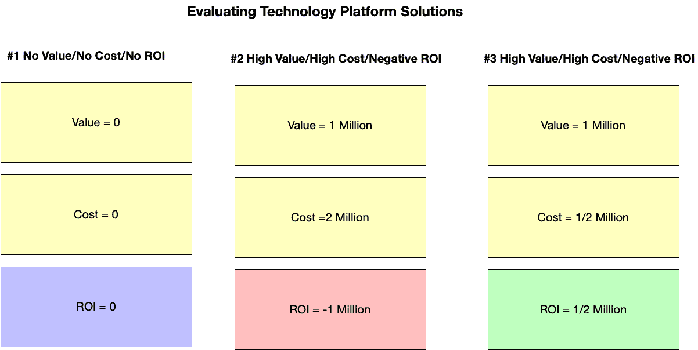

The big takeaway is that cost alone shouldn’t be the driver of technology platform solutions. The best choice isn’t free, but is the solution that delivers the highest ROI since this ROI increases the velocity of the profitable enterprise. Let’s expand on the concept of ROI even more by digging into bespoke solutions, which in some sense are also “free” since an employee built the solution.

在 图 1-2 中，一位真正出色的工程师说服管理层允许他们为财富 100 强公司构建一个定制系统来解决特定问题。尽管有些人持怀疑态度，工程师不仅交付迅速，而且系统超出预期。很容易认为这是个成功故事，但实际上这是一个失败的故事。一年后，这位出色的工程师收到了一家万亿美元公司的工作机会并离开。大约三个月后，系统崩溃，没有人足够聪明来修复它。公司不情愿地更换了整个系统，并对公司进行了新专有系统的再培训。

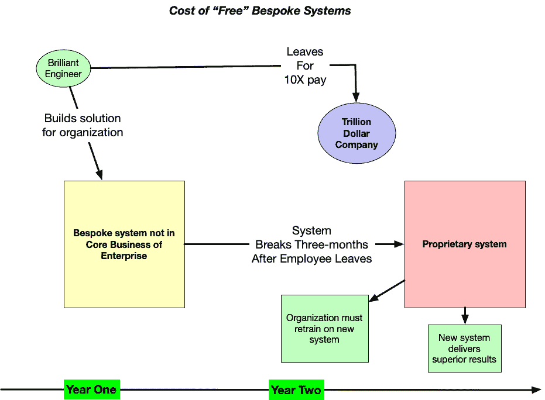

组织最终的成本是使用更优系统一年所带来的动量缺失，以及从旧系统切换到新系统所需的培训时间。一个具有正 ROI 的“免费”解决方案对组织而言可能具有长期负 ROI。这一场景不仅并非假设，而且你可能自己见过它^(2)。

在《Fooled by Randomness: The Hidden Role of Chance in Life and the Markets》（Random House, 2008）一书中，作者纳西姆·塔勒布提到，“如果失败的成本过于高昂，成功发生的频率就无关紧要。”这一论断直接适用于想要实施 MLOps 的成功企业。承担正确类型的战略风险至关重要。在以下章节，让我们更详细地讨论风险的概念。

## 对企业中风险与不确定性的理解

并非所有风险都相同，正如并非所有不确定性都相同。与初创公司不同，企业已经进入了生存阶段。有些风险是企业无需承担的。在一本关于企业的书中，*从优秀到卓越 (Harper Business, 2011)*，吉姆·柯林斯问道，“优秀到伟大的组织如何以不同的方式思考技术？”他发现，在每一个“优秀到伟大”的公司案例中，他们都具备技术精熟度并成为应用技术的先驱。此外，他指出技术是动量的加速器，而非创造者。

### 备注

马克·斯皮茨纳格尔在《Safe Haven》（Wiley, 2021）一书中主张在金融投资中考虑几何平均值。他指出，“利润是有限的。风险是无限的”。在投资时，你可能损失的财富百分比比你可能损失的财富绝对值更重要。这一事实非常适合企业。为什么要承担无界损失的风险？

柯林斯关于技术的关键观点直接适用于企业中的 MLOps。机器学习的目的是加速已有的业务价值。使用机器学习的原因不是将组织转变为与专门从事研究的公司竞争的机器学习研究人员；它是通过技术加速组织的战略优势。

以业务加速器形式采用机器学习的计算风险是可以接受的，如果这样做能让组织限制技术变更管理的负面影响。当其核心优势在于制造业、酒店业或金融服务等其他行业时，公司创建定制机器学习解决方案和平台几乎存在无界风险。

企业加速技术发展的选择很多，包括使用预训练模型如 [Hugging Face](https://huggingface.co) 或 [TensorFlow Hub](https://tfhub.dev)、[类似 AWS Rekognition 的计算机视觉 API](https://aws.amazon.com/rekognition/)，或开源 AutoML 解决方案如 [Ludwig](https://ludwig-ai.github.io/ludwig-docs/0.5/) 或 MLOps 编排框架如 [MLRun](https://www.mlrun.org/)。采用使用合适抽象层级的方法实施 MLOps 的企业，相对于那些“雇佣了 15 名数据科学家”做“研究”的组织，获得了“优秀到伟大”的优势。在后者示例中，通常情况是经过数年的研究，在最好的情况下什么也没做，而在最坏的情况下，糟糕的解决方案造成的后果比什么都不做更糟。

来自芝加哥大学的教授弗兰克·奈特清楚地 [清晰阐述差异](https://archive.org/details/riskuncertaintyp00knigrich) 了风险与不确定性之间的区别。他进一步指出，承担已知风险的回报与风险不可衡量且无法计算的情况大不相同。这种形式的风险在弗兰克·奈特之后被称为 *奈特不确定性*。从事机器学习的企业应深入考虑自己承担的是哪种风险，是可知的常规风险，还是踏上了具有奈特不确定性的道路。在几乎所有情况下，在机器学习和人工智能中承担可知风险更好，因为技术不是增长的创造者；相反，它是加速器。

认识到加速是使用技术的伟大公司的关键洞见，让我们来看一下 MLOps 与 DevOps 之间技术加速差异的一些区别。

## MLOps 与 DevOps

没有 DevOps，就无法做 MLOps。DevOps 是实施 MLOps 的基础构建块，没有替代品。DevOps 是一种在不断提高业务成果和软件本身质量的同时以敏捷方式发布软件的方法论。高水平的 DevOps 从业者与大师级美食厨师有很多共同之处。厨师对食材有深入的了解，并有多年的实践经验来制作精美美味的餐点，并且能够以工业化和可重复的方式制作这些餐点。可重复性使餐厅能够保持开放并赚取利润。

同样，在 DevOps 中，领域专家对如何以高质量和可重复的方式构建软件并部署它有详细的了解。数据科学专家向 MLOps 过渡的最大挑战之一是缺乏 DevOps 经验。经验无可替代；许多数据科学从业者和机器学习研究人员应获得使用 DevOps 方法论构建和部署软件的经验，以获得成为 MLOps 专家所需的奠基性知识和经验。

### 备注

你可以在书 *Python for DevOps (O’Reilly, 2019)* 中了解更多关于 DevOps 的信息，也可在 [O’Reilly 平台](https://learning.oreilly.com/library/view/python-for-devops/9781492057680/) 上获取。

尽管如此，传统 DevOps 与 MLOps 之间存在明显差异。一个明显的差异是 *数据漂移* 的概念；当模型在数据上训练时，随着底层数据变化，它会逐渐失去用处。这一概念的一个极好的理论示例来自纳西姆·塔勒布在书 *Fooled by Randomness, Random House, 2001* 中，他描述了 图 1-3 中所示的“淘气孩子”如何破坏对容器中红球与黑球底层分布的理解。

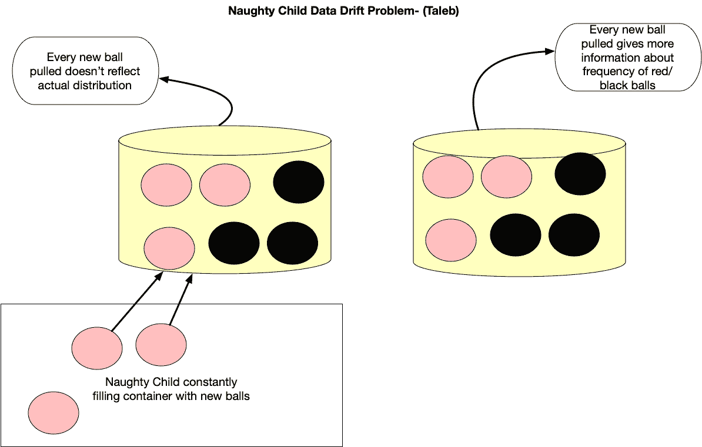

在静态条件下，从容器中取出球越多，人们对红球与黑球底层分布的信心就越强。在动态条件下，如果球不断被更换，则在旧数据版本上训练的模型将不准确。这一示例有效地捕捉了 MLOps 特有的众多独特元素之一，而 DevOps 中没有这些元素。

### 备注

Microsoft [指出](https://docs.microsoft.com/en-us/azure/machine-learning/how-to-monitor-datasets?tabs=python#what-is-data-drift)，“数据漂移是模型准确性随时间下降的头号原因之一。”

The takeaway is that DevOps is a necessary foundation for MLOPs, but MLOps’ additional requirements, like data drift, don’t appear in traditional DevOps.

# MLOps 不是什么？
一种更了解 MLOps 的方法是定义它不是什么。以下是一些常见的 MLOps 反模式：
* 雇佣一支数据科学团队然后寄予厚望：也许最常见的 MLOps 反模式就是雇佣一支数据科学团队并期望优秀的解决方案自动出现。如果没有理解 MLOps 的组织支持以及支持他们的技术基础设施，就不会有理想的结果。
* 只构建定制化的机器学习解决方案：只构建定制化解决方案的一个根本问题是它们可能对组织的业务目标并非必要。对自动驾驶公司专有数据训练定制的机器学习模型对于竞争优势至关重要。对财富 500 强配送公司训练类似模型可能是一项耗费成本的实验，对业务没有任何实际价值。
* 忽视 DevOps 的重要性：各自为政的团队并未遵循 DevOps 的最佳实践。让数据科学团队例如在“德克萨斯州”用 `R` 构建模型，然后“扔给”旧金山金融区 DevOps 团队用 `Python` 放入软件栈中，是不切实际的。

总之，MLOps 需要以业务和生产为先的心态。机器学习的目的是加速业务价值。这一事实意味着构建解决方案的团队在解决机器学习问题的方法上必须具有敏捷性。

# MLOps 的主流定义
技术领域的一个挑战性问题是将营销策略与技术策略区分开来。就 MLOps 而言，它不是营销策略；它是企业中一个严重问题的具体解决方案。归根结底，模型并未进入生产环境；如果进入了，它们也很脆弱，面对现实世界的复杂性时会崩溃。各种调查显示，50-70% 的组织未能将 AI 试点或模型交付到 [生产环境](https://services.google.com/fh/files/misc/practitioners_guide_to_mlops_whitepaper.pd)。

在确定了问题之后，让我们找到解决办法。解决办法需要解决以下关键问题（其中包括）：
* 模型部署和开发时间
* 不同团队之间的协作
* ML 系统的运营卓越性
* 数据治理
* 提升部署模型的企业的投资回报率。

一种极简的方式来定义 MLOps 是：它支持机器学习开发，就像 DevOps 支持软件开发一样。

## 什么是 ML 工程
一种定义 ML 工程的方法是查看流行的认证。[Google 机器学习工程师](https://cloud.google.com/certification/machine-learning-engineer) 解释了专业机器学习工程师的以下标准：
* 构建 ML 问题：[选择哪个模型](https://developers.google.com/machine-learning/problem-framing/ml-framing?hl=en) 取决于业务约束和上下文。例如，一家企业可能会决定对损坏的发货箱与成功交付的包裹进行分类。在这种情况下，分类模型比回归模型更合适。
* 设计 ML 解决方案：ML 工程师与其他团队成员一起开发解决方案，利用机器学习解决正确构建的问题。
* 设计数据准备和处理系统：数据准备和处理中的两个 [关键步骤](https://developers.google.com/machine-learning/data-prep) 是构建数据集然后转换数据。
* 开发 ML 模型：[详细建模过程](https://developers.google.com/machine-learning/problem-framing/implement-model?hl=en) 涉及团队或个人创建适合初始模型构建的模型。
* 自动化和编排 ML 管道：[管道](https://developers.google.com/machine-learning/guides/rules-of-ml#ml_phase_i_your_first_pipeline) 用于创建可重复且可维护的 ML 流程。
* 监控、优化和维护：在构建复杂系统时，主动优于被动。构建监控可以实现对 ML 系统维护的 [主动方法](https://developers.google.com/machine-learning/guides/rules-of-ml#monitoring)。

### 备注
几本 O’Reilly 书籍讨论了机器学习工程，包括 [*在 Google Cloud Platform 上进行数据科学*](https://learning.oreilly.com/library/view/data-science-on/9781491974551/)、[*机器学习设计模式*](https://learning.oreilly.com/library/view/machine-learning-design/9781098115777/) 和 [*实用 MLOps*](https://learning.oreilly.com/library/view/practical-mlops/9781098103002/)。

ML 工程旨在构建高质量的 ML 模型，解决特定的业务问题，同时创造投资回报率。

## MLOps 与业务激励
商学院的一个经典问题是激励。一种表达激励的方式是“谁动了我的奶酪？”这个场景指的是迷宫中的老鼠只根据奶酪所在位置移动。同样，在 MLOps 中有两个常见的激励值得讨论：不考虑投资回报率而雇佣数据科学家以及负外部性。
* 负外部性：负外部性，如一家公司通过制造获利但将有毒废物排入河流并伤害下游城镇居民，是资本主义根本问题的经典例子。在机器学习中，负外部性可能是不公平有偏见的算法，导致无辜者入狱或根据联邦保护法律（如《平等信贷机会法》，该法禁止债权人在信贷交易的任何方面基于种族、肤色、宗教、国籍等类别进行歧视）拒绝某人信贷。即使模型中无意产生的偏见仍然是非法的，即基于年龄拒绝信贷。未能着眼未来的企业如果例如系统对老年申请的偏见被意外地植入机器学习模型中，可能使自己暴露于生存风险。
* 不考虑投资回报率而雇佣数据科学家：最近流行“雇佣数据科学家”而不考虑他们解决什么问题。如前所述，这种策略最终行不通，因为大多数从事 AI 和 ML 的组织中模型并未投入生产。

# 技术与组织挑战 - 为什么大多数模型永远无法投入生产

# 云中的 MLOps
云计算有几个关键优势，MLOps 方法论利用了这些优势。首先，云是一个弹性资源，既能实现计算和存储的高效使用，又能按需扩展以满足几乎任何需求。这种能力意味着云计算可以按需访问几乎无限的资源。

其次，云具有网络效应，即云技术受益于与其他云技术的集成。一个很好的例子是 `AWS Lambda`，一种无服务器技术。`AWS Lambda` 是一项有价值的构建应用程序的服务，并非因为它单独能做什么，而是因为它与 `AWS Step Functions`、`AWS Sagemaker` 或 `AWS S3` 等其他 AWS 服务的深度集成。对于任何活跃的云平台，可以假设服务集成网络会随着平台功能的不断发展而进一步增强其能力。

第三，所有云厂商都有 MLOps 平台。AWS 拥有 [SageMaker](https://aws.amazon.com/sagemaker/studio/)。Azure 拥有 [Azure 机器学习](https://azure.microsoft.com/en-us/services/machine-learning/)，而 [Google 拥有 Vertex AI](https://cloud.google.com/vertex-ai)；即使是像阿里云这样规模较小的细分云厂商，也有类似其 [人工智能机器学习平台](https://www.alibabacloud.com/product/machine-learning) 的平台。通过使用云平台，组织很可能会使用原生 ML 平台的一些产品，并可能通过自定义解决方案和第三方解决方案对其进行增强。

第四，所有云厂商都有云开发环境。显著的趋势是使用轻量级 CloudShell 环境的组合，如 [AWS CloudShell](https://aws.amazon.com/cloudshell/)，更重的完整 IDE（交互式开发环境）选项，如 [AWS Cloud9](https://aws.amazon.com/cloud9)，以及笔记本环境，既有免费的，如 [SageMaker Studio Lab](https://aws.amazon.com/sagemaker/studio-lab/) 或 [Google Colab](https://research.google.com/colaboratory/)，也有具有丰富 IDE 集成的，如 [SageMaker Studio](https://aws.amazon.com/sagemaker/studio/)。

最后，根据公司所做的事情，它可能别无选择，只能使用云计算。对于专门构建定制深度学习解决方案的组织而言，一些云计算组件是硬性要求，因为深度学习需要大量的存储和计算能力。

除公共云厂商外，还有几家额外的厂商在云中提供 MLOps 解决方案（见本节后面）。这些厂商可以在公共云或私有云上运行。使用规模较小的厂商的优势在于此类公司为其客户提供的定制化程度。此外，MLOps 厂商将在 MLOps 方面拥有更深入的专业知识，因为这是其唯一的关注点。集成厂商通常能确保更相关的功能和更多集成。最后，通过选择对特定云提供商不敏感的厂商，您作为客户也不会与之绑定。相反，您可以在多个云或您可能拥有的额外基础设施上使用该厂商（见本节后面）。

### 注意

机器学习厂商分析的一个有帮助的资源是 AI Infrastructure Alliance（AIIA）。该组织为数据科学家和工程师提供清晰的信息和关于 AI/ML 工具的信息，以构建稳健、可扩展的端到端企业平台。一个资源是全面的 MLOps 格局，描绘了行业中的所有参与者。本文档包含一份更新的 MLOps 格局，将描绘 MLOps 的开源和企业解决方案。新的格局将涵盖多个类别和数百家公司，同时详细说明每个厂商解决方案的功能。[以下链接为](https://ai-infrastructure.org/the-new-landscape-of-machine-learning-for-the-new-year/) 现有的 AIIA 格局。

在 图 1-4 中，注意所有云中典型的模式，其中有一组云开发环境、灵活的存储系统、弹性计算系统、无服务器和容器化托管服务以及第三方厂商集成。

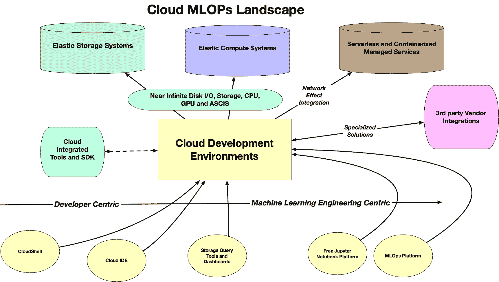

让我们将这些类别分解为更详细的说明：

* 云开发环境：通常，开发人员中心的工具如云 shell 和 IDE 在一端，机器学习中心的工具在另一端。存储查询工具如 [Google BigQuery](https://cloud.google.com/bigquery)、[Amazon Athena](https://aws.amazon.com/athena) 或 [Azure Databricks 集成](https://azure.microsoft.com/en-us/services/databricks/) 在中间。
* 在云中运行的 MLOps 平台：MLOps 平台专门为在云中或跨任何环境为企业运行 MLOps 而构建。解决方案如 [Iguazio](http://iguazio.com/)、[Valohai](https://valohai.com/)、[DataRobot](https://www.datarobot.com/)、[Azure Databricks](https://www.databricks.com/) 和 [Outerbounds](https://outerbounds.com/) 以及许多其他解决方案为企业提供各种 MLOps 解决方案。
* 弹性存储系统和弹性计算系统：深度学习系统在大数据上蓬勃发展，并且具有来自 GPU、CPU 和 AI 加速器 ASIC（专用集成电路）如 TPU（张量处理单元）的灵活计算能力。因此，原生和第三方 MLOps 平台都大量使用这种弹性能力来提供托管解决方案。
* 无服务器和容器化托管服务：云平台正朝着更多无服务器解决方案发展，如 [AWS Lambda](https://aws.amazon.com/lambda/) 或 [Google Cloud Functions](https://cloud.google.com/functions) 以及具有完全托管容器化解决方案的解决方案，如 Google [Cloud Run](https://cloud.google.com/run) 或 [AWS Fargate](https://aws.amazon.com/fargate/)。这些托管服务反过来具有深度的平台集成，这通过网络效应增强了云平台的价值主张。
* 第三方厂商集成：云平台不可能拥有恰到好处的一切组合并且质量恰到好处。去大型仓储商店会提供价格合理的各种产品。另一方面，尽管它们可能没有你喜欢的正宗美食或你需要的确切电器功能，但云提供商无法在所有方面都深入。因此，第三方集成处理这些专业或高级用例。

在涵盖了 MLOps 云计算的共同方面之后，让我们现在更详细地讨论云环境。

## 关键云开发环境

微软最好的新产品之一是 [GitHub Codespaces](https://github.com/features/codespaces)。它是一个云端开发环境，具有许多可定制功能，是练习 MLOps 的好地方。特别是，这个环境的有帮助之处在于与 GitHub 的深度集成以及能够使用专用运行时进行定制。最后，与 [GitHub Actions](https://docs.github.com/en/actions) 的协同作用提供了很好的 CI/CD 故事。

### 注意

您可以通过以下 O’Reilly 视频了解更多关于 GitHub Codespaces 的信息：

* [使用 GitHub 生态系统构建：Copilot、Codespaces 和 GitHub Actions](https://learning.oreilly.com/videos/building-with-the/10052022VIDEOPAIML/)
* [GitHub Codespaces 与自定义 dotfiles](https://learning.oreilly.com/videos/github-codespaces-and/50142VIDEOPAIML/)
* [使用 GitHub Codespaces 从头编译 Python](https://learning.oreilly.com/videos/compiling-python-from/062212022VIDEOPAIML/)
* [由 GitHub Copilot 驱动：从函数到 AWS 上微服务的持续交付的 Python DevOps](https://learning.oreilly.com/videos/github-copilot-driven/10182022VIDEOPAIML/)
* [GitHub Codespaces 课程](https://learning.oreilly.com/videos/github-codespaces-course/27724023VIDEOPAIML/)

Google 提供三种不同的云端开发方式。第一个是 [Colab 笔记本](https://colab.research.google.com)，第二个是 [Google Cloud Shell](https://cloud.google.com/shell)，第三个是 [Google Cloud Shell 编辑器](https://cloud.google.com/shell/docs/editor-overview)。

在 图 1-5 中，GCP 可用完整的编辑器。

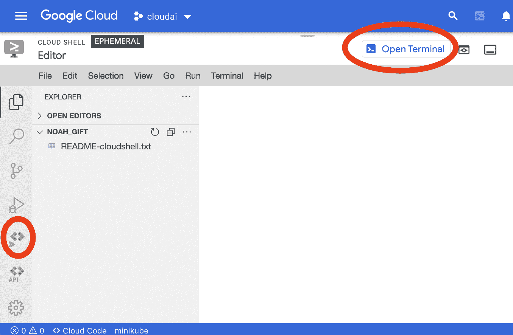

在 图 1-6 中，API 文档与开发环境集成。

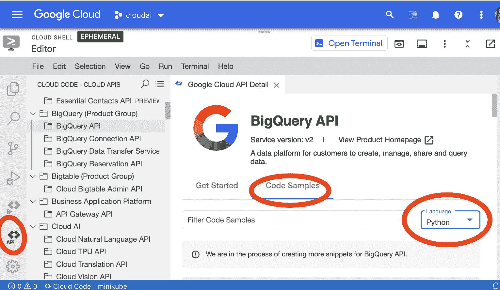

在 图 1-7 中，终端显示了使用云 shell 体验的标准视图。

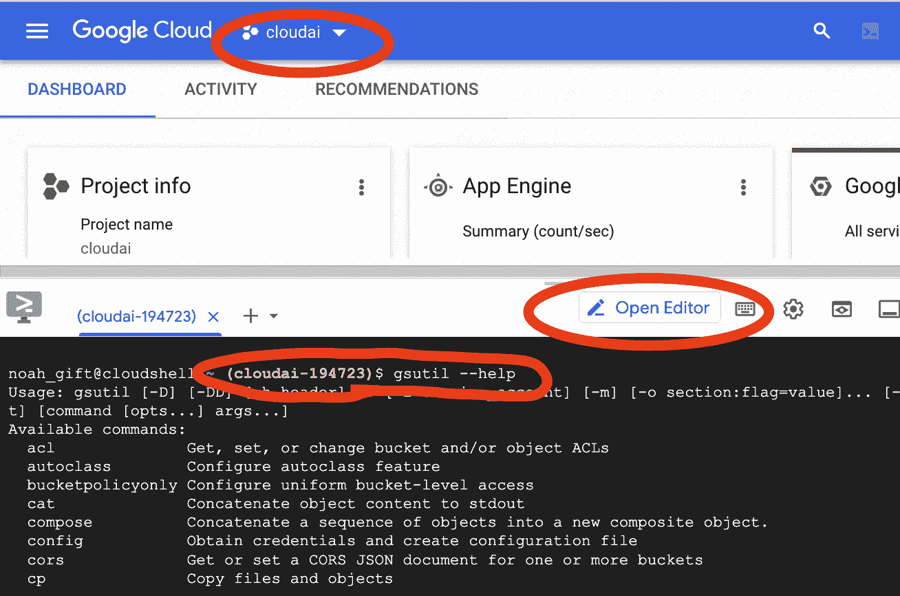

### 注意

你可以通过以下 O’Reilly 视频了解更多关于 Colab 笔记本的信息：

* [使用 Python 在第一天进行数据科学](https://learning.oreilly.com/videos/data-science-on/01222022VIDEOPAIML/)
* [Python 数据科学：使用 Colab 和 Pandas 的一小时视频课程](https://learning.oreilly.com/videos/python-for-data/62062021VIDEOPAIML/)

[什么是 Google Colab Notebooks，以及如何为数据科学项目共享它们？](https://learning.oreilly.com/videos/what-is-google/01142022VIDEOPAIML/)

最后，AWS 平台具有云 shell 环境，如 图 1-8 所示。

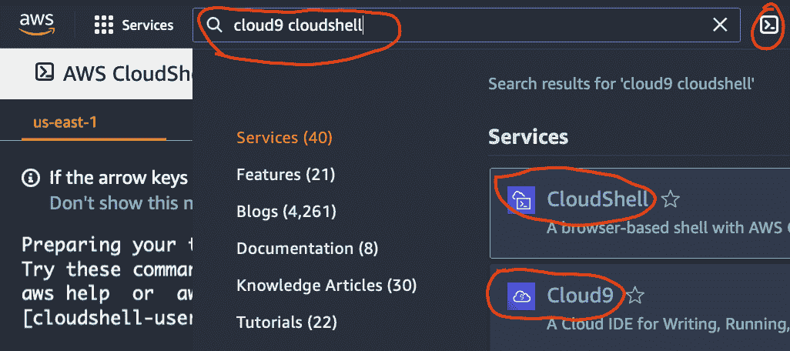

**Note**
同时学习多个云的一种快速方法是设置多云持续集成。你可以通过 [本 O’Reilly 视频中的 GitHub Actions](https://learning.oreilly.com/videos/github-actions-hello/011812022VIDEOPAIML/) 学习如何设置。

所有这些都引出了云开发者工作区优势的概念，如 图 1-9 所示。笔记本电脑或工作站由于预装软件而昂贵且不确定，并且按定义不是部署目标。当你查看基于云的工作区时，它具有许多不可思议的优势，包括强大、可丢弃性、预加载以及与高级工具的深度集成。

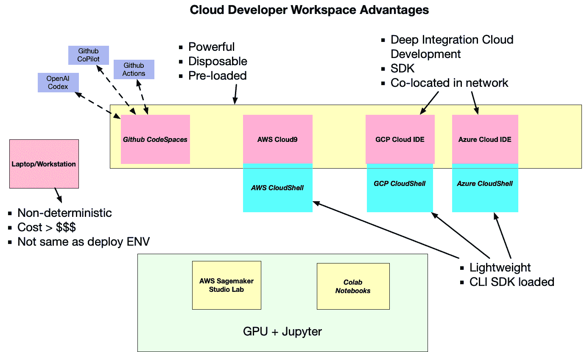

**Note**
你可以在以下 O’Reilly 视频 [云开发者工作区优势](https://learning.oreilly.com/videos/52-weeks-of/080232022VIDEOPAIML/080232022VIDEOPAIML-c1_s4/) 或 [YouTube](https://www.youtube.com/watch?v=5gw30mFmDzc) 上了解更多关于云开发者工作区优势的信息。

## 云计算的关键参与者

想认识一个年薪 20 万美元或以上的人吗？根据 O’Reilly 的 Mike Louikides 所做的 [2022 云薪资调查](https://get.oreilly.com/rs/107-FMS-070/images/2022-Cloud-Salary-Survey.pdf?mkt_tok=MTA3LUZNUy0wNzAAAAGF3zSlFTeLd278VcGMchi3YXTWozijVa0a0VMJOLv2wKHAC_ymMLgXwgqNFr1g8Rd-QAtOlsehKlghdBQHO5f_tC0SEwwEbDO1o2dO-5N7uoGflw) ，在 AWS、Azure 和 GCP 上获得认证的专业人员的平均薪资超过 20 万美元。

Statista 的数据进一步证实了这一点，如 图 1-10 所示。截至 2021 年第四季度，全球市场上有三个关键参与者。AWS 约占市场份额的 33%，Azure 约占 21%，Google Cloud 约占 10%。这三家供应商合计占市场份额的 2/3，该市场产生的收入接近 2000 亿美元。服务收入较上一年增长了 37%。

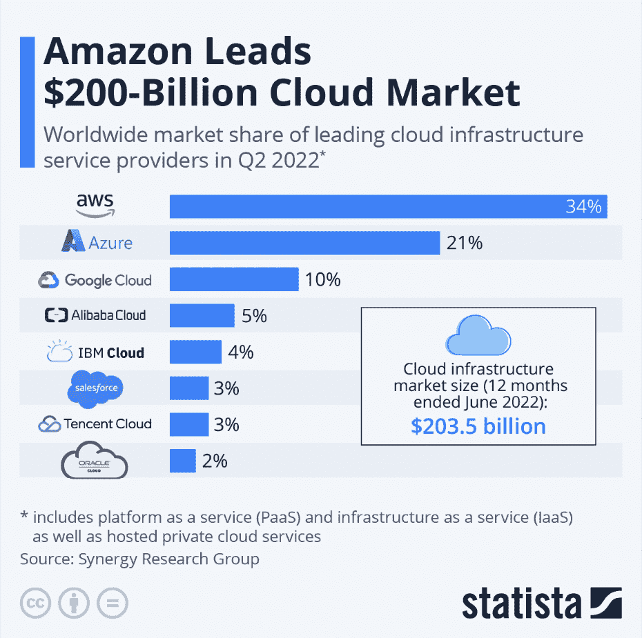

对于希望使用云计算的组织来说，使用最大提供商的平台是一个合理的策略。马太^(3) 效应说，“富者愈富，贫者愈贫”，由于以下几个原因适用于云计算。

* 可聘用的员工和供应商：利用最突出的云平台使招聘员工和寻找与平台合作的供应商变得更加容易。
* 可用的培训材料：最突出平台的培训材料的可用性使培训员工变得更容易。
* 可用的服务：更大的平台可以雇用更多软件工程师和产品经理，这意味着你可以指望其平台持续提供新功能和维护。
* 服务成本：规模经济意味着最重要的提供商从规模经济中获益最多。他们可以通过批量采购获得价格优势，然后将其传递给客户。

**Note**
你可以通过在 O’Reilly 平台上观看 [AWS 解决方案架构师专业课程](https://learning.oreilly.com/videos/aws-solutions-architect/021222022VIDEOPAIML/) 和 [AWS 认证云从业者视频课程](https://learning.oreilly.com/videos/aws-certified-cloud/60644VIDEOPAIML) 来学习 AWS 云认证，这些课程由 [Noah Gift](https://www.oreilly.com/pub/au/3039) 撰写。

现在云计算的顶级提供商已经确定，让我们讨论每个供应商如何看待云计算与 MLOps 的关系。

### AWS 对与 MLOps 相关的云计算的看法

获取 AWS 云计算高层概述的最佳位置是 [Amazon Web Services AWS 白皮书概述](https://docs.aws.amazon.com/whitepapers/latest/aws-overview)。特别是，他们提到了 [云计算的六大优势](https://docs.aws.amazon.com/whitepapers/latest/aws-overview/six-advantages-of-cloud-computing.xhtml)。

**Note**
你可以在 O’Reilly 书籍《使用 C# 在 AWS 上开发（O’Reilly 2022）》中了解更多关于 AWS 的信息，该书也可在 [O’Reilly 平台](https://learning.oreilly.com/library/view/developing-on-aws/9781492095866/) 上获得。

* 将固定支出转为可变支出：通过避免大额资本支出，它鼓励敏捷性和效率。
* 受益于巨大的规模经济：随着供应商的价格下降，客户的价格也会下降，从而实现比客户自行购买相同产品更低的价格。同样，平台上的托管服务将拥有稳定的新功能发布计划。
* 停止猜测容量：由于系统构建时具有按需扩展的弹性能力，因此无需预先配置资源。
* 提高速度和敏捷性：专注于组织的比较优势，而不是构建非业务必需的 IT，可以让组织更快地行动。
* 停止花费资金运行和维护数据中心：通过外包 IT 的这一部分，成本节约会累积。
* 分分钟实现全球化：由于其全面的产品，借助 AWS，实现全球化这一极具挑战性的问题迎刃而解。

这些功能最终推动了 Amazon SageMaker 的核心 MLOps 方案，如 图 1-11 所示，项目的生命周期从准备到构建再到训练，最后部署和管理解决方案。工作流的中心是与 Studio 和 RStudio 开发工具的紧密集成。

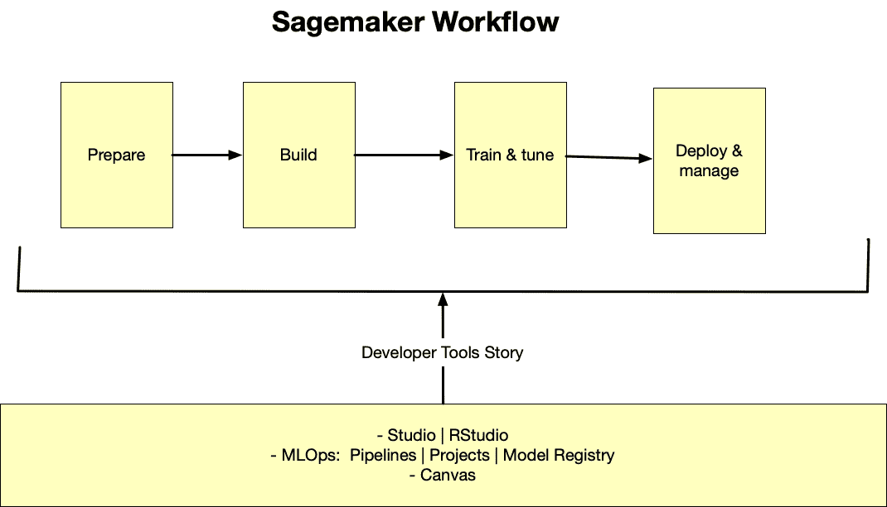

**Note**
在 O’Reilly 平台视频上，你可以观看 SageMaker Studio Lab 的完整演练 [Sagemaker Studio Lab](https://learning.oreilly.com/videos/aws-sagemaker-studio/12162021VIDEOPAIML/)。

AWS 对 MLOps 的看法完成后，让我们接下来看看 Azure。

### Azure 对与 MLOps 相关的云计算的看法

Microsoft Azure [将 MLOps 的世界视为](https://docs.microsoft.com/en-us/learn/paths/introduction-machine-learn-operations/) 一种“从概念验证或试点项目高效扩展到生产环境中的机器学习工作负载”的方式。在 图 1-12 中，模型的生命周期从训练、打包、验证、部署、监控到再训练。

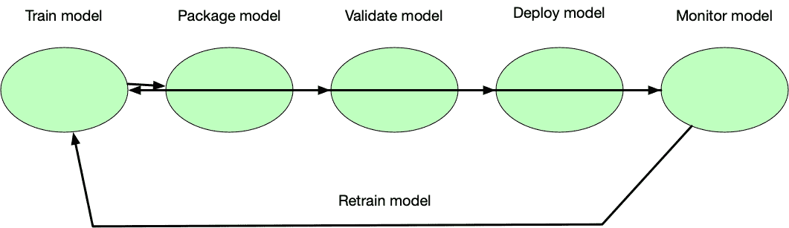

Azure 对 MLOps 的看法介绍完毕，让我们接下来看看 Google 如何看待 MLOps。

### GCP 对与 MLOps 相关的云计算的看法

了解 Google 如何看待世界的一个理想场所是通过查看 [生产机器学习系统速成课程](https://developers.google.com/machine-learning/crash-course/production-ml-systems)。公司指出的项目之一是实际建模部分在 图 1-13 中有多么微小，相反，包括数据收集、服务基础设施和监控在内的其他任务的组合占据了更多的问题空间。

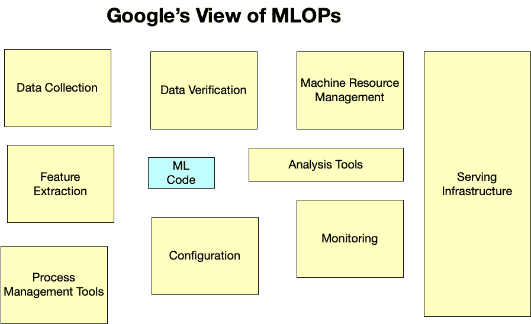

最终这引出了 Google 的 [Vertex AI 平台](https://cloud.google.com/vertex-ai) 如何处理 图 1-14 中的 MLOps 工作流：ML 开发流程发生，包括针对业务问题的模型构建。数据处理阶段导致可按需扩展的操作化训练流程。然后进行模型部署，同时进行工作流编排以及制品组织。模型监控已集成到部署流程中。

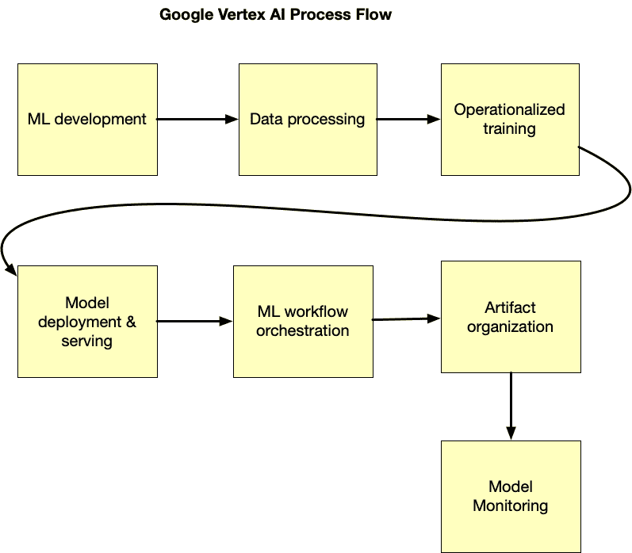

虽然公有云提供商提供自己的解决方案，但有时企业可能需要更符合其特定需求的解决方案。让我们来看另外两种部署选项：本地部署和混合云部署。

# MLOps 本地部署

在某些用例中，企业无法使用公有云。诸如需要保护敏感数据或必须遵守严格法规（例如数据本地化隐私法规）等业务限制，要求 MLOps 解决方案能够在本地运行。许多 MLOps 解决方案都提供在云中或本地部署的能力。这种方法唯一的缺点是，本地解决方案要求企业提供服务器和设备，以支持大规模运行 ML 算法所需的强大计算能力。他们还需更新和维护基础设施。

另一方面，本地部署几乎肯定需要某种定制。这种安装使企业对产品有更多控制权，并且可以提出具体要求以使其符合自身需求。更具体地说，如果部署的解决方案是初创公司提供的解决方案，他们会很用心并努力工作以确保满意度和采用率。如果是开源产品，那么企业不仅可以利用社区的开发力量，还可以让自己的开发人员深入内部，对产品进行调整以确保其符合需求。

# MLOps 混合环境

与本地部署类似，一些企业可能更喜欢混合云部署。这将涉及在公有云、本地部署，甚至在私有云或边缘设备上部署。自然而然，这会使事情变得复杂得多，因为 MLOps 解决方案必须实现数据路径与控制路径的完全分离，并且必须由一个高度可用、可扩展的实体提供，该实体在不同类型的<|message|> 基础设施部署中编排、跟踪和管理 ML 流水线。别忘了，这必须以高速和最佳性能进行。最后，该解决方案理想情况下应为所有基础设施类型的工程师提供单一的开发和部署栈。

找到能够满足所有这些要求的供应商或开源解决方案可能并不简单，但正如前面提到的，你最好的选择可能是在可以定制以满足基础设施特定需求的初创公司或成熟的 OSS 解决方案。

# 企业 MLOps 策略

在对 MLOps 涉及的关键问题进行了高层次概述后，是时候转向策略了，如 图 1-15 所示。实施 MLOps 策略时需要考虑的四个关键类别是：云、培训与人才、供应商以及高管对投资回报率的关注。

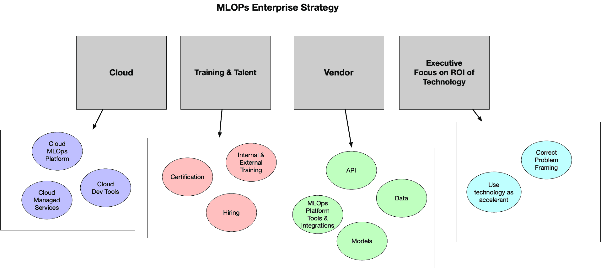

让我们讨论这四个类别中的每一个：

*   云：没有完美的答案来选择使用哪种云平台。任何中央平台都会提供规模经济的优势。MLOps 策略中至关重要的是，要意识到云平台如何契合每个特定组织的独特目标，以及它如何与招聘或第三方供应商集成等其他战略要素保持一致。

*   培训与人才：通常，组织只关注新技术的强大功能，而不考虑使用该技术的培训和人才要素。在几乎所有情况下，如果使用较弱的解决方案招聘和培训效果更好，组织应使用较弱的技术。这一事实意味着在实施新技术时，技术普及至关重要。最终，如果你无法招聘或培训员工，最新技术将一到就死。

*   供应商：使用云计算时常被忽视的一个问题是，它通常需要由专业供应商增强，以帮助组织实现技术目标。这些战略选择可以为云和业务战略带来更好的投资回报率。示例包括使用专门从事 Hadoop、Kubernetes 或预训练模型的供应商技术。供应商将因每个组织及其业务目标而异。

### 注意

在本書的采访中，Outerbounds 的首席执行官兼 Metaflow 作者 Ville Tuulos 提到，虽然所有公司都使用云的基础层，例如存储和数据库，但它们通常可能需要在更高层使用供应商进行增强：[企业 MLOps 面谈](https://learning.oreilly.com/videos/enterprise-mlops-interviews/08012022VIDEOPAIML/)

*   高管对投资回报率的关注：最终，如果高管关注点不在投资回报率上，前述三个类别就毫无意义。技术的目的在于推动长期业务价值，这意味着问题需要准确界定范围。

# 结论

本章为理解企业将机器学习和人工智能投入生产所面临的危机奠定了基础。从常识角度来看，“仅仅雇佣更多数据科学家”来提高投资回报率的想法，与“仅仅雇佣更多软件工程师”来加快传统软件项目一样合理。在传统软件公司的情况下，如果没有产品、没有目标、没有监督，那么雇佣更多开发人员只会增加组织的资本支出，而没有任何附加价值。

与此场景不同，MLOps 旨在增加一种方法论，该方法论在处理机器学习独特特征的同时，借鉴了 DevOps 的成功经验。最后，在企业层面，最终归结为数据科学的投资回报率。对大多数组织而言，技术是价值的加速器，而非价值本身。创造对投资回报率渴望的组织可以迅速采用 MLOps 思维。

# 批判性思考讨论问题

*   有许多方法可以将机器学习模型部署到生产环境中，包括预训练模型、API、AutoML 和定制训练。这些方法的优缺点是什么？

*   企业可以实施哪些策略来吸引新的机器学习工程人才并对现有人才进行培训和再培训？

*   如果你的组织目前不做任何 DevOps，而 DevOps 是 MLOps 所需的基础组件，他们如何启动第一个 DevOps 项目来测试 CI/CD 和 IaC 等概念？

*   如果你的组织没有大量专有数据，它如何仍然利用机器学习获得竞争优势？

*   你组织的云策略是什么：单一云、多云、混合云、私有云或其他？这如何帮助你的组织实现 MLOps 目标？

# 练习

*   前往像 [TensorFlow Hub](https://www.tensorflow.org/hub) 或 [Hugging Face](https://huggingface.co/) 这样的热门模型托管站点，并将其中一个模型部署到你喜欢的云平台。

*   选择一个基于云的开发环境，如 [Github CodeSpaces](https://github.com/features/codespaces)、[Amazon SageMaker Studio Lab](https://aws.amazon.com/sagemaker/studio-lab/) 或 [Google Colab](https://colab.research.google.com/)，并以构建机器学习工程项目为目标探索其界面。

*   使用像 [Gradio](https://gradio.app/) 或 [Streamlit](https://streamlit.io/) 这样的机器学习应用框架来构建一个简单的机器学习应用程序。

*   头脑风暴可能受益于使用机器学习的几个组织问题，并使用 MLOps 技术构建一个简单的原型。
*   通过下载数据集并使用 MLOps 技术对预测进行编码，将 Kaggle 项目转换为 MLOps 项目。

^(1) Dr. Luks 总结了系统性的循证策略：“创造热量赤字，然后保持精瘦。保证睡眠。吃真正的食物。整天经常活动。推拉重物。社交。拥有目标感。”
^(2) 在书籍 *Principles of Macroeconomics (McGraw Hill, 2009)* 中，作者分享了这样一个故事：一位才华横溢的厨师在完全竞争的情景下能够从餐厅中获取全部利润，因为他们会不断跳槽到竞争对手那里以获得更高的薪水，从而最终使业主的利润全部消失。
^(3) 社会学家 Robert K. Merton 和 Harriet Zuckerman [首次提出](http://garfield.library.upenn.edu/merton/matthewii.pdf) 这一术语。
