# 第 2 章. MLOps 的阶段

MLOps 不是关于跟踪本地实验，也不是关于将 ML 模型部署在 API 端点之后。相反，MLOps 是关于构建自动化环境和流程，以持续将 ML 项目交付到生产环境。

MLOps 由四个主要组件组成（并且不限于模型训练）：
*   数据收集和准备
*   模型开发和训练
*   ML 服务部署
*   持续反馈和监控

本章详细探讨了这些组件。

## 开始入门

牢记最终目标 - 任何 ML 项目的第一步是明确：
1) 需要使用 ML 解决的问题。
2) 你想要预测的内容。
3) 如何从答案中提取业务价值。我们可能需要的业务价值示例包括减少欺诈、通过吸引新客户增加收入、通过自动化各种手动流程削减运营成本等等。

一旦你定义了目标，不要直接进入实施阶段。首先考虑以下几点：
*   哪些历史和运营数据可以在训练和 [服务](https://www.iguazio.com/glossary/model-serving/) 流水线中同时收集和使用。
*   如何以产生影响的方式将 ML 模型结果纳入新应用或现有应用中。
*   如何验证并可靠地衡量 ML 模型是否达到目标并产生有价值的业务成果。

图 2-1 说明了 ML 项目中的不同阶段。请注意反馈循环，其中观察结果用于重新校准业务目标、数据收集和准备逻辑。

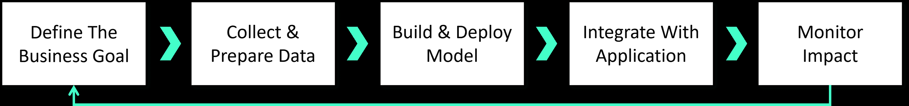

如果你只关注 ML 模型，你可能会遇到以下陷阱：
*   使用错误的数据集，这很容易导致不准确或有偏的结果。
*   缺乏构建模型所需的足够标注数据。
*   发现用于训练模型的<|message|> 历史特征在生产或实时环境中不可用。
*   发现没有切实可行的方法将模型预测集成到当前应用中。
*   意识到 ML 项目成本高于产生的价值，或者在最坏的情况下，导致收入或客户满意度损失。

### 选择你的算法

下一阶段是确定 ML 问题和算法的类型。

在监督学习中，需要且已知标签：

**Classification**
: 
该算法将回答二元的是/否问题（是否欺诈、是否是苹果、客户是否流失）或进行多类分类（树木类型等等）。你还需要为算法学习提供足够的有标签数据。

**Regression**
: 
该算法基于各种自变量预测连续数值。例如，回归算法可以帮助估算股票的合适价格、组件的预期寿命、温度等等。

图 2-2 对比了这两种算法。

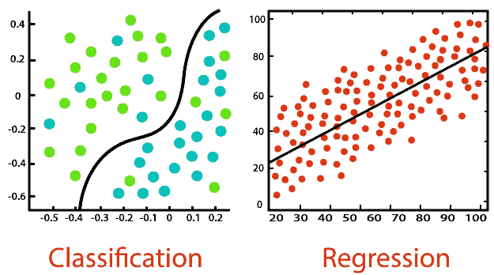

在无监督学习中，标签不是必需且未知：

**Clustering**
: 
该算法将基于相似性在数据中寻找有意义的组或集合（客户细分、医学影像、音乐流派、异常检测等等），而无需预先标注数据的帮助。

**Dimensionality reduction**
: 
该算法将 *dimensionality*（数据集中输入变量的数量）从高维空间减少到低维空间，使得低维表示保留原始数据的一些有意义的属性，理想情况下接近其内在维度。降维允许你避免过拟合，减少模型计算开销，并处理比原来所需更少的特征。

**Recommendation and ranking**
: 
该算法通过考虑其相关性、重要性和内容分数来推荐或对对象进行排序。推荐算法可用于对网页进行排名、在流媒体服务中推荐电影或音乐，或根据客户之前的搜索和购买活动显示客户很可能购买的产品。推荐引擎可用于监督学习或无监督学习。

请注意，排名算法依赖于用户提供的搜索查询，用户知道自己在寻找什么。另一方面，推荐系统在没有用户明确输入的情况下运行，旨在发现用户否则可能找不到的东西。

某些应用可能结合多种算法。例如，使用 NLP 算法确定文本中的情感，并将情感作为做出购买决策的输入。

### 设计你的流水线

ML 模型具有有限的生命周期，因为数据模式会随时间变化（[漂移](https://www.iguazio.com/glossary/concept-drift/)），并且模型可能具有有限的范围。例如，为每个用户或设备创建特定模型（在相关数据子集上训练）。在许多情况下，我们希望使用不同的参数或算法训练多个模型并进行比较或组合。

出于这些原因，目标 *不是* 构建模型，而是创建自动化的 [ML 流水线](https://www.iguazio.com/glossary/machine-learning-pipeline/)（工厂），它可以接受输入（代码、数据和参数），生成高质量的模型产物，并在应用流水线中部署它们。

ML 流水线可以在数据、代码或参数每次发生变化时触发，或可以在循环中执行（每次使用不同的数据集或参数）以生成多个模型。为了理解、比较或解释模型结果，所有输入（代码、数据、参数）、运营数据（硬件类型、日志等等）和结果必须被记录并版本化。

模型通常作为更广泛的应用流水线的一部分部署，其中包括 API 集成、实时数据丰富和准备、模型服务、操作和监控。自动化部署不能仅关注模型，而应关注部署或更新整个应用流水线。

典型的 ML 流水线包括数据准备、训练、测试、注册和部署。在现实生活中，ML 流水线可以加入数据验证、优化等额外步骤。此外，一些 ML 流水线构建并使用多个模型。


图 2-3 演示了一个使用级联两个模型的推荐引擎应用。第一个模型用于识别相似产品。第二个模型将使用第一个模型的输出和其他用户数据来确定购买概率（并过滤结果）。

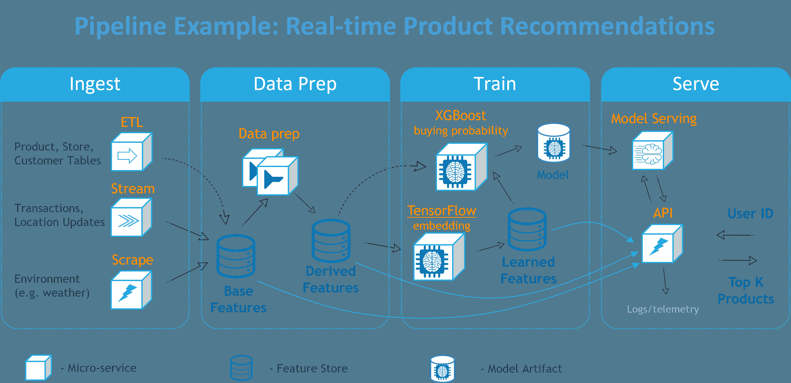

# 数据收集与准备

没有数据就没有机器学习。在其他任何事情之前，机器学习团队需要访问来自多个来源的历史或在线数据。在构建任何模型之前，他们必须摄取、准备和探索数据。

第一步是定义你的目标，即你打算解决什么问题或挑战，以及哪些数据源或特征可以帮助你预测结果。一旦确定目标和原始数据集，你必须收集足够的数据，对其进行准备、标注并探索，以便在模型中使用。

在大多数情况下，原始数据不能直接用于机器学习算法，原因各异，包括以下几点：

* 数据质量低（缺少字段、拼写错误、空值等），需要清洗和插补。
* 数据需要分组或聚合以使其有意义。
* 数据需要转换为算法可以处理的数值或类别值。
* 特征值应进行归一化和缩放，以确保它们具有同等重要性。
* 数据已编码或需要与参考信息进行连接。

根据 IDC 的预测，到 2025 年，80% 的数据将是[非结构化](https://www.delltechnologies.com/asset/en-th/products/storage/industry-market/h18811-wp-idc-new-unstructured-storage-requirements-for-enterprises.pdf)，因此构建运营数据管道的一个重要部分是将非结构化文本、音频和视觉数据转换为机器学习或[深度学习](https://www.iguazio.com/glossary/deep-learning-pipelines/)\-友好的数据组织或向量格式。

机器学习流程始于对历史数据的小规模抽取进行手动探索性数据分析和[特征工程](https://www.iguazio.com/glossary/feature-engineering/)。然而，要将准确的模型投入生产，机器学习和数据工程团队必须在更大、更新的数据集上工作，并自动化收集和准备流程。此外，批处理收集和准备方法以及批处理分析不适用于运营或[实时](https://www.iguazio.com/glossary/real-time-ml/)管道。因此，机器学习团队通常会构建单独的 `real-time data pipelines`（在实时情况下以规模处理大量事件的管道），这些管道使用 `stream processing`（连续数据流的摄取和处理）。一些厂商提供数据标注即服务，结合自动化工具和众包（例如 [Amazon SageMaker Ground Truth](https://aws.amazon.com/sagemaker/data-labeling)）。许多算法需要标注数据来[训练](https://www.iguazio.com/glossary/model-training/)模型。因此，你必须在数据准备流程中设计并实现历史数据的标注解决方案。

此外，许多应用需要持续重新训练以保持模型的准确性和相关性。因此，在这种情况下，你应设计一个自动生成数据标签的管道。

模型的好坏取决于训练数据的质量。为了比较或解释模型行为并满足监管合规要求，你必须能够访问训练中使用的数据。因此，你必须将数据来源信息与模型一起保存，或为每次训练运行保存数据集的唯一副本。数据血缘和版本控制解决方案是每个 MLOps 解决方案的必备条件。

任何现代 MLOps 解决方案中的关键方案都是[特征存储](https://www.iguazio.com/feature-store/)，它可自动化离线和在线数据的收集、转换、编目、版本控制和服务。

## 数据存储与摄取

数据是人工智能和机器学习的基础。它可以是持久的或在传输中，可分为两大类：结构化和非结构化。`Unstructured` 数据通常存储在文件系统、对象存储（数据湖）、日志或消息系统（如电子邮件）中。`Structured` 数据具有某种模式，并存储在表、文档或图结构中。

由于可扩展且成本效益高，我们通常使用对象存储来处理图像、视频和文本（NLP）的深度学习工作负载。在某些情况下，我们会使用本地或分布式文件存储。

当数据为结构化时，我们可以使用文件（CSV、Excel 等）进行简单探索和模型训练，但这无法扩展到生产环境。在生产环境中，我们将数据存储在以下两类之一：

* 归档数据系统：这些是数据仓库或具有 CSV、Parquet、JSON 等结构化文件格式的对象。它们记录所有历史交易并允许高效的分析查询。
* 运营或实时数据库：这些数据库频繁更新，并通过索引实现快速数据检索。

由于模型是根据历史数据模式学习预测结果的方程，因此训练过程应使用归档存储（具有结构化对象的数据仓库或数据湖）。如果数据源是实时或运营数据系统，则首先需要将数据复制并转换到归档系统，该系统更适合分析工作负载，例如使用 ETL 流程（提取、转换、加载）。结构化对象格式通常是最经济的存储选项，尤其是在使用高效压缩技术（如 Parquet 文件）时。但数据仓库（如 [Google BigQuery](https://cloud.google.com/bigquery)、[Snowflake](https://www.snowflake.com/)、[Amazon Redshift](https://aws.amazon.com/redshift/) 等）支持更快、更灵活的数据查询，且更容易更新。

## 警告标题

\=== 当你为训练收集数据时，务必确保数据中没有偏见，因为这可能导致模型结果不佳，甚至导致项目完全失败（参见 [亚马逊废弃 `sexist AI` 工具](https://www.bbc.com/news/technology-45809919)）。 ===

MLOps 解决方案和训练流程应纳入数据版本控制。每个训练作业都应指向数据的唯一版本，以便重建数据的确切内容。对于静态历史内容来说这可能很简单，但对于用户信息或交易等持续且动态的数据则更困难，因为这些数据可能经常变化。

解决方案是对数据集进行快照并存储在归档存储中，并在作业和模型对象中添加适当的链接（数据血缘），以便轻松查看每次运行相关的数据。一些 MLOps 框架和特征存储（如 [MLRun](https://www.mlrun.org/)）将此作为内置功能提供。

在服务过程中，请求会携带部分数据，例如 `user ID`；你从在线数据库中为该用户丰富额外特征（如 `age`、`gender`、`income` 等），然后将其传递给模型。由于归档存储速度太慢，无法支持大量并发请求，因此不能用于服务。相反，索引的 NoSQL 或 SQL 数据库（如 [Redis](https://redis.io/)、[DynamoDB](https://aws.amazon.com/dynamodb/) 或 [MySQL](https://www.mysql.com/)），也称为 `online feature store`，更好，因为它们速度更快，并且你拥有索引键（`user ID`）。


要使用在线特征，必须先将它们复制到在线数据库；对于静态特征（如 `age` 或 `gender`）来说这可能很简单，但对于频繁更新的交易特征（如过去一小时内的购买总额）则具有挑战性。通常使用流处理来高效计算和更新实时特征。这意味着实时数据管道使用与离线特征计算（用于训练的实现）不同的实现。

图 2-4 展示了数据摄取流程中使用的不同组件。

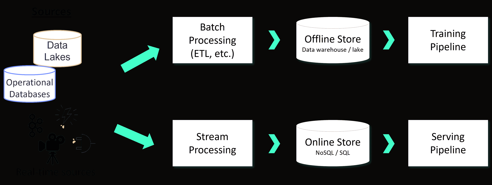

在训练和服务中使用不同的数据库和数据处理技术会导致更高的复杂性和数据同步挑战。特征存储用于抽象掉其中大部分复杂性，并在以下章节中进行讨论。

### 注意

了解有关特征存储的更多信息，请参阅[此在线资源](https://www.iguazio.com/blog/what-are-feature-stores-and-why-are-they-critical-for-scaling-data-science/)。

## 数据探索与准备

在大多数情况下，您无法直接使用原始格式的数据，因此第一步是对数据应用清洗、转换或计算。一旦拥有干净且有意义的特征集，就可以开始评估数据并为我们的模型选择最佳特征。

以下是一些所需的数据转换示例：

* 数据以 `JSON` 格式到达，您需要将其转换为 `array` 或 `vector`。
* 数据包含字符串（如城市名称），您需要使用某种编码策略将其转换为数值。
* 您拥有交易日志，但需要上个月交易的总值。
* 您拥有个人的邮政编码，但需要将其转换为代表社会经济评分的数值。
* 数据集存在缺失值或拼写错误的名字。

使用数据子集开始数据探索并使用交互式可视化工具或标准 Python 包（如 [`Pandas`](https://pandas.pydata.org/)、[`Matplotlib`](https://matplotlib.org/)、[`Bokeh`](https://docs.bokeh.org/) 和 [`Plotly`](https://plotly.com/)）会更容易。

首先应直观检查数据的性质和质量（不一致性、异常值、异常、缺失数据等）并清理数据。接下来，转换并添加派生特征，检查数据或其派生特征与目标特征（目标）之间的相关性，以支持或反驳您的理论，并生成训练集（特征向量）。创建新的派生特征以改善模型的输出，是数据科学家的核心技能。选择相关特征进行分析并消除不相关或冗余特征也至关重要。

请注意，在生产实现中，需要以自动化方式处理更大量的数据。因此，您必须将数据清洗和转换步骤重新实现为可扩展且自动化的数据处理管道的一部分，并且可能需要使用可扩展或实时数据处理引擎（如 [`Spark`](https://spark.apache.org/)、[`Flink`](https://flink.apache.org/)、[`Nuclio`](https://nuclio.io/) 等）代替交互式工具。

图 2-5 说明了数据准备和特征工程流程。

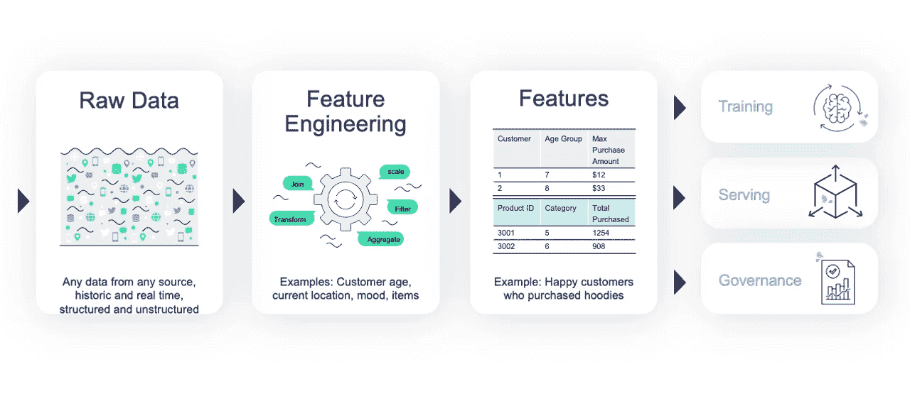

以下是一些最常见的数据转换操作：

* 删除缺失数据过多的行/列。
* 插补：用常数或统计值（例如，列的中位数）替换缺失值
* 异常值检测：删除值不在预期范围内的行（例如，将行值与 `mean +/- N * stddev` 进行比较）。
* 分箱：将多个值分组到单一类别（例如，智利和巴西映射到南美洲）。
* 对数转换：将线性尺度转换为对数尺度。
* 独热编码：将不同的类别值映射为二进制（是/否）特征。
* 分组和聚合：按时间（`hour`、`day`、`month` 等）或按类别（例如，按产品类型销售的单位数量）聚合列值。
* 缩放：重新缩放列值（归一化、标准化）。
* 日期提取：将日期时间转换为 `hour`、一周中的 `day`、`month`、`season`、是否为假日等。
* 时间近因：两个事件之间的时间距离（例如，自上次登录以来的时间）。

对于非结构化数据，可能有更多类型的转换（提取文本元素、调整图像大小或旋转等）。

在训练和服务期间，您必须使用相同的特征；这要求您实现两个数据管道：用于训练的批处理管道和用于服务的实时（流式）管道。

一些特征存储提供了定义数据转换逻辑的简单方法，并将自动部署和管理离线和在线数据管道。

## 数据标注

*数据标注* 或 *数据注释* 是监督学习所需预处理阶段的一部分。您向原始数据（数值、文本、图像等）添加标签，以向机器学习模型展示预期的目标属性（预测）。一些知名示例包括 [`Amazon Sagemaker Ground Truth`](https://aws.amazon.com/sagemaker/data-labeling/)、[`Label Studio`](https://labelstud.io/)、[`DataTurks`](https://github.com/DataTurks) 和 [`CVAT`](https://github.com/openvinotoolkit/cvat)。

对于数值，标注可以从原始数据中推导出来。例如，在尝试预测哪些客户即将流失的流失模型中，您可以检查历史记录并通过查看他们是否在连续月份中仍为客户来标记流失的客户。简单的分析查询即可实现，并将结果回移一个月。

对于非结构化数据（文本、图像、视频、音频等），标注更困难，通常涉及人工标注过程（由人工完成）。然而，市场上许多解决方案可以简化并自动化流程的一部分。尽管如此，仍存在一些挑战，如需要领域专业知识、一致性风险以及流程易出错。

当历史数据集是静态的时，标注只需执行一次。例如，将图像分类为猫或狗的问题在不久的将来可能不会改变。但当数据是动态的时，例如在人脸或指纹识别应用中，每天都可能添加新的人。在这种情况下，标注解决方案必须成为应用的一部分。例如，新用户可以拍摄自己的照片并附上其 ID（以便应用验证其身份）。如果图像未被分类，应发出警报或进入人工识别流程。当添加新照片时，需要触发模型训练过程，并且在线模型必须刷新以考虑新图像。

数据可以在摄取时与标签和标记关联。例如，图像从汽车中到达，同时附带元数据（`car ID`、`model`、`driver`、.) 和遥测数据（`geolocation`、`timestamp`、`speed`、`weather`、`sensor metrics` 等）。这些信息应存储并与图像关联，可用于生成标签。

在考虑具有自动化（重新）训练流程的 MLOps 时，您应考虑自动化标注的机制。在某些应用中，标签会延迟到达（例如，如果用户流失、如果股价上涨或如果客户购买了产品）。因此，训练数据集应进行偏移以适应延迟（如果您基于过去三个月重新训练流失模型，数据范围应为 4 到 1 个月前）。

## 特征存储

正如我们所建立的，任何 ML 项目中的大部分复杂性都源于数据：

* 工作通常在孤岛中进行（数据科学家和工程师）。


# 特征存储

* 生产高质量特征需要耗费大量数据工程工作。
* 生成离线和在线特征时存在重复工作和资源浪费，这也导致结果不准确。
* 难以纳入数据版本控制和治理。
* 每个新项目都要重复特征开发工作。
* 缺乏大规模访问生产就绪特征的简单途径。
* 模型和特征监控脱节或不存在。

ML 团队需要一种持续部署 AI 应用的方式，从而为组织创造真实、持续的业务价值。特征是推动组织 AI 的燃料，而特征存储是能够简化流程、提高[模型准确性](https://www.iguazio.com/glossary/model-accuracy-in-ml/)并加速生产路径的架构答案。

特征存储提供单一视图，用于在组织内共享所有可用特征及其元数据。当数据科学家启动新项目时，他们可以访问此目录并轻松找到特征。但特征存储不仅仅是一个数据层；它也是一个数据转换服务，使用户能够操作原始数据并将其存储为特征，以便用于离线（训练）和在线（服务），而无需重复工作。此外，一些特征存储支持强大的安全性、版本控制和数据快照，从而实现更好的数据血缘、合规性和可管理性。

一些处理 AI 最广泛的大型科技公司已构建了自己的特征存储（Uber、Twitter、Google、Netflix、Facebook、Airbnb 等）。过去几年中，特征存储的开源和商业生态系统爆炸式增长。这向业界其他部分表明，将特征存储作为高效 ML 管道的一部分是多么重要。

大多数特征存储仅限于结构化数据处理（ML），但有些可以同时支持结构化数据和非结构化数据（文本、文档、图像、音频等）。

特征存储将在本书第四章中详细介绍。如图 2-6 所示，它们提供一种机制，从各种在线或离线源读取数据，执行一组数据转换，并将数据持久化到在线和离线存储中。特征与其所有元数据（模式、标签、统计信息等）一起存储和编目，使用户能够组合 `feature Vectors`（联合来自不同特征集的多个特征）并将其用于训练或服务。特征向量在需要时生成，同时考虑数据版本控制和时间正确性（时间旅行）。特征检索使用不同的引擎，实时引擎用于服务，批处理引擎用于训练。

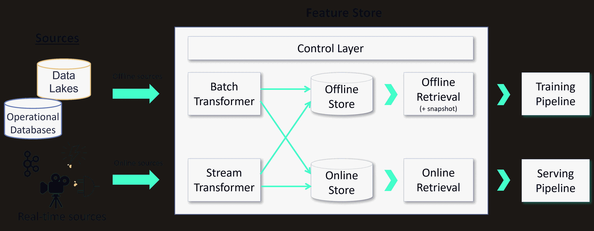

以下是特征存储的一些主要优势：

* 开发速度更快，所需工程资源大幅减少。
* 从开发到生产迁移更顺畅。
* 模型准确性提高（在线和离线使用相同管道）。
* 跨团队协作和安全性更好。
* 能够追踪血缘关系并满足监管合规要求。

### 注意

并非所有特征存储都一样。有些专注于编目，并不自动化摄取以及在线或离线转换流程，而这些是最耗费人力的任务。因此，在选择解决方案之前，请务必进行适当的评估。

# 模型开发与训练

数据科学家在开发模型时通常会经历以下流程：

1. 从外部来源手动提取数据。
2. 对数据进行标注、探索和丰富，以识别潜在模式和特征。
3. 模型训练和验证。
4. 模型评估和测试。
5. 回到第一步并重复，直到达到期望结果（准确率、损失等）。

传统方式是使用笔记本、小规模数据和手动流程，但这无法扩展且不可重复。此外，为了实现最大准确性，实验通常需要使用不同的参数或算法运行（`AutoML`）。

借助 `MLOps`，ML 团队构建机器学习管道，可自动收集和准备数据，选择最佳特征，使用不同的参数集或算法运行训练，评估模型并运行各种模型和系统测试。所有执行及其数据、元数据、代码和结果都必须进行版本控制和记录，提供快速结果可视化，与过去结果进行比较，并了解用于生成每个模型的数据。

管道可能更复杂——例如，当 ML 团队需要开发模型组合或使用深度学习或 NLP 时。你可以在图 2-7 中看到一个基本的模型开发流程示例。

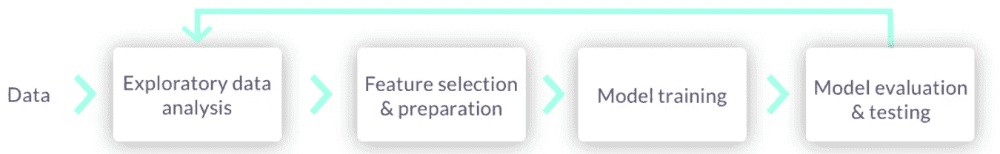

ML 管道可以手动启动，或最好在以下情况时自动触发：

1. 代码、包或参数发生变化。
2. 输入数据或特征工程逻辑发生变化。
3. 检测到概念漂移，模型需要使用新数据重新训练。

ML 管道具有以下特征：

* 使用微服务（容器或无服务器函数）构建，通常在 `Kubernetes` 上。
* 对管道中每一步的所有输入（代码、包依赖项、数据、参数）和输出（日志、指标、数据/特征、工件、模型）进行跟踪，以便重现或解释实验结果。
* 对管道中使用的所有数据和工件使用版本控制。
* 将代码和配置存储在带版本的 `Git` 仓库中。
* 使用持续集成（`CI`）技术自动化管道启动、测试自动化、评审和审批流程。

管道应在可扩展的服务或函数上执行，这些服务或函数可以弹性地跨多个服务器或容器扩展。这样，作业完成速度更快，计算资源在完成后即可释放，节省高昂成本。

生成的模型连同元数据、性能指标、所需参数、统计信息等一起存储在带版本的模型仓库中。模型稍后可以加载到批处理或实时服务微服务或函数中。

## 编写和维护生产级 ML 代码

许多数据科学家在开发和评估模型时喜欢 `Jupyter Notebooks` 的可用性和交互性。确实很方便，可以操作一些代码并立即看到可视化表格或图表，而且大多数 ML 教程、示例和 Kagle 项目都是以 Notebook 的形式消费的。

你可以找到将数据准备、训练、评估甚至预测全部放在一个巨大的 Notebook 中的项目，但这种方法在迁移到生产时可能导致挑战，例如：

* 很难在版本（在 `Git` 中）之间跟踪代码更改。
* 几乎不可能实现测试框架和单元测试。
* 函数无法在各种项目中重复使用。
* 迁移到生产需要代码重构并移除可视化或临时代码。
* 缺乏适当的文档。

最佳做法是为代码段使用函数式编程，为交互式和可视化部分使用 Notebook。示例 2-1 实现了一个数据准备函数，该函数接受数据集（`dataframe`）和一些属性作为输入，并返回处理后的数据集。该函数有文档说明，使用户能够理解其目的和用法。

### 示例 2-1. 数据准备函数（`data_prep.py`）


## 提取和测试数据准备函数

```
import pandas as pd

def add_date_features(
    data, time_column: str = "timestamp", drop_timestamp: bool = False
):
    """Add numeric date features (day of week, hour, month) to a dataframe

    :param time_column:    The name of the timestamps column in the data
    :param drop_timestamp: set to True to drop the timestamp column from
                           the original dataframe
    :return datafarame
    """
    timestamp = pd.to_datetime(data[time_column])
    data["day_of_week"] = timestamp.dt.day_of_week
    data["hour"] = timestamp.dt.hour
    data["month"] = timestamp.dt.month
    if drop_timestamp:
        data.drop([time_column], axis=1, inplace=True)
    return data
```

将该函数放在单独的 python 文件 `data_prep.py` 中，现在你就可以从 Notebook 中调用它，注入数据并使用以下代码单元检查或可视化其输出：

```
import pandas as pd
from data_prep import add_date_features

df = pd.read_csv("data.csv")
df = add_date_features(df, "timestamp", drop_timestamp=True)
df.head()
```

一旦代码定义完善，使用 python 测试框架 (`pytest`) 并为每个函数实现单元测试，如 示例 2-2 所示：

### 示例 2-2. 数据准备测试函数 (`test_data_prep.py`)

```
import pytest
import data_prep
import pandas as pd

# tell pytest to test both drop values (True/False)
@pytest.mark.parametrize("drop_timestamp", [True, False])
def test_add_date_features(drop_timestamp):
    df = pd.DataFrame({'times':['2022-01-01 08:00',
                                '2022-02-02 09:00',
                                '2022-03-03 10:00'],
                       'vals':[1,2,3]})
    new_df = data_prep.add_date_features(df, "times", drop_timestamp=drop_timestamp)

    # verify the results are as expected
    assert new_df["day_of_week"].to_list() == [5, 2, 3]
    assert new_df["month"].to_list() == [1, 2, 3]
    assert new_df["hour"].to_list() == [8, 9, 10]
    assert ("times" in new_df.columns.values) != drop_timestamp
```

示例 2-2 中的代码将使用不同的输入选项执行 `add_date_features()` 函数并验证输出是否正确。

采用这种方法，你可以获得一些即时好处：
* 在版本控制中轻松查看数据准备代码的更改。
* 同样的代码稍后可以使用测试框架进行测试（例如，使用 `pytest`）。
* 函数可以在无需重构笔记本的情况下移至生产环境。
* 函数有文档记录，你可以轻松了解如何使用它以及预期结果。
* 函数稍后可以保存到共享库中，并在不同项目中使用。
* 代码变得更易读。

功能方法的另一个好处在即将到来的章节中有所体现：使用诸如 [MLRun](https://www.mlrun.org/)（MLOps orchestration 框架）之类的工具，将开发代码自动转换为生产服务和流水线的一种自动化方式。

## 跟踪和比较实验结果

运行 ML 实验时，跟踪每次运行至关重要，以便你可以重现实验结果（例如，哪些参数和输入产生最佳结果），可视化各种指标，并比较不同算法或参数集的结果。

每次执行都涉及输入和输出数据集。 关键是要跟踪和版本化数据集，而不仅仅是参数。 任何 MLOps 解决方案都应提供一种机制来版本化数据，并将数据传播（lineage）与执行参数、输出和元数据的其余部分一起跟踪。

今天各种开源和商业框架都会跟踪每次实验运行的结果，将其存储在数据库中并进行可视化。 图 2-8 中显示的一些示例包括 [MLFlow](https://mlflow.org/)、[Weights & Biases](https://wandb.ai/)、MLRun 和 [ClearML](https://clear.ml/)。

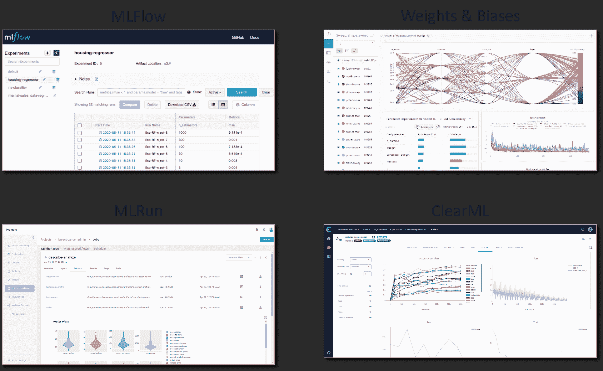

在现实世界中，实验可以在自动化的 ML 流水线中运行（见 图 2-9），该流水线包含不同的步骤（数据准备、训练、测试等）。 流水线的每个阶段接受参数和输入数据，并生成输出值、指标和数据等结果，以供后续流水线步骤使用。 此外，跟踪应扩展到操作数据（使用了哪些代码、软件包、分配和使用的资源、系统等）。

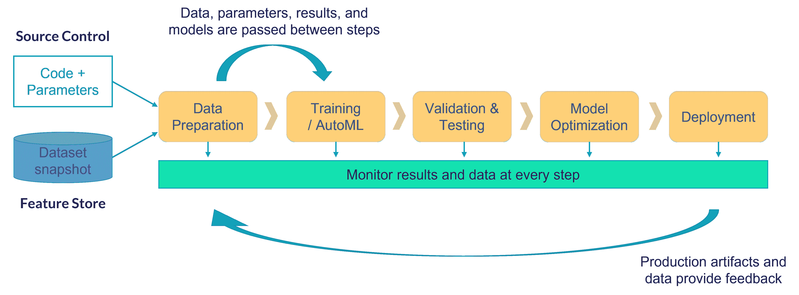

图 2-10 显示了执行跟踪系统的总体架构。 输入可能包括参数、用户或系统定义的标签（以允许过滤和比较）、secrets（执行中使用的隐藏凭据）以及数据对象（文件、表等）。 输出包括结果指标、日志、使用数据、输出数据对象和工件。 一个良好的跟踪系统还记录代码版本、使用的软件包、运行时环境和参数、资源、代码分析等

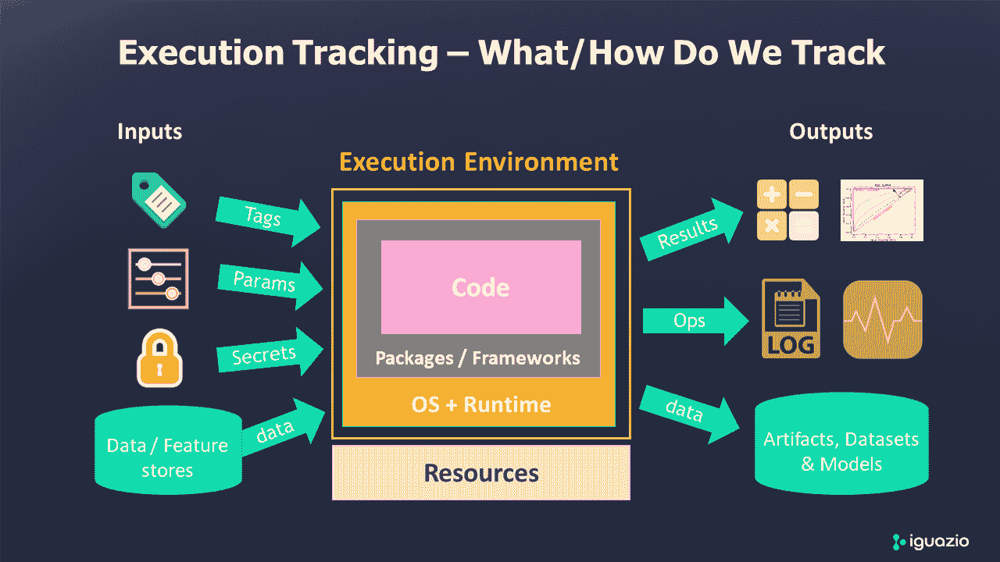

执行跟踪的缺点是它需要 *code instrumentation*（添加代码以显式记录参数、标签、结果和数据）。 一些 MLOps 框架为 ML/DL 工作负载提供自动日志记录，你可以导入一个库，该库会自动记录所有 ML 框架特定的指标。

一种新技术 AutoMLOps 由 `MLRun` 框架开创，它不仅记录指标以及参数、数据血缘、代码版本和操作数据，还会自动添加生产功能，例如自动扩展、资源管理、自动文档、参数检测、代码分析、安全、模型注册等，从而消除大量的工程工作。

## 分布式训练和超参数优化

要获得最佳模型结果，尝试各种算法或参数组合，并根据目标指标如最佳准确率选择最佳者。 这项工作可以使用多个超参数优化和 AutoML 框架进行自动化，这些框架会尝试不同的组合，记录每次运行的所有指标并标记最佳结果。 为了缩短训练时间，一些框架支持在不同的计算资源上执行每次单独的运行。 图 2-11 显示了超参数作业中多个子运行的跟踪以及最佳选择结果。

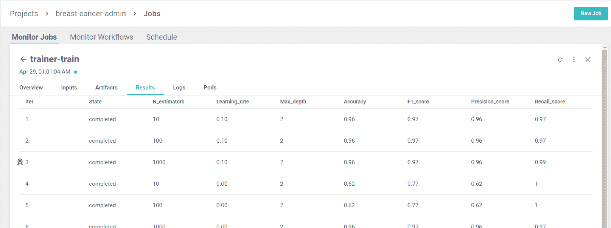

并行超参数作业不仅限于模型训练。 它们可用于并行加载和准备许多数据对象，并行测试不同的测试用例等

有几种超参数执行策略：
* Grid search: 运行所有参数组合。
* Random: 运行从所有参数组合中采样的一组。
* Bayesian optimization: 构建目标函数的概率模型并使用它来选择在真实目标函数中评估最有希望的超参数。
* List: 运行每个列表中的第一个参数，然后是第二个参数，依此类推。

你可以指定选择标准来在不同的子运行中选择最佳运行（例如，模型的准确率）以及停止条件，当基于返回结果满足某些条件时停止子运行的执行（例如：`stop condition="accuracy>=0.9"`）。

一些数据工程、ML 或 DL 作业无法放入单个容器或虚拟机中，必须在多个容器之间进行分布。 一些开源框架，包括 `Spark`、[`Dask`](https://www.dask.org/)、[`Horovod`](https://horovod.ai/) 和 `Nuclio`，支持工作负载分布。 当将工作负载分布与子（超参数）任务的并行运行相结合时，你需要控制和限制使用的总资源量。


跟踪分布式工作负载可能更具挑战性。请确保您使用的 `MLOps` 框架支持该功能。

## 生产环境的模型构建与测试

当模型用于实际应用时，确保其稳健且经过充分测试至关重要。因此，除了传统的软件测试（单元测试、静态测试等）之外，测试还应涵盖以下类别：
* 数据质量测试：用于训练的数据集质量高且不带偏见。
* 模型性能测试：模型产生准确的结果。
* 服务应用测试：已部署的模型以及数据预/后处理步骤稳健且提供足够的性能。
* 流水线测试：确保自动化开发流水线能处理各种异常和期望的规模。

当训练数据集质量较低时，您可能会认为模型是准确的，但它可能会做出有害的预测。因此，验证数据质量很高至关重要。以下是数据质量测试的一些示例：
* 没有缺失值。
* 值类型正确且落在预期范围内（例如，用户年龄在 0-120 之间，具有预期的平均值和标准差）。
* 类别值落在可能选项范围内（例如，城市名称与城市名称列表中的选项匹配）。
* 数据中没有偏见（例如，性别特征具有预期的男性和女性比例）。

数据质量测试可以在数据流水线（和特征存储）中实现，也可以在训练前的 ML 流水线中实现。请注意，一些特征存储使用内置函数自动执行数据质量验证。

训练模型后，下一步是确保其准确且具有弹性。除了将测试数据集分开并使用该数据集衡量模型准确度的常见做法外，以下是一些可以提高模型质量的额外测试：
* 验证性能在数据的关键切片中保持一致（例如，按型号的设备、按国家或其他类别的用户、按类型的电影），并且不会对特定群体显著下降。
* 将模型结果与之前的版本或基线版本进行比较，并验证性能没有下降。
* 测试不同的参数组合（超参数搜索），以验证我们选择了最佳参数组合。
* 测试偏见和公平性 - 验证性能在性别和特定人群中保持一致。
* 检查特征重要性，并判断是否存在边际贡献可从模型中移除的特征。
* 测试对虚假、随机或恶意输入向量的免疫力，以提高稳健性并防御对抗攻击。

应特别注意如何独立生成测试集，使其考虑公平性和无偏性，并最大程度地减少与训练集的依赖。

当模型部署到生产服务应用中时，它们包含额外的预处理或后处理逻辑（提取、格式化、验证、转换、`API` 集成等）。此外，模型代码可能依赖于各种软件包或基础设施（内存、CPU、GPU 等）。因此，在将模型部署到生产环境之前，必须在目标服务应用环境中并通过 `API` 对其进行彻底测试。

以下是服务应用测试的一些示例：
* `API` 覆盖率：所有服务 `API` 都按预期行为。
* 性能测试：验证服务应用能够承受目标每秒请求数并在所需延迟内响应。
* 包一致性：验证模型训练和服务使用相同的框架版本（例如，`Sklearn`）。
* 测试数据验证逻辑：验证如果向模型发送不合规数据，模型端点会失败或记录请求。
* 测试弹性：测试服务应用能否承受恶意攻击和冒充。
* 测试正确性：验证通过服务 `API` 的模型预测结果与模型验证步骤中的结果相同。
* 测试结果：验证预测结果能转化为适当的操作（写入数据库、生成警报、更新用户界面等）。

所有不同的测试都应成为自动化 `CI/CD` 流水线的一部分。每当数据集或代码发生变化时，流水线就会执行并生成一组新的可部署对象（模型、应用程序、特征等），并记录所有结果以实现可重复性和可解释性。

应注意测试 ML 流水线，确保每次触发时都能正确运行，不会因缺少参数或资源不足而失败，并且能够处理大规模数据。

一旦模型和其他生产制品准备就绪，它们必须连同所有元数据和生成生产部署所需的参数一起存储在版本化的制品仓库中。

在许多情况下，训练好的模型可以进一步优化以用于生产并获得更高性能，例如，通过执行特征选择并移除冗余特征，或通过压缩模型并以更高效的机器格式存储，如 [`ONNX`](https://onnx.ai/)。因此，ML 流水线可能包含模型优化步骤。

图 2-12 说明了如何将不同的测试和优化步骤作为 ML 流水线的一部分使用。

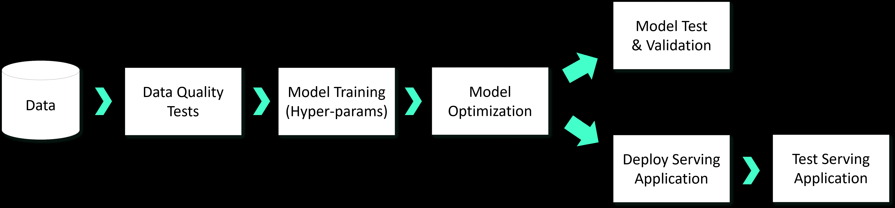

## 部署（和在线 ML 服务）

一旦 ML 模型构建完成，就需要将其与真实世界数据以及业务应用或前端服务集成。整个应用或其部分需要在不中断服务的情况下部署。如果 ML 组件未被视为应用或生产流水线不可或缺的一部分，部署将极具挑战性。

ML 应用流水线通常包括以下内容：
* `API` 服务或应用集成逻辑。
* 实时数据收集、丰富、验证和特征工程逻辑。
* 一个或多个模型服务端点。
* 数据和模型监控服务。
* 资源监控和告警服务。
* 事件、遥测以及数据/特征日志服务。
* 预测结果后的操作集合。

您可以在 图 2-13 中看到实时流水线示例。

不同服务相互依赖。例如，如果模型的输入发生变化，则特征工程逻辑必须与模型服务和模型监控服务一起升级。这些依赖关系要求在线生产流水线（图）反映这些变化。

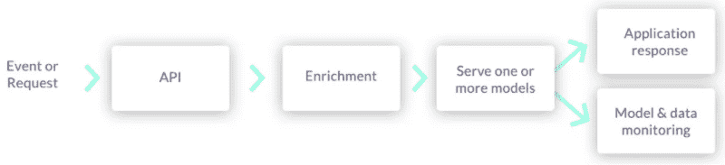

使用非结构化数据、深度学习、`NLP` 或模型集成时，应用流水线可能更复杂，因此拥有灵活的机制来构建和连接我们的流水线图至关重要。

应用流水线通常通过快速流式或消息协议互连，因此应具有弹性以应对流量和需求波动，并应允许对流水线的一个或多个元素进行非中断升级。这些需求最好通过快速的无服务器技术来解决。

应用流水线开发和部署流程执行以下操作：
1. 开发生产组件：
   * `API` 服务和应用集成逻辑。
   * 特征收集、验证和转换。
   * 模型服务图。
2. 使用模拟数据测试在线流水线。
3. 将在线流水线部署到生产环境。
4. 监控模型和数据并检测漂移。
5. 在需要时重新训练模型并重新设计数据。
6. 在需要时升级流水线组件（非中断式）。


# 从模型端点到应用管道

今天的常见做法是构建模型服务端点，这些端点仅接受数值特征向量并返回预测结果。 通常与模型紧密耦合的预处理或后处理逻辑则放在独立的微服务中完成。 这使得机器学习应用的交付、扩展和维护变得复杂。

在某些情况下，预测是使用模型组合来完成的，例如通过实现覆盖不同时间范围（近期和季节性模型）或其他算法的模型集成。 另一个例子是级联两个模型。 第一个从文本中提取情感，第二个基于情感和其他特征进行预测。

更优的做法是设计在线（或实时）应用管道，其中模型服务只是其中的一个步骤，并且能够将整个管道作为一个整体进行部署、升级或回滚。 与运行缓慢批处理任务的数据和模型训练管道不同，应用管道应每秒处理数千个请求，并使用流式或无服务器处理引擎。

图 2-14 展示了一个简单的应用管道，它接受用户请求（通过 `HTTP` 或流消息），对其进行处理，使用三模型集成预测结果，并进行后处理（响应用户、更新数据库中的结果、生成警报等）。

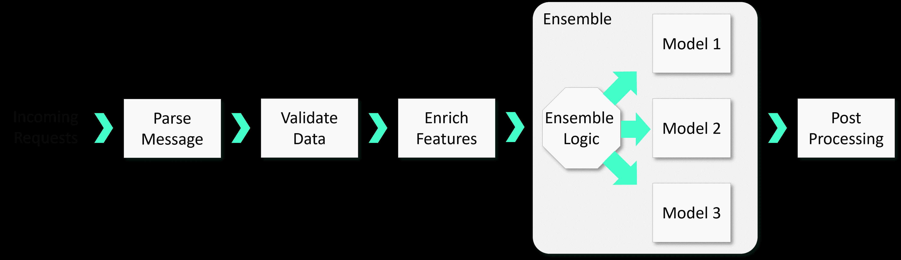

机器学习（`ML`）或深度学习（`DL`）应用可能处理非结构化数据和复杂的处理阶段，例如图像操作（`detect` 对象、`resize`、`sample`、`re-color`、`crop` 等）或文本操作（`parse`、`format`、`tokenize` 等）。 应用管道不限于结构化数据。 如 图 2-15 所示，管道可以分支并使用各种技术和模型处理数据的不同部分。 在示例中，文档 URL 通过 `Kafka` 流发送到管道，第一步从对象存储库中获取文档，随后进行文本和图像处理步骤，最后合并结果并更新托管文档信息的搜索数据库。

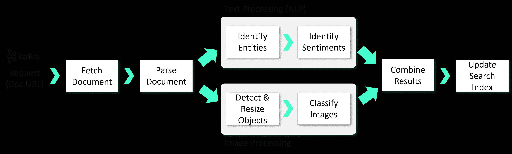

构建多阶段在线管道的一些开源和商业框架示例：

* [AWS Step Functions](https://aws.amazon.com/step-functions)：AWS 云服务，可使用 AWS Lambda 无服务器函数和其他 AWS 云服务组合在线管道。
* [MLRun Serving Graphs](https://www.mlrun.org/)：开源和商业 MLOps 框架，其服务层支持在线数据和 ML/DL 管道的组合，并自动 provision 为自动扩展的实时无服务器函数。
* [Apache Beam](https://beam.apache.org/)：开源流处理框架，专注于在线结构化数据处理。 ([Google Dataflow](https://cloud.google.com/dataflow) 是 Apache Beam 的托管版本)。
* [Seldon](https://www.seldon.io/)：具有基本在线管道能力的开源和商业模型服务框架。

## 在线数据准备

在线应用管道的主要部分是数据处理，任务包括数据解析、格式化、验证、转换、聚合、日志记录、持久化、连接等

批处理数据是很常见的做法。 例如，可以使用数据仓库查询、`ETL` 流程、`Spark` 等。 但同样的技术不适用于在线管道，在线管道中每秒可能有数千个事件或用户请求到达，并且需要在毫秒内得到响应。

在线数据管道中，特征累积在内存或快速 `SQL/NoSQL` 数据库中，按事件获取以丰富用户请求，然后传递给模型进行预测。 当特征基于历史或静态数据（性别、年龄、年收入等）时，可以使用周期性批处理将此类特征复制到在线数据库。 然而，当特征频繁更新时（当前地理位置、最近交易价值、过去一小时花费的金额、上次登录时间等）这种方法就不适用了。

在线数据管道使用流处理实现（`Spark Streaming`、`Flink`、`Amazon Kinesis Data Analytics`、`Nuclio` 等），事件在流式传输中被摄取、转换或聚合以形成实时特征向量。 此外，使用快速 `key/value` 数据库来持久化并共享分布式状态。 图 2-16 说明了有状态流处理的工作方式。 事件到达并分发到流工作器（按 `user key` 分区）。 每个工作器处理数据并将其与累积状态合并或聚合。

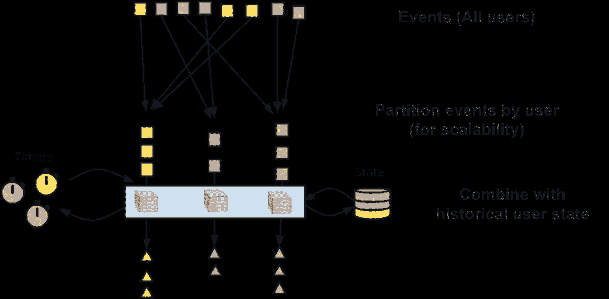

主要挑战在于流处理代码和方法与批数据分析方法差异很大，需要将用于训练的批处理管道重新实现为实时流处理管道。 然而，一些特征存储允许你使用高级原语定义数据管道，并自动生成批处理或流处理管道，确保逻辑保持一致并节省大量工程工作。

在线数据管道不限于结构化数据。 现代应用需要处理非结构化视觉和文本数据，操作包括调整图像大小或旋转、解析文本、标记语句等。 因此，你选择的 技术和框架需要支持此类应用。

### 注意

数据处理与 `ML` 或 `DL` 之间的界限可能模糊。 例如，文本可以使用 `NLP` 模型转换为情感或类别特征，那么这是模型服务还是数据转换？

# 持续模型和数据监控

AI 服务和应用已成为任何业务不可或缺的一部分。 模型性能不佳可能导致责任、收入损失、品牌受损和客户不满意。 因此，监控数据、模型以及整个在线应用管道至关重要，并保证模型持续发挥性能且业务 KPI 得到满足。 得益于完善的监控解决方案，你可以快速响应问题，通过通知用户、重新训练模型或调整应用管道。

监控系统跟踪各种基础设施、数据、模型和应用指标，并可在以下等不同情况下报告或发出警报：

* 数据漂移或概念漂移：模型输入或输出的统计属性发生变化（表明模型将表现不佳）。
* 模型性能问题：模型结果不准确。
* 数据质量问题：提供给模型的数据质量低（缺失值、`NaNs`、值超出预期范围、异常等）。
* 模型偏差：检测整体评分与特定人群评分之间的变化（如男性与女性、少数群体等）。
* 对抗攻击：已进行恶意企图欺骗模型。
* 业务 KPI：验证模型是否达到目标业务目标（收入增长、客户保留等）。
* 应用性能：应用能够正确服务请求且无延迟。
* 基础设施使用：跟踪计算资源的使用情况。
* 模型陈旧：若距离上次部署模型版本时间过长则发出警报。
* 异常检测：模型数据或结果不符合预期规范或类别（例如，使用编码器-解码器神经网络模型）。


# 模型监控架构

图 2-17 显示了典型的模型监控架构。数据输入、输出和应用程序指标被发送到流中。实时流处理应用程序读取数据。它可以检测或警报即时问题、汇总信息，并写入各种数据目标（键/值、时间序列、文件或数据仓库）。

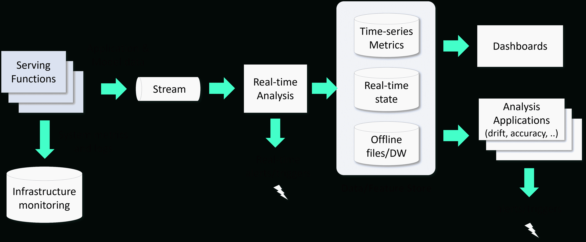

由监控系统生成的警报可以通知用户（通过电子邮件、Slack 等）或触发纠正措施，例如使用更新的数据重新训练模型、更改模型权重等

特性存储在监控数据和模型方面可以发挥重要作用。它们存储每个特性的模式和统计信息，可用于不同的验证和分析任务。如果生产数据返回到特性存储，则更容易分析、连接并将生产数据集与其他历史或离线数据集进行比较。

## 监控数据和概念漂移

概念漂移是一种现象，即目标变量（`y` - 模型试图预测的变量）的统计特性随时间变化。数据漂移（虚拟漂移）发生在输入的统计特性发生变化时。在漂移中，基于过去数据构建的模型不再适用，并且模型对过去数据的假设需要根据当前数据进行修订。

图 2-18 说明了概念漂移和虚拟（数据）漂移之间的差异。

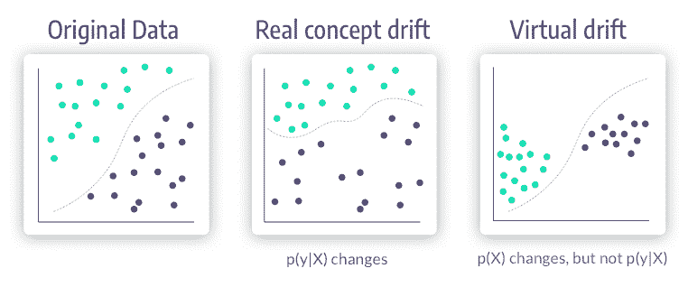

回到业务层面，你可以在以下用例中看到漂移的例子：

* *风力发电预测*: 当从基于离线数据集的模型预测风力发电的电功率时，我们与在线训练模型相比存在概念漂移，因为风和天气具有非平稳特性。
* *垃圾邮件检测*: 电子邮件内容和呈现方式 constantly 变化（数据漂移）。由于用于训练的文档集合经常变化，表示该集合的特征空间也会发生变化。此外，用户本身的兴趣也在变化，导致他们开始或停止将某些电子邮件视为垃圾邮件（概念漂移）。

概念漂移的变化可以是：

* Sudden: 旧概念和新概念之间的转换同时发生。与 COVID-19 大流行相关的行为模式为我们提供了引人注目的例子，例如封锁突然改变了全球人口的行为。
* Incremental / Gradual: 概念之间的变化随着新概念的出现和开始适应而随时间发生。从夏季到冬季的转变可能是渐进漂移的一个例子。
* Recurring / Seasonal: 变化在首次观察到后会再次发生。一个例子是天气的季节性变化，这决定了消费者在较冷的月份购买外套，在春天到来时停止这些购买，然后在秋季再次开始。

在 图 2-19 中，你可以看到模型漂移检测的工作方式。首先，收集模型输入和输出，系统计算时间窗口上的统计数据，并将其与样本集统计数据（在训练时保存）或来自较旧时间窗口的数据进行比较。

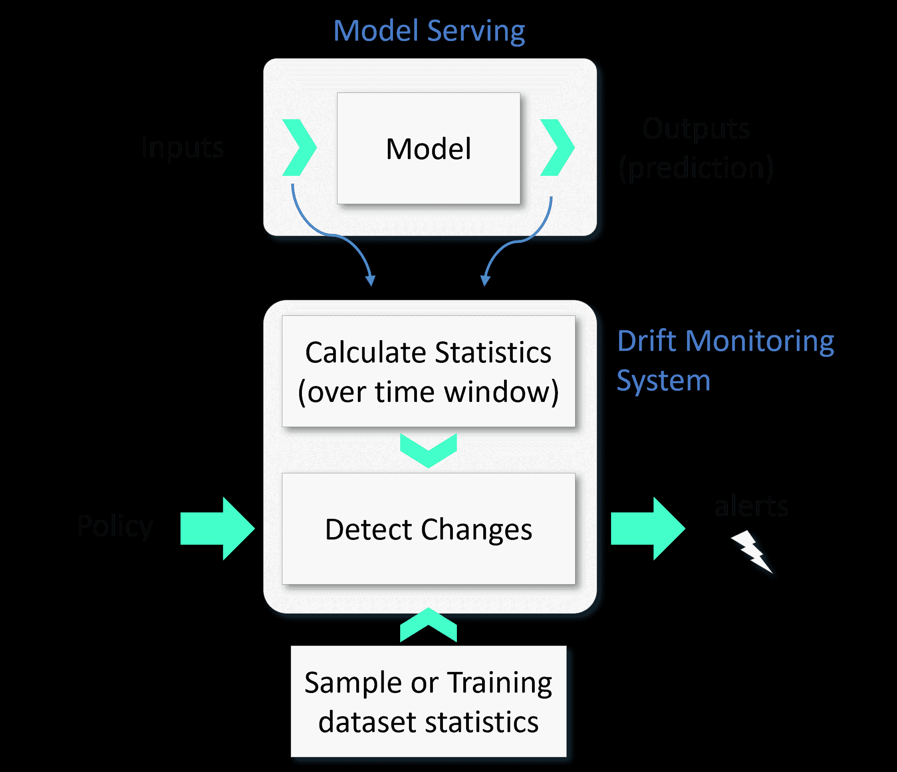

监控系统保存各种特征统计信息（最小值、最大值、平均值、标准差、直方图等），并且使用以下一个或多个指标计算漂移水平：

* Kolmogorov–Smirnov 检验
* Kullback–Leibler 散度
* Jensen–Shannon 散度
* Hellinger 距离
* 标准分数（Z-score）
* 卡方检验
* 总方差距离

图 2-20 演示了如何检测漂移。

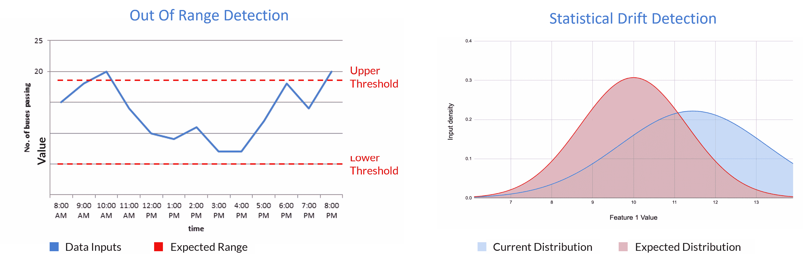

当数据由简单的数值指标组成时，使用这些方法很容易检测到漂移，但当数据是非结构化的、图像或文本片段时，如何检测它？

一个技巧是将输入数据转换为表示数据的扁平指标，并在这些指标上监控漂移。例如，假设你对水果图像进行分类。然后，你可以将图像转换为其 RGB 颜色指标，并检查生产中的颜色分布是否与训练中相同。

## 监控模型性能和准确性

一个重要指标是衡量模型在生产中的准确性。为此，你必须拥有 *ground truth*（与预测相匹配的实际结果）。在某些模型中获得真实值相对简单。例如，如果我们预测今天股价会上涨，我们可以等待几个小时并知道预测是否准确。这与预测客户流失或机器故障等其他预测应用相同，其中实际结果会延迟到达。

在某些应用中，会针对特定交易（例如广告的曝光或点击）进行预测。在这种情况下，交易或预测可以标记为 `UID`（唯一标识符）。一旦实际结果已知（客户购买了产品），你就可以使用真实值更新交易（由 `UID` 标识）。这要求模型服务和监控框架能够为每个预测存储或生成 `UID` 并将真实值添加到特定交易/预测中。

准确性监控是定期进行的（例如每小时或每天）。首先，生成一个数据集，其中包含预测的 `Y` 值（由模型计算）和真实值（使用适当的时间偏移或使用 `UID` 获得的实际结果）。然后将其用于计算准确性指标并将其与训练期间的准确性进行比较。

这在 图 2-21 中有所说明。

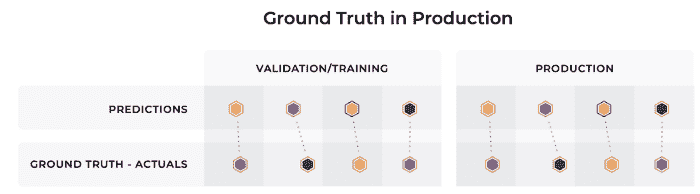

###### 注意

用于准确性监控计算的真实值与重新训练模型所需的相同 `Y` 标签。因此，最佳方法是一次生成它们，将其存储在特性存储中，并将其用于重新训练和准确性监控。

就像在训练中一样，建议使用多个指标来确定预测准确性，尤其是在类别不平衡的情况下：

* Accuracy: 总体整体准确率。
* Recall: 总体阳性中有多少比例是正确的。
* Precision: 确定假阳性成本高的时候。
* F1 Score: 回收率和精确率之间权衡的分析。

###### 注意

请注意，真实值可能包含偏差。例如，在用于批准或拒绝交易的欺诈预测应用中，真实值仅包含有关已批准交易的信息。没有关于被拒绝交易的数据，这些交易可能并非欺诈，这可能导致偏差。

# 预训练模型的策略

商务战略最著名的作者之一是 [哈佛商学院教授 Michael Porter](https://www.hbs.edu/faculty/Pages/profile.aspx?facId=6532)，他经常说，“战略的本质是选择不做什么。” 由于大多数组织在实施能够提供投资回报的机器学习项目方面遇到困难，因此需要更好的战略。特别是，组织应该问在进行机器学习项目时不应该做什么。在许多情况下，他们不应该构建特定类型的模型，而应改用预训练模型。


在《*理解迈克尔·波特*》（哈佛商业评论出版社，2011 年）一书中，作者 Joan Magretta 总结了迈克尔·波特在 图 2-22 中阐述的竞争优势的本质。以执行力竞争的公司会陷入博弈论中的囚徒困境问题，其中他们和竞争对手不断降低价格和成本，同时降低公司的利润。而这已是最好的情况；在许多情况下，公司不可能在执行上超越更大的竞争对手，例如训练出更好的 NLP 或计算机视觉模型。

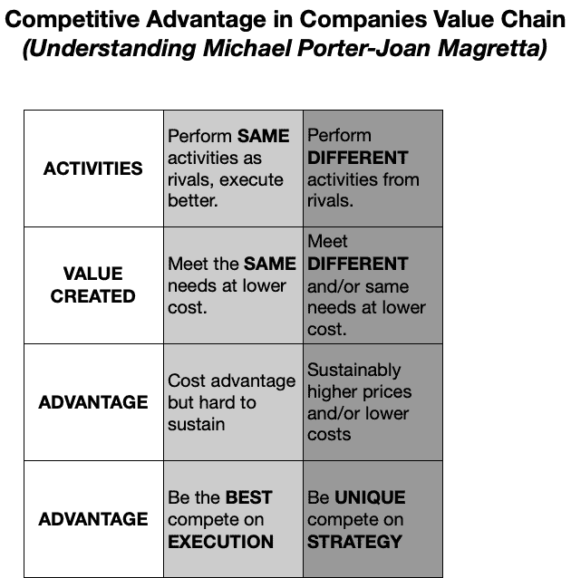

这种对战略的概念性理解正是预训练模型成为创建独特竞争优势的整体战略中必不可少组成部分的本质所在，同时在实施机器学习项目时。

有多个预训练模型供应商。最受欢迎的平台是 [Hugging Face](https://huggingface.co/models)，拥有超过 6 万个模型。Google 的 [TensorFlow Hub](https://www.tensorflow.org/hub) 拥有独特的预训练模型集合，格式多样，包括针对 [JavaScript](https://www.tensorflow.org/js) 或 [嵌入式硬件或移动设备](https://www.tensorflow.org/lite/examples) 等运行时的格式。另一个格式和存储库是 [ONNX](https://github.com/onnx/models#vision)，其中包含许多预训练的计算机视觉和语言模型示例。

## 使用 Hugging Face 构建端到端应用

理解预训练模型的最佳方式是使用其中一个构建端到端解决方案。幸运的是，Hugging Face 使这一过程变得简单。首先，你需要 [注册免费账户](https://huggingface.co/join)。

### 注

你可以在 [YouTube](https://youtu.be/EmsJG8RVhWY) 上或 [O’Reilly 平台](https://learning.oreilly.com/videos/mlops-with-hugging/05282022VIDEOPAIML/05282022VIDEOPAIML-c1_s0/) 上观看此 Hugging Face 应用的演示。应用源代码在 [GitHub](https://github.com/nogibjj/hugging-face) 上。

接下来，让我们查看 图 2-23 中的应用架构。用户账户会创建一个身份验证令牌，该令牌随后成为云端构建系统中的持续交付管道的一部分，该系统位于 [GitHub Actions](https://github.com/features/actions) 中。代码本身在 Github CodeSpaces 中开发。Hugging Face 模型随后位于 Gradio 应用内部，通过提供用户界面实现 MLOps 工作流的快速原型设计。最后，Hugging Face Spaces 功能允许用户使用 [Gradio](https://www.gradio.app) 技术构建机器学习应用，从而在平台上托管应用。

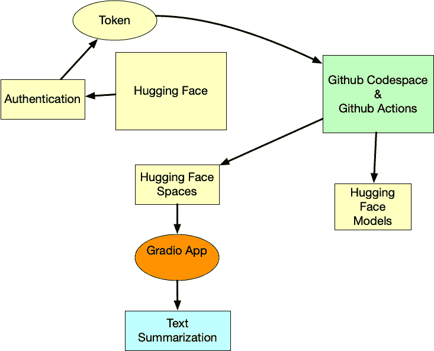

```
from transformers import pipeline
import gradio as gr

model = pipeline("summarization")

def predict(prompt): 
    summary = model(prompt)[0]["summary_text"]
    return summary

with gr.Blocks() as demo: 
    textbox = gr.Textbox(placeholder="Enter text block to summarize", lines=4)
    gr.Interface(fn=predict, inputs=textbox, outputs="text")

demo.launch()
```

让我们分解每个核心应用文件；首先是 `app.py`。


: 

使用 Hugging Face `transformers`（预训练模型）。


: 

创建 `predict()` 函数。


: 

构建 `gradio` UI。

```
name: Sync to Hugging Face hub
on:
  push: 
    branches: [main]

  # to run this workflow manually from the Actions tab
  workflow_dispatch:

jobs:
  sync-to-hub:
    runs-on: ubuntu-latest
    steps:
      - uses: actions/checkout@v2
        with:
          fetch-depth: 0
      - name: Add remote
        env: 
          HF: ${{ secrets.HF }}  Use the token from Hugging Face
        run: git remote add space <your account>
      - name: Push to hub
        env:
          HF: ${{ secrets.HF }}
        run: git push --force <your account>
```

另一个关键文件是 `main.yml`，它控制向 Hugging Face 的持续交付。操作如下：


: 

在推送到 Github 时构建项目。


: 

使用 Hugging Face 身份验证令牌：

最后，在构建流程设置好后，你可以在 图 2-24 中看到正在运行的应用。提交框中输入的任何文本都会使用 Hugging Face 预训练模型进行总结。之后，只需更改一行代码即可替换不同的模型，整个应用和模型就会上线。关键的收获是以这种 MLOps 方式部署的预训练模型允许快速原型设计，后续可能成为更复杂的 MLOps 系统。

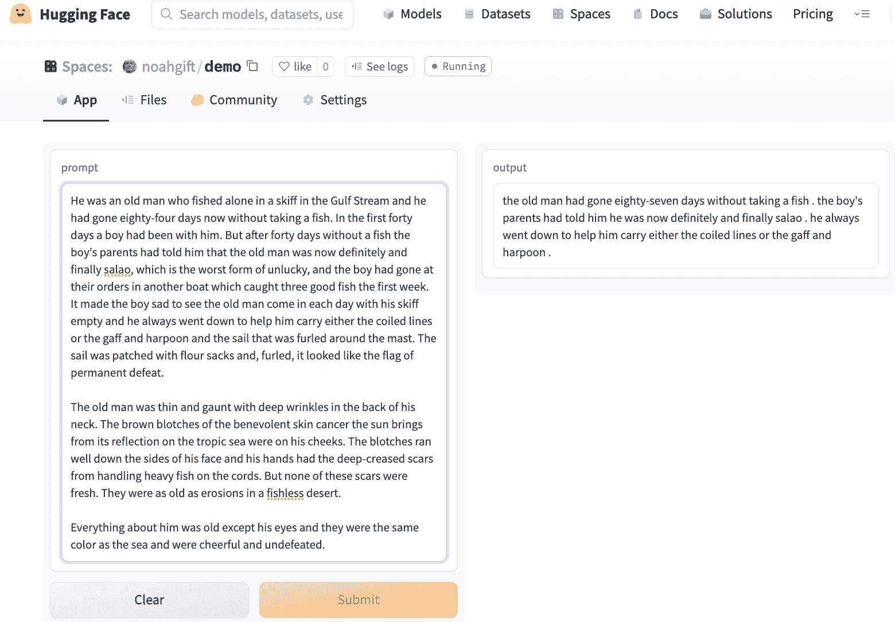

# 流程自动化（ML 的 CI/CD）

持续集成和持续交付（CI/CD）是一种敏捷开发方法，用于管理软件生命周期并持续向生产环境部署稳健的代码更新。使用 CI/CD，多个开发人员可以向共享项目存储库贡献代码更新，进行自动化测试，并拥有受控且持续的部署流程。结果是使用更少的资源更快地上市，软件故障率更低。

ML 模型和应用的开发带来了传统软件开发中不存在的额外挑战：

* 多个角色参与开发（数据科学家、数据工程师、软件开发人员、ML 工程师等），各自拥有不同的开发技能、工具和实践。
* 版本定义超出了代码，还包括数据源对象、参数和多个工件。
* 不同的数据和 ML 工作负载（数据准备、模型训练、模型、数据和应用测试等）需要使用 CPU 和 GPU 进行高可扩展性和分布式处理。
* 将新版本部署到生产环境涉及合并不同的数据资产和状态（表可能更改模式、流可能部分处理、新功能添加并需要历史值或对缺失值进行插补等）。
* 监控和可观察性更加复杂且不那么确定（如前一节关于模型和数据监控所讨论的）。

为了解决数据和 ML 特有的挑战，组织必须扩展其 [使用 MLOps 自动化实践的 CI/CD 实践](https://www.iguazio.com/glossary/ci-cd-for-machine-learning/) 实践并确保工程和数据科学团队在相同的开发方法论和工具上保持一致。以下是一些需要遵循的做法：

* 数据科学家的代码不再能维护在庞大的笔记本中，而应分解为更小的功能代码组件（参见：“编写和维护生产 ML 代码”）。
* 所有数据、代码、参数、工件和结果必须自动收集、版本化并关联（参见：“跟踪和比较实验结果”）。
* 测试应全面并涵盖所有数据、模型、应用方面（参见：“为生产构建和测试模型”）。
* 管道必须支持高性能和分布式处理以及在管道中高效移动和版本化数据资产。
* 模型和数据监控解决方案应提供反馈循环并纳入自动化流程（参见：“持续模型和数据监控”）。


图 2-25 展示了机器学习应用的典型 CI/CD 流程。它包含三个主要部分：
1. 开发：用户（数据科学家、数据工程师、软件开发人员等）从最新代码创建开发分支，添加他的功能，并使用一些样本数据进行本地测试。
2. 暂存（或集成）：用户请求将新功能合并到开发分支。此时，自动化测试程序会对新代码、更大数据集以及分布式或更可扩展的计算资源进行运行。一旦新代码通过测试并获得批准，它就会合并到开发版本中，并可能进行额外的压力测试。
3. 部署到生产环境：开发版本会部分地推广到生产环境（使用金丝雀或 A/B 测试部署方法来处理实际交易的一小部分）。一旦新版本被验证为正确工作并与之前的版本进行比较，就会被批准并发布到生产环境。如果出现故障或模型性能下降，系统可以回滚到之前的版本。

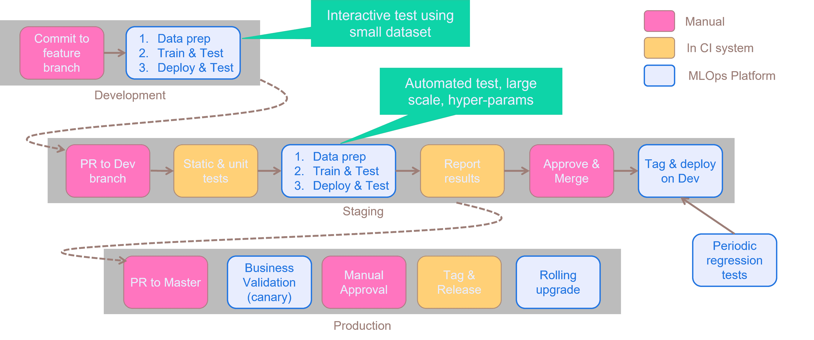

MLOps 框架必须与您选择的源代码控制（GIT）和 CI/CD 框架（[Jenkins](https://www.jenkins.io/)、[GitHub Actions](https://github.com/features/actions)、[Gitlab CI/CD](https://docs.gitlab.com/ee/ci/) 等）紧密集成。各种元数据和配置对象必须与代码一起存储在源代码库中，数据引用应抽象且可版本化，并且报告和 API 应集成以提供整体视图并避免手动或复杂的集成。您可以在 图 2-26 中看到集成的示例。

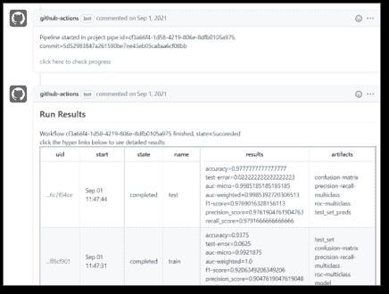

## 批判性思维讨论问题

让我们回顾一下本章讨论的话题。你能回答以下问题吗？
* 为什么问题框架是遵循 MLOPs 哲学实施项目的初始建议步骤？
* 举出两个或三个组织用启发式方法比机器学习更好地解决的问题的例子？
* 你的组织如何设计有效的數據治理策略，以主动防止 PII、偏见或监管风险问题？
* 你如何使用 Feature Store 来减少模型的计算训练时间？
* 考虑一种情况，你的组织可能会面临数据漂移问题，以及概念漂移问题。如果未解决，哪种影响会更显著？

## 练习
* 使用 [mlrun serving](https://docs.mlrun.org/en/latest/serving/custom-model-serving-class.xhtml) 来部署一个 [Hugging Face 模型](https://huggingface.co/)。
* 在 MLOPs 平台上使用 Feature Store 来训练一个需要在训练前进行数据转换的模型。
* 使用像 MLFlow、MLRun、ClearML、Sagemaker 或其他 MLOps 平台这样的实验跟踪技术来训练多个版本的模型并比较多次运行的准确性。
* 使用像 Spark、Dask、Horovod 或 Nuclio 这样的开源框架进行工作负载分发以执行分布式超参数调优。
* 使用本书前面介绍的示例之一编写服务应用程序测试。
