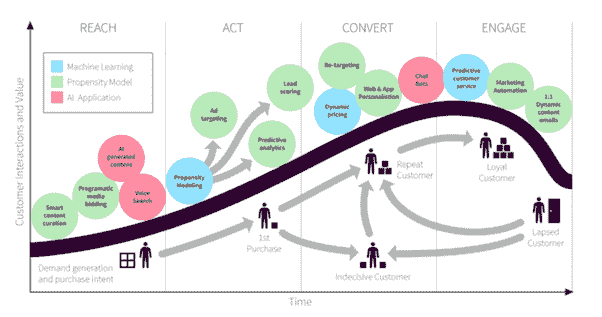
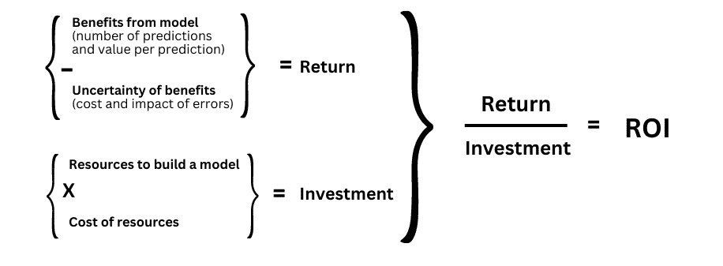
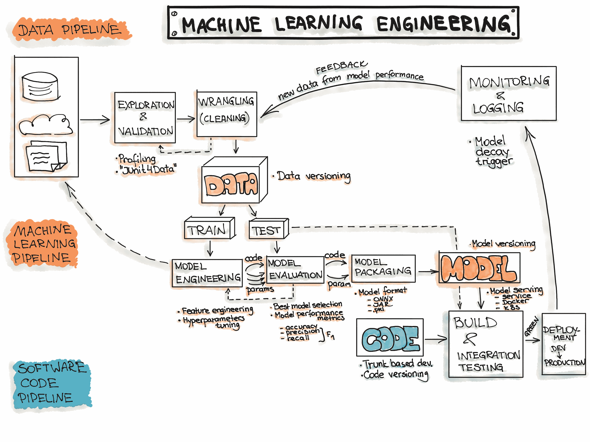
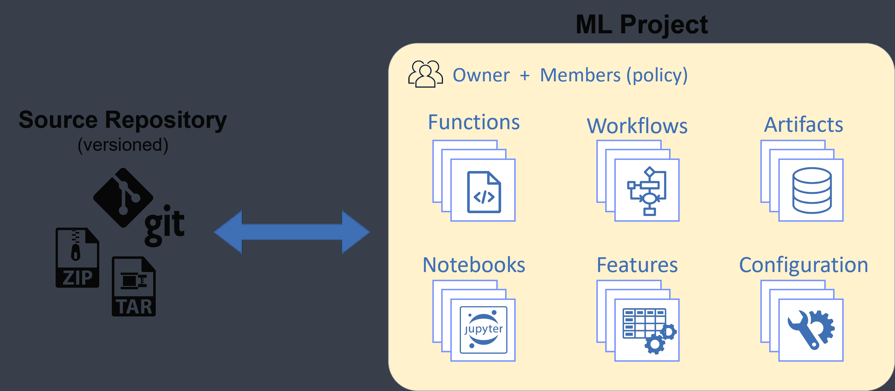
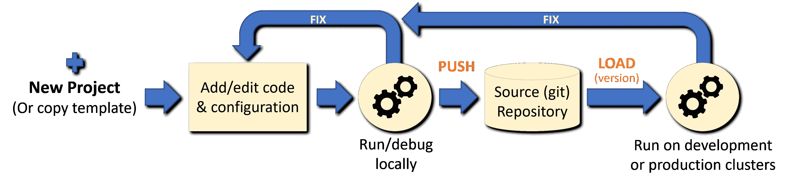
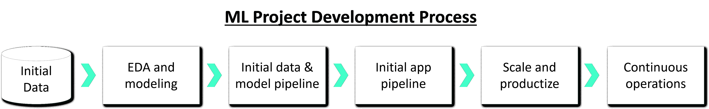
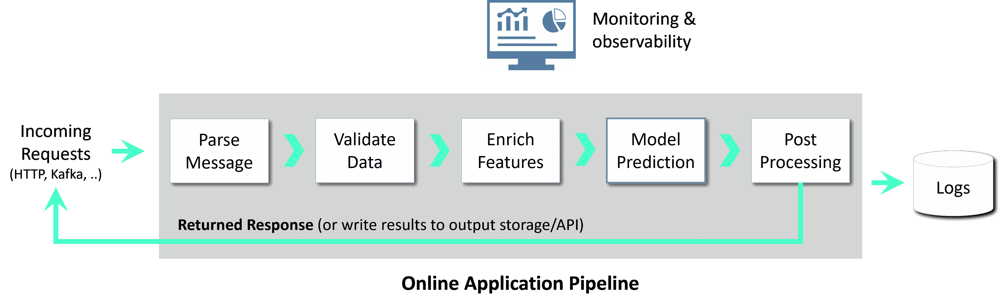
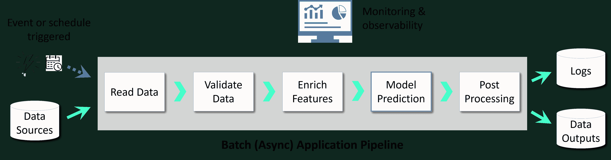
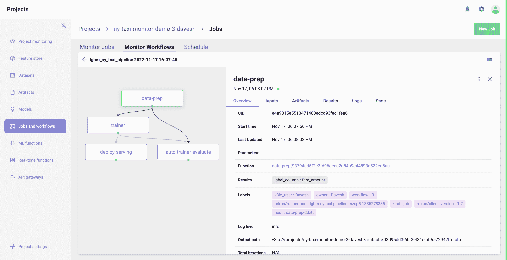

# 第 3 章. 开始你的第一个 MLOps 项目

TBD: 章节概述

## 识别业务用例和目标

AI 正在改变企业和全球经济。[PwC 报告预测](https://www.pwc.com/gx/en/issues/data-and-analytics/publications/artificial-intelligence-study.xhtml) 到 2030 年，AI 可能会为全球经济贡献高达 15.7 万亿美元。此外，45% 的总经济收益将来自产品增强，从而刺激消费者需求。这是因为 AI 将推动更大的产品多样性，随着时间的推移，个性化、吸引力和可负担性会增加。AI 帮助企业增加收入、削减运营成本、提高生产力并减少摩擦。此外，它还有助于长期战略目标，例如提高竞争力、降低风险、扩大用户群和消费者忠诚度、提高员工保留率和提升品牌价值，这最终会转化为更高的盈利能力和估值。

例如，[根据 McKinsey](https://www.mckinsey.com/industries/retail/our-insights/how-retailers-can-keep-up-with-consumers) 的说法，亚马逊高达 35% 的收入来自 AI 驱动的推荐。通过引入 *经常一起购买* 推荐（和其他推荐），亚马逊能够增加平均客户购物车大小和订单金额（向上销售和交叉销售），进而提高每个客户的平均收入和亚马逊每季度产生的电子商务收入。

[Netflix 估计](https://dl.acm.org/doi/10.1145/2843948) 其个性化推荐引擎每年价值 10 亿美元。根据 Netflix 团队的说法，“消费者研究表明，典型的 Netflix 会员在选择时可能在 60 到 90 秒后失去兴趣，在一两个屏幕上查看了十到二十个标题。之后，用户要么找到感兴趣的内容，要么用户放弃我们服务的风险会大幅增加。”因此，Netflix 高管认为，如果他们的订阅用户没有获得适当的推荐，他们每年可能至少损失 10 亿美元。

LATAM Airlines 是南美最大的航空公司。其业务在 COVID-19 的打击下遭受重创。他们损失了 80% 的收入并进入第 11 章。CEO 决定加倍押注 AI 以降低成本并提高盈利能力。在大幅削减成本的同时，他们显著扩大了数据科学和 MLOps 团队，并自动化了业务的几乎所有部分。现在他们的财务状况好得多。在其中一个用例中，目标是提高飞行燃油计算的精度以避免携带额外燃油。该项目每年为他们节省了数千万美元，并显著减少了二氧化碳排放（这也是一个重要的环境效益）。在另一个用例中，他们使用客户数据提供定制套餐和追加销售选项，该项目带来了数千万美元的额外收入。

AI 带来的显著成本节约的另一个典型例子是聊天机器人的使用。Juniper Research 的一份[报告](https://www.juniperresearch.com/press/chatbots-to-deliver-11bn-cost-savings-2023) 发现，到 2023 年，在零售、银行和医疗保健领域采用聊天机器人将实现每年 110 亿美元的业务成本节约，而 2018 年的估计为 60 亿美元。正确实施时，聊天机器人解决了客户服务人员可扩展性的需求，提升了客户服务质量并收集了有价值的消费者数据。

政府和非营利组织也使用 AI。他们解决的是与可衡量的业务目标无关但惠及整个人口的普遍需求，例如国家安全、改善医疗保健、环境保护、儿童安全、教育等。以下信息取自麦肯锡报告：[*为社会公益应用 AI*](https://www.mckinsey.com/featured-insights/artificial-intelligence/applying-artificial-intelligence-for-social-good)。（[pdf](https://ec.europa.eu/futurium/en/system/files/ged/mgi-applying-ai-for-social-good-discussion-paper-dec-2018.pdf)）并列出了不同的用例。

表 3-1. AI 用于公益的用例

| 类别 || 应用 |
| --- | --- |
| 危机响应 || 疾病爆发、移民危机、自然和人为灾害、搜索与救援 |
| --- | --- |
| 经济赋权 || 农业质量和产量、金融包容、经济增长倡议、劳动力供需匹配 |


| 类别 | 关注领域 |
|---|---|
| 教育 | 教育的可及性和完成度, 最大化学生成绩, 教师和管理人员生产力 |
| 环境 | 动物和植物保护, 气候变化与适应, 能源效率与可持续性, 土地、空气和水资源保护 |
| 平等与包容 | 无障碍与残疾, 剥削, 边缘化社区 |
| 健康与饥饿 | 治疗交付, 预测与预防, 治疗与长期护理, 心理健康, 饥饿 |
| 信息核实与验证 | 虚假新闻, 极化 |
| 基础设施 | 能源, 房地产, 交通运输, 城市规划, 水与废物管理 |
| 公共与社会部门 | 公共部门的有效管理, 社会部门的有效管理, 筹款, 公共财政管理, 公民服务 |
| 安全与司法 | 伤害预防, 公正起诉, 警务 |

人工智能也在通过解决重大的可持续性挑战而对世界产生积极影响。我参与的一个例子以一种新颖且创新的方式解决了突发洪水和淡水可用性问题。新加坡水文信息学研究所开始使用分布在亚洲大城市各处的数千台 CCTV 摄像头作为实时传感器来分析和测量降雨量。他们利用此数据生成高度空间分布的地面降雨数据。然后，这些数据被输入他们构建并通过自动化 MLOps 管道部署的复杂深度学习算法中，以创建准确的实时降雨预测。他们利用降雨预测来管理洪水，通过提前移动防洪闸门并将多余降雨引导至水库，这些水库可以储存并将其转化为供民众饮用的水。

## 寻找 AI 用例

在定义 AI 项目时，目标或假设不能停留在想要增加顶线收入或削减成本的抽象层面。相反，它应解决特定的用例或业务问题，并具有可衡量的成果和投资回报率。例如，一个应用程序可以根据可能一起购买的产品提供购买建议，并将平均客户订单金额提高 X%，这将积极影响像提高每个客户平均收入和顶线收入等顶层目标。

用例通常会落入以下一个或多个类别（按复杂性和价值排序）：
* 用于支持各种决策的智能预测和数据分析。
* 创新的流程或服务自动化，以降低成本并提高生产力。
* 产生增量价值的新产品和服务。
* 更简单或更好的用户体验，以及自主系统（机器人、自动驾驶汽车等）。

同一个项目可能同时解决成本削减，并增加收入或改善用户体验。例如，设定一个围绕构建 AI 模型来预测特定产品需求的目标。该预测可以帮助零售商确保不会缺货，从而避免收入损失。额外的好处是改善了客户体验，这会导致更快乐、更忠诚的客户购买他们想要的产品。

你可以阅读 [麦肯锡 2021 年人工智能现状报告](https://www.mckinsey.com/capabilities/quantumblack/our-insights/global-survey-the-state-of-ai-in-2021)，其中描述了最常见 AI 用例的采用情况。

更详细的文章见于 [人工智能帮助企业发展的 10 种方式：用途与示例](https://www.intellspot.com/artificial-intelligence-business/)。以下是它描述的主要要点：

**人工智能可以帮助您的业务的 10 种方式：**
* *通过产品推荐提高收入：* AI 驱动的推荐系统根据客户的购买历史或相似用户的行为等因素向用户推荐产品。因此，AI 系统帮助客户找到满足其需求的产品。
* *用于提升客户服务的聊天机器人：* 聊天机器人是一种软件，可通过网站、移动应用、电话等与用户进行人类对话（或聊天）模拟。如今，人们希望随时随地获得快速、简单且个性化的客户服务。聊天机器人可以提供这种服务。
* *帮助您创建最佳内容营销策略：* 人工智能使用算法分析现有数据并创建最佳内容营销策略。AI 帮助您决定写什么、用什么关键词、多久发布一次、用什么渠道进行内容分发等。
* *情感分析以衡量客户情绪：* 使用情感分析，企业可以检测客户表达的意见和感受，并衡量放置在数百万网页、评论和论坛中的反馈。
* *驱动您的竞争情报：* 通过在竞争情报工作中利用人工智能，您可以轻松地监视、跟踪并了解竞争对手在做什么以及是什么让他们成功。
* *销售预测以发展您的业务：* AI 允许进行准确的销售预测。准确的销售预测使企业能够计算客户购买的概率、预测短期和长期表现，并相应地分配资源。
* *帮助您优化价格：* 许多因素影响您的价格：价格历史、品牌声誉、竞争、质量、季节、运营成本、需求等。人工智能可以在确定最佳价格时成功考虑所有这些因素。
* *智能网络安全：* AI 驱动的软件可以通过多种方式处理网络安全：漏洞、管理、网络钓鱼、检测、网络安全、行为分析、预防控制等。
* *帮助您创造愉悦的店内体验：* 人工智能有能力彻底改变传统的店内体验，并通过令人愉悦的个性化将其提升到下一个水平。
* *节省时间和降低成本：* 人工智能技术允许企业自动化各种流程，释放员工时间，并帮助提高生产力。

精选的 [前 100 名人工智能用例](https://www.marketsandmarkets.com/top-100-artificial-intelligence-use-cases.asp) 按行业和重要性分类的列表可以为您提供更多灵感。以下图表（来自文章 [人工智能驱动的内容营销如何推动您的业务增长](https://www.smartinsights.com/content-management/content-management-systems/how-ai-powered-content-marketing-can-fuel-your-business-growth/)）说明了 AI 如何在不同的营销用例中使用。



最好的开始方式是组织一次头脑风暴会议，邀请所有不同的业务和技术利益相关者，以获取用例想法并验证其可行性。

## 定义目标和评估投资回报率

尽管 AI 项目的成功率似乎有所提高，但许多项目在其 AI 投资上获得的价值极少甚至为零。其中一个原因是相对较少的项目部署到生产环境，主要是由于文化和组织挑战；在许多情况下，它们被当作一堆小型科学项目对待，未能实现投资回报率。此外，生产部署很复杂，因为它们通常需要在可扩展且稳健的方式下与现有系统、流程、在线数据资产和应用程序集成。


# AI 项目投资回报率、风险与考量

增加成功率的一种方式是定义可实现且可衡量的目标。识别、优先排序和设定目标是多功能团队的共同努力，应包括业务负责人、领域专家、数据科学和工程团队等。这有助于确保与公司目标保持一致，同时具备必要的业务和领域专业知识。AI 计划还可能需要有效的治理、合规、伦理、成本和风险考量。

要评估项目的投资回报率，你需要考虑投资和回报，包括直接（硬性）和软性（间接）。

### 投资
* 人力（数据科学家、数据工程师、MLOps 等）
* 计算和数据基础设施
* 软件许可和服务
* 顾问和培训

### 回报
* 成本节约
* 收入增加
* 节省时间或提高生产力
* 提高竞争力或用户基数

必须考虑收益的不确定性。AI 模型很可能存在错误，其准确率低于 100%。因此，估算错误率和犯错成本会有所帮助。此外，做出正确预测并不意味着你的行动会产生预期的用户行为。例如，你预测用户会喜欢推荐的产品，但推荐没有及时送达或用户看不到。

图 3-2 说明了如何计算 ML 项目的投资回报率。



另一个挑战是，虽然历史数据可能可以访问，但现实世界的数据可能表现不同或无法访问，导致生产部署结果不同。因此，基于机器学习的 AI 模型随着时间的推移可能会性能下降。投资回报率和关键绩效指标应持续监控，以防止价值衰减。为 MLOps 解决方案以及持续的开发和部署模型进行预算也是必不可少的。

AI 应用也带来潜在风险，并使组织面临责任、网络安全漏洞、合规或法律挑战等风险。

好的一面是，AI 的许多投资可以在多个项目之间共享。在组织内建立通用 AI 平台、实践和知识共享（一个 *AI 工厂*）可以显著影响投资回报率。根据 [McKinsey 2021 年 AI 现状报告](https://www.mckinsey.com/capabilities/quantumblack/our-insights/global-survey-the-state-of-ai-in-2021)，“从 AI 采用中获得最大底线影响的公司更有可能遵循核心和先进的 AI 最佳实践，包括 MLOps；将 AI 工作转移到云端；并且比同行更高效、更有效地在 AI 上支出。”

对项目投资回报率产生重大影响的是找到买与建之间的正确平衡。当今市场上的许多产品和服务已融入 AI，这有助于减少开发周期和风险。预训练或部分训练的 ML 模型可以节省时间、资源和数据。MLOps 平台可以节省大量的开发开销和技术债务，让你专注于业务问题。

# 如何构建成功的 ML 项目

各种调查表明，组织中 AI 成功的主要阻碍是文化挑战，例如对变化的适应缓慢、业务流程再造、员工教育、数据素养要求、组织对齐以及消除信息孤岛以支持业务目标。许多组织报告称，高层管理人员直接参与对 AI 项目的成功至关重要。《哈佛商业评论》专门撰写了一篇文章，讨论 [首席执行官在领导数据驱动文化中的关键作用](https://hbr.org/2020/03/how-ceos-can-lead-a-data-driven-culture)，McKinsey 还撰写了关于 [首席执行官与 MLOps 的作用](https://www.mckinsey.com/capabilities/quantumblack/our-insights/scaling-ai-like-a-tech-native-the-ceos-role) 的文章。

但仅解决文化挑战是不够的。要实现成功的 AI 战略，你需要围绕数据和 AI 重新设计所有业务流程和任务：

* 建立系统和流程，用于持续收集、整理、分析、标注和维护高质量数据。有效算法最显著的阻碍是数据不足或质量差。
* 开发有效且可靠的算法，这些算法可以解释、不会对特定群体或个人产生偏见、拟合正确、持续监控并使用新鲜数据定期更新。
* 将业务应用的数据资产、AI 算法、软件和用户界面整合到一个具有明确所有权和里程碑的单一项目中。避免组织信息孤岛。
* 建立健全的工程和 MLOps 实践，以持续开发、测试、部署和 [监控](https://www.iguazio.com/glossary/model-monitoring/) 端到端 ML 应用。

## 项目审批与原型设计

在承诺项目之前，你需要构建并批准你的计划。为此，回答以下问题：

1. *目标*：该 AI 用例的目标是什么，它们是否与战略业务目标一致？
2. *KPI*：什么才算成功，如何衡量？
3. *数据*：你是否有足够的训练模型的数据（和标签）？能否在生产和推理中获得相同的数据？数据是否包含偏见？能否获得用于再训练的新鲜标注数据？
4. *人员*：谁将负责（拥有者）该项目？需要哪些资源和技能？它们是否可用，还是需要招聘？
5. *算法*：你计划使用哪种 AI 方法和算法？能否找到现有的模型？
6. *伦理和风险*：该用例是否存在伦理或法律问题（隐私、GDPR、偏见）？是否引入了任何安全风险？能否保护模型免受恶意攻击？
7. *基础设施*：技术和基础设施的挑战和要求是什么？实施挑战是什么？预期的基础设施成本是多少？
8. *连续性*：能否持续监控和维护应用？能否足够频繁地更新数据和模型？应用部署后如何验证 KPI 和投资回报率？

回答这些问题并获得项目批准后，下一步是通过快速原型设计和仿真工具验证假设并原型化应用。

* 手动从不同来源收集数据。确保你使用的数据以后可以按规模持续摄取和准备。
* 探索数据并寻找模式和信号。验证哪些数据集和特征是必需的，哪些没有价值。接下来，尝试派生特征（日期提取、聚合、间接值，例如将邮政编码数字转换为人口统计或地理位置数据等）。
* 准备数据，使用相关子集训练模型，验证其按预期运行，并尝试不同的框架、算法和现有模型。
* 构建原型应用，模拟端到端流程：接收请求、准备数据、使用模型推理、驱动操作并与外部 API/系统集成、记录性能和 KPI 监控的重要指标等。


构建原型可以节省时间、降低风险并改善结果。节省时间和精力的一种极佳方式是拥有包含应用骨架和最佳实践的项目模板。从原型迁移到生产级机器学习应用可以通过多次迭代完成，每次迭代都增加更多数据、逻辑和健壮性。从第一天起将项目拆分为功能模块（例如，数据准备、[训练](https://www.iguazio.com/glossary/model-training/)、测试、服务等）并定义模块之间的接口至关重要。这允许对每个模块进行独立开发，并促进团队成员之间的更好协作。

必须定义初始原型的范围、里程碑和目标。一旦实现并可以评估目标，执行团队需要批准项目的产品化并分配其成功所需的额外资源。

## 扩展与产品化项目

为生产和扩展而设计的机器学习项目包含以下三个管道：

* `Data pipeline`：利用全量历史、运营和[实时数据源](https://www.iguazio.com/glossary/real-time-ml/)，并将原始数据转换为用于训练和推理阶段的特征。[特征存储](https://www.iguazio.com/glossary/feature-store/)可以加速数据管道的开发，并实现从其他项目复用现有数据特征。
* `Model development (CI/CD) pipeline`：自动化获取相关数据、数据验证、使用不同参数和框架进行训练、评估和测试模型、部署推理管道等流程。
* `Application pipeline`：拦截请求或事件、丰富和处理数据、使用模型进行推理、应用相关操作并监控各种资源、数据、模型和 KPI 指标。

管道必须为持续开发和运营而设计。新版本可以在不中断整体应用的情况下部署。建议以冲刺方式工作（每周、每月）。每个冲刺结束时，查看完整应用的运行情况。每个冲刺提供更多功能或健壮性，直到达到可部署且生产质量的应用。部署应用后，继续通过功能改进或错误修复进行迭代。

图 3-3 说明了项目工程流程。



在当今普遍的情况下，每个管道使用不同的框架，并由具有不同技能的不同团队维护。例如，数据管道使用 [Spark](https://spark.apache.org/)、[Flink](https://flink.apache.org/) 和 [Airflow](https://airflow.apache.org/)，模型开发使用 [Kubeflow](https://www.kubeflow.org/)，应用管道使用普通容器或无服务器函数。如此众多的工具和框架会带来运营挑战。此外，每个框架使用不同的元数据布局和 API，迫使增加额外的胶水逻辑和转换。因此，在框架间使用标准元数据和抽象对于简化并优化部署至关重要。

机器学习项目由不同的团队成员持续协作开发。因此，像 [Git](https://git-scm.com/) 这样的版本化源代码控制系统、敏捷开发流程和 CI/CD 自动化是成功结果的强制性要求。

## 项目结构和生命周期

ML 项目是针对特定机器学习应用所有工作的容器。项目托管函数、工作流、制品、笔记本、特征和配置。项目拥有所有者和成员，并具有基于角色的访问控制，应定义谁可以访问什么以及如何访问。



项目组件（参见：图 3-4）：

* `Functions`：代码元素及其包需求、配置、元数据、资源定义等。
* `Workflows`：管道（`DAG`）定义，例如哪个步骤在哪个步骤之后以及参数如何在步骤之间传递。
* `Artifacts`：项目中使用的各种数据制品（文件、数据集、模型等）的元数据和指针。
* `Notebooks`：用于交互式开发、数据探索和可视化的 [Jupyter](https://jupyter.org/) 笔记本。建议仅在笔记本中存储生产代码，因为在笔记本中测试、自动化和跟踪更改更困难。
* `Features`：特征存储特征的定义以及生成或检索这些特征的数据管道（通常称为特征集和特征向量）。
* `Configurations`：参数、密钥、构建和安装说明等。

项目应存储在源代码控制系统（`Git`）中并进行版本管理，或归档。然后，它们可以在不同的 IDE 中作为项目打开和编辑（在 `Jupyter`、 [PyCharm](https://www.jetbrains.com/pycharm/)、 [VSCode](https://code.visualstudio.com/) 等中）。这种方法支持版本控制、协作和 CI/CD。

你可以为团队定义最佳实践和项目模板。这可以简化新项目的创建，并帮助在现有项目中聚焦和优先排序。示例 3-1 演示了如何定义项目目录结构：

### 示例 3-1. 项目目录布局示例

```
my-project           # Parent directory of the project (context)
├── data             # Project data for local tests or outputs (not tracked by version control)
├── docs             # Project documentation
├── src / pkg-name   # Project source code (functions, libs, workflows)
├── tests            # Unit tests (pytest) for the different functions
├── notebooks        # directory for storing notebooks
├── README.md        # Project README
├── requirements.txt # Default Python requirements file (may have per function requirements files)
├── setup.py         # Python package setup file
├── LICENSE          # License file
└── ...
```

类似 [MLflow](https://mlflow.org/) 和 [MLRun](https://www.mlrun.org/) 的 MLOps 框架在项目目录中存储额外的元数据和配置文件（`MLproject`、`project.yaml`）。这允许从 `Git` 加载项目，自动重建其所有对象和配置，并对配置和元数据进行版本控制（又名 `Git-ops`）。

在持续开发和集成流程中（图 3-5 所示），开发人员创建 ML 项目并编写和测试其代码和模型。一旦准备就绪，他们将更改推送到源代码控制系统（`Git`）。接下来，项目加载到开发集群中，在更大数据集和类似生产设置的环境上运行额外的自动化测试。然后，对代码应用错误修复，直到项目稳定并准备发布。最后，当发布准备就绪时，为项目分配版本标签，并在滚动升级过程中将该版本部署到生产集群。



将项目划分为功能构建块（函数、工作流、特征等）并使用 `Git` 可实现持续协作开发。此外，将代码、ML 对象、元数据和配置放在同一个版本化项目仓库中，可简化测试、部署到生产环境以及出现问题时回滚到旧版本。

## 从 A 到 Z 的 ML 项目示例

本节演示了一个完整的 ML 项目以及从初始探索到大规模持续部署的开发流程。

开发和产品化流程包括以下步骤（图 3-6 所示）：

* 初始数据收集（用于探索）。


* 探索性数据分析 (EDA) 和建模。
* 数据和模型流水线开发（数据准备、训练、评估等）。
* 应用流水线开发（拦截请求、处理数据、推理等）。
* 项目的扩展和产品化（添加测试、扩展、超参数调优、实验跟踪、监控、流水线自动化等）。
* 持续运营（CI/CD 集成、升级、重新训练、实时运营等）。



## 探索性数据分析 (EDA)

*探索性数据分析* (EDA) 使您能够深入了解您的数据集、其质量以及它们如何影响目标变量。EDA 对于确定模型中应使用哪些原始和派生特征以及检验您的假设至关重要。在许多情况下，EDA 需要领域特定知识（或直觉）来确定可以使用哪些变量以及它们如何影响模型。EDA 通常是手动和交互式的过程，但可以使用各种工具来自动化并更好地可视化信息收集和分析。

EDA 过程包括以下步骤：

1. 导入相关数据集（从整体数据中提取）。
2. 理解数据结构和统计信息。
3. 清理和净化。
4. 转换 - 生成派生特征。
5. 特征分析。
6. 跨特征关系和相关性分析。
7. 原型化模型并评估特征重要性。

该过程是迭代的。您可能需要从其他来源获取更多数据，或者您可能会发现某些数据无用且不有助于您的模型，或者各种转换会产生更好的结果。

第一步是了解数据形状、类型、统计分布、类别、缺失值等。接下来是数据清洗，删除无用的列或行，处理缺失值，删除重复项以及识别和修复记录错误。

在许多情况下，原始特征不是一个好的指标，您需要创建与目标结果相关性更好的派生特征。一些示例：

* 从日期/时间字段中提取日期/时间组件（一天中的小时，一周中的天，`is_weekend` 等）。
* 值映射（对数尺度、分箱、编码、分组等）。
* 按时间或实体聚合（过去一小时的点击次数、客户的总购买量）。
* 通过连接次要数据集的数据获得的重要特征（将邮政编码映射到地理位置或社会经济信息，将产品 ID 映射到其价格或类别等）。

一旦您拥有所有特征，就该分析并可视化它们的行为、直方图、异常值和分类。您可能可以应用转换以改善数据质量和影响。

下一步是找到显示一个变量对另一个变量（最好是对目标）影响的有趣关系。某些特征可能没有任何影响，可以删除，而某些特征可能需要转换以增加其影响。在此阶段，您还可以评估数据的潜在偏差。

当特征经过清理和准备后，您可以构建一个基础模型或使用 AutoML 工具来原型化模型。一旦您拥有模型，请检查您的假设，看看是否可以预测目标变量，并评估您使用的特征的重要性与必要性。

## 数据和模型流水线开发

在 EDA 阶段，过程是探索性和交互式的。现在是时候构建数据准备、建模和测试，并将它们转变为高质量、健壮且可重用的代码。如第 2 章所述，首选的方法是为每个阶段创建单独的 python 函数，为其提供参数，记录其输出并创建单元测试。然后，笔记本可以交互式地执行这些函数并可视化其结果。

一旦各个函数正常工作，您就可以创建一个工作流（`DAG`），在可扩展的本地或云资源上通过自动化流水线运行不同的任务，并将该工作流集成到自动化的 `CI/CD` 流程中。

一个最小的流水线包括以下步骤：

1. 数据准备：准备训练和测试数据集。
2. 模型训练：使用数据集和一些参数训练模型。
3. 评估：根据测试数据集评估模型并生成各种报告和指标。

实际流水线将有更多测试和部署步骤，并使用不同的参数组合运行训练步骤（超参数调优）。

您可以在下面查看三个函数的代码示例，示例 2-1 演示了接受 `dataframe` 和必需的 `test_size`，处理数据，并将其拆分为 `train` 和 `test` 数据集。

### 示例 3-2. 数据准备函数代码示例（部分）

```
def data_preparation(dataset: pd.DataFrame, test_size=0.2):
    """A function which preparation training dataset

    :param dataset: input dataset dataframe
    :param test_size: the amount (%) of data to use for test

    :return train_dataset, test_dataset, label_column
    """
    dataset = clean_df(dataset).dropna(how="any", axis="rows")

    ... additional processing

    train, test = train_test_split(dataset, test_size=test_size)
    return train, test, label_column
...
```

#### 注意

使用特征存储是处理数据更强大和自动化的方式。这将在下一章中讨论。

下一步是使用新准备的数据集训练模型。例如，以下函数（参见：示例 3-3）接受训练数据集和各种参数（将在以下各节中用于超参数调优），训练模型并返回 ML 模型。

### 示例 3-3. 模型训练器函数代码

```
def train(
    dataset: pd.DataFrame,
    label_column: str = "label",
    n_estimators: int = 100,
    learning_rate: float = 0.1,
    max_depth: int = 3,
    model_name: str = "cancer_classifier",
):
    # Initialize the x & y data
    x = dataset.drop(label_column, axis=1)
    y = dataset[label_column]

    # Initialize the ML model
    model = ensemble.GradientBoostingClassifier(
        n_estimators=n_estimators, learning_rate=learning_rate, max_depth=max_depth
    )

    # Train the model
    model.fit(x, y)
    return model
```

最后一步是使用测试集评估模型。`evaluate` 函数（<<>>）接受训练好的模型和训练集作为输入，并生成各种报告和图表（例如 ROC 曲线、特征重要性等）。由于 `evaluate` 函数是通用的，它可以实现一次，存储在像 `MLRun` 的函数中心这样的共享存储库中，并在多个项目中使用。完整的训练和评估函数的实现可以在 [MLRun 训练和评估中心函数](https://www.mlrun.org/hub/functions/master/auto_trainer/latest/source/) 中查看。

### 示例 3-4. 评估函数代码示例（部分）

```
def evaluate(
    model,
    dataset: pd.DataFrame,
    label_columns: Optional[Union[str, List[str]]] = None,
):
    """
    Evaluating a model and generate reports and artifacts.

    :param model:             The model path or object.
    :param dataset:           The dataset to evaluate the model on.
    :param label_columns:     The target label(s) of the column(s) in the dataset.
                              for Regression or Classification tasks.
    """

    # load the model and dataset
    # run prediction using the test dataset
    # generate plots and reports and log them to the artifacts store
    # update the model, the result metrics and metadata in the model registry
```

一旦您实现了这三个函数，您就可以定义一个执行流水线（`DAG`）来运行一个函数并将其结果传递给下一步，依此类推。


MLOps 的重要组成部分是能够为每个实验（即实验跟踪）记录所有输入、元数据、数据和结果，以便能够理解并解释特定模型结果是如何获得的。例如，MLFlow 和 MLRun 等 MLOps 框架会跟踪函数的执行并记录数据和结果。这将在后续章节中更详细地介绍。

## 应用程序管道开发

模型只有在部署并集成到实际应用中时才具有价值。例如，ML 应用会从用户或其他服务接收相关数据或请求，对其进行处理并与模型一起使用以做出预测并生成某些操作。此外，生产应用还需要监控、日志记录、生命周期管理等。应用程序、数据、模型和监控活动的流程称为应用程序管道。

应用程序管道有两种类型。实时（或在线）管道，不断接受事件或请求并立即响应；批处理管道，通过 API 或在给定计划时触发。批处理管道通常在每次运行中读取并处理更大的数据集。

### 实时应用程序管道

图 3-7 描述了典型的实时应用程序管道及其不同步骤。应用程序管道可能会接收请求并实时（同步）响应，或者它可能会处理请求并将结果写入另一个服务或存储/数据库系统（异步或流式管道）。



实时管道可以通过串联单个容器化函数手动实现，也可以通过使用实时管道框架（如 MLRun Serving Graphs、Apache Beam 或 AWS Step Functions）进行自动化。第 6 章详细介绍了不同的选项。

#### 注意

为训练管道实现的某些数据处理逻辑现在为事件驱动架构重新实现（实时处理，逐事件处理 vs. 使用大型数据帧）。使用特征存储时可以消除这种工程开销。特征转换逻辑会根据相同的抽象定义（称为特征集）自动为批处理和实时生成。

一旦应用程序管道和模型部署完成，它们可以自动跟踪和监控以识别资源使用情况、模型漂移、模型性能等。

### 批处理应用程序管道

图 3-8 描述了典型的批处理（离线）应用程序管道及其不同步骤。例如，API 调用或计划事件可能会触发批处理管道。它加载并处理一个或多个数据集，进行批处理推理和后处理，并将结果写入目标存储。



批处理应用程序管道可以使用与训练相同的管道引擎执行。

## 项目的扩展与产品化

在构建了模型开发组件（数据准备、训练、评估）和应用程序管道之后，是时候添加测试并自动化和扩展项目了。

### 添加测试

提高 ML 应用质量的第一步是为每个组件添加单元测试。常见做法是使用 [`pytest`](https://docs.pytest.org/) 并将测试文件放在 `/test` 目录下。例如，以下代码演示了针对 `data_prep` 函数的单元测试实现。

```
def test_data_preparation_pipline():
    df = get_data()
    train, test, label = data_preparation(df, 0.2)

    assert label == 'fare_amount'

    # check for expected types
    assert isinstance(train, pd.DataFrame)
    assert isinstance(test, pd.DataFrame)
```

您可以为每个函数或模块构建额外的单元测试，并验证是否正确覆盖了使用模式。要运行测试，只需执行 `pytest` 并指向 `tests` 目录。每次将更改推送到源代码库时重复这些步骤。

```
python -m pytest tests
```

许多 Python 包可用于测试代码的格式、一致性、质量、覆盖率等（如 `black`、`isort`、`flake8` 和 `interrogate`）。您可以将它们添加到项目中，并在提交代码之前执行，或作为 CI 流程的一部分执行。

例如，使用 `black` 格式化 `\src` 和 `\tests` 中的代码：

```
python -m black src tests
```

额外的测试（验证数据、模型和 API）应作为 ML 管道的一部分实现。

### ML 管道与超参数优化

为了找到最佳模型，您应该使用不同的参数组合（超参数搜索）运行相同的训练代码。然而，在笔记本电脑上执行可能需要时间和资源。相反，定义搜索选项并让其在云中或集群上并行运行。许多 MLOps 框架支持超参数作业。如果您提供超参数选项（策略、选择标准、并行级别、资源、提前停止等），它们将为您执行所有排列并自动选择最佳结果。

模型开发是一个多阶段过程。它需要数据摄取、准备、验证、训练一个或多个模型以及测试和评估模型。您还可以使用新生成的模型和数据项部署和测试应用程序管道。

大多数 MLOps 平台都有描述和运行完整工作流（DAG）步骤的方法。一些知名开源工作流执行工具是 Airflow 和 Kubeflow pipelines。还有一些 CI 框架，如 [GitHub Actions](https://github.com/features/actions)、[Gitlab CI](https://docs.gitlab.com/ee/ci/) 和 [Jenkins](https://www.jenkins.io/)，可以运行简单的工作流。但 CI 工作流工具缺乏 MLOps 能力，例如处理大型数据集、跟踪执行和工件、运行分布式工作负载等。

诸如 MLRun 之类的框架为 CI/CD 系统添加了缺失的 MLOps 功能，并简化了 ML 管道的构建和执行方式。在实现、执行和测试每个函数后，您只需将它们放入 DAG 中并运行即可。MLRun 可与不同的底层工作流引擎（如 Kubeflow pipelines）一起工作，并且可以与所有 CI 框架一起工作。

ML 应用的 CI/CD 管道可能会实现以下步骤：

1. 数据准备
2. 使用超参数和网格搜索进行模型训练
3. 模型评估
4. 应用程序管道部署（使用最佳模型）

当使用 MLRun 执行管道时，MLRun 会跟踪进度和结果，您可以在客户端（IDE、Jupyter 或其他）或 MLRun UI 中查看它们。图 3-9 显示了 MLRun 中工作流跟踪 UI 的示例。



## CI/CD 与持续运营

您现在拥有了所有要素：数据管道、模型开发管道和应用程序管道。然而，这些组件会不断发展和增强。它们需要一个敏捷的过程来监控结果、推送更新、测试和部署。

### 持续监控数据和模型

在传统服务中，我们监控应用程序性能、资源使用、错误等。然而，在 ML 应用中，监控数据和模型也至关重要（参见 REFTO：第二章中的持续模型和数据监控）。

数据和模型监控层会获取在数据准备和模型训练阶段收集的元数据（数据类型、统计信息等），并将其与生产数据和指标进行比较。MLRun 自动化了此过程。元数据会在开发时与模型和特征一起自动记录，并在实时或定期与生产数据的元数据和行为进行比较（由模型服务类自动生成）。


你可能希望避免不断盯着仪表板查看模型或数据性能问题。相反，你可以定义触发策略和操作。例如，当达到某个阈值时，通知可以提醒管理员或启动自动流程来重新训练模型或缓解潜在错误。

## 与 CI/CD 服务集成

CI/CD（持续集成和部署）是在敏捷流程中构建和维护现代服务的标准方法。第 2 章介绍了 REFTO: CI/CD for ML 以及与传统 CI/CD 的区别。参考项目使用 `MLRun` 将 GitHub Actions CI 服务扩展到 ML 和数据应用。

作为第一步，你需要创建脚本来执行不同的测试和验证。标准方法是使用 `Makefile`。在 `Makefile` 中添加构建、测试等命令。以下是 make 命令的一些示例（请参阅项目目录中的完整 `Makefile`）：

```
.PHONY: lint
lint: fmt-check flake8 ## Run lint on the code

.PHONY: fmt-check
fmt-check: ## Format and check the code (using black and isort)
	@echo "Running black+isort fmt check..."
	$(PYTHON_INTERPRETER) -m black --check --diff src tests
	$(PYTHON_INTERPRETER) -m isort --check --diff src tests

.PHONY: flake8
flake8: ## Run flake8 lint
	@echo "Running flake8 lint..."
	$(PYTHON_INTERPRETER) -m flake8 src tests

.PHONY: test
test: clean ## Run tests
	$(PYTHON_INTERPRETER) -m pytest -v --capture=no --disable-warnings tests
```

使用此 `Makefile`，输入 `make lint` 或 `make test` 将运行 lint 和 pytest 测试。

### 注意

CI/CD 系统（如 Jenkins 或 GitHub Actions）会检查你的项目并在保留目录中搜索 CI 脚本，并在代码更改或合并时执行它们。

除了静态测试之外，你还应自动运行 ML 流水线。然而，由于 ML 流水线可能消耗大量计算资源，你可能希望用户明确请求运行 ML 流水线。这可以通过在 Git 拉取请求中输入命令（例如 `/run`）来完成，这将触发在云资源上执行 ML 流水线并自动化执行、数据移动和跟踪。

你可以使用相同的方法来自动化部署、运行详尽测试、应用治理等，同时添加更多 CI 脚本和 ML 流水线以匹配它们，并限制谁可以在哪个阶段（开发、暂存、生产）执行哪个工作流。

## 批判性思维讨论问题

*   TBD

## 练习

*   TBD
