# 第 4 章 使用数据和特征存储

机器学习将数据转化为预测逻辑。数据对该过程至关重要，可以来自许多来源，并且必须经过处理才能使用。因此，数据管理和处理是机器学习中最关键的组件。

数据可以源自不同的来源：

*   *文件*：存储在本地或云文件中的数据。
*   *数据仓库*：托管历史数据交易的数据库。
*   *在线数据库*：托管最新事务性或应用数据的 SQL、NoSQL、图或时序数据库。
*   *数据流*：托管实时事件和消息的中间存储（用于在服务之间可靠地传递数据）。
*   *在线服务*：任何可以提供有价值数据的云服务（这可能包括新闻网站、社交、金融、政府和新闻服务）。
*   *传入消息*：可通过电子邮件或任何其他消息服务（Slack、WhatsApp、Teams 等）到达的异步消息和通知。

源数据被处理并存储为特征，用于[模型训练](https://www.iguazio.com/glossary/model-training/)和模型流程。在许多情况下，特征存储在两个存储系统中。一个用于批处理访问（训练、批预测等），另一个用于在线检索（用于实时或在线服务）。因此，可能存在两条独立的数据处理管道，一条使用批处理，另一条使用实时（流）处理。

数据源和处理逻辑可能会随时间变化，导致处理后的特征以及由此数据产生的模型发生变化。因此，对数据、处理逻辑进行版本控制并跟踪数据血缘是任何 MLOps 解决方案的关键要素。

交付准确且高质量的生产模型需要大量数据和显著的计算能力。生产数据的处理可使用分布式分析引擎（[Apache Spark](https://spark.apache.org/)、[Dask](https://www.dask.org/)、[Google BigQuery](https://cloud.google.com/bigquery) 等）、流处理技术（如 [Apache Flink](https://flink.apache.org/)）或多阶段数据管道进行扩展。

用于自动化与数据源集成、可扩展的批处理和实时数据处理、数据版本控制以及特征管理的机制之一是使用特征存储。特征存储是生产、共享和监控特征的中心枢纽。特征存储在现代 MLOps 实现中至关重要，并在本章中将作进一步详细描述。

## 数据版本控制和血缘

模型和数据产品源自数据。因此，收集元数据并追溯数据的来源可以更好地控制和治理数据产品。此外，如果你想检查数据产品的特定版本，就必须了解用于生成该产品或模型的原始数据。

数据版本控制、血缘和元数据管理是一组必不可少的 MLOps 实践，解决以下问题：

1.  *数据质量*：追踪数据在组织系统中的流转并收集元数据和血缘信息可以帮助识别错误和不一致。这使得采取纠正措施并改善数据质量成为可能。
2.  *模型可重现性和可追溯性*：访问历史数据版本使我们能够重现模型结果，可用于模型调试、故障排除以及尝试不同的参数集。
3.  *数据治理和可审计性*：通过了解数据的来源和历史，组织可以确保数据遵循预期政策和法规，追踪错误来源，并执行审计或调查。
4.  *合规性*：数据血缘可以帮助组织证明其符合 GDPR 和 HIPAA 等法规。
5.  *更简单的数据管理*：元数据和血缘信息能够实现更好的数据发现、映射、分析、集成和迁移。
6.  *更好的协作*：数据版本控制和血缘可以通过提供对 ML 模型中使用的数据的清晰一致视图，并在处理升级时促进数据科学家和 ML 工程师之间的合作。
7.  *依赖跟踪*：了解每个数据、参数或代码更改如何影响结果，并提供有关由于数据源修改而需要更改的数据或模型对象的洞察。

### 其工作原理

如图 4-1 所示，数据生成流程可以抽象为一组数据源和参数作为输入，用于数据处理（计算）任务，该任务生成一组数据产品或工件。输出工件可以是不同类型的文件、表、机器学习模型、图表等。

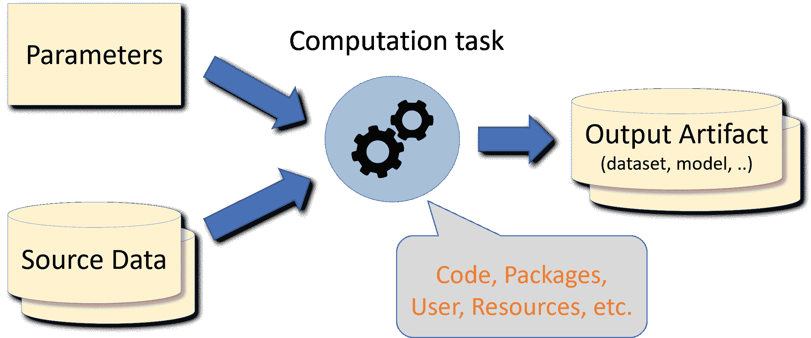


数据跟踪系统记录输入（数据源和版本、参数）以及计算任务（代码、软件包、资源、执行用户等）的信息。然后，它将这些信息作为元数据添加到输出工件中。元数据可能包括用户提供的标签或标记、数据结构、模式、统计信息等附加信息。通常，元数据不会复制到每个输出工件中，而是通过链接引用，以消除数据重复。

如图 4-2 所示，第一阶段任务（例如数据准备）的输出工件可以作为后续任务（例如模型训练、测试等）的数据输入。

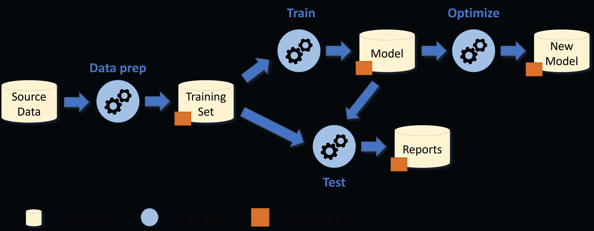

通过用户界面或 SDK 访问数据产品时，元数据让我们可以看到确切的数据源、参数以及计算任务的完整细节。我们还可以追溯多阶段流程中生成的数据的进展，并检查所有附加元数据。

每次数据处理任务运行时，都会创建输出工件的新版本（参见图 4-3）。每个版本都标记有唯一的版本标识符（`commit id`），也可以使用有意义的版本名称进行标记，例如`master`、`development`、`staging`、`production`等。这类似于在对源代码进行版本控制时`GIT`的流程。

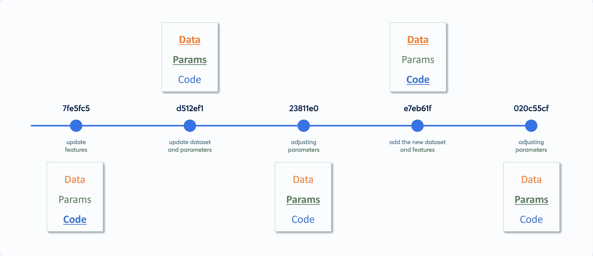

假设您每小时重复运行一个特定任务。它具有相同的输入和参数，或者您可能会进行一些小的更改，这些更改不会改变输出数据的结果。这可能导致大量冗余数据堆积，并且多个版本会存储相同的内容。许多数据版本控制解决方案通过实现*内容去重*来解决这一挑战。

当生成工件时，会计算内容的加密哈希值（例如使用`MD5`或`SHA1`算法），它代表内容的唯一性。最后，将哈希值与旧版本进行比较，或将其用作存储系统中的索引。这样，内容只需存储一次。

由于数据版本控制解决方案的本质是除了源数据之外还跟踪各种属性（代码、参数、用户、资源等），因此必须与源控制系统（`GIT`）和作业或管道执行框架很好地集成。否则，用户必须手动将框架粘合在一起，并提供引用元数据以便与数据一起记录。

许多框架（[MLflow](https://mlflow.org/)、[MLRun](https://www.mlrun.org/)等）提供日志 API，用户调用`log_artifact()`方法，该方法会自动记录并对新数据以及代码和执行元数据进行版本控制。许多框架可能会提供`auto logging`解决方案，无需代码插装。相反，它将通过理解用户代码和 ML 框架的功能，自动判断哪些数据和元数据需要保存和版本控制。

## 常见 ML 数据版本控制工具

存在一组开源和商业的数据版本控制框架。本书重点介绍和比较开源选项[DVC](https://dvc.org/)、[Pachyderm](https://www.pachyderm.com/)、MLflow 和 MLRun。

### DVC (数据版本控制)

DVC 最初是为 ML 设计的数据版本控制工具，后来扩展以支持基本的[ML 工作流自动化](https://www.iguazio.com/glossary/automated-machine-learning/)和实验管理。它利用您已经熟悉的现有软件工程工具集（`Git`、您的 IDE、[CI/CD](https://www.iguazio.com/glossary/ci-cd-for-machine-learning/)等）。

DVC 就像`GIT`一样工作（使用类似的命令），但用于大型基于文件的数据集和模型工件。这是其主要优势，也是其弱点。DVC 将数据内容存储在文件或对象存储（AWS S3、GCS、Azure blob 等）中，并在存储在`GIT`存储库中的文件（`*.dvc`）中保留对这些对象的引用。

以下命令将把本地模型文件（`model.pkl`）添加到数据版本控制系统中。

```
dvc add model.pkl
```

DVC 会将`model.pkl`文件的内容复制到一个新文件（名称由内容`md5`哈希值派生）中，并将其放置在`*.dvc/`目录下。它还创建一个名为`model.pkl.dvc`的文件，该文件指向该内容文件。接下来，新元数据文件需要由`GIT`跟踪，内容应被忽略，并且更改应被提交。这是通过输入以下命令完成的：

```
git add model.pkl.dvc .gitignore
git commit -m "Add raw data"
```

当您想将数据上传到远程存储时，您需要设置远程对象存储库（此处未显示）并使用`dvc push`命令：

```
dvc push
```

数据流程如图 4-4 所示

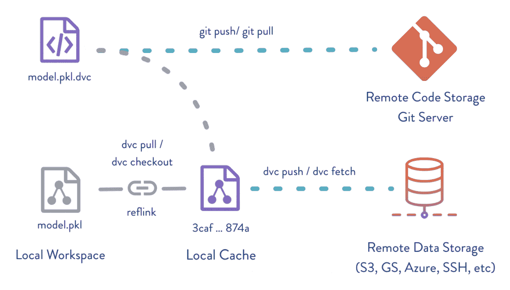

从示例可以看出，DVC 在代码和文件数据对象之间提供可靠的同步，但需要手动配置，并且不存储有关执行、工作流、参数等的扩展元数据。相反，DVC 使用与代码一起存储和版本控制的 JSON 或 YAML 文件来处理参数和结果指标。

用户可以定义包装可执行文件（例如 Python 程序）的工作流阶段，并指定哪些参数（`-p`）是文件输入或依赖项（`-d`）以及输出（`-o`）到该可执行文件。参见示例 4-1：

#### 示例 4-1. 在 DVC 中添加工作流步骤

```
dvc stage add -n featurize \
              -p featurize.max_features,featurize.ngrams \
              -d src/featurization.py -d data/prepared \
              -o data/features \
              python src/featurization.py data/prepared data/features
```

当您运行`dvc repro`命令时，它会评估依赖项是否已更改，执行所需的步骤并注册输出。

DVC 不使用实验数据库。它使用`GIT`作为数据库，并且每次执行或参数组合都映射到唯一的`GIT`提交。此外，DVC 专注于本地开发。因此，在规模化或容器化或分布式工作流环境中使用它可能具有挑战性，并且需要脚本和手动集成。

总之，DVC 是在本地开发环境中对大型数据工件进行版本控制并将其映射到`GIT`提交的优秀工具。此外，DVC 实现了数据去重以减少实际存储占用。另一方面，DVC 以命令行为主（`GIT`流程），在生产环境中运行、执行管道以及跟踪扩展属性和结构化数据的能力有限。它还提供最小的 UI（studio）。

### Pachyderm

Pachyderm 是构建在容器化基础设施上的数据管道和版本控制工具。它提供版本化文件系统，并允许用户构建多阶段管道，其中每个阶段在容器上运行，接受输入数据（作为文件）并生成输出数据文件。

Pachyderm 提供可通过对象存储（AWS S3、Minio、GCS 等）实现的版本化数据存储库，并可通过文件 API 或 SDK/CLI 访问。每次数据提交或更改都像`GIT`一样记录。数据会被去重以节省空间。

Pachyderm 数据管道执行容器并将存储库的一片挂载到容器中（在 `/pfs/` 目录下）。容器读取文件、处理它们并将输出写回 Pachyderm 存储库。

示例 4-2 展示了一个简单的管道定义，它从 `data` 存储库的 `master` 分支获取所有数据，使用指定的容器镜像运行词频统计逻辑，并将输出写入 `out` 存储库。

#### 示例 4-2. Pachyderm 管道示例


## Pachyderm
```
pipeline:
    name: 'count'
description: 'Count the number of lines in a csv file'
input:
    pfs:
        repo: 'data'
        branch: 'master'
        glob: '/'
transform:
    image: alpine:3.14.0
    cmd: ['/bin/sh']
    stdin: ['wc -l /pfs/data/iris.csv > /pfs/out/line_count.txt']
```

管道可以在输入数据发生变化时每次触发，并且数据可以增量处理（只有新文件会被传递到容器进程中）。这可以节省时间和资源。

Pachyderm 具有用于管理管道和探索数据的良好用户界面。参见 图 4-5。

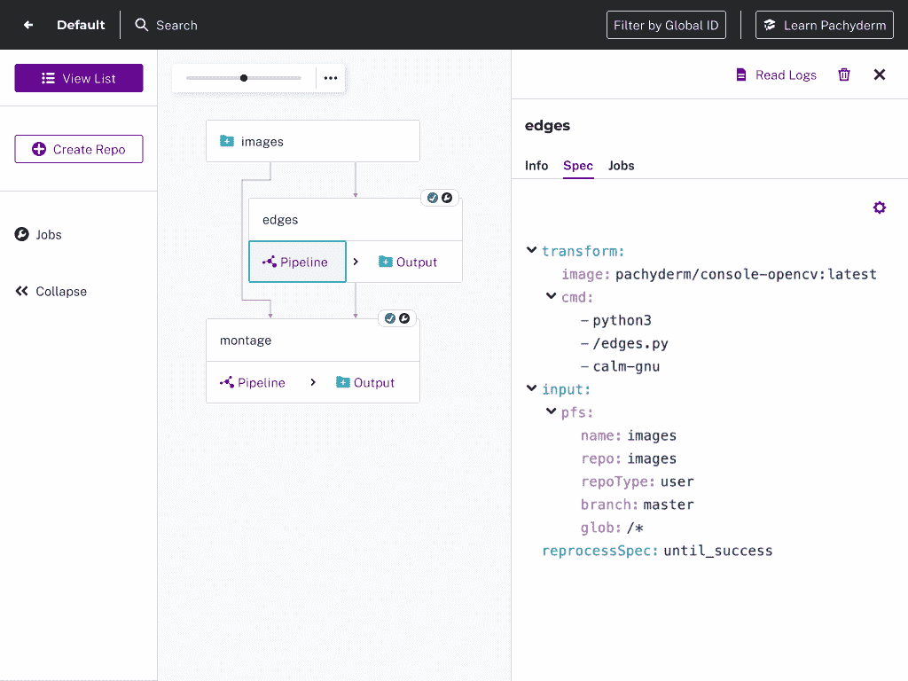

Pachyderm 可以通过将数据拆分为较小的 `CSV` 或 `JSON` 文件来处理大型或连续的结构化数据源。

总之，Pachyderm 是构建版本化数据管道的优秀工具，其中代码足够简单，可以读取和写入文件。它处理去重和增量处理。然而，它需要单独跟踪源代码（运行预构建镜像）、执行或实验参数、元数据、指标等。

## MLflow Tracking

MLflow 是一个用于管理端到端机器学习生命周期的开源平台。其核心组件之一是 MLflow Tracking。MLflow Tracking 提供 `API` 和 `UI` 用于记录机器学习运行、其输入和输出，并可视化结果。

MLflow Tracking 运行是对某些数据科学代码的执行。每个运行记录以下信息：

*   *代码版本*：用于该运行的 `Git` 提交哈希值。
*   *开始和结束时间*：运行的开始和结束时间。
*   *来源*：启动运行的文件名称，或如果从 `MLflow Project` 运行，则为项目名称和入口点。
*   *参数*：您选择的 `Key-value` 输入参数。键和值均为字符串。
*   *指标*：`Key-value` 指标，其中值为数值。MLflow 记录并允许您可视化指标的完整历史记录。
*   *产物*：任意格式的输出文件。例如，您可以记录图像（例如 `PNG`）、模型（例如一个 pickle 化的 `scikit-learn` 模型）和数据文件（例如一个 `Parquet` 文件）作为产物。

MLflow Tracking 并不是一个完整的数据版本控制解决方案，因为它不支持诸如数据血缘（记录数据输入以及用于创建新数据项的数据）、去重等功能。然而，它能够记录和索引每次运行的数据输出以及源代码、参数和一些执行细节。MLflow 可以手动与其他工具如 `DVC` 集成以跟踪数据和实验。

MLflow 的优势在于使用关于代码和参数的额外元数据跟踪数据输出，并在图形 `UI` 中可视化或比较它们。然而，这并非免费。用户代码需要使用 MLflow 跟踪代码进行[content]
## Pachyderm
```
pipeline:
    name: 'count'
description: 'Count the number of lines in a csv file'
input:
    pfs:
        repo: 'data'
        branch: 'master'
        glob: '/'
transform:
    image: alpine:3.14.0
    cmd: ['/bin/sh']
    stdin: ['wc -l /pfs/data/iris.csv > /pfs/out/line_count.txt']
```

管道可以在输入数据发生变化时每次触发，并且数据可以增量处理（只有新文件会被传递到容器进程中）。这可以节省时间和资源。

Pachyderm 具有用于管理管道和探索数据的良好用户界面。参见 图 4-5。


Pachyderm 可以通过将数据拆分为较小的 `CSV` 或 `JSON` 文件来处理大型或连续的结构化数据源。

总之，Pachyderm 是构建版本化数据管道的优秀工具，其中代码足够简单，可以读取和写入文件。它处理去重和增量处理。然而，它需要单独跟踪源代码（运行预构建镜像）、执行或实验参数、元数据、指标等。

## MLflow Tracking

MLflow 是一个用于管理端到端机器学习生命周期的开源平台。其核心组件之一是 MLflow Tracking。MLflow Tracking 提供 `API` 和 `UI` 用于记录机器学习运行、其输入和输出，并可视化结果。

MLflow Tracking 运行是对某些数据科学代码的执行。每个运行记录以下信息：

*   *代码版本*：用于该运行的 `Git` 提交哈希值。
*   *开始和结束时间*：运行的开始和结束时间。
*   *来源*：启动运行的文件名称，或如果从 `MLflow Project` 运行，则为项目名称和入口点。
*   *参数*：您选择的 `Key-value` 输入参数。键和值均为字符串。
*   *指标*：`Key-value` 指标，其中值为数值。MLflow 记录并允许您可视化指标的完整历史记录。
*   *产物*：任意格式的输出文件。例如，您可以记录图像（例如 `PNG`）、模型（例如一个 pickle 化的 `scikit-learn` 模型）和数据文件（例如一个 `Parquet` 文件）作为产物。

MLflow Tracking 并不是一个完整的数据版本控制解决方案，因为它不支持诸如数据血缘（记录数据输入以及用于创建新数据项的数据）、去重等功能。然而，它能够记录和索引每次运行的数据输出以及源代码、参数和一些执行细节。MLflow 可以手动与其他工具如 `DVC` 集成以跟踪数据和实验。

MLflow 的优势在于使用关于代码和参数的额外元数据跟踪数据输出，并在图形 `UI` 中可视化或比较它们。然而，这并非免费。用户代码需要使用 MLflow 跟踪代码进行仪器化。

示例 4-3 演示了一个部分代码片段，使用 MLflow `API` 跟踪运行。首先，命令行参数被手动解析，输入数据作为字符串 URL 传递，就像其他参数一样。然后，数据的加载和转换也是手动完成的。

在逻辑（数据准备、训练等）执行后，用户使用 MLflow 日志命令记录标签、输入参数、输出指标和数据产物（数据集和模型）。

### Example 4-3. MLflow tracking code example
```
if __name__ == "__main__":
    # parse the input parameters
    parser = argparse.ArgumentParser()
    parser.add_argument("--data", help="input data path", type=str)
    parser.add_argument('--dropout',  type=float, default=0.0, help='dropout ratio')
    parser.add_argument("--lr", type=float, default=0.001, help='learning rate')
    args = parser.parse_args()

    # Read the csv file
    try:
        data = pd.read_csv(args.data)
    except Exception as e:
        raise ValueError(f"Unable to read the training CSV, {e}")

    # additional initialization code ...

    with mlflow.start_run():

        # training code ...

        # log experiment tags, parameters and result metrics
        mlflow.set_tag("framework", "sklearn")
        mlflow.log_param("dropout", args.dropout)
        mlflow.log_param("lr", args.lr)
        mlflow.log_metric("rmse", rmse)
        mlflow.log_metric("r2", r2)
        mlflow.log_metric("mae", mae)

        # log data and model artifacts
        mlflow.log_artifacts(out_data_path, "output_data")
        mlflow.sklearn.log_model(model, "model",
                                 registered_model_name="ElasticnetWineModel")
```

MLflow 将运行信息发送到跟踪服务器，并将数据元素存储在本地文件或远程对象中（例如在 `S3` 中）。运行信息可以在 MLflow 用户界面中查看或比较（参见 图 4-6）。

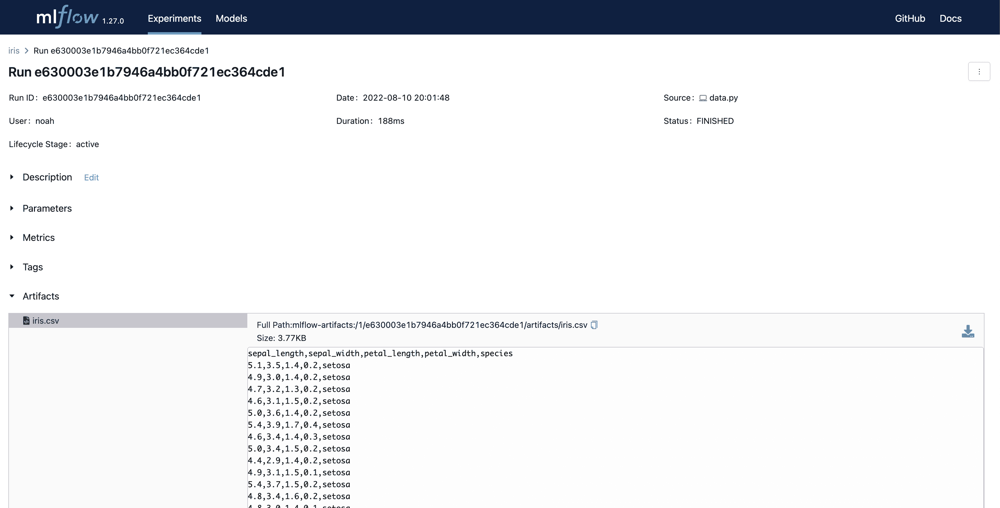

MLflow 不管理或版本化数据对象。运行是主要元素，您无法直接访问或搜索数据对象和产物。此外，没有血缘跟踪，这意味着无法跟踪用于生成新数据对象或产物的哪些数据对象。当您运行管道时，您无法在一个地方看到不同步骤的产物，或将一个阶段的输出链接到下一步的输入。

使用 MLflow，存储容量可能变得显著，因为每次运行都会将输出保存在新的文件目录中，即使没有任何变化。与其他框架相比，没有数据去重。

总之，MLflow tracking 是在开发环境中跟踪和比较 ML 实验结果的优秀工具。此外，MLflow 易于安装和使用。然而，它不是数据跟踪或版本控制系统，可能需要大量的存储容量。此外，MLflow 要求开发人员添加自定义代码，MLOps 团队添加胶水逻辑以使其适应生产 [部署](https://www.iguazio.com/glossary/model-deployment/) 和 `CI/CD` 工作流。

## MLRun

MLRun 是一个开源的 MLOps 编排框架，具有多个子组件来处理完整的 ML 生命周期。数据对象在 MLRun 中是第一类公民，并与其它组件很好地集成以提供无缝体验和自动化。

而大多数框架管理文件数据对象，MLRun 支持多种数据对象（数据存储、项/文件、数据集、流、模型、特征集、特征向量、图表等），每个都有独特的元数据、操作和查看器。

MLRun 中的每个对象都有类型、唯一的版本 ID、标签（例如开发、生产等命名版本）、用户定义标签（用于跨对象分组和搜索）、与其他对象的关系，并且是项目成员。例如，运行对象链接到源和输出数据对象以及函数（代码）对象，形成关系图。

图 4-7 演示了运行屏幕，其中包含一般和代码属性、数据输入对象、数据/产物输出对象、结果指标、自动收集的日志等信息选项卡。用户可以从不同视角查看信息。例如，查看项目中的所有数据集（ regardless of which run generated them）。

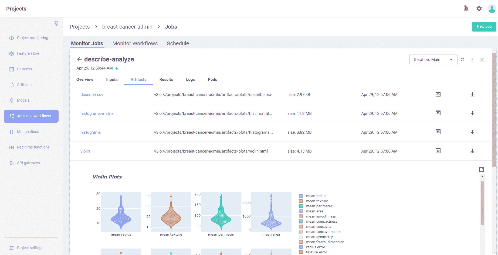

MLRun 数据对象和产物携带详细的元数据，包括它们是如何产生的（由谁、何时、代码、框架等）、用于创建它们的哪些数据源，以及类型特定的属性，如模式、统计信息、预览等。元数据是自动生成的，这提供了更好的可观察性，并消除了对额外胶水逻辑的需求。


MLRun 提供了用于跨数据和实验进行跟踪和搜索的广泛 API/SDK。然而，其真正的强大之处在于它可以在无需额外编码的情况下提供大部分功能和自动化。

请看 示例 4-4。它接受输入数据和参数并生成输出数据和结果。请注意，与之前的示例不同，代码不包括参数解析、数据加载、转换、日志记录等。

### 示例 4-4. MLRun 代码示例

```
def data_preparation(dataset: pd.DataFrame, test_size=0.2):
    # preform processing on the dataset
    dataset = clean_df(dataset).dropna(how="any", axis="rows")
    dataset = dataset.drop(columns=["key", "pickup_datetime"])
    train, test = train_test_split(dataset, test_size=test_size)
    return train, test, "fare_amount"
```

当执行函数并指定输入数据对象 URL 或路径（文件、远程对象或复杂类型）时，它会自动加载到函数中。例如，使用 AWS `boto` 驱动程序访问 `S3` 对象或 `BigQuery` 驱动程序访问 `BigQuery` 表。然后，数据会被转换为接受的格式（`DataFrame`）并注入到用户代码中。

MLRun 可以自动检测返回值的类型（例如，`train` 和 `test` 的类型为 `DataFrame`）并以最佳形式存储它，同时附带自动生成的元数据、指向作业详情和数据输入对象的链接以及版本信息。如果数据重复，则会进行去重并仅存储一次以节省存储空间。

数据对象在 UI 和客户端 SDK 中具有类型特定的可视化，无论它们如何以及存储在哪里， 例如，数据集的表格格式带有表元数据（模式、统计信息等）或图表对象的交互式图形。参见 图 4-8 和 图 4-9。

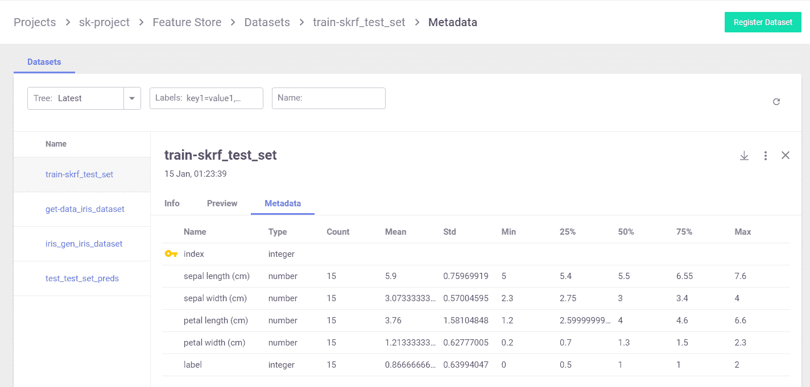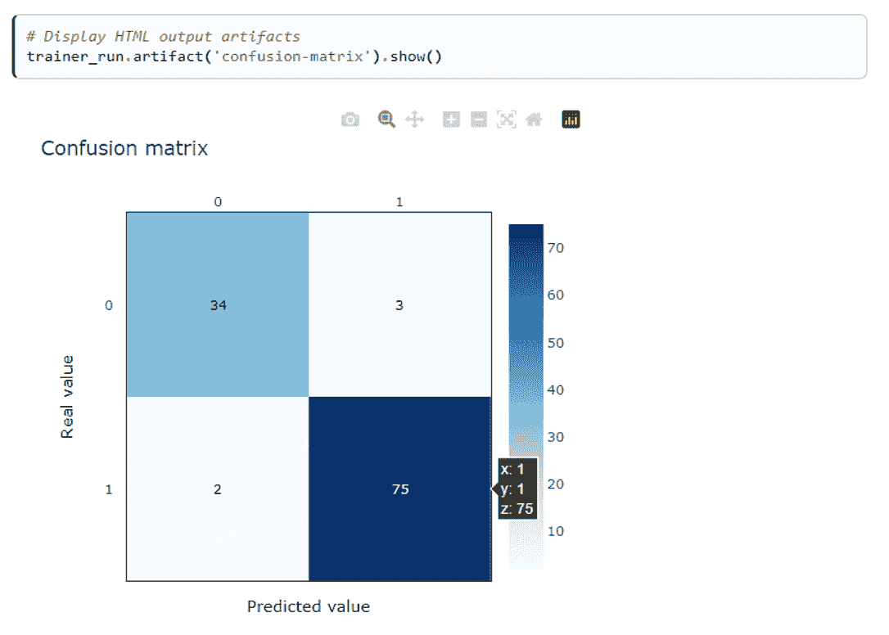

总之，MLRun 是一个完整的 MLOps 编排框架，重点显著放在数据管理、移动、版本控制和自动化上。此外，MLRun 拥有丰富的对象模型，涵盖不同类型的数据和执行对象（函数、运行、工作流等）、它们之间的关系以及它们的使用方式。MLRun 专注于抽象和自动化以减少开发和部署工作。然而，MLRun 并不是通用的数据管理和版本控制解决方案，其价值在使用 MLOps 上下文中时最大化。

### 其他框架

一些工具，例如 [Delta Lake](https://delta.io/) 和 [LakeFS](https://github.com/treeverse/lakeFS)，处理数据湖版本控制。然而，这些工具并不专注于 ML 生命周期，可能需要集成才能对 MLOps 有用。

云厂商提供的解决方案通常与内部服务紧密绑定。例如，参见 [Amazon SageMaker ML 血缘跟踪](https://docs.aws.amazon.com/sagemaker/latest/dg/lineage-tracking.xhtml) 和 [Azure ML 数据集](https://learn.microsoft.com/en-us/azure/machine-learning/how-to-create-data-assets)。

# 大规模数据准备和分析

数据处理在不同的数据、ML 和应用程序管道中被广泛使用。在处理生产数据时，需要支持更广泛的规模和性能，并且在某些情况下，需要实时处理到达的数据。

在交互式开发期间有效的实践，例如将数据存储在 CSV 文件中并读入笔记本，在处理千兆字节或太字节数据时不起作用。它们需要分布式或并行数据处理方法。

分布式数据处理的总体架构是相同的，不同之处在于数据如何分发和收集以及它们使用的 API。例如，数据被分区到多个计算机节点，处理请求或查询到达一个或多个节点进行本地处理，结果被收集并合并以获得单一答案。此外，复杂查询可能在节点之间洗牌数据或执行多个处理和移动步骤。

图 4-10 演示了如何使用 map-reduce 方法对文档中的单词进行计数，从而说明分布式数据处理的工作原理。

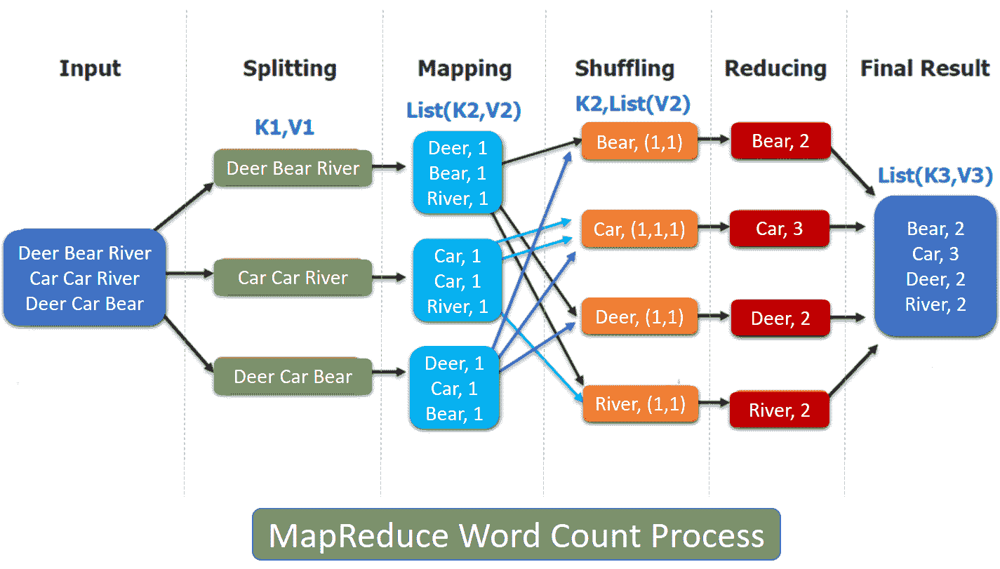

### 结构化和非结构化数据转换

数据可以是 *结构化* 的，这意味着它符合特定的格式或结构，并且通常具有预定义的模式或数据模型。结构化数据可以是数据库表或具有结构化布局的文件（例如，csv、excel、json、ml、parquet）。然而，世界上大部分数据是 *非结构化* 的，通常更复杂，且比结构化数据更难处理。这包括自由文本、日志、网页、图像、视频和音频。

以下是可以在结构化数据上执行的一些分析转换示例：

1. *过滤*：根据特定标准选择数据子集，例如特定日期范围或列中的特定值。
2. *排序*：根据一个或多个列对数据进行排序，例如按日期或按特定值排序。
3. *分组*：根据一个或多个列将数据组织成组，例如按产品类别或按城市分组。
4. *聚合*：计算一个或多个列的汇总统计信息，例如计数、总和、平均值、最大值和标准差。
5. *连接*：基于公共列将来自多个表或数据集的数据组合在一起，例如将销售数据表与客户数据表连接。
6. *映射*：使用用户定义的操作或代码将一个或多个列的值映射到新的列值。有状态映射可以根据原始值和来自旧条目的累积状态计算新值（例如，自上次登录以来经过的时间）。
7. *时间序列分析*：随时间分析或聚合数据，例如识别趋势、模式或异常。

以下技术示例可用于处理非结构化数据或将其转换为结构化数据：

1. *文本挖掘*：使用自然语言处理（NLP）技术从文本数据中提取含义和见解。文本挖掘可以从文本数据中提取诸如情感、实体和主题等信息。
2. *计算机视觉*：使用图像和视频处理技术从视觉数据中提取信息。计算机视觉可以提取诸如对象识别、人脸识别和图像分类等信息。
3. *音频和语音识别*：使用语音转文本和音频处理技术从音频数据中提取含义和见解。音频和语音识别可以提取诸如语音转文本、情感和说话人识别等信息。
4. *数据提取*：使用诸如网络抓取和数据提取等技术从非结构化数据源中提取结构化数据。

各种机器学习方法可用于将原始数据转换为更有意义的数据，例如：

1. *聚类*：根据某些特征对相似的数据点进行分组，例如具有相似购买习惯的客户。
2. *降维*：减少数据集中的特征数量以使其更易于分析和可视化。
3. *回归和分类*：基于其他数据特征预测类别或值。
4. *插补*：在数据缺失的情况下，基于其他数据点确定预期值。

### 分布式数据处理架构

数据处理架构可分为三个主要类别：

1. *交互式*：请求或更新到达后被处理，并立即返回响应。例如，`SQL` 和 `NoSQL` 数据库、数据仓库、键/值存储、图数据库、时间序列数据库、云服务等。


### 2. `Batch`
作业在请求或计划时间启动，数据被获取并处理，完成后再将结果写入目标存储。批处理作业通常需要更长时间处理。批处理数据处理的示例框架包括 [Hadoop](https://hadoop.apache.org/)、[Spark](https://spark.apache.org/)、[Dask](https://www.dask.org/) 等。

### 3. `Streaming`
持续处理传入的请求或数据块，并实时将结果写入目标存储或消息队列。

批处理通常更适合处理大量数据。然而，交互式和流数据处理能够提供更快响应和更短延迟。此外，构建数据流处理管道通常比批处理作业更复杂。

一些框架如 Spark 可能支持不同的处理方法（交互式、批处理、流处理），但它们通常仅在其中一种处理方法中更优。

## 交互式数据处理
交互式系统预期立即响应，因此请求客户端或交互式仪表板无需等待。此外，生产服务可能依赖于结果的可靠性和健壮性。这就是为什么交互式系统具有简单 API 且数据操作有限的原因。在某些情况下，交互式系统提供通过存储过程和 `UDFs`（用户定义函数）定义自定义逻辑的机制。

不同类型交互式数据系统的主要区别在于它们如何索引和存储数据以最小化响应检索时间。例如，NoSQL、内存型和键/值存储针对按索引键检索进行了优化（如 `user id`、`product id` 等）。数据按键（或加密哈希或键）划分并存储在不同节点中。然后，当请求到达时，它会被传递给管理该键（用户、产品等）数据的特定节点，并能快速计算和检索答案。另一方面，复杂或跨键计算需要所有节点之间的协调，耗时更长。

另一方面，分析数据库和数据仓库旨在遍历具有不同索引键值的多条记录。它们按列（按字段）组织数据，并使用各种列式压缩技术以及过滤和提示技巧（如 bloom filtering）来跳过数据块。

其他系统如时间序列或图数据库具有更先进的数据布局和搜索策略，结合了多维索引和列式压缩。例如，按指标键（名称）访问时间序列指标对象，并使用列式压缩技术扫描或聚合单个值（按时间）。

许多交互式系统使用 `SQL` 语言或 SQL-like 语义来处理数据。

按子类别划分的一些知名数据系统示例列于 表 4-1：

表 4-1. 按子类别划分的数据系统示例

| Category || Description |
| --- | --- |
| Relational || 存储结构化数据，通过 `SQL` 命令访问。示例包括 [MySQL](https://www.mysql.com/)、[PostgreSQL](https://www.postgresql.org/)、[Oracle](https://www.oracle.com/) 和 [Microsoft SQL Server](https://www.microsoft.com/en-us/sql-server)。 |
| --- | --- |
| NoSQL || 示例包括 [MongoDB](https://www.mongodb.com/)、[Cassandra](https://cassandra.apache.org/_/index.xhtml)、[Redis](https://redis.io/)、[Elasticsearch](https://www.elastic.co/)、[AWS DynamoDB](https://aws.amazon.com/dynamodb/) 和 [Google BigTable](https://cloud.google.com/bigtable)。 |
| Time-series || 存储和查询时间序列数据。示例包括 [InfluxDB](https://www.influxdata.com/)、[Prometheus](https://prometheus.io/) 和 [TimescaleDB](https://www.timescale.com/)。 |
| Graph || 以图格式存储和查询数据。示例包括 [Neo4j](https://neo4j.com/) 和 [Titan](https://titan.thinkaurelius.com/)。 |

分析系统通常遍历并处理更大的数据集。因此，它们支持更广泛的转换（过滤、分组、连接、聚合、映射等）和用户定义函数。此外，其中一些可以处理和聚合来自其他数据库或存储在文件中的数据。例如，像 Spark SQL 或 Presto DB 这样的解决方案具有到许多数据源的连接器，可以处理跨多个数据集的查询，而这些数据集存储在不同的系统中。

最受欢迎的分布式 SQL 基于分析引擎之一是 Presto DB 及其后续项目 [Trino](https://trino.io/)。Presto 最初由 Facebook 开发并贡献给开源社区。后来，它被 fork 为 Trino 等项目以及商业产品如 [Amazon Athena](https://aws.amazon.com/athena/) 云服务。Trino 拥有长长的 [数据连接器](https://trino.io/docs/current/connector.xhtml) 列表

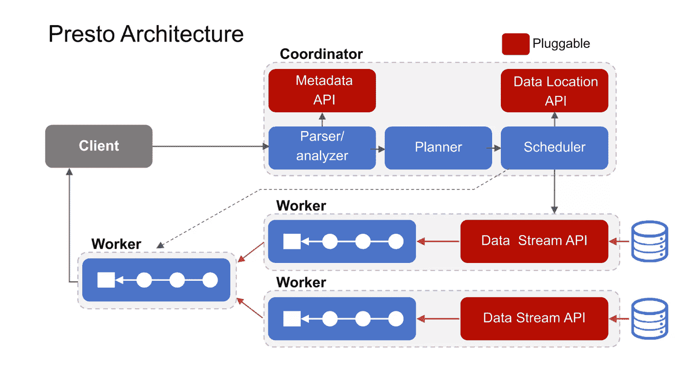

图 4-11 说明了 Presto 和 Trino 架构。查询通过 `HTTP` 请求到达，被解析，并由规划器和调度器拆分为更小的任务，由各个工作节点处理并合并。

## 批处理数据处理
批处理数据处理用于需要处理大量数据并运行一系列数据转换，且处理时间不是主要关注点时。在批处理中，数据被读取并拆分为块传递给多个工作节点进行处理。结果准备好后写入目标系统。

批处理通常用于处理大量历史数据并生成用于训练 ML 模型的数据集。

最知名的批处理数据处理框架之一是 Apache Hadoop，一个用于分布式存储和大规模处理数据密集型任务的开源软件框架。Hadoop 最初由 Yahoo! 工程师开发，基于 `MapReduce` 编程模型。`MapReduce` 模型包含两个主要函数：`Map` 和 `Reduce`。`Map` 函数接收输入数据集并将其处理为一组中间键值对，然后按键分组并由 `Reduce` 函数处理以生成最终输出。

此后，Hadoop 已被基于云对象存储、容器化基础设施以及计算框架如 [Spark](https://spark.apache.org/)、[Flink](https://flink.apache.org/)、[Beam](https://beam.apache.org/)、[Dask](https://www.dask.org/) 等的更现代云原生架构所取代。

批处理的日常用途见于 `ETL`（提取、转换、加载）任务。`ETL` 指从多个来源提取数据、转换它并加载到目标数据库、数据仓库或数据湖中。`ETL` 是数据集成过程中的关键步骤，因为它使组织能够从多个来源提取、清理和转换数据到单一的集中式存储库。

批处理管道可能复杂且具有多个步骤和依赖关系。[Apache Airflow](https://airflow.apache.org/) 是用于编写、调度和监控批处理数据管道最受欢迎的开源框架之一。

Airflow 最初由 Airbnb 开发，现由 Apache 软件基金会维护。它提供了一个简单易用的界面，用于将工作流定义为任务的有向无环图（`DAGs`），其中每个任务代表一个单独的处理步骤。任务可以用 Python 编写，并在各种环境中运行，包括本地、Kubernetes 或云端。


Airflow 还提供基于 Web 的用户界面（参见 图 4-12）用于管理和 [监控](https://www.iguazio.com/glossary/model-monitoring/) 工作流，包括查看每个任务的状态、重试失败任务以及手动触发或调度任务的能力。它还包括用于管理和组织工作流的功能，例如在任务之间定义依赖关系和设置任务重试逻辑。

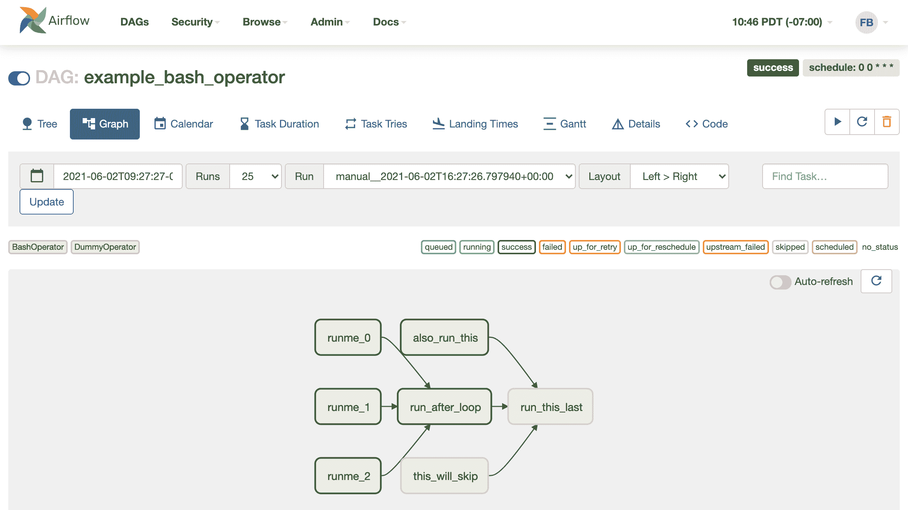

示例 4-5 是 Python 代码的一个示例，可用于在 Apache Airflow 中创建 `DAG`，该 DAG 从 CSV 文件读取数据、处理数据并将其写入目标位置。

### 示例 4-5. Airflow 数据管道代码示例

```
import csv
from airflow import DAG
from airflow.operators.python_operator import PythonOperator
from datetime import datetime, timedelta

def process_data(**kwargs):
    ti = kwargs['ti']
    input_file = ti.xcom_pull(task_ids='read_file')
    processed_data = do_data_processing(input_file)
    return processed_data

def do_data_processing(input_file):
    # Placeholder function that performs data processing
    processed_data = input_file
    return processed_data

def read_csv_file(file_path):
    with open(file_path, 'r') as file:
        reader = csv.reader(file)
        return list(reader)

def write_csv_file(file_path, data):
    with open(file_path, 'w') as file:
        writer = csv.writer(file)
        writer.writerows(data)

default_args = {
    'owner': 'airflow',
    'depends_on_past': False,
    'start_date': datetime(2021, 1, 1),
    'email_on_failure': False,
    'email_on_retry': False,
    'retries': 1,
    'retry_delay': timedelta(minutes=5),
}

dag = DAG(
    'data_processing_dag',
    default_args=default_args,
    description='A DAG that reads data from a CSV file, processes it'
                ', and writes it to a destination',
    schedule_interval=timedelta(hours=1),
)

read_file = PythonOperator(
    task_id='read_file',
    python_callable=lambda: read_csv_file('/path/to/input_file.csv'),
    xcom_push=True,
    dag=dag,
)

process_data = PythonOperator(
    task_id='process_data',
    python_callable=process_data,
    provide_context=True,
    dag=dag,
)

write_file = PythonOperator(
    task_id='write_file',
    python_callable=lambda: write_csv_file('/path/to/output_file.csv',
                                           ti.xcom_pull(task_ids='process_data')),
    provide_context=True,
    dag=dag,
)

read_file >> process_data >> write_file
```

有多个基于云的批处理数据管道服务，例如 [AWS Glue](https://aws.amazon.com/glue/)、[Google Cloud Composer](https://cloud.google.com/composer)（基于 Airflow）和 [Azure Data Factory](https://azure.microsoft.com/en-us/products/data-factory)。

Hadoop 或其他批处理管道的一个缺点是需要在每个步骤中从磁盘读取数据、处理它，然后再次将其写入磁盘。然而，像 [Spark](https://spark.apache.org/) 和 [Dask](https://www.dask.org/) 这样的框架知道如何将处理管道编译成最优图，在可能的情况下在内存中完成任务，从而最大限度地减少磁盘 IO 并最大化性能。

示例 4-6 演示了 Spark 代码，该代码读取 CSV 文件、处理数据并将结果写入目标文件。

### 示例 4-6. PySpark 数据管道代码示例

```
from pyspark.sql import SparkSession

# Create a Spark session
spark = SparkSession.builder.appName("SimpleBatchProcessing").getOrCreate()

# Load a CSV file into a Spark DataFrame
df = spark.read.csv("/path/to/input_file.csv", header=True, inferSchema=True)

# Perform some data processing on the DataFrame
processed_df = df.groupBy("column_name").agg({"column_name": "mean"})

# Write the processed DataFrame to a new CSV file
processed_df.write.csv("/path/to/output_file.csv", header=True)

# Stop the Spark session
spark.stop()
```

同一示例在 示例 4-7 中使用 Dask 实现。Dask 的优势在于其操作与 Python pandas 非常相似，这对数据科学家来说是一个巨大的优势。然而，Spark 通常更具可扩展性和鲁棒性。

### 示例 4-7. Dask 数据管道代码示例

```
import dask.dataframe as dd

# Load a CSV file into a Dask DataFrame
df = dd.read_csv('/path/to/input_file.csv')

# Perform some data processing on the DataFrame
processed_df = df.groupby('column_name').column_name.mean().compute()

# Write the processed DataFrame to a new CSV file
processed_df.to_csv('/path/to/output_file.csv', index=False)
```

可以看出，Spark 和 Dask 示例与 Airflow 示例相比要简单得多。然而，Airflow 更适合管理和跟踪长且复杂的作业。

## 流处理

*流处理* 能够实现可扩展、容错和实时数据处理。它通常用于实时处理大量数据的应用程序中，例如实时分析、欺诈检测或推荐。

在流处理中，数据和传入事件被推送到流（队列）中，并由一个或多个 worker 读取。Worker 按顺序处理数据，进行转换、聚合结果，并将结果写入数据库或输出流。与传统消息队列不同，流处理是有序发生的。例如，假设流包含两个事件，一个是客户登录，另一个是客户注销。未按顺序处理它们可能导致状态损坏。另一个例子是发生资金存款操作，随后是取款。如果操作按错误顺序处理，取款操作可能会被拒绝。

流被设计为可扩展。它们被划分为分区，每个分区处理特定的一组数据对象，因此不会违反顺序。例如，用户活动流按用户 ID 分区，以便特定用户的活动始终存储在同一分区并由同一 worker 处理。

流 ([Kafka](https://kafka.apache.org/)、[AWS Kinesis](https://aws.amazon.com/kinesis/) 等) 与消息队列 ([RabbitMQ](https://www.rabbitmq.com/)、[AMQP](https://www.amqp.org/)、[AWS SQS](https://aws.amazon.com/sqs/)、[Google PubSub](https://cloud.google.com/pubsub) 等) 不同。消息队列不保证消息顺序。然而，它们保证消息的可靠传递，而在流的情况下，客户端管理可靠性。此外，由于流提供的更直接的逻辑和并行性，它们速度要快得多。

图 4-13 说明了一个流应用程序，其中客户端发布的数据分布在各个分区之间（基于分区键的哈希）。一个 worker 从每个分区读取并处理数据。Worker 可以使用数据库在已知间隔（检查点）存储状态，以便在发生故障时可以恢复状态，或者 worker 可以释放未使用的内存。最后，结果可以写入目标数据库或输出流。

流提供“至少一次语义”。因此，同一条消息可能出现多次。通过检查点的帮助提供“恰好一次语义”（同一条消息仅处理一次）的一种方法。流是有序处理的，并且状态可以在每个微批处理后持久化。在发生故障的情况下，worker 可以恢复最后一个检查点数据（状态），从该点开始处理事件，并忽略旧事件。

### 流处理框架


对实时流进行实时分析与在批处理或 SQL 中进行分析不同。在流中，工作进程只能按顺序一次遍历数据，并且只能看到数据的一部分（在同一分区中）。这就是为什么实时分析框架例如 [Spark Streaming](https://spark.apache.org/docs/latest/streaming-programming-guide.xhtml)、[Apache Flink](https://flink.apache.org/)、Apache Beam、[Apache Nifi](https://nifi.apache.org/) 以及其他框架，专注于流处理并以流优化的方式实现标准分析和统计方法。

流处理中的典型场景是对一段时间内的值进行聚合。例如，检查过去一小时内客户交易的总值以检测欺诈。使用流处理为每个新事件计算总和是不可行的。这将花费大量时间和内存。相反，值被分组到窗口化桶中。例如，六个或更多桶，每个桶保存每 10 分钟的总和。该过程仅对最近的六个桶的值求和，并在每 10 分钟丢弃最旧的桶。图 4-14 说明了重叠的滑动窗口，窗口持续时间为一分钟，窗口周期为 30 秒。

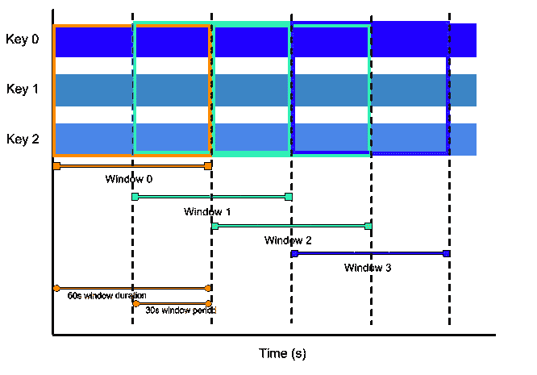

示例 4-8 展示了使用 Apache Beam 定义此类窗口的代码。

### 示例 4-8. 使用 Apache Beam 定义滑动窗口

```
from apache_beam import window
sliding_windowed_items = (
    items | 'window' >> beam.WindowInto(window.SlidingWindows(60, 30)))
```

使用流处理框架进行编码需要高级数据工程知识。这就是为什么许多用户避免使用实时数据，即使它可以提供更好的业务价值和更准确的模型评分结果。特征存储来救援，因为它们可以从同一更高级别的数据处理逻辑自动生成批处理和流处理管道。

# 介绍特征存储

*特征存储* 是机器学习特征的工厂和中央存储库。特征存储处理从各种来源收集原始数据、转换管道、存储、编目、版本控制、安全、[服务](https://www.iguazio.com/glossary/model-serving-pipeline/) 和监控。它们自动化本章所述的许多流程，同时加快生产时间并减少工程工作量。特征存储形成生产就绪特征的共享目录，促进团队之间的协作和共享，并加速新 AI 应用的创新和交付。

首批特征存储实现来自 Uber、Twitter 和 Spotify 等大型服务提供商。在这些提供商中，AI 是业务的核心，特征存储帮助他们加速新 AI 应用的开发和部署，并改善协作和复用。如今有多种商业和开源实现可供选择。

高级特征存储提供以下功能：

*   *数据连接*：与多个离线（数据湖、数据仓库、数据库等）和在线（流、消息队列、API、托管服务等）源无缝集成。
*   *离线和在线转换*：一些特征存储提供从更高级别逻辑自动构建和管理批处理和流处理管道的能力。
*   *存储*：将生成的特征存储在离线存储（如对象存储）和在线存储（通常是键/值数据库）中。
*   *元数据管理*：自动生成、存储和管理所有特征元数据，包括血缘、模式、统计信息、标签等。
*   *版本控制*：管理每个特征的多个版本以及将特征从开发环境提升到生产环境的过程，并与 CI/CD 集成。
*   *生成和管理特征向量*：将多个特征正确连接成单个数据集，用于训练或服务应用。
*   *中央编目*：提供集中访问以生成、标记或搜索特征。
*   *安全和治理*：控制对特征和原始数据的访问以及记录特征访问。
*   *易用的 UI 和 SDK*：通过 API 和用户界面提供简单访问，以抽象底层复杂性、可视化特征并使其可供数据科学家使用。
*   *监控和高可用性*：自动监控资产和数据处理任务，同时可靠地从故障中恢复。
*   *特征验证和分析*：自动或由用户发起执行各种数据处理任务，以验证特征正确性或生成特征、相关性等的深入分析。

在选择特征存储之前，您应进行彻底比较。例如，许多功能具有非常部分的功能，可能专注于特征编目，并缺乏自动化转换、大规模数据管理或实时功能。这些功能在加速生产时间方面提供了最显著的价值。

## 特征存储架构和使用

图 4-15 说明了特征存储的总体架构和使用情况。原始数据被摄取并转换为特征，特征被编目并提供给不同的应用（训练、服务、监控）。API 和 UI 允许数据科学家、数据工程师和机器学习工程师更新、搜索、监控和使用特征。

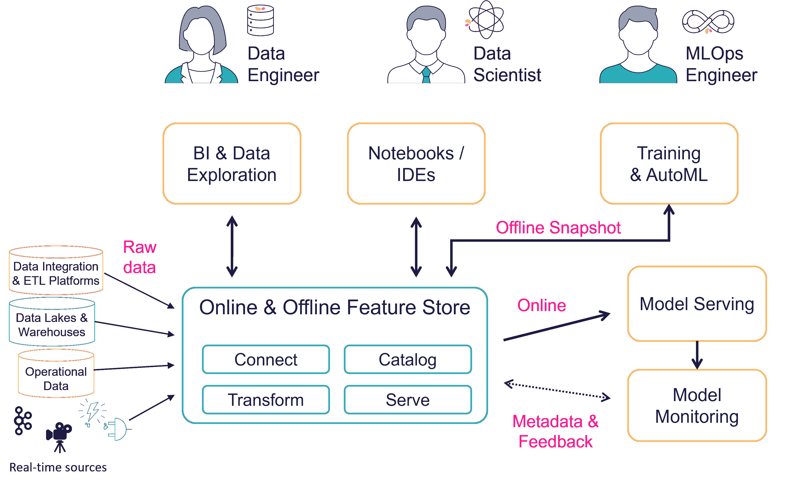

特征存储的核心组件包括：

*   *转换层*：将原始离线或在线数据转换为特征，并将其存储在在线（键/值）和离线（对象）存储中。
*   *存储层*：在特征表（特征集）中存储特征的多个版本并管理数据生命周期（创建、追加、删除、监控和保护数据）。数据层以两种形式存储每个特征：离线用于训练和分析，在线用于服务和监控。
*   *特征检索*：接受对多个特征（特征向量）和其他属性（如时间范围、事件数据等）的请求，并为训练生成离线数据快照或为服务生成实时向量。
*   *元数据管理和编目*：存储特征定义、元数据、标签和关系。

## 摄取和转换服务

本章迄今已讨论了批处理和实时数据的大规模处理、数据版本控制和元数据管理的复杂性。特征存储旨在通过抽象和自动化降低这种复杂性。在现代特征存储中，数据管道使用高级转换逻辑描述。该逻辑被转换为底层处理引擎语义并部署为连续的生产级服务，节省了大量的工程工作。

管道实现对于本地开发（使用 `Pandas` 等包）、大规模离线数据（使用批处理）和实时数据（使用流处理）是不同的。支持自动化转换的特征存储的优势在于它对所有三种部署模式使用一个定义，并消除了将数据管道从一种方法移植到另一种方法所需重新工程。在某些特征存储中，数据管道技术将由数据源决定，无论是离线（数据湖、数据仓库、数据库等）还是在线（流、消息队列、API、托管服务等）。


Feature stores implement the data ingestion and transformation on groups of features (called feature sets or feature groups) that originate from the same source. For example, all the features extracted from the credit card transaction log. Feature sets take data from offline or online sources, build a list of features through a set of transformations, and store the resulting features along with the associated metadata and statistics.

图 4-16 illustrates the transformation service (feature set). Once the data is ingested from the source, it passes through a graph (`DAG`) of transformations, and the resulting features are written into the offline and online stores.

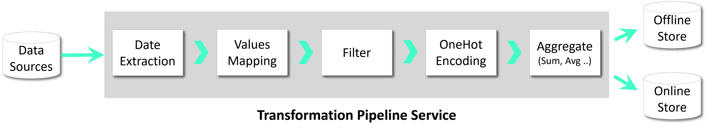

转换示例（按数据类型）：

* `Structured`: 过滤、分组、连接、聚合、`OneHot` 编码、映射、提取和分类。
* `Textual`: 提取、解析、拆解、检测实体、情感和嵌入。
* `Visual (images and videos)`: 帧处理、调整大小、检测对象、裁剪、重新着色、旋转、映射和分类。

生成的转换服务应达到生产级别并支持自动扩展、高可用性、实时升级等。此外，它应支持连续的数据摄取和处理。例如，新数据可能持续到达（用于实时）或按计划间隔到达（用于离线）。因此，无服务器函数技术非常适合。

## 特征存储

特征通常以两种形式存储：用于训练和分析应用的离线存储，以及用于实时服务和监控应用的在线存储。参见 图 4-17。

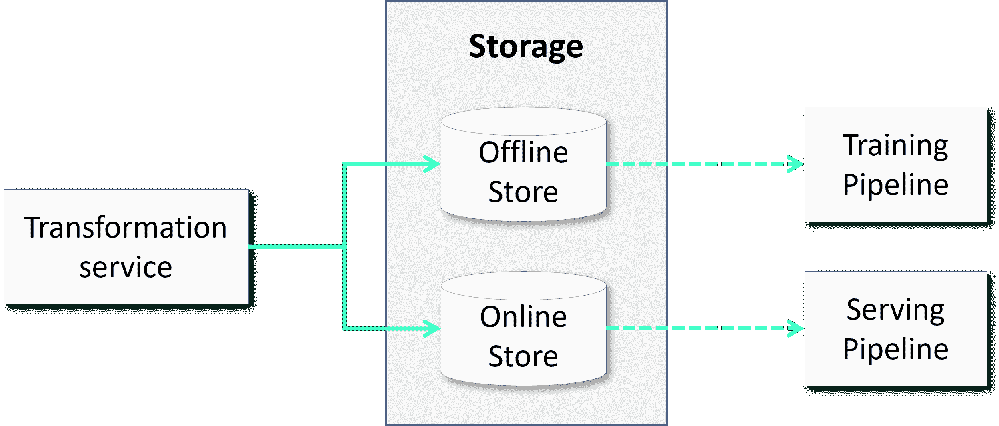

离线存储保存所有历史数据，通常使用数据湖、对象存储或数据仓库技术。例如，常见选择是使用压缩的 Parquet 文件存储在对象存储中，如 AWS `S3`。

在线存储保存最近的数据，通常使用 NoSQL 或键/值存储，如 Redis、AWS DynamoDB、Google BigTable 等。在线存储需要支持毫秒级读取特征。

## 特征检索（用于训练和服务）

训练、服务和分析应用需要从多个数据集和来源获取多个特征。相比之下，特征存储根据特征的来源和实体（主键，如 `user id`、`product id` 等）将特征组织成组（称为 `feature sets`）。

从不同来源、时间且具有不同索引检索多个特征可能是一项复杂的分析任务。特征存储会根据特征元数据、实体名称和用户请求数据自动确定 `JOIN` 查询所需的参数。此外，当数据集为事务性（记录带有时间戳）时，连接操作需要考虑时间正确性和 `time traveling`，以仅返回事件发生时已知的数值（也称为 `as of join` 分析操作）。

离线特征集可以通过特征存储生成的 SQL 查询生成。然而，对于需要在毫秒级响应的实时服务应用，这会产生相当大的开销，因此会使用其他实时方法。此外，基于时间的特征（例如过去一小时的请求数）无法预先计算，需要特殊处理以生成准确结果（例如，通过组合预先计算的时间窗口数据和临时最后一公里计算）。

图 4-18 illustrates the feature retrieval flow with two separate engines, one for offline retrieval and the other for real-time retrieval. Note that in the case of offline, the dataset is snapshotted or preserved in a new dataset to allow data lineage tracking and explainability.

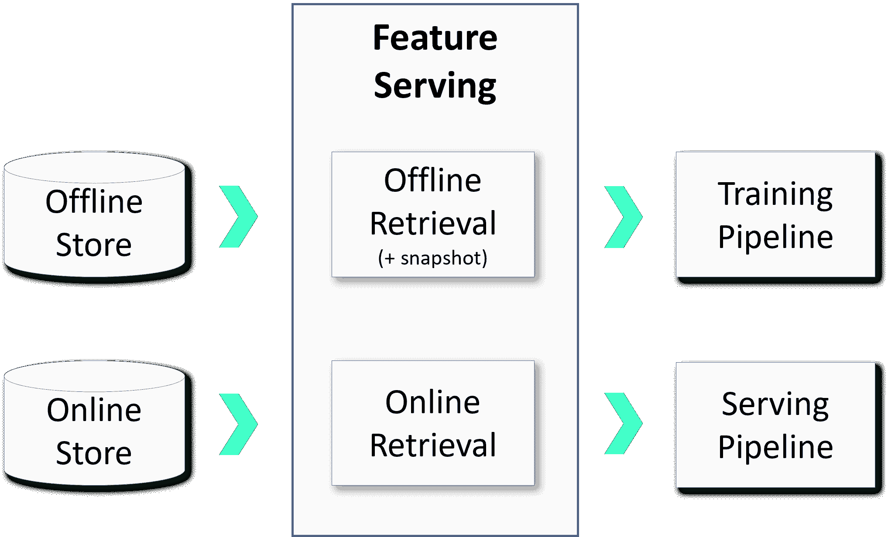

The `get_offline_features` request can accept event data to base the query on, a valid time range (for example, if we want to train the model based on data from the last month), and which features and columns should return (for example, whether to include the index, time, or label columns). Then, it initiates a local or serverless analytics job that computes the results and returns the features vector dataset.

在实时检索中，系统初始化检索服务（一次性配置本地或远程实时分析函数以节省请求时间）。然后，用户请求会连同实体键（取自事件数据）推送并接受结果向量。此外，一些特征存储允许实时插补（用从特征元数据中获取的统计特征值替换缺失或 `NaN` 数据）。

## 特性存储解决方案及使用示例

特征存储最初作为领先云服务提供商（如 Uber、Spotify、Twitter 等）的内部平台出现。但现在，市场上有许多开源和商业特征存储解决方案。然而，就像每个重要的新技术领域一样，这些解决方案之间存在许多功能差异；在选择合适的方案之前，你需要了解这些差异。

最显著且最本质的差异在于特征存储平台是否为您管理数据（转换）管道，以及是否同时支持离线和实时（流式）管道。正如本章所述，构建和管理可扩展的数据管道是主要挑战。如果被迫手动执行，这会显著削弱特征存储的价值。

表 4-2 compares the leading feature store solutions:

待验证表格内容！！！

表 4-2. 按子类别划分的数据系统示例

| 类别 || [Feast](https://feast.dev/) || [Tecton](https://www.tecton.ai/) || [MLRun](https://docs.mlrun.org/en/stable/feature-store/feature-store.xhtml) || [SageMaker](https://aws.amazon.com/sagemaker/feature-store/) || [Vertex AI](https://cloud.google.com/vertex-ai/docs/featurestore) || [DataBricks](https://docs.databricks.com/machine-learning/feature-store/index.xhtml) || [HopsWorks](https://www.hopsworks.ai/) |
| --- | --- | --- | --- | --- | --- | --- | --- |
| 开源 || 是 || 否 || 是 || 否 || 否 || 否 || 是 |
| --- | --- | --- | --- | --- | --- | --- | --- |
| 管理选项 || 否 || 主要云平台 || 云 + 本地部署 || 在 AWS 上 || 在 GCP 上 || 主要云平台 || 云 + 本地部署 |
| 离线管道 || 否 || 是 || 是 || 否 || 否 || 否 || 是 |
| 实时管道 || 否 || 是 || 是 || 否 || 否 || 否 || 否 |
| 特性检索 || 是 || 是 || 是 || 是 || 是 || 是 || 是 |
| 引擎 || Spark || Spark || Python, Dask, Spark, Nuclio || None || Spark || Spark || Spark, Flink |
| 特性分析 || 否 || 部分 || 是 || 否 || 否 || 否 || 是 |
| 版本控制与血缘 || 否 || 是 || 是 || 否 || 否 || 否 || 是 |
| 特性安全 || 否 || 是 || 是 || 是 || 否 || 否 || 否 |
| 监控 || 否 || 是 || 是 || 否 || 否 || 否 || 是 |
| 无缝训练与服务 || 否 || 否 || 是 || 否 || 否 || 否 || 是 |

以下部分将演示特征存储如何与两个领先的开源框架 Feast 和 MLRun 结合使用。请注意，MLRun 功能更全面，并提供离线和在线转换服务（基于 MLRun 的无服务器引擎），以及许多其他独特功能。

### 使用 Feast 特性存储

Feast does not provide a transformation service. Data should be prepared upfront and stored in a supported source (like `S3`, `GCS`, `BigQuery`, or other). Feast registers the source dataset and its metadata (schema, entity, and so on) in a `FeatureView` object. See 示例 4-9。

#### 示例 4-9. 定义 Feast FeatureView（来源：Feast）


```
# Read data from parquet files. Parquet is convenient for local development mode. For
# production, you can use your favorite DWH, such as BigQuery. See Feast documentation
# for more info.
driver_hourly_stats = FileSource(
    name="driver_hourly_stats_source",
    path="/content/feature_repo/data/driver_stats.parquet",
    timestamp_field="event_timestamp",
    created_timestamp_column="created",
)

# Define an entity for the driver. You can think of entity as a primary key used to
# fetch features.
driver = Entity(name="driver", join_keys=["driver_id"])

# Our parquet files contain sample data that includes a driver_id column, timestamps and
# three feature column. Here we define a Feature View that will allow us to serve this
# data to our model online.
driver_hourly_stats_view = FeatureView(
    name="driver_hourly_stats",
    entities=[driver],
    ttl=timedelta(days=1),
    schema=[
        Field(name="conv_rate", dtype=Float32),
        Field(name="acc_rate", dtype=Float32),
        Field(name="avg_daily_trips", dtype=Int64),
    ],
    online=True,
    source=driver_hourly_stats,
    tags={},
)
```
Feast 不提供在线转换或摄取服务。相反，用户需要运行一个 `materialization` 任务将离线特征复制到实时存储（数据库）中。不幸的是，这也意味着在两次物化之间，存储在在线存储中的数据是不准确的，而过于频繁地运行物化可能会导致显著的计算开销。

通过 SDK 运行物化任务：
```
store = FeatureStore(repo_path=".")
store.materialize_incremental(datetime.now())
```
项目可能包含一个或多个特征视图，每个视图都是独立定义和物化的。特征可以从一个或多个特征视图中检索（将发起 JOIN 操作）。

要检索离线特征（直接从离线源获取），请使用 `get_historical_features()` API 调用，如示例 4-11 所示：

### 示例 4-10. 使用 Feast 检索离线特征（来源：Feast）
```
# The entity dataframe is the dataframe we want to enrich with feature values
# see https://docs.feast.dev/getting-started/concepts/feature-retrieval for details
# for all entities in the offline store instead
entity_df = pd.DataFrame.from_dict(
    {
        # entity's join key -> entity values
        "driver_id": [1001, 1002, 1003],
        # "event_timestamp" (reserved key) -> timestamps
        "event_timestamp": [
            datetime(2021, 4, 12, 10, 59, 42),
            datetime(2021, 4, 12, 8, 12, 10),
            datetime(2021, 4, 12, 16, 40, 26),
        ],
        # (optional) label name -> label values. Feast does not process these
        "label_driver_reported_satisfaction": [1, 5, 3],
        # values we're using for an on-demand transformation
        "val_to_add": [1, 2, 3],
        "val_to_add_2": [10, 20, 30],
    }
)

store = FeatureStore(repo_path=".")

# retrieve offline features, feature names are specified with <view>:<feature-name>
training_df = store.get_historical_features(
    entity_df=entity_df,
    features=[
        "driver_hourly_stats:conv_rate",
        "driver_hourly_stats:acc_rate",
        "driver_hourly_stats:avg_daily_trips",
        "transformed_conv_rate:conv_rate_plus_val1",
        "transformed_conv_rate:conv_rate_plus_val2",
    ],
).to_df()

print("----- Example features -----\n")
print(training_df.head())
```
要检索在线特征（来自在线存储），我们按如下方式使用 `get_online_features()` API 调用：

### 示例 4-11. 使用 Feast 检索在线特征（来源：Feast）
```
from pprint import pprint
from feast import FeatureStore

store = FeatureStore(repo_path=".")

feature_vector = store.get_online_features(
    features=[
        "driver_hourly_stats:acc_rate",
        "driver_hourly_stats:avg_daily_trips",
        "transformed_conv_rate:conv_rate_plus_val1",
        "transformed_conv_rate:conv_rate_plus_val2",
    ],
    entity_rows=[
        # {join_key: entity_value}
        {
            "driver_id": 1001,
            "val_to_add": 1000,
            "val_to_add_2": 2000,
        },
        {
            "driver_id": 1002,
            "val_to_add": 1001,
            "val_to_add_2": 2002,
        },
    ],
).to_dict()

pprint(feature_vector)

# results:
{'acc_rate': [0.86463862657547, 0.6959823369979858],
 'avg_daily_trips': [359, 311],
 'conv_rate_plus_val1': [1000.6638441681862, 1001.1511893719435],
 'conv_rate_plus_val2': [2000.6638441681862, 2002.1511893719435],
 'driver_id': [1001, 1002]}
```

## 使用 MLRun 特征存储
MLRun 支持现有源（如 Feast）的注册，或定义用于将源数据转换为特征的数据管道。在定义数据管道（称为 `graph`）时，MLRun 会根据抽象的用户定义 provision 所选的数据处理引擎。MLRun 支持一些处理引擎，包括本地 Python、Dask、Spark 和 Nuclio（实时无服务器引擎）。

在 MLRun 中，默认情况下管道会写入在线和离线存储，因此无需单独的物化作业，并且在线和离线特征始终保持同步。此外，MLRun 可以自动检测数据模式，使其更简单且更健壮。

MLRun 将特征集（由同一管道生成的特征集合）的定义与数据源定义分开。这样，您可以在交互式开发和生产中使用相同的特征集。只需将开发环境中的本地文件源替换为生产部署中的数据库或实时 Kafka 流即可。

示例 4-12 展示了定义用于处理信用卡交易以检测信用卡欺诈的特征集的示例。该定义包括实体、时间戳以及使用内置运算符和聚合的转换图。请注意，用户也可以添加自定义 Python 运算符。参见 [完整示例](https://docs.mlrun.org/en/stable/feature-store/end-to-end-demo/index.xhtml)。

数据管道包括以下内容：
*   `Extracting` 数据组件（小时、星期几）。
*   `Mapping` 年龄值。
*   `One hot encoding` 交易类别和性别。
*   `Aggregating` 金额（2/12/24 小时时间窗口内的平均值、总和、计数、最大值）。
*   `Aggregating` 各类别的交易（14 天时间窗口）。
*   `Writing` 结果到离线（Parquet）和在线（NoSQL）目标。

### 示例 4-12. 定义 MLRun FeatureSet（来源：MLRun）


```
import mlrun.feature_store as fs

# Define the credit transactions FeatureSet
transaction_set = fs.FeatureSet("transactions",
                                entities=[fs.Entity("source")],
                                timestamp_key='timestamp',
                                description="transactions feature set")

# Define and add value mapping
main_categories = ["es_transportation", "es_health", "es_otherservices",
       "es_food", "es_hotelservices", "es_barsandrestaurants",
       "es_tech", "es_sportsandtoys", "es_wellnessandbeauty",
       "es_hyper", "es_fashion", "es_home", "es_contents",
       "es_travel", "es_leisure"]

# One Hot Encode the newly defined mappings
one_hot_encoder_mapping = {'category': main_categories,
                           'gender': list(transactions_data.gender.unique())}

# Define the data pipeline (graph) steps
transaction_set.graph\
    .to(DateExtractor(parts = ['hour', 'day_of_week'], timestamp_col = 'timestamp'))\
    .to(MapValues(mapping={'age': {'U': '0'}}, with_original_features=True))\
    .to(OneHotEncoder(mapping=one_hot_encoder_mapping))


# Add aggregations for 2, 12, and 24 hour time windows
transaction_set.add_aggregation(name='amount',
                                column='amount',
                                operations=['avg','sum', 'count','max'],
                                windows=['2h', '12h', '24h'],
                                period='1h')


# Add the category aggregations over a 14 day window
for category in main_categories:
    transaction_set.add_aggregation(name=category,column=f'category_{category}',
                                    operations=['count'], windows=['14d'], period='1d')
```

数据管道可以使用 `transaction_set.plot(rankdir="LR", with_targets=True)` 进行可视化，如 图 4-19 所示。

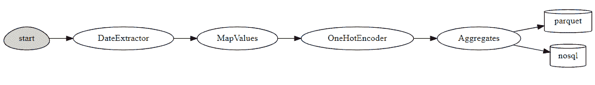

一旦有了特征集定义，你就可以使用 `preview()` 方法对其进行测试和调试，该方法在本地运行数据管道并让你查看结果。

```
df = fs.preview(transaction_set, transactions_data)
df.head()
```

特征集定义完成后，你可以将其部署为生产作业，按需运行、按给定计划运行或作为实时管道运行。

要运行批处理摄取，请使用 `ingest()` 方法。要进行实时摄取，从 HTTP 或流中，使用 `deploy_ingestion_service()`，它会启动实时 Nuclio 无服务器管道。参见 示例 4-13。

### 示例 4-13. 将数据摄取到 MLRun FeatureSet（来源：MLRun）

```
# Batch ingest the transactions dataset (from CSV file) through the defined pipeline
source = CSVSource("mycsv", path="measurements.csv")
fs.ingest(transaction_set, source=source)

# Deploy a real-time pipeline with HTTP API endpoint as the source
# MLRun support other real-time sources like Kafka, Kinesis, etc.
source = HTTPSource()
fs.deploy_ingestion_service(transaction_set, source)
```

你可以在 MLRun 特征存储 UI 中查看特征集、其元数据和统计信息。参见 图 4-20。

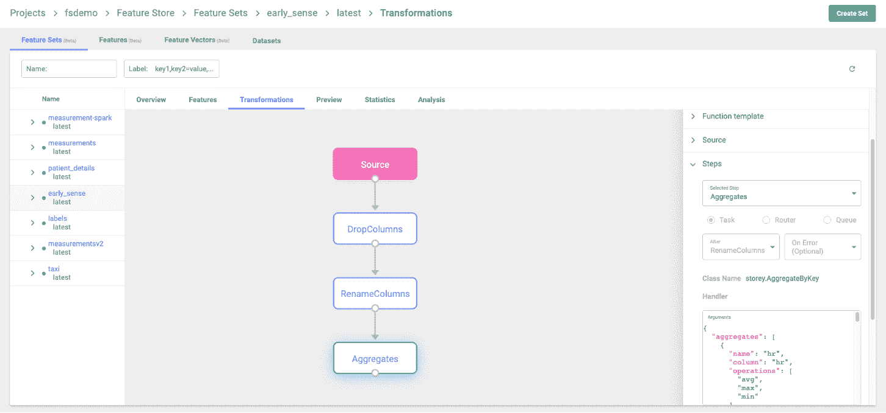

在 MLRun 中，特征检索使用 `FeatureVector` 对象完成。特征向量保存所请求特征的定义和附加参数。此外，它还存储计算值，例如特征元数据、统计信息等，这在训练、服务或监控任务中可能很有帮助。例如，特征统计信息用于在特征值缺失或为 NaN 时进行自动值插补，并用于服务应用程序中的模型漂移监控。

特征向量可以在 MLRun 的 UI 中创建、更新和查看。

用户首先定义特征向量，然后她或他可以使用它来获取离线或在线特征。参见 示例 4-14 中如何检索离线特征并使用 `get_offline_features()` 方法。

### 示例 4-14. 获取 MLRun 的离线特征（来源：MLRun）

```
# Define the list of features you will be using (<feature-set>.<feature>)
features = ['transactions.amount_max_2h',
            'transactions.amount_sum_2h',
            'transactions.amount_count_2h',
            'transactions.amount_avg_2h',
            'transactions.amount_max_12h']

# Import MLRun's Feature Store
import mlrun.feature_store as fstore

# Define the feature vector name for future reference
fv_name = 'transactions-fraud'

# Define the feature vector using our Feature Store
transactions_fv = fs.FeatureVector(fv_name, features,
                                   label_feature="labels.label",
                                   description='Predicting a fraudulent transaction')

# Save the feature vector definition in the Feature Store
transactions_fv.save()

# Get offline feature vector as dataframe and save the dataset to a parquet file
train_dataset = fstore.get_offline_features(transactions_fv, target=ParquetTarget())

# Preview the dataset
train_dataset.to_dataframe().tail(5)
```

要获取实时特征，你首先需要定义一个服务（它初始化实时检索管道），然后使用 `.get()` 方法实时请求特征值。服务创建（一次性初始化）与单独请求之间的分离可确保更低的请求延迟。此外，MLRun 支持基于特征的元数据和统计信息的自动值插补。这可以节省大量的开发和计算开销。参见 示例 4-15。

### 示例 4-15. 获取 MLRun 的在线特征（来源：MLRun）

```
# Create the online feature service, substitute NaN values with the feature mean value
svc = fs.get_online_feature_service('transactions-fraud:latest',
                                    impute_policy={"*": "$mean"})

# Get sample feature vector
sample_fv = svc.get([{'source': 'C76780537'}])

# sample_fv Result
[{'amount_max_2h': 14.68,
  'amount_max_12h': 70.81,
  'amount_sum_2h': 14.68,
  'amount_count_2h': 1.0,
  'amount_avg_2h': 14.68}]
```

#### 注

MLRun 的特征存储通过在摄取过程中结合预先计算的值与在特征请求时进行的实时计算，提供准确的实时聚合和低延迟。

MLRun 框架提供模型开发和训练管道、实时服务管道以及集成模型监控。MLRun 的特征存储与其它组件原生集成，消除了冗余的胶水逻辑、元数据转换等。因此加速了投产时间。

# 结论

由于数据管理和处理是 ML 最关键的组件，因此了解如何最优地执行数据相关任务非常重要。本章探讨了处理数据的各个阶段的推荐工具和实践。我们首先通过讨论数据版本控制和血缘关系开始本章，这对于追溯数据来源至关重要。然后我们探讨了大规模的数据准备和分析，即数据是如何被处理以便在生产中使用。在本节中，我们还讨论了交互式数据处理解决方案的架构以及批处理数据处理与实时处理之间的差异。

在回顾了大规模实施这些实践的挑战后，我们继续介绍了特征存储的概念，特征存储是 ML 特征的中央存储库。我们介绍了特征存储的各种功能，如数据连接以及离线和在线转换。我们还展示了特征存储在 MLOps 管道中的位置，从摄取原始数据到支持在训练、服务、监控等中使用该数据。最后，我们回顾了不同的特征存储解决方案以及如何使用它们。

# 批判性思考讨论问题


*   元数据为我们提供了哪些细节？作为数据专业人员，为什么我们需要这些信息？
*   有哪些开源数据版本控制工具？哪一个可能适合您的组织？
*   批处理和流处理有什么区别？各自在何时使用？
*   特性存储如何简化数据管理和处理实践？哪些功能使此成为可能？
*   `Feast` 和 `MLRun` 特性存储之间有什么区别？哪一个可能适合您的组织？

# 练习

*   选择一个开源解决方案（`DVC`、`Pachyderm`、`MLFlow` 或 `MLRun`）并创建一个数据版本控制脚本或工作流，以记录和版本化数据和元数据。
*   使用您选择的工具创建一个批处理管道的原型。
*   将 `Trino` 数据连接器连接到数据源。
*   使用特性存储训练一个演示模型（如果需要示例模型，可以使用 `Hugging Face`）。
*   在 `MLRun` 中创建特性集和摄取管道。您可以使用 [此项目](https://docs.mlrun.org/en/stable/feature-store/end-to-end-demo/01-ingest-datasources.xhtml) 作为参考。
