# 第 5 章. 为生产开发模型

本章内容是关于“为生产开发模型”。创建适当的建模环境是其核心。靠制作桌椅为生的木工需要有一个合适的车间。车间需要足够的空间，最好足够大，可以存放原材料，如木材和油漆，以及一套有组织的工具。这种车间环境最终能够实现高质量家具的制作。没有这个工作空间，家具的质量和产量都会受损。

同样，对于 MLOps 而言，上下文很重要。在 图 5-1 中，模型构建所使用的工具和环境至关重要。一个关键的第一步是 `SDK`，配合适当的编辑器，如 `Visual Studio Code`、基于云的开发环境，以及从一开始的 `CI/CD`。

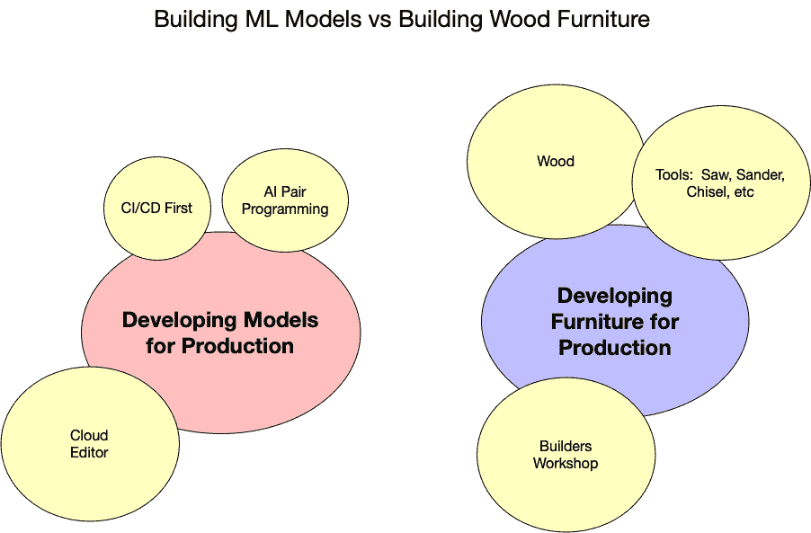

解释上下文的另一种方式是看我在撰写本书时走过的海滩的照片 图 5-2。海浪声、阳光在天空闪烁、赤脚在温暖的水中行走，都是写书的绝佳环境。原因在于海滩带来一种放松感，使人自然而然地反思。


许多开发者每天的工作流程是工作四小时，散步一小时，然后再工作四小时。他们这样做是因为这创造了先投入问题的上下文，然后让思绪离开编码挑战，让它在后台工作，然后再处理在午间散步时出现的解决方案的其余部分。

同样，本章涵盖了在正确上下文中构建机器学习模型的许多概念。接下来，让我们深入了解模型构建的细节。

## 运行、跟踪和比较 ML 作业

从很多方面来看，对于传统软件工程师而言，运行、跟踪和比较 ML 作业的概念并没有什么新意。软件工程师在部署服务时会关注 `CPU`、`Memory`、`Disk I/O` 以及微服务响应时间。机器学习运维非常适合软件工程监控的传统范围。

让我们以 Azure Databricks 作为运行、跟踪和比较 ML 作业的简化玩具示例 图 5-3。从高层次来看，这是一个端到端的 MLOps 解决方案，允许您使用 `AutoML` 创建实验、提供模型，然后在许多不同的环境中提供模型，包括通过 Databricks 端点在 Databricks 本身中提供，或在 Azure、AWS、GitHub Codespace 或更多环境中的容器化部署。

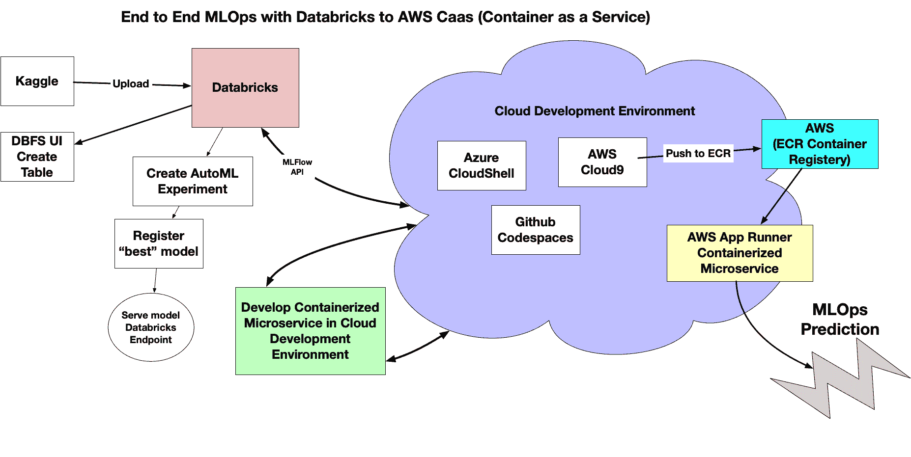

让我们进一步分解并讨论每一步。注意，Kaggle 上关于 [分类虚假新闻](https://www.kaggle.com/datasets/ruchi798/source-based-news-classification) 的数据集开始了这一旅程。接下来，该数据集上传到 `DBFS`（`Databricks File System`）。`DBFS` 是一个挂载到 Databricks 工作区并在 Databricks 集群上可用的分布式文件系统。您可以使用许多简单的 Kaggle 数据集来尝试此工作流。在 图 5-4 中，数据砖 UI 基本上绘制了该管道中的许多顺序步骤，从数据到计算到模型再到服务等。

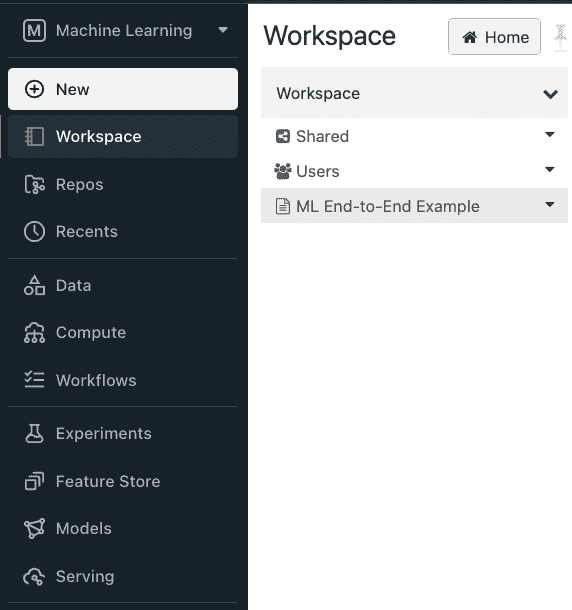

该端到端 MLOps 管道的依赖项之一是需要计算集群来托管 `DBFS` 并执行 `AutoML`。在 图 5-5 中，Azure Databricks 中的默认集群以至少两个工作节点和最多八个工作节点的示例配置启动，并在 120 分钟后终止。

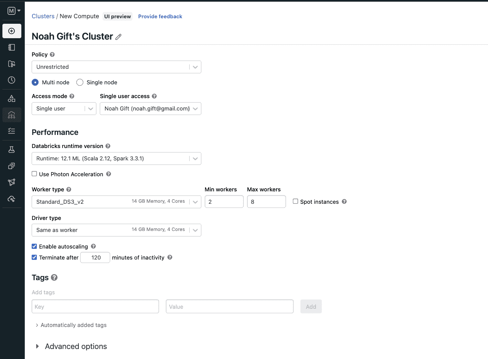

一旦运行起来，将数据上传到 `DBFS` 并运行实验即可解锁在 图 5-6 中运行 `AutoML` 作业的能力。`AutoML` 实验的关键输入是集群、ML 问题类型，在本例中为“classification”、位于 `DBFS` 上的输入训练数据，最后是“Prediction target”，即要预测的列。Databricks `AutoML` 系统会完成其余工作。

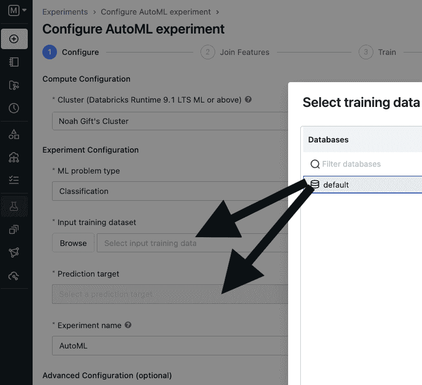

## AutoML

您可以使用 `DBFS` 中的默认 diamonds 数据集看到一个很好的示例。请注意在 图 5-7 中，多个训练运行致力于优化准确率指标，并创建笔记本和模型作为工件。

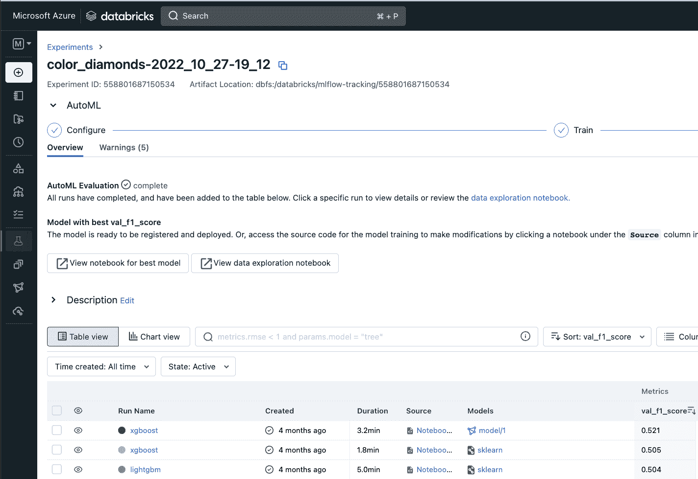

此外，如果您进一步深入模型，可以在 图 5-8 中看到有三种模式“Real-time”，它在虚拟机上设置一个端点、流式“Delta Live Tables”和“Batch Inference”。简而言之，`AutoML` 工作流实现了构建一次、多种产出，即您可以以多种方式提供模型。

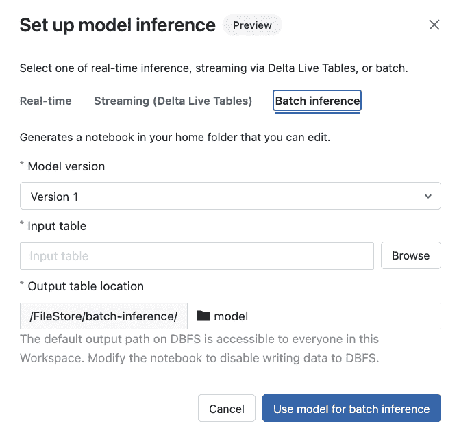

### 使用模型工件保存必要的元数据

如 [以下示例](https://github.com/noahgift/mlflow-project-best-practices/blob/main/download-model.py) 所示，还有另一种方法可以在 Databricks 中处理使用 `AutoML` 创建的模型。将模型下载到基于云的环境中可以提供更多利用推理的方式。在此示例 示例 5-1 中，模型使用 `mlflow` API 本地下载。

#### 示例 5-1. 下载模型 (`download-model.py`)

```
from mlflow.store.artifact.models_artifact_repo import ModelsArtifactRepository
from mlflow.tracking import MlflowClient

client = MlflowClient()
my_model = client.download_artifacts("68baff0203344dfebe89a6c73c6d6cfe", path="model")
print(f"Placed model in: {my_model}")
```

您可以按如下 API 调用所示列出模型 示例 5-2，这使您可以搜索符合您在类型、准确率等方面要求的模型。

#### 示例 5-2. 列出模型 (`list-models.py`)

```
from pprint import pprint
from mlflow.tracking import MlflowClient

client = MlflowClient()
for rm in client.list_registered_models():
    pprint(dict(rm), indent=4)
```

另一种处理结果的方法是使用 `curl` 调用 Databricks 的 API，从 `bash` 脚本中调用模型，如以下示例 示例 5-3 所示。

#### 示例 5-3. 调用端点


```
curl \
  -u token:$DATABRICKS_TOKEN \
  -X POST \
  -H "Content-Type: application/json; format=pandas-records" \
  -d@data.json \
  https://adb-2951765055089996.16.azuredatabricks.net/model/Fake-News/1/invocations
```

另一种调用模型的方式是通过 Python，如 [以下示例](https://github.com/noahgift/mlflow-project-best-practices/blob/main/predict-fake-news.py) 所示。一般流程是创建包含输入数据的 `DataFrame`，在这种情况下是对可疑新闻报道的文本进行分类 示例 5-4。

### 示例 5-4. 列出模型 (`predict-fake-news.py`)
```
#!/usr/bin/env python

import os
import requests
import pandas as pd

my_data = {
    "text": {"aliens are coming to invade earth"},
}
df = pd.DataFrame(data=my_data)

def create_tf_serving_json(data):
    return {
        "inputs": {name: data[name].tolist() for name in data.keys()}
        if isinstance(data, dict)
        else data.tolist()
    }

def score_model(dataset):
    url = "https://adb-2951765055089996.16.azuredatabricks.net/model/Fake-News/1/invocations"
    headers = {"Authorization": f'Bearer {os.environ.get("DATABRICKS_TOKEN")}'}
    data_json = (
        dataset.to_dict(orient="split")
        if isinstance(dataset, pd.DataFrame)
        else create_tf_serving_json(dataset)
    )
    response = requests.request(method="POST", headers=headers, url=url, json=data_json)
    if response.status_code != 200:
        raise Exception(
            f"Request failed with status {response.status_code}, {response.text}"
        )
    return response.json()


if __name__ == "__main__":
    print(score_model(df))
```

你可以在 Azure Cloud shell 中看到此 API 调用，见 图 5-9。

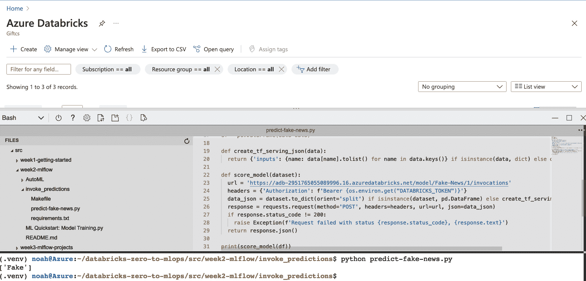

你可以在 GitHub Codespace 中看到此 API 调用，见 图 5-10。

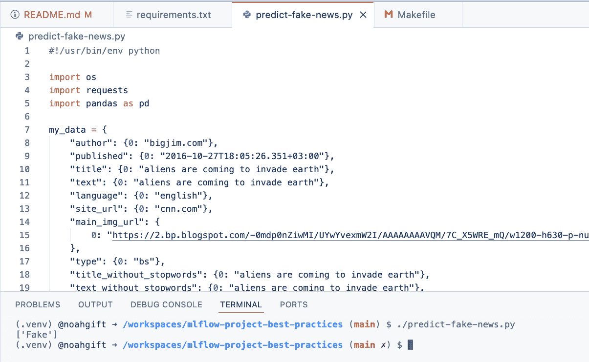

#### 注
这里是对整个过程的逐步讲解。
* [YouTube 讲解](https://studio.youtube.com/video/PUXhWZQW8BI/edit?c=UCNDfiL0D1LUeKWAkRE1xO5Q)
* [从开发到生产的 MLOps 平台](https://learning.oreilly.com/videos/mlops-platforms-from/032232022VIDEOPAIML)

你还可以将之前下载的模型放入 `FastAPI` 微服务中，如 [以下示例](https://github.com/noahgift/mlflow-project-best-practices/blob/main/main.py) 所示，见 示例 5-5。

### 示例 5-5. 通过 `FastAPI` 预测 (`main.py`)
```
# pylint: disable=no-name-in-module
# pylint: disable=no-self-argument

from fastapi import FastAPI
import uvicorn
import mlflow
import pandas as pd
from pydantic import BaseModel
from fastapi.responses import JSONResponse
from fastapi.encoders import jsonable_encoder

class Story(BaseModel):
    text: str

def predict(text):
    print(f"Accepted payload: {text}")
    my_data = {
        "text": {0: text},
    }
    data = pd.DataFrame(data=my_data)
    result = loaded_model.predict(pd.DataFrame(data))
    return result


# Load model as a PyFuncModel.
loaded_model = mlflow.pyfunc.load_model('model')
app = FastAPI()

@app.post("/predict")
async def predict_story(story: Story):
    print(f"predict_story accepted json payload: {story}")
    result = predict(story.text)
    print(f"The result is the following payload: {result}")
    payload = {"FakeNewsTrueFalse": result.tolist()[0]}
    json_compatible_item_data = jsonable_encoder(payload)
    return JSONResponse(content=json_compatible_item_data)

@app.get("/")
async def root():
    return {"message": "Hello Model"}

@app.get("/add/{num1}/{num2}")
async def add(num1: int, num2: int):
    """Add two numbers together"""

    total = num1 + num2
    return {"total": total}


if __name__ == '__main__':
    uvicorn.run(app, port=8080, host='0.0.0.0')
```

要将工作流程提升到下一个层次，请将其容器化，如以下 示例 5-6 [Dockerfile](https://github.com/noahgift/mlflow-project-best-practices/blob/main/Dockerfile) 所示。

### 示例 5-6. `FastAPI` 应用的 `Dockerfile`
```
FROM public.ecr.aws/lambda/python:3.8

RUN mkdir -p /app
COPY ./main.py /app/
COPY model/ /app/model/
COPY ./requirements.txt /app/requirements.txt
RUN pip install --no-cache-dir --upgrade -r /app/requirements.txt
WORKDIR /app
EXPOSE 8080
CMD [ "main.py" ]
ENTRYPOINT [ "python" ]
```

将 ml 应用容器化的原因是它允许你一次构建，多次部署。例如，你可以部署到 AWS App Runner 或 Azure App Services，或 Google Cloud Run。

# 自动记录和 MLOps 自动化

`MLflow` 的一个有价值的方面是它可以自动记录正在发生的事情 示例 5-7 [在项目中](https://mlflow.org/docs/latest/tracking.xhtml#automatic-logging)。它通过使用 `mlflow.autolog()` 实现这一点。

### 示例 5-7. mlflow 推理日志记录
```
import mlflow

from sklearn.model_selection import train_test_split
from sklearn.datasets import load_diabetes
from sklearn.ensemble import RandomForestRegressor

mlflow.autolog()

db = load_diabetes()
X_train, X_test, y_train, y_test = train_test_split(db.data, db.target)

# Create and train models.
rf = RandomForestRegressor(n_estimators = 100, max_depth = 6, max_features = 3)
rf.fit(X_train, y_train)

# Use the model to make predictions on the test dataset.
predictions = rf.predict(X_test)
autolog_run = mlflow.last_active_run()
```

接下来，让我们转向另一个主题：处理大规模训练。

# 处理大规模训练

大规模训练是一个引人入胜的问题，值得先从理论规模开始。在 图 5-11 中，注意一次构建 ML 模型并多次部署的想法。

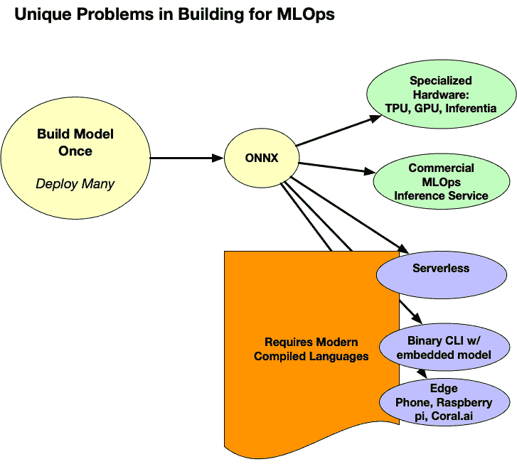

使这一过程成为可能的是首先为 `ONNX runtime` 构建 [ONNX 运行时](https://github.com/microsoft/onnxruntime)。接下来，开发人员决定部署到哪些潜在目标。对于使用专用硬件和商业 MLOps 推理服务的 Web 应用而言，部署已有成熟方案。

另一个新兴用例是基于二进制的工作流概念，它嵌入 `ONNX runtime`，然后利用其高性能和低内存占用，解锁在无服务器平台如 AWS Lambda 上进行推理、构建 CLI 工具以及部署到边缘硬件如 [Coral.ai 设备](https://coral.ai/) 的能力。在这种情况下，官方支持的 C# 和 Rust 运行时都是潜在解决方案。

## 构建和运行多阶段工作流

为什么要使用 MLOps 平台的一个绝佳例子是把生命周期的多个阶段联系起来。这些包括数据收集和准备、特征工程、模型训练、模型选择和调优，以及部署和监控。临时编排所有这些在现实世界中是不可扩展的。让我们接下来深入了解细节。

## 扩展和自动化深度学习任务

在现代 MLOps 工作流中，笔记本具有多种用途，这增加了它在未来仍保持在 MLOps 中心的挑战，如 图 5-12 所示。

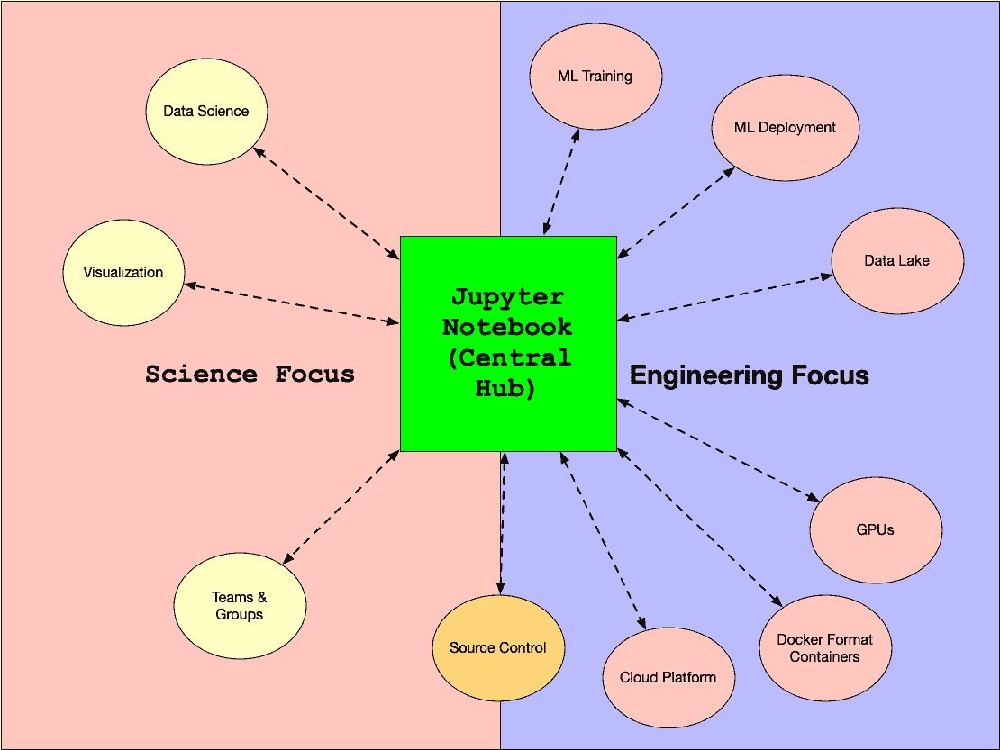

注意挑战在于将科学重点与工程重点合并。让我们接下来更详细地探讨这一点。

## 高效管理计算资源

在规模化 MLOps 中，挑战在于编排从摄取数据、进行探索性数据分析、建模，然后得出结论的连续过程，如 图 5-13 所示

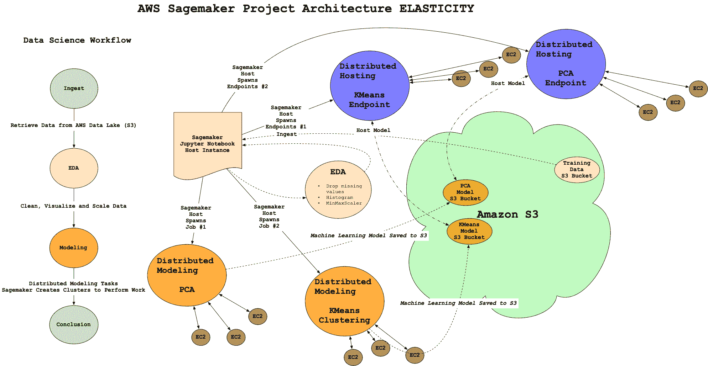


# 可扩展性和框架示例

构建和部署模型的每个步骤都需要大量的可扩展资源，例如 `S3`，用于存储原始数据和模型占位符。训练作业也需要弹性资源，推理作业也是如此。MLOps 是一个分布式计算问题，处理平台是解决这个困难问题最合理的方法之一。

另一个关于可扩展性至关重要的绝佳例子是苹果的 [`CreateML` 工具](https://developer.apple.com/machine-learning/create-ml/)。在 图 5-14 中，来自 Kaggle 的 [狗和猫数据集](https://www.kaggle.com/c/dogs-vs-cats) 被拖放到 UI 上以设置训练作业。

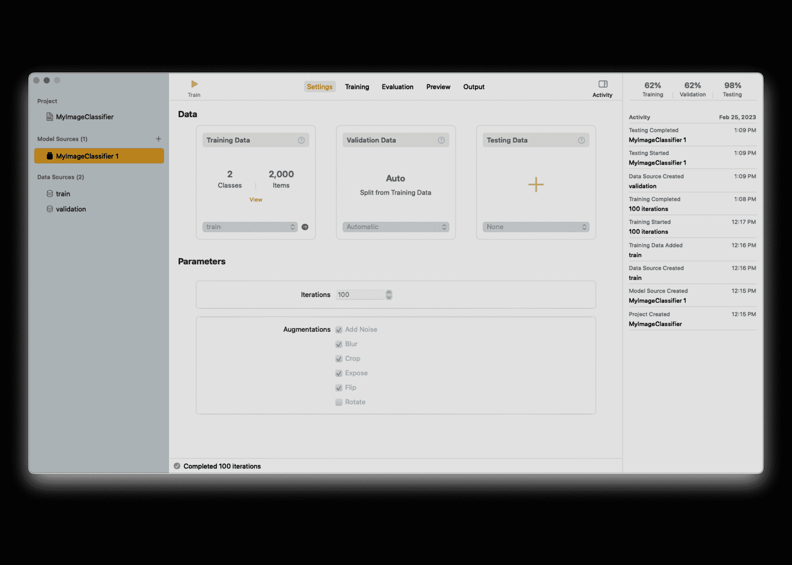

接下来，配备 38 个 GPU 内核和 10 个 CPU 内核的 Mac Pro M2 Max 可以充分利用这些 GPU 内核图 5-15。这里的工具是关键，因为软件和硬件的快速融合使开发人员能够快速原型化模型，然后再从 [`CoreML`](https://developer.apple.com/documentation/coreml) 格式导出到 `ONNX`。

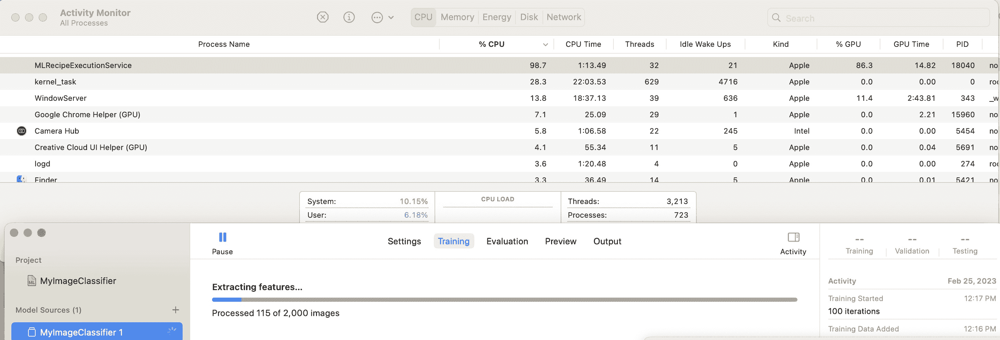

另一个高级框架的例子是 [`ML.NET` 框架](https://dotnet.microsoft.com/en-us/apps/machinelearning-ai/ml-dotnet) 在 图 5-16 中显示，它在执行 AutoML 时饱和了 CPU 内核。

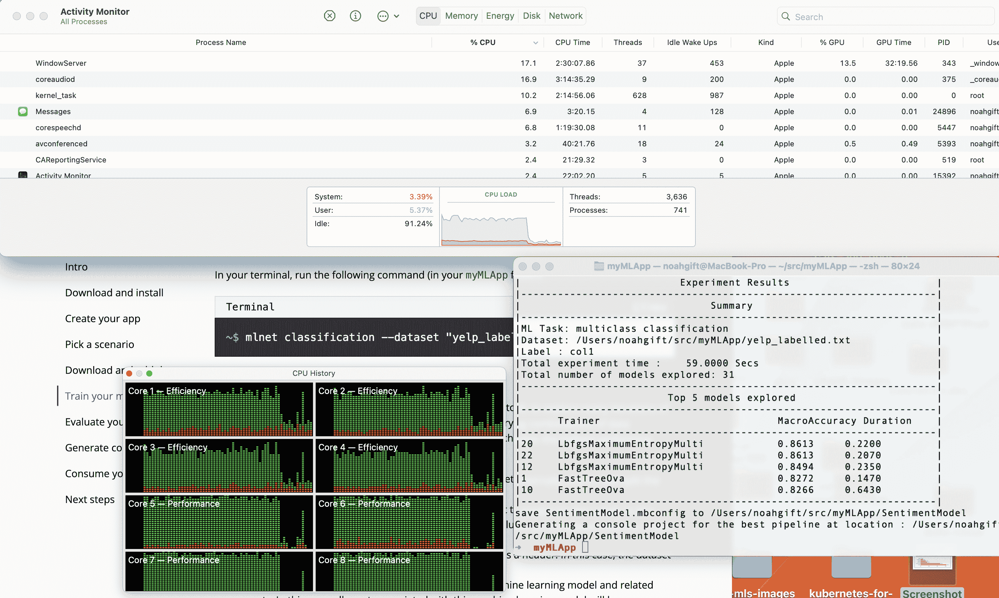

最后，不仅创建了一个高效使用 `ONNX` 的模型，而且 `C#` 控制台应用程序也是框架构建过程的一部分，使其能够与 `C#`、Visual Studio Code、模型格式以及最终的一次构建、部署工具紧密集成。

在 MLOps 领域，存在许多将硬件、软件、模型格式和最终交付物耦合在一起的工具的出现示例，值得为贵组织的目标评估这些框架。

## AWS 硅创新

MLOps 中的另一个拼图是 [自定义硅](https://aws.amazon.com/silicon-innovation/)。在训练方面，有 [`Tranium`](https://aws.amazon.com/machine-learning/trainium/)，一种高性能机器学习训练加速器，旨在加速深度学习工作负载。第一个版本使用约 50% 更少的能源，训练速度快 2 倍以上，训练成本降低 70% 以上，而第二个版本吞吐量高出 4 倍，延迟降低 10 倍，并且支持超大生成式 AI 模型。

在推理方面，还有 [`AWS Inferentia`](https://aws.amazon.com/machine-learning/inferentia/) 这种性能意味着 `OPT-30B` 模型（300 亿参数的大型语言模型）比基于 GPU 的推理快 3 倍以上，而 `OPT-66B` 在 GPU 上内存不足，但在 `Inferentia2` 上每秒可处理 248 个 token。

你可以使用 [`AWS Neuron SDK`](https://github.com/aws-neuron/aws-neuron-sdk) 探索此工作流程。主要的收获是，将模型投入运营的一个关键方面是寻找能够提高成本和能源效率的软件和硬件解决方案，如 图 5-17 所示。最终 AWS 在 MLOps 中具有最深的协同效应。许多较小的参与者需要帮助来保持与硬件、软件和平台的这种协同效应，这一点可以从竞争解决方案的 GitHub 星数低、市场份额常见，甚至 MLOps 领域的初创公司出现负面退出等情况看出。

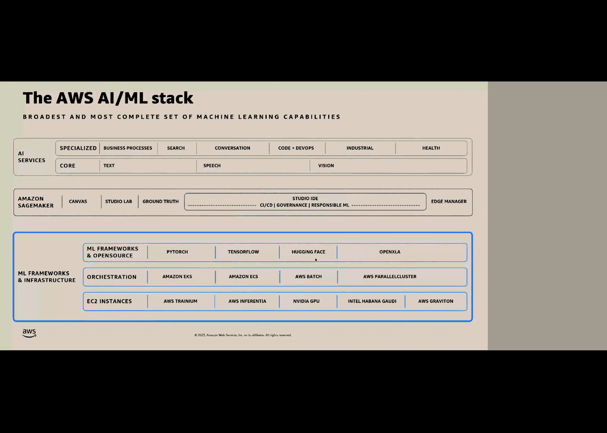

# CI/CD 和开发流程自动化

MLOps 中的一个重要考虑因素是为项目设定意图。我们在做机器学习时正在努力实现什么目标？工具链会根据目标的定义而有所不同。如果目标是从一开始就实现自动化，这是 MLOPs 的核心目标，那么工具链需要支持自动化，即 `SDK` 与笔记本，如 图 5-18 所示。

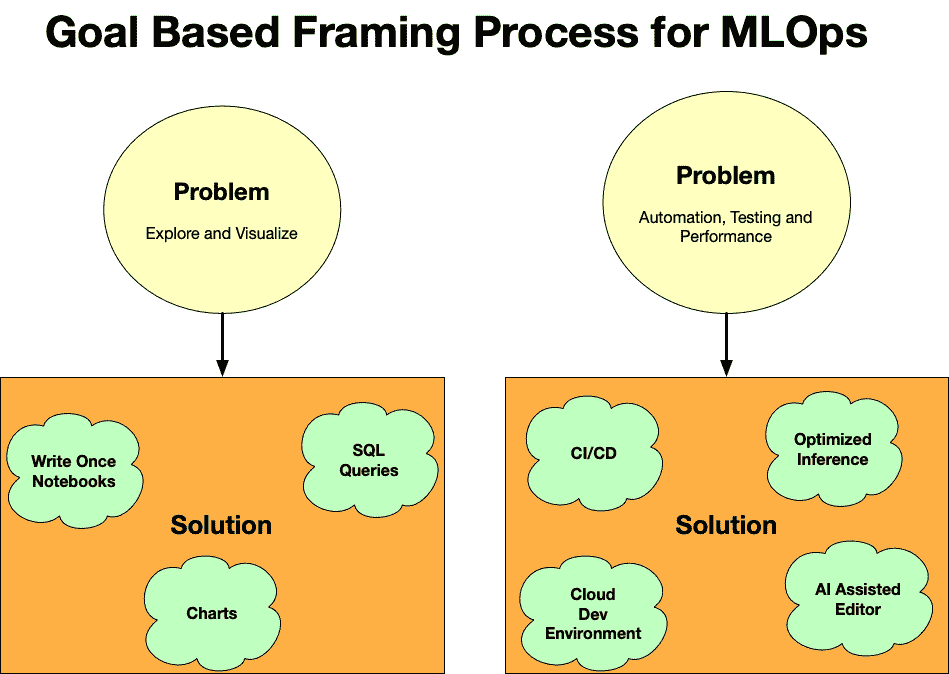

以笔记本为先的方法对 MLOps 来说是有问题的，因为它未能通过上下文测试，即如果上下文是软件自动化，那么该目标就需要一个持续集成管道。由于笔记本本质上是“只写”且无法测试，因此目标不能与自动化相同。相反，笔记本旨在以只写、不可测试的方式探索涉及数据科学的想法。

`CI/CD`（持续集成）/（持续交付）的三个关键方面是自动化、持续反馈和测试，以及协作。让我们简要讨论一下每个方面：

*   自动化：`CI/CD` 完全依赖于自动化，以确保快速、高效且无错误的软件交付管道。这意味着软件开发管道的每个步骤都需要自动化，包括开发环境、构建软件、测试、打包和通过 `IAC`（基础设施即代码）部署。自动化还减少了人为错误的机会并确保结果一致。

*   持续反馈和测试：这里的关键收获是，每当对软件进行更改时，软件质量控制工具，包括 linting、格式化、编译和测试，都会发生。代码在每次更改时都会持续改进，因为这些质量工具会报告更改的状态。

*   协作：代码库的持续改进和能够启动新环境的能力使团队成员之间能够进行深度协作。

对此工作流程的另一个变化是 图 5-19 中显示的新技术。相对较新的是右侧红色部分中的项目，即 `IAC`、AI 编码建议和可重复的开发环境。`CI/CD` 的全部目的就是促进自动化、反馈、测试和协作。提供帮助的输入越多越好。如果你没有编译器，会对你造成伤害；如果你没有 linter 甚至没有快速 linter，也会伤害你，等等（有关此内容的更多信息，请参阅 rust 附录）。

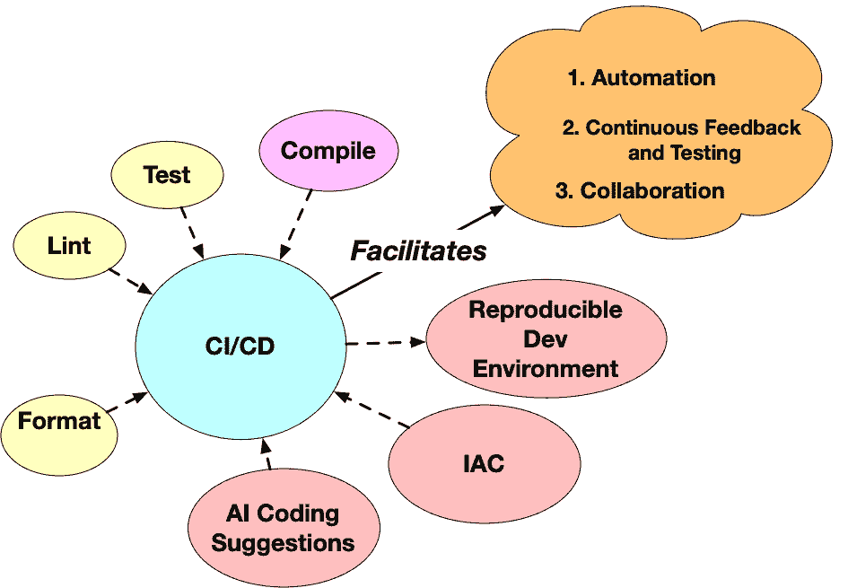

这里的收获是，使用高性能工具是改进 `CI/CD` 管道的一种方式需要注意的地方。此外，请注意笔记本在 `CI/CD` 管道中不起作用。它怎么能工作呢？笔记本的上下文与自动化不同。虽然是一个有用的工具，但它与 MLOps 正交，因为笔记本是一种创作媒体，如新书形式。

那么 MLOps 的 `CI/CD` 管道可能是什么样子？一个好的起点是 [GitHub MLOps 模板仓库](https://github.com/nogibjj/mlops-template)。必要的项目包括可配置的基于云的开发环境，如 `GitHub`，一个在本地和构建系统中编排工作的 `Makefile`，最后是一个基于云的构建系统。

但这只是基础，类似于软件工程的基础。MLOps 的独特 `CI/CD` 组件至少包括一个模型。让我们接下来深入研究一个端到端的预训练模型示例。

## 端到端 PyTorch 到 AWS App Runner

消除理解 MLOps 中 `CI/CD` 的一些复杂性的一种好方法是构建一个 [简单示例微服务](https://github.com/nogibjj/pytorch-fastapi-aws-apprunner)，它使用预训练的 `PyTorch` 模型。为此需要修改使用 `Flask` 与 `PyTorch` 的 [官方教程](https://pytorch.org/tutorials/intermediate/flask_rest_api_tutorial.xhtml)。

首先，有一个 [`app.py`](https://raw.githubusercontent.com/nogibjj/pytorch-fastapi-aws-apprunner/main/app.py) 构建了一个用于预测的 `PyTorch` 模型，通过 `FastAPI` 提供服务。第一个函数转换图像，然后 `get_prediction` 获取推理，最后 `async def predict` 将所有内容整合在一起。

\[\[预训练 PyTorch 微服务\]\] .`FastAPI` 应用程序 `PyTorch`


## PyTorch FastAPI 预测服务

```
"""
Build a PyTorch model that used for prediction served out via FastAPI
"""

import io
import json

from torchvision import models
import torchvision.transforms as transforms
from PIL import Image
import fastapi
from fastapi import File, UploadFile
import uvicorn

app = fastapi.FastAPI()

model = models.densenet121(weights="DenseNet121_Weights.IMAGENET1K_V1")
model.eval()
imagenet_class_index = json.load(open("imagenet_class_index.json", encoding="utf-8"))


def transform_image(image_bytes):
    my_transforms = transforms.Compose(
        [
            transforms.Resize(255),
            transforms.CenterCrop(224),
            transforms.ToTensor(),
            transforms.Normalize([0.485, 0.456, 0.406], [0.229, 0.224, 0.225]),
        ]
    )
    image = Image.open(io.BytesIO(image_bytes))
    return my_transforms(image).unsqueeze(0)


def get_prediction(image_bytes):
    tensor = transform_image(image_bytes=image_bytes)
    outputs = model.forward(tensor)
    _, y_hat = outputs.max(1)
    predicted_idx = str(y_hat.item())
    return imagenet_class_index[predicted_idx]


@app.get("/")
def index():
    return {"message": "Hello World"}


@app.post("/files/")
async def create_file(file: bytes = File()):
    return {"file_size": len(file)}


@app.post("/uploadfile/")
async def create_upload_file(file: UploadFile):
    return {"filename": file.filename}


@app.post("/predict")
async def predict(file: UploadFile = File(...)):
    image_bytes = await file.read()
    print(len(image_bytes))
    class_id, class_name = get_prediction(image_bytes=image_bytes)
    return {"class_id": class_id, "class_name": class_name}


if __name__ == "__main__":
    uvicorn.run(app, host="0.0.0.0", port=8080)
```

`Dockerfile` 非常简单，如图所示。它将流量转发到外部接口 “0.0.0.0” 上的 8080 端口。

```
FROM tiangolo/uvicorn-gunicorn-fastapi:python3.9

WORKDIR /code

COPY . /code

RUN pip install --upgrade pip &&\
    pip install --no-cache-dir --upgrade -r /code/requirements.txt

CMD ["uvicorn", "app:app", "--host", "0.0.0.0", "--port", "8080"]
```

容器镜像会被推送到 Amazon ECR，或者你可以指向源代码仓库，如 图 5-20 所示，然后设置 [AWS App Runner](https://aws.amazon.com/apprunner/)。

接下来，你在 图 5-21 中配置构建过程。

接下来，你在 图 5-22 中配置服务。

接下来，你在 图 5-23 中配置部署。

完成此过程后，你将到达已部署的端点并连接到 `/docs`；从那里，上传图像进行预测非常简单。你可以在 [在此在 YouTube 上观看完整演示](https://www.youtube.com/watch?v=-CoOotWG30E) 查看。

## 使用 GitHub Actions 与 Azure Machine Learning Studio 的访客章节

在本节中，我联系了 [O’Reilly Alfredo Deza](https://www.oreilly.com/pub/au/7872)，他是 Azure 的开发者倡导者。他在教育领域广泛使用 DevOps 和 MLOps 工作流，并与本书的读者分享了这一技术。

我在 Azure Machine Learning Studio 工作时常使用的一项功能是添加 GitHub Actions，使其成为强大的组合。GitHub Actions 使用称为工作流文件 的 YAML 文件。这些文件易于阅读，因此易于维护——在处理企业级软件时必不可少的组合。

我常用的两种模式如下，可在此基础上进一步构建：

1.- 从 GitHub 注册模型或数据集到 Azure ML Studio

2.- 检索特定版本的模型以进行打包

### 对 Azure 进行身份验证

任何时候你与 Azure 交互以创建或检索你账户中的数据时都需要身份验证。有多种方式可以使用 GitHub Actions 进行身份验证，但我最常用的是使用 Azure 服务主体。服务主体是一种创建对资源具有有限范围的账户的方式，只需一个简单的命令即可。

使用 [Azure Cloud Shell](https://shell.azure.com/?WT.mc_id=academic-0000-alfredodeza) 运行以下命令查找你的订阅 ID：

```
az account show --query id -o tsv
```

捕获结果 ID 并在下一步中使用，将 `$AZURE_SUBSCRIPTION_ID` 替换为上一步的结果：

```
az ad sp create-for-rbac  --sdk-auth --name "github-actions" \
   --role contributor --scopes /subscriptions/$AZURE_SUBSCRIPTION_ID
```

该命令将生成一个 JSON 输出，你必须将其用于 GitHub 仓库密钥中。仓库密钥是安全存储敏感信息（如 Azure CLI 命令提供的）的一种方式。在你想使用 GitHub Actions 与 Azure 的 GitHub 仓库中，进入 Settings，然后选择 Actions，并选择 New。名称使用 `AZURE_CREDENTIALS`，值则粘贴上一步命令的 JSON 输出。

虽然你需要使用更多组件配置 YAML 工作流，但这是用于对 Azure 进行身份验证的步骤：

```
  - uses: azure/login@v1
    with:
     creds: ${{ secrets.AZURE_CREDENTIALS }}
```

仅需三行代码即可使用具有足够权限的账户正确地对 Azure 进行身份验证，这使你能够专注于机器学习项目的其他方面，而不必花费时间尝试使身份验证工作。这是我喜欢 GitHub Actions 的主要原因之一。

### 使用你的 Azure ML 工作区

本节假设你已经创建了 Azure Machine Learning 工作区，并且可以访问其门户 [*https://ml.azure.com/?WT.mc\_id=academic-0000-alfredodeza*](https://ml.azure.com/?WT.mc_id=academic-0000-alfredodeza)。Azure ML 工作区的常见用途之一是在 Azure 中创建和存储模型。身份验证后，你可以使用这些已注册的模型与 GitHub Actions 配合执行不同的工作流，包括打包。

以下示例展示了如何确保 Azure CLI 拥有与 Azure ML 工作区配合工作并检索模型所需的一切：

```
- name: set auto-install of extensions
  run: az config set extension.use_dynamic_install=yes_without_prompt
```

接下来，将 `workspace-name` 和 `workspace-group` 分别替换为你的 Azure ML 工作区和资源组，以便 GitHub Actions 可以将工作区附加到作业：

```
- name: attach workspace
  run: az ml folder attach -w "workspace-name" -g "workspace-group"
```

最后，你可以检索特定版本的模型。版本位于 `--model-id` 值中的冒号之后。在以下示例中，我们使用之前已在 Azure ML 中注册的 ONNX 格式的 GPT-2 模型：

```
- name: retrieve the ONNX model
  run: az ml model download -t "." --model-id "GPT-2-onnx:1"
```

虽然我没有详细介绍构建端到端示例，但希望我已经展示了一些强大的构建块，你可以使用它们通过 Azure ML 和 GitHub Actions 创建更复杂的作业。过去，我曾使用这些示例来打包机器学习模型并将其部署到容器注册表。GitHub Actions 的可读性提高，加上 Azure CLI 的易用性，使其成为值得尝试的出色组合。

让我们继续进入下一部分总结本章。

## 结论


本章讨论构建机器学习模型的背景，特别是关于一次构建、多处部署。在这些场景中，硬件、软件、模型格式和最终交付物之间存在紧密的反馈。上下文在构建模型中很重要，并且有许多独特的上下文需要考虑，从二进制部署到嵌入式再到星球级推理等等。

我们还讨论了两个不同的端到端示例。第一个涉及使用 `Databricks` 作为一次构建、多处部署的 `MLOps` 解决方案。示例包括通过其生态系统调用、提取模型并将其放入容器化工作流中。我们以一个预训练的 `FastAPI` `PyTorch` 示例作为收尾。完成练习和批判性思考问题，以充分利用本章内容。

# Exercises
* 部署一个简单的图像分类模型：使用预训练的卷积神经网络（`CNN`），构建一个 `FastAPI` Web 应用程序，从用户接收图像文件，使用模型对其进行处理，并显示预测的类别。该应用程序应处理错误和意外输入，并可通过基于 [`locust`](https://locust.io/) 的负载测试准备在生产环境中部署
* 构建可扩展的文本分类流水线：在大型数据集上训练用于文本分类的深度学习模型，并使用 [`Ludwig`](https://ludwig.ai/latest/) 开发可扩展的推理流水线。
* 集成模型监控和告警：开发一个系统，使用 `MLOps` 平台持续监控已部署模型的性能。当检测到异常时发送告警。使用数据漂移分析将性能异常与数据变化关联起来。
* 实现模型版本控制系统：构建一个模型版本控制系统，使团队能够从头开始跟踪模型随时间的演变。该系统应跟踪模型的代码、数据和超参数，并允许轻松回滚到以前的版本。使用 `Git` 进行版本控制，并使用 `DVC` 等工具管理数据和模型。
* 创建模型再训练流水线：开发一个流水线，随着新数据的可用自动重新训练模型。该项目应监控数据源的变化，在最新数据上重新训练模型，并将新模型部署到生产环境。考虑使用 `Apache Airflow` 进行工作流管理、`Kubernetes` 进行部署、`AWS Sagemaker` 或 `Azure ML Studio` 等技术。

# Critical Thinking Discussion Questions
* 什么因素会影响模型在生产部署中的性能？你如何为组织争取优势以实现成功的结果？
* 你组织的数据管理与模型构建治理政策是什么？使用 [企业数据目录](https://learning.oreilly.com/library/view/the-enterprise-data/9781492098706/) 能否改善治理？
* 在性能方面部署模型的關鍵瓶颈是什么？语言、技术或设计如何帮助构建可扩展的解决方案？
* 一次构建并部署到多个目标（即二进制命令行工具、基于边缘的设备和移动设备）使用 [`Onnx`](https://github.com/microsoft/onnxruntime) 的优势是什么？
* 你如何保护 ML 系统用户的隐私？是否存在符合所有近期政府法规的方法？
