# 第 6 章. 模型和人工智能应用的部署
处理数据、训练和验证模型只是真正工作的前奏：构建和部署一个应用程序，该应用程序使用你生成的数据和你构建的模型来驱动决策和行动。

要交付机器学习应用程序，首先构建并注册模型以供生产应用程序使用。然后，创建一个应用程序 [流水线](https://www.iguazio.com/glossary/machine-learning-pipeline/)，该流水线通常接受事件或数据，准备所需的模型特征，使用一个或多个模型推断结果，并驱动操作。最后，监控数据、模型和应用程序以保证其可用性和性能。在出现问题或模型性能下降的情况下，采取纠正措施。

许多组织仍然认为“服务模型”或创建模型端点。然而，他们需要更多关注交付 ML 应用程序整体的更大图景，而不是将应用程序交付责任在数据科学和工程团队之间划分。忽视更大的图景将导致重大的功能缺口、故障、不必要的风险和长时间的延迟。

## 模型注册与管理
一个 *模型注册表* 是用于存储 ML 模型及其元数据并管理模型生命周期和版本的中央存储库。一旦 [模型训练](https://www.iguazio.com/glossary/model-training/) 过程完成，它会将模型及其元数据保存到注册表中。然后，不同的功能（例如 [评估](https://www.iguazio.com/glossary/model-evaluation/)、测试、优化等）扩展模型元数据或更新模型文件。最后，服务功能或应用程序流水线加载模型并使用它进行预测。

Model registries provide the following functionality:
* 存储模型及其元数据和标签（tags）。
* 管理模型访问、版本和生命周期。
* 能够基于元数据属性或标签查找、分组和比较模型。
* 存储 [模型部署](https://www.iguazio.com/glossary/model-deployment/) 和监控所需的信息。
* 跟踪模型状态和审批流程。
* 提供将模型部署到生产环境的简单或自动化机制。

通常，模型注册表与实验跟踪系统集成。这样，训练或实验中的关键元数据会自动记录在注册表中，无需人工干预。然而，大多数模型注册表解决方案提供 API 以注册在其他系统上训练的模型。

A model consists of the following data and metadata elements:
* *基础元数据*：唯一的模型名称、标识符、描述、项目、所有者、版本信息等。
* *标签*：用于标记、过滤、分组和搜索模型的一组键/值标签。
* *模型文件*：已保存的模型（例如 `pkl`、`json` 或 `hd5` 格式）和模型服务过程中使用的辅助文件。
* *跟踪信息*：模型是如何训练的、参数、数据源、代码版本、训练框架等的引用。
* *模型指标*：在训练、评估和测试过程中收集的性能指标。例如，[模型准确率](https://www.iguazio.com/glossary/model-accuracy-in-ml/)、损失、f1 分数、ROC 曲线、特征重要性等。
* *数据集模式*：模型输入（`X`）和输出（`Y`）的模式，包括字段名称、顺序和类型。
* *部署数据*：模型部署所需的信息和参数，例如包依赖项、容器镜像、运行时参数等。
* *监控元数据*：监控模型性能或 [漂移](https://www.iguazio.com/glossary/drift-monitoring/) 所需的信息。例如，每个特征的统计信息和直方图，以确定训练数据和服务数据之间是否存在漂移。
* *状态和状态*：关于模型当前状态、使用情况和审批的信息。

在许多情况下，训练流水线会生成多个模型。例如，在尝试不同的算法或参数组合时。在这种情况下，我们将为每个模型使用不同的名称或标签，并可以比较模型以选择最合适的选项。此外，相同的模型流水线可能产生多个模型，为数据的每个子集生成一个模型（例如，每个用户、每个设备、每个国家/地区一个模型等）。


模型注册表提供 API 和用户界面，用于创建、更新、检索、列出、比较和部署模型。模型注册表是 MLOps 或数据科学平台的组件。例如，开源解决方案包括 [MLflow](https://mlflow.org/docs/latest/model-registry.xhtml) 和 [MLRun](https://docs.mlrun.org/en/stable/store/models.xhtml)。此外，还有来自 [AWS SageMaker](https://docs.aws.amazon.com/sagemaker/latest/dg/model-registry.xhtml)、[Google Vertex AI](https://cloud.google.com/vertex-ai/docs/model-registry/introduction) 和 [DataRobot](https://docs.datarobot.com/en/docs/mlops/deployment/registry/reg-create.xhtml) 的商业解决方案。尽管注册表可以导入或导出模型，但一旦选择了 MLOps 平台，最佳做法是使用内置注册表。

## 解决方案示例

一些解决方案（例如 SageMaker 和 Vertex AI）要求你将模型打包到容器中，并对模型来源和元数据提供最少的可见性。这种方法可能导致额外的工作、功能限制（无法在同一容器中提供多个模型）以及有限的可观测性。

### SageMaker 示例

示例 6-1 显示了在 AWS SageMaker 中注册模型的代码示例。它涵盖了注册模型所需的以下步骤：

1. 将模型和代码保存到 `tar.gz` 包中并上传到 S3。
2. 构建容器镜像或使用预构建的 Docker 镜像。
3. 创建模型包组。
4. 创建模型包并指定模型包、镜像、运行时偏好、元数据等信息。

#### 示例 6-1. 在 AWS SageMaker 中注册模型

```
import boto3
from sagemaker import image_uris

region = boto3.Session().region_name
client = boto3.client('sagemaker', region)

# Require you to first package the model in tar.gz and upload to S3

# Specify the S3 location of the model package
model_package_location = 's3://my-bucket/my-model-package.tar.gz'

# Find the image url for a SageMaker built-in inference image
inference_image = image_uris.retrieve(
    framework="sklearn",
    region=region,
    version="1.0-1",
    py_version="py3",
    instance_type="ml.m5.large",
)


# Define the model package metadata
model_package_name = 'my-model-package'
model_package_group_name = model_package_name + "-group"
model_package_description = 'A sample model package'
model_package_framework = 'scikit-learn'
model_package_runtime = 'Python 3.8'

print(model_package_group_name)
group_response = client.create_model_package_group(
    ModelPackageGroupName=model_package_group_name,
    ModelPackageGroupDescription="My group description",
)

model_package_version_response = client.create_model_package(
    ModelPackageGroupName=model_package_group_name,
    ModelPackageDescription="scikit-learn demo",
    ModelPackageVersion='1.0',
    MetadataProperties={
        'GeneratedBy': 'my-username'
    },
    InferenceSpecification={
        "Containers": [
            {
                "ContainerHostname": "scikit-learn",
                "Image": inference_image,
                "ModelDataUrl": model_package_location,
                "Framework": "SAGEMAKER-SCIKIT-LEARN",
                "Environment": {
                    "SAGEMAKER_CONTAINER_LOG_LEVEL": "20",
                    "SAGEMAKER_PROGRAM": "inference.py",
                    "SAGEMAKER_REGION": region,
                },
            },
        ],
        "SupportedRealtimeInferenceInstanceTypes": [
            "ml.c5.xlarge",
            "ml.m5.xlarge",
        ],
        "SupportedContentTypes": ["text/csv"],
        "SupportedResponseMIMETypes": ["application/json"],
    },
)
```

### MLflow 示例

在 MLflow 中，实验跟踪服务可以保存模型工件（连同实验元数据），而模型注册表可以将工件注册为模型。请参阅 示例 6-2，其中演示了训练作业如何记录模型工件并将其注册。

#### 示例 6-2. 在 MLflow 中注册模型

```
from sklearn import ensemble, metrics
from sklearn.model_selection import train_test_split

import mlflow
import mlflow.sklearn
import pandas as pd

dataset = pd.read_cvs("data.csv")

with mlflow.start_run(run_name="YOUR_RUN_NAME") as run:
    params = {"n_estimators": 5, "learning_rate": 0.1}
    model = ensemble.GradientBoostingClassifier(**params)

    # Initialize the x & y data and split to train and test sets
    x = dataset.drop("label", axis=1)
    y = dataset["label"]
    x_train, x_test, y_train, y_test = train_test_split(x, y)

    # Log parameters and metrics using the MLflow APIs
    mlflow.log_params(params)


    # Train the model and log the metrics
    model.fit(x_train, y_train)
    predicted_probs = model.predict_proba(x_test)
    roc_auc = metrics.roc_auc_score(y_test, predicted_probs[:,1])
    mlflow.log_metric("test_auc", roc_auc)

    # Log the sklearn model and register as version 1
    mlflow.sklearn.log_model(
        sk_model=model,
        artifact_path="sklearn-model",
        registered_model_name="sk-learn-reg-model"
    )
```

注册模型后，可以在 MLflow UI 中查看，如 图 6-1 所示。

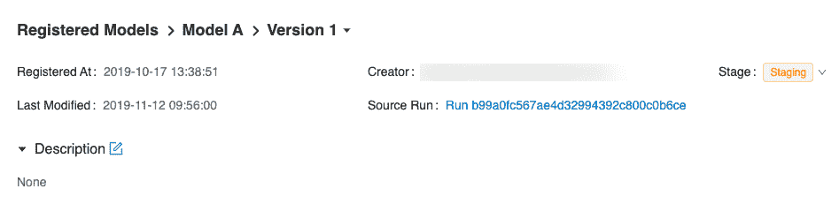

### MLRun 示例

在 MLRun 中，训练函数可以使用框架特定的 `apply_mlrun()` 方法自动获取所有模型详细信息、元数据、数据模式和统计信息并将模型保存到注册表（请参阅 示例 6-3）。请注意，MLRun 自动化了数据移动以及实验元数据、参数和指标的收集。

#### 示例 6-3. 在 MLRun 中注册模型

```
import pandas as pd
from sklearn import ensemble
from sklearn.model_selection import train_test_split
from mlrun.frameworks.sklearn import apply_mlrun

def train(
    dataset: pd.DataFrame,
    label_column: str = "label",
    n_estimators: int = 100,
    learning_rate: float = 0.1,
    model_name: str = "cancer_classifier",
):
    # Initialize the x & y data and split to train and test sets
    x = dataset.drop(label_column, axis=1)
    y = dataset[label_column]
    x_train, x_test, y_train, y_test = train_test_split(x, y)

    # Pick an ideal ML model
    model = ensemble.GradientBoostingClassifier(
        n_estimators=n_estimators, learning_rate=learning_rate
    )

    # Generate and register model artifact along with all its metrics and metadata
    # MLRun auto extracts the model schema and drift metadata from the test set
    apply_mlrun(model=model, model_name=model_name, x_test=x_test, y_test=y_test)

    # Train the model
    model.fit(x_train, y_train)
```

注册模型后，可以在 MLRun UI 中查看，连同所有自动收集的元数据。见 图 6-2。

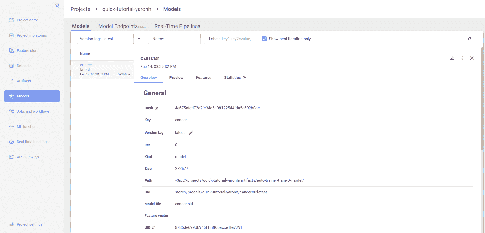

如果你有一个返回模型对象的现有代码函数，你不必添加 `auto_mlrun()` 方法。相反，MLRun 将自动检测模型对象并保存它。但是，它不会包含所有元数据和统计信息。你可以使用 `update_model()` 方法稍后添加这些信息。

你可以使用项目的 `log_model()` 方法注册在其他系统上训练的模型。

```
model_object = project.log_model('my-model', model_file=model_path, ..)
```

MLRun 还提供了一种简单的方法，将模型及其所有元数据导出到 `.zip` 文件中并加载回另一个系统。见 示例 6-4。

#### 示例 6-4. 导出和导入 MLRun 模型

```
# In the source platform export the model artifact into a .zip object
model_object.export("s3://my-bucket/model.zip")

# In the destination system import the model files + metadata from zip into the project
model_object = project.import_artifact("my-model", "s3://my-bucket/model.zip")
```

# 模型服务


# 模型服务

模型是一种方程形式。它们接受数值 (`X`) 并返回结果或预测 (`Y`)。模型具有独特的依赖关系和开发生命周期。因此，最好将它们打包并作为微服务（容器）部署，并通过 API 访问。此外，使用 API 允许模型独立扩展（添加/移除容器）、高可用性、细粒度安全以及滚动升级。

最基本的方法是手动将模型预测代码用协议包装起来。例如，使用 Python [`Flask`](https://flask.palletsprojects.com/) 或 [`FastAPI`](https://fastapi.tiangolo.com/) 包在模型之上添加 HTTP REST API。然而，这种简单的方法意味着你必须编写和维护大量代码来处理不同的 API 调用、异常、扩展、安全、升级等。

服务框架会为你处理模型部署、协议、生命周期和监控。许多框架要求你构建容器包，并添加部署、扩展等功能。一些框架（如 `MLRun`）使用无服务器函数架构自动创建容器包并向服务微服务注入高级功能和可观测性。此外，云中还有托管的模型服务解决方案，你只需上传模型而无需控制基础设施。

你可以通过在线端点（使用 HTTP/REST 或 gRPC 协议）部署和提供模型，该端点接受输入数据集并立即返回预测结果，或通过流式或消息协议（如 [`Kafka`](https://kafka.apache.org/)、 [`Kinesis`](https://aws.amazon.com/kinesis/)、 [`PubSub`](https://cloud.google.com/pubsub)、 和其他）接收输入事件、进行预测并将结果写入数据库或上游流/队列。

你可以将模型作为批处理管道的一部分部署。例如，第一步是准备数据集。然后，模型预测步骤从传入的数据集生成预测并将结果写入下一步或存储系统。批处理管道可以按需运行或按固定间隔调度。

图 6-3 说明了不同的模型服务部署选项，在线（同步）、流（异步）和批处理。

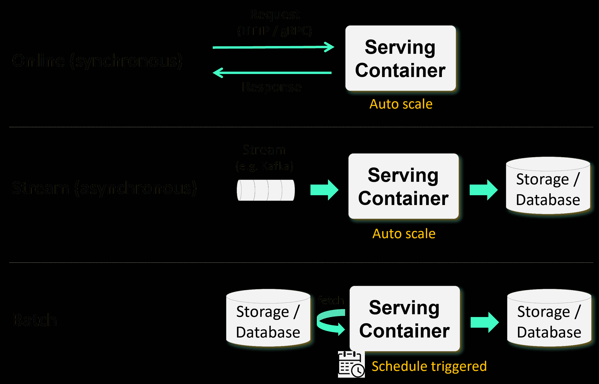

在线服务协议支持多个操作来处理整个模型生命周期，例如：
* `Predict`: 发送输入数据集并返回预测结果。
* `Get model metadata`: 获取有关模型及其架构的信息。
* `Get Health`: 获取模型运行状况和就绪状态。
* `List`: 列出端点提供的模型及其版本。
* `Explain`: 发送输入数据并返回预测响应的描述（解释）。

[`NVIDIA Triton`](https://developer.nvidia.com/nvidia-triton-inference-server) (TensorRT)、 [`KServe`](https://github.com/kserve/kserve) (KFServing)、 [`Seldon Core`](https://github.com/SeldonIO/seldon-core)、 和 `MLRun` 支持标准的 [`model serving protocol`](https://docs.mlrun.org/en/stable/serving/model-api.xhtml)。

在高级解决方案中，你可以控制模型如何从内存中加载和驱逐，并且模型端点可以提供多个模型以节省内存空间和计算资源。此外，它们可以处理数据预/后处理以及集成、灰度发布、监控等高级功能。

表 4-2 列出了领先的 [`model serving`](https://www.iguazio.com/glossary/model-serving/) 解决方案。

表 6-1. 按子类别划分的数据系统示例

| 类别 || [`Sagemaker`](https://docs.aws.amazon.com/sagemaker/latest/dg/deploy-model.xhtml) || [`Vertex AI`](https://cloud.google.com/vertex-ai/docs/tabular-data/classification-regression/get-online-predictions) || [`MLRun`](https://docs.mlrun.org/en/latest/serving/serving-graph.xhtml) || [`Seldon`](https://docs.seldon.io/projects/seldon-core/en/v2/index.xhtml) || [`KServe`](https://www.kubeflow.org/docs/external-add-ons/kserve/) || [`Triton`](https://developer.nvidia.com/nvidia-triton-inference-server) |
| --- | --- | --- | --- | --- | --- | --- |
| 开源 || 否 || 否 || 是 || 是 || 是 || 是 |
| --- | --- | --- | --- | --- | --- | --- |
| 管理选项 || AWS || GCP || 云 + 本地 || 云 + 本地 || 否 || 否 |
| 无服务器 || 是 || 是 || 是 || 否 || 否 || 否 |
| 协议 || 专有 || 专有 || 标准 || 标准 || 标准 || 标准 |
| 多阶段管道 || 否 || 否 || 是 || 是 || 否 || 否 |
| 流式 || 否 || 否 || 是 || 基础 || 否 || 否 |
| 模型监控 || 基础 || 基础 || 是 || 是 || 否 || 否 |

## AWS SageMaker

在 SageMaker 中，你可以从注册表中检索模型，将其部署到端点并调用它以生成预测。例如，参见 示例 6-5 中的代码。

### 示例 6-5. 在 SageMaker 中部署已注册模型

```
import sagemaker

sagemaker_session = sagemaker.Session()
role = sagemaker.get_execution_role()

# Get the model package from the registry
model = sagemaker.ModelPackage(
    role=role,
    model_package_arn=model_package_arn,
    sagemaker_session=sagemaker_session)

# Deploy the model as an endpoint
predictor = model.deploy(
    initial_instance_count=1,
    instance_type='ml.m5.xlarge',
    endpoint_name="some-name")

# Test the model by sending a request to the endpoint
test_data = {"input": [1, 2, 3, 4, 5]}
response = predictor.predict(test_data)
print(response)
```

如果你使用 SageMaker 的内置框架训练模型，可以跳过注册模型的部分并立即将其部署到端点（参见 示例 6-6）。

### 示例 6-6. 在 SageMaker 中部署内置训练模型

```
from sagemaker.pytorch import PyTorch

# Train the model using an estimator
pytorch_estimator = PyTorch(entry_point='train_and_deploy.py',
                            instance_type='ml.p3.2xlarge',
                            instance_count=1,
                            framework_version='1.8.0',
                            py_version='py3')
pytorch_estimator.fit('s3://my_bucket/my_training_data/')

# Deploy my estimator to a SageMaker Endpoint and get a Predictor
predictor = pytorch_estimator.deploy(instance_type='ml.m4.xlarge',
                                     initial_instance_count=1)

# `data` is a NumPy array or a Python list.
# `response` is a NumPy array.
response = predictor.predict(data)
```

#### 提示

SageMaker 模型服务在你在 SageMaker 内部构建模型时是一个不错的选择。然而，使用外部或标准开源框架时需要更多工作。此外，数据处理或应用程序逻辑不由服务端点处理，需要外部服务或无服务器函数。

## Seldon Core

Seldon Core 是一个开源模型服务解决方案，可以通过 [`Docker`](https://www.docker.com/) 或 [`Kubernetes`](https://kubernetes.io/) 部署。Seldon 可以部署单个模型或包含多个模型和处理步骤的多阶段管道。此外，它支持 [`model monitoring`](https://www.iguazio.com/glossary/model-monitoring/) 和可解释性。

Seldon Core 支持两种类型的模型服务器（参见 图 6-4）：
* `Reusable`: 允许使用预构建镜像部署一组标准模型。模型通常从中央存储库（如 AWS S3 存储）获取。
* `Non-Reusable`: 使用自定义模型服务器，需要构建包含代码和依赖包的自定义 Docker 镜像。

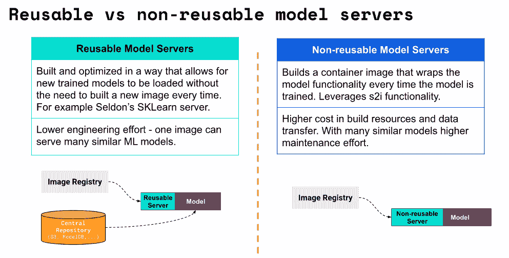

Seldon 模型和管道使用 YAML 文件定义，并使用 Kubernetes 命令行工具 (`Kubectl`) 部署。参见 示例 6-7。


# 高级服务与应用流水线

### 示例 6-7. 使用 Seldon Core 部署模型（来源：Seldon Core）

Step 1: 创建一个描述单个（可重用）模型服务器的 YAML 文件：
```
apiVersion: machinelearning.seldon.io/v1
kind: SeldonDeployment
metadata:
  name: sklearn
spec:
  name: iris
  protocol: v2
  predictors:
  - graph:
      children: []
      implementation: SKLEARN_SERVER
      modelUri: gs://seldon-models/sklearn/iris-0.23.2/lr_model
      name: classifier
    name: default
    replicas: 1
```
Step 2: 将模型部署到 Kubernetes 集群：
```
> kubectl apply -f resources/iris-sklearn-v2.yaml
seldondeployment.machinelearning.seldon.io/sklearn created
```
Step 3: 测试新的端点：
```
import requests

inference_request = {
    "inputs": [
        {"name": "predict", "shape": [1, 4], "datatype": "FP32",
         "data": [[1, 2, 3, 4]]}
    ]
}

endpoint = "http://localhost:8003/seldon/seldon/sklearn/v2/models/infer"
response = requests.post(endpoint, json=inference_request)

print(response.json())
```
Seldon Core 支持各种模型部署选项、多阶段流水线和标准（v2）协议。然而，它更偏向 DevOps，需要手动配置并理解 Kubernetes API。

## MLRun 服务

MLRun MLOps 框架包含高级模型和应用服务功能。MLRun serving 允许用户定义多阶段实时流水线，并借助 [Nuclio](https://nuclio.io/) 快速部署到生产环境，Nuclio 是一个实时无服务器引擎。Nuclio 是一个高性能、弹性、开源的“无服务器”框架，专注于数据、I/O 和计算密集型工作负载。它支持高级功能和多种触发选项（如 HTTP、cron、Kafka、Kinesis 等）。MLRun 和 Nuclio 的无服务器架构将代码和高层定义转换为加固的、高性能、自愈和自动扩缩容的服务，并内置监控和可观测性。

MLRun serving 支持两种拓扑选项：
*   `Router`: 一个或多个模型的基础服务（默认选项）。
*   `Flow`: 多阶段流水线（DAG - 有向无环图），包含内置或自定义步骤（例如 API 集成、数据丰富和处理、模型服务、路由、存储等）。

MLRun 包含针对主要 ML/DL 框架的内置服务类（[Scikit-Learn](https://scikit-learn.org/)、[TensorFlow](https://www.tensorflow.org/)、[ONNX](https://onnx.ai/)、[XGBoost](https://xgboost.ai/)、[LightGBM](https://github.com/microsoft/LightGBM)、[PyTorch](https://pytorch.org/) 和 [Hugging Face](https://huggingface.co/)）并支持标准服务协议（如 KServe、Seldon 和 Triton）。此外，MLRun 提供了一些预装所需 ML/DL 包的容器镜像，或您可以选择基础镜像和额外的包需求，系统将自动为您构建所需镜像。

在 MLRun 中，第一步是定义一个函数对象，指定代码、包、资源、触发器等。然后定义服务拓扑（图）。一旦服务函数完全定义，您可以本地模拟它或使用单个 API 调用将其部署到集群。

示例 6-8 演示了 MLRun serving 的使用。首先，使用标准镜像定义一个函数，添加模型，然后使用测试数据在本地模拟和调试服务流水线。最后，将函数部署到集群并测试实时端点（使用 `invoke()`）。

### 示例 6-8. 定义和部署一个基本的 MLRun serving 拓扑
```
serving_fn = mlrun.new_function("serving", image="mlrun/mlrun",
                                kind="serving", requirements=[])

# Add a model object or file (can be in S3, GCS, local file, etc.)
serving_fn.add_model(
    "my-model",
    model_path=model_uri,
    class_name="mlrun.frameworks.sklearn.SklearnModelServer")

# Create a mock server (simulator) and test/debug the endpoint
server = serving_fn.to_mock_server()
sample = {"inputs": [[5.1, 3.5, 1.4, 0.2], [7.7, 3.8, 6.7, 2.2]]}
server.test(path=f"/v2/models/my-model/infer", body=sample)

# Result:
{'id': '2b2e1703f98846b386965ce834a6c4ab',
 'model_name': 'my-model',
 'outputs': [0, 2]}

# Deploy the serving function to the cluster
project.deploy_function(serving_fn)
```
```
> 2023-02-14 12:29:12,008 [info] Starting remote function deploy
> 2023-02-14 12:29:12  (info) Deploying function
> 2023-02-14 12:29:12  (info) Building
> 2023-02-14 12:29:12  (info) Staging files and preparing base images
> 2023-02-14 12:29:12  (info) Building processor image
> 2023-02-14 12:29:57  (info) Build complete
> 2023-02-14 12:30:05  (info) Function deploy complete
> 2023-02-14 12:30:05,918 [info] successfully deployed function
```
```
# Send prediction request to the live endpoint
serving_fn.invoke(path=f"/v2/models/my-model/infer", body=sample)
```
MLRun serving graphs 的真正强大之处在于能够快速开发和部署复杂的分布式 AI 应用，同时确保最大性能、可扩展性、可用性和安全性。示例 6-9 显示了一个多阶段 NLP 应用的示例，包含数据预/后处理。您可以扩展服务图以包含分支和并行。您还可以添加高级数据处理步骤、模型集成、异常处理、自定义监控等。

### 示例 6-9. 定义和部署多阶段服务图拓扑
```
# Create an MLRun serving function from custom code
serving_function = mlrun.code_to_function(
    filename="src/serving.py",
    kind="serving",
    image="mlrun/mlrun",
    requirements=[],
)

# Set the serving topology
graph = serving_function.set_topology("flow", engine="async")

# Define a 3 step graph (preprocess -> hugging face model -> postprocess)
# the custom preprocess and postprocess functions are in serving.py
# while the HuggingFaceModelServer is a built-in MLRun class
graph.to(handler="preprocess", name="preprocess")\
     .to(mlrun.frameworks.huggingface.HuggingFaceModelServer(
              name="sentiment-analysis",
              task="sentiment-analysis",
              model_name="distilbert-base-uncased",
              model_class="AutoModelForSequenceClassification",
              tokenizer_name="distilbert-base-uncased",
              tokenizer_class="AutoTokenizer"))\
     .to(handler="postprocess", name="postprocess").respond()

# Plot to graph:
serving_function.plot(rankdir='LR')
```

```
# Deploy the pipeline
project.deploy_function(serving_function)

# Send a text request and get the sentiment results
response = serving_function.invoke(path='/predict', body="good morning")
print(response)

# Result:
['The sentiment is POSITIVE', 'The prediction score is 0.7876932144165039']
```
MLRun serving 提供了一个丰富的用户界面，可与平台的其他元素原生集成（参见 图 6-5）。

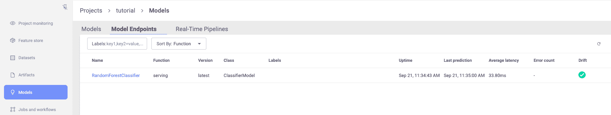

总之，MLRun serving 将模型服务的概念扩展到快速交付应用流水线并加速 AI 应用的部署。此外，其无服务器架构降低了基础设施成本和工程开销，并实现了持续运营。


前文解释了需要从将模型端点视为生产最终目标转变为或发出操作。活动可以顺序运行（一个接一个）、并行运行，或结合顺序和并行活动。管道可以是同步的（客户端等待响应）或异步的（客户端不等待）。

简单的顺序实现使用单个进程按顺序调用不同的活动。例如，示例 6-10 演示了使用 `FastAPI` 的顺序应用管道，其步骤如下：
1. 读取并丰富传入请求。
2. 数据预处理以生成特征向量。
3. 模型预测。
4. 处理模型结果并向客户端返回响应。

### 示例 6-10. 使用 `FastAPI` 的顺序应用管道示例

```
from fastapi import FastAPI, HTTPException
from pydantic import BaseModel

app = FastAPI()

# Define the prediction request data (json) structure
class PredictRequest(BaseModel):
    user: str
    # ...


# API to get model endpoint status
@app.get("/")
async def get_status():
    return {"model": "my-model", "version": 1.0, "status": "ok"}


# API to process data and make a prediction
@app.post("/predict")
async def predict(req: PredictRequest):

    enriched_data = enrich_user(req)

    data = pre_process(enriched_data)

    prediction = model_predict(data)

    return post_process(prediction, req)


def enrich_user(req: PredictRequest):
    ...
```

假设你希望将工作分配给多个微服务或避免包依赖。在这种情况下，主进程可以利用 REST API 调用调用活动（通过单独的微服务实现）。然而，分布式架构将要求你处理额外的复杂性，例如部分故障、重试、服务认证以及跨多个微服务的滚动升级。

#### 注
在本地和分布式架构中，流程仍然是顺序和同步的，这可能导致性能变慢。添加并行性可以提高性能。例如，主进程可以使用线程或 `async` 并行执行多个活动。然而，这会增加代码的复杂性。

实现分布式处理、并行性和简洁性的一种方法是使用异步或流式管道框架，在其中定义活动图（`DAG`）。然后，框架使用分布式计算资源执行、扩展并跟踪活动。此外，应用管道作为一个托管服务进行监控、部署和升级。

图 6-6 说明了几种应用管道架构选项：
1. 同一进程中的顺序活动。
2. 使用少量进程结合顺序和并行活动。
3. 异步流式管道。

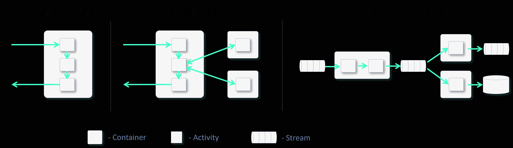

行业中存在多个商业和开源的分布式管道框架。这里涵盖的一些示例有 [AWS Step Functions](https://aws.amazon.com/step-functions/)、[Apache Beam](https://beam.apache.org/) 和 [MLRun Serving Graphs](https://docs.mlrun.org/en/stable/serving/serving-graph.xhtml)。

### AWS Step Functions

AWS Step Functions 是一个工作流服务，执行单个步骤的状态机（如 图 6-7 所示）。步骤可以调用无服务器 `Lambda` 函数或调用 AWS 服务。Step Functions 服务控制工作流的执行，其图形控制台将你的应用程序工作流显示为一系列事件驱动的步骤。

Step Functions 有两种工作流类型。标准工作流非常适合长时间运行、可审计的工作流，因为它们显示执行历史和可视化调试。Express 工作流适用于流数据处理和物联网数据摄取等高事件率工作负载。

Express 工作流可以是同步的（等待工作流完成后再返回结果）或异步的（不等待工作流完成）。

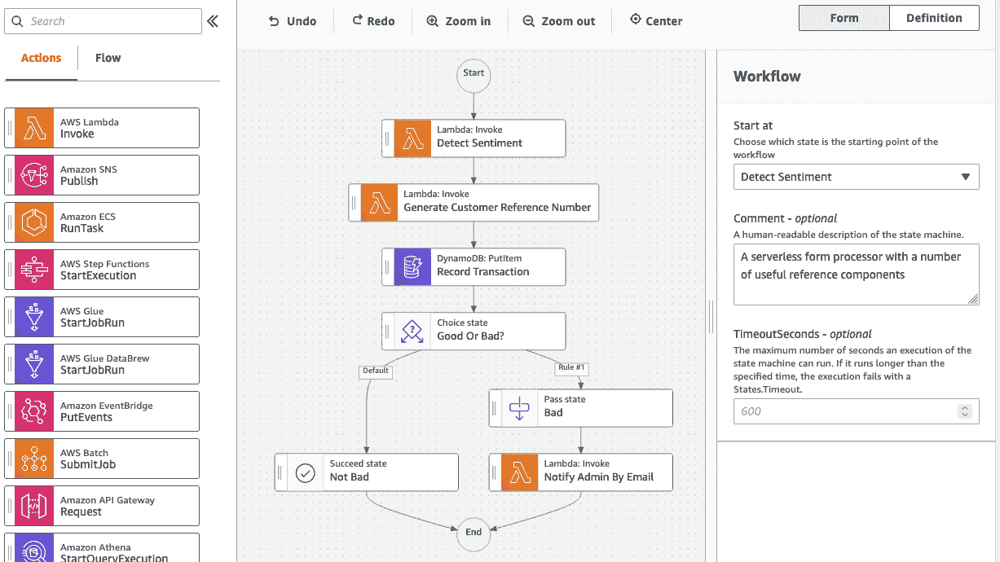

虽然 AWS Step Functions 功能丰富，可以动态扩展资源，并且具有出色的用户界面，但它增加了为每个步骤创建新的 `Lambda` 函数的复杂性，以及步骤之间网络和数据序列化的性能开销。

要构建具有数据准备和模型服务步骤的 ML 应用管道，你必须首先为每个步骤创建无服务器 `Lambda` 函数。例如，示例 6-11 演示了 `TensorFlow` 模型服务的 `Lambda` 函数。

#### 示例 6-11. 使用 AWS Lambda 的无服务器预测函数

```
import json
import boto3
import tensorflow.keras.models as models

s3 = boto3.client('s3')

# Load the Keras model from S3 during initialization
model_path = '<your-s3-bucket>/path/to/model.h5'
response = s3.get_object(Bucket='<your-s3-bucket>', Key=model_path)
model_bytes = response['Body'].read()
model = models.load_model(model_bytes)

def lambda_handler(event, context):
    # Load input data from event
    input_data = event['input_data']

    # Make predictions using the preloaded model
    predictions = model.predict(input_data)

    # Return predictions as JSON
    return json.dumps(predictions.tolist())
```

一旦拥有所有函数，你就可以定义多阶段工作流。示例 6-12 演示了具有数据准备、模型预测和后处理的简单异步管道。

#### 示例 6-12. AWS Step Functions 工作流示例


## 步骤函数
```
from stepfunctions.steps import LambdaStep, PassStep, Chain
from stepfunctions.workflow import Workflow
from stepfunctions.inputs import ExecutionInput

def create_workflow(input_data):
    # Define the workflow using the stepfunctions library
    with Workflow('MyWorkflow') as workflow:
        # Define the Lambda function to preprocess the data
        preprocess_data_step = LambdaStep(
            'PreprocessData',
            parameters={
                'FunctionName': '<function-arn>',
                'Payload': ExecutionInput(input=input_data)
            }
        )

        # Define the Lambda function to load and run the model
        run_model_step = LambdaStep(
            'RunModel',
            parameters={
                'FunctionName': '<function-arn>',
                'Payload': ExecutionInput(
                    input=preprocess_data_step.output()['Payload'])
            }
        )

        # Data post processing
        post_process_step = LambdaStep(
            'PostProcess',
            parameters={
                'FunctionName': '<function-arn>',
                'Payload': ExecutionInput(input=run_model_step.output()['Payload'])
            }
        )

    # Start the execution of the workflow
    execution = workflow.execute(inputs={'input_data': input_data})
    return execution.execution_arn

# Example usage
input_data = [[1, 2, 3, 4], [5, 6, 7, 8], [9, 10, 11, 12]]
execution_arn = create_workflow(input_data)
```

Step Functions 不支持诸如 Kafka 或 Kinesis 之类的流式协议。然而，你可以创建一个前端函数来从流中读取并调用工作流。参见 示例 6-13，一个 `Lambda` 函数示例。

### 示例 6-13. 读取流事件并执行工作流的 AWS Lambda 函数
```
import os, base64, boto3

sf = boto3.client("stepfunctions", os.environ['REGION'])

def lambda_handler(event, context):
    # Execute the workflow on every stream message
    for record in event['Records']:
        payload = base64.b64decode(record['kinesis']['data'])
        sf.start_execution(
            stateMachineArn=os.environ['WORKFLOW_ARN'],
            input=payload,
        )
```

## Apache Beam
Apache Beam 是一个开源流处理框架，专注于在线结构化数据处理。([Google Dataflow](https://cloud.google.com/dataflow) 是 Apache Beam 的托管版本)。

Beam 让你构建一个异步管道 (`DAG`)，由多个步骤组成。步骤可以使用内置数据、IO、计算或用户自定义函数。Beam 管道可以使用 [`DirectRunner`](https://beam.apache.org/documentation/runners/direct/) 在本地执行，或部署到分布式运行器如 [Apache Spark](https://spark.apache.org/)、[Flink](https://flink.apache.org/) 和 [Google Dataflow](https://cloud.google.com/dataflow)。

Beam 的优势在于它开源、可扩展，并且包含强大的数据操作符（例如在时间窗口上计算聚合）。然而，与 AWS Step Functions 相比，它在每个步骤对底层资源和包的灵活性和控制力方面不足。

示例 6-14 定义了一个三步管道：读取 `JSON` 数据；预处理、预测和序列化输出；以及将其写入 Kafka 流。

### 示例 6-14. 具有数据处理和预测的 Apache Beam 管道
```
import apache_beam as beam
from tensorflow.keras.models import load_model
import json

# Define a custom DoFn that parses JSON strings
class ParseJsonFn(beam.DoFn):
    def process(self, element):
        yield json.loads(element)

# Define a custom DoFn that serializes Python dictionaries to JSON strings
class SerializeJsonFn(beam.DoFn):
    def process(self, element):
        yield json.dumps(element).encode('utf-8')

# Define a custom DoFn to make model predictions
class MakePredictions(beam.DoFn):
    def __init__(self, model_path):
        self.model_path = model_path
        self.model = None

    def setup(self):
        self.model = load_model(self.model_path)

    def process(self, element):
        # Make a prediction using the loaded model
        prediction = self.model.predict(element)

        # Return the prediction
        return [prediction]

# Define the pipeline options
options = beam.options.pipeline_options.PipelineOptions()
options.view_as(beam.options.pipeline_options.StandardOptions).runner = 'DirectRunner'

# Create the pipeline
with beam.Pipeline(options=options) as p:
    # Read data from a JSON file or message
    messages = p | "Read JSON" >> beam.io.ReadFromText("path/to/json_message.json")

    # Parse JSON strings into Python dictionaries
    parsed_messages = messages | "Parse JSON" >> beam.ParDo(ParseJsonFn())

    # Make model predictions using the custom DoFn
    predictions = parsed_messages | 'MakePredictions' \
        >> beam.ParDo(MakePredictions(model_path='my_model.h5'))

    # Print the predictions
    predictions | 'PrintPredictions' >> beam.Map(print)

    # Serialize the processed messages to JSON strings
    serialized_messages = predictions | "Serialize JSON" \
        >> beam.ParDo(SerializeJsonFn())

    # Write the output to a Kafka topic
    serialized_messages | "Write to Kafka" >> beam.io.WriteToKafka(
        producer_config={'bootstrap.servers': 'kafka-host:9092'},
        topic='my-topic'
    )
```

## MLRun 服务图
许多用于构建应用程序管道的解决方案，最初是针对结构化数据的批处理或流处理（Apache Beam、Flink、[Storm](https://storm.apache.org/)、[Airflow](https://airflow.apache.org/)、[Spark Streaming](https://spark.apache.org/docs/latest/streaming-programming-guide.xhtml) 等）。因此，将其扩展到模型服务和监控应用，或处理文本、视频等非结构化数据会变得更加复杂。其他解决方案如 AWS Step Functions 已作为一种通用方式出现，用于串联微服务，并且需要更多的定制和逻辑来处理大规模的数据处理和模型服务。

MLRun Serving Graph 结合了 AWS Step Functions 作为一种多功能无服务器函数管道（使用 Nuclio 实时无服务器函数）的优势，以及 Apache Beam 的并行数据处理能力，并提供了一种轻松构建和调试可扩展管道的方式。此外，它还增加了机器学习和 [深度学习](https://www.iguazio.com/glossary/deep-learning-pipelines/) 功能以及内置组件（步骤）。

使用 MLRun Serving Graph，你可以构建一个包含源、中间步骤（任务）、路由器、队列和数据目标的 `DAG`：

*   *源*: 实时（`HTTP` 端点、Kafka、Kinesis 等）或离线（例如，定期从文件/对象/数据库读取数据）的数据或事件输入。

*   *步骤*: 运行函数、类处理器或 `REST API` 调用。MLRun 拥有预构建步骤列表，包括数据操作、读取器、写入器和模型服务。你也可以使用标准或自定义 `Python` 函数/类编写自己的步骤。

*   *路由器*: 一种具有路由逻辑和多个子节点的特殊步骤类型。路由逻辑定义了数据/事件如何传递给子步骤并从中收集。例如，`basic router class` 根据事件内容或元数据将事件传递给特定子节点。`Parallel router` 将事件传递给 *所有* 子节点并合并结果。`Ensemble router` 是 `Parallel router` 的派生版本，可以智能地将多个子模型的结果组合成一个聚合结果。用户可以创建自己的路由器并使用自定义逻辑。


- `Queue`：表示一个队列或流，从一个或多个源步骤接收数据并发布到一个或多个输出步骤。队列最适合用于连接独立的函数/容器。队列可以在内存中运行，也可以使用流实现，从而使其跨进程/容器。
- `Targets`：在线或离线存储（流、文件、数据库等）。

类似 Apache Beam 或 AWS Step Functions，DAG 中的每个步骤都接受一个事件对象，对其进行操作，并将事件(s)传递到下游。在 MLRun 的情况下，有一个很长的内置流程控制、并行数据处理和 ML/DL 步骤列表（[查看文档](https://docs.mlrun.org/en/latest/serving/available-steps.xhtml)），例如过滤、映射、展平、微批处理事件、聚合、连接、编码、插补、模型服务、模型集成等。最终结果可以异步写入某个目标（文件、DB、流等）或通过标记结果步骤（responder）立即同步返回给调用方。

一旦用户定义了服务图（DAG），他们就可以使用内置的模拟器（mock server）对其进行测试和调试，并通过一条命令将其部署到一个或多个无服务器函数上进行生产部署。

示例 6-15 展示了一个多阶段管道，包含数据预处理、特征增强（使用 MLRun 的 [特征存储](https://www.iguazio.com/glossary/feature-store/)）、三个模型的集成（返回三个模型之间的平均结果）以及一个后处理步骤。函数管道代码包含两个自定义的预/后处理步骤（在 `func.py` 中实现）和内置的 `EnrichmentVotingEnsemble` 路由器类。

### 示例 6-15. 使用预/后处理和三路集成的 MLRun 服务图

```
# Define a serverless serving graph function
function = mlrun.code_to_function("app-pipe", kind="serving",
                                  image="mlrun/mlrun",
                                  requirements='requirements.txt')

# Define the graph topology and start with the pre-process step
graph = function.set_topology("flow")

pre_process = graph.to(handler="pre_process", name="pre-process")

# add an EnrichmentVotingEnsemble router with 3 child models (routes)
# The input data will be enriched with feature store features
# nil values will be imputed (with stats from the feature vector metadata)
router = pre_process.to(mlrun.serving.routers.EnrichmentVotingEnsemble(
    name='VotingEnsemble',feature_vector_uri="my-vector", impute_policy={"*": "$mean"}
))
for i, model in enumerate(models):
    router.add_route(f"model{i}", model_path=model.uri)

# Add the post-process step (after the router step)
router.to(handler="post_process", name="post-process")

# plot the graph topology (using Graphviz)
graph.plot(rankdir='LR')
```

一旦函数定义完成，管道就可以通过创建并使用 mock server 来进行模拟。然后可以使用 `deploy_function()` 方法将其部署为生产微服务。参见 示例 6-16。

### 示例 6-16. 测试和部署管道

```
# Create a mock server (simulator) and test the graph with the test data
server = function.to_mock_server()
resp = server.test("/v2/models/infer", body={"inputs": test_data})

# Deploy the graph as a real-time serverless function
project.deploy_function(function)

# Invoke the remote function using the test data
resp = function.invoke("/v2/models/infer", body={"inputs": test_data})
```

MLRun 简化了迁移到生产环境的过程。可观测性和模型监控功能内置于其中。因此，无需堆砌额外的代码来收集和报告指标（只需开启跟踪功能）。此外，用户还可以定义和报告自定义实时指标，这些指标将被收集并显示在监控仪表板中，或报告错误，这些错误将被集中记录。

MLRun Serving Graphs 提供了管道步骤的灵活配置，分解为底层自动扩缩容的实时 Nuclio 无服务器函数，同时获得最佳的可扩展性和最优成本。例如，如 图 6-8 所示，您可以指定哪些步骤在同一个微服务上运行（从而消除网络和序列化开销），哪些步骤必须分布在多个微服务上（以允许使用不同的操作系统/软件包或资源，如 [GPU](https://www.iguazio.com/glossary/gpu-for-machine-learning/)，具体取决于步骤）。

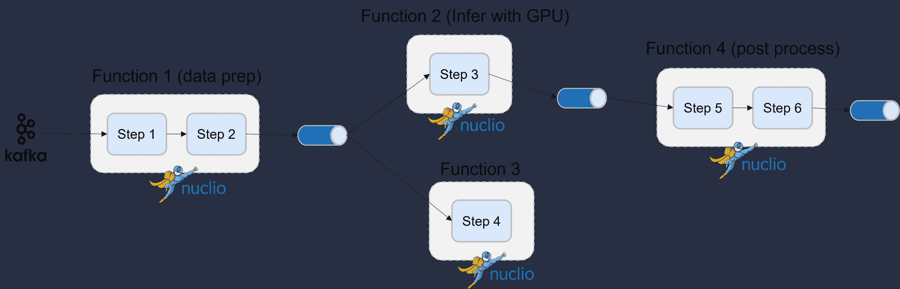

## 模型路由和集成

基本的模型服务实现会在每次请求到达时将模型加载到内存中并进行预测。然而，当您提供多个模型时，可能需要更高级的拓扑结构来优化成本，通过组合各种模型获得更好的结果，或动态地将流量从一个模型转移到另一个模型。

为每个函数部署一个微服务可能很昂贵，特别是如果您不经常调用模型，或者您使用的是带有 GPU 或大内存的昂贵计算实例。在这种情况下，您可能更喜欢实现一个托管多个模型的单个微服务函数，并根据 URL 或请求正文中的元素将请求路由到特定模型。（例如，根据请求中的国家代码选择特定国家的模型）。此外，您可以根据模型的使用情况动态地将模型加载到内存中或从内存中卸载（换句话说，实现缓存机制）以减少内存消耗。

虽然模型缓存解决方案可以降低成本和内存消耗，但它们也可能导致首次（未缓存）请求的延迟。只有在您对首次请求延迟不敏感时才应使用缓存。

不同模型可能具有不同的软件包依赖项或资源需求（例如，它们需要 GPU）。在这种情况下，您应该使用单独的容器微服务部署模型，每个微服务具有特定的软件包和资源需求，或者根据这些需求将模型分组到容器中，并将流量路由到托管相关模型的特定微服务。

将数据处理与模型放在同一个微服务中可以提高性能，因为它可以将不同的转换和预测活动保留在内存中，而无需在步骤之间写入和读取存储。然而，这不允许细粒度扩缩容（对管道中的特定任务进行扩缩容），并且需要汇总资源和软件包需求。因此，请根据您的需求权衡这两种方法之间的取舍。MLRun Serving Graphs 提供了一种简单的方法来指定哪些步骤在同一个容器中 colocated，哪些步骤分离到单独的容器中。

提高模型准确性的常见机制是组合使用不同数据集、算法或参数训练的不同模型。例如，使用季节性数据（一年中同一时期的交易）训练一个模型，使用时间性数据（最近的交易）训练另一个模型，并将两个模型的结果结合起来，以保留对评分结果的季节性和时间性影响。另一个例子是组合机器学习和深度学习模型并返回平均结果。

模型集成是机器学习中的一种技术，其中训练多个模型并将它们的预测结果组合起来以做出最终预测，从而提高整体模型性能。

创建集成有两种常见方法：

- `Bagging`：在训练数据的不同子集上独立训练多个模型，然后使用某种聚合技术（如平均或多数投票）将它们的预测结果组合起来。使用 `Bagging` 来降低预测的方差。


*   `Boosting`: 顺序训练多个模型，其中每个模型都训练来纠正前一个模型的错误。使用 Boosting 来降低预测的偏差。

### Tip

监控集成中每个子模型的性能至关重要，这样才能了解哪种方法能获得更好的准确率。在某些情况下，您可能希望根据各个模型的性能来控制集成中模型之间的权重。（例如，由于近期事件影响更大而偏好时间模型）。

多臂老虎机（MAB）算法（如 epsilon-greedy、UCB 或 Thompson sampling）可用于随时间自适应地选择表现最佳的模型或模型组合。MAB 算法可以为每个模型分配一个分数，该分数反映其预期性能和不确定性。系统随后可以将更多推理请求导向表现最好的模型，同时继续探索其他模型并更新其分数。

## Model Optimization and ONNX

一些模型，尤其是深度学习模型，会消耗大量计算资源。使用优化技术，可以减少资源消耗并提高性能。优化示例包括以下内容：

*   `Feature reduction`: 通过移除对结果没有显著价值的特征来减小特征向量的大小。
*   `Code optimization`: 将代码的关键部分迁移到更快的二进制代码实现中（使用 C、C++、Go、Rust 等）。
*   `Hardware acceleration`: 使用 GPU、TPU 或 FPGA 可以显著提高推理性能，通过将计算从 CPU 卸载到专门为矩阵乘法优化的专用硬件。
*   `Quantization`: 降低模型权重和激活值的精度，通常从 32 位浮点降低到 8 位整数精度。
*   `Pruning`: 移除对模型准确率影响很小的部分权重或神经元。
*   `Model compression`: 通过压缩其权重来减小模型大小。使用诸如权重共享、低秩分解或哈夫曼编码等技术。

有多个框架可以优化模型：

*   `ONNX Runtime`: 用于执行 ONNX 模型的高速引擎。它为 CPU、GPU 和 FPGA 提供硬件加速支持，并支持量化、剪枝等模型压缩技术。
*   `Intel OpenVINO`: 用于在 Intel 硬件（包括 CPU、GPU 和 FPGA）上优化和部署机器学习模型的工具包。它支持量化、剪枝等模型压缩技术，并提供深度学习操作的优化库。
*   `NVIDIA TensorRT`: 用于 NVIDIA GPU 的高性能推理引擎，支持剪枝和量化等模型压缩技术。它为 NVIDIA GPU 提供硬件加速支持，并包含深度学习操作的优化库。

[ONNX](https://onnx.ai/)（开放神经网络交换）是一种用于表示机器学习模型的开放格式。ONNX 定义了一套通用的算子——机器学习和深度学习模型的基本构建块——以及一种标准文件格式，使 AI 开发者能够在各种框架、工具、运行时和编译器中使用模型。

ONNX 运行时以机器原生（二进制）代码运行，并支持模型压缩技术和硬件特定优化，从而实现显著更快的推理性能。

# Data and Model Monitoring

监控解决方案可分为三个主要层：

1.  `Resource monitoring`: 监控 ML 应用使用的资源（CPU、GPU、内存、存储）及其健康状况和服务的可用性。
2.  `Model and data monitoring`: 监控模型及其使用的数据的性能（准确率、漂移、偏差、数据质量等）。
3.  `Application monitoring`: 在所有管道步骤中监控整体应用性能（吞吐量、延迟、错误等）并衡量为应用定义业务 KPI。

您可以对三层使用相同的解决方案或每层使用不同的服务。无论如何，使用标签和标签关联各层的信息至关重要，因为资源或模型性能问题通常会影响应用的更高层。

集群监控解决方案可以监控资源。例如，在 [Kubernetes](https://www.iguazio.com/glossary/kubernetes-for-mlops/) 中，典型做法是使用 [Prometheus](https://prometheus.io/) 和 [Grafana](https://grafana.com/) 来跟踪微服务资源。但首先，您需要确定哪个模型或应用由哪个容器提供服务（并且这可能会动态变化）。因此，在将模型部署为 Kubernetes 资源（容器、Pod 等）时，应使用模型和应用信息为其标注标签。

如果您使用公有云，可以使用托管的云服务进行资源监控，例如 [Amazon CloudWatch](https://aws.amazon.com/cloudwatch/)、[Azure Monitor](https://learn.microsoft.com/en-us/azure/azure-monitor/)、[Google Cloud Monitoring](https://cloud.google.com/monitoring)、[Datadog](https://www.datadoghq.com/)、[New Relic](https://newrelic.com/) 等。

模型、数据和应用性能指标也可以在传统的资源和应用监控解决方案中报告。然而，真正的挑战是在收集到海量数据的情况下，收集这些信息和参考元数据并保持成本效益和可扩展性。

模型和数据监控解决方案具有独特的挑战；它们将生产环境中的数据和模型性能与在模型开发和训练阶段收集的参考数据进行比较，以计算准确率、漂移等。此外，数据是针对每个模型请求收集的，必须存储以供实时仪表板和离线访问，而传统的资源和服务监控仅存储采样指标。此外，微服务与模型之间没有一对一的关系，同一个容器可以托管多个模型、集成等。最后，模型和数据监控解决方案还必须适用于批处理工作负载，而批处理工作负载仍然是模型使用的主要场所。

大多数模型监控解决方案仅限于结构化（表格）数据，不支持非结构化数据（文本、图像、视频等）。不过，您可以通过创建从非结构化数据到表格数据的转换来处理非结构化数据并监控结果。例如，将图像转换为数值 RGB 值或检测到的对象指标。

应用监控涵盖 ML 应用的不同阶段（数据丰富、准备、模型预测、操作等）。它关注应用级指标，如整体请求延迟和吞吐量、应用错误、应用级指标、业务指标、KPI 等。

同一应用管道的多个版本可能并行运行（例如在 A/B 测试的情况下）。因此，您希望在版本之间比较应用 KPI，而不仅仅是模型性能，因为更好的模型不一定反映出更好的 KPI。例如，如果模型没有在正确的时间响应，或者预测后的操作没有产生预期影响。

在设计和实施之前考虑应用级监控是最好的，因为它需要在多个应用连接点进行自定义检测，并提供收集和使用参考数据以进行 KPI 性能测量的方式。


监控结果在仪表板中显示，但当它们触发警报和纠正措施时，可以带来更显著的价值。例如，模型漂移指示可以启动再训练流程，改变模型集成中的权重，或向管理员发送关键通知以纠正问题。因此，解决方案应提供一种机制来轻松定义条件、阈值和操作。

模型监控的解决方案有两种类型，将在以下章节中描述：
* *集成*: 数据科学或 MLOps 平台的组成部分。通常功能较少，但不需要胶水逻辑和单独管理。
* *独立*: 专用监控解决方案通常功能丰富，但需要手动集成和单独管理。

## 集成模型监控解决方案

数据科学或 MLops 平台支持开发和部署模型所需的任务。当您部署模型时，平台通常提供基础模型监控，可通过最少的配置进行操作。集成监控解决方案显示模型端点的重要性能和健康信息。大多数平台支持漂移检测，只有少数平台支持额外的监控类别。

### AWS SageMaker

[AWS SageMaker](https://docs.aws.amazon.com/sagemaker/latest/dg/model-monitor.xhtml) 支持数据和模型漂移检测（请参阅 图 6-9 中的架构）。模型端点将传入请求和模型结果捕获到 S3 对象中，并将其与基线和真实数据集进行比较以计算漂移和准确率指标。

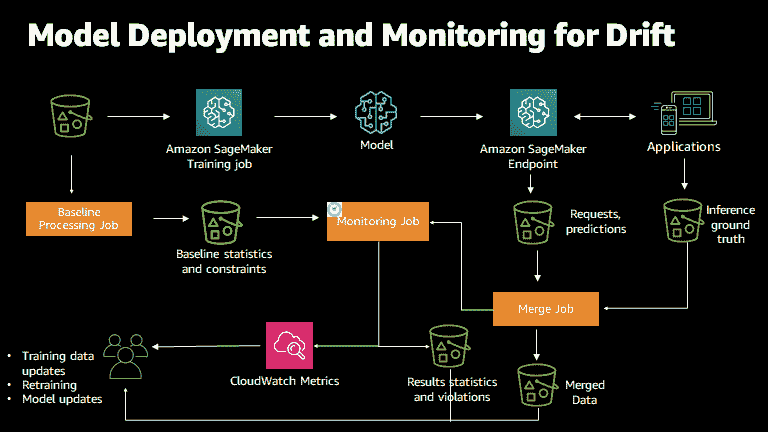

在 SageMaker 中，您手动生成并将参考数据集上传到 S3，然后定义一个计划的模型监控作业（请参阅 [示例](https://sagemaker-examples.readthedocs.io/en/latest/sagemaker_model_monitor/introduction/SageMaker-ModelMonitoring.xhtml)）。

您可以在 SageMaker UI 中查看模型指标和漂移指示（请参阅 图 6-10）。

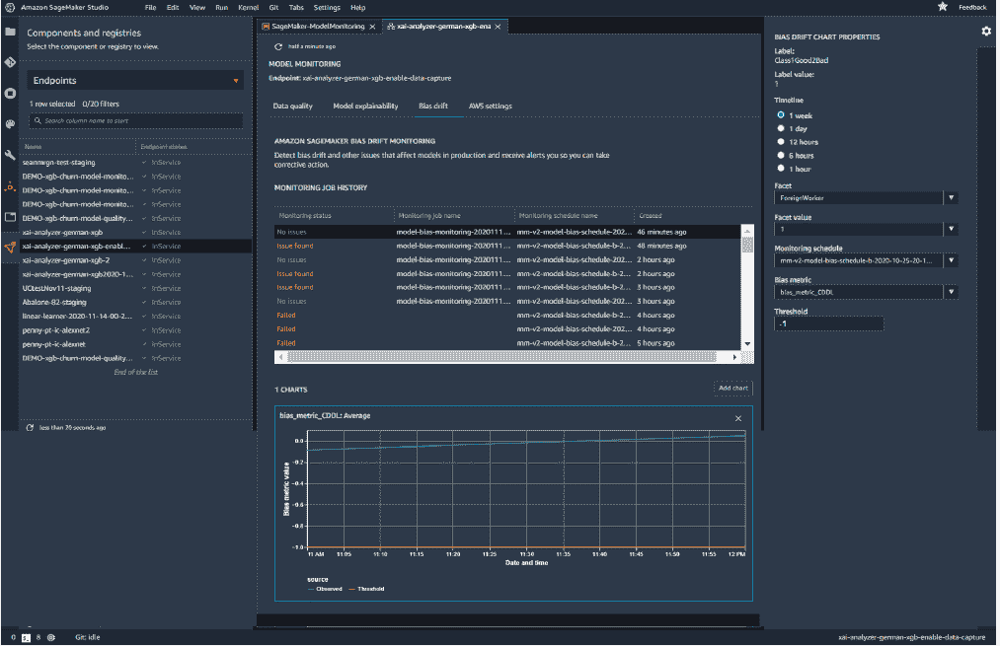

### Google Vertex AI

Google [模型监控](https://cloud.google.com/vertex-ai/docs/model-monitoring/overview) 支持将模型请求和结果跟踪到 BigQuery 表中，并在指定阈值被超过时发出电子邮件警报。图 6-11 演示了用户如何启用监控、设置监控策略并上传参考数据（模式和统计信息）。

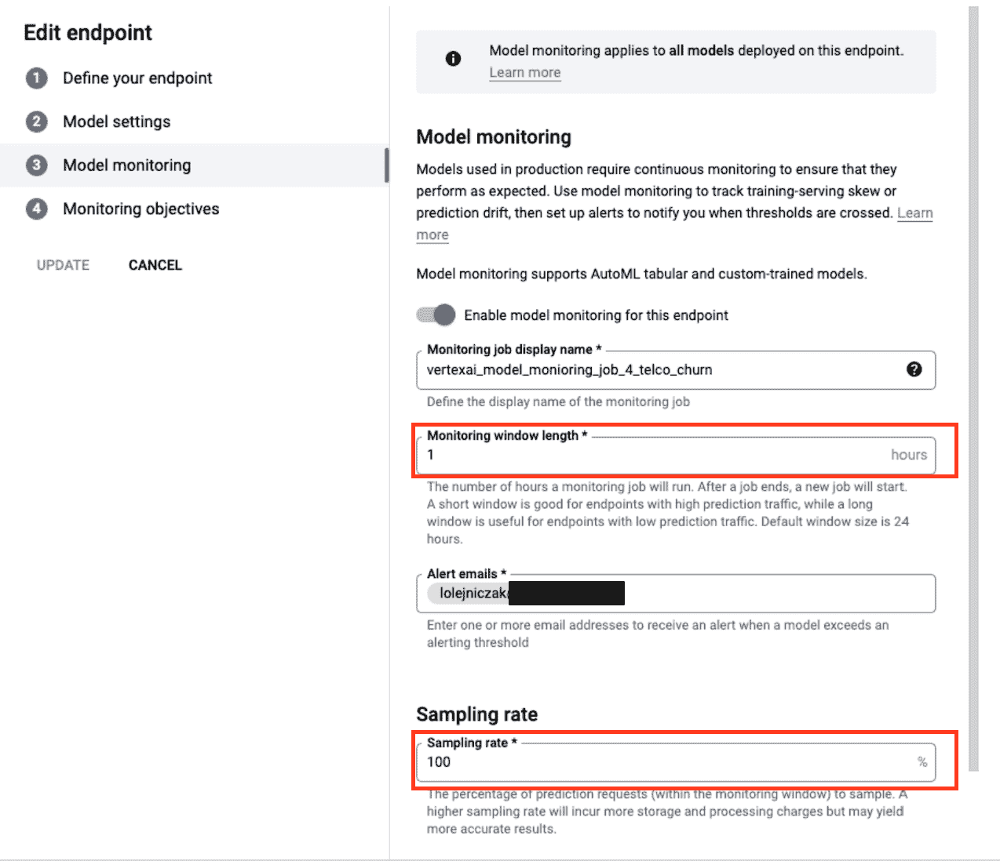

关键的模型端点指标和漂移信息在 UI 中可视化（请参阅 图 6-12 和 图 6-13），您可以通过 BigQuery 访问完整数据。

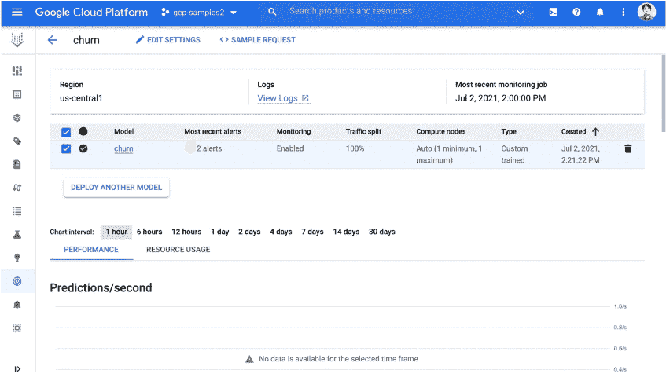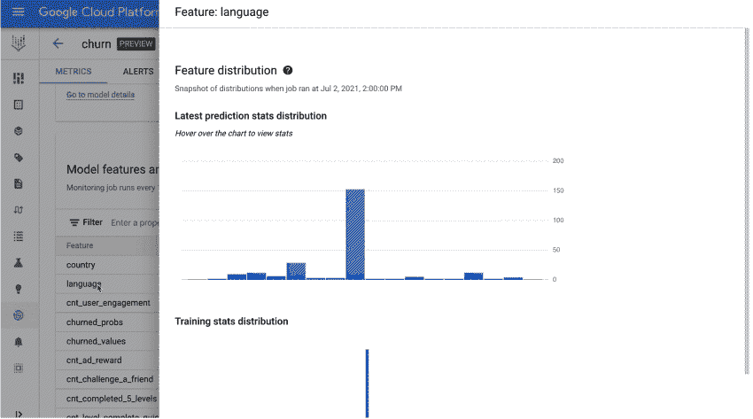

### MLRun Model Monitoring

MLRun 开源 MLOps 包含用于批处理和实时工作负载的集成 [监控服务](https://docs.mlrun.org/en/latest/concepts/monitoring.xhtml)。如 图 6-14 所示，MLRun 模型服务端点将性能、输入、输出和用户定义指标写入流中。然后，实时无服务器 Nuclio 函数读取并处理数据，并将结果写入不同类型的存储（键/值、时序数据库和 parquet 文件）。计划的 MLRun 作业定期运行，读取数据，计算各种指标（漂移、准确率等），并触发适当的警报。

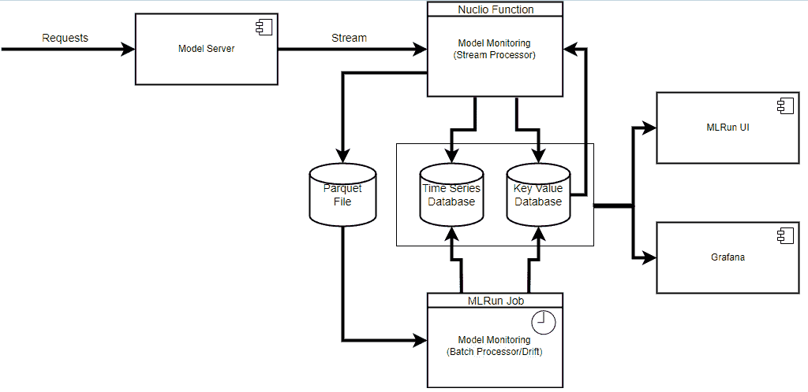

您可以在 MLRun UI 中查看模型端点信息（请参阅 图 6-15），或在 Grafana 中查看（请参阅 图 6-16）以及生产数据集存储在 MLRun 的特征存储中，可用于生产后分析（例如分析数据质量、偏差和可解释性）或用于重新训练模型。

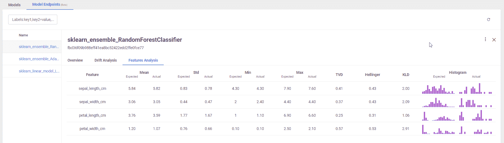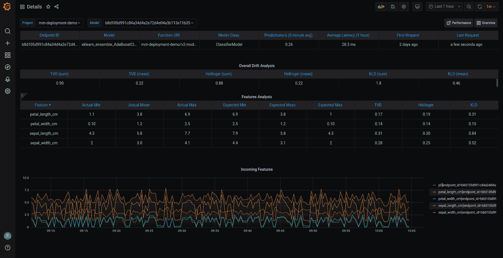

MLRun 通过自动生成参考和生产数据集、管理数据资产和生命周期、调度和扩展监控任务等，消除了许多工程工作。

当您在 MLRun 中训练模型时，参考数据（模式、统计信息等）会自动生成并与模型一起保存。您也可以通过 API 手动更新参考数据。要操作监控功能，您应在服务函数中应用 `_set_tracking()` 选项。

MLRun 支持监控插件，并具有可扩展性以支持结构化和非结构化数据的先进监控应用。

## 独立模型监控解决方案

有几种专门用于模型监控的解决方案。它们通常比集成选项具有更先进的功能和用户界面，但需要与数据资产、服务和训练框架进行手动集成。此外，它们需要使用多个管理控制台。

商业产品的示例包括 [Aporia](https://www.aporia.com/)、[Arize](https://arize.com/)、[Whylabs](https://whylabs.ai/) 和 [Mona Labs](https://www.monalabs.io/)。

商业框架通常支持多种监控应用（漂移、准确率、数据质量等）、友好且丰富的用户界面、高级策略以及多种警报和触发选项（电子邮件、Slack、webhooks 等）。

您可以在 图 6-17 中看到创建新监控任务的示例 Aporia UI 向导。

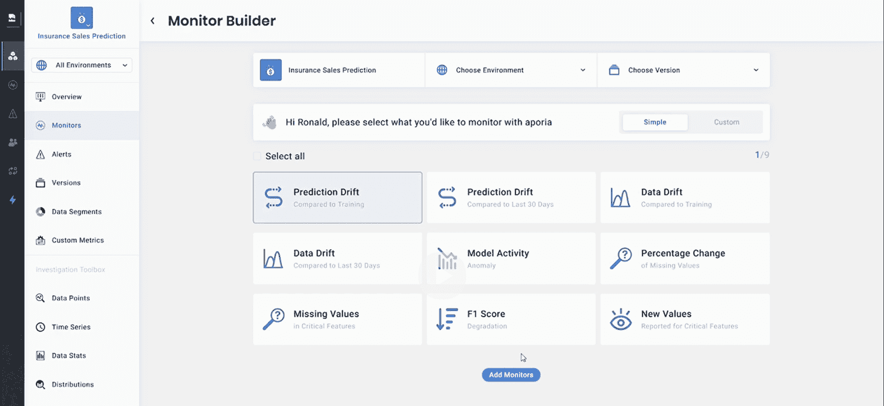

挑战在于将预测和参考数据上传到存储并管理数据生命周期，而不是像 MLRun 等集成平台那样开箱即用。请参阅 示例 6-17 中的代码示例，了解如何上传批量预测数据。（实时预测数据需要额外一步将流转换为 parquet 文件）。

### 示例 6-17. 将预测输入和输出写入 parquet 文件（来源 Aporia）

```
import fastparquet

# Preprocess & predict
X = preprocess(...)
y = model.predict(X_pred)

# Concatenate features, predictions and any other metadata
df = ...

# Store predictions
fastparquet.write(
    filename=f"s3://my-models/{MODEL_ID}/{MODEL_VERSION}/serving.parquet",
    data=df,
    append=True,
)
```

Aporia 监控仪表板的示例显示在 图 6-18 中。

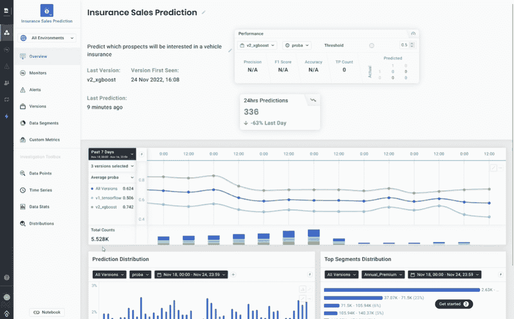

一个流行的开源模型监控框架是 [Evidently](https://www.evidentlyai.com/)，它监控漂移和数据质量。Evidently 将参考数据集与预测数据集进行比较并生成精美的静态 HTML 报告。此外，它可以将结果指标写入 Prometheus 并在预设计的 Grafana 仪表板中显示。

示例 6-18 演示了如何生成报告，将参考数据与预测输入和输出数据（`current_data`）进行比较。在 图 6-19 中您可以看到报告示例。

### 示例 6-18. 生成 Evidently 报告

```
report = Report(metrics=[
    DataDriftPreset(),
])

report.run(reference_data=reference, current_data=current)
report.save_html("file.xhtml")
```

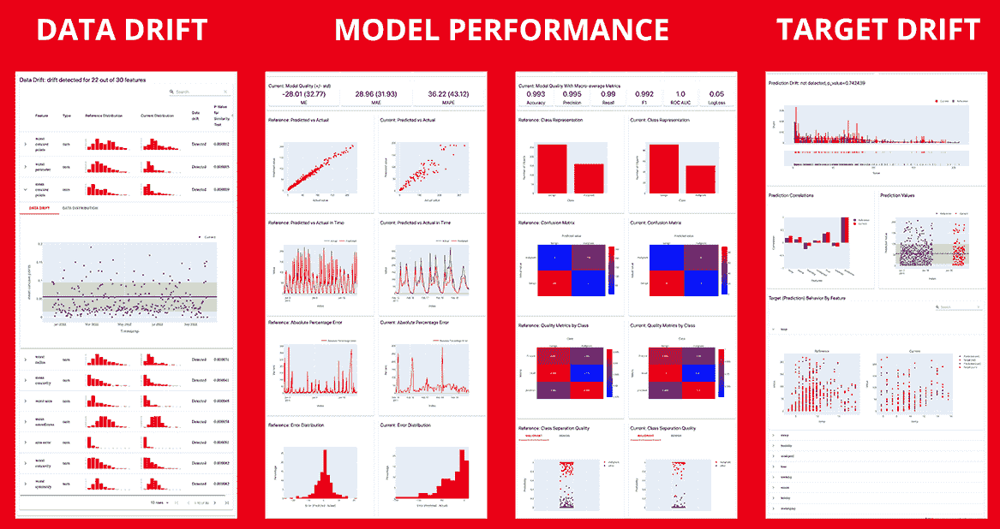


正如你所见，生成参考数据集和生产数据集以及生成报告的责任在于用户，用户需要添加额外的代码用于监控、数据生成和生命周期管理。因此，Evidently 是一个优秀的交互式开发和比较解决方案，你可以手动扩展它以处理批预测工作负载。然而，它不适合连续批处理或实时模型服务，并且缺乏交互式 UI 门户、集中管理、警报、安全等功能。

# 模型再训练

新冠疫情显著而突然地改变了全球人类行为。但大流行不仅严重影响了人类生活，也扰乱了机器学习模型。数据工程师醒来发现，他们在疫情前数据集上训练的机器学习模型突然发生了漂移，并且无法提供可靠的结果。

模型性能下降是因为疫情前的数据无法反映当前行为，因此不再相关或准确。这些模型随后必须重新训练，以确保其在疫情时代的验证和有效性。

虽然新冠疫情是一个极端例子，但数据不断变化，因为人们在变化，世界也在变化。这意味着在过时数据上训练的模型会失去相关性。模型再训练，也称为持续训练或连续训练，是指在更新后的数据上一次又一次地训练模型，然后将其重新部署到生产环境中。

通过[重新训练](https://www.iguazio.com/glossary/model-retraining/)，数据工程师可以确保模型是最新的、有效且值得信赖的。这确保了模型的预测和输出始终准确，适用于它们被设计用来回答的业务用例。如果模型不进行再训练，它们会变得陈旧。

准确的模型对业务成功至关重要。如果一个组织使用提供不准确输出的模型，结果可能是客户和利润的损失。例如，如果一个模型本应检测欺诈但检测不准确，这意味着要么欺诈者逍遥法外，给公司带来客户流失以及可能数百万美元的保险索赔损失，要么出现太多误报，导致终端用户沮丧（无法进行在线购买）以及对公司客户的不利财务影响（再次导致客户流失）。

自动化模型再训练流程使其可靠且优化。自动化还减少了人为错误或数据工程师忘记重新训练模型的可能性。通过自动化，数据工程师和数据科学家可以确保其度量是可辩护且量化的，并且可解释性测试已设置。

### 提示

[自动化](https://www.iguazio.com/glossary/automated-machine-learning/)再训练应作为 MLOps 流程的一部分进行。它可以作为[CI/CD](https://www.iguazio.com/glossary/ci-cd-for-machine-learning/)流程的一部分集成，并且可在漂移检测时由模型监控服务自动触发。

## 何时重新训练你的模型

在决定何时重新训练时没有对错之分（但不重新训练绝对是错误的）。答案取决于业务用例。然而，最终目标是避免漂移。

存在两种类型的漂移：

*   *数据漂移*：当生产数据的统计分布与用于训练或构建模型的基线数据不同时。这发生在人类行为发生变化、训练数据不准确或存在数据质量问题时。
*   *概念漂移*：[当](https://www.iguazio.com/glossary/concept-drift/)目标变量的统计特性随时间变化时。换句话说，概念或数据集之间的关系发生了漂移。

重新训练主要有四种方法：

1.  *基于间隔*：根据一定的计划或重复间隔。例如，每周日晚上或每月末重新训练一次。这确保模型始终保持最新，因为它们会不断重新训练。然而，这种方法可能成本高昂，因为即使重新训练不必要时也会使用资源。
2.  *基于性能*：当预先确定的阈值或基线被跨越时进行重新训练，这表明模型退化和漂移。这确保模型始终能够回答业务用例。然而，如果阈值确定不准确或数据未及时到来，模型可能在组织意识到并能够重新训练之前就变得陈旧。
3.  *基于数据变化*：这种类型的重新训练在出现新数据集或进行代码更改时进行。这种重新训练确保了对工程更改的适应性，但可能会错过导致模型性能下降的漂移。
4.  *手动按需*：这种非自动化的重新训练方法为数据科学家提供完全控制，但容易出错，并且可能意味着在需要时未进行重新训练。

## 数据再训练策略

模型再训练通过将训练数据提升到再训练管道中进行。此数据包括特征、标签、模型参数和管道参数。

用于再训练应使用多少数据的问题取决于组织的 f 要求和限制，这决定了策略。再训练所需的数据量可通过以下方法确定：

*   *固定窗口*：一种实用但简单的方法。
*   *动态窗口*：适用于不断更新的大型数据集，但计算密集。
*   *代表性子样本选择*：准确，因为它与生产数据相似，但耗时且资源消耗大。

模型再训练可以是在线或离线事件，其中离线是最流行的方法。离线再训练，也称为批再训练，通常使用所有可用数据或相当数量的现有数据。操作简单，但需要更多地考虑再训练策略。

### 提示

在线再训练建议用于实时流用例。用于在线再训练的数据是新数据，而不是模型已见过的样本。这使得在线再训练更准确，并有助于避免漂移，尽管成本也更高。

要训练模型，你需要标签（目标值），并且标签通常在特征之后延迟到达。例如，流失预测应用可能立即拥有所有输入特征。然而，目标标签（指示是否流失）可能在一个月后才到来。因此，训练集数据窗口应仅覆盖具有标签的交易。此外，由于模型对预期流失做出反应，它可能会影响数据集并需要对数据集进行调整，从而使其更平衡。

当数据复杂或非结构化时，计算标签具有挑战性。在这种情况下，组织使用手动标注。他们提取数据样本，手动标注，与预测结果进行比较，并使用标注后的数据集进行模型再训练和调优。

尽管模型再训练很重要，但也要记住它会带来成本。模型再训练需要数据存储、计算、调整再训练架构、数据专业人员的时间等资源。因此，一些组织不愿持续运行它。建议根据业务需求调整再训练计划，以确保在保持模型性能的同时具有成本效益。

## MLOps 流程中的模型再训练


# 重新训练
重新训练是通过触发模型开发流水线（数据准备、训练、验证等）实现的。触发可以基于计划事件发起，或在检测到漂移后发起（由模型监控组件触发）。在部署到生产环境之前，在暂存环境中验证模型是一个重要步骤。如果结果不符合预期，则需要对模型和流水线进行重新训练。

重新训练后，建议让旧模型在生产环境中继续运行一段时间，或直到其服务了特定数量的请求。通过运行这些 A/B 测试，你可以通过比较其预测结果与其他模型的结果来确定哪个模型表现更好。另一种方法是使用旧模型和新模型的集成，并随着时间的推移调整权重或移除旧模型。

最后，模型重新训练也可以用于训练新模型。这称为迁移学习。在迁移学习中，现有模型会被重复使用来重新训练新模型。这在深度学习中很常见，因为它通过重复使用模型而不是重建来节省资源。

## 部署策略
在生产环境中，模型和应用程序必须始终准备好提供请求，并且不应因版本升级而遭受停机。此外，更高级的做法是逐步将请求迁移到新版本，同时验证性能和质量水平是否达标。然后，如果最新版本失败或性能不佳，可以回滚到上一个版本。

为了保证不中断服务，可以使用滚动升级部署策略。该策略一次替换服务使用的一个实例的应用程序版本。滚动升级在云原生平台和 Kubernetes 中开箱即用。然而，当你想将候选版本与当前版本进行评估时，需要两个或多个版本共存并提供请求，直到你能确定新版本满足质量和性能目标。或者，你可以使用其他版本作为基线来比较性能。

有几种标准的模型部署和升级策略（参见 图 6-20）：
- *A/B 测试*：新模型与旧模型一起部署，流量在两者之间分配。然后监控两个模型的输出以确定哪个表现最好，并将表现最好的模型推广。此方法适用于大多数用例。在某些情况下，你可能部署两个以上的模型进行 A/B/C 测试、A/B/C/D 测试等。
- *蓝绿*：设置两个相同的环境，分别称为 *蓝* 和 *绿*，其中一个是实时的生产环境，另一个是暂存环境。新模型部署到暂存环境。一旦其按预期运行，暂存环境变为生产环境，旧版本被移除，更新的模型部署到暂存环境。此方法简单直接，但运营成本高，因为需要运行两个相同的环境。此方法推荐用于无法承受任何停机的用例，如欺诈检测或电子商务。
- *金丝雀*：将新模型逐步推广到一定比例的用户以验证其有效性、性能和功能。验证后，模型会逐步推广到更多用户，最终推广到所有人。该策略可在不中断服务的情况下实现受控推广。然而，它速度慢，且测试在生产环境中进行。因此，它推荐用于从生产环境中逐步测试中获益的非关键应用，如社交媒体。
- *冠军/挑战者（或影子）*：将 Champion 模型与一个或多个 Challenger 模型一起部署到生产环境。流量被路由到所有模型，Champion 的输出用作结果，而 Challenger(s) 的输出仅用于监控。该策略提供了最高形式的模型验证，但也是最昂贵的。

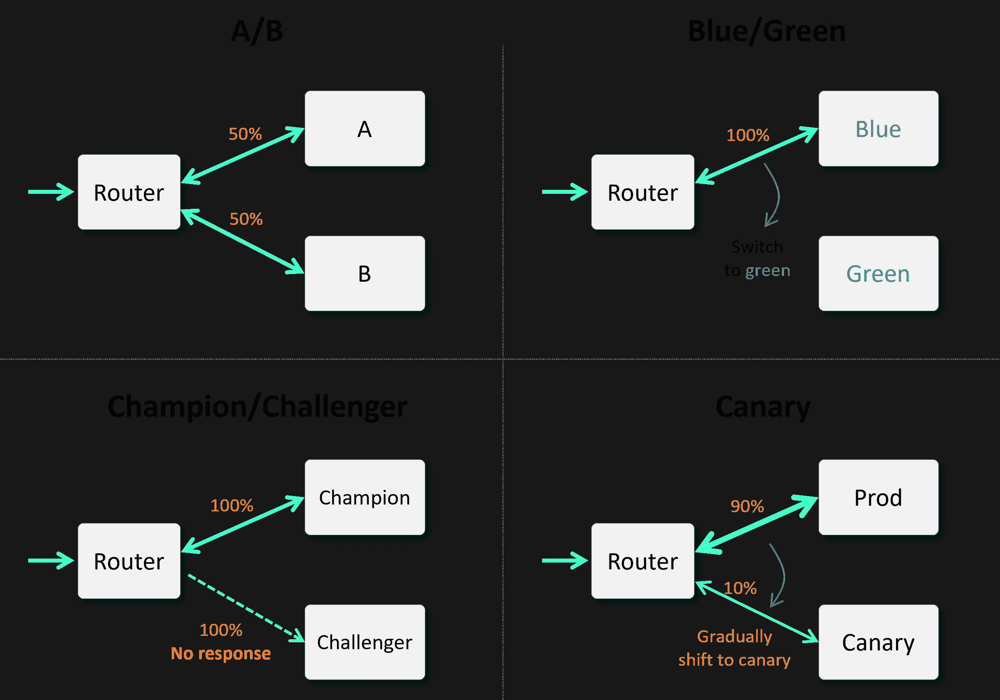

当流量在多个模型之间分配时，你必须确保 *亲和性*（同一用户始终被路由到同一模型，并且每次请求都有相同的体验）。例如，你可以使用用户 ID 的哈希值来确定请求路由到哪里。

离线和批处理应用程序流水线不需要维护运行中的服务或使用滚动更新。它们可以在每次运行中选择使用哪个版本。然而，你可以并行运行两个或多个批处理流水线（在 A/B 或 Champion/Challenger 部署中），每个流水线将结果存储在不同的表/文件中。

重要的是要记住，部署不是一次性过程。相反，部署是一个重复的过程，每次我们重新训练模型并希望确保使用最新且高性能的模型时就会发生。因此，选择合适的部署策略很重要，因为你将在 MLOps 流水线中反复使用它。如同以往，你选择的策略取决于多个因素。主要考虑因素包括：
- 你的业务用例
- 重新训练和部署频率
- 你的模型大小
- 你是实时流式传输数据还是批量处理
- 你的模型受漂移影响的程度
- 你期望的服务正常运行时间和质量

## 衡量业务影响
衡量应用程序的业务影响对于确定模型性能至关重要。然而，衡量它可能是一项复杂任务，因为这涉及评估模型对业务各个方面的影响，如收入、客户满意度和运营效率。

以下是衡量 ML 模型影响的一些方法：
- *定义成功指标*：定义可衡量且可跟踪的指标，使其与业务目标保持一致。例如，模型准确率、精确率和召回率、F1 分数、平均绝对误差（MAE）和均方根误差（RMSE）、提升、转化率和客户满意度。
- *建立基线*：创建衡量模型对业务影响的基准。这应在将模型部署到生产环境之前确定。
- *进行 A/B 测试*：在部署 ML 模型前后比较业务指标（成本、收入、活跃用户数、客户满意度等）。这将有助于确定模型的增量影响。
- *进行成本效益分析*：确定 ML 模型的投资回报率（ROI）。这将有助于评估模型对业务的财务影响。例如，有多少新用户注册，新服务带来的增量收入是多少，使用聊天机器人节省了多少通电话等。
- *收集反馈*：收集来自利益相关者（如客户和员工）的反馈，以评估 ML 模型对其体验的影响。这将有助于确定模型对业务的非财务影响。你可以使用调查、用户测试、评论和评分、支持票分析或 NPS 分数等方法。

总体而言，衡量 ML 模型的业务影响需要全面的方法，考虑财务和非财务指标以及利益相关者反馈。通过这样做，企业可以确保其 ML 模型提供切实价值并推动有意义的结果。

## 结论
在本章中，我们终于深入探讨了“真正的东西”：构建和部署使用数据并驱动决策和行动的模型的应用。我们描述了有助于整体交付 ML 应用程序的步骤。通过审视这一更大的图景，我们可以确保没有功能缺陷、运营故障、可避免的风险和长时间的延迟。


本章回顾了模型注册表和模型服务，同时展示了不同的解决方案及其使用方法。然后，我们讨论了高级服务和应用管道，它们解决了诸如 API 集成、数据丰富、验证、处理、存储、路由、级联、合并多个模型的结果等需求。随后我们解释了各种监控解决方案及其运行方式，以及再训练和部署策略和条件。最后，我们讨论了如何衡量部署的业务影响，这是确定模型性能的最关键步骤。

## 批判性思维讨论问题
* 模型注册表的重要性是什么？
* 选择一种模型服务解决方案并描述其功能。它是否适合您的组织？
* 在哪些情况下需要增强或升级您的应用管道？应考虑哪些因素？
* 有哪些不同的再训练策略？在何种情况下会选择每一种？
* 您的经理不认为衡量模型业务价值是必要的。请说服他们。

## 练习
* 编写代码以在您选择的注册表中注册其中一个模型。
* 选择一个开源服务解决方案并定义一个无服务器服务图函数。
* 选择一个开源模型监控解决方案并为您的模型配置它（无需实际连接到生产环境）。
* 构建再训练作为 CI/CD 管道的一部分的集成。
* 为其中一个 ML 模型定义 4 个成功指标。
