# 第 8 章. 高级数据类型解决方案

本章深入探讨数据分析和解释的复杂性，重点关注时间序列分析、自然语言处理（NLP）、视频和图像分类的现代技术和方法。它旨在全面讨论高级数据类型及其在解决资深数据科学家和初学者面临的复杂问题中的应用。

本章讨论了与数据处理和模型选择相关的挑战和选项，特别是关于时间序列数据。我们将探索不同类型的解决方案，权衡利弊，并讨论 MLOps 领域的具体考虑因素。我们将扩大范围，包括亚马逊网络服务（AWS）、Google Cloud Platform（GCP）、Hugging Face 和 Apple 的 CreateML 等各种平台。每个平台都提供独特的一套工具和服务，可以有效满足不同的需求和偏好。通过提供这些平台的公正比较并讨论其优缺点，我们旨在帮助您做出明智的决策。

为了了解 MLOps 开发者可能使用的各种数据类型的多样性，请查看 图 8-1 中的 Apple CreateML 界面。如图所示，类别包括图像、视频、动作、声音、文本和表格。

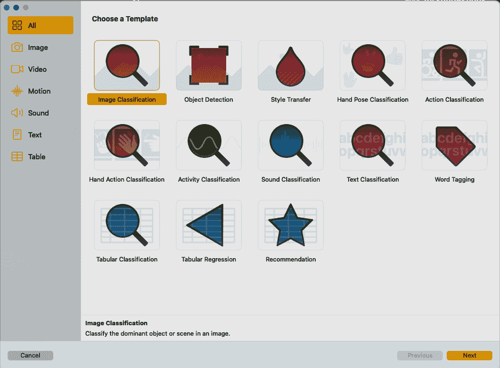

我们将在本章末尾再次回到 CreateML。

## 使用时间序列进行 ML 问题框架

处理时间序列数据时一个关键的转折点决策是使用机器学习（ML）还是使用传统统计技术。时间序列数据涉及在特定时期内对特定变量的观察，广泛应用于金融、经济、天气预报等众多领域。诸如 ARIMA（自回归积分滑动平均）、ETS（误差-趋势-季节性）和 Holt-Winters 等传统统计技术长期以来一直用于分析和预测时间序列数据。

一种表述这一困境的方式是称之为 [机器学习问题框架](https://developers.google.com/machine-learning/problem-framing/problem-framing)。Google 将这些步骤称为“确定 ML 是否是解决问题的正确方法”，然后，如果合适，“以 ML 术语表述问题”。

### 注意

如果你想在 Google Cloud Platform 上了解更多关于机器学习背景下的问题框架，Noah 在 [Google 专业机器学习工程师课程 2023](https://learning.oreilly.com/videos/google-professional-machine/03212023VIDEOPAIML/) 上有一门认证课程。


## 机器学习在时间序列分析中相对于传统统计方法的优势

然而，ML 在分析时间序列数据时相较于传统统计方法具有多项优势：
* *非线性*：ML 模型，尤其像神经网络这样的技术，可以捕捉传统统计方法可能遗漏的数据中复杂的非线性关系。时间序列数据通常表现出非线性模式，ML 可以细致地处理这些复杂性。
* *变量之间的交互*：ML 算法可以识别并利用多个输入特征之间的复杂交互，而这对于传统统计技术来说具有挑战性。例如，在各种变量的交互影响输出的情况下，ML 可以更有效地建模这些关系。
* *自动化特征工程*：一些 ML 技术，如 DL 可以自动从数据中提取相关特征，减少手动特征工程的需求。这种能力在处理高维数据时尤其有益。
* *信号与噪声*：ML 算法通常对数据中的噪声和异常更具鲁棒性。虽然异常值或不规则性会显著影响传统统计技术，但 ML 模型可以更有效地处理这些挑战。
* *可扩展性*：ML 技术可以更有效地扩展到大型数据集，并使用新兴技术如 ML 专用硅。传统统计方法在数据集规模增大时可能变得计算上不可行，而 ML 模型，尤其为大数据环境设计的模型，可以更高效地处理大量数据。

传统统计技术与机器学习之间的选择有时需要澄清。它取决于问题的具体要求、数据的性质、可用资源，甚至你可以直接访问的云平台或数据平台。在某些情况下，结合两者元素的混合方法可能是最佳解决方案。

在排除了一些理论之后，让我们来看 AWS 针对时间序列问题的特定解决方案，然后是 GCP。

## 使用 AWS 导航时间序列分析

*时间序列分析*，一种分析随时间变化的数据模式的方法，对于理解和预测趋势至关重要。虽然这些技术可以使用各种工具和平台应用，但本节重点介绍 AWS 如何促进这一过程。
我们将探索 AWS 支持的用于趋势分析和预测的方法，例如 `ARIMA` 和 Forecast `DeepAR+`。这些技术有助于从时间序列数据中解读洞察，指导对未来结果的预测。在 AWS 与其他平台之间选择，甚至决定构建自定义解决方案，将取决于成本、复杂性、可扩展性要求以及你团队的专业知识等各种因素。

AWS 提供了多个面向时间序列分析的服务，每个服务都可通过 `Python` 访问。与 AWS 交互的三种主要方式是：
* The `AWS Management Console`
* The `AWS Command Line Interface (CLI)`
* The `AWS Software Development Kit (SDK)`

每种方法都提供独特的优势，选择合适的方法取决于你的用例。

`AWS Management Console` 是一个基于 Web 的图形界面，提供简化与 AWS 服务交互的方式。你可以使用控制台执行诸如启动 `EC2` 实例、创建 `S3` 存储桶、管理 `IAM` 用户以及使用 AI/ML 服务如 `Amazon Forecast` 等任务。控制台可在 [控制台](https://aws.amazon.com/console/) 获取。

`AWS CLI` 是一个命令行界面，允许你从命令行执行 AWS 任务。`AWS CLI` 提供了与 AWS 服务交互的统一方式，对于管理 `EC2` 实例、将文件上传到 `S3` 以及进行预测等任务很有帮助。`AWS CLI` 可在 [命令行界面](https://aws.amazon.com/cli/) 获取。在许多方面，`CLI` 非常适合进行高级实验，如以下创建 `ARIMA` 预测的示例所示。

```
$ aws forecast create-predictor \
  --predictor-name "time-series-forecast-predictor" \
  --algorithm-arn "arn:aws:forecast:::algorithm/ARIMA" \
  --forecast-horizon 7 \
  --perform-auto-ml "false" \
  --input-data-config '{"DatasetGroupArn": \
  $(aws forecast list-dataset-groups | jq '.DatasetGroups[] \
  | select(.DatasetGroupName == "time-series-forecast-dataset-group") \
  | .DatasetGroupArn'), "SupplementaryFeatures
```

### Note

`AWS Command Line Interface (CLI)` 被广泛认可为管理 Amazon Web Services (AWS) 资源的高效工具，相较于控制台或其他 GUI 提供了卓越的效率和灵活性。这些优势源于其能够简单且快速地执行复杂命令，同时通过全面的命令和选项集提供对 AWS 资源的精细控制。`AWS CLI` 针对可扩展性进行了优化，可以轻松集成到其他 AWS 服务中，使其非常适合管理大规模部署和复杂基础设施。首先，在探索具有复杂输入的服务时尝试 `CLI`；它通常会更简单。

`AWS SDK` 是一组用于开发与 AWS 服务交互的应用程序的库和工具。它提供了以编程方式与 AWS 服务交互的方法，并支持多种编程语言，包括 `Java`、`.NET`、`PHP`、`Python` 和 `Rust`。`AWS SDK` 可在 [开发者工具](https://aws.amazon.com/developer/tools/) 获取。

### AWS Services for Time Series

* [*亚马逊 Forecast*](https://aws.amazon.com/forecast/) - 一种完全托管的服务，使用机器学习算法基于历史时间序列数据提供准确预测：
```
import boto3

forecast = boto3.client('forecast')
response = forecast.create_dataset_group(
    DatasetGroupName='forecast_dataset_group',
    Domain='CUSTOM',
)
```

* [*亚马逊 QuickSight*](https://aws.amazon.com/quicksight/) - 一种商业智能服务，为时间序列数据提供快速且易于使用的可视化和洞察：
```
import boto3

quicksight = boto3.client('quicksight')
response = quicksight.create_data_source(
    AwsAccountId='AWS_ACCOUNT_ID',
    DataSourceId='data_source_id',
    Name='data_source_name',
    Type='ADOBE_ANALYTICS',
)
```

* [*亚马逊 Kinesis Data Streams*](https://aws.amazon.com/kinesis/data-streams/) - 一种用于时间序列分析和可视化的实时数据流服务：
```
import boto3

kinesis = boto3.client('kinesis')
response = kinesis.create_stream(
    StreamName='kinesis_stream_name',
    ShardCount=1,
)
```

* [*亚马逊 Kinesis Data Analytics*](https://aws.amazon.com/kinesis/data-analytics/) - 一种用于时间序列分析的实时数据流服务：
```
import boto3

kinesis_analytics = boto3.client('kinesisanalytics')
response = kinesis_analytics.create_application(
    ApplicationName='kinesis_analytics_app',
    RuntimeEnvironment='SQL-1.0',
)
```

* [*亚马逊 SageMaker*](https://aws.amazon.com/sagemaker/) - 一种用于构建、训练和部署机器学习模型，包括时间序列模型的服务：
```
import boto3

sagemaker = boto3.client('sagemaker')
response = sagemaker.create_notebook_instance(
    NotebookInstanceName='notebook_instance_name',
    InstanceType='ml.t2.medium',
)
```

* [*亚马逊 DynamoDB*](https://aws.amazon.com/dynamodb/) - 一种 NoSQL 数据库服务，用于存储和检索时间序列数据：
```
import boto3

dynamodb = boto3.client('dynamodb')
response = dynamodb.create_table(
    TableName='dynamodb_table_name',
    KeySchema=[
        {
            'AttributeName': 'attribute_name',
            'KeyType': 'HASH'
        },
    ],
    AttributeDefinitions=[
        {
            'AttributeName': 'attribute_name',
            'AttributeType': 'S'
        },
    ],
    ProvisionedThroughput={
        'ReadCapacityUnits': 5,
        'WriteCapacityUnits': 5
    }
)
```


## 亚马逊 EMR

[*亚马逊 EMR*](https://aws.amazon.com/emr/) - 用于处理大数据以进行时间序列分析和可视化的服务：

```
import boto3

emr = boto3.client('emr')
response = emr.run_job_flow(
    Name='emr_cluster_name',
    Instances={
        'InstanceGroups': [
            {
                'Name': 'master_instance_group',
                'InstanceRole': 'MASTER',
                'InstanceType': 'm5.xlarge',
                'InstanceCount': 1,
            },
        ],
        'Ec2KeyName': 'ec2_key_name',
        'KeepJobFlowAliveWhenTerminationProtected': False,
    },
    JobFlowRole='EMR_EC2_DefaultRole',
    ServiceRole='EMR_DefaultRole',
    VisibleToAllUsers=True,
    Applications=[
        {
            'Name': 'Spark'
        },
    ],
)
```

这些 AWS 服务支持时间序列分析，可用于为 MLOps 项目构建和部署可扩展的时间序列解决方案。

## 深入探索 DeepAR+ 中的时间序列

DeepAR+ 是一款 AWS 机器学习服务，利用深度学习算法进行时间序列预测。 在时间序列中利用深度学习可以提供独特的能力，如本章前面所述。 DeepAR+ 在管理大规模、复杂的时间序列数据方面表现出色，为各种用例提供有价值的预测，从需求预测到交通和设备维护预测。

DeepAR+ 基于 DeepAR 算法构建，这是一种专门为时间序列预测开发的先进深度学习算法。 还记得本章前面关于统计技术在缺失数据或异常值方面的局限性时我们对“信号与噪声”的定义吗？ DeepAR+ 在此发挥作用，其功能可处理缺失值和不规则间隔的数据。

要使用 DeepAR+，必须将时间序列数据上传到 Amazon `S3` 并创建 DeepAR+ 模型。 DeepAR+ 不仅提供预测，还会为其预测生成置信区间，使组织能够感知潜在结果的范围并做出更明智的决策。

工作流程在 图 8-2 中说明了使用 `AWS CLI` 接口的每个步骤，直至最终预测。

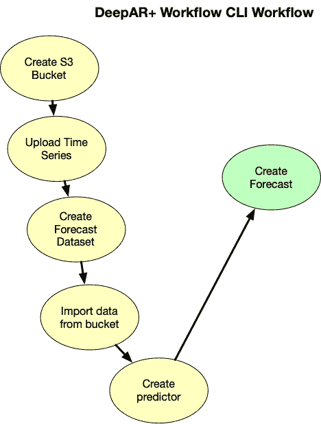

以下代码示例反映了此过程：您可以将其替换为您的时间序列数据集，并根据未来的 `AWS CLI` 更改进行调整。 通过这些示例，我们建立一个 `S3` 存储桶，将时间序列数据上传到 `S3`，创建 DeepAR+ 数据集，将数据导入 DeepAR+ 数据集，创建 DeepAR+ 预测器，最后使用 DeepAR+ 预测器创建预测。

1. 创建 S3 存储桶以存储数据：

```
$ aws s3 mb s3://deepar-example-bucket
```

2. 将时间序列数据上传到 S3：

```
$ aws s3 cp time-series-data.csv s3://deepar-example-bucket/data.csv
```

3. 创建符合模式 `^[a-zA-Z][a-zA-Z0-9_]*` 的 DeepAR+ 数据集：

```
$ aws forecast create-dataset \
  --dataset-name "DeepARExampleDataset" \
  --data-frequency "H" \
  --dataset-type "TARGET_TIME_SERIES" \
  --domain "CUSTOM" \
  --schema '{"Attributes":[{"AttributeName":"timestamp",\
  "AttributeType":"timestamp"},{"AttributeName":"target_value",\
  "AttributeType":"float"},{"AttributeName":"item_id",\
  "AttributeType":"string"}]}'
```

4. 将时间序列数据导入 DeepAR+ 数据集：

```
$ aws forecast create-dataset-import-job \
  --dataset-import-job-name "DeepARExampleDatasetImportJob" \
  --dataset-arn $(aws forecast list-datasets | \
  jq '.Datasets[] | select(.DatasetName == "DeepARExampleDatasett") | \
  .DatasetArn') \
  --data-source "S3" \
  --data-source-config '{"S3Config": {"Path": \
  "s3://deepar-example-bucket/data.csv", "RoleArn": \
  "arn:aws:iam::ACCOUNT_ID:role/ForecastRole"}}'
```

5. 创建 DeepAR+ 预测器：

```
$ aws forecast create-predictor \
  --predictor-name "DeeparExamplePredictor" \
  --algorithm-arn "arn:aws:forecast:::algorithm/Deep_AR_Plus" \
  --forecast-horizon 24 \
  --perform-auto-ml "false" \
  --input-data-config '{"DatasetGroupArn": $(aws forecast list-dataset-groups | \
  jq '.DatasetGroups[] | select(.DatasetGroupName == "DeepARExampleDatasetGroup") | \
  .DatasetGroupArn'), "SupplementaryFeatures": [{"Name": "item_id", "Value": "item1"}, \
  {"Name": "timestamp", "Value": "yyyy-MM-dd HH:mm:ss"}]}' \
  --featurization-config '{"ForecastFrequency": "H"}'
```

6. 最后，使用 DeepAR+ 预测器创建预测：

```
# create a forecast using the DeepAR+ predictor
$ aws forecast create-forecast \
  --forecast-name "DeeparExampleForecast" \
  --predictor-arn $(aws forecast list-predictors | \
  jq '.Predictors[] | select(.PredictorName == "DeeparExamplePredictor") | \
  .PredictorArn')
```

这里的关键见解是 `CLI` 为探索基于云的时间序列预测提供了一个可访问的入口点，在利用 AWS ML 和 AI 服务时，通常比从笔记本或 SDK 开始更简单。 我们将转向一种对比方法：通过 Google `BigQuery` 使用 `SQL`。 这种转变为我们的探索引入了另一种途径，将我们的工具包扩展到笔记本和 `Python` 之外。

## 使用 GCP BigQuery 和 SQL 进行时间序列分析

将时间序列分析灵活性提升到另一个层面的平台之一是 Google `BigQuery`。 之前讨论的权衡变得不那么具有挑战性，因为您可以并排使用统计技术和机器学习技术。 `BigQuery` 在建模时间序列数据方面有几个独特之处：

* *可扩展性*: `BigQuery` 处理大规模数据，非常适合同时分析数百万个时间序列。 它可以快速处理 PB 级数据，使得能够跨多个大量时间序列列分析趋势和预测成为可能。

* *多时间序列预测*: `BigQuery ML` 允许使用单个查询预测多个时间序列。 当处理大量时间序列变量时，此功能非常有利，因为它消除了为每个变量运行单独查询的需求。

* *ARIMA 和 ARIMA_PLUS 模型*: `BigQuery ML` 支持 `ARIMA`（自回归积分滑动平均）模型，特别适合时间序列数据。 `ARIMA_PLUS` 模型还包括假日效应，并且可以根据外部因素改变模型行为，这对某些类型的时间序列数据非常有益。

* *与 Google Cloud 的集成*: `BigQuery` 是 Google Cloud Platform (`GCP`) 的一部分，允许与其它 `GCP` 服务无缝集成。 这种协同作用使得将时间序列分析纳入更广泛的数据工作流程变得更容易。

* *基于 SQL 的 ML*: `BigQuery` 使用 `SQL`，一种许多数据专业人士熟悉的语言，进行机器学习任务。 `SQL` 语言降低了那些想要构建时间序列模型但没有强大机器学习或编程背景的人的入门门槛。 此外，许多人更喜欢使用 `SQL` 查询数据而不是 `Python` 或 `R`。

* *评估工具*: `BigQuery` 提供内置函数如 `ML.EVALUATE` 用于评估时间序列预测的准确性。 此功能简化了评估模型性能并进行必要调整的过程。

这篇关于纽约市 Citi Bike 出行的 [教程](https://cloud.google.com/bigquery/docs/arima-speed-up-tutorial) 演示了如何使用 `BigQuery` 高效训练时间序列模型并使用单个查询执行多个时间序列预测。 该教程利用托管在 `GCP` 上的纽约市 Citi Bike 出行数据集和爱荷华州酒类销售数据集。 主要步骤包括：

* 在 `BigQuery` 中创建数据集以存储 ML 模型。

* 使用 Citi Bike 数据集创建要预测的时间序列。

* 使用默认参数同时预测多个时间序列，与使用多个 `CREATE MODEL` 查询相比加快了流程。

* 使用 `ML.EVALUATE` 函数评估每个时间序列的预测准确性。


# 评估所有时间序列的整体预测准确性。

这种风格的要点是创建一条包含此处所示的 `model_type = 'ARIMA_PLUS'` 的 SQL 查询：

```
CREATE OR REPLACE MODEL bqml_tutorial.nyc_citibike_arima_model_default
OPTIONS
  (model_type = 'ARIMA_PLUS',
   time_series_timestamp_col = 'date',
   time_series_data_col = 'num_trips',
   time_series_id_col = 'start_station_name'
  ) AS
SELECT *
FROM bqml_tutorial.nyc_citibike_time_series
WHERE date < '2016-06-01'
```

最后，运行 `ML.EVALUATE` 来查看创建的预测有多准确：

```
SELECT *
FROM
  ML.EVALUATE(MODEL bqml_tutorial.nyc_citibike_arima_model_default,
              TABLE bqml_tutorial.nyc_citibike_time_series,
              STRUCT(7 AS horizon, TRUE AS perform_aggregation))
```

一旦你掌握了使用 BigQuery 通过 SQL 预测时间序列数据集的方法，就很容易将完整的管道串联起来，从原始问题形成到数据摄取，再到建模，最后到结论。

让我们看看如何使用 [在此找到的 BigQuery 示例](https://github.com/nogibjj/gcp-ml-cert/tree/GPU/bigquery) 来执行这些步骤。首先，让我们查看 Wikipedia 的总页面浏览量，但过滤掉我们不查询的内容，例如首页：

```
SELECT
  views,
  title
FROM
  `bigquery-public-data.wikipedia.pageviews_2023`
WHERE
  DATE(datehour) = "2023-04-18"
  AND NOT (title LIKE "Main_Page"
    OR title LIKE "Special:%"
    OR title LIKE "Wikipedia:%"
    OR title LIKE "Wikidata:%"
    OR title LIKE "Cookie_(informatique)"
    OR title LIKE "Wikipédia:Accueil_principal"
    OR title LIKE "メインページ")
ORDER BY
  views DESC
LIMIT
  1000
```

你可以在 图 8-3 中看到 Google Big Query 的界面；注意你还可以“explore the data”；此选项甚至允许你将其导出到 colab 笔记本中。

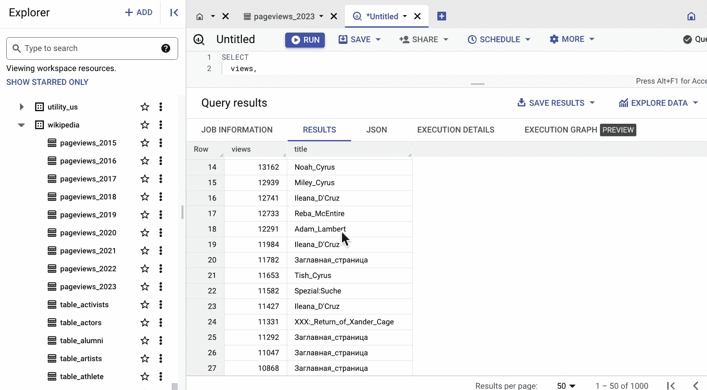

带有可视化的 colab 代码如下；注意将上一个查询的结果转换为我们用 seaborn 作图的数据框是多么容易。

```
from google.colab import auth
from google.cloud import bigquery
from google.colab import data_table

project = 'platinum-lead-379722'  # Project ID
location = 'US'  # Location
client = bigquery.Client(project=project, location=location)
data_table.enable_dataframe_formatter()
auth.authenticate_user()

job = client.get_job('bquxjob_3f8ffc04_18795d1ee67')  # Job ID
print(job.query)

results = job.to_dataframe()

# Group by title and sum the views
results = results.groupby("title").sum().reset_index()

# Sort by views in descending order
results = results.sort_values(by="views", ascending=False)

# Print the result
print(results.head(10))

# Now visualize
import seaborn as sns
import matplotlib.pyplot as plt

# Visualize
# Select top 25 pages by views
top25 = results.head(25)

# Create a bar plot using seaborn
sns.set(style="whitegrid")
plt.figure(figsize=(12, 8))
ax = sns.barplot(x="views", y="title", data=top25)
ax.set_title("Top 25 Most Viewed Wikipedia Pages on 2023-04-18")
ax.set_xlabel("Number of Views")
ax.set_ylabel("Title")
plt.show()
```

在 图 8-4 中可以看到结果。

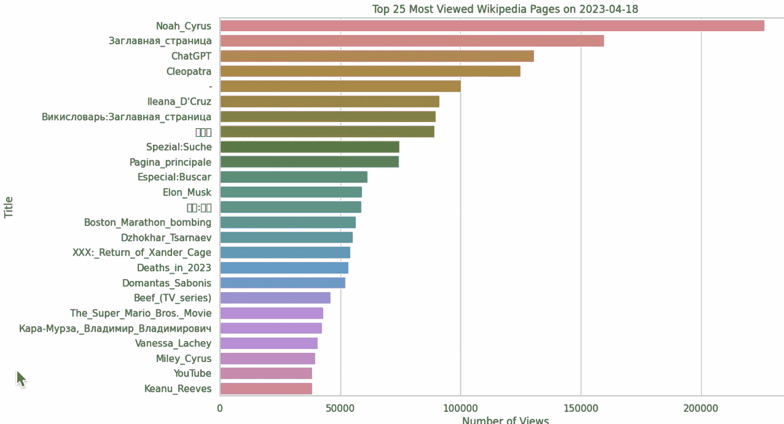

Google Big Query 让你能够通过 SQL 查询运行适合 MLOPs 工作流程的时间序列数据的整个管道。

# MLOps NLP 问题的构建与购买

NLP 在寻求实施机器学习解决方案的组织中无处不在。集成 NLP 解决方案的方式有很多，包括从头构建自定义模型或从供应商处购买预训练模型。

随着语言模型变得越来越复杂，是否 *build* 或 *buy* 对企业具有重要影响。此决策影响成本、资源、时间、定制化和控制。

本节深入探讨了在大型语言模型（LLMs）背景下围绕此决策的考虑因素。这些模型经过大量数据的训练，显示出分析和生成类人文本的令人印象深刻的能力，使其成为许多应用的强大工具。

在 LLMs 的背景下，*build vs. buy* 决策尤其突出，鉴于其训练所需的资源以及定制所需的专业知识。我们将探讨这些因素和其他因素，以提供一个框架，帮助你在企业的 MLOps 战略中做出这一关键决策。

# 构建与购买：Hugging Face 方法

在 LLMs 的时代，Hugging Face 已成为一个有影响力的参与者。其 hub 充当 ML 的存储库，提供模型、数据集和演示。它是 ML 资源的一站式商店，类似于 BigQuery 的庞大数据仓库。

但是，如果你不确定是构建自己的解决方案还是利用 Hugging Face 的产品怎么办？让我们深入探讨这一困境：

*   *模型*：Hugging Face 为 NLP、视觉和音频任务提供各种预训练模型。可以将其视为即用的 AWS 库，但专注于 ML。模型卡提供有关限制、偏差、任务、语言等的信息。它们就像 BigQuery 的模式描述，但针对 ML 模型。
*   *数据集*：与 BigQuery 的庞大数据集类似，Hugging Face 托管了超过 5,000 个数据集，涵盖 100 多种语言。数据集卡和数据集预览提供了对数据的洞察，就像 BigQuery 提供表预览一样。
*   *Spaces*：Hugging Face Spaces 是用于展示你的模型的交互式应用。可以将其想象为 AWS Lambda 函数，但用于演示你的 ML 模型。你可以创建自己的 space，为其升级 GPU 支持，甚至在会议或会议上展示它。
*   *组织*：与 AWS Organizations 类似，Hugging Face 提供了用于分组账户并管理数据集、模型和 Spaces 的功能。此功能可在团队和项目之间实现更好的协作和资源管理。
*   *安全*：Hugging Face 具有强大的安全功能，类似于 AWS 的 IAM 角色和 BigQuery 的访问控制。用户访问令牌、组织的访问控制、使用 GPG 签署提交以及恶意软件扫描可确保你的工作安全。

Hugging Face 已成为执行机器学习工作流程的强大且适应性强的平台。从头构建解决方案或利用现有解决方案是一个艰难的选择。Hugging Face 通过允许你按原样使用模型或对其进行微调，在即用资源和定制机会之间实现了理想的平衡，以满足你的需求。本书中到处都有大量 Hugging Face 的示例供你查阅。然而，为了避免重复并节省空间，我们将不再在此添加另一个 Hugging Face 示例。

# 使用 AWS 探索自然语言处理

在深入动手示例之前，让我们先为自然语言处理（NLP）在 MLOps 中的作用设定背景。NLP 是人工智能的一个分支，帮助机器分析、解释和生成人类语言。在 MLOps 中，NLP 可以在各种任务中发挥关键作用，例如情感分析、文本分类、语言翻译和信息提取。通过自动化这些任务，组织可以做出更数据驱动的决策、改善客户体验并优化业务流程。

与我们对时间序列分析的探索类似，我们将研究 AWS 如何提供用于 NLP 任务的全面即用型解决方案套件，为 Hugging Face 等平台提供替代方案。AWS 的服务能够快速实施 NLP 任务，使其成为 MLOps 工作流程的实用选择。


# 使用 AWS Comprehend 和 Translate 进行 NLP 实战

## 使用 AWS Comprehend 进行情感分析

现在，让我们动手实践一些 NLP。首先从 [UCI 机器学习知识库](https://archive.ics.uci.edu/ml/datasets/Sentiment+Labelled+Sentences) 下载 [情感标注句子](https://archive.ics.uci.edu/ml/machine-learning-databases/00331/sentiment%20labelled%20sentences.zip) 数据集。下载后，打开 `yelp_labelled.txt` 文件。接下来，导航到 [AWS Comprehend 界面](https://aws.amazon.com/comprehend/)。要查看 AWS Comprehend 的实际效果，请将 `yelp_labelled.txt` 文件中的一行粘贴到 AWS Comprehend 控制台中，如 图 8-5 所示。该平台允许您快速原型设计和可视化 NLP 任务，例如情感分析。从传统的笔记本或 `Python SDK` 方法转向更直接、用户友好的界面，体现了 AWS 致力于在 MLOps 工作流程中提供实用且易于访问的 NLP 工具的承诺。

该图提供了 AWS Comprehend 控制台界面的图形表示。此基于 Web 的用户界面允许您在无需编程或命令行交互的情况下与 AWS Comprehend 交互。您可以直接将文本数据输入控制台，服务会分析这些数据以识别关键情感指标。

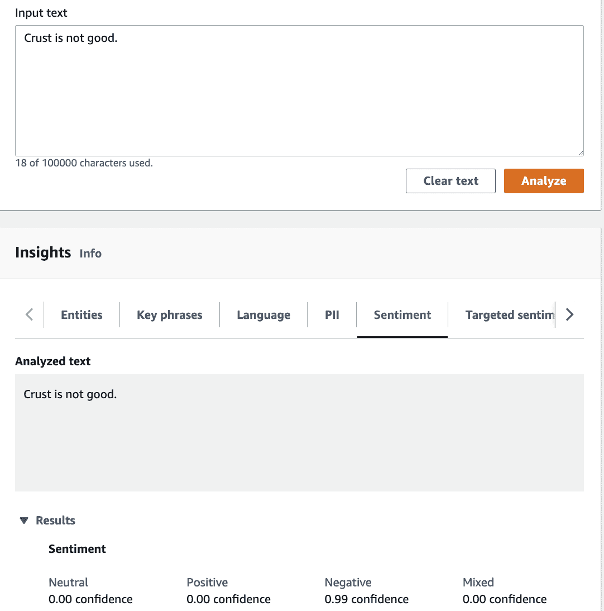

本示例中，一句来自 Yelp 标注数据集的句子被输入到控制台中。控制台的输出显示了来自 AWS Comprehend 的情感分析结果。它展示了检测到的主要情感（积极、消极、中性或混合），以及与每种情感相关的置信度分数。这些分数反映了模型为每个情感类别分配的概率。这种可视化是 AWS Comprehend 如何让您快速原型设计和测试情感分析任务的绝佳示例，使其成为 MLOps 的宝贵工具。它展示了从数据输入到有洞察力的结果的轻松过渡，所有这些都在用户友好且直观的界面中完成。

### 注意

情感分析，有时称为 *观点挖掘*，是自然语言处理（NLP）的一个方面，关注预测词语的情感基调。这种推断评估文本数据中表达的态度、观点和情感。该技术常见于客户之声（VoC）分析、品牌监控和社交媒体监控等领域。它是理解公众情绪的有力工具，与我们围绕时间序列分析和预测所探索的概念密切相关。当与 AWS Comprehend 等机器学习服务或 Hugging Face 等工具配对时，情感分析可以提供有关趋势的宝贵见解，帮助组织做出明智的决策。正如我们使用 `AWS CLI` 进行时间序列预测一样，AWS Comprehend 也可通过类似方式用于情感分析，凸显了这些平台的多功能性。

我们之前利用 `AWS CLI` 进行时间序列预测。另一项服务 AWS Comprehend 可以使用 `CLI` 或 `SDK` 执行情感分析，进一步证明了这些预训练模型服务在 MLOps 上下文中的适应性和实用性。

## 使用 Python SDK 进行情感分析

现在，让我们进入动手实践部分。必须了解，尝试使用 `AWS Console` 和 `Python SDK` 可提供宝贵的反馈循环。这种迭代过程使您更好地了解 AWS 服务的内部运作，从而更轻松地将其集成到 MLOps 工作流程中。以下是一个很好的示例：

```
import boto3

# initialize comprehend client
comprehend = boto3.client(service_name='comprehend', region_name='your_aws_region')

# input text for sentiment analysis
text = 'Crust is not good.'

# detect the sentiment of the input text
response = comprehend.detect_sentiment(Text=text, LanguageCode='en')

# print the sentiment score
print(response['SentimentScore'])
```

## 使用 AWS Translate 进行文本翻译

让我们再次使用这种方法开始翻译一些文本，首先使用控制台，如 图 8-6 所示。该确切的文本字符串从英语翻译成葡萄牙葡萄牙语。

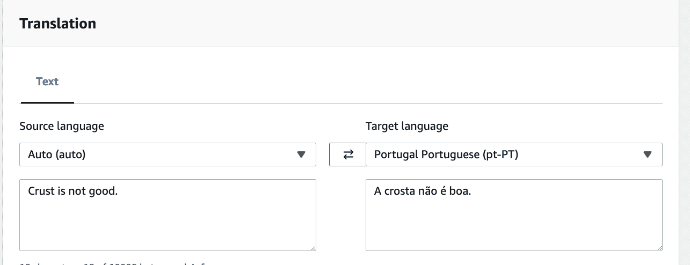

接下来，让我们构建几个 Python 函数来帮助我们翻译文本——所有源代码都位于此 [仓库](https://github.com/nogibjj/assimilate-aws) 中。首先，让我们创建一个列出可用语言的函数，以构建一个为最终用户提供多种选项的命令行工具：

```
def list_languages():
    """List available languages"""

    client = boto3.client("translate")
    result = client.list_languages()
    return result["Languages"]
```

以下函数翻译文本：

```
def translate_text(text, source, target):
    """Translate text from source to target language"""

    client = boto3.client("translate")
    result = client.translate_text(
        Text=text, SourceLanguageCode=source, TargetLanguageCode=target
    )
    return (
        result["TranslatedText"],
        result["SourceLanguageCode"],
        result["TargetLanguageCode"],
    )
```

接下来，使用两个子命令构建一个 [click 命令行工具](https://github.com/nogibjj/assimilate-aws/blob/main/translator_cli.py)，其中每个子命令映射到这些函数：

```
#!/usr/bin/env python

from awstools.translatelib import translate_text, list_languages
import click
from random import choices


# build out click group
@click.group()
def cli():
    """A simple command line interface for AWS Translate"""


# build out click command to list languages
@cli.command("languages")
def cli_list_languages():
    """List available languages"""

    colors = ["red", "green", "blue", "yellow", "magenta", "cyan", "white"]
    languages = list_languages()
    for language in languages:
        # randomly select a color
        color = choices(colors)
        # print the language name in the randomly selected color
        result = f"{language['LanguageName']}, {language['LanguageCode']}"
        click.secho(result, fg=color[0])


@cli.command("translate")
@click.argument("text")
@click.option("--source", default="en", help="Source language")
@click.option("--target", default="es", help="Target language")
def translate(text, source, target):
    """Translate text from source to target language

    Example:
    ./translator_cli.py translate "Hello World" --source en --target es

    """

    text, source, target = translate_text(text, source, target)
    # use colored text to highlight the source and target languages
    click.secho("Source: {}".format(source), fg="blue")
    click.secho("Target: {}".format(target), fg="yellow")
    click.secho(text, fg="white")


# run the cli
if __name__ == "__main__":
    # pylint: disable=no-value-for-parameter
    cli()
```

语言翻译是 NLP 的一个重要组成部分，也是 MLOps 专业人员经常遇到的另一项任务。在多语言数据环境中，了解和翻译跨语言的数据对于全球数据驱动决策至关重要。AWS、Google Cloud 和其他云服务为此提供了解决方案，但工具的选择很大程度上取决于您的具体需求和项目的背景。

图 8-7 中的彩色输出展示了我们所选工具支持的语言的多样性。这种可视化是通过随机化交替行来产生彩虹颜色效果的简单技巧创建的（请注意，印刷版读者需要在终端上自行运行才能看到颜色。

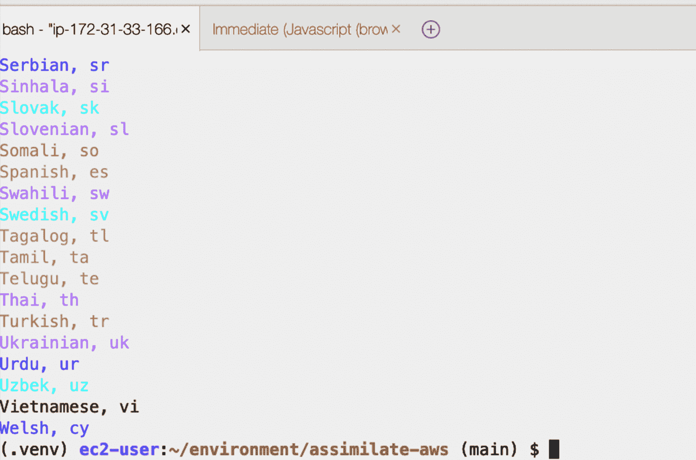

接下来，我们使用自定义构建的 Python 工具演示命令行翻译示例。以下命令将短语“Crust is not good”从英语（`en`）翻译成葡萄牙语（`pt-PT`）。

```
python translator_cli.py translate --source en --target pt-PT "Crust is not good"
```


The translated text output is shown in 图 8-8, again with the customized terminal work.

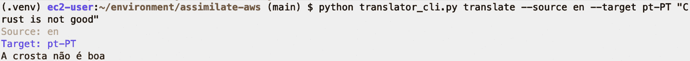

This example illustrates how easy it is to automate language translation in an MLOps context, emphasizing the role of command-line tools in facilitating these tasks. While focusing on a custom tool, remember that cloud-based services offer similar functionalities, often with more robust and scalable solutions. The choice between using a custom tool or a cloud service depends on your specific requirements and the scale of your data.

# 使用 OpenAI 探索 NLP

OpenAI, a leading NLP player, provides robust solutions that can significantly augment your MLOps workflow. Leveraging their readily available tools, we will explore constructing an “off-the-shelf” MLOps solution using OpenAI’s [Python SDK](https://github.com/openai/openai-python). The final product, a command-line interface (CLI) tool, can be accessed here: [这里](https://github.com/nogibjj/assimilate-aws/blob/main/openaiAnswerbotCli.py). This CLI tool exemplifies how pre-existing solutions can effectively employ in an MLOps context.

The following code does a few things: it grabs a URL, parses the text, and summarizes it. Then it acts like a question/answer bot:

```
#!/usr/bin/env python

import openai
import os
import click
import urllib.request
from bs4 import BeautifulSoup


def extract_from_url(url):
    req = urllib.request.Request(
        url,
        data=None,
        headers={
            "User-Agent": ("Mozilla/5.0 (Macintosh; Intel Mac OS X 10_9_3) "
                           "AppleWebKit/537.36 (KHTML, like Gecko) "
                           "Chrome/35.0.1916.47 Safari/537.36")
        },
    )
    html = urllib.request.urlopen(req)
    parser = BeautifulSoup(html, "html.parser")
    text = ''.join(paragraph.text for paragraph in parser.find_all("p"))
    return text[:1500]  # return a max of 1500 characters


def submit_to_openai(text):
    openai.api_key = os.getenv("OPENAI_API_KEY")
    result = openai.Completion.create(
        prompt=text,
        temperature=0,
        max_tokens=300,
        top_p=1,
        frequency_penalty=0,
        presence_penalty=0,
        model="text-davinci-002",
    )
    return result["choices"][0]["text"].strip(" \n")


def summarize(text):
    return submit_to_openai(f"{text}\n\nTl;dr")


def submit_question(text):
    return submit_to_openai(text)


@click.group()
def cli():
    """An OpenAI tool to answer questions"""


@cli.command("question")
@click.argument("text")
def question(text):
    print(submit_question(text))


@cli.command("summarize")
@click.argument("url")
def summarize_url(url):
    print(summarize(extract_from_url(url)))


if __name__ == "__main__":
    cli()
```

First, let’s parse a website, then use OpenAI to summarize it.

```
./openaiAnswerbotCli.py summarize \
"https://en.wikipedia.org/wiki/2020_Summer_Olympics"
```

The utility of OpenAI in the realm of NLP is indeed profound, as the tool significantly simplifies many complex tasks. OpenAI is an invaluable resource for both developing and seasoned MLOps professionals. The following example showcases the tool’s ability to summarize lengthy text concisely:

```
"The 2020 Summer Olympics were postponed to 2021 due to the global COVID-19
pandemic. The event was largely held behind closed doors with no public
spectators permitted due to the declaration of a state of emergency in the
Greater Tokyo Area in response to the pandemic. The Games were the most
expensive ever, with total spending of over $20 billion."
```

Other tools in the market also offer similar capabilities, such as AWS Comprehend, Google Cloud’s Natural Language API, and Microsoft’s Azure Text Analytics. Each tool has its strengths and weaknesses, and the choice between them often boils down to your project’s specific requirements, budget, and comfort level with the respective platforms.

OpenAI stands out due to its powerful machine learning models like GPT-4 and user-friendly Python SDK, making it accessible for developers with varying levels of expertise. Its ability to generate human-like text makes it an exceptional tool for summarizing text, developing content, and answering context-based questions.

However, while OpenAI simplifies many tasks, it doesn’t negate the need for a deeper understanding of NLP and its underlying principles obsolete. A strong foundation in NLP will enable you to leverage OpenAI’s capabilities more effectively and tailor its use to your specific needs.

Next, we’ll explore another intriguing aspect of OpenAI - its capabilities for image generation.

# 视频分析、图像分类和生成式 AI

OpenAI’s repertoire also includes a remarkable tool called DALL-E 2. This model leverages the power of AI to generate images from textual descriptions, demonstrating a significant leap in AI image generation. It’s essentially an artist at your command, creating visuals from mere sentences.

DALL-E 2’s capacity to translate text into visual representations can be valuable in numerous MLOps scenarios. For instance, one use case is to generate data for training other models, visualizing concepts for better understanding, or creating illustrations for documentation or presentations. Its capabilities can enhance data understanding and exploratory data analysis and fuel creativity in the MLOps space.

Its accessibility via the OpenAI API means it can incorporate into existing MLOps workflows. This capability facilitates swift prototyping and iterative development, aligning with the principles of MLOps. Let’s now dive into Python and code a solution that utilizes DALL-E 2 via the OpenAI API. The complete example is at [此链接](https://github.com/nogibjj/assimilate-openai/blob/main/imageGen.py):

```
#!/usr/bin/env python
"""
A command line tool that uses click to generate images using OpenAI.
"""
import click
from oalib.image_gen import generate_image

# build a click command line tool that takes a prompt and returns a generated image
@click.group()
def cli():
    """A command line tool that uses click to generate images using OpenAI."""


@cli.command("generate")
@click.option("--prompt", help="The prompt to use for image generation.")
@click.option("--size", default="1024x1024", help="The size of the image to generate.")
def generate(prompt, size):
    """Generate an image using OpenAI's API."""
    image_url = generate_image(prompt, size)
    print(image_url)


if __name__ == "__main__":
    cli()
```

Next, take let’s run this code example:

```
./imageGen.py generate --prompt "cats playing with dogs"
```

One of the exciting aspects of building your tools is the level of customization and flexibility it offers. You can tailor the AI solutions to your specific needs, intertwining APIs with your trained models or even integrating multiple APIs. Combining AI solutions allows for creation of robust, multi-faceted systems that can handle complex tasks.

For MLOps professionals, this level of customization and integration can be precious. For instance, DALL-E 2 can generate synthetic data for model training or create visual representations of complex concepts for better comprehension. Combining different AI tools, you can build a comprehensive system covering various aspects of the MLOps lifecycle, from data collection and preprocessing to model training and evaluation. Look at the command prompt in 图 8-9 for an example of what is achievable.


## 使用 CreateML 的图像分类技术


现在让我们来看一个基于训练的原型工具，Apple 的 CreateML。我们将进行一个高层次的图像分类任务，以实际示例展示其能力。你可以从此 Kaggle 链接下载猫狗数据集：[链接](https://www.kaggle.com/c/dogs-vs-cats)。另外，欢迎使用你拥有的任何其他图像数据集。

作为最终演示，图 8-10 显示了使用这些高层次工具时，200 张图像这样的小型数据集训练有多快。需要注意的是，速度和效率在 MLOps 中至关重要。快速的模型训练允许进行更多迭代，最终带来性能更好的模型。它还有助于快速原型设计和测试不同的模型和假设。这一过程凸显了这些高层次工具在 MLOps 工作流程中的价值，因为它们可以显著简化操作并提高生产力。

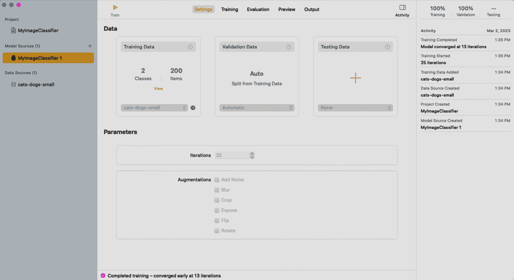

与其从零开始，有经验的 MLOps 专业人员可能会在其工作流程中使用预训练模型，例如在 [Kaggle](https://www.kaggle.com/models) 上找到的模型。这些模型已在大量数据集上进行过训练，可以为许多机器学习任务提供坚实的基础。

预训练模型可以节省大量时间和计算资源，因为训练主要已完成。在数据有限的情况下，它们可以发挥重要作用，此时从头训练复杂模型可能具有挑战性。

图 8-11 说明了 Kaggle 上可用的各种预训练模型。它们涵盖了从图像和文本分类到回归等一系列任务。这些模型可以轻松集成到你的工作流程中，针对你的特定任务进行调优并部署，使其成为提升 MLOps 领域效率的高层次工具。

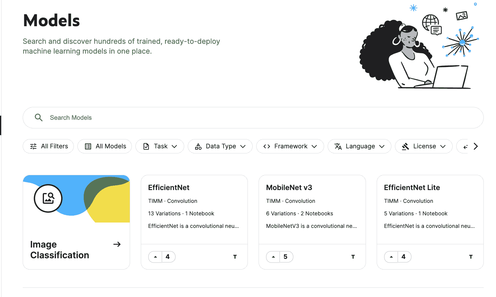

# 复合 AI

复合 AI 是人工智能中一种新兴的方法，它结合了各种 AI 技术和模型来解决复杂问题。它不仅仅是各部分的简单总和；它关乎创建能够利用各种 AI 技术优势的系统，例如自然语言处理、图像识别和机器学习，以提供更全面、更实用的解决方案。

在 MLOps 的背景下，复合 AI 可以成为改变游戏规则的存在。它允许开发更复杂的模型，能够处理多方面的任务，并显著增强 AI 解决方案的稳健性和灵活性。

复合 AI 结合了不同的 AI 技术，并将 AI 与其他技术集成，例如云计算、大数据分析和物联网 (IoT)。这种技术能够处理海量数据、实时决策和自动化复杂流程。

复合 AI 的潜力是巨大的。它可以帮助组织解决使用单一 AI 技术难以甚至不可能解决的挑战，成为 AI 行业创新的重要驱动力。

虽然有众多平台和工具可用于实现复合 AI 解决方案，但 AWS 提供了异常全面和多样的生态系统。AWS 结合了各种服务，从低级工具如 Sagemaker 到高级 AI 和 ML 服务，如用于 NLP 的 [AWS Comprehend](https://aws.amazon.com/comprehend/) 或用于图像分析的 [AWS Rekognition](https://aws.amazon.com/rekognition/)。

然而，AWS 只是该领域的众多参与者之一。Google Cloud、Microsoft Azure 和 IBM Watson 等平台也提供构建复合 AI 解决方案的工具和服务。作为一名 MLOps 专业人员，了解这些不同平台的能力以及如何有效利用它们，对于构建稳健、高效和创新的 AI 系统至关重要。

接下来，让我们探讨 AWS 如何构建复合 AI 解决方案。

## 使用无服务器构建复合 AI 入门

AWS 上无服务器的基础是 Lambda。Lambda 是一项服务，允许你在不配置或管理服务器的情况下运行代码。它仅在需要时执行代码并自动扩展，使其成为无服务器架构的理想组件。

我们的重点是 Lambda 如何成为混合 AI 解决方案的一部分。为了说明这一点，让我们考虑一个简单示例：Lambda 响应由计时器触发的事件，处理一些数据，并将结果放入队列中。

这种架构结构在 图 8-12 中。

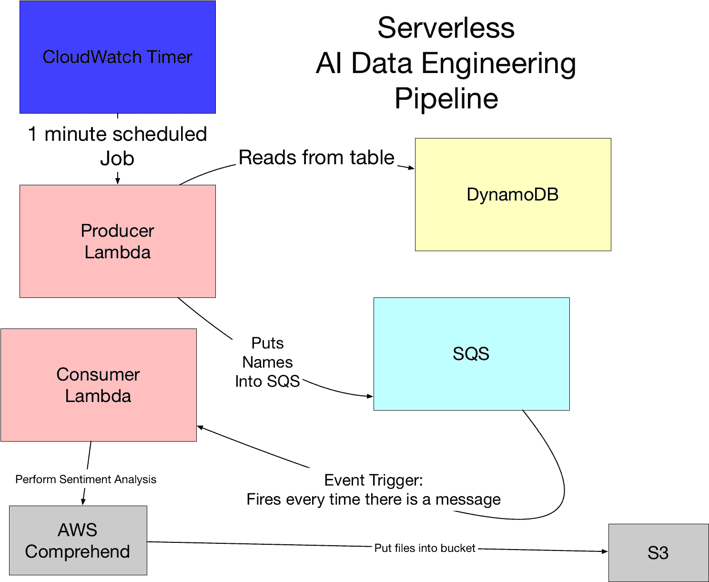

该图显示了事件如何触发 Lambda 函数，该函数处理数据并将结果放入 Amazon Simple Queue Service (SQS) 队列中。

在 图 8-13 中，我们看到 SQS 队列如何融入我们的无服务器架构的可视化表示。一旦 Lambda 函数处理完数据，它就会将结果放入 SQS 队列，准备被其他系统组件消费。

完整的代码仓库是以下 [仓库](https://github.com/noahgift/awslambda)，但让我们来看一下此 Python 示例的亮点：

```
def lambda_handler(event, context):
    """Entry Point for Lambda"""
    LOG.info(f"SURVEYJOB LAMBDA, event {event}, context {context}")

    receipt_handle = event['Records'][0]['receiptHandle']  # sqs message
    event_source_arn = event['Records'][0]['eventSourceARN']

    names = []  # Captured from Queue

    # Process Queue
    for record in event['Records']:
        body = json.loads(record['body'])
        company_name = body['name']

        # Capture for processing
        names.append(company_name)

        extra_logging = {"body": body, "company_name": company_name}
        LOG.info(
            f"SQS CONSUMER LAMBDA, splitting sqs arn with value:"
            f" {event_source_arn}", extra=extra_logging
        )
        qname = event_source_arn.split(":")[-1]
        extra_logging["queue"] = qname
        LOG.info(
            f"Attemping Deleting SQS receiptHandle {receipt_handle} "
            f"with queue_name {qname}", extra=extra_logging
        )
        res = delete_sqs_msg(queue_name=qname, receipt_handle=receipt_handle)
        LOG.info(
            f"Deleted SQS receipt_handle {receipt_handle} with res {res}",
            extra=extra_logging
        )

    # Make Pandas dataframe with wikipedia snippets
    LOG.info(f"Creating dataframe with values: {names}")
    df = names_to_wikipedia(names)

    # Perform Sentiment Analysis
    df = apply_sentiment(df)
    LOG.info(f"Sentiment from FANG companies: {df.to_dict()}")

    # Write result to S3
    write_s3(df=df, name=names.pop(), bucket="fangsentiment")
```

这段代码是一个 Python 脚本，作为 AWS Lambda 函数的入口点。该函数通过接收来自 Amazon Simple Queue Service (SQS) 队列的消息而触发。该函数的目的是处理消息，对消息中包含的公司名称列表执行情感分析，并将结果写入 Amazon S3 存储桶。

脚本记录触发 Lambda 函数的 `event` 和 `context`。它从 SQS 消息中提取 `receipt_handle` 和 `event_source_arn`。处理后，收据句柄并从队列中删除消息。`event_source_arn` 决定了 SQS 队列的名称。

接下来，脚本遍历 `event` 中的所有记录，并从每个 `record` 中提取 `company_name`。公司名称传递给名为 `names_to_wikipedia` 的函数，该函数返回一个包含名称及其对应 Wikipedia 片段的 Pandas `DataFrame`。

然后脚本调用名为 `apply_sentiment` 的函数对 `DataFrame` 执行情感分析。情感分析结果被记录，然后写入名为 `fangsentiment` 的 S3 存储桶中。


最后，脚本使用 `delete_sqs_msg` 函数删除已处理的 SQS 消息，传入队列名称和收据句柄。在解决了主要用例之后，让我们在此基础上构建并深入探讨混合 AI 解决方案。

## 使用无服务器的复合 AI 用例
复合 AI 与无服务器技术相结合，为以成本高效的方式解决复杂任务提供了强大的组合。AWS 提供了各种服务，使其成为部署这些解决方案的理想平台。其中一个场景是在 AWS 的弹性文件系统 (`EFS`) 上托管预训练的机器学习模型，并利用 AWS `Lambda`，一种无服务器计算服务，进行推理。

这种设置的优势在于能够使用低推理、低内存的语言，从而优化成本。无服务器技术，尤其是在与经过良好优化的高性能代码结合使用时，由于 AWS `Lambda` 的计费模式而具有成本效益，该模式基于请求数量和代码执行时长收费。除了 `Lambda` 和 `EFS` 之外，其他 AWS 服务如 `Rekognition`，它使向应用程序添加图像和视频分析变得容易，也可以整合以实现更全面的解决方案。这样的复合 AI 解决方案示例显示在 图 8-14。

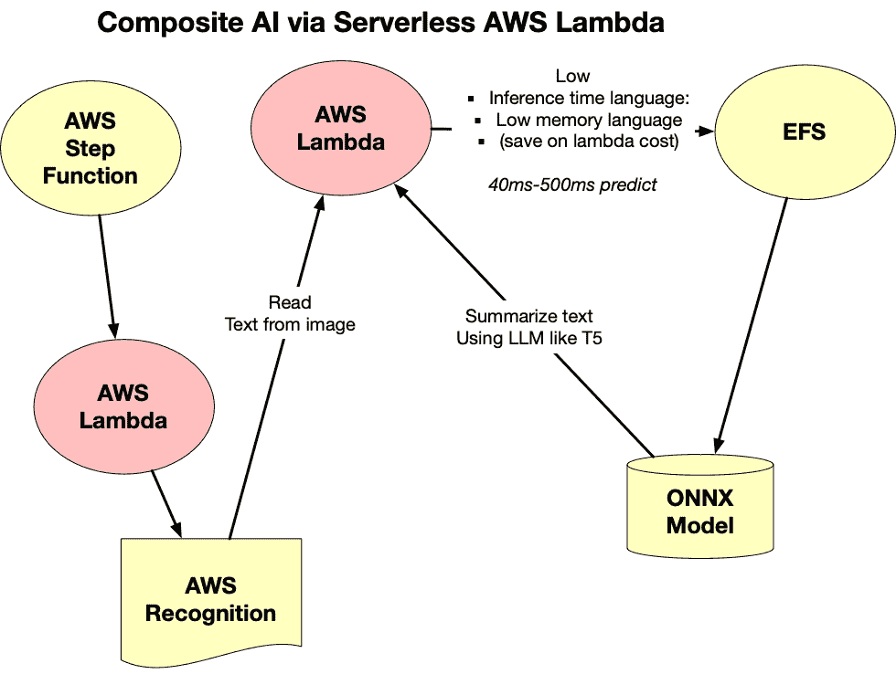

虽然本章重点介绍 AWS 服务，但值得注意的是，类似的概念也可以使用其他云平台应用。例如，Google Cloud 提供 `Cloud Functions` 作为无服务器执行环境，而 Azure 提供 `Azure Functions`。两者都使用各自的存储和 AI/ML 服务来创建复合 AI 解决方案。

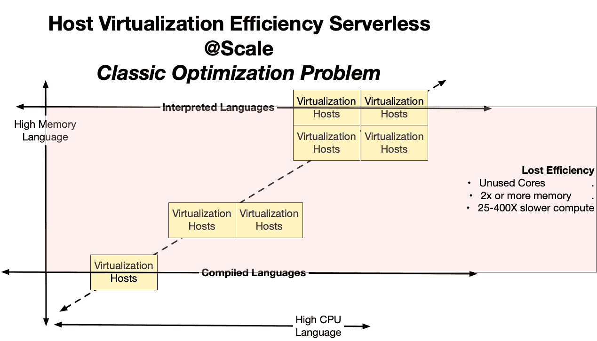

让我们总结本章并反思关键要点。

## 摘要
本章既深入探讨了高级数据类型，也以务实的方式进行，例如使用 API、GUI 工具和预训练模型。我们还展示了 AWS 如何成为进行快速粗糙原型开发的优秀作战基地，这些原型随后会被放入命令行工具中。

接下来，请完成练习和批判性思考问题，以巩固本章的理念。

## 练习
* 使用 AWS `SageMaker` 训练时间序列预测模型，并将其性能与传统时间序列分析方法进行比较。
* 使用 AWS `Comprehend` 构建基于 NLP 的情感分析模型，并在真实世界的数据集上评估其准确性。
* 使用 AWS `DeepLens` 训练图像分类模型，并将其部署到实时视频流中进行对象检测。
* 使用 AWS `Rekognition` 在视频流中执行对象识别，并将其性能与其他视频分析技术进行比较。
* 使用 AWS 服务（如 `SageMaker`、`Comprehend` 和 `Rekognition`）创建复合 AI 解决方案，以分析和解释复杂数据集。

## 批判性思考讨论问题
* 使用时间序列分析进行数据解释和预测的优点和缺点是什么？
* LLM NLP 工具如何用于解决情感分析和文本分类中的特定挑战？
* 在实际应用中使用视频分析和图像分类时有哪些关键考虑因素？
* 复合 AI 解决方案的关键组件是什么，它们如何集成以解决复杂的数据问题？
* AWS 如何用于支持数据科学项目的整个生命周期，从数据处理到模型部署和监控？

# 第 9 章. 常见用例的解决方案
有时常规的智慧根本就不常规。随着拥有不同背景的新一代数据科学家进入行业，解释来自生产软件世界的经验教训变得至关重要。本章旨在解释当前软件工程最佳实践背后的历史，以及它们如何通过 `MLOps` 应用于数据科学。

此外，本章展示了许多涉及 `MLOps` 工作流的日常用例，包括使用来自 `Hugging Face`、`OpenAI` 等的预训练模型。另一个讨论点是如何通过容器优先的工作流，使用 `GitHub Codespaces` 等可重复的基于云的开发环境来创造生产优先的心态。

## 重新学习 DevOps 的教训
在我职业生涯的早期，我在电视和电影行业工作，本质上是自动化任务的孵化器，使用 `Python`，尤其是在 1990 年代末和 2000 年代初的数据工作流方面。这方面的官方术语是 *电影流水线*，与当今的数据流水线 remarkably 相似。

电影行业因构建脆弱且不断崩溃的流水线而享有盛誉。电影软件工程师将项目的全部代码放在一个缺乏甚至版本控制的“上帝系统”中，并混合 `HTML`、`SQL` 和 `Python` 或 `PHP` 的做法十分普遍。当时这种开发风格的官方术语是 `LAMP`，也称为 `Linux`、`Apache`、`MySQL` 或 `PHP` 开发人员，如 图 9-1 所示。请注意，`PHP` 应用程序将标记语言、`SQL` 或 `Pandas` 和过程式代码结合起来，与典型的 `Jupyter` 项目有惊人的相似之处。教训是历史会重演。

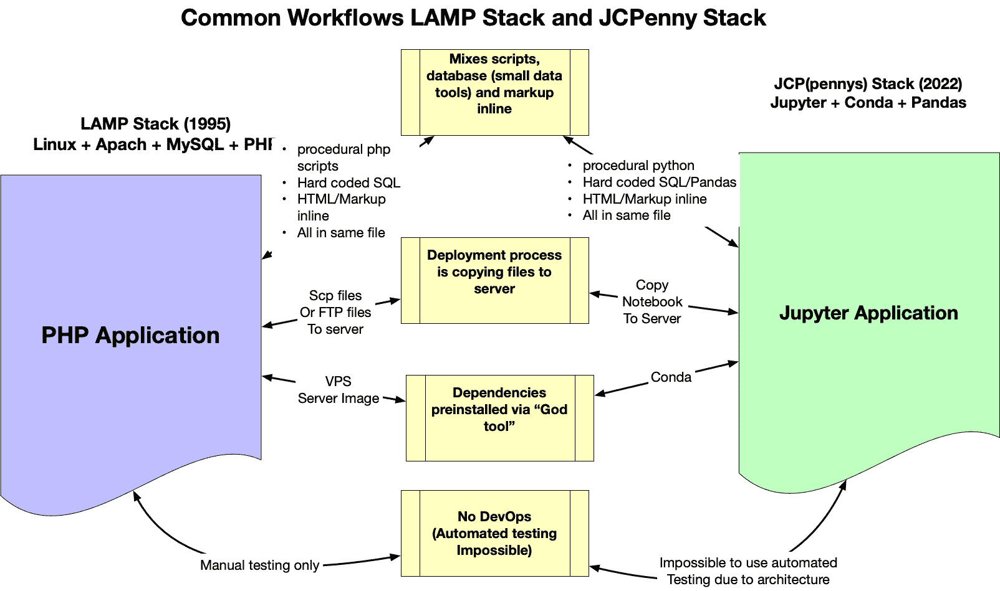

适合快速实验的东西，如电影或学术领域，往往不适合生产，因为研究和运营之间存在权衡。同样，如果你进入研究机构或大学的有机化学实验室，你不一定想开始混合化合物然后从汽车后备箱出售它们；需要有一个将研究产品化的流程。

实际场景需要权衡以满足业务需求。这些脆弱的软件工程实践的结果是越来越关注 `DevOps`。`DevOps` 文化直接源于缺乏运营卓越性所造成的问题。`DevOps` 最终归结为行为，如 图 9-2 所示。

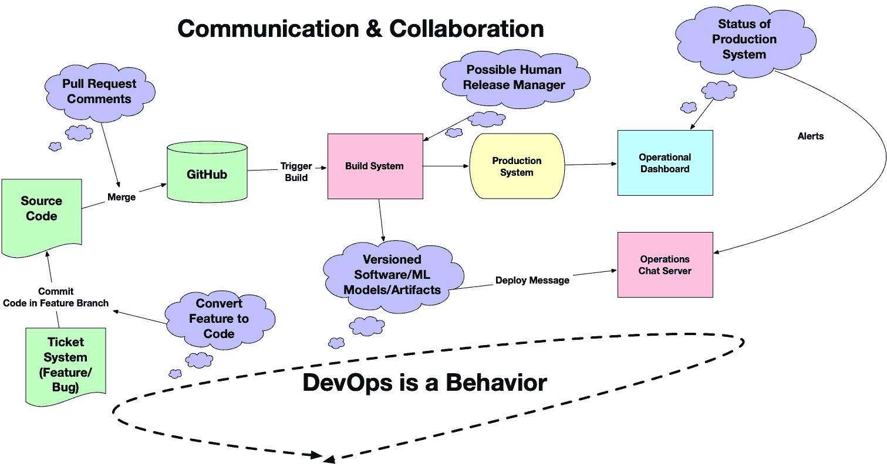

这种行为是 `MLOps` 的基础，因为 `MLOps` 的基线是 `DevOps`。如果没有 `DevOps`，就没有 `MLOps`。首先，你需要建立这些组织能力。请注意，工作流是功能被创建，然后导致更改，触发构建并开始部署。每次更改都会改进系统，目标是持续改进系统。`DevOps` 工作流中参与者的行为使技术成就成为可能。

在许多方面，数据科学领域非常适合 `DevOps`。`DevOps` 的全部意义是通过持续使用数据的反馈来改进系统。设计良好的软件工程架构具有广泛的负载测试、仪器化、监控和自动化流程，可提供可操作的洞察。让我们通过讨论容器化的生产优先心态来更深入地探讨这一概念。

### 容器化的生产优先心态
Gartner 认为 70% 的组织将在 2023 年使用容器（`MLOps` 和 `DevOps` 严重偏向使用容器），而 [Stack Overflow](https://www.docker.com/blog/key-insights-from-stack-overflows-2022-developer-survey/) 显示 2022 年 75% 的开发人员喜欢容器，如 图 9-3 所示。

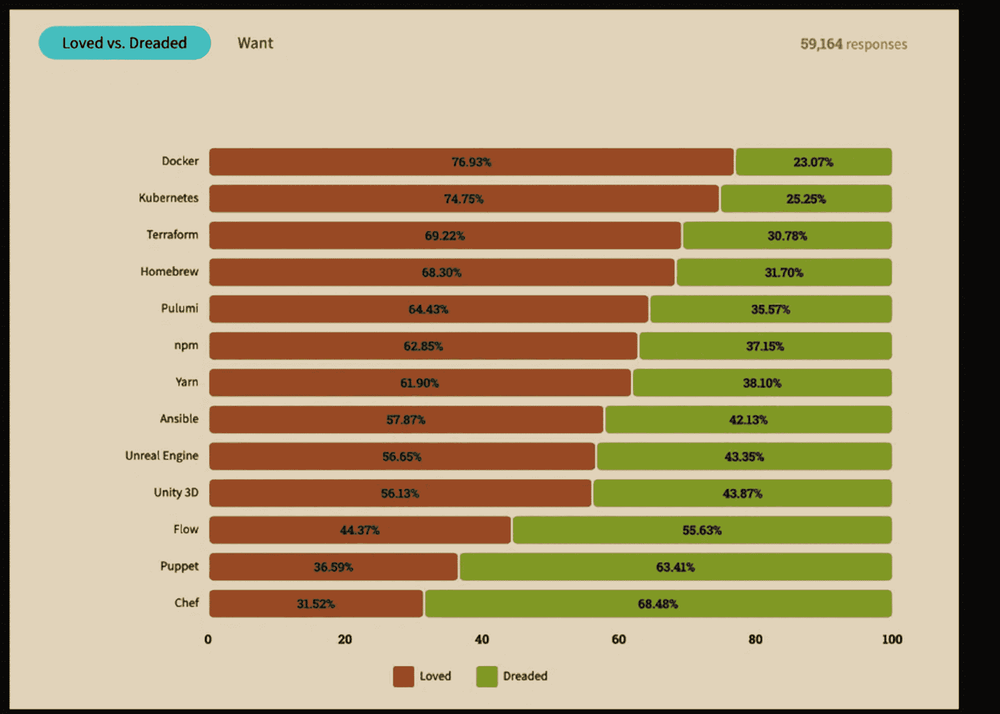

为什么使用容器？
1. 因为它们允许你将生产部署中的依赖项数量 *减少*，而非 *上帝工具*（即旨在同时解决多个问题的复杂安装工具）。
2. 使用 `Python` 时，你只需要一个 [`Dockerfile`](https://docs.docker.com/engine/reference/builder/) 和 [`pip`](https://pip.pypa.io/en/stable/)。


## 生产优先的容器思维

3. 容器是一种生产优先的思维方式，即你的客户是生产部署，并且你最初就是为其构建。

4. [无发行版容器](https://github.com/GoogleContainerTools/distroless) 允许容器大小最小化，对于使用 [编译型语言](https://github.com/nogibjj/rust-mlops-template/tree/main/distroless-web) 的微服务而言小至 20MB。

实际上，这意味着 MLOps 工作流从以下步骤开始，其中容器发挥关键作用：

1. 使用与生产环境几乎相同（或非常接近）的容器化环境配置基于云的 IDE。

2. 设置 DevOps 流水线，即 `Makefile`（或等效项），并使构建系统针对每个步骤正常工作：`install`、`test`、`lint`、`format`、`deploy` 等。你可以在此 [GitHub Actions `cicd.yml` 文件](https://github.com/nogibjj/mlops-template/blob/GPU/.github/workflows/cicd.yml) 中看到这些确切步骤。

```
name: CI
on:
  push:
    branches: [ "GPU" ]
  pull_request:
    branches: [ "GPU" ]
  workflow_dispatch:

jobs:
  build:
    runs-on: ubuntu-latest
    steps:
      - uses: actions/checkout@v3
      - name: install packages
        run: make install
      - name: lint
        run: make lint
      - name: test
        run: make test
      - name: format
        run: make format
      - name: deploy
        run: make deploy
```

这两个初始步骤对应于实际的 [`Makefile`](https://github.com/nogibjj/mlops-template/blob/GPU/Makefile)，并允许从本地测试到构建系统测试的轻松链接。

* 启用 AI 结对编程工具，如使用 Codespaces 的 [GitHub Copilot](https://github.com/features/copilot) 或使用 [Code Whisperer](https://aws.amazon.com/codewhisperer/) 的 Cloud9。这些步骤嵌入到可复现的 `devcontainer.json` 配置中，如文件中以下部分所示。每个扩展都是预构建并在环境中预加载的：

```
 // Add the IDs of extensions you want installed when the container is created:
	 "extensions": [
	 "GitHub.vscode-pull-request-github",
	 "GitHub.copilot-nightly",
	 "GitHub.copilot-labs",
	 "ms-azuretools.vscode-docker",
	 "ms-toolsai.jupyter",
	 "ms-toolsai.jupyter-keymap",
	 "ms-toolsai.jupyter-renderers",
	 "ms-python.vscode-pylance",
	 "ms-python.python",
	 "ms-vscode.makefile-tools"
	 ]
```

* 编写库代码（可能使用预训练模型，即 Hugging Face）或在模型注册表中使用模型。你可以在此查看一个 [库模块](https://github.com/nogibjj/assimilate-openai/tree/main/oalib)。

* 首先将库代码转换为命令行工具以进行原型设计。你可以在此查看一个 [cli 工具示例](https://github.com/nogibjj/assimilate-openai/blob/main/questionAnswerCLI.py)。

* 然后通过 Jupyter、FastAPI、[Streamlit](https://streamlit.io/)、[Gradio](https://gradio.app/) 等调用库代码，即代码的客户端。

实际上，这意味着使用 Python 函数，你可以一次构建，即你的库代码，然后“多用”和“多部署”，如 图 9-4 所示。正因如此，函数式编程对于构建机器学习项目的 DevOps 基础层至关重要。如果首先创建一个符合 DevOps 最佳实践的库，那么将其添加到 MLOps 工作流中（其中 Jupyter Notebook 可能存在或不存在）是直接的。

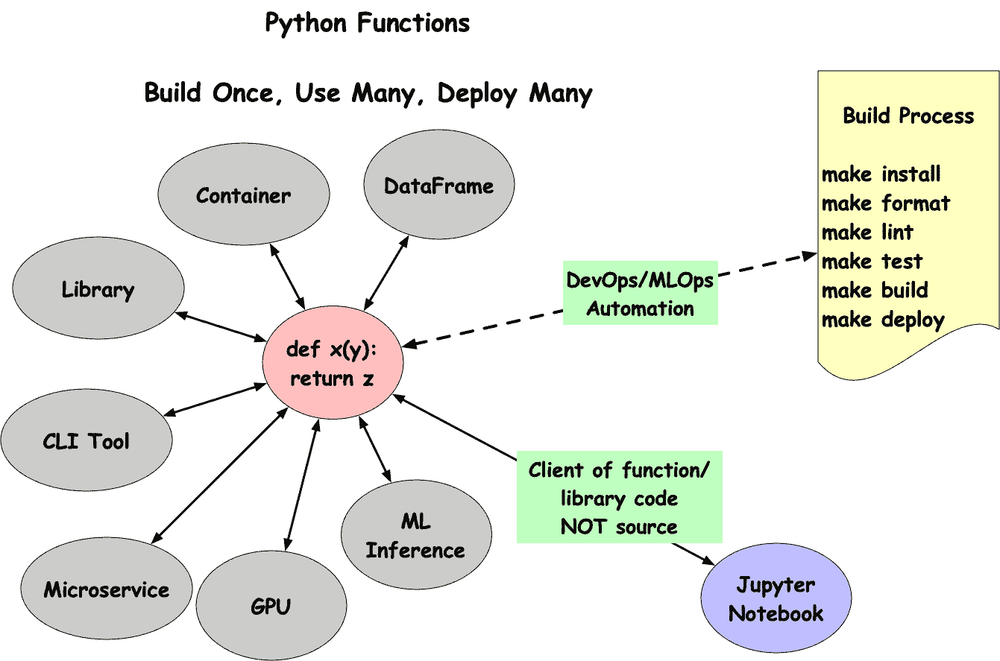

# 使用预训练模型构建解决方案

MLOps 的一个独特之处在于，你并不总是需要自己构建模型来拥抱围绕 MLOPs 的方法论。以下几个重要趋势支持这一运动：

* 机器学习的碳足迹

* 规模经济的微观经济原则。

* 新兴技术解决方案和平台。这一运动的最前沿有两家公司：[OpenAI](https://openai.com) 和 [Hugging Face](https://huggingface.co)。

本章后面，这个容器优先的思维方式体现在使用 GitHub Codespaces 构建解决方案中。

## 机器学习的碳足迹

现代机器学习中的一个重大挑战是管理机器学习的碳足迹。最近一篇论文 [《机器学习训练的碳足迹将趋于平稳，然后缩小》](https://arxiv.org/pdf/2204.05149.pdf) 列举了四种减少能源的做法：

1. *模型*：选择高效模型可将计算量减少 5-10 倍。

2. *计算*：像 [TPUs](https://cloud.google.com/tpu/docs/tpus) 或现代 GPU 这样更专业的芯片，比 CPU 等其他形式的计算更有效地减少能源 1.4-2 倍。

3. *云*：高效的云数据中心能源可将碳使用量减少 1.4-2 倍。

4. *区域特异性*：云计算用户可以选择清洁能源比例最高的数据中心区域。

虽然这些因素具有吸引力且可操作，但减少机器学习碳足迹还有另一个组成部分。使用预训练模型消除了训练新模型的需求，或通过 [微调](https://huggingface.co/docs/transformers/training) 显著减少训练时间。

###### 注

*微调* 是一种技术，允许从业者利用具有数十亿参数的高度复杂的机器学习模型，并通过最少的数据和训练创建这些模型的专用版本。

## 预训练模型的规模经济

若干微观经济趋势支持使用预训练模型。让我们从比较优势示例开始。大型组织可以访问数千个昂贵的 GPU 来训练具有数十亿参数的模型。此外，世界级的机器学习工程师帮助在计算机视觉、自然语言处理等任务上设计模型。生产这些复杂预训练模型的组织相对于小型组织或个人具有比较优势。

因此，使用预训练模型（无论是原样使用还是对其进行微调）有很多可取之处。深思熟虑比较优势是一种利用专家力量、获得更好的业务成果并减少碳足迹的方式。

# 预训练模型的新兴技术与平台

2020 年初见证了预训练模型革命的兴起。像 [Hugging Face](https://huggingface.co/)、[Stability AI](https://stability.ai/faq) 和 [Open AI](https://openai.com/) 这样的公司推动了预训练大型模型这种新型机器学习的边界。

## LLM (Large Language Models)

斯坦福大学人本中心人工智能研究所 在一篇关于大型语言模型的最新文章中，[认为 LLM 将改变社会](https://hai.stanford.edu/news/how-large-language-models-will-transform-science-society-and-ai)。为了展示这一想法，我使用了 Hugging Face 界面及其 BigScience 或 Bloom 模型来帮助撰写本书中下面看到的一个章节，如 图 9-5 所示。请注意，第一句话 *“大型语言模型可以彻底改变我们看待世界的方式。”* 促使了第二句话 *“它们可用于理解句子的含义、生成新句子并回答问题”*。

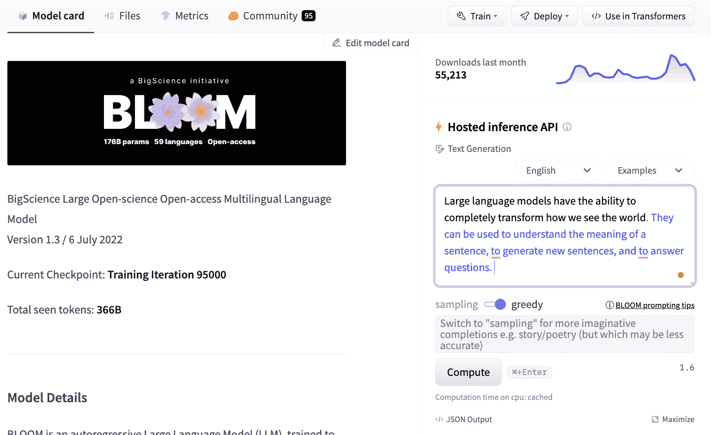

LLM 的更著名示例之一是 GPT-3，[由 OpenAI 于 2020 年 7 月发布](https://openai.com/blog/gpt-3-apps/)。更强大的新技术之一是 [ChatGPT](https://chat.openai.com/chat)，它可以即时编写代码并回答一般搜索查询，如“世界各地女性的预期寿命是多少？”。

###### 注


大型企业经常创建 LLM，但 [BLOOM](https://huggingface.co/bigscience/bloom) 是由法国政府和 Hugging Face 赞助的一个令人兴奋的开源协作项目。硬件为 384 A100 80GB GPUS（48 个节点），每个节点配置 8 个 GPU。

让我们从 OpenAI 开始，并使用他们的模型来构建解决方案。

# OpenAI

我为本书创建了一组示例，位于仓库中：[同化 OpenAI](https://github.com/nogibjj/assimilate-openai)。

### 注意

您可以在 [OpenAI 的 YouTube 播放列表](https://www.youtube.com/playlist?list=PLdfopzFjkPz-kUcaflzMqbfm6B6UVA5Iq) 或 [O’Reilly](https://learning.oreilly.com/videos/assimilate-openai/08252022VIDEOPAIML/) 上查看此内容的讲解。

在此示例中，第一个库是通过探索 [OpenAI API](https://openai.com/api/) 创建的。此代码位于模块内部，如以下代码示例所示，它创建了一个简单的函数，该函数接受输入并返回输出，即来自预训练模块的结果。

第一个函数，`submit_question`，可以使用 `text-davinci-002` 模型返回一个补全提示。第二个函数，`create_code` 接受任何编程语言的注释并将其转换为代码示例。稍后第一个函数将从命令行脚本中导入。

```
"""Library with OpenAI API solutions as functions

References:

For building code:  https://beta.openai.com/docs/guides/code/introduction

"""

import openai
import os


def submit_question(text):
    """This submits a question to the OpenAI API"""

    openai.api_key = os.getenv("OPENAI_API_KEY")
    prompt = text

    result = openai.Completion.create(
        prompt=prompt,
        temperature=0,
        max_tokens=300,
        top_p=1,
        frequency_penalty=0,
        presence_penalty=0,
        model="text-davinci-002",
    )["choices"][0]["text"].strip(" \n")
    return result


# build a function that converts a comment into code in any language
def create_code(text, language):
    """This submits a comment to the OpenAI API to create code in any language

    Example:
        language = '# Python3'
        text = f"Calculate the mean distance between an array of points"
        create_code(text, language)

    """
    openai.api_key = os.getenv("OPENAI_API_KEY")
    prompt = f"## {language}\n\n{text}"

    result = openai.Completion.create(
        prompt=prompt,
        temperature=0,
        max_tokens=300,
        top_p=1,
        frequency_penalty=0,
        presence_penalty=0,
        model="davinci-codex",
    )["choices"][0]["text"].strip(" \n")
    return result
```

在这里，由于之前的工作，将其导入到命令行脚本中非常简单，如以下示例所示：

```
#!/usr/bin/env python3

"""
An openai api key is required to use this script.
This uses an advanced GPT-3 model
I also used AI via Github Copilot to write this command-line interface.
"""
import click
from oalib.solutions import submit_question


@click.command()
@click.argument("text")
def main(text):
    """

This is the main function to ask OpenAI API a question:

    example: /.questionAnswerCLI.py "Who won the 2020 Summer Olympics?"

    """
    print(submit_question(text))


if __name__ == "__main__":
    # pylint: disable=no-value-for-parameter
    main()
```

只要存在有效的令牌，就很容易从命令行调用，例如：

`./questionAnswerCLI.py "What is a good science fiction book I can read?"`

此工具返回以下输出：`A good science fiction book to read is 1984 by George Orwell.`。

### 图像生成

接下来让我们处理图像：

```
"""A library for generating images using OpenAI."""

import openai

# build a function that takes a prompt and
# returns a generated image
def generate_image(prompt, size="1024x1024"):
    """Generate an image using OpenAI's API."""
    response = openai.Image.create(
        prompt=prompt,
        n=1,
        size=size,
    )
    image_url = response["data"][0]["url"]
    return image_url
```

```
#!/usr/bin/env python
"""
A command line tool that uses click to generate images using OpenAI.
"""
import click
from oalib.image_gen import generate_image

# build a click command line tool that takes a prompt and
# returns a generated image
@click.group()
def cli():
    """A command line tool that uses click to generate images using OpenAI."""


@cli.command("generate")
@click.option("--prompt",
	help="The prompt to use for image generation.")
@click.option("--size", default="1024x1024",
	help="The size of the image to generate.")
def generate(prompt, size):
    """Generate an image using OpenAI's API."""
    image_url = generate_image(prompt, size)
    print(image_url)


if __name__ == "__main__":
    cli()
```

要调用此脚本生成图像，我可以输入任何想要的奇思妙想提示：

`./imageGen.py generate --prompt "A Husky romping in the snow while licking giant lollypops"`

Python 脚本根据 `prompt` 创建良好结果的工作做得相当不错，如 图 9-6 所示。


### Whisper 转录

与 OpenAI 相关的另一个探索领域是 [whisper](https://openai.com/blog/whisper/)，根据 OpenAI 的说法，它接近“人类水平在英语语音识别上的鲁棒性和准确性”。

该模型的一个更值得注意的用例是为其他 AI 流水线生成数据。以下示例，您也可以在 [这里](https://github.com/nogibjj/assimilate-openai/blob/main/transcribeCLI.py) 找到，展示了如何快速将 `whisper` 包装在 Python 中以同时转录多个音频或视频文件：

```
#!/usr/bin/env python
"""
transcribe multiple files using open AI whisper and python subprocess
whisper utils/four-score.m4a --model large --language English """
import os
import click
import subprocess

# create a python function that returns files in a directory
def get_files(directory):
    """get files in a directory"""
    files = []
    for file in os.listdir(directory):
        files.append(file)
    return files


# find the size of all the files in a directory using subprocess and ls -lah
def get_size(directory):
    """get size of files in a directory"""
    filesize = subprocess.check_output(["ls", "-lah", directory])
    return filesize


# transcribe multiple files in a directory
def transcribe(directory, model, language):
    files = get_files(directory)
    for file in files:
        subprocess.run(
            [
                "whisper",
                f"{directory}/{file}",
                "--model",
                model,
                "--language",
                language,
            ],
            check=True,
        )


@click.group()
def cli():
    """transcribe multiple files using open AI whisper and python subprocess"""


@cli.command("transcribe")
@click.option("--directory", default="utils",
              help="transcribe files in a directory")
@click.option("--model", default="tiny",
              help="model to use for transcribing")
@click.option("--language", default="English",
              help="language to use for transcribing")
def transcribe_cli(directory, model, language):
    """transcribe multiple files using open AI whisper and python
    example: whisper utils/four-score.m4a --model large --language English"""
    transcribe(directory, model, language)

@cli.command("size")
@click.option("--directory", default="utils",
              help="directory to find size of files")
def size(directory):
    """get size of files in a directory"""
    click.echo(get_size(directory))


# create a command that finds files in a directory
@cli.command("find")
@click.option("--directory", default="utils", help="directory to find files")
def find_files(directory):
    """find files in a directory"""
    files = get_files(directory)
    for file in files:
        print(file)


# invoke the command
if __name__ == "__main__":
    cli()
```


首先，使用它在目录中查找文件，以验证转录任务是否应在此处开始：

`./transcribeCLI.py find --directory utils`

在 Codespaces 中运行的此 GitHub 项目中，它返回以下结果：

```
utils_four-score2.m4a
utils_four-score.m4a
```

现在我们知道该工具可以找到正确的文件，它可以指向对它们进行转录。

`./transcribeCLI.py transcribe --directory utils`

你可以看到它运行时的以下输出：

```
(.venv) @noahgift ➜ /workspaces/assimilate-openai (main) $
./transcribeCLI.py transcribe --directory utils
[00:00.000 --> 00:08.100]  Four score and seven years
[00:08.100 --> 00:14.800]  conceived in liberty and dedicated to...
[00:14.800 --> 00:20.360]  Now we are engaged in a great civil war...
[00:20.360 --> 00:24.240]  conceived and so dedicated can long endure.
[00:24.240 --> 00:26.760]  We are met on a great battlefield of that war.
```

值得注意的一点是，它在 GitHub Codespaces 中的 GPU 上也表现极佳，你可以在 [MLOps 模板仓库在此](https://github.com/nogibjj/mlops-template#verify-gpu-works) 中看到一个示例，也可以在 图 9-7 中看到。请注意，命令 `nvidia-smi -l 1` 将显示 GPU 处于饱和状态。


接下来我们将查看 Hugging Face，看看它如何使用预训练模型完成任务。

# Hugging Face

使用预训练模型最令人兴奋的方式之一是通过生成 AI 艺术。让我们看一个使用 [stable-diffusion](https://huggingface.co/spaces/stabilityai/stable-diffusion) 的 Hugging Face Space。通过使用以下提示，我们可以开发一个 AI 机器人：

```
hero robot, robot saves dog, utopian robot, rainbow exhaust,\
periwinkle skies, steampunk style, dieselpunk style, 3D, \
realistic graphics, photorealism, hyperrealism, digital art, \
 cinematic, ArtStation, Unreal Engine, Autodesk Arnold, \
Pixar RenderMan, V-Ray, path tracing, dynamic lighting, \
dynamic shadows, dynamic reflection, ray tracing, \
volumetric lighting, perfectly shaped, hyper render, \
HD, 4K resolution, 8K resolution, razor sharp image, \
crystal clear, ultra crisp, hyper detail, best quality, \
128 samples, iteration 10000, NVIDIA OptiX denoising
```

你可以在 图 9-8 中查看这件艺术作品。关键要点是，使用 AI 生成图像既有艺术性也有科学性，随着 AI 技术的进步，一切只会变得更好。


让我们看看你如何使用 [官方教程](https://huggingface.co/docs/transformers/training) 也构建一个微调示例。图 9-9 显示了该工作流程的实际运行情况。

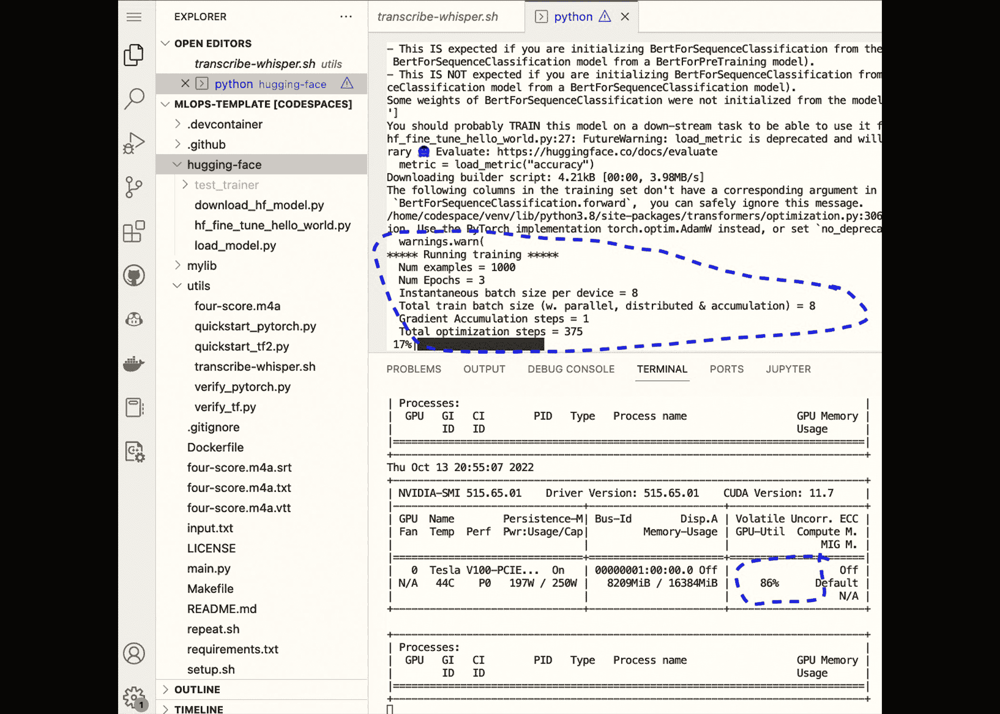

以下代码基于官方 HuggingFace 教程，展示了使用 Python 进行微调的过程。

```
#!/usr/bin/env python

"""
Fine Tuning Example with HuggingFace

Based on the official tutorial
"""

from transformers import AutoTokenizer
from datasets import load_dataset, load_metric
from transformers import (AutoModelForSequenceClassification,
                          TrainingArguments, Trainer)
import numpy as np

dataset = load_dataset("yelp_review_full")
tokenizer = AutoTokenizer.from_pretrained("bert-base-cased")

def tokenize_function(examples):
    return tokenizer(examples["text"], padding="max_length", truncation=True)
tokenized_datasets = dataset.map(tokenize_function, batched=True)

model = AutoModelForSequenceClassification.from_pretrained(
    "bert-base-cased", num_labels=5)

metric = load_metric("accuracy")
def compute_metrics(eval_pred):
    logits, labels = eval_pred
    predictions = np.argmax(logits, axis=-1)
    return metric.compute(predictions=predictions, references=labels)

small_train_dataset = tokenized_datasets["train"].shuffle(seed=42).select(range(1000))
small_eval_dataset = tokenized_datasets["test"].shuffle(seed=42).select(range(1000))

training_args = TrainingArguments(output_dir="test_trainer", evaluation_strategy="epoch")
trainer = Trainer(
    model=model,
    args=training_args,
    train_dataset=small_train_dataset,
    eval_dataset=small_eval_dataset,
    compute_metrics=compute_metrics,
)

trainer.train()
```

简而言之，GPU GitHub Codespace 创建了一个理想的微调环境。这种基于云的开发环境能够以一种强大的方式快速编写解决方案，使用预训练模型和传统的软件工程工具链。

## 使用预训练模型创建迭代反馈循环

你可以在 图 9-10 中看到，预训练模型开启了一种全新的工作方式。例如，你可以在预训练模型上进行 MLOps，将其推送到 Hugging Face 和 Azure，并通过像 `MLRun` 这样的模型服务框架提供服务。

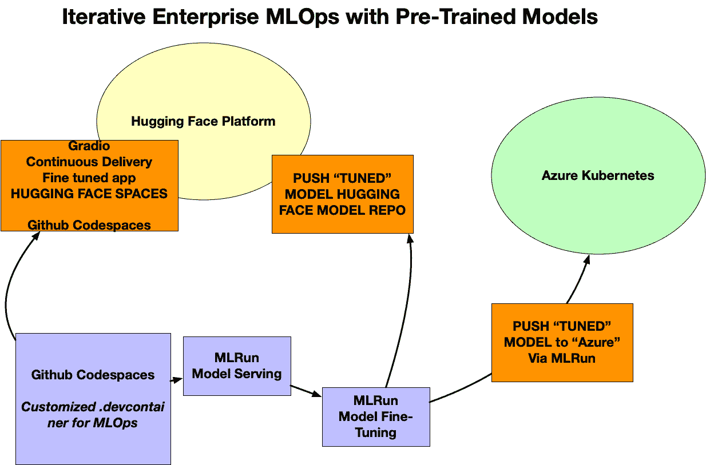

## 使用多种工具构建端到端解决方案

预训练模型[content]
首先，使用它在目录中查找文件，以验证转录任务是否应在此处开始：

`./transcribeCLI.py find --directory utils`

在 Codespaces 中运行的此 GitHub 项目中，它返回以下结果：

```
utils_four-score2.m4a
utils_four-score.m4a
```

现在我们知道该工具可以找到正确的文件，它可以指向对它们进行转录。

`./transcribeCLI.py transcribe --directory utils`

你可以看到它运行时的以下输出：

```
(.venv) @noahgift ➜ /workspaces/assimilate-openai (main) $
./transcribeCLI.py transcribe --directory utils
[00:00.000 --> 00:08.100]  Four score and seven years
[00:08.100 --> 00:14.800]  conceived in liberty and dedicated to...
[00:14.800 --> 00:20.360]  Now we are engaged in a great civil war...
[00:20.360 --> 00:24.240]  conceived and so dedicated can long endure.
[00:24.240 --> 00:26.760]  We are met on a great battlefield of that war.
```

值得注意的一点是，它在 GitHub Codespaces 中的 GPU 上也表现极佳，你可以在 [MLOps 模板仓库在此](https://github.com/nogibjj/mlops-template#verify-gpu-works) 中看到一个示例，也可以在 图 9-7 中看到。请注意，命令 `nvidia-smi -l 1` 将显示 GPU 处于饱和状态。


接下来我们将查看 Hugging Face，看看它如何使用预训练模型完成任务。

# Hugging Face

使用预训练模型最令人兴奋的方式之一是通过生成 AI 艺术。让我们看一个使用 [stable-diffusion](https://huggingface.co/spaces/stabilityai/stable-diffusion) 的 Hugging Face Space。通过使用以下提示，我们可以开发一个 AI 机器人：

```
hero robot, robot saves dog, utopian robot, rainbow exhaust,\
periwinkle skies, steampunk style, dieselpunk style, 3D, \
realistic graphics, photorealism, hyperrealism, digital art, \
 cinematic, ArtStation, Unreal Engine, Autodesk Arnold, \
Pixar RenderMan, V-Ray, path tracing, dynamic lighting, \
dynamic shadows, dynamic reflection, ray tracing, \
volumetric lighting, perfectly shaped, hyper render, \
HD, 4K resolution, 8K resolution, razor sharp image, \
crystal clear, ultra crisp, hyper detail, best quality, \
128 samples, iteration 10000, NVIDIA OptiX denoising
```

你可以在 图 9-8 中查看这件艺术作品。关键要点是，使用 AI 生成图像既有艺术性也有科学性，随着 AI 技术的进步，一切只会变得更好。


让我们看看你如何使用 [官方教程](https://huggingface.co/docs/transformers/training) 也构建一个微调示例。图 9-9 显示了该工作流程的实际运行情况。


以下代码基于官方 HuggingFace 教程，展示了使用 Python 进行微调的过程。

```
#!/usr/bin/env python

"""
Fine Tuning Example with HuggingFace

Based on the official tutorial
"""

from transformers import AutoTokenizer
from datasets import load_dataset, load_metric
from transformers import (AutoModelForSequenceClassification,
                          TrainingArguments, Trainer)
import numpy as np

dataset = load_dataset("yelp_review_full")
tokenizer = AutoTokenizer.from_pretrained("bert-base-cased")

def tokenize_function(examples):
    return tokenizer(examples["text"], padding="max_length", truncation=True)
tokenized_datasets = dataset.map(tokenize_function, batched=True)

model = AutoModelForSequenceClassification.from_pretrained(
    "bert-base-cased", num_labels=5)

metric = load_metric("accuracy")
def compute_metrics(eval_pred):
    logits, labels = eval_pred
    predictions = np.argmax(logits, axis=-1)
    return metric.compute(predictions=predictions, references=labels)

small_train_dataset = tokenized_datasets["train"].shuffle(seed=42).select(range(1000))
small_eval_dataset = tokenized_datasets["test"].shuffle(seed=42).select(range(1000))

training_args = TrainingArguments(output_dir="test_trainer", evaluation_strategy="epoch")
trainer = Trainer(
    model=model,
    args=training_args,
    train_dataset=small_train_dataset,
    eval_dataset=small_eval_dataset,
    compute_metrics=compute_metrics,
)

trainer.train()
```

简而言之，GPU GitHub Codespace 创建了一个理想的微调环境。这种基于云的开发环境能够以一种强大的方式快速编写解决方案，使用预训练模型和传统的软件工程工具链。

## 使用预训练模型创建迭代反馈循环

你可以在 图 9-10 中看到，预训练模型开启了一种全新的工作方式。例如，你可以在预训练模型上进行 MLOps，将其推送到 Hugging Face 和 Azure，并通过像 `MLRun` 这样的模型服务框架提供服务。


## 使用多种工具构建端到端解决方案

预训练模型能够或已能够实现的是链式 AI 架构中的多种工具。一个进步触发另一个进步，进而引发另一个进步；你可以在 [示例的源代码在此](https://github.com/nogibjj/sqlite-ai-pubtools) 中查看。本工作流程在 图 9-11 中展示了 `OpenAI` 工具如何转码音频，该音频被提取为关键词存储到 `SQLite` 数据库中，这些关键词是 Hugging Face 零样本分类的目标，进而便于轻松创建 YouTube 播放列表。

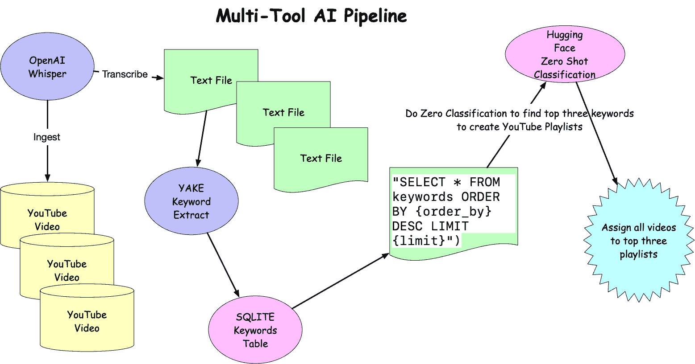

让我们看看提取过程可能是什么样的，假设文本已处理；你可以在 [此处](https://github.com/nogibjj/sqlite-ai-pubtools/blob/main/text.txt) 看到一个版本。

首先，一个概念验证脚本阐明了如何提取关键词，你可以从 [此处](https://raw.githubusercontent.com/nogibjj/sqlite-ai-pubtools/main/main.py) 获取。该脚本读取文件并使用一个库来查找这些关键词：

```
#!/usr/bin/env python3

"""
Main cli or app entry point
"""
import yake
import click

# create a function that reads a file
def read_file(filename):
    with open(filename, encoding="utf-8") as myfile:
        return myfile.read()


# def extract keywords
def extract_keywords(text):
    kw_extractor = yake.KeywordExtractor()
    keywords = kw_extractor.extract_keywords(text)
    return keywords


# create a function that makes hash tags
def make_hashtags(keywords):
    hashtags = []
    for keyword in keywords:
        hashtags.append("#" + keyword[0].replace(" ", ""))
    return hashtags


@click.group()
def cli():
    """A cli for keyword extraction"""


@cli.command("extract")
@click.argument("filename", default="text.txt")
def extract(filename):
    """Extract keywords from a file"""
    text = read_file(filename)
    keywords = extract_keywords(text)
    click.echo(keywords)


@cli.command("hashtags")
@click.argument("filename", default="text.txt")
def hashtagscli(filename):
    """Extract keywords from a file and make hashtags"""
    text = read_file(filename)
    keywords = extract_keywords(text)
    hashtags = make_hashtags(keywords)
    click.echo(hashtags)


if __name__ == "__main__":
    cli()
```

现在工作流程已建立，下一步是将输出放入 `SQLite` 数据库，如以下示例所示。请注意，`SQL` 查询可以作为新管道部分的[content]
首先，使用它在目录中查找文件，以验证转录任务是否应在此处开始：

`./transcribeCLI.py find --directory utils`

在 Codespaces 中运行的此 GitHub 项目中，它返回以下结果：

```
utils_four-score2.m4a
utils_four-score.m4a
```

现在我们知道该工具可以找到正确的文件，它可以指向对它们进行转录。

`./transcribeCLI.py transcribe --directory utils`

你可以看到它运行时的以下输出：

```
(.venv) @noahgift ➜ /workspaces/assimilate-openai (main) $
./transcribeCLI.py transcribe --directory utils
[00:00.000 --> 00:08.100]  Four score and seven years
[00:08.100 --> 00:14.800]  conceived in liberty and dedicated to...
[00:14.800 --> 00:20.360]  Now we are engaged in a great civil war...
[00:20.360 --> 00:24.240]  conceived and so dedicated can long endure.
[00:24.240 --> 00:26.760]  We are met on a great battlefield of that war.
```

值得注意的一点是，它在 GitHub Codespaces 中的 GPU 上也表现极佳，你可以在 [MLOps 模板仓库在此](https://github.com/nogibjj/mlops-template#verify-gpu-works) 中看到一个示例，也可以在 图 9-7 中看到。请注意，命令 `nvidia-smi -l 1` 将显示 GPU 处于饱和状态。


接下来我们将查看 Hugging Face，看看它如何使用预训练模型完成任务。

# Hugging Face

使用预训练模型最令人兴奋的方式之一是通过生成 AI 艺术。让我们看一个使用 [stable-diffusion](https://huggingface.co/spaces/stabilityai/stable-diffusion) 的 Hugging Face Space。通过使用以下提示，我们可以开发一个 AI 机器人：

```
hero robot, robot saves dog, utopian robot, rainbow exhaust,\
periwinkle skies, steampunk style, dieselpunk style, 3D, \
realistic graphics, photorealism, hyperrealism, digital art, \
 cinematic, ArtStation, Unreal Engine, Autodesk Arnold, \
Pixar RenderMan, V-Ray, path tracing, dynamic lighting, \
dynamic shadows, dynamic reflection, ray tracing, \
volumetric lighting, perfectly shaped, hyper render, \
HD, 4K resolution, 8K resolution, razor sharp image, \
crystal clear, ultra crisp, hyper detail, best quality, \
128 samples, iteration 10000, NVIDIA OptiX denoising
```

你可以在 图 9-8 中查看这件艺术作品。关键要点是，使用 AI 生成图像既有艺术性也有科学性，随着 AI 技术的进步，一切只会变得更好。


让我们看看你如何使用 [官方教程](https://huggingface.co/docs/transformers/training) 也构建一个微调示例。图 9-9 显示了该工作流程的实际运行情况。


以下代码基于官方 HuggingFace 教程，展示了使用 Python 进行微调的过程。

```
#!/usr/bin/env python

"""
Fine Tuning Example with HuggingFace

Based on the official tutorial
"""

from transformers import AutoTokenizer
from datasets import load_dataset, load_metric
from transformers import (AutoModelForSequenceClassification,
                          TrainingArguments, Trainer)
import numpy as np

dataset = load_dataset("yelp_review_full")
tokenizer = AutoTokenizer.from_pretrained("bert-base-cased")

def tokenize_function(examples):
    return tokenizer(examples["text"], padding="max_length", truncation=True)
tokenized_datasets = dataset.map(tokenize_function, batched=True)

model = AutoModelForSequenceClassification.from_pretrained(
    "bert-base-cased", num_labels=5)

metric = load_metric("accuracy")
def compute_metrics(eval_pred):
    logits, labels = eval_pred
    predictions = np.argmax(logits, axis=-1)
    return metric.compute(predictions=predictions, references=labels)

small_train_dataset = tokenized_datasets["train"].shuffle(seed=42).select(range(1000))
small_eval_dataset = tokenized_datasets["test"].shuffle(seed=42).select(range(1000))

training_args = TrainingArguments(output_dir="test_trainer", evaluation_strategy="epoch")
trainer = Trainer(
    model=model,
    args=training_args,
    train_dataset=small_train_dataset,
    eval_dataset=small_eval_dataset,
    compute_metrics=compute_metrics,
)

trainer.train()
```

简而言之，GPU GitHub Codespace 创建了一个理想的微调环境。这种基于云的开发环境能够以一种强大的方式快速编写解决方案，使用预训练模型和传统的软件工程工具链。

## 使用预训练模型创建迭代反馈循环

你可以在 图 9-10 中看到，预训练模型开启了一种全新的工作方式。例如，你可以在预训练模型上进行 MLOps，将其推送到 Hugging Face 和 Azure，并通过像 `MLRun` 这样的模型服务框架提供服务。


## 使用多种工具构建端到端解决方案

预训练模型能够或已能够实现的是链式 AI 架构中的多种工具。一个进步触发另一个进步，进而引发另一个进步；你可以在 [示例的源代码在此](https://github.com/nogibjj/sqlite-ai-pubtools) 中查看。本工作流程在 图 9-11 中展示了 `OpenAI` 工具如何转码音频，该音频被提取为关键词存储到 `SQLite` 数据库中，这些关键词是 Hugging Face 零样本分类的目标，进而便于轻松创建 YouTube 播放列表。


让我们看看提取过程可能是什么样的，假设文本已处理；你可以在 [此处](https://github.com/nogibjj/sqlite-ai-pubtools/blob/main/text.txt) 看到一个版本。

首先，一个概念验证脚本阐明了如何提取关键词，你可以从 [此处](https://raw.githubusercontent.com/nogibjj/sqlite-ai-pubtools/main/main.py) 获取。该脚本读取文件并使用一个库来查找这些关键词：

```
#!/usr/bin/env python3

"""
Main cli or app entry point
"""
import yake
import click

# create a function that reads a file
def read_file(filename):
    with open(filename, encoding="utf-8") as myfile:
        return myfile.read()


# def extract keywords
def extract_keywords(text):
    kw_extractor = yake.KeywordExtractor()
    keywords = kw_extractor.extract_keywords(text)
    return keywords


# create a function that makes hash tags
def make_hashtags(keywords):
    hashtags = []
    for keyword in keywords:
        hashtags.append("#" + keyword[0].replace(" ", ""))
    return hashtags


@click.group()
def cli():
    """A cli for keyword extraction"""


@cli.command("extract")
@click.argument("filename", default="text.txt")
def extract(filename):
    """Extract keywords from a file"""
    text = read_file(filename)
    keywords = extract_keywords(text)
    click.echo(keywords)


@cli.command("hashtags")
@click.argument("filename", default="text.txt")
def hashtagscli(filename):
    """Extract keywords from a file and make hashtags"""
    text = read_file(filename)
    keywords = extract_keywords(text)
    hashtags = make_hashtags(keywords)
    click.echo(hashtags)


if __name__ == "__main__":
    cli()
```

现在工作流程已建立，下一步是将输出放入 `SQLite` 数据库，如以下示例所示。请注意，`SQL` 查询可以作为新管道部分的关键组成部分，该部分为 [零样本分类](https://raw.githubusercontent.com/nogibjj/mlops-template/8a1adcb3635a4e75bcdf0e57ed8b510ffaf6e54b/hugging-face/zero_shot_classification.py) 提供输入。


```
#!/usr/bin/env python3

"""
Extract keywords from a text file and load them into a database.
"""
#!/usr/bin/env python3

from main import extract_keywords, make_hashtags, read_file
import click
import sqlite3
import os
from os import path

DATABASE = "keywords.db"

def load_keywords(keywords, score, hashtags):
    db_exists = False
    if path.exists(DATABASE):
        db_exists = True

    conn = sqlite3.connect(DATABASE)
    c = conn.cursor()
    c.execute(
        "CREATE TABLE IF NOT EXISTS keywords (keyword TEXT, score REAL, hashtags TEXT)"
    )
    for keyword, score, hashtags in zip(keywords, score, hashtags):
        c.execute("INSERT INTO keywords VALUES (?, ?, ?)", (keyword, score, hashtags))
    conn.commit()
    conn.close()
    return db_exists

def collect_extract(filename):
    keywords = []
    score = []
    text = read_file(filename)
    extracted_keyword_score = extract_keywords(text)
    for keyword_score in extracted_keyword_score:
        keywords.append(keyword_score[0])
        score.append(keyword_score[1])
    hashtags = make_hashtags(extracted_keyword_score)
    return keywords, score, hashtags

def extract_and_load(filename):
    keywords, score, hashtags = collect_extract(filename)
    status = load_keywords(keywords, score, hashtags)
    return status

def query_database(order_by="score", limit=10):
    """Query the database and return keywords, hashtags, and scores"""
    conn = sqlite3.connect(DATABASE)
    c = conn.cursor()
    c.execute(
        f"SELECT * FROM keywords ORDER BY {order_by} DESC LIMIT {limit}"
    )
    results = c.fetchall()
    conn.close()
    return results

@click.group
def cli():
    pass

@cli.command("etl")
@click.argument("filename", default="text.txt")
def etl(filename):
    path_to_db = path.abspath(DATABASE)
    click.echo(
        click.style(
            f"Running ETL to extract keywords from {filename} and load them into a database: {path_to_db}",
            fg="green",
        )
    )
    result = extract_and_load(filename)
    if result:
        click.echo(click.style("Database already exists", fg="yellow"))
    else:
        click.echo(click.style("Database created", fg="green"))

@cli.command("query")
@click.option("--order_by", default="score", help="Order by score or keyword")
@click.option("--limit", default=10, help="Limit the number of results")
def query(order_by, limit):
    results = query_database(order_by, limit)
    for result in results:
        print(
            click.style(result[0], fg="red"),
            click.style(str(result[1]), fg="green"),
```

最后，这些关键词可以输入到最终的 Hugging Face zero shot 分类步骤中，如以下示例所示。

```
#!/usr/bin/env python
"""Create Zero-shot classification command-line tool using Hugging Face's transformers library."""

from transformers import pipeline
import click

def read_file(filename):
    with open(filename, encoding="utf-8") as myfile:
        return myfile.read()

def read_labels(kw_file):
    return read_file(kw_file).splitlines()

def classify(text, labels, model="MoritzLaurer/mDeBERTa-v3-base-mnli-xnli"):
    classifier = pipeline("zero-shot-classification", model=model)
    results = classifier(text, labels, multi_label=False)
    return results

@click.group()
def cli():
    """A cli for zero-shot classification"""

@cli.command("classify")
@click.argument("filename", default="four-score.m4a.txt")
@click.argument("kw_file", default="keywords.txt")
def classifycli(filename, kw_file):
    """Classify text using zero-shot classification"""
    text = read_file(filename)
    labels = read_labels(kw_file)
    results = classify(text, labels)
    for label, score in zip(results["labels"], results["scores"]):
        click.secho(f"{label}\t{score:.2f}", fg="green")

if __name__ == "__main__":
    cli()
```

总而言之，许多工具协同工作，可以利用 AI 工具快速构建出出色的内容管道。

# ML 系统中的数据投毒预防

数据投毒的概念，即污染训练数据，是每个从事 MLOps 的组织都应放在首要考虑的问题之一。即使是由全球最优秀的从业者设计的系统，也可能出现令人意外的非预期后果^(1)。

开始讨论此场景的一种方式是 图 9-12，它展示了两种潜在的攻击向量。在第一个攻击向量中，拥有类似 Google Drive 或 iCloud 或任何云存储系统写入权限的员工或承包商，该系统会筛查禁止的图片，可能故意植入禁止的图片或触发禁止图片误报的图片。在第二次攻击中，使用 AI 扫描禁止图片的公司的内部人员通过足够多的误报污染训练数据集，从而有可能欺骗机器学习系统日后标记具有相同误报的账户。

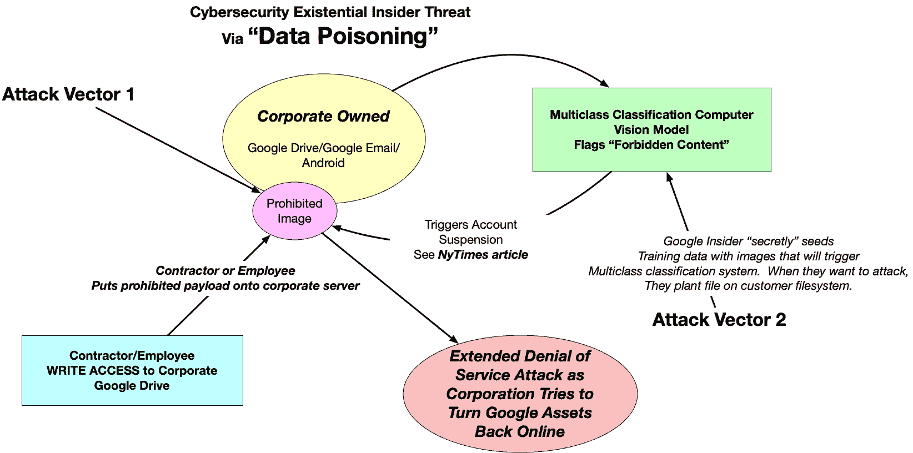

# 推荐引擎

推荐引擎是 MLOps 中一个令人兴奋问题的核心^(2)。一方面，推荐引擎对许多组织而言是“基本门槛”，也是现代机器学习管道中最古老的问题之一。最著名的例子是 Netflix 大奖。最著名的是，它并未 [在生产环境中实现](https://netflixtechblog.com/netflix-recommendations-beyond-the-5-stars-part-1-55838468f429)，即早在 2012 年就出现的一个原始 MLOps 问题。故事的大致内容是，最初 Netflix 在竞赛中优化的是准确性，而非运营复杂性，而我们现在称之为 MLOps。面对“获胜”方案的难度，他们放弃了它，转而采用更易于部署到生产环境的东西。

关键问题在于工程要求过于复杂，且问题框架发生了变化。这些是超越推荐引擎类别的关键问题，对任何 MLOps 问题都至关重要。尽管如此，MLOps 与推荐引擎相关的一些独特问题也值得讨论。让我们深入探讨用户体验、负外部性和启发式方法。

## 推荐引擎用户体验

推荐引擎最重要的一部分可能并非推荐引擎本身，而是围绕它的用户体验。让我们快速看一个使用 [GitHub](https://github.com) 的例子。当本章于 2022 年撰写时，Github Feed 在我的 GitHub 动态中推荐用户关注。虽然许多人喜欢深入研究推荐引擎中涉及的机器学习算法的复杂性，但一个关键的 MLOps 思维问题是用户体验。在 图 9-13 中，Noah 的 GitHub 动态显示了两个推荐用户（用户的姓名已被涂黑以保护隐私）。不过，如果 Noah 想避免关注他们，就会变得有趣起来，也许是因为他不喜欢他们的代码，他已经关注太多人，或出于其他各种原因。


进一步深入用户体验，我们可以进一步深入某个特定用户的控制选项，如 图 9-14 所示（用户名已涂黑以保护隐私）。不过，这些选项仅允许我们屏蔽用户或举报滥用，这些都是与推荐引擎用户体验无关的极端操作。


结果是，想要不断获取新的推荐用户关注的用户会陷入用户体验的黑洞。GitHub 推荐用户体验的挑战在于其无法提供持续的相关用户建议流。希望获得新的关注用户推荐的用户常常发现自己陷入了有问题的 UX 场景。在使用平台时，他们要么完全停止接收推荐，要么接受自己不感兴趣的建议，以确保未来能获得想要的推荐。这种工作流程为寻求有意义连接的平台用户创造了不满意且令人沮丧的体验。

因此，从 MLOps 角度来看，这凸显了推荐中的机器学习部分可能是问题中最不重要的部分。相反，公司可以考虑先使用启发式方法，如流行度或相似度，并构建稳健的用户体验系统和真实数据收集系统。

另一种方法是利用 `docker` 命令的简洁性，正如这篇 [TensorFlow 推荐系统示例所示](https://www.tensorflow.org/resources/recommendation-systems)，它运行在 [MLOps 模板 GPU 启用仓库](https://github.com/nogibjj/mlops-template) 中：

```
# Deploy the retrieval model with TensorFlow Serving
docker run -t --rm -p 8501:8501 \
  -v "RETRIEVAL/MODEL/PATH:/models/retrieval" \
  -e MODEL_NAME=retrieval tensorflow/serving &

# Retrieve top movies that user 42 may like
curl -X POST -H "Content-Type: application/json" \
  -d '{"instances":["42"]}'  \
  http://localhost:8501/v1/models/retrieval:predict

# Output
# {
#    "predictions":[
#       {
#          "output_1": [2.032, 1.969, 1.813],
#          "output_2": ["movie1”, “movie2”, “movie3”]
#       }
#    ]
# }

# Deploy the ranking model with TensorFlow Serving
docker run -t --rm -p 8501:8501 \
  -v "RANKING/MODEL/PATH:/models/ranking" \
  -e MODEL_NAME=ranking tensorflow/serving &

# Get the prediction score for user 42 and movie 3
curl -X POST -H "Content-Type: application/json" \
  -d '{"instances":[{"user_id":"42", "movie_title":"movie3"}]}' \
  http://localhost:8501/v1/models/ranking:predict

# Output:
# {"predictions": [[3.66357923]]}
```

# 放弃笔记本

随着 MLOps 的成熟，很明显环境正在为 MLOPs 而演进。在云计算中，拥有数据中心的公司通常会进行“迁移和提升”，（将相同的架构从数据中心迁移到云端，而不优化服务器 less 等新的云优势）。这些组织的缺点是它们没有使用新范式，而是将旧模式强加于新能力。

同样，对于学术工作流程而言，一个使用不稳定安装工具的单体 Juypter Notebook，运行在某人桌下的一台功能强大的工作站上，在你想要部署此实验之前似乎很有意义。在 图 9-15 中，注意典型的学术工作流程将 Jupyter Notebooks 用作数据科学工作流程的核心。该工作流程在移植到云环境时涉及重量级虚拟机和有限的软件工程最佳实践。软件安装还使用针对实验性工作流程优化的工具，这些工具可能难以重现。

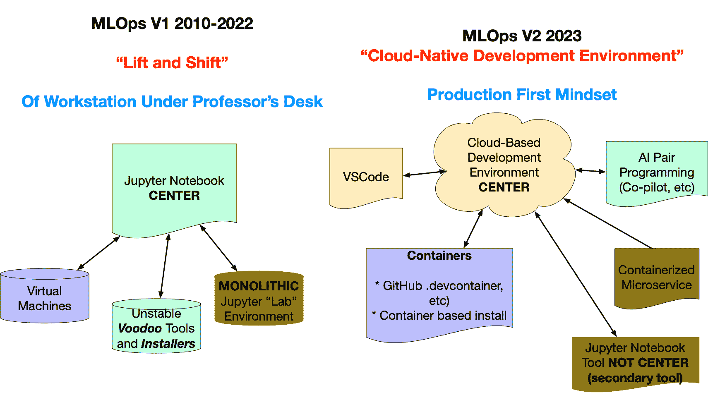

另一个新兴场景是使用以现代工具为中心的云原生产品。不是 Jupyter Notebook 成为 MLOps 项目的起点，传统的软件工程工具处于核心位置。生产优先的心态意味着理想情况下，开发环境与生产环境的配置几乎相同。GitHub 生态系统是这一实践的绝佳例子。让我们接下来看看 MLOPs 的这一演进工作流程。

## 基于云的开发环境与 GitHub 生态系统

采用云开发优先方法进行开发的更优雅的方面之一是 MLOps 反馈循环变得更高效的方式。如果查看 图 9-16，请注意 AI 结对编程与传统 DevOps 工作流程相结合可创建增强的反馈循环，因为 AI 结对编程助手提供的建议通过 linting 和测试而质量提升。此外，本地容器化开发环境允许轻松过渡到云部署，因为本地环境与生产环境匹配。

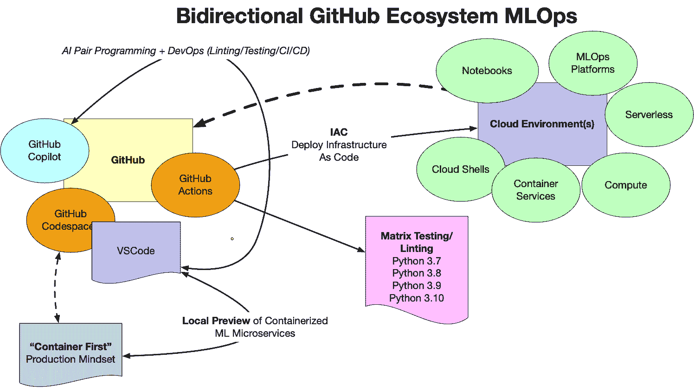

组织需要自问的是，如何创造一种生产优先的心态，使开发环境尽可能接近生产环境。立即这个问题否定了以 Notebook 为中心的工作流程作为核心，因为软件工程生命周期中的许多重要部分都不复存在。你无法合理地在 Notebook 内构建容器；你需要用编辑器编辑 `Dockerfile`。同样，Notebooks 不适用于 linting 和测试或基础设施即代码，即只有一些技巧，其效果不如具有 linting、测试、格式化和代码补全的传统源代码文件。

实现 AI 结对编程工作流程的一种推荐选项显示在 图 9-17 中。注意“DevOps in the Loop”如何拦截来自代码推荐的输入，然后通过应用 DevOps 最佳实践来增强原始建议。

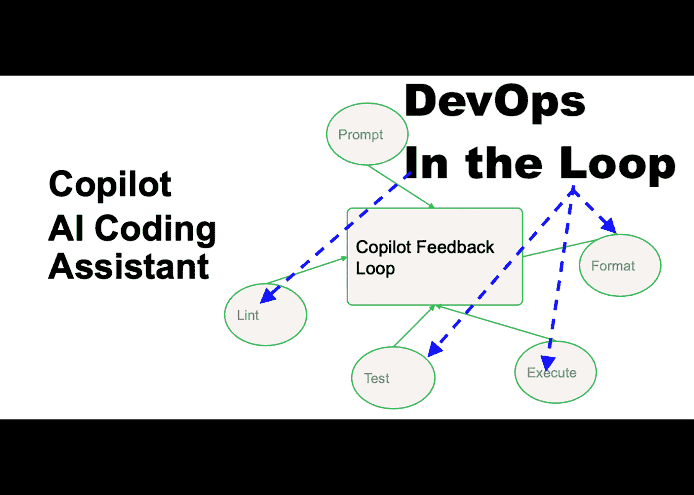

### 注意

你可以在 [YouTube 在此](https://www.youtube.com/watch?v=lbm9ckutS3k) 和 [O’Reilly 在此](https://learning.oreilly.com/videos/python-for-devops/12012022VIDEOPAIML/) 观看演示此迭代过程的 Python for DevOps 2023 直播编码会话。

此过程在 图 9-18 中以生产优先配置进一步说明。使用像 [GitHub Codespaces](https://github.com/nogibjj/mlops-template/actions/workflows/codespaces/create_codespaces_prebuilds) 这样的环境，你可以创建一个模仿生产环境的 [`Dockerfile`](https://github.com/nogibjj/mlops-template/blob/GPU/.devcontainer/Dockerfile)。通过 `.devcontainer` 启用了 Visual Studio Code 插件，例如 GitHub Copilot。

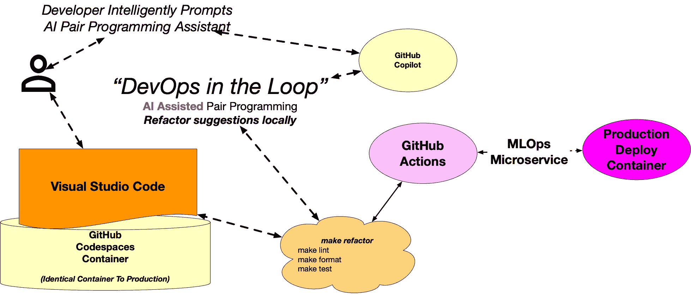

以下内容大致等同于 [MLOps 模板中的](https://github.com/nogibjj/mlops-template/tree/GPU/.devcontainer) `Dockerfile`。请注意，仅包含 Python 标准库工具 `virtualenv` 和 `pip`，以及一些 Ubuntu 包。这种方法允许在无需第三方安装工具的情况下，为未来的生产部署提供稳健且直接的工作流程：

```
FROM mcr.microsoft.com/vscode/devcontainers/universal:2-focal

RUN apt-get update && apt-get -y install --no-install-recommends \
   ffmpeg \
   python3.8-venv \
   gcc \
   pciutils

RUN apt-get update \
&& apt-get install -y nvidia-docker2 \
&& systemctl restart docker

#create global virtual environment
ARG USER="codespace"
ARG VENV_PATH="/home/${USER}/venv"
COPY requirements.txt /tmp/
COPY Makefile /tmp/
RUN su $USER -c "/usr/bin/python3 -m venv /home/${USER}/venv" \
   && su $USER -c "${VENV_PATH}/bin/pip \
 	--disable-pip-version-check \
	--no-cache-dir install -r /tmp/requirements.txt" \
   && rm -rf /tmp/requirements.txt
```

另外两个值得注意的项目是 `devcontainer.json` [在此找到](https://github.com/nogibjj/mlops-template/blob/GPU/.devcontainer/devcontainer.json) 和一个设置脚本。`devcontainer.json` 的以下子部分展示了安装后，最终的 [`setup.sh`](https://raw.githubusercontent.com/nogibjj/mlops-template/GPU/setup.sh) 如何启用 virtualenv：

```
 "postCreateCommand": "bash setup.sh"
	}
```


```
#!/usr/bin/env bash
source /home/codespace/venv/bin/activate
#append it to bash so every shell launches with it
echo 'source /home/codespace/venv/bin/activate' >> ~/.bashrc
```

这个工作流程的奇妙之处之一是它使得运行 GPU 容器和 GPU 项目成为可能。图 9-19 显示了 TensorFlow Docker 容器在 GitHub Codespaces 中使用 GPU 运行。

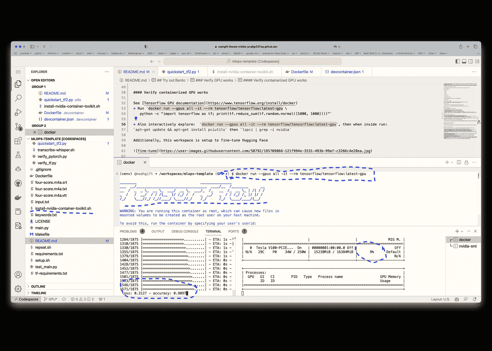

你可以阅读更多关于 [TensorFlow GPU 文档](https://www.tensorflow.org/install/docker)。几点需要指出，包括以下命令：

* 运行 `docker run --gpus all -it --rm tensorflow/tensorflow:latest-gpu \ python -c "import tensorflow as tf; print(tf.reduce_sum(tf.random.normal([1000, 1000])))"`
* 还可以交互式探索：`docker run --gpus all -it --rm tensorflow/tensorflow:latest-gpu`，然后在容器内部运行：`apt-get update && apt-get install pciutils` 然后 `lspci | grep -i nvidia`
* 将代码挂载到容器中：`docker run --gpus all -it --rm -v $(pwd):/tmp tensorflow/tensorflow:latest-gpu /bin/bash`。然后执行 `apt-get install -y git && cd /tmp`。然后你只需运行 `make install`。现在你可以通过执行 `python utils/quickstart_tf2.py` 来验证你是否可以训练深度学习模型

# 弥合与笔记本的差距

(*客座作者：andrew cui* 来自 Linea)

摆脱 MLOps 周期中笔记本的另一种策略是弥合单体 Jupyter Notebook 与云原生开发环境之间的差距。数据科学工作流程的中心不应是 Notebook，而应作为通往 MLOps 开发生态系统其余部分的网关。

这种类型的工作流程已在 图 9-15 中通过 Notebook 作为次要工具进行了说明。然而，即使在云原生开发环境中使用笔记本作为次要工具，也会带来许多在以笔记本为中心的开发环境中将笔记本产品化时“迁移并扩展”范式所面临的旧挑战。

## 使用笔记本的问题：Linea 可以提供帮助

使用笔记本作为 MLOps 为中心的开发环境中的次要工具时，尝试将工作从 Notebook 转移到其他 MLOps 工具会带来许多重大挑战。数据科学和工程团队面临许多常见问题，包括：

* *依赖管理与工具链设置*：将开发环境与生产环境使用相同的依赖项和工具链设置会带来许多麻烦。此过程在尝试将组件和管道推广到生产环境中运行时可能会导致问题，因为它们会因缺少依赖项或缺少工具而失败。
* *可复用代码组件的管理与组织*：在 MLOps 实践不佳的低效组织中，一个常见主题是需要更轻松地共享代码模块，从而导致重复代码泛滥，代码管理却很少。此过程使得从运维角度识别这些可复用组件变得更加困难，以便对其应用良好的运维实践，包括审查、测试和部署其代码。
* *代码恢复与清理*：在许多组织中，受任务将笔记本投入生产的工程师会被给予混乱且难以阅读的笔记本，进一步加剧了上述问题。弄清楚哪些单元格对主要数据流不是必需的是复杂的，而仅从笔记本中查找可能位于已删除分区中的代码或执行顺序错误的代码几乎是不可能的。

## Linea 的作用

[Linea](https://linea.ai/) 是一个专注于解决这些问题的工具，定位在 Jupyter Notebook 之间，并将其连接到云开发环境中所有其他基本 MLOps 工具。此步骤允许轻松地将 Jupyter Notebook 集成到基于云的开发环境中，同时避免使用 Jupyter Notebook 相关的许多问题。

图 图 9-18 说明了这些新工具所在的位置以及它们可以提供的好处。

Linea 可以通过捕获和理解 Notebook 的执行情况，帮助完成许多复杂且难以解决的自动弥合差距的任务。Linea 使用对用户所运行内容的语义理解来提供面向运维的组织所需的特性，并直接解决使用笔记本作为次要工具时的问题。

## 解决方案：依赖管理

Linea 提供的一项基本功能是自动创建将 Notebook 中运行的函数容器化的 docker 文件。将工作负载容器化是良好 MLOps 实践的核心。对于扩展数据组织的能力和避免依赖不匹配或工具链管理带来的昂贵问题至关重要。

Linea 可以自动处理依赖解析，创建 Dockerfile 来规范安装运行其有效负载所需的最小依赖项和工具。此步骤至关重要，因为数据科学家在其笔记本中导入大量依赖项，导致出现“厨房水槽”式的依赖项，包含他们曾经需要使用过的所有库和工具。

通过识别最小的依赖集，Linea 使设置和部署容器化工作负载变得更容易，并提高了这些工作负载的可靠性。

以下是示例，说明其有多么简单和 [`https://docs.lineapy.org/en/latest/guide/build\_pipelines/pipeline\_basics.xhtml?highlight=dockerfile#output-files`](https://docs.lineapy.org/en/latest/guide/build_pipelines/pipeline_basics.xhtml?highlight=dockerfile#output-files) \[可以自动完成\]。

## 解决方案：识别和使用可复用组件

良好 MLOps 实践的另一个关键支柱是能够将代码视为代码并使用适当的工具来管理它。如前所述，GitHub 生态系统对于管理代码也至关重要。然而，在将笔记本带入 GitHub 生态系统时，识别笔记本中的代码片段会出现问题。

幸运的是，Linea 可以捕获用户在笔记本环境中运行内容的语义，并建议高价值的可复用组件，这些组件被许多人共享和使用，以便添加到 GitHub 生态系统中并进行维护。标准可复用组件的示例包括用于将关键且常用的数据集转换为组织其余库使用的格式的提取转换加载 ETL 组件，或许还有一个模型训练循环，可获取访问组织中 GPU 资源所需的凭据。

一旦这些可复用组件置于 Github 生态系统的管理之下，它们就可以进行版本控制、编辑和开发，同时牢记良好的 MLOps 实践，完全避免了在 Jupyter 环境中管理关键代码的陷阱。

## 解决方案：从笔记本中清理代码

良好的干净代码是良好 DevOps 实践的标志，MLOps 也是如此。干净的代码已被很好地分解为函数并移除了不必要的代码，对于理解并将工作从笔记本转移到采用生产优先思维方式工作的其他 MLOps 工具至关重要。


Jupyter notebook 倾向于变得杂乱且维护不善的代码，并且需要大量手动清理工作。Linea 可以检测执行顺序错误或单元格删除，这通常会使笔记本变得杂乱且难以阅读和复现。Linea 在开发 Jupyter notebook 环境中提供的代码捕获功能可用于理解所需的工作流程并生成干净的最小可复现代码集，然后可以将该代码带入并用于其余的 [*https://github.com/LineaLabs/lineapy#use-case-1-cleaning-messy-notebooks*](https://github.com/LineaLabs/lineapy#use-case-1-cleaning-messy-notebooks) \[基于云的开发环境\]。

Linea 存在于弥合笔记本与云端开发或生产环境中所有工具之间的差距的领域，提供令人兴奋且具有巨大潜力的新功能。Linea 解决了数据从业者在尝试遵循良好的 MLOps 实践时面临的许多最具挑战性的问题。在此过程中，任何希望建立并灌输坚实的以生产为先的 MLOps 文化的组织都可以找到具有巨大潜力将组织提升到下一个水平的特性和技术。

## 摘要
本章的精神在于强调云端开发环境如何实现对生产的更接近逼近。令人反直觉的是，学术工具和工作流程在实现运营化时可能需要大量工作。GitHub Codespaces 的容器化开发环境展示了一种新兴的开发风格，带来了新的生产力提升，包括使用 AI 结对编程工具以及预训练模型。

来自 OpenAI、Hugging Face 和其他机构的预训练模型会流入用于开发 AI 软件的工具中，例如 Visual Studio Code。从本质上讲，存在一个递归反馈循环，其中 AI 工具和 AI 预训练模型的最新进展能够带来更好的 AI 解决方案。本章演示了如何在你的工作中使用这些令人兴奋的工作流程。浏览以下练习和批判性思维挑战，以将你所学的内容提升到下一个水平。

本章还为许多数据科学问题奠定了基础。一种能够解决性能、可复现性、管理性和安全性方面的解决方案是 Rust 语言。在下一章中，Rust for MLOps 被提出为 MLOps 的一种潜在的新兴解决方案。

## 练习
* 使用在 GitHub Codespaces 中开发的本地下载并版本化的模型构建 Hugging Face 命令行工具。你可以参考这个 [用于想法的示例 GitHub 项目](https://github.com/nogibjj/Coursera-MLOps-C2-Final-HuggingFace)。
* 查看此 [MLOps 模板](https://github.com/nogibjj/mlops-template) GitHub 仓库中的配置。Fork 它并制作你自己的自定义 GitHub 模板，以部署使用 GPU 和预训练模型并部署到云环境的容器化微服务。
* 使用 [此示例演练](https://codelabs.developers.google.com/tfrecommenders-flutter#0) 构建 Tensorflow 推荐系统。
* 使用此 [作为起点的示例](https://github.com/nogibjj/mlops-template/blob/GPU/hugging-face/zero_shot_classification.py) 构建一个执行零样本分类的命令行工具。
* 使用 [作为起点的 MLOps 模板](https://github.com/nogibjj/mlops-template) 运行像 MLRun 或 Bento 这样的基于 Kubernetes 的实验跟踪服务。

## 批判性思维讨论问题
使用以下问题进一步思考本章讨论的话题。
* 为什么面向 MLOps 的基于笔记本的工作流程与面向数据科学的工作流程相比会产生新的挑战？
* 为什么在 MLOPs 工作流程中使用尽可能少的工具可能是有帮助的，例如仅使用标准库工具 [`pip`](https://pip.pypa.io/en/stable/) 和 [`venv`](https://docs.python.org/3/library/venv.xhtml) 以及 [`Docker`](https://www.docker.com/)？
* AI 结对编程工作流程如何增强 MLOPs 的生产力生命周期？
* DevOps 的核心原则是什么，以及如何测试它们以确保它们已成功实施，作为进行 MLOps 的前提条件？
* 为什么在使用如下命令的容器中使用 GPU 可能具有显著优势：`docker run --gpus all -it --rm tensorflow/tensorflow:latest-gpu \ python -c "import tensorflow as tf; print(tf.reduce_sum(tf.random.normal([1000, 1000])))"`

^(1) 近期 [在《纽约时报》报道的示例](https://www.nytimes.com/2022/08/21/technology/google-surveillance-toddler-photo.xhtml) 解释了 AI 系统可能产生具有毁灭性后果的误报。

^(2) 在播客 [“未来有多重要"'](https://www.samharris.org/podcasts/making-sense-episodes/292-how-much-does-the-future-matter) 中，William MacAskill 提出，大多数高级机器学习研究人员认为“未来二十年内 AI 在你一生中导致死亡或剥夺权力的几率为 2.5%。这一统计数据比你在车祸中死亡的几率更显著。”一个关键问题是推荐引擎是否属于此类容易导致灾难性风险的 AI
