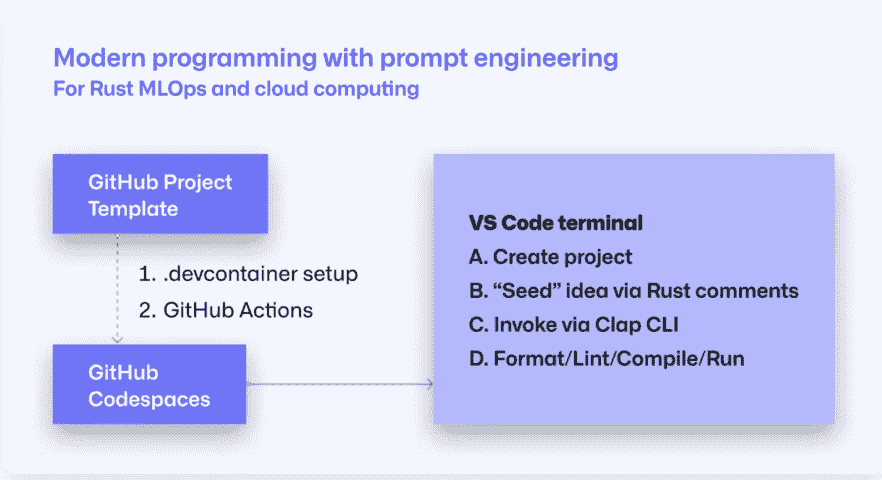
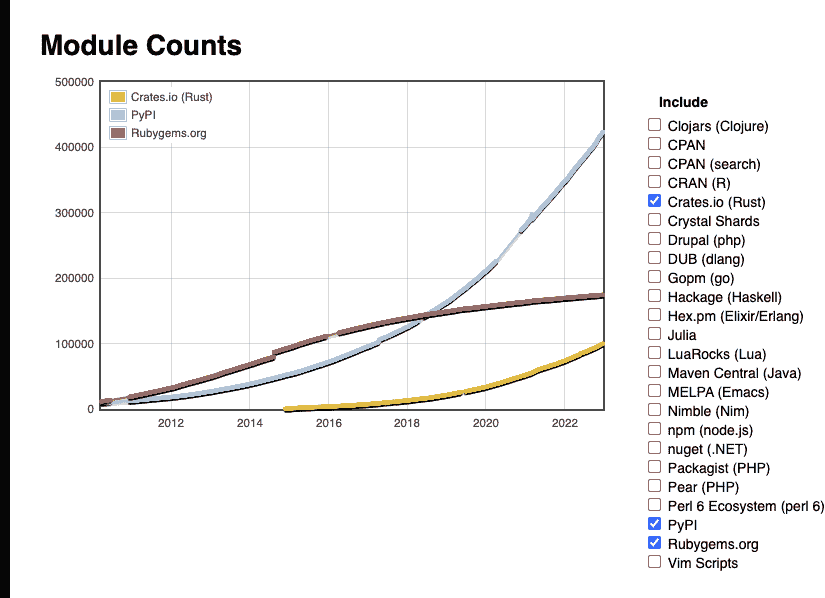
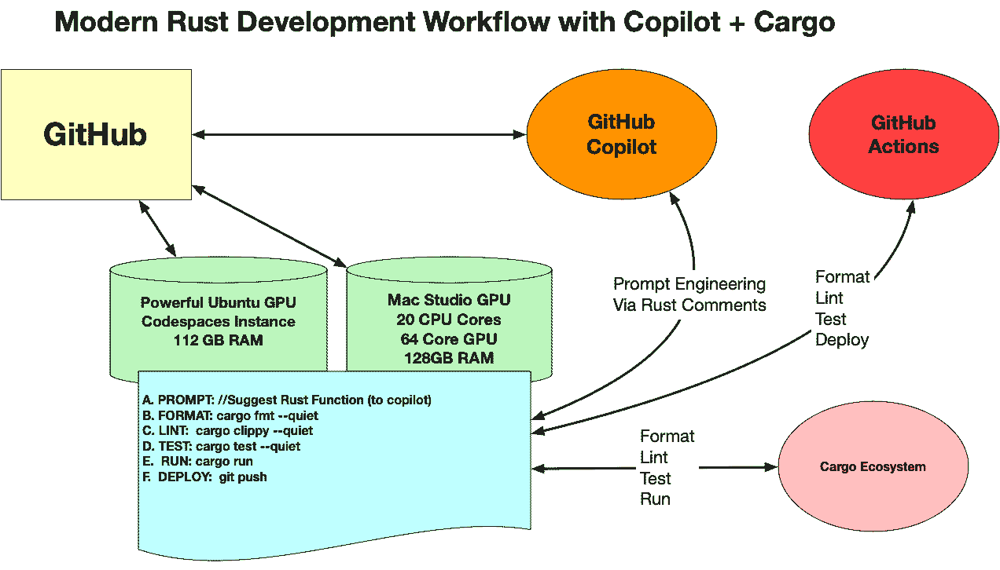
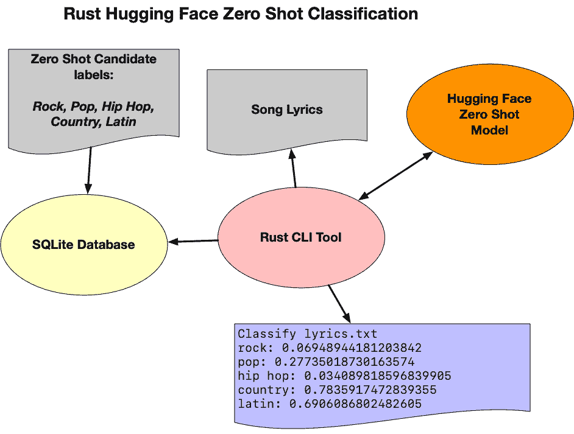
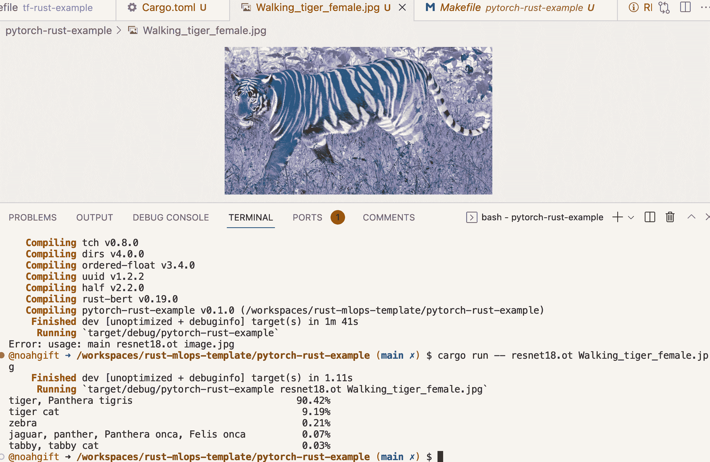
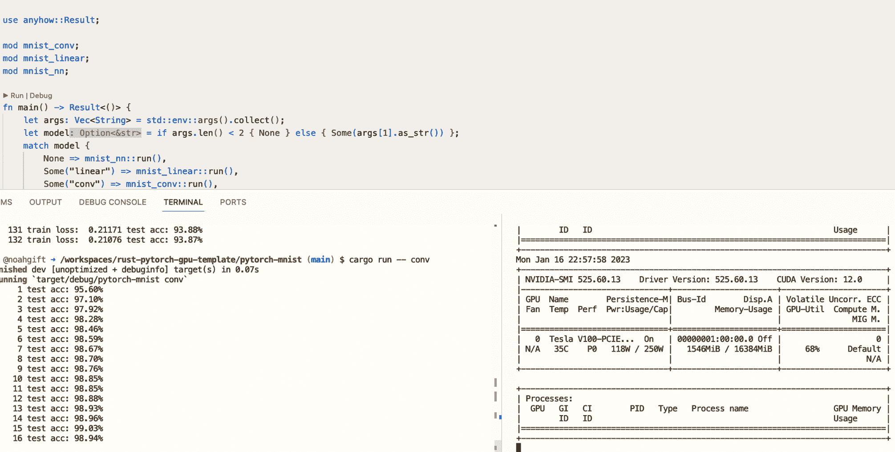
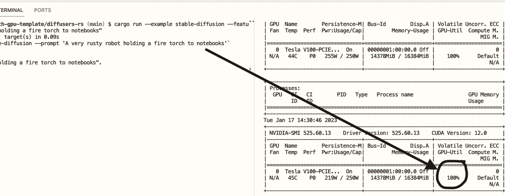
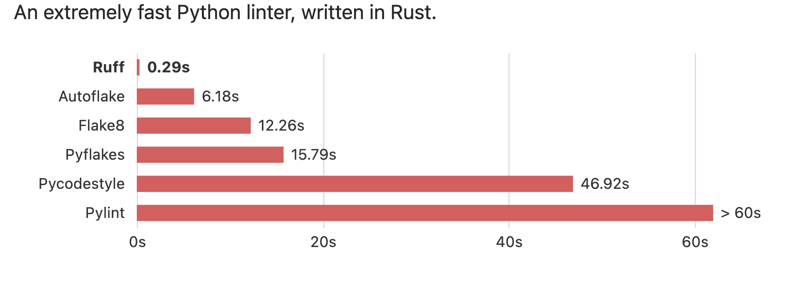

# 第 10 章 使用 Rust 实现 MLOps
运营效率必须是任何技术系统的核心。MLOps 建立在 DevOps 之上，而 DevOps 建立在 *kaizen* 的概念之上，*kaizen* 是指持续改进的日语词汇。没有持续改进，就不会有 DevOps，也就不会有 MLOps。

持续改进运营的核心是一个简单的问题：“我们能否将运营性能——从训练和推理到打包和交付——提高十倍或更多？”如果答案是肯定的，就像许多使用 Python 进行数据科学的组织一样，下一个问题应该是：“我们为什么不这样做？”

几十年来，组织在机器学习解决方案方面除了纯 C 或 C++ 和 Python 外几乎没有其他选择。C++ 在性能方面可能提供更高的效率，但 Python 通常更容易学习、实现和维护，这就是为什么 Python 在数据科学中蓬勃发展。性能高但复杂的 C++ 与易于学习但相对较慢的 Python 之间的艰难选择最终导致许多公司选择 Python。

但还有另一种方式。Rust 一直位列 [性能最高且节能效率最高的语言](https://greenlab.di.uminho.pt/wp-content/uploads/2017/10/sleFinal.pdf) 之一。它也是 [StackOverflow 年度开发者调查](https://survey.stackoverflow.co/2022/) 中最受喜爱的语言之一。尽管数据科学中广泛使用的一些 Python 库是用 C 编写的，可以提供运行编译语言的一些性能优势，但 Rust 在使用单一语言的同时提供了更直接通往裸机的途径。

Rust 也比 C 或 C++ 更容易学习和使用，这使其成为想要编译语言性能的人的现实解决方案。当使用 [GitHub Copilot](https://github.com/features/copilot) 时尤其如此。这个 AI 驱动的结对编程助手使用 OpenAI Codex 在开发者编码时实时为其建议代码和整个函数。让我们接下来讨论这一策略。

### 注
短语 *AI 驱动的结对编程助手* 指的是对经典结对编程风格的改进，在经典风格中你坐在另一位开发者旁边一起编写代码。随着 [GitHub Copilot X](https://github.blog/2023-03-22-github-copilot-x-the-ai-powered-developer-experience/) 等新兴开发者工具的出现，你可以与编码助手聊天以获取有关编码项目的想法，同时在你输入时获得编码建议。

## Rust 用于 MLOps 的案例


GitHub Copilot 是开发者工作方式中的一场革命性新变革。GitHub Copilot 以及类似的工具是游戏规则改变者，因为它们最大程度地减少了语法对生产力的影响。使用 Rust，你会花费更多时间编译代码，这是一种对未来回报的投资，就像为退休账户储蓄一样。Rust 具有出色的性能和安全性，但语法可能具有挑战性。有了 GitHub Copilot，语法就不再是问题，因为建议消除了编程中的许多困难。此外，由于 Rust 工具链在代码检查、格式化和编译方面的健壮性，GitHub Copilot 的任何错误或误开始都会被这些工具捕获，使得 Rust 与 GitHub Copilot 的结合成为 AI 辅助编程中的新兴领先者。

### 备注

除了性能之外，考虑 Rust 还有几个原因。Rust 是一种现代语言，最早出现在 2010 年。它没有老语言所携带的包袱，但已经足够成熟，我们可以放心它在不久的将来不会消失。此外，其他趋势也在支持对 Rust 进行深入审视。

Rust 从零开始设计，以支持现代计算能力，例如多核线程，而这些能力在 Python 等老语言中通常是“事后添加”的。通过从一开始就设计语言以支持这些功能，Rust 可以避免许多其他语言中的笨拙。Rust 中多核线程有多简单的一个绝佳例子是来自 [Rust rayon 库](https://docs.rs/rayon/latest/rayon/iter/index.xhtml) 的以下代码片段：

```
    use rayon::prelude::*;
    fn sum_of_squares(input: &[i32]) -> i32 {
        input.par_iter()
             .map(|i| i * i)
             .sum()
    }
```

代码中没有任何花招或技巧；线程在所有机器核心上“只需工作”，代码的可读性与 Python 一样。

同样，Rust 原生支持类型，因此整个工具链，从代码检查器到编辑器再到编译器，都可以利用这一能力。Rust 也让打包变得轻而易举。Cargo 提供了 Python 风格的“一种显而易见的方式”来安装包。

当然，Python 在某些方面仍然表现出色。它在 API 文档和整体可读性方面非常出色。如果你需要尝试一个想法，很难超越在交互式提示中使用 Python，例如 [IPython](https://ipython.org/)，来探索概念。但 MLOps 对性能要求比其他数据科学领域更敏感，并且在很大程度上依赖于有利于 Rust 实现的软件工程最佳实践。一种名为 [Mojo](https://github.com/modularml/mojo) 的 Python 超集可能会很快解决许多性能和部署问题，但它仍在开发中，而 Rust 现在就可以使用。

使用 Rust 的一个常见反对意见是，与 Python 用于数据工作相比，它的生态系统没有那么大和成熟。但请记住，这个生态系统不一定最适合 MLOps 的需求。特别是，我称之为 #jcpennys（Jupyter、Conda、Pandas、Numpy、Sklearn）的技术栈直接来自学术界，重量级，并且针对小数据使用进行了优化。在学术界，“上帝环境”将所有东西集中在一处有很多可取之处。但在现实世界的生产 MLOps 中，你不想要额外的包或难以测试的脆弱工具，比如笔记本。与此同时，Rust 生态系统正在增长。例如，[Polars](https://www.pola.rs/) 是一个性能出色的数据帧库，正在席卷数据领域。

## 使用 Rust、GitHub Copilot 和 Codespaces 提升水平

接下来，看看如何使用 GitHub 生态系统提升到更强大的 Rust 语言 图 10-1。提示工程发生在你在步骤 B 中要求 GitHub Copilot 生成代码时；然后你测试 CLI 的想法以确保其有效，并使用一系列 Makefile 命令清理任何建议。



所有 Rust 项目都可以遵循此模式：

1. 使用 [Rust 新项目模板](https://github.com/noahgift/rust-new-project-template) 创建一个新的仓库。
2. 接下来，创建一个新的 [代码空间](https://github.com/features/codespaces) 并使用它。
3. 使用 `main.rs` 调用处理 CLI，并使用 `lib.rs` 处理逻辑，并在 `Cargo.toml` 中导入 `clap`，如本项目所示。
4. 使用 `cargo init --name 'hello'` 或你想要为项目命名的任何名称。
5. 将你的“想法”作为注释放在 Rust 中以引导 GitHub Copilot，即添加如下所示的注释：`//build an add function`
6. 运行 `make format` 即 `cargo format`
7. 运行 `make lint` 即 `cargo clippy --quiet`
8. 运行项目：`cargo run -- --help`
9. 推送你的更改以允许 GitHub Actions 执行：`format` 检查、`lint` 检查以及二进制部署等其他操作。

### 备注

你可以在这里观看展示此工作流程的两个视频。- [视频的直接链接](https://www.youtube.com/watch?v=U_qyJZfiMLo) - [视频中的仓库的直接链接](https://github.com/nogibjj/hello-rust-template-example)。

这是一个 [示例仓库](https://github.com/nogibjj/hello-rust)。对于新的 Rust 项目，以下模式是一个良好的起点：

运行方式：`cargo run -- marco --name "Marco"` 请注意在 `Cargo.toml` 中使用项目的 `name` 来调用 `lib.rs`，如下所示：

```
[package]
name = "hello"
```

例如，查看名称 `hello` 与 `marco_polo` 一起被调用，后者位于 `lib.rs` 代码中：

```
/* A Marco Polo game. */

/* Accepts a string with a name.
If the name is "Marco", returns "Polo".
If the name is "any other value", it returns "Marco".
*/
pub fn marco_polo(name: &str) -> String {
    if name == "Marco" {
        "Polo".to_string()
    } else {
        "Marco".to_string()
    }
}
```

`main.rs` 代码：

```
fn main() {
    let args = Cli::parse();
    match args.command {
        Some(Commands::Marco { name }) => {
            println!("{}", hello::marco_polo(&name));
        }
        None => println!("No command was used"),
    }
}
```

这种风格是一种新兴模式，非常适合 Rust 的系统编程，因为某些组合会导致进一步的进步。例如，钢是铁和碳的复合物，形成了一种比铁更强更硬的新物质。同样，GitHub Copilot 的建议、像 Rust 这样的下一代编译语言及其格式化、代码检查和打包工具生态系统，可以带来比 Python 更强大的软件开发体验。

让我们考虑 Rust 可能为 MLOps 世界带来的一些潜在好处：

* *性能*: Rust 具有非常高效的内存模型且没有垃圾回收器，这可以显著提高 MLOps 管道的速度。这种能力对于快速处理大量数据的 MLOps 任务至关重要。
* *并发*: Rust 的内存安全保证使安全并发成为可能，使你能够快速利用多核来加速处理任务。
* *互操作性*: Rust 与 C 具有出色的互操作性，可以直接调用 C 库。这种能力可以让 MLOps 开发者利用现有的 C 库进行数值计算和机器学习任务。
* *安全性*: Rust 强调内存和类型安全，可以带来更安全的应用程序。这一过程对于安全至关重要的 MLOps 任务至关重要，例如医疗保健或金融。
* *健壮性*: Rust 的编译时错误检查可以在代码运行前捕获许多错误。这一过程可以带来更健壮的 MLOps 管道，减少运行时错误。
* *开发者生产力*: Rust 的学习曲线比 Python 更陡峭，因此像 GitHub Copilot 这样的工具可以帮助你更快、更轻松地编写 Rust 代码。

当然，Rust 不是万能药，Python 将继续在 MLOps 中发挥重要作用。然而，对于需要 Rust 提供的性能、安全性和健壮性的 MLOps 任务而言，Rust 是一个值得考虑的选择。


Another bolt-on problem with Python is the packaging. Even though the Python standard library includes two tools that make it relatively straightforward to install packages in [`pip`](https://pip.pypa.io/en/stable/) and [`virtualenv`](https://virtualenv.pypa.io/en/latest/) as I [demonstrate in a Python MLOPs repository](https://github.com/nogibjj/mlops-template), there is an explosion of tools to handle “edge cases.” Ironically, the [Python 之禅](https://peps.python.org/pep-0020/), actually cautioned against this decades ago in the statement, “There should be one-- and preferably only one --obvious way to do it”. Python means *except packaging*, which has an almost exponential way of doing things. Additionally, distributing a binary command-line tool efficiently in Python is non-trivial since this capability is not part of the language; this is different from a default workflow included in the language, like it is with Rust or Go. An excellent example of good binary tool distribution is the [Hugo 框架](https://gohugo.io/) written in Go. One reason it is so popular is it is easy to install.

These critiques of Python don’t mean it is an imperfect solution to what it excels at; it just isn’t *the* solution to every single problem. Python is fantastic for API documentation and readability in general. If you need to try out an idea, it is hard to beat using Python in an interactive prompt, like [`IPython`](https://ipython.org/), to explore a concept. It struggles with packaging, performance, and language safety, all things Rust excels at doing. This strength is why Rust is an ideal language for enterprise MLOps.

What could be the alternative for MLOps if there is a better solution than academic “data science” tools?

* Is there a more performant Data Frame library? (Rust has [`Polars`](https://www.pola.rs/)).
* Why not have a [编译器来优化代码](https://rustc-dev-guide.rust-lang.org/overview.xhtml)?
* Why not have a simple packaging solution with “one way to install” (Rust has [`Cargo`](https://doc.rust-lang.org/cargo/))?
* Why not have a breakneck computational speed for ML ([某些基准测试显示速度提升 25 倍](https://www.secondstate.io/articles/performance-rust-wasm/))?
* Why not be able to write both for the [Linux Kernel](https://thenewstack.io/rust-in-the-linux-kernel/) and general-purpose scripting?
* Why not see if there is a better solution than Python (which is essentially two languages scientific python and regular Python)?
* Python is more or less the least green language in energy efficiency, and Rust is more or less the best. With the rise of machine learning, it is important to consider carbon footprint and sustainability goals.

### Note

O’Reilly has several fantastic books on or involving Rust worth referring to if you want to dive deeper into Rust. These include the following books:

* [`Command-Line Rust`](https://learning.oreilly.com/library/view/command-line-rust/9781098109424/)
* [`Programming Rust, 2nd Edition`](https://learning.oreilly.com/library/view/programming-rust-2nd/9781492052586/)
* [`WebAssembly: The Definitive Guide`](https://learning.oreilly.com/library/view/webassembly-the-definitive/9781492089834/) (包含 Rust WebAssembly 示例)。

Two GitHub repositories you might look at are [简要 Rust 教程](https://github.com/nogibjj/rust-tutorial) and [Rust MLOps 模板](https://github.com/nogibjj/rust-mlops-template). With the case for Rust made theoretically, let’s dive into the details in more detail next.

## In The Beginning Was the Command-Line

What could MLOps and data science look like in the near future and beyond without Jupyter Notebook and complex install tools as the center of the universe? It could be the command line. Initially, it was the command line at the beginning of computing in the 1970s and 1980s, and it may be the best solution for the domain of MLOps.

Science fiction author Neal Stephensen wrote an essay in 1999 called “In the Beginning …​Was the Command Line”. The following snippet highest his thoughts at the time on the emergence of GUI-based systems: “What would the engineer say after you had explained your problem and enumerated all the dissatisfactions in your life? He would probably tell you that life is a very hard and complicated thing; that no interface can change that; that anyone who believes otherwise is a sucker; and that if you don’t like having choices made for you, you should start making your own.”

Similarly, with the constantly evolving domain of MLOPs, it is easy to get caught in the trap of thinking of a notebook-based workflow alone as the solution to every problem. In a recent seminar where Noah discussed MLOps and some of the drawbacks of notebooks, one data scientist “cutting and pasting” code from a notebook to a script file. Back in the early days of web development in the 1990s, the concept of cut-and-paste coding debunked itself as an anti-pattern, and here in 2023, there are advocates for it in MLOps with a straight face!

Ultimately the flexibility of command-line interfaces, coupled with systems programming approaches like those with C, C++, Go, and Rust, are too valuable to ignore, especially if the language is approachable by a developer that is more familiar with high-level languages. According to a [newstack 文章](https://thenewstack.io/rust-in-the-linux-kernel/) on Rust for the Linux kernel, in April of 2021, a developer Ojeda introduced a Request for Comment (`RFC`) on making Rust a part of Linux. Linus Torvalds, the creator of Linux, said, “Unless something odd happens, it \[Rust\] will make it into 6.1.” (i.e., late 2022 or early 2023). And this happened in 6.1, and Rust has continued updates in each subsequent release.

Similarly, Amazon is active in open-source Rust development via the [`Firecracker`](https://firecracker-microvm.github.io/) project, which is “an open-source virtualization technology.” One example of the power of this technology is a [firecracker demo repo](https://github.com/firecracker-microvm/firecracker-demo), which shows 4000 simultaneous VMs launching. Amazon also has an alpha release of a [Rust SDK on GitHub](https://github.com/awslabs/aws-sdk-rust).

Finally, because of how easy Rust makes command-line tools to distribute, doing MLOPs for the CLI is an optimal use case for Rust. One of the more remarkable examples is the [`diffusers-rs`](https://github.com/LaurentMazare/diffusers-rs) project that invokes Stable Diffusion using Rust and [`libtorch`](https://pytorch.org/get-started/locally/).

```
cargo run --example stable-diffusion --features clap --\
 --prompt "A rusty robot using the command-line terminal and throwing\
away notebooks"
```

The reason solutions like the Stable Diffusion example exist along with bindings for [Rust with PyTorch](https://github.com/LaurentMazare/tch-rs/) is the exponential growth of Rust modules, as shown in Figure 10-2.



Now that the case for Rust for MLOps exists, let’s dive into getting started with Rust itself.

# Getting Started with Rust for MLOps

Rust is one of the more accessible languages from an installation perspective. You run the [`rustup`](https://rustup.rs/) command, and that is all you need to install! Another option is to use GitHub Codespaces as a development environment. One of the advantages of codespaces is that it has a generous free tier and allows for easy customization. You can create a new repository for developing with Rust using the Rust [new project template](https://github.com/noahgift/rust-new-project-template) we made available for this book.

Once you install, check to see if things work by running the following command: `rustc --version`


另一个选项是 [创建 Makefile](https://github.com/noahgift/rust-new-project-template/blob/main/Makefile#L1-L7) 并在其中放入关键命令，例如 `make rust-version`，它会检查 `cargo` 和 `rust` 的版本。你可以看到有多个工具可以帮助你在 Rust 中完成工作：

```
rust-version:
	@echo "Rust command-line utility versions:"
	rustc --version 			#rust compiler
	cargo --version 			#rust package manager
	rustfmt --version			#rust code formatter
	rustup --version			#rust toolchain manager
	clippy-driver --version		#rust linter
```

为了以后在本地运行所有内容，你可以执行 `make all`，它将格式化/检查/测试所有项目 [在此仓库](https://github.com/noahgift/rust-new-project-template/blob/main/Makefile#L24)。

接下来，要构建一个 hello-world 示例，你可以使用内置的 `cargo` 命令。Cargo 是 Rust 生态系统中最重要和最有价值的部分之一。

创建项目目录：`cargo new hello`。`cargo` 命令会创建一个结构，你可以用 `tree hello` 查看：

```
hello/
├── Cargo.toml
└── src
    └── main.rs
1 directory, 2 files
```

`Cargo.toml` 文件是项目配置所在的位置，即如果你需要添加依赖。源代码文件在 `main.rs` 中的内容如下。它看起来像 Python 或其他任何现代语言，并且此函数会打印一条消息。

```
fn main() {
    println!("Hello, world MLOPs!");
}
```

运行项目时，你 `cd` 进入 `hello` 并运行 `cargo run`。输出如下所示：

```
@noahgift > /workspaces/rust-mlops-template/hello (main) $ cargo run
   Compiling hello v0.1.0 (/workspaces/rust-mlops-template/hello)
    Finished dev [unoptimized + debuginfo] target(s) in 0.36s
     Running `target/debug/hello`
Hello, world MLOPs!
```

最后，以无噪音的方式运行：`cargo run --quiet`。如果你想运行生成的二进制文件，以下命令会执行它 `./target/debug/hello`。从 Python 角度来看，这有多么出色非常重要，因为你的代码的二进制分发是免费的。在 Python 中，二进制可执行文件的概念并不是原生 Python 支持的工作流程。相反，要实现相同的可移植可执行文件，最接近的方式需要将 Python 打包到 Docker 工作流程中。

通过这个 hello world 项目可以学到的一大要点是，Rust 生态系统处理了许多复杂的编程部分，即在 Rust [Cargo 包管理器](https://doc.rust-lang.org/cargo/) 内的 linting、测试、格式化和二进制部署。如果 Rust 代码通过 lint 并编译成功，运行时应该就能工作。对于 Python 来说则不能这样说，因为它没有编译器。除了更可靠之外，它还能提供“C-level”速度，同时具有与 Python 相似的可读语法。最后，语言的许多特性，如不可变变量和合理的并发设计，使代码更安全，因为编译器不会编译不安全代码。

还有一个工具可以使 Rust 编程更有效，即在代码创建的初始阶段包含 [GitHub Copilot](https://github.com/features/copilot)，或类似的工具如 [Amazon CodeWhisperer](https://aws.amazon.com/codewhisperer/)。Copilot 与强大的 Cargo 生态系统的协同作用是提高生产力的秘诀，如 图 10-3 所示。



此外，通过在工作流程中包含 [GitHub Actions](https://github.com/features/actions) 的自动化，这些必要的自动化步骤也会作为 CI/CD 的一部分发生。MLOps 的基础是在构建系统上发生的软件工程最佳实践的自动化。这种核心能力使后续的进一步自动化成为可能：

```
name: Rust CI/CD Pipeline
on:
  push:
    branches: [ "main" ]
  pull_request:
    branches: [ "main" ]
env:
  CARGO_TERM_COLOR: always
jobs:
  build:
    runs-on: ubuntu-latest
    steps:
    - uses: actions/checkout@v1
    - uses: actions-rs/toolchain@v1
      with:
          toolchain: stable
          profile: minimal
          components: clippy, rustfmt
          override: true
    - name: update linux
      run: sudo apt update
    - name: update Rust
      run: make install
    - name: Check Rust versions
      run: make rust-version
    - name: Format
      run: make format
    - name: Lint
      run: make lint
    - name: Test
      run: make test
```

`Makefile` 是项目中优秀组件的原因之一是，本地的步骤——安装、linting、格式化和测试——在构建系统上以相同的方式运行。这种方法消除了自动构建软件时可能出现的错误。

这种 Rust 开发风格既新颖，又是开发者生产力的重要进步。借助 GitHub Copilot 和 AWS Codewhisper 等工具，切换到 Rust、C# 或 Go 等更高性能语言会更易于管理。这种新的软件工程形式使 *prompt engineering* 成为软件开发中一个有效且合理的第一阶段。接下来，由 Rust Cargo 工具格式化的代码允许像 Copilot 这样的服务进行“重新审视”，从而可能提高建议的质量。

一旦该阶段完成，Cargo lint 工具 Clippy 会进一步深入代码质量并对其进行增强。最后，运行测试确保业务逻辑正常工作，然后最后一步编译生成最优且安全的代码。

接下来，让我们超越简单的 hello-world 工具，进入 PyTorch 和 Hugging Face。

# 使用 PyTorch 和 Hugging Face 与 Rust

[Hugging Face](https://huggingface.co/) 是一个用于构建大型语言模型（LLM）解决方案的新兴平台，它可与 Rust 和 PyTorch 配合使用。对于此示例，我使用预训练的摘要模型拼凑了一个相当逼真的演示工具类型示例；示例 [项目位于此处](https://github.com/noahgift/rust-mlops-template/tree/main/sqlite-hf)。此演示的总体结构如下。歌曲 Maná 的《En El Muelle De San Blas》的歌词位于 `lyrics.txt` 文件中。

```
├── Cargo.toml
├── Makefile
├── README.md
├── lyrics.txt
└── src
  ├── lib.rs
  └── main.rs

2 directories, 6 files
```

你可以在 图 10-4 中看到总体架构。思路是 Rust 与 SQLite 数据库的性能相结合，而 Hugging Face 则是使用预训练 LLM 分析歌词的可重复模式。



自然语言处理（NLP）中的一个常见问题是构建分析文本的解决方案。以下示例展示了如何制作一个可重复、高效且安全的解决方案来分析歌词。


```
use rust_bert::pipelines::sequence_classification::Label;
use rust_bert::pipelines::zero_shot_classification::ZeroShotClassificationModel;
use std::fs::File;
use std::io::BufRead;
use std::io::BufReader;

fn create_db() -> sqlite::Connection {
    let db = sqlite::open(":memory:").unwrap();
    db.execute(
        "CREATE TABLE zeroshotcandidates (id INTEGER PRIMARY KEY, label TEXT)",
    )
    .unwrap();
    ["rock", "pop", "hip hop", "country", "latin"].iter().for_each(|&x| {
        db.execute(&format!("INSERT INTO zeroshotcandidates (label) VALUES ('{}')", x))
            .unwrap();
    });
    db
}

pub fn get_all_zeroshotcandidates() -> Vec<String> {
    let db = create_db();
    let mut candidates: Vec<String> = Vec::new();
    db.iterate("SELECT label FROM zeroshotcandidates", |pairs| {
        for &(_column, value) in pairs.iter() {
            candidates.push(value.unwrap().to_string());
        }
        true
    })
    .unwrap();
    candidates
}

pub fn read_lyrics(file: &str) -> Vec<String> {
    let mut lyrics: Vec<String> = Vec::new();
    let file = File::open(file).expect("Unable to open file");
    let reader = BufReader::new(file);
    for line in reader.lines() {
        lyrics.push(line.unwrap());
    }
    lyrics
}

pub fn classify_lyrics(lyrics: Vec<String>) -> Vec<Vec<Label>> {
    let temp_candidates = get_all_zeroshotcandidates();
    let candidate_labels: Vec<&str> = temp_candidates.iter().map(|s| s.as_str()).collect();
    let lyrics: String = lyrics.join(" ");
    let lyrics: &str = lyrics.as_ref();
    let zero_shot_model = ZeroShotClassificationModel::new(Default::default()).unwrap();
    zero_shot_model.predict_multilabel([lyrics], candidate_labels, None, 128)
}
```

要运行所有内容，你会看到通过 `cargo` 暴露的不同命令：

```
cargo run -- candidates
    Finished dev [unoptimized + debuginfo] target(s) in 0.13s
     Running `target/debug/sqlitehf candidates`
1
rock
2
pop
3
hip hop
4
country
5
latin
```

```
cargo run -- lyrics
   Compiling sqlitehf v0.1.0 (/Users/noahgift/src/rust-mlops-template/sqlite-hf)
    Finished dev [unoptimized + debuginfo] target(s) in 0.76s
     Running `target/debug/sqlitehf lyrics`
Lyrics lyrics.txt
Uh-uh-uh-uh, uh-uh
Ella despidió a su amor
```

```
@noahgift > /workspaces/rust-mlops-template/sqlite-hf (main) $ cargo run -- classify
   Compiling sqlitehf v0.1.0 (/workspaces/rust-mlops-template/sqlite-hf)
    Finished dev [unoptimized + debuginfo] target(s) in 8.76s
     Running `target/debug/sqlitehf classify`
Classify lyrics.txt
rock: 0.06948944181203842
pop: 0.27735018730163574
hip hop: 0.034089818596839905
country: 0.7835917472839355
latin: 0.6906086802482605
```

Rust 用于 MLOps 的又一个示例是使用 PyTorch 加载预训练模型并创建图像预测，如 `main.rs` [文件](https://raw.githubusercontent.com/noahgift/rust-mlops-template/main/pytorch-rust-example/src/main.rs) 所示。PyTorch 绑定很容易转变为预训练模型工具：

```
/*
Hello world Rust pytorch
Download pre-trained model here:
https://github.com/LaurentMazare/tch-rs/releases/download/mw/resnet18.ot
*/

use anyhow::{bail, Result};
use tch::nn::ModuleT;
use tch::vision::{resnet, imagenet};

pub fn main() -> Result<()> {
    let args: Vec<_> = std::env::args().collect();
    let (weights, image) = match args.as_slice() {
        [_, w, i] => (std::path::Path::new(w), i.to_owned()),
        _ => bail!("usage: main resnet18.ot image.jpg"),
    };
    // Load the image file and resize it to the usual imagenet dimension
    // of 224x224.
    let image = imagenet::load_image_and_resize224(image)?;

    // Create the model and load the weights from the file.
    let mut vs = tch::nn::VarStore::new(tch::Device::Cpu);
    let net: Box<dyn ModuleT> = match
        weights.file_name().unwrap().to_str().unwrap() {
        "resnet18.ot" => Box::new(resnet::resnet18(
            &vs.root(), imagenet::CLASS_COUNT)),
        _ => bail!("unknown model, use a weight file named e.g. resnet18.ot"),
    };
    vs.load(weights)?;

    // Apply the forward pass of the model to get the logits.
    let output = net.forward_t(
        &image.unsqueeze(0), /* train= */ false
    ).softmax(-1, tch::Kind::Float); // Convert to probability.

    // Print the top 5 categories for this image.
    for (probability, class) in imagenet::top(&output, 5).iter() {
        println!("{:50} {:5.2}%", class, 100.0 * probability)
    }
    Ok(())
}
```

要运行此示例，请执行以下操作：

预训练模型：`cd` 进入 `pytorch-rust-example` 然后运行：`cargo run -- resnet18.ot Walking_tiger_female.jpg`。你可以在 图 10-5 中看到结果。



# 使用 Rust 构建 MLOps 工具

在对使用 Rust 进行深度学习有了一些扎实想法后，让我们看看 Rust 在 MLOps 方面的生态系统。

## 构建容器化 Rust 命令行工具

Rust 的另一个能力是容器化命令行工具。让我们看一个常规的容器化命令行工具和一个带有 PyTorch 的 Rust 命令行工具。

项目的仓库 [在这里](https://github.com/noahgift/rust-docker-cli)。`lib.rs` 文件包含一个函数，如果传入字符串 “Marco”，则返回字符串 “Polo”。

```
/* A Marco Polo game. */

/* Accepts a string with a name.
If the name is "Marco", returns "Polo".
If the name is "any other value", it returns "Marco".
*/
pub fn marco_polo(name: &str) -> String {
    if name == "Marco" {
        "Polo".to_string()
    } else {
        "Marco".to_string()
    }
}
```

接下来，要调用命令行工具，本章大多数示例使用的相同模式适用，其中库包含逻辑，而 main 将函数映射到子命令，在本例中为子命令 `Play`：

//A command-line tool to play Marco Polo
use clap::Parser;

#[derive(Parser)]
#[clap(version = "1.0", author = "Noah Gift", about = "A Marco Polo game")]
struct Cli {
    #[clap(subcommand)]
    command: Option<Commands>,
}

#[derive(Parser)]
enum Commands {
    #[clap(version = "1.0", author = "Noah Gift")]
    Play {
        #[clap(short, long)]
        name: String,
    },
}

fn main() {
    let args = Cli::parse();
    match args.command {
        Some(Commands::Play { name }) => {
            let result = containerized_marco_polo_cli::marco_polo(&name);
            println!("{}", result);
        }
        None => println!("No subcommand was used"),
    }
}
```

最后，`Dockerfile` 是 [精简的](https://github.com/noahgift/rust-docker-cli/blob/main/Dockerfile) 用于将此项目转换为容器化工具。`Dockerfile` 的第一部分构建项目，然后较小的容器镜像 `debian:buster-slim` 允许减少占用空间：

```
FROM Rust:latest as builder
ENV APP containerized_marco_polo_cli
WORKDIR /usr/src/$APP
COPY . .
RUN cargo install --path .

FROM debian:buster-slim
RUN apt-get update && rm -rf /var/lib/apt/lists/*
COPY --from=builder /usr/local/cargo/bin/$APP /usr/local/bin/$APP
ENTRYPOINT [ "/usr/local/bin/containerized_marco_polo_cli" ]
```

现在构建和运行容器非常简单。

```
docker build -t marco-polo .
docker run --rm -it marco-polo --help
docker run --rm -it marco-polo play --name Marco
Polo
```

凭借我们工具包中的这些知识，让我们将之前的 PyTorch Rust 预训练模型打包到容器中。完整的示例项目位于 [这里](https://github.com/noahgift/rust-mlops-template/tree/main/pytorch-rust-docker)。

主要的 [相关补充](https://github.com/noahgift/rust-mlops-template/blob/main/pytorch-rust-docker/Dockerfile) 是 `Dockerfile`，它利用现有的 `Cargo` 生态系统来安装 PyTorch。

```
FROM Rust:latest as builder
ENV APP pytorch-rust-docker
WORKDIR /usr/src/$APP
COPY . .
RUN apt-get update && rm -rf /var/lib/apt/lists/*
RUN cargo install --path .
RUN cargo build -j 6
```


## 调用容器

调用此容器的步骤涉及运行以下命令来构建和运行它：

```
docker build -t pytorch-rust-docker .
docker run -it pytorch-rust-docker
#runs inside of container
cargo run -- resnet18.ot Walking_tiger_female.jpg
```

## GPU PyTorch 工作流

Rust 性能提升的协同效应在加入 GPU 时真正闪耀。这个[以下仓库](https://github.com/nogibjj/rust-pytorch-gpu-template)凭借 GitHub Codespaces 的出色工具链提供了许多可重复的 GPU 示例。

只要环境变量 `export TORCH_CUDA_VERSION=cu117` 存在，`cargo` 就会构建一个 NVidia Cuda 项目版本。以下 MNIST（改良国家标准与技术研究所数据库）项目展示了一个非常简短的[训练片段](https://github.com/nogibjj/rust-pytorch-gpu-template/blob/main/pytorch-mnist/src/mnist_conv.rs)：

```
// CNN model. This should reach 99.1% accuracy.

use anyhow::Result;
use tch::{nn, nn::ModuleT, nn::OptimizerConfig, Device, Tensor};

#[derive(Debug)]
struct Net {
    conv1: nn::Conv2D,
    conv2: nn::Conv2D,
    fc1: nn::Linear,
    fc2: nn::Linear,
}

impl Net {
    fn new(vs: &nn::Path) -> Net {
        let conv1 = nn::conv2d(vs, 1, 32, 5, Default::default());
        let conv2 = nn::conv2d(vs, 32, 64, 5, Default::default());
        let fc1 = nn::linear(vs, 1024, 1024, Default::default());
        let fc2 = nn::linear(vs, 1024, 10, Default::default());
        Net { conv1, conv2, fc1, fc2 }
    }
}

impl nn::ModuleT for Net {
    fn forward_t(&self, xs: &Tensor, train: bool) -> Tensor {
        xs.view([-1, 1, 28, 28])
            .apply(&self.conv1)
            .max_pool2d_default(2)
            .apply(&self.conv2)
            .max_pool2d_default(2)
            .view([-1, 1024])
            .apply(&self.fc1)
            .relu()
            .dropout(0.5, train)
            .apply(&self.fc2)
    }
}

pub fn run() -> Result<()> {
    let m = tch::vision::mnist::load_dir("data")?;
    let vs = nn::VarStore::new(Device::cuda_if_available());
    let net = Net::new(&vs.root());
    let mut opt = nn::Adam::default().build(&vs, 1e-4)?;
    for epoch in 1..100 {
        for (bimages, blabels) in m.train_iter(256)
            .shuffle()
            .to_device(vs.device()) {
            let loss = net.forward_t(&bimages, true)
                .cross_entropy_for_logits(&blabels);
            opt.backward_step(&loss);
        }
        let test_accuracy = net
            .batch_accuracy_for_logits(
                &m.test_images, &m.test_labels, vs.device(), 1024);
        println!("epoch: {:4} test acc: {:5.2}%",
            epoch, 100. * test_accuracy,);
    }
    Ok(())
}
```

要运行，请 `cd` 进入 `pytorch-mnist` 目录并运行以下代码：`cargo run -- conv`。结果显示模型训练速度极快，如图 10-6 所示。`nvidia-smi -l 1` 命令启用了 GPU 监控，验证 GPU 正在承担主要工作。



另一个有效的 Rust GPU 工作流是运行最新版本的 Stable Diffusion：

* 克隆此[仓库](https://github.com/LaurentMazare/diffusers-rs)。
* 按照这些[设置说明](https://github.com/LaurentMazare/diffusers-rs#clip-encoding-weights)：

完成前面的步骤后，下载模型权重然后运行：

`cargo run --example stable-diffusion --features clap -- --prompt "A very rusty robot holding a fire torch to notebooks"`

再次，你可以看到 Rust 和 GPU 的强大之处，因为 GPU 已完全饱和，如图 10-7 所示。



图 10-8 中的结果是一张机器人图片，由于 Rust 的高性能特性，它可以轻松集成到复杂的管道中。


## 使用 Tensorflow Rust

你不仅仅需要使用 PyTorch。要在 Rust 中运行 Tensorflow，请查看此[仓库](https://github.com/noahgift/rust-mlops-template/tree/main/tf-rust-example)中的示例。

首先，查看 `Cargo.toml` [文件](https://github.com/noahgift/rust-mlops-template/blob/main/tf-rust-example/Cargo.toml)。请注意，`tensorflow` crate 已足以开始使用：

```
[package]
name = "tf-rust-cli"
version = "0.1.0"
edition = "2021"
[dependencies]
tensorflow = "0.19.1"
```

接下来，在 `main.rs` [文件](https://github.com/noahgift/rust-mlops-template/blob/main/tf-rust-example/src/main.rs) 中，一个简单的示例仅涉及几行代码。要了解更多想法，请访问官方 crate [文档页面](https://crates.io/crates/tensorflow)，包括启用 GPU 支持（使用带 GPU 的 GitHub Codespaces 即可轻松完成）：

```
/*Rust Tensorflow Hello World */

extern crate tensorflow;
use tensorflow::Tensor;

fn main() {
    let mut x = Tensor::new(&[1]);
    x[0] = 2i32;
    //print the value of x
    println!("{:?}", x[0]);
    //print the shape of x
    println!("{:?}", x.shape());
    //create a multidimensional tensor
    let mut y = Tensor::new(&[2, 2]);
    y[0] = 1i32;
    y[1] = 2i32;
    y[2] = 3i32;
    y[3] = 4i32;
    //print the value of y
    println!("{:?}", y[0]);
    //print the shape of y
    println!("{:?}", y.shape());
}
```

## 使用 Rust 进行 KMeans 聚类

Rust 中也有用于机器学习的高性能科学库。一个优秀的库示例是 [linfa](https://crates.io/crates/linfa)。有许多经过基准测试的示例。

简单示例显示的代码量与使用 [scikit-learn](https://scikit-learn.org/stable/) 在 Python 中进行机器学习相似。库作者的一个关键且重要的观点是：“出于性能原因无需使用第二种语言”，也就是说你不需要 C 和 Python；仅使用 Rust 一切都很快速。

他们网站上的以下示例展示了代码有多么简单和简洁：

```
let (train, valid) = linfa_datasets::diabetes()
    .split_with_ratio(0.9);

// train pure LASSO model with 0.1 penalty
let model = ElasticNet::params()
    .penalty(0.1)
    .l1_ratio(1.0)
    .fit(&train)?;

println!("z score: {:?}", model.z_score());

// validate
let y_est = model.predict(&valid);
println!("predicted variance: {}", y_est.r2(&valid)?);
```

有一篇关于其 k-means 示例的博客文章[显示推理速度比 scikit-learn 快 25 倍](https://github.com/LukeMathWalker/clustering-benchmarks)。你可以在以下[仓库](https://github.com/noahgift/rust-mlops-template/tree/main/linfa-kmeans)中看到 Noah 创建的命令行工具示例。

## 关于 Rust 的最终说明

接下来让我们讨论一些关于 Rust 的额外说明。

### Ruff Linter

一个名为 [ruff](https://github.com/charliermarsh/ruff) 的新基于 Rust 的 linter 可以显著减少 lint 代码库所需的时间。你可以在图 10-9 中看到 ruff 相对于常规 Python 的速度提升在 12-120 倍之间。



根据作者的说法，linting 的额外速度使得数百万行代码的“即时”处理成为可能。在一篇[关于该工具的博客文章](https://notes.crmarsh.com/python-tooling-could-be-much-much-faster)中，他明智地说，“Ultimately, my goal with Ruff is to get the Python ecosystem to question the status quo. How long should it take to lint a million lines of code? In my opinion: it should be instant. And if your developer tools were instant, what would that unlock?”

### rust-new-project-template

对于初学者来说，一个好主意是让 Rust 项目遵循以下模式：

1. 使用 Rust New Project Template 创建一个新仓库：[`https://github.com/noahgift/rust-new-project-template`](https://github.com/noahgift/rust-new-project-template)
2. 创建一个新的 Codespace 并使用它


3. 使用 `main.rs` 调用处理 CLI，并使用 `lib.rs` 处理逻辑，并在 `Cargo.toml` 中导入 `clap`，如本项目所示。

4. 使用 `cargo init --name 'hello'` 或你想要为项目命名的任何名称。

5. 将你的“ideas”作为注释放在 Rust 代码中以引导 GitHub Copilot，例如 `//build anadd function`

6. 运行 `make format` 即 `cargo format`

7. 运行 `make lint` 即 `cargo clippy --quiet`

8. 运行项目：`cargo run -- --help`

9. 推送你的更改以允许 GitHub Actions 执行：`format` 检查、`lint` 检查，以及二进制部署等其他操作。

此模式是一种新兴模式，非常适合 Rust 系统编程。

仓库示例在此：[`github.com/nogibjj/hello-rust`](https://github.com/nogibjj/hello-rust)

在采用上述样式后，你可以执行以下操作：

运行：`cargo run -- marco --name "Marco"` 请注意在 `Cargo.toml` 中使用项目的 `NAME` 来调用 `lib.rs`，如下所示：

```
[package]
name = "hello"
```

例如，查看名称 `hello` 与 `marco_polo` 一同被调用，而 `marco_polo` 在 `lib.rs` 中。

`lib.rs` 代码：

```
/* A Marco Polo game. */

/* Accepts a string with a name.
If the name is "Marco", returns "Polo".
If the name is "any other value", it returns "Marco".
*/
pub fn marco_polo(name: &str) -> String {
    if name == "Marco" {
        "Polo".to_string()
    } else {
        "Marco".to_string()
    }
}
```

`main.rs` 代码：

```
fn main() {
    let args = Cli::parse();
    match args.command {
        Some(Commands::Marco { name }) => {
            println!("{}", hello::marco_polo(&name));
        }
        None => println!("No command was used"),
    }
}
```

# 摘要

本章的总体前提是对 Python 作为 MLOps 唯一选择的作用进行批判性审视。正如 Patterson 博士所阐明的那样，我们需要新的语言、新的硬件和新的思想。MLOps 的实践与数据科学不同。它更偏向软件工程，尤其是分布式计算系统的软件工程。

对于使用 LLM 的 MLOps 来说，Rust 的部署意义重大。例如，一旦你使用来自 [OpenAI](https://github.com/openai) 的 [`whisper.py`](https://github.com/openai/whisper) 并看到它在构建音频和视频文件的准确转录方面有多么有帮助，那么下一个合乎逻辑的问题就是用户尝试让它快 25 倍。突然间，Rust 就显得非常有意义；它 *确实* 快 25 倍。“秘密武器”是 GitHub Copilot；它让 Rust 语法变得轻而易举（我们无法过度强调这一点）。毕竟，你不想成为那个告诉客户或老板“抱歉，我们无法更快”的人，而实际上你可以做到！

此外，认为一种语言 Python 是所有软件工程问题的万灵药的想法，虽然极其流行且有价值，但属于魔幻思维。将越来越多的非原生组件拼接到 Python 上是一种次优策略，而在适当时选择新语言则更好。此外，如果开发者可以用 Rust 取代两者并使用一种语言，那么建议人们混合使用 C 与 Python 的旧范式就需要重新评估。

我们不应该像对待足球比赛中喜爱的体育队伍一样对待软件语言。务实的从业者会寻找高效解决问题工具。Go 和 Rust 等语言已成为高性能计算的解决方案，而 Rust 尤其在网络安全方面表现出色，而这正是 C 和 Python 等大多数语言的弱点。一个合理的问题是，学习一种可能同样或稍复杂的新语言是否值得换取性能、能源效率、包部署和网络安全方面的改进。就 Rust 而言，确实有令人信服的理由。

在分布式计算中，性能很重要，网络安全、能源使用和二进制软件分发同样重要。Rust 在 MLOps 中有许多令人信服的用例，更多示例可在 [Rust MLOp 仓库](https://github.com/noahgift/rust-mlops-template) 中找到，以及附录中的 Rust 教程。

Rust 为 MLOps 提供了很多优势。它结合了低级语言的性能和高层语言的可读性。它对内存安全、类型安全和错误检查的强调可以带来更健壮和安全的 MLOps 流水线。此外，它与 C 的互操作性和不断增长的生态系统使其成为需要快速、安全处理大量数据的 MLOps 任务的有力竞争者。随着 MLOps 领域的演进，Rust 角色的发展将是令人期待的。

记住，最适合工作的工具取决于手头的任务。Python 有其优势，并将在 MLOps 中继续广泛采用。但如果你正在寻找一种提供更高性能、安全性和鲁棒性的语言，Rust 值得一看。

# 练习

* 使用 Rust 构建一个命令行工具，该工具使用 PyTorch 预训练模型。你可以参考 [此项目](https://github.com/noahgift/rust-mlops-template/tree/main/pytorch-rust-example) 作为参考。

* 使用 [`linfa` crate](https://crates.io/crates/linfa)，构建一个 K-means 聚类命令行工具，用于分析一个知名公共数据集。你可以以 [此示例](https://github.com/noahgift/rust-mlops-template/tree/main/linfa-kmeans) 为起点

* 使用 [`rust-bert` Hugging Face 绑定](https://crates.io/crates/rust-bert) 构建一个命令行摘要工具。你可以以此 [项目为起点](https://github.com/noahgift/rust-mlops-template/tree/main/hfdemo)。

* 使用 Rust 将 PyTorch 预训练模型部署到 AWS Lambda。

* 在 Rust 中运行 Stable Diffusion，[使用此项目](https://github.com/LaurentMazare/tch-rs) 作为起点。

# 批判性思维讨论问题

* Rust 作为系统编程语言解决了哪些问题，这些问题相对于 Python 来说是优势？

* 推理性能如何影响在 MLOps 流水线中选择 Rust 作为核心组件的决策？

* 使用预训练模型（如 LLMs）与完全自行训练这些模型相比有哪些优势？此外，与 Python 相比，Rust 在部署 LLM 解决方案方面有哪些优势？

* 两个最流行的深度学习框架是 TensorFlow 和 PyTorch。从可持续性，即能源效率的角度来看，这些框架的优缺点是什么？Rust 与 Python 呢？

* 相比脚本语言解决方案，部署静态链接二进制解决方案有哪些优势？
