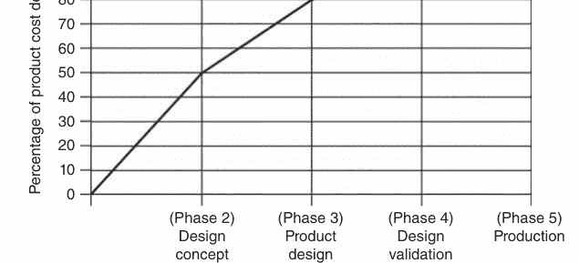
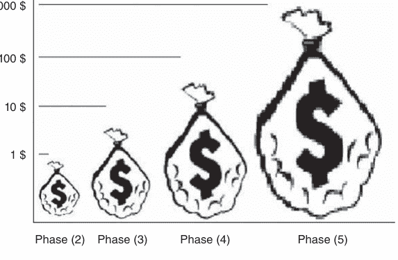
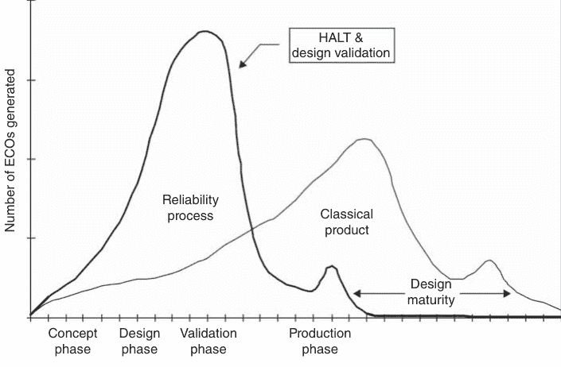

## 1 硬件可靠性与软件质量新范式的需求

### 1.1 硬件可靠性与软件质量面临的快速变化挑战

硬件可靠性和软件质量，为什么需要它？在 1970 年代，美国主要汽车制造商的统治地位被日本汽车制造商侵蚀，因为三大汽车制造商生产的车辆问题明显更多。当美国汽车的缺陷率与日本汽车工业相比时，美国汽车工业缓慢的下行市场滑坡是可以预测的。1981 年，一辆日本制造的汽车平均每 100 辆车有 240 个缺陷。在同一时期，美国汽车制造商生产的车辆每 100 辆车的缺陷率高出 280–360%。通用汽车平均每 100 辆车有 670 个缺陷，福特平均每 100 辆车有 740 个缺陷，而克莱斯勒最高，达到每 100 辆车 870 个缺陷。

关于这一切是如何发生的，以及美国制造商如何开始实施全面质量管理（TQM）、质量圈、持续改进和并行工程来改善其产品，已有很多论述。现在美国汽车工业生产出高质量的车辆，人们认为日本车辆更好的看法已显著削弱。J.D. Power and Associates 在其 1997 款车型年度报告中报道，汽车和卡车平均每 100 辆车约有 100 个缺陷。这比 1996 年增加了 22%，比 1987 年减少了 100%。通用汽车的 Saturn 和福特 Taurus 等车型是对这一成功的致敬，无论在财务方面还是在人们对美国汽车制造商能够生产可靠、高质量汽车的改善认知方面。像 TQM 这样的质量计划极大地改善了美国制造业的质量。汽车行业也受益于进入汽车的零部件质量，其质量水平也非常高。假冒零部件和假冒材料仍然是电子和汽车行业的主要关注点，需要持续的警惕和有效的计划，以最大限度地降低假冒材料进入生产流程的风险。

在 1970 年代，典型的汽车保修期为 12 个月或 12 000 英里。1997 年，汽车制造商提供 3 年/36 000 英里整车保修。三年后，这些汽车制造商提供 7 年/100 000 英里保修。捷豹现在在其二手车上宣传 7 年/100 000 英里保修！宝马也推出了类似的计划。这些制造商能够提供更长的保修期是因为他们

### 1.2 获得竞争优势

在二十一世纪成功竞争的公司有一个共同点。它们都生产出质量优良的产品，随着时间的推移满足或超过客户期望。这可能听起来不像是一个新发现，但这些公司为实现这一成功而使用的流程和工具必须是新的。在某些行业，技术发展如此之快，以至于客户往往在第一款产品仍按规格运行之前就升级到下一代产品。这似乎是制造商的理想环境，因为消费者的产品寿命期望更短。然而，实际上，随着产品开发时间的缩短实现产品可靠性，需要改变我们开发产品的方式。平台产品开发时间已缩短至 18 个月，其衍生产品（产品分支）已缩短至 12 个月或更短。当然，这在很大程度上取决于产品复杂性和监管及安全要求，但这一趋势不容忽视。发布“有 bug”或不可靠的产品，公司要付出沉重代价。满意的客户是回头客。众所周知，获取新客户的成本是保留现有客户的 5–10 倍。无论你是在成本还是产品差异化上竞争；可靠的产品会带来回头客和通过口碑的产品增长。有缺陷的产品通常会导致客户向任何愿意倾听的人表达不满，直到产品或服务被更可靠的产品或服务取代。

### 1.3 在下一个十年竞争——赢家将在可靠性上竞争

过去几十年的商业实践不足以确保在二十一世纪取得成功。多年来，我们学会了打造高质量产品的技能。更高质量的产品带来了更好的利润率。事实上，当竞争产品价格大致相同时，消费者会根据他们对产品质量的感知做出购买决定。在过去几十年里，可靠性对大多数消费者来说并不是决定因素。这主要是由于消费者对产品质量缺乏了解。然而，二十一世纪的普通消费者在做出购买决定时，不仅会考虑价格和质量，还会考虑产品的感知可靠性。消费者根据产品提供的最佳价值做出购买决定。我们可以将产品价值定义为

产品价值 = 客户感知价值 / 价格

这里客户感知价值与产品的质量和可靠性有关。实施可靠性贯穿整个组织并在产品生命周期的每个阶段实施的一个关键优势是，由于客户对产品价值的感知改善以及生产成本的降低，产品价值会增加。有一个常见的误解，即实施可靠性会延迟产品开发时间并增加产品成本（材料和生产成本）。现实恰恰相反。更可靠的产品通常具有更低的生产成本。其原因是由许多因素共同导致产品成本和产品开发周期的降低。例如，可靠的产品通常具有

- 测试中更高的首次通过率，
- 更少的材料报废，
- 更少的产品返工（有助于降低产品成本并提高产品可靠性），
- 更少的现场故障，
- 降低保修成本（这笔节省可以转嫁给消费者以提供有竞争力的价格优势），
- 召回风险更低，
- 更优越的设计，更易于制造。

回顾消费者认为有价值的定义，很明显产品可靠性将提高感知产品价值并降低生产成本。这是关于产品可靠性的一个重要事实，常常被误解。

### 1.4 并行工程

将新技术成功设计并实施到制造中的一个重要因素涉及建立并行工程实践。并行工程是一种从设计概念到产品开发再到制造过程中使用的流程，其中来自所有相关部门的跨职能代表对关键决策提供意见。这些决策直接影响产品的价格、性能、质量和所需开发时间。该概念在 1990 年代被广泛讨论，并为使用者带来了更好的产品、更短的产品开发时间和更高的利润。然而，跨职能团队由市场营销、设计、测试和制造组成。团队不包括可靠性的单独代表，因为这被认为属于设计和测试工程师的职责范围。（我们将在本书第二部分看到，用于提高产品可靠性的工具对大多数设计和测试工程师来说是未知的。）

这种惯例需要改变，必须开发一种更全面的并行工程版本，考虑到整个产品生命周期。产品生命周期方法包括可靠性、可服务性和可维护性输入，这些输入始于设计概念阶段，并贯穿产品开发和产品生命周期。这种从摇篮到坟墓的方法确保了沿途学到的经验教训被捕获并纳入下一个开发周期。

以前的产品开发方法在很大程度上依赖于早期设计用于制造（DFM）工作和原型测试，以在产品发布前发现设计缺陷。这种方法的问题在于，DFM 工程师（在制造工艺方面非常熟练）主要确保产品可制造，并且可以快速在生产中推广以满足市场预测。换句话说，DFM 确保设计的产品可以轻松地在生产中推广（高质量产品），但这项工作对产品可靠性贡献甚微。

图 1.1 产品成本在开发早期即已确定。

在原型阶段进行的测试将在工程发布前验证产品性能是否符合规格。然而，这并未考虑制造过程中每件产品能否满足规格的问题。这种方法的问题在于，产品开发过程中会不断做出决策，这些决策对产品的性能、可靠性以及产品维护和服务的难易程度有重大影响。在此阶段，需要快速做出决策，且应包括所有受影响人员的意见：市场营销、设计、测试、制造、现场服务和可靠性。

如前所述，在产品开发周期的早期就让所有相关组织和支持团队参与进来，以确保产品成本最低且产品可靠性最高至关重要。包括DFM在内的设计方案，以及设计用于测试（DFT）、设计用于可靠性（DFR）、设计用于服务（DFS）和可维护性，必须在产品概念阶段早期就予以考虑。每个职能的代表均根据行业标准、经验教训、知识产权和内部流程开发制定的指南提供意见。这些决策必须基于事实，而非感知。

将这些设计指南同时应用于产品开发，将持续降低成本和周期时间，同时优化可靠性。图 1.1 说明了采用产品生命周期方法进行产品开发将如何对产品成本产生直接的积极影响。通常，80%的产品成本在进入原型阶段时已确定。因此，降低产品成本的最大机会在于设计阶段。产品生命周期方法解决了影响产品整个生命周期成本、服务、可靠性和可维护性的所有问题。这些活动包括整个团队参与对新技术、封装、工艺和设计产生影响的决策，并基于成本效益分析进行，该分析包括市场调研、风险和可靠性。

将可靠性尽早纳入产品开发的另一个驱动原因是，基于人力和资本的变更成本在设计概念阶段之后进行时所带来的成本。图 1.1 说明了这种影响对产品成本可能有多大。降低成本的最大机会在于开发和设计概念阶段，此时与技术、组件和工艺相关的风险问题决定了大部分产品成本。通过在设计阶段早期应用这些实践，可大幅减少实施工程变更所需的成本和劳动资源。

图 1.2 设计修复成本在每个后续阶段都会增加一个数量级。来源：Teradyne, Inc. 授权提供。

图 1.2 进一步说明了这一点，其中工程变更的总成本在产品开发周期后期进行时可能增加数个数量级。

## 1.5 减少产品发布时的工程变更单数量

在第四部分“产品开发的可靠性流程”中，我们将展示如何使用诸如高度加速寿命试验（HALT™）、高度加速应力筛选（HASS™）、失效模式和影响分析（FMEA）以及风险缓解等工具，在产品开发周期的早期揭示通常要到产品投产一段时间后才会发现的隐藏问题。产品生命周期方法还将减少产品投放市场时的工程变更单（ECO）数量，并提高长期产品可靠性。这一观点在图 1.3 中得到了最好的说明，其中产品生命周期方法确保大多数工程设计变更发生在开发周期的早期。这是降低产品发布后现场退货风险的最佳方式。图表说明了通过在产品开发周期早期实施可靠性，可显著减少现场退货和工程变更的数量。

图 1.3 可靠性流程减少了产品发布后所需的 ECO 数量。

## 1.6 快速上市优势

影响产品可靠性的驱动因素之一是组织面临的极大缩短的产品开发周期。巧合的是，这也是人们常称产品无法进行可靠性所需额外活动的最大原因。但这一论点与可靠性在设计概念阶段早期纳入时实际发生的情况相悖。实施产品生命周期可靠性方法的一大优势是产品投放市场的开发时间缩短。当实现上市时间目标时，其益处包括产品知名度提升、能够设定行业标准、被认可为领导者、扩大客户群以及利润最大化。采用产品生命周期方法，产品开发时间将显著缩短，如图 1.4 所示。

最后，图 1.5 说明了产品投放市场的时间如何影响产品盈利能力。与竞争对手同时推出新产品将导致产品生命周期内的平均利润。领先于竞争对手发布产品将增加盈利机会。相反，在竞争对手之后发布产品，盈利机会将大大降低。需要指出的是，领先市场太多可能是不利的。这一观点在文章《加速新产品开发的主要方法综述》[2] 中有所说明，其中内存芯片市场的后期进入者可能得不到任何利润，甚至无法收回投资。

图 1.4 将可靠性纳入并行工程可缩短上市时间。

图 1.5 相对于竞争对手的产品投放时间。

## 1.7 加速产品开发

有许多方法可以加速新产品的开发。可以通过简化产品设计流程、改善跨职能组织之间的沟通、实施升级流程以解决冲突、消除不必要的步骤、将开发工作量保持在不超过 85% 的产能、尽可能并行处理，以及最重要的是消除延误来加速产品开发。

在当今竞争激烈的技术环境中，公司已无法承受新产品发布延迟，尤其是在产品生命周期持续缩短的市场中。公司必须消除“不是我们发明的”态度，这种态度往往会导致忽视更简单的解决方案或新的机会。

简化制造并缩短产品开发周期的另一种方法是采用模块化结构标准化通用设计。惠普在创建模块化设计的产品方面取得了巨大成功。模块化便于升级和新设计功能。此外，通过标准化所有产品固有的某些通用功能，可大幅减少开发时间。这也消除了存在许多不同版本的通用功能的问题。例如，一个增益为 10 dB 的通用电路可能由每位工程师设计得不同，但功能相同。如果将 10 dB 放大器标准化，则不会浪费工程时间去“重新发明轮子”，并且可以高度保证新电路能够正常工作。

## 1.8 识别和管理风险

任何可靠性计划的关键在于识别风险。这一概念在第四部分中得到了详细阐述，其中介绍了将可靠性纳入产品生命周期流程的工具和流程。可靠的可靠性计划必须关注项目中的高风险问题。产品生命周期的每个阶段都会存在风险问题。在概念阶段早期，会做出与捕捉目标市场所需的特性和规格相关的决策。市场营销利用广泛的客户之声（VOC）来识别下一个高增长机会。这些增长机会通常涉及新技术。对于在技术前沿竞争的企业而言，新技术代表了项目和长期可靠性的重大风险。

为了开发新的平台产品，必须制定挑战清单。这些挑战中的每一个都代表着对项目的风险。为了管理风险，应根据风险的严重程度对每个项目进行排序，并对代表最高风险的项目进行跟踪。可靠性在概念阶段的作用是确保风险问题得到正确识别。它们应按严重程度排序，并列出纠正措施，以便在完成后降低风险。风险计划需要包括产品生命周期中受影响的所有职能。与维护、制造性、设计、安全和环境相关的风险问题均包含在内。不幸的是，这些活动是被动的，因此增加了项目开发时间。然而，后面将证明，这些活动的净结果是降低产品开发成本。

在产品开发之前进行的积极可靠性活动也有助于减少产品开发时间并提高产品可靠性。减少技术风险的主动可靠性活动的一个例子是技术路线图。早期的 VOC 将识别需要新技术来满足的未来市场需求。提前缓解技术风险问题可提供足够的时间来充分缓解所有风险问题。通过提前缓解技术风险，您可以通过率先进入市场获得竞争优势，从而获得比原本可能获得更大的市场份额。

## 1.9 ICM，一种降低风险的流程

在任何开发项目中，最大的挑战之一是在项目早期识别和缓解风险问题。这最好通过一种称为识别、沟通和缓解（ICM）的技术来实现，该技术如图 1.6 所示。ICM 方法是对项目重大风险进行识别的三步流程，

Figure 1.6 The ICM process.

为了传达其影响，并制定共同认可的策略来降低风险。ICM 方法是一种有效的方式，能够以最有利于项目目标的方式分配和利用有限资源。

为了识别风险，每个职能组都会审查产品概念、设计和流程。然后每个组都会识别出当前技术、方法、材料、流程和工具无法确保成功的问题。这些就是风险。早期识别风险可使整个团队尽早关注产品可靠性的概念。在此流程阶段，必须识别所有风险问题，无论大小。低风险问题不会像高风险问题那样具有可见性和优先级。为了确保在首次交付给客户之前完成主要风险问题，所有风险问题都会在最早可能的点被记录下来，按严重程度进行排序，并根据每个问题的严重程度制定风险缓解计划。风险识别是一个必须正式化和记录的过程，需记录以下信息：

- 1. 风险描述
- 2. 缓解风险所需活动的简要描述
- 3. 风险对项目和其他职能组的影响
- 4. 风险严重程度，按从不重要到灾难性的等级定义
- 5. 替代解决方案。

## 1.10 软件质量概述

交付高质量软件对产品和公司的成功至关重要。缺乏质量流程会给软件开发组织带来大量成本。美国国家标准与技术研究院 NIST 在 2002 年的一项研究 [3] 指出，由于缺乏足够的质量保证基础设施和流程，美国软件开发组织所承受的成本估计在 220 亿至 590 亿美元之间。随着软件行业的增长和通货膨胀，这一经济影响现在大约是 2002 年估计值的两倍。这对软件开发团队在竞争激烈的市场中来说是一个沉重的生产力负担，也是利润的重大消耗。除了因质量流程不足而产生的额外成本外，产品的成功往往取决于其质量。如果产品无法正常工作或存在太多错误，它将无法成功。

行业中存在一种趋势，即交付更频繁的软件版本。这可能是为了在消费设备市场中保持领先于竞争对手，或是满足客户对现有硬件之上不断新增功能的不满足需求。试图支持低质量且有缺陷的软件会减缓及时交付软件版本的能力。

幸运的是，创建高质量、可靠软件的流程并不复杂。但这并不意味着它很容易。开发高质量软件需要在技术、流程、指标和控制的应用上保持纪律。软件的质量如果不被衡量就无法得知。软件质量的产生必须在开发过程中使用程序和工具来防止、发现和修复软件缺陷。本书介绍了可用于生产高质量软件并随着时间的推移提高软件质量的基本指标、工具和程序的介绍。

所描述的软件是一种数据驱动的软件开发管理风格。设定可量化的目标。在整个软件开发过程中部署技术和程序以防止和发现软件缺陷。在开发过程中持续进行测量并更新，以跟踪当前质量水平并确定软件发布的就绪程度。

这里描述了两套重叠的流程。第一套是一组用于交付高质量软件版本的技术和指标。第二套流程是一组随着时间的推移提高软件质量能力的方法，从而实现从一次发布到下一次发布的持续改进。

通用软件质量流程周期包括四个步骤：

- 1. 为每次软件发布设定质量目标。
- 2. 在开发过程尽可能早的时候跟踪软件质量。
- 3. 在软件发布开发过程中采用技术和程序来防止、检测和修复缺陷。
- 4. 在发布后分析质量未达标的情况，并改进流程以提高后续软件发布的质量。

本书涵盖了软件生命周期、流程、方法论、工具和指标的许多方面，这些都适用于创建和发布高质量软件。然而，这并不是一本关于软件生命周期和流程的书；有许多优秀的书籍深入涵盖了这些主题。本书仅在它们适用于生产高质量软件的范围内涵盖这些主题。

本书包含伪代码、测试计划和指标的示例。需要指出的是，这些示例仅用于说明目的。它们并非旨在完整、可编译或可用于生产。

## References

1 Burkacky, O., Deichmann, J., Doll, G. et al. (2018). Rethinking Car Software and Electronics Architecture. McKinsey & Company.

2 Millson, M., Raj, S.P., and Wilemon, D. (1992). A survey of major approaches for accelerating new product development. The Journal of Product Innovation Management 9: 55.

3 Tassey, G. (2002). The Economic Impact of Inadequate Infrastructure for Software Testing. National Institute of Standards and Technology.

## Further Reading

Hoffman, D.R. (1998). An Overview of Concurrent Engineering, 1997 Proceedings Annual Reliability and Maintainability Symposium (1998).

## 2
