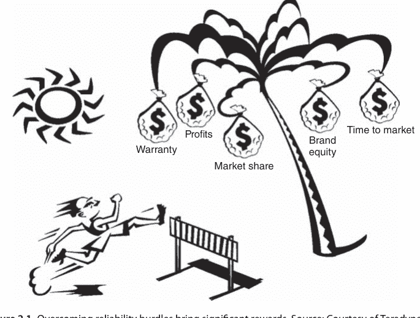

## Barriers to Implementing Hardware Reliability and Software Quality

### 2.1 Lack of Understanding

可能最大的改进可靠性的障碍是对 *可靠性* 实际含义缺乏理解。你在实施可靠性时所遇到的大部分阻力将来自于认为质量和可靠性是同一回事的人。但正如我们之前所展示的那样，它们并不相同。质量是符合规范，而可靠性是 *随时间的质量*。从客户角度来看，可靠性是指“产品在其预期使用期内按预期方式工作”。在开始改进可靠性之前，你必须清楚自己在改进什么。

从实际角度来看，大多数公司在其整个制造过程中都建立了质量改进流程。理解质量和可靠性之间的区别是关键，因为如果你不理解区别，你可能只是在改进产品质量，而完全没有影响产品的整体可靠性。如何区分两者？

首先，关注制造过程中出了什么问题。然后查看描述问题的数据。审查数据以了解问题是如何被纠正的。如果纠正措施不是通过设计或流程变更实现的，那么你所做的只是管理流程以保持符合指定参数。你保持了符合规范。如果改进是通过增加检查步骤、测量步骤或任何其他增加的人为干预实现的，这就是一个线索，说明你所做的只是改进了质量。另一方面，如果做出了改变以提高保持符合规范的能力，那么很可能你做出了可靠性改进。如果确实发生了这种情况，当前数据将显示几乎不需要或不需要后续纠正措施来维持这一质量规范。数据随后将显示该问题区域已得到极大改善或完全纠正。

研究你已有的信息。从制造过程和现场故障数据中收集数据；这可以立即对降低保修成本产生影响。可以通过设计纠正的问题需要更长时间。非常经常，需要做出决定，将资源用于新设计而不是旧设计或当前设计。如果认为当前设计将长期生产，则应花费资源对该设计进行更改。这也是开始使用在保和过保维修数据的时机。将此数据与旨在使这些问题消失的已实施更改进行比较。如果某些问题确实消失了，

Figure 2.1 Overcoming reliability hurdles bring significant rewards. Source: Courtesy of Teradyne, Inc.

图 2.1 克服可靠性障碍带来显著回报。来源：Teradyne, Inc. 授权提供。

因为数据表明它们不再复发，那么很可能已经实现了可靠性改进。如果某些问题确实消失了，而其他问题出现了，这些信息表明流程未受控。

在收集数据并分析故障、纠正措施以及相关流程的信息后，将更好地了解从何处开始可靠性改进流程。在大多数情况下，很明显存在设计和流程问题。从数据中挑选出唾手可得的成果并采取纠正措施，使这些简单问题消失。这些简单问题通常会以少量资源投入换来质量和可靠性的改进。更难的问题需要更多资源和更长时间来纠正，但它们往往带来更大的改进。提高产品可靠性的收益是多方面的，如图 2.1 所示。

## 2.2 内部障碍

将可靠性植入公司可能是一项非常困难且充满挑战的任务。预计在整个过程中都会遇到障碍。你会遇到的障碍既有内部的也有外部的。内部障碍是最难克服的，而且是真实存在的。外部障碍影响较小。我们将证明其中许多障碍基于无效的认知。我们首先讨论内部障碍并提出打破它们的方法。内部障碍在开始时似乎难以逾越。许多公司发现，在实施可靠性计划几年后，它们在产品可靠性方面的改进并不显著。

显然，组织规模越小，将可靠性实施到组织中就越容易。需要坚持不懈。

一旦内部障碍开始被打破，你会惊讶于组织内部会发生什么。这种现象类似于在退休账户中的长期投资。在开始时，退休投资很小，定期缴纳的金额似乎不会让你更接近最终目标。然而，随着时间的推移，这笔金额变得重要，因为它开始呈指数增长。一旦组织开始看到可靠性的益处，公司内部也会出现同样的效应。

内部障碍是在实施有效的可靠性计划时最难克服的。我们发现，成功的公司会将其作为核心竞争力的一部分。销售可靠的产品将使你的公司区别于竞争对手。我们首先来看这些内部障碍。以下是 13 个最常见的内部障碍：

- 1. 抵制变革
- 2. 管理层缺乏可靠性知识
- 3. 工程部门缺乏可靠性知识
- 4. 培训不足
- 5. 缺乏管理层对流程的支持
- 6. 缺乏支持流程的资本资源
- 7. 没有足够的人员来处理问题
- 8. 目标随意设定或定义不清
- 9. 流程在计划中没有安排足够的时间
- 10. 修复发现的问题在计划中没有安排足够的时间
- 11. 实施流程定义不清
- 12. 工程师希望转向下一个设计，而不是返回对旧产品进行改进和修复
- 13. “对我们来说行不通”的态度

## 2.3 实施变革与变革推动者

不出所料，成功实施的最大障碍将是抵制变革。在实施的早期阶段，抵制变革将存在于公司内部所有跨职能组织中。抵制变革的最大阻力将出现在工程组织中。工程师通常在自己的做法上根深蒂固。不久你就会开始听到工程部门说这些话：“我们必须这样做才能使其工作”，“系统不是设计成那样工作的”，以及“我们多年来一直设计高质量产品；这将如何使事情变得更好？”

我们一次又一次反复看到的一个问题是，工程师不了解质量与可靠性之间的区别。当然，你可能正在设计和制造符合客户期望的优质产品。这在 1990 年代是大多数公司的目标，但现在要保持竞争力还需要更多。质量指的是在购买时满足客户期望的能力。可靠性指的是产品在一段时间内满足这些期望的能力。如果你生产的是质量产品但经不起时间的考验，你就有可靠性问题。这是我们需要灌输给组织的讯息；我们今天的经营方式在明天的竞争环境中将不再奏效。

内部抵制实施可靠性的一个常见且普遍的原因是对产品可靠性流程缺乏了解。许多员工更喜欢在自己的舒适区工作。人类天生害怕未知。自然会反对成功无法保证的事情。解决对可靠性流程的恐惧和不适的唯一方法是透过教育消除疑虑。随着组织对可靠性流程的了解加深，对实施的抵制会慢慢减弱。

交付流程知识需要两个必要的条件。第一个条件是有一位魅力非凡的领导者或推动者，他对流程有深入了解，并能清晰传达需要做什么。在这里，销售技巧可能非常有价值。第二个条件是管理层需要支持实施新流程所需的变革。这两个条件都是成功的必要因素。管理层的支持尤其绝对必要。

推动者应为负责实施可靠性流程的可靠性经理。大多数公司缺乏这样的人选。公司必须在组织外部寻找这个人。选择合适的主推动者将是成功与失败之间的区别。不仅此人需要是良好的沟通者和激励者，而且他/她还必须与组织的文化融合得很好。推动者需要采取的第一步是在组织中建立信誉。一旦推动者建立了信誉，抵制程度将急剧下降。一个常见的错误是选择组织内部在不同领域取得成功的人来担任产品可靠性的推动者。通常，质量经理会被赋予这一新职责。不幸的是，大多数质量经理缺乏建立信誉所需的技能和经验。这并不是说质量经理不能成为优秀的可靠性经理。然而，在实施阶段新流程正在开发时，会出现最好由已有类似情况经验的人来解决的问题。

选择合适的人选至关重要，但同样重要的是该个人如何被介绍给组织。可以保证实施可靠性会遇到抵制；你如何向组织介绍可靠性经理将决定这些障碍是被打破还是怨恨和抵制会增加。

在曾经工作过的一个小型作坊里，老板在制造车间召开会议，并向大家介绍我为新的可靠性“顾问”。50 名员工都听着老板明确说明即将发生的事情，以及越快越好。他继续说，每个人与顾问的合作和团队合作将加快我的离开。“事实上，你们的下一次加薪已被暂停并支付给顾问，从今天起；因此，我们越快让这个‘可靠性事情’进行，你们的下一次加薪就会越快到来。”虽然我当然得到了管理层的支持，但这次介绍使我需要攀爬的山坡变得更加陡峭。

相比之下，在一家非常大的公司中，一种高成本的物品只是整个公司产出的一部分，管理层则更为外交：“让我们看看如何

这种可靠性做法有效，四五个月后我们会更仔细地审视进展。”但这并不是管理层的承诺。

实施过程中第二个必不可少的要素是承诺。这种承诺需要在人力、资本资源、时间分配以及管理层方面体现出来。管理层的承诺必须来自最高层。此外，承诺应纳入五年规划，因为最初几年回报可能并不明显。一旦高层管理决定将可靠性纳入组织，就应安排一次与中层管理及外部顾问的会议，在会上设定实施的共同目标并为实施奠定基础。一些公司会为此会议使用周末 retreat。可靠性实施不应被视为一次实验。

*如果实施可靠性的需求是真实的，那么承诺也必须真实。* 通常，当聘请一名可靠性经理时，高层管理对可能性持乐观态度，但对能否成功实施却信心不足。这种不信任在支持人员中更为严重。如果实施方法包含可靠性最佳实践，这种不信任就可以得到缓解。组织中许多人，无论是管理层还是员工，通常会对整个想法持负面态度。虽然组织中其他人可能有过可靠性实施的先前经验，但他们对整个过程持负面态度的可能性也有 50-50。简单地说，对成功的怀疑程度很高。

总体而言，设计工程师对该过程的感受会形成群体共识。可靠性经理会被视为局外人。因此，高层和中层管理在过程中的承诺对实施成功至关重要。表面上，员工会认为这是最新的管理潮流，似乎撑不过一年。老板过去做过类似的事情。通常收效甚微，所以我们只要敷衍他，让这股最新潮流自行消亡即可。这种看法可以通过向组织分享五年实施计划以及实现这一目标的资源承诺来迅速解决。

## 2.4 建立信誉

实施过程中第三个必不可少的要素是建立对产品可靠性是什么以及如何实现其内部认知。知识最好通过常规培训课程获得。培训应按逻辑顺序进行。首先，需要建立对产品可靠性为何对公司重要的一致理解。这是讨论以往产品中错失的机会（即问题）以及延迟上市产品的绝佳开端。接下来，应进行可靠性流程培训。与过去开发产品的方式相比有何变化？它如何影响不同组织？它将如何使他们受益，又将提供哪些资源来实现目标？建议定期举行培训会议或小型研讨会。

培训不应严格局限于可靠性。其他产品开发组织，如机械组、电路板设计师、现场服务、市场营销、元件工程等，也应开设课程以传达影响产品可靠性的问题和指导方针。可以轻松开始的一个主题是

关于制造现场和现场出现故障的事项的培训课程。很可能有大量数据可用于课程准备。课程可以指出问题所在、采取了哪些纠正措施，然后确定问题是设计相关还是制造相关。员工可以从此次培训中学到很多，这也有助于推动这种可靠性工作是真实的态度转变。

这些课程对新员工尤其重要，有助于建立更强大、更有效的团队。例如，您可以从制造指南、机械指南、可维护性和可用性、服务性、可测试性、热管理、产品生命周期、加速测试、平均故障间隔时间（MTBF）、失效模式与影响分析（FMEA）、实验设计（DOEs）、失效物理、元件可靠性、机械可靠性以及系统可靠性等培训课程中进行选择。定期培训课程（大约每两周一次）将培养实现产品可靠性所需的知识基础。利用内部专家授课。这种培训过程传达了谁是这些特定领域的驻场专家。员工将了解专家的姓名和面孔，并在需要时寻求他们的帮助。作者们偶然发现的一个好处是，这些课程让具备跨职能技能的人员相互认识。会议建立了以前不存在的改善工作关系。

## 2.5 感知的外部障碍

希望实施可靠性的公司面临五大感知外部障碍：

- 1.上市时间
- 2.产品开发成本
- 3.竞争对手未实施
- 4.无本地测试设施
- 5.无本地专家

前两个障碍，即上市时间和产品开发成本，是反对实施可靠性者主要使用的论点。这是一种非常短视的观点；感知与现实恰恰相反。如我们在第 1 章中所讨论的，当可靠性以并行方式实施时，整体产品开发时间和成本都会降低。这个想法似乎显而易见，但在实施初期感知会大不相同。一个原因是可靠性的一项输出会推动设计变更的需求。设计团队将这些设计变更解读为不必要且会进一步延迟项目。然而，如果可靠性活动与设计过程并行进行，则设计变更将以最低成本实施到项目中。例如，在设计布局之前，由跨职能、多学科团队进行 FMEA 将识别出在原型构建或产品发布后才会被发现的设计问题。净结果是工程发布前所需修改次数减少。同样，在产品交付制造之前进行高度加速寿命试验（HALT）将消除首次客户发货前的设计问题。这反过来将大大降低保修成本，并有助于减少产品召回。

第三个障碍，另一个常见的误解，是你的竞争对手并未将其可靠性流程作为产品开发的一部分实施。随着越来越多的公司接受产品可靠性，这种感知每天都在变得越来越不准确。如果你拖延，你的竞争对手就会获得竞争优势。除了这些优势外，更快的产品开发时间、更低的产品开发成本和更低的保修成本都伴随着产品可靠性的提升。将可靠性作为产品中的重要组成部分会产生几个非常理想的结果，这些结果实际上相互契合。你通过产品可靠性获得更大的品牌资产，这为你的产品带来更高的溢价，从而整体提高利润率。

拥有产品可靠性计划的公司将其视为核心竞争力之一。从 FMEA、HALT 以及以往项目中，经验教训可应用于未来产品。经验教训可以被捕获到数据库中，并通过计算机检索系统供所有人使用。由于这些数据库可能变得相当庞大，应有能够根据关键词或主题查找研究的搜索引擎。其次，经验教训应总结成可靠性设计指南，并更新后传达给设计社区。

公司在实施可靠性计划之前了解这些产品可靠性最佳实践的一种方法是基准测试其竞争对手。虽然这在概念上是个好主意，但在实践中可能相当困难。前面讨论过的一个原因是公司不讨论其可靠性计划。其次，公司很少发布讨论其如何实现产品可靠性的信息。在这里，从访谈和聘请可靠性专家来帮助你入门可以获得很多见解。一些公司使用外部顾问和测试设施来完成其可靠性活动的一部分。这些公司有严格的保密协议，禁止外部来源讨论这些问题。一些公司甚至可能考虑购买竞争对手的产品并进行拆解以了解他们如何实现产品可靠性。幸运的是，或不幸的是，竞争对手还不能拆解你的产品来了解你如何实现产品可靠性——至少现在还不能。

## 2.6 获得接受所需的时间

过了一段时间后，每个人都能看出可靠性经理不会被阻止，日复一日地有人转向并加入进来。几个月后，他们看到了一些小成功，更多的人被说服加入可靠性改进过程。不久之后，似乎对这种新的“可靠性事物”出现了热情的雪崩。可靠性经理被要求在其特定组件上实施其可靠性流程的请求淹没。他们看到了光明并希望获得好处。一些顽固分子仍然持怀疑态度，确实是该过程发展的相对绊脚石。这些怀疑者必须被发现并说服以帮助实现可靠性流程。

在每种情况下，新的可靠性流程都处于关键路径上。对其的抵制很容易形成，因为早期进入市场对利润极其重要。任何额外活动都会延迟市场进入。有时，作为替代方案，管理层决定将

将可靠性流程放在旁支轨道上，以便现有的产品开发不会因任何事情而放慢速度，尤其是未经验证的可靠性流程。将可靠性流程与常规产品开发流程并行进行是可行的，但结果会非常小，开发时间的节省也无法实现。之后，对新可靠性流程的评估将得不到太多支持，因为支持继续可靠性工作的<|message|>数据几乎不存在。

即使可靠性工具揭示了需要纠正的设计，实施改进所需的时间和资源也可能导致管理层不愿容忍的延迟。如果实施可靠性修复所需的时间未纳入产品开发计划中，可靠性流程从一开始就注定失败。

工程师都是聪明人。他们对事物的工作原理有技术上的理解。他们通常会根据对情况的即时分析，解释事物的工作原理（或无法工作）。当被介绍可靠性工程的概念时，他们的即时分析往往会找到在他们环境中根本行不通的理由。他们认为自己对如何设计和安装电气元件、冷却系统或选择紧固件等一切都了如指掌。工程师们最缺乏的知识是来自他们最新设计在现场失效数据的反馈。因此，他们认为自己设计的一切都很出色，而在许多情况下，如果在最终批准前对设计应用可靠性工具，他们的设计本可以做得更可靠。他们需要慢慢地接触可靠性工具。今天，许多工程师从一个项目跳到另一个项目，甚至从一家公司跳到另一家公司，很少有机会了解自己的设计疏忽。等到现场失效的反馈可用时，他们已经转向新事物了。可以理解，教育工程师对可靠性工作的成功至关重要。

## 2.7 外部障碍

后勤可能是将 HALT 和其他可靠性测试应用于产品开发流程的障碍。新产品开发人员可以租用这些服务，花费一周时间（通常）来发现产品的弱点。全国乃至全世界都有许多此类先进的测试实验室。其中一些拥有 HALT 能力，可以帮助 HALT 的新用户设计应力测试方案。Qualmark 是 HALT 试验箱制造商。他们在主要城市设有多个 HALT 设施，可供产品开发人员使用（Qualmark 在 www.qualmark.com）。提供 HALT 服务和 HALT 设备的公司列表可在附录 A 中找到。通过联系 HALT 试验箱制造商，您可以找到最本地的测试机构，在那里进行 HALT 测试。该列表经常增长和变化。（我们建议您使用附录中提供的 HALT 试验箱制造商列表。）不幸的是，测试机构很少且分散在全国各地。在大多数情况下，设施不会在附近。

在外部设施进行 HALT 测试的成本和后勤问题会迅速累积。设计工程师可能需要前往 HALT 设施，通常需要飞机、酒店、租车和其他差旅费用。这加上 HALT 测试的设施费用，可能使改善产品可靠性的成本成为一个显著障碍。因此，距离测试机构的远近非常重要（越近越好）。如果您幸运地拥有附近的测试设施，那么差旅成本就不是一个重要因素。HALT 服务提供商需求旺盛，因此您需要提前安排和预订测试时间——通常提前四到六周。

工程师的时间，就像其他人一样，是宝贵的。工程师不喜欢花大量时间前往异地设施工作。最大限度地减少这一因素可能决定可靠性测试实施计划的成败。

当 HALT 流程不为人所知且 HALT 测试外包给远处的测试设施时，需要有一位有知识的人确保所有准备工作在前往测试设施之前完成。在某些情况下，新产品开发人员可能需要聘请专门从事此类测试的顾问或合同工程师加入 HALT 流程。这些技能可以购买也可以学习。通常，开始时两者都需要。这增加了成本，也是提高可靠性的额外障碍。

有提供 HALT 培训的顾问和 HALT 机器制造商。这些服务可以现场提供或在培训研讨会上提供。HALT 测试顾问的列表可在附录 A 中找到。

如果一家公司确定实施这些可靠性测试的成本过高，他们应该重新审视可能性。如果制造商的最终产品没有给客户带来预期的可靠性，那么不做 HALT 的成本将高得多。成本可能是客户群的流失，最终导致企业破产。这可能意味着购买 HALT 机器是更好的长期解决方案。

HALT 测试的初期成本乍一看似乎过高。与对业务的影响（增加的保修支出、产品召回和流失客户）相比，它们是微不足道的。长期可靠性改进带来的回报，这些改进成为产品可靠性的组成部分，将远远超过实施 HALT 测试所花费的资金。制造商将通过留住客户并开发坚持要求最佳可靠性的新客户而受益。

## 2.8 软件流程改进的障碍

提高软件质量需要改变软件开发流程和软件开发文化。预计会有人抵制增加或改变软件开发流程，因为他们声称新流程会增加开发时间和降低响应速度。然而，预测的开发时间和成本增加只是一个幌子。提高软件质量和降低缺陷逃逸率意味着在维护工程上花费的资源和时间更少。当没有独立的维护组织来支持软件质量问题，并且为下一版本计划了新功能列表时，重点很快就会转向修复逃逸缺陷。开发团队可能很快会被修复软件缺陷所淹没，导致计划中的新功能增强的发布延迟或取消。高缺陷逃逸率会分散开发团队的注意力，同时也是昂贵的。上市时间受到两次打击，一次是必须支持高缺陷逃逸率的产品，另一次是必须延迟新功能开发，因为开发人员必须花费更多时间修复逃逸缺陷。此外，当工程师需要在新功能开发和修复逃逸缺陷之间切换时，生产率也会受到影响，因此开发人员在任务上花费的时间也不那么高效。

以缺陷逃逸率为衡量标准的软件质量提升是一种竞争优势。按承诺的时间表交付软件版本也是竞争优势。客户更喜欢那些可以信任按时交付且运行良好的软件的供应商。更好的进度可预测性源于对缺陷模型的理解以及为查找和消除缺陷所做的充分规划。提高软件发布可预测性会提高客户对您履行软件交付承诺能力的信心。这反过来会导致更好的客户体验、更高的客户满意度，并最终带来竞争优势。

反对使用分析技术管理软件项目的另一条论点是，模型和指标本质上不准确，因此根本不可依赖。模型确实是估计值，因此不可能完全预测。然而，不使用任何可量化的测量来规划和跟踪项目往往是灾难性的。没有使用一些可量化指标，就无法知道任何给定项目的状态。指标并非 100% 准确并不意味着它们没有极大的用处。

最后，有些人会断言软件开发是一种创造性活动，一种艺术，将流程和指标应用于其中会扼杀开发人员的创造力。事实上，软件开发是创造性的，但不能将其视为艺术。艺术在于观者的眼中；它由最终用户单独解读。许多艺术家可能很高兴不同的观众或读者对他们的艺术有不同的理解。然而，如果你认为你的软件有特定目的，并且你希望确保它实现该目的，那么你必须使用严格的流程来保证软件的成功。

