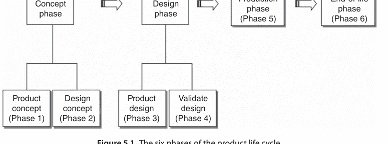
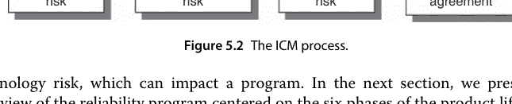
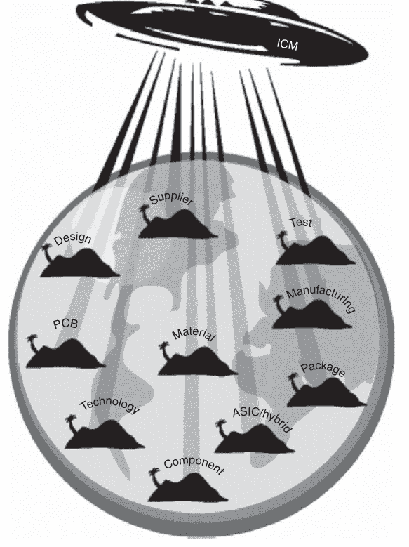

# 产品生命周期

在建立可靠性计划之前必须做出许多选择。这些决策将对组织产生重大影响，并影响实施可靠性计划所需的时间。小型公司与大型公司在障碍和决策标准上会有所不同。已承诺通过可靠性提升产品的大型公司可能愿意付出任何代价以取得成功。当然，这并不能保证成功，如果实施不当，会导致利润下降，产品可靠性回报率边际递减。小型公司在推动更可靠产品需求的制约因素上有所不同，并且会以与大型公司不同的方式实施变革。在为你量身定制最合适的可靠性计划之前，需要了解可靠性流程、概念和工具。在第二部分中，我们将揭开成功可靠性计划背后的谜团。

## 5.1 产品生命周期的六个阶段

我们从可靠性流程的简要概述开始本章。该流程对实施可靠性计划的所有公司都相同。该流程被正式化的程度将取决于公司规模和上市时间限制。（可靠性流程的更详细描述见第四部分“产品开发的可靠性流程”。）可靠性流程需要涵盖整个产品生命周期。产品生命周期是一种从摇篮到坟墓的方法，其中在产品生命周期的任何阶段做出的决策都会影响产品可靠性、客户满意度、利润和产品形象。此外，这些决策必须考虑到它们对产品生命周期所产生的影响。产品生命周期包括六个阶段：

- 1. 产品概念阶段
- 2. 设计概念阶段
- 3. 产品设计阶段
- 4. 验证设计阶段
- 5. 生产阶段
- 6. 寿命终止阶段，如图 5.1 所示

可靠性流程是一个多学科的努力，在产品生命周期的六个阶段中同时进行。多学科团队由

# 图 5.1 产品生命周期的六个阶段。

拥有来自其特定职能活动的知识、经验教训和专业知识的代表组成。传统上，并行工程是一种多学科方法，已在产品生命周期的设计阶段和生产阶段实施。并行工程、质量圈、持续改进以及其他此类计划带来了美国制造产品质量的显著提升。这些计划之所以成功，是因为它们在产品设计阶段尽早利用了组织中所有职能组的知识和专业知识，而在该阶段做出影响产品质量的决策。

由于这些活动，美国的制造商正在生产世界上一些最高质量的产品。这些质量计划已有 30 多年历史，现在已被竞争对手在全球范围内采用。不幸的是，仅靠质量竞争的策略不再提供竞争优势。今天的消费者了解产品质量，并能解释哪些产品质量更高以及原因。这些培养了这种理解的消费者很快就会了解产品可靠性。时间不会太久，这些消费者就能解释哪些产品更可靠以及原因。

互联网的便捷和即时访问进一步加速了消费者对产品质量和可靠性的了解。现在，有许多搜索引擎可供消费者对特定产品进行比较购物。同一搜索引擎提供聊天室，消费者可以在其中讨论他们对产品的疑问和担忧。其中一些搜索引擎有消费者产品评论，你可以在其中阅读有关感兴趣的特定产品的评论。虽然互联网和比较购物搜索引擎对消费者决策过程的全部影响尚不清楚，但它们应被视为产品质量和可靠性的有力传播者。互联网将在未来十年为生产出在预期使用时间内可靠且高质量产品的企业提供竞争优势。

设计和制造能够持续满足消费者期望的高质量产品的最佳方式是对产品生命周期采取多学科、并行工程的方法。还有必要建立一个融入产品生命周期概念的可靠性计划。可靠性计划考虑与产品质量和可靠性相关的任何问题，以及可能影响计划的任何重大技术风险。在下一节中，我们将围绕产品生命周期的六个阶段介绍可靠性计划的概述。表 5.1 包含了在产品生命周期中进行的职能活动的总结。一些概念将在第 7 章中进一步解释。

图 5.2 ICM 流程。

## 5.2 风险缓解

风险缓解是一个三步流程，导致达成关闭协议，如图 5.2 所示。首先，调查以识别风险问题。接下来，将风险问题传达给所有相关方以接受风险。最后，制定缓解风险的计划。作为流程的一部分，定期召开会议更新状态并审查风险问题，关闭已解决的问题，并在出现时添加新问题。接下来将详细描述这三个部分中的每一个。

### 5.2.1 调查风险

为了识别技术风险，每个职能组审查产品概念并确定当前技术、方法、流程和工具无法确保成功的问题。早期风险识别使整个团队在最早阶段关注产品可靠性的概念。所有风险问题，无论大小，都需要在流程的此阶段识别。低风险问题不会像高风险问题那样具有可见性和优先级。因此，为确保在首次客户交付前完成所有工作，所有风险问题在概念阶段被捕获并记录，如图 5.3 所示。可以根据这些问题中的每一个来规划风险缓解。

风险识别是一个必须记录的过程，并且必须解决以下问题：

- 1. 风险描述
- 2. 缓解风险所需活动的简要描述
- 3. 风险对计划和其他职能组的影响
- 4. 风险严重程度在从不重要到灾难性的范围内定义
- 5. 替代解决方案

### 5.2.2 传达风险

一旦识别出风险问题，就需要将其传达给计划的关键股东。他们是构成并行工程团队的职能组的代表。股东还应包括组织的 senior management。由于风险是共享的，股东需要就计划的每个已识别风险达成一致并确定其必要性。传达风险的过程最好在所有股东参加的正式会议中实现。该

表 5.1 可靠性跨职能集成的职能活动。

| 职能活动 | 概念阶段 |  | 设计阶段 |  | 生产阶段 |  |  |
|---|---|---|---|---|---|---|---|
| | 产品概念 | 设计概念 | 产品设计 | 验证设计 | 生产爬坡 | 大批量生产 | 寿命终止阶段 |
| 市场营销 | 风险缓解 — 外部 VOC，可靠性目标，经验教训 | 风险缓解 – 内部 VOC | 实施风险缓解计划 |  |  |  |  |
| 电气设计 | 风险缓解 – 外部 VOC，可靠性目标 | 风险缓解 – 内部 VOC，应用设计指南 | HALT，实施风险缓解计划，设计 FMEA | 风险缓解关闭，ECO 验证 设计和性能验证，运行 FRACAS |  |  |  |
| 机械设计 |  | 风险缓解 – 内部 VOC，应用设计指南 | 实施风险缓解计划，设计 FMEA | 风险缓解关闭，ECO 验证 设计和性能验证，运行 FRACAS |  |  |  |
| 软件设计 |  | 风险缓解 – 内部 VOC | 实施风险缓解计划，设计 FMEA | 风险缓解关闭，ECO 验证 设计和性能验证 |  |  |  |
| PCB 设计 |  | 风险缓解 – 内部 VOC，应用设计指南 | 实施风险缓解计划，设计 FMEA | 风险缓解关闭 ECO 验证 |  |  |  |
| 可靠性 | 风险缓解 – 外部 VOC，技术风险，可靠性目标，可靠性流程，经验教训 | 风险缓解 – 内部 VOC，较低层级可靠性目标，定义可靠性设计指南，技术风险，可靠性资本预算 | 实施风险缓解计划，设计 FMEA，可靠性估算，根本原因失效分析，应用设计指南，安装 FRACAS，HALT 规划 | HALT，风险缓解关闭，筛选验证，筛选验证，根本原因失效分析，将发现记录为经验教训，运行 FRACAS | HASS，ECO 验证，HASS，FRACAS，可靠性增长，Burn-in，ARG，早期寿命测试（ELT） | HASA，FRACAS，可靠性增长 | HASA，FRACAS，淘汰 |

| 软件质量与可靠性 | 风险缓解 – 内部 VOC | 实施风险缓解计划，设计 FMEA | 风险缓解关闭 |  |  |  |
| 质量 | 风险缓解 – 内部 VOC | 实施风险缓解计划，设计 FMEA | HALT，风险缓解关闭，运行 FRACAS* | HASS，FRACAS，SPC，6-sigma | HASA，FRACAS，SPC，6-sigma | HASA，FRACAS，SPC，6-sigma |
| 测试工程 | 风险缓解 – 内部 VOC | 实施风险缓解计划，设计 FMEA | 风险缓解关闭，运行 FRACAS | FRACAS，SPC，6-sigma | HASA，FRACAS，SPC，6-sigma | HASA，FRACAS，SPC，6-sigma |
| DFM | 风险缓解 – 内部 VOC | 实施风险缓解计划，设计 FMEA，应用设计指南 | 风险缓解关闭，运行 FRACAS，过程 FMEA | FRACAS，SPC，6-sigma | FRACAS，SPC，6-sigma | FRACAS，SPC，6-sigma |
| DFT | 风险缓解 – 内部 VOC | 实施风险缓解计划，设计 FMEA，应用设计指南 | 风险缓解关闭，过程 FMEA，运行 FRACAS | FRACAS，SPC，6-sigma | FRACAS，SPC，6-sigma | FRACAS，SPC，6-sigma |
| 制造 | 风险缓解 – 内部 VOC | 风险缓解，设计 FMEA | 风险缓解关闭，过程 FMEA，运行 FRACAS | FRACAS，SPC，6-sigma | HASA，FRACAS，SPC，6-sigma | HASA，FRACAS，SPC，6-sigma |
| 客户支持 | 风险缓解 – 内部 VOC | 实施风险缓解计划，设计 FMEA | 风险缓解关闭 | FRACAS | FRACAS | FRACAS |
| 物料管理 | 风险缓解 – 内部 VOC | 实施风险缓解计划，设计 FMEA | 风险缓解关闭 | FRACAS | FRACAS | FRACAS |
| 元器件工程 | 风险缓解 | 实施风险缓解计划，设计 FMEA | 风险缓解关闭 | FRACAS | FRACAS | FRACAS 淘汰 |
| 安全与法规 | 风险缓解 – 外部 VOC | 风险缓解 | 实施风险缓解计划，设计 FMEA | 风险缓解关闭 | FRACAS | FRACAS | FRACAS |

*注：DFM，面向制造设计；DFT，面向测试设计；ECO，工程变更通知；FMEA，失效模式与影响分析；FRACAS，故障报告、分析与纠正措施系统；HALT，高加速寿命试验；HASA，高加速应力审核；HASS，高加速应力筛选；PCB，印刷电路板；SPC，统计过程控制；VOC，客户之声；ARG，加速可靠性增长；ELT，加速寿命测试。*

图 5.3 风险缓解计划（ICM）需要在开发计划的各个方面解决风险问题。来源：Teradyne, Inc. 友情提供

会议的唯一目的是提出风险问题，达成一致哪些风险是必要的，并在首次客户发货前签署正式协议，以解决关键风险问题。该协议是对投入必要资源解决关键风险问题的承诺，并向团队传达在计划时间范围内无法解决的风险。

## 5.2.3 缓解风险

识别、沟通和缓解（ICM）方法中的最后一步是风险缓解计划。风险缓解计划在高层次上记录了将要开展的活动，以确保产品可靠并且能够以满足市场预测所需的产量进行制造。风险缓解计划应

不包含实现交付成果所需的步骤，因为它将被团队中的所有利益相关者阅读，而他们可能对这些细节不感兴趣。风险缓解计划中应包括所有将要进行的实验、环境应力测试、工装等清单，以及期望的结果。

该计划还应包括每项活动开始和结束的时间范围。风险缓解计划中最后必要的要素是每项活动所需的交付成果。这是许多公司容易失误的一个环节。交付成果，即为每个风险问题实现关闭所需的内容，需要明确说明。例如，是否会生成一份正式报告，其中包含他人重复该活动并实现相同期望结果所需的所有必要信息？极高风险问题将需要一条并行进行的替代路径，与主要工作同时进行但资源投入较低。最后，部分风险活动会与其他部门合并，因为风险对双方都存在。在这些情况下，需要团队协作，以避免工作重复，并确保受影响的部门对结果达成一致。并行工作将确保不会因错误假设另一部门正在开展该工作而遗漏任何活动。

ICM 流程需要正式签署批准，以便项目进入下一阶段。该程序是一个门控，要求达成一致认为风险可控后才能进入下一开发阶段。签署批准可以由高级管理团队成员或职能团队成员本人进行。通常在此签署中包含必须解决的强制性交付成果的定义，以及通常与产品开发流程的未来阶段相一致的关联时间范围。

## 5.3 小型公司的 ICM 流程

小型公司的可靠性流程可能与大型或中型公司不同。小型公司通常缺乏中型和大型公司所具备的众多职能支持部门。小型公司不存在其大型同行所存在的沟通障碍。因此，小型公司通常受流程限制较少；它可以非正式地解决问题，并花费更少的时间进行文档记录和生成报告。

小型公司在开发技术驱动型产品时可能面临与中型和大型公司相同的可靠性问题和风险。然而，由于小型公司更具灵活性，它们能够快速应对变化并承担额外风险。无论公司规模多小，管理风险和确保产品开发可靠性的流程都是相同的。在产品概念阶段早期，需要进行评估以识别所有重大风险。由于财务资源、技术专长、合格技术人员数量和实验室能力有限，小型公司的风险缓解方式不同。

在当今全球环境下，小型公司有可能与大型或中型公司竞争。赢得市场份额的公司将是率先推出产品、拥有有效的商业计划并且产品最可靠的公司。由于小型公司仍面临与大型至中型公司相同的许多风险和技术挑战，因此有必要使用 ICM 方法识别、沟通和缓解所有重大风险。小型公司需要

记录整个 ICM 流程，以确保没有问题在未解决的情况下被遗漏。

小型公司最显著的区别是风险缓解的实施策略。由于在许多情况下小型公司无法在内部充分缓解风险，因此应考虑寻求外部帮助。缓解风险的一些替代方式如下：

- 1. 聘请该领域具有专业知识的顾问。
- 2. 将部分工作外包给大学。
- 3. 聘请临时合同帮助。
- 4. 许可该技术。
- 5. 外包给另一家公司（不建议将核心竞争力外包）。

## 5.4 设计指南

成功实施可靠性的一项重要因素是设计指南的实施。这些指南包括面向制造设计（DFM）、面向测试设计（DFT）和面向可靠性设计（DFR）。当这三项指南在产品开发中得到实施，并采用并行工程时，将确保产品满足制造、测试和产品可靠性的最低标准。成功实施任何“面向设计”指南于产品设计和开发中的一个不可或缺的部分是并行工程。并行工程是一种确保事情第一次就做对并及时与参与设计决策的所有部门沟通的方式。并行工程促使产品开发者考虑产品生命周期的所有要素，包括可制造性、可维护性、测试、成本、进度、用户需求、质量和可靠性。

## 5.5 质保

每个销售数字中都隐藏着一笔小额资金，用于确保卖方在未来有一定资本来支付客户提出的质保索赔成本。销售额越高，这笔资金就越高。更重要的是，可靠性越低，就需要预留越多的收入来履行质保索赔承诺。看待质保索赔准备金的一种方式是，这就是由于设计和制造过程中的可靠性逃逸而导致的预期利润减少。

如果设计要求使用比所需更多的螺母和螺栓，制造产品的制造成本就会更高。应启动成本削减工作，以移除不需要的紧固件，从而节省材料成本。在移除不需要的螺丝后，制造产品的制造成本将下降，利润将增加。制造商然后可以选择获得轻微的利润增长，或降低产品成本以获得更大的市场份额。拥有这些选择有助于确保公司的未来。

W. Gegen, *Design For Reliability – Methodology and Cost Benefits in Design and Manufacture*, The Reliability of Transportation and Distribution Equipment, pp. 29–31 (March, 1995).
Golomski, W.A. (1995). *Reliability & Quality in Design*, 216–219, IEEE. Chicago: W. A. Golomski & Associates.
R. Green, *An Overview of the British Aerospace Airbus Ltd.*, Reliability Process, Safety and Reliability Engineering, British Aerospace Airbus Ltd., Savoy Place, London WC2R OBL, UK, IEEE (1999).
D. R. Hoffman, M. Roush, *Risk Mitigation of Reliability-Critical Items*, 1999 Proceedings Annual Reliability and Maintainability Symposium, pp. 283–287, IEEE (1999).
J. Kitchin, *Design for Reliability in the Alpha 21164 Microprocessor*, Reliability Symposium 1996. Reliability – Investing in the Future. IEEE 34th Annual Spring. 18 April 1996.
I. Knowles, Reliability Prediction or Reliability Assessment, IEEE (1999).
Leech, D.J. (1995). Proof of designed reliability. *Engineering Management Journal* 5 (4): 169–174.
S. M. Nassar, R. Barnett, Applications and Results of Reliability and Quality Programs, 2000 Proceedings Annual Reliability and Maintainability Symposium, IEEE (2000).
Novacek, G. (2001). Designing for reliability, maintainability and safety. *Circuit Cellar*, January 126: 28.

## DFM

D. Baumgartner, The Designer’s View, *Printed Circuit Design* (January, 1997).
R. Prasad, Designing for High-Speed High-Yield SMT, *Surface Mount Technology* (January, 1994).
C. Parmer, S. Laney, DFM & T Guidelines for Complex PCBs, *Surface Mount Technology* (July, 1993).
