## 6 可靠性概念

本书中的信息主要面向设计界的人士、管理人员、首席执行官、公司总裁、助理可靠性工程师——几乎所有人，除了可靠性工程师。可靠性工程师理解这些可靠性概念背后的数学原理，而这对其他人来说并不重要。幸运的是，可靠性概念背后的数学超出了本书的范围。我们将着重于可靠性概念，以提供对其是什么、如何应用以及如何解读结果的理解。你不需要是可靠性工程师就能理解和讨论这些概念。通过理解概念和工具，你将对产品可靠性和其实现方式有更高的认识。

对于想要实施可靠性计划的人来说，最困难的挑战之一是理解用于描述产品可靠性的所有术语、定义和概念。其中许多概念基于数学，在追求细微之处时可能高度理论化。这使得只有统计学家或可靠性工程师才能完全掌握这些概念。获得如此深度的理解超出了本书的重点。然而，具备对可靠性术语、定义和概念的工作性理解至关重要。发展这种理解的一个原因是，它将使你在开始建立可靠性流程时能够聘请合适的人。一旦可靠性流程建立起来，这些术语和概念在讨论产品可靠性时会成为常用语。在某些情况下，我们为了避免繁琐和令人困惑的数学而过度简化了解释。在我们看来，理解这些概念很重要，因为可靠性是每个人的责任。随着组织对可靠性的了解加深，所设计的产品将更具鲁棒性并为公司带来更多利润。因此，我们在不深究其背后的数学的情况下呈现这些概念以培养这种理解。产品开发中常用的一些基本可靠性概念包括以下内容：

- 1. 浴盆曲线
- 2. 平均故障间隔时间（MTBF）
- 3. 质保成本
- 4. 可用性
- 5. 可靠性增长
- 6. 可靠性验证测试（RDT）
- 7. 维护和可用性

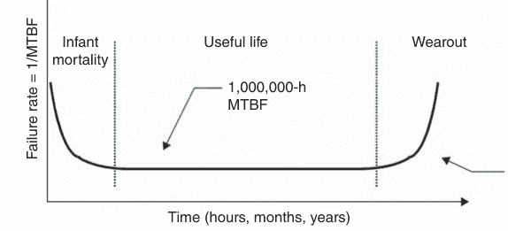

图 6.3 灯泡理论示例。

该区域有时被称为随机发生的事件。长时间后，产品可能会表现出急剧增加的故障率。浴盆的这一区域称为产品耗损期。这里，时间已达到产品消耗其使用寿命的时候。也许是时候更换或升级它了。

灯泡的故障率很好地说明了使用寿命和耗损之间的区别。假设一个灯泡的预期寿命为 2000 小时。灯泡包装上将其显示为额定寿命（或中位寿命）。2000 小时代表耗损曲线中的拐点。灯泡不期望在 2000 小时后继续工作。然而，白炽灯泡极其可靠；为此示例，我们假设其 MTBF 为一百万小时。MTBF 代表灯泡在其使用寿命期间的平均或平均故障率。图 6.3 说明了这种差异。

现在假设，你建造一个灯面板以容纳一百万个这些灯泡。此外，所有灯都连线在一起，使其同时工作，就像圣诞灯一样。在使用寿命期间（运行的前 2000 小时），一百万个灯泡中每小时会有一个灯泡失效（停止发光）。实际上，灯泡以随机速率失效。然而，在前 2000 小时内，一百万个灯泡中有 2000 个会失效。按照定义，这就是一百万小时 MTBF 的计算方式。现在，如果我们继续运行该灯面板超过 2000 小时，灯泡失效的速率会迅速增加。也许只需要再 400 小时，一百万个灯泡中的大多数就不再工作了。这说明了在产品使用寿命期间失效发生的速率很低，但一旦产品达到其额定寿命，灯泡开始失效的速率就会急剧增加。从本质上讲，2000 小时后失效是预期的，因此我们可以为此事件做计划。但，使用寿命期间的失效是随机且不可预期的（每小时一百万分之一）。

## 6.2 平均故障间隔时间

描述产品可靠性的最常用术语是 MTBF。该术语衡量产品在其正常寿命期间的故障率。描述产品故障率还有其他方法，在以下各节中进行了解释。

### 6.2.1 平均维修间隔时间

平均维修间隔时间（MTBR）是描述可修复系统基本可靠性指标的另一种方式。它是现场系统中所有维修之间的平均时间度量。

### 6.2.2 平均维护间隔时间（MTBM）

平均维护间隔时间（MTBM）是描述可修复系统可靠性的常用术语。它是现场所有系统之间维护（预防性维护和维修）平均时间的度量。

### 6.2.3 平均事件间隔时间（MTBI）

平均事件间隔时间（MTBI）是描述可能需要用户干预来修复的事件频率的较少使用的术语。它可用于参考自动化系统（即系统运输或传送带上的托盘），该系统可能卡住并需要用户干预来解决。MTBI 也可用于描述平均中断间隔时间。使用 MTBI 需要对构成事件的内容进行清晰定义。

### 6.2.4 平均故障时间（MTTF）

平均故障时间（MTTF）是描述不可修复系统可靠性的常用术语。MTTF 描述了一组系统运行到下一次系统故障的平均时间。该术语通常用于产品不会被维修的情况。因为它不会被维修，所以在正常运行意义上不能有“两次故障之间”的时间。

### 6.2.5 平均修复时间（MTTR）

平均修复时间（MTTR）是最常用的描述系统可维护性的术语。它是修复所有故障所需时间的总和除以故障总数。修复故障所需的时间通常包括故障排除、故障隔离、维修以及验证问题已修复所需的任何测试。简单地说，它是从客户无法使用产品到客户再次可以使用产品的时间。

### 6.2.6 平均系统恢复时间（MTTRS）

平均系统恢复时间（MTTRS）与 MTTR 类似，但包括获取修复问题所需零件的额外时间。

这些定义用于描述预定义的环境和运行条件下的事件频率。这些事件的频率会因不同的环境和运行条件而显著变化。讨论产品可靠性有许多不同方式。生产全球产品的公司将更关心 MTTRS，因为它包括其现场


service and spare parts logistics. 生产一次性电子产品或使用寿命较短的产品 的公司会衡量其 MTTF。您选择衡量产品可靠性的 方法可能取决于客户的需求、市场力量以及您收集有效数据的能力。

MTBF 定义为浴盆曲线“恒定失效率”部分的失效率的倒数。MTBF 通常以两次故障之间的小时数来描述。MTBF 不包括婴儿死亡期失效率和产品磨损。为了说明这一点，我们考虑一组打印机的可靠性。该组可能具有 10 000 小时的 MTBF（该 MTBF 数字是编造的，并不代表打印机的实际 MTBF）。这句话意味着这些打印机的平均失效率约为每运行 10 000 小时发生 1 次故障。然而，有些打印机使用寿命要长得多。其他客户的体验是他们的打印机寿命远低于平均寿命。事实上，客户体验可能存在差异，以至于观察到的打印机故障时间在 6000 到 30 000 小时使用之间不等。原因在于浴盆曲线。打印机的工作寿命包括婴儿死亡期、恒定寿命期和磨损阶段。在这一时间线上，最终所有打印机都可预期会发生故障。磨损通常不被视为产品使用寿命的一部分，即使很难知道磨损阶段何时开始。MTBF 实际上应仅针对浴盆曲线的恒定失效率部分，因此在观察故障时必须谨慎。观察到的现场 MTBF 可能显示出故障时间范围很广，而平均值（MTBF）通常是通过测试和现场经验确定的。有些打印机寿命远长于平均值，有些则不然。MTBF 就是这种常用于判断符合性的运行时间平均值。

## 6.3 保修成本

当制造商向客户使用 MTBF 术语时，必须谨慎。通常，客户将这个数字视为某种保证数字。因此，当单个购买的单元在“规定的 MTBF 时间”之前发生故障时，通常会向制造商寻求某种形式的补偿。一般来说，对于具有给定 MTBF 的给定产品，将有一些产品在 MTBF（平均）失效率之前发生故障，而另一些产品将超过预期的 MTBF。故障事件的发生是随机的，无法预测，只能估计。那些在 MTBF 规格以下时间发生故障的单元，通常会影响保修预算以及客户意见。

制造商可以（并且应该）使用 MTBF 数字来预算其保修成本。如果产品的 MTBF 为 10 000 小时且产品通常连续运行，则一年保修期（8760 小时）可能是合适的。制造商可能会吸收早期故障（即在保修期内）的任何保修成本。了解 MTBF 将为制造商提供一个依据，以便为给定产品预算保修准备金。使用此示例，我们接下来将研究一个简单的情况，以更好地了解 MTBF 如何影响保修成本。

首先，MTBF 是许多未同时制造的运行单元的失效率平均值。它是机队平均值。保持简单，我们可以查看 100 个在同一短时间制造周期内制造的单元，例如一周。它们可能由其众多用户在大约同一时间投入运行，因此它们的累计运行时间通常相似。

在此示例中，一组单元将表现出接近规定 MTBF 数字的机队 MTBF，例如 10 000 小时。因此，这 100 个单元的小机队将出现故障（随机），平均失效率为 10 000 小时。一些客户不会看到任何故障；而其他客户会经历一次或多次故障。在不深入详细数学的情况下（参见附录 B），大约有 37 个单元在规定的 10 000 小时内不会发生故障。这些客户是被故障事件随机性选中的幸运者。一些用户会不幸，可能在同一 10 000 小时时间内发生两次、三次甚至四次故障！以下是一个简单示例。

假设您有一个 MTBF 为 10 000 小时的产品，并且您刚刚售出了前 100 个单元。在使用的前 10 000 小时内，可以估计以下情况：

- 1. 平均（平均值）每 100 小时发生一次故障。
- 2. 在 10 000 小时时间内总共发生 100 次故障。
- 3. 故障的发生是随机分布的。
- 4. 一些单元（26 个）将发生一次以上故障。
- 5. 一些单元（37 个）不会出现故障。

这些估计背后的数学在附录 B 中介绍。

您如何避免大部分这种痛苦？使用可靠性技术使您的 MTBF 非常高。即使是 MTBF 为一百万小时的产品，也可能在 100 个机队中在约 10 000 小时内出现第一次故障。但会有 99 位非常满意的客户，因为下一个故障在统计上预计还要再等 10 000 小时累计时间。

保修要求预留销售资金，旨在吸收售出产品保修期间的保修成本。产品单元平均每累计一个 MTBF 时间段就会发生一次故障。制造商必须考虑这种预期的故障累积，以便有资金吸收这种预期成本。

销售可靠性非常高因此 MTBF 数字很高的产品的制造商通常保修成本很低。他们拥有更满意的客户，这些客户会一次又一次地从同一制造商处重新订购产品。当我们考虑此示例中的故障数量时，所有故障单元都将被迅速修复并重新投入使用。表 6.1 说明了 MTBF 如何与可修复单元的保修期内故障相关。

有关 MTBF 和保修预算的更详细讨论，请参阅附录 B。

## 表 6.1 保修期内不同 MTBF 的故障数。

| 保修期（年） | MTBF = 8760 h | MTBF = 87 600 h | MTBF = 876 000 h |
|---|---|---|---|
| 1 | 100 次故障 | 10 次故障 | 1 次故障 |
| 2 | 200 次故障 | 20 次故障 | 2 次故障 |
| 5 | 500 次故障 | 50 次故障 | 5 次故障 |

## 6.4 可用性

当系统发生故障并对客户变得无法使用时，解决问题所需的时间至关重要（MTTR）。长时间的维修时间会大大降低连续运行产品的使用价值，因此具有较短的 MTTR 是关键的可用性问题。简单地说，静态可用性可表示为

Availability = MTBF/(MTBF + MTTR)

示例：MTBF 为 10 000 小时，MTTR 为 10 小时：

Availability = 10,000/(10,000 + 10) = 10,000/10,010 = 0.999 或 99.9%

读者可以看到，更大的 MTBF 可使可用性接近 100%。较小的 MTBF 会降低可用性，即使 MTTR 相同。经常出现中断的客户需要快速解决问题。如果 MTTR 非常短，小于一小时，影响相对较小。但当 MTTR 很长，例如数天时，可用性会变得非常小。该客户会不满意。对制造商来说，拥有高 MTBF 最有利，但他们也必须努力实现短 MTTR。由于备件可用性是使产品恢复运行的主要因素之一，因此建议在可靠性改进计划的早期解决此问题。

当 MTBF 很低时，短可用性并不能拯救。一些制造商生产需要熟练的现场服务人员的复杂设备。如果他们平均能在几小时内修复所有问题，但有许多单元在运行，他们将面临一场艰苦的战斗。为了说明，我们将考虑一个拥有 100 个运行单元的客户。MTBF 为 1000 小时，MTTR 为 4 小时，平均每 10 小时就会出现一次新故障。如果设备 24/7 运行，预计服务每天需要修复约 2.4 次故障。维修人员预计每 8 小时班次可修复平均两个单元，并在下班前还有 0.4 个单元需要维修。维修服务可能需要更多服务人员后勤。物流限制通常会进一步推高 MTTR 要求。采购时间可能从几小时到几天甚至几周不等。平均每天累积 2.4 次故障，很容易看出维修团队很快就会不堪重负。

随着故障出现，客户的生产输出可能会减少。客户在下次为生产线选择设备时可能会考虑其他制造商。

更短的 MTTR 转化为能够快速纠正现场故障的服务能力。这意味着受过培训的服务人员和 readily available 备件。服务/维修人员必须几乎立即为客户提供服务。这可以通过八种方式实现：

- 1. 现场制造商服务人员
- 2. 客户受训服务人员
- 3. 制造商对客户服务人员的培训
- 4. 易于使用的服务手册


- 5. 快速诊断能力
- 6. 维修和备件可用性
- 7. 对客户服务请求的快速响应
- 8. 故障数据追踪

### 6.4.1 现场制造商服务人员

客户，特别是新客户，通常没有熟悉其新购设备故障排除、诊断、纠正措施和备件选择的员工。向客户在客户设施中提供工厂服务人员将缩短较长的 MTTR。

### 6.4.2 受过培训的客户服务人员

鉴于客户需要受过培训的人员，客户服务团队的培训应在产品交付前完成。

### 6.4.3 制造商为客户服务人员提供的培训

制造商应为客户服务人员提供培训。如果客户偏好“交付前培训”，可在制造商设施中进行。为了节省客户的费用，部分培训可在客户设施中使用原型系统进行。客户通常希望获得此项增值服务，但如果其自身设备尚未交付，可能因没有实际设备可操作而付出代价。

### 6.4.4 易于使用的服务手册

提高可靠性的新产品开发过程的一部分是失效模式和影响分析（FMEA）过程。FMEA 的交付物（输出）之一是对产品如何失效的详细理解。这些信息对服务手册编写人员非常宝贵。他们可以利用 FMEA 创建一份服务手册，涵盖设计团队讨论的所有问题。服务手册会因最终产品而大不相同，但 FMEA 过程始终是帮助开发服务手册的丰富信息来源。

手册应随时可供客户使用。许多公司现在将手册放在网上。在网页上提供链接到这些手册的位置将缩短最终产品的 MTTR。将手册放在 CD 上是另一种选择。

### 6.4.5 快速诊断能力

工厂培训加上服务手册非常有用，但某些特殊设计难以诊断。这可能意味着需要特殊工具、测试设备和软件来加快诊断速度。服务手册的一部分应包含可用于快速诊断的推荐工具清单。昂贵的工具或只能从制造商处获得的特殊工具往往会阻碍而非帮助降低 MTTR。即使是可在美国几乎任何地方获得的常见工具，在世界其他地区也可能不易找到。

### 6.4.6 维修和备件可用性

由于频繁故障，磨损件可能需要在客户设施中备有。这些包括滤清器、液体、润滑剂、计算机磁盘和磁带等。应向客户提供清单，并在客户设施中备有套件，以便消除因这些常用物品造成的延误。

其他零件和子组件应始终由制造商备货，以便迅速交付给客户。应建立完整的零件订购、库存和运输系统，以满足业务需求。全球分散的客户需要多个零件存放点，以加快将零件送达所需地点的速度。

### 6.4.7 对客户服务请求的快速响应

制造商设施中的零件和服务部门应设计成便于客户识别所需内容并迅速获得必要部件。专用软件和互联网能力很可能是解决方案。这里零件的命名和编号质量非常重要。客户可能不像制造商那样熟悉零件系统(s)，可能会订购错误的零件。这会增加维修延迟并大幅提高 MTTR。使零件 ID 系统易于使用。

您必须从销售团队了解客户是否认为该系统有用。了解需要改进的地方并据此做出改变。

### 6.4.8 故障数据追踪

收集现场数据以了解问题区域。利用这些信息消除问题。通常，这些信息会导致设计变更，从而改善新产品。这些变更可在后续产品开发中节省大量资金和时间。全面追踪故障数据可实现快速发现和纠正措施。完善的故障报告、分析和纠正措施系统（FRACAS）通过降低保修成本并提高 MTBF，从而减轻现有 MTTR 的影响，将带来丰厚回报。

图 6.4 说明了 MTBF、MTTR 与由此产生的可用性之间的关系。

## 6.5 可靠性增长

可靠性增长是在永久消除失效机制时测量产品可靠性改善的过程。这最初由 J.T. Duane 描述，他推导出随着时间的推移，故障间隔会增加 [1]。简单来说，每消除一个失效机制，MTBF 就会增加。对于从系统中移除的每个缺陷（意味着该故障在任何系统中都不会再发生），由此产生的 MTBF 必须增加。

公司处理可靠性问题大致有两种方式。第一种选择是许多制造商采用的方式，即积累现场故障信息。当现场数据压倒性地表明存在问题时，他们会调查故障以找到根本原因。然后解决问题并通过工程变更关闭。希望设计变更能成为未来设计的建议。从识别问题到实施修复的整个过程可能需要相当长的时间，有时长达数年。到那时，问题的成本影响可能已变得显著。由于解决问题可能需要数年时间，新设计很可能在没有此知识的情况下完成。相同的老错误被设计到新产品中并导致类似问题。这是反应式的现场故障分析和纠正措施。寻找故障并修复故障的过程通常会使产品达到设计成熟度的时间延迟几年。理想情况下，设计成熟度应在首批单元发货前实现。产品召回是由于在发货前未识别出将在现场失效的内容所致。第二种、更优的方式是主动使用可靠性增长，如表 6.2 所示。新产品开发过程应具有带数据收集的测试（FRACAS），可帮助设计人员在设计定型前很早就发现这些失效机制。FMEA 和高度加速寿命试验（HALT）是识别设计过程早期潜在可靠性问题的两个非常有用的工具。可靠性人员应与设计人员一起了解并追踪每一次故障，直到找到根本原因并实施和验证设计修复。

### 可用性 vs MTBF vs MTTR

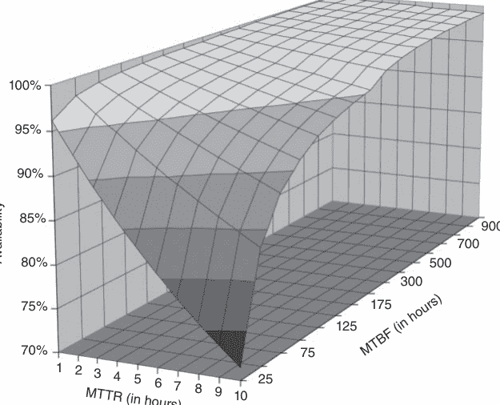

图 6.4 可用性作为 MTBF 和 MTTR 的函数。注意：曲线中有一点涟漪，这是由于 MTBF 轴的变化所致。对于 0 到 200 的范围，以 25 小时为增量标记，之后以 100 小时为增量标记。这是为了分辨率目的而进行的，以便说明低 MTBF 和长 MTTR 的影响。

## 表 6.2 主动可靠性增长的优势。

| 主动 | 反应 |
|---|---|
| 快速发现问题<br>故障数据可能更准确，因为设计团队收集它<br>设备在内部更容易修改<br>可对首次发生做出反应<br>维护制造商声誉 | 数据更难获得<br>数据因技术较差的服务人员而模糊<br>修改成本更高（召回）<br>可能需要多次发生<br>制造商声誉下降 |

## 6.6 可靠性验证测试

RDT 常被误认为是可靠性增长。在上一节中，我们展示了可靠性增长如何在使用前将设计成熟到首批客户发货之前。产品发布时设计越成熟，保修成本就越低。这是通过在设计早期调查所有故障并跟踪公司的纠正措施直至关闭来实现的。

RDT 是一个统计确保早期项目中设定的可靠性目标得以实现的过程。关于可靠性增长和 RDT 进行顺序的混淆。可靠性增长始终先于 RDT。我们可以在设计确定后开始可靠性增长测量。FMEA 和 HALT 识别问题；这些问题被发现后然后使用可靠性增长技术进行跟踪。RDT 只有在设计定型并有最终产品可供测试后才能开始。换句话说，可靠性增长是提高产品 MTBF 的工具，其成果通过 RDT 得到验证。

本章前面我们展示了，即使系统具有指定的 MTBF，现场系统也会表现出不同的 MTBF。我们为车队指定的 MTBF 是所有系统中“平均 MTBF”的衡量标准。车队中的单个系统会在不同时间、不同速率下发生故障并具有不同的 MTBF 体验。车队 MTBF 是现场整个总运行时间的累积，除以该总人口的全部现场故障总和。单个系统 MTBF 因故障事件的随机性而变化。这些事件的随机性可数学建模为置信区间。置信区间代表可能预期的值范围。随着置信区间的增加，即对测量值落在置信区间内的信心更大，预期值范围也会增加。MTBF 计算假设指数分布，置信区间基于非对称的卡方分布。上限和下限可能不会对称地分布在平均 MTBF 值周围。

RDT 是追踪累积产品运行时间和故障次数以验证产品是否达到其 MTBF 目标的过程。RDT 是通过产品测试证明产品确实达到所承诺的指定 MTBF 的一种方法。RDT 是验证设计满足合同可靠性要求 commonly 使用的方法。可靠性工程师负责追踪累积运行小时数


Table 6.3 RDT multiplier for failure-free runtime.

| Confidence bounds (%) | Failure-free multiplier |
|---|---|
| 95 | 3.0 |
| 90 | 2.3 |
| 85 | 1.9 |
| 80 | 1.6 |
| 75 | 1.4 |
| 70 | 1.2 |

against the number of accumulated failures. To verify that a system has achieved its stated MTBF, we will need to accumulate more product runtime without a failure. This total time is always more than the desired MTBF time.

There is a rule of thumb that can be applied to RDT. The rule is used to verify that a system has achieved the specified MTBF goal at 90% confidence, that a system must run failure-free for 2.3 times the desired MTBF goal.

For example, we can say a system has a demonstrated MTBF of 1000 hour at 90% if it has functioned properly for 2300 hour without a failure. Recall that, when we talk about MTBF, there is some uncertainty specified around it. This rule assumes that the design maturity goal has been met with a 90% confidence level. If we wanted a higher confidence level, then the runtime without a failure will have to increase. Likewise, if the design maturity goal can accept a lower confidence level, the failure free runtime will decrease. Refer to Table 6.3 to see the effect of the confidence interval on failure-free runtime. A 90% confidence interval, typically, is widely accepted.

There is always a confidence level associated with RDT. The confidence interval is the way to account for system variability and determine if it is acceptable. Let’s imagine that a product has an MTBF of 8760 hour. With an exponential failure rate, there will be one failure every year. Of course, not every product will experience one failure every year; life is not that simple. There will be some users who will have no failures in the first-year time period and some who have one, two, or more failures in the same first year. The variability is defined through a confidence interval. The confidence interval takes into account that not all users will have the same experience in the product’s reliability. The way we deal with this random nature is through the use of confidence intervals to account for the variability in the reliability experience for RDT.

When a system or a number of systems in the field have demonstrated that their accumulated runtimes have reached at least 2.3 times the stated MTBF of 1000 hours without a failure, we can state statistically that there is a high degree of confidence (90%) that the product has demonstrated a 1000-hour MTBF. By using more than one system in the RDT, the manufacturer can speed up the process. No manufacturer can state, however, precisely how long any individual unit will operate properly before failure.

What do you do when there is a failure during the design maturity testing to verify the product’s MTBF goal? If this happens, does it mean that you cannot achieve your product’s MTBF goals? No. There are still more statistics that can be helpful.

This point is illustrated in Figure 6.5 for demonstrating a 1000-hour product MTBF.

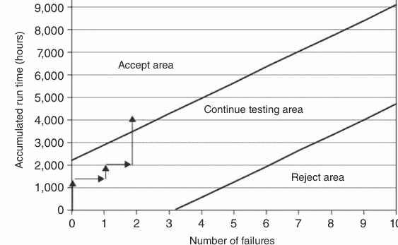

Figure 6.5 Design maturity testing – accept/reject criteria.

The x-axis is scaled for the number of failures. This test can be set up for one system or more. More is always better! The y-axis is in accumulated runtime hours. Again, this can be for one system or for more. When using more than one system to determine RDT, you must add the runtime hours and total the number of failures for all systems being used in the test. If you use two systems in the RDT, the accumulated runtime hours will collect at twice the rate as that of a single system. Using 5 or 10 systems will accelerate the RDT.

In Figure 6.5, small arrows depict what occurred when trying to demonstrate to perform a real RDT on a product that has a stated 1000-hour MTBF. The RDT begins at the origin, zero failures and zero accumulated runtime hours. For illustration, we show the first arrow as representing the test. This arrow lengthens and runs until there is a first failure at approximately 1500 hours. Then, the second arrow points to the first failure at the “number of failures” and extends until 1500 hours. The unit is repaired and the test continues, and the third arrow climbs toward the accept line to represent this condition. When the unit reaches approximately 2400 hours, there is a second failure. Again, the unit is repaired and the test is resumed. Then, there are no more failures and the unit passes through the “accept” or “pass” line at approximately 3600 hours. This is the statistically required point in accumulated runtime hours that a system must run with two failures to have “demonstrated” that it has an MTBF of 1000 hours with a 90% confidence interval. If the system had no failures, the accumulated runtime hours needed would only have to have reached 2300 hours. As you can see, there may be times when doing an RDT that you might experience failures before the arrow passes through the “accept” line. This is still statistically correct. If the failures collect too rapidly and the tracking line passes through the reject line, then stop the RDT because the test has statistically proven with a 90% confidence interval that the reliability of the product is not capable of operating at the specified MTBF.

If the arrows never punch through the accept line, then you have more work to do in reliability growth before you should again try to demonstrate the final system MTBF. If the arrows soon punch through the fail line, then you must have decided to do the RDT prematurely or you simply have greatly overstated the system MTBF.

Can you place five units in the RDT for a while and then remove a few units and still have a statistically correct result? Yes, as long as the accumulated runtime hours and the total number of failures are recorded. Five units can speed the process. Removing a few units from the RDT will slow it down.

Can you place five units in the RDT and halfway through remove some, install some new units and continue? Yes, statistically, but here it gets a little tricky. You must be certain that the infant mortalities have been removed from any of the new units. This is true for all the above examples. If the early failures are not removed, the RDT will, in all likelihood, fail. If you place units in and out too often, then the test may become invalid.

Can you perform a continuing RDT to ensure that the stated MTBF is remaining to specification? Yes, place a group of units in RDT, remove them after a period of time for shipment, place new units in the same RDT, remove them for shipment, and so on. The idea is not to consume too much life from the units while testing them. The RDT test can be very challenging when the MTBFs are very long. For an MTBF of a million hours or more, you would have to demonstrate 2 300 000 hours without a failure.

What is so magical about the number 2.3? It is simply the statistical correction number that acts as a multiplier for the 90% statistical confidence interval. If you wanted more confidence, the number would be somewhat higher, and vice versa.

## 6.7 Maintenance and Availability

Electromechanical systems that are repairable will require maintenance at some point in time to keep them operating. Maintainability is the probability that an item that has failed can be successfully restored to an operational state. The maintenance can be either a preventative or a reactive/corrective activity. A preventative maintenance activity is intended to either prevent or delay the electromechanical system from malfunctioning. Preventative maintenance can be done based on a schedule, an opportunity (i.e. when other work is being done due to an unscheduled downtime), a warning indicator or based on a sensor/feedback system designed to detect degradation and wear. The maintenance method chosen will have an impact on maintenance cost and failure probability. A corrective maintenance activity is performed when there is a failure that needs to be repaired. Corrective maintenance activities can require part replacement or an adjustment to return the electromechanical system to an operational state.

Maintainability refers to the ease with which repairs can be made to keep the system operational and available. The MTTR is the sum of the time required to fix all failures in the fleet divided by the total number of failures in the fleet. The MTTR is the average repair time per unit that fails. The time required to fix the failure typically includes diagnostic troubleshooting, fault isolation, waiting period if replacement parts are not available, repair, and any testing that is required to verify that the problem has been fixed. Simply stated, repair time is the duration during which the customer could not use the product. Maintenance refers to an operations related activity to keep the electromechanical system operational or to restore it to an operational condition after a failure.


可用性是指机电系统处于正常运行状态的总时间的度量。

## 6.7.1 预防性维护

维护是对产品或系统进行恢复至其标称或运行状态的活动。维护活动的结果可能将系统恢复至接近新品的状态，也可能恢复至不如新品但比维护前更可靠的状态。可恢复性描述了系统保持在工作状态的程度以及未来发生故障的概率。需要注意的是，预防性维护可能会导致系统可靠性降低。一个例子是如果维护操作不当或更换了有缺陷或假冒的零件。

当维护是计划活动的一部分（即维护计划）时，就被视为预防性维护。维护计划可以基于时间或运行时间、距离、表读数或事件。汽车遵循制造商提供的维护计划，以确定何时需要进行保养、更换零件或检查项目。预防性维护背后的理念是它降低了故障发生的可能性。通常，预防性维护计划是基于故障数据和历史记录制定的。在汽车中更换机油是另一个预防性维护的例子。机油不会被测试以确定其是否良好或已劣化。预防性维护计划或事件通常基于对类似零件收集的故障数据。它可以基于过往经验制定，并旨在保守，以便维护事件在潜在故障风险出现之前很久就发生。

例如，考虑一个额定使用寿命为 25 000 小时的风扇。风扇并非都在 25 000 小时时全部失效，但那是风扇的平均使用寿命。如果你假设故障概率随时间呈高斯分布，则在接近磨损时故障概率可能如下图 6.6 所示。注意：许多机械磨损故障遵循对数正态分布，因为在磨损相关故障开始出现之前存在较长的无故障时间。

使用预防性维护策略，你需要决定风扇的更换点。风扇更换时间的确定为

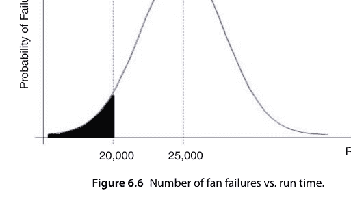

图 6.6 风扇故障数与运行时间的关系。

基于你愿意接受的在风扇被更换前发生故障的风险容忍度。如果故障可能导致灾难性连带损坏、成为安全问题或非计划停机导致重大收入损失，则风险容忍度会很低。故障风险容忍度越低，风扇更换计划就越早。

如果维护策略是在 20 000 小时后更换风扇，则风扇在被更换前可能发生故障的概率如阴影黑色区域所示。风扇可能还有 5000–10 000 小时或更长的剩余使用寿命，但预防性维护计划是基于在风扇仍处于良好状态时就进行更换。可以清楚地看出，这种方法会导致更高的维护成本。为了降低维护成本，需要采用预测性或预测与健康管理（PHM）方法。如果完全不能容忍故障，则需要冗余策略。

## 6.7.2 预测性维护

预防性维护可能会导致在组件实际上不需要更换之前就进行更换，因为更换决策基于计划而不是组件或系统的状况。例如，汽车制造商可能会建议每行驶 12 000 英里或 1 年更换一次机油，以先到者为准。机油可能仍然良好且不需要更换。要知道机油是否开始劣化，需要进行分析。如果能够分析机油以确定其是否已劣化，你就可以做出更具成本效益的何时更换的决策。这就是预测性维护背后的理论。

预测性维护是一种用于确定组件或系统状况的技术。如果能够感知到某些东西开始劣化，你就可以就何时应更换或进行维护做出更明智的决策。这为维护系统和减少非计划停机提供了一种更具成本效益的方法。

预测性维护使用技术来确定磨损、劣化和诸如裂纹和脆化之类的故障。预测性维护要求用户进行测量以确定组件的健康状况。测量可以是热成像以查看热点区域、高摩擦磨损或热失控迹象。它可以是振动分析，以判断轴承或齿轮是否正在磨损并可能很快失效。但还有许多其他方法可以更简单、更便宜。检查轮胎并使用量规测量胎面磨损是预测性维护技术，用于确定轮胎何时应更换。

## 6.7.3 预测与健康管理（PHM）

与预防性维护相比，预测性维护在最小化维护成本和非计划停机方面具有显著的成本优势，但还有第三种方法可以进一步最小化非计划停机并更好地管理维护成本。该方法称为 PHM，其基于这样一种理论：大多数机电系统在可接受的使用条件下不会在运行中瞬间从良好状态转变为失效状态。相反，它们会开始磨损或劣化，随着时间的推移，劣化程度足以导致故障事件。PHM 方法提供了一种检测组件、子系统或系统劣化的方法。一旦

你确定其已劣化到不可接受的水平，PHM 定义了一个流程和方法来确定何时以及劣化了多少，并估计到故障的时间或剩余使用寿命（RUL）。要确定劣化和到故障的时间，需要了解其如何失效、失效机制以及测量或感知劣化的方法。该过程适用于电气、机械和机电系统。机载传感器可以测量实时运行和性能。PHM 相对于预防性维护或预测性维护方法具有以下优势：

- PHM 在劣化开始发生时提供早期指示。
- 非计划维护事件的数量减少，可用性提高。
- 由于维护周期减少、零件库存成本管理更好以及不必要的检查减少或可能消除，拥有成本降低。

例如，考虑第 6.7.1 节中描述的风扇。使用预防性维护方法，风扇将在 20 000 小时后更换。如果系统未设计为跟踪实际风扇运行小时数，则会采用更保守的估计风扇运行小时数的替代方法，从而导致风扇更早被更换。

使用预测性维护技术，你将对风扇进行负载测试以查看其性能如何。如果风扇性能劣化低于阈值水平（即风扇输出的立方英尺每分钟 [CFM] 降低），则会触发更换警告。此方法需要维护计划来监控风扇磨损。用于监控风扇磨损的维护计划间隔需要设定为风扇不太可能在两次维护间隔之间失效。随着风扇运行小时数的增加，可能需要缩短维护间隔以防止风扇故障。PHM 方法使用实时传感器数据和分析来监控和检测风扇磨损。检测导致劣化的风扇磨损有许多方法。如果风扇磨损是由于轴承劣化引起，它会使风扇振动加剧。风扇振动可使用安装在能够检测轴承振动区域的加速度计进行监控。随着轴承磨损，风扇发出的声学噪声的量和频率谱也会增加。可以使用声学传感器来监控噪声量和频率谱作为检测风扇轴承劣化的策略。当风扇开始磨损时，风扇转速会减慢，因此根据风扇传感器的类型，它可用于确定风扇劣化。

PHM 提供了一个流程和方法，将实时数据与预期良好的数据集进行比较，以便对其健康状况做出判断。PHM 流程可以指示运行健康是否发生变化，并为未来健康提供预测。为机电系统开发 PHM 流程需要确定其随时间推移可能如何失效或劣化。这可以通过失效模式、机制和影响分析（FMMEA）来实现。FMMEA 提供了一种系统的方法来研究其如何失效、可能导致其失效的原因以及可能使其从良好状态转变为不良或劣化状态的机制或机制。失效机制是物理上导致其健康发生变化的过程，可能是由于过应力或磨损。过应力可以是机械、热、电辐射或化学反应（图 6.7）。例如，电气过应力可能导致器件发生介电击穿。同样，物理磨损可能导致


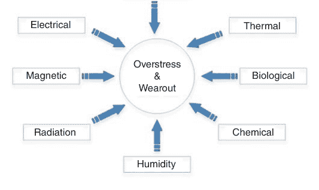

图 6.7 可能导致退化和失效的机制。

表 6.4 风扇轴承的 FMMEA（省略检测）。

| Failure | Failure mode | Failure cause | Failure mechanism | Occurrence | Severity | RPN |
|---|---|---|---|---|---|---|
| Fan Ball bearing | Brinell mark | Mechanical overload | Material yields | 3 | 3 | 9 |
|  | Furrows | Moisture | Corrosion | 2 | 2 | 4 |
|  | Spalling | Cyclic overload | Fatigue | 1 | 2 | 2 |
|  | Seizure | Thermal overload | Lubricant breakdown/deterioration | 5 | 4 | 20 |

也可能归因于相同的机制，即：机械、热、电、辐射或化学反应。FMMEA 有助于确定哪些失效模式和机制是 PHM 方法的良好候选对象，并提供有关如何监控其健康状况以及何时需要维护操作的见解。对于在 FMMEA 中被确定为高优先级关注的每个项目，都需要开发一种故障检测、诊断和预测的方法。

对于前面提到的风扇示例，FMMEA 将识别风扇可能失效的所有方式、导致其失效的原因以及每个失效原因所涉及的机制。表 6.4 中给出了风扇轴承的示例。

PHM 需要一种实时捕获系统健康状况的方法。通常，使用传感器来监控系统的健康状况。可以使用许多不同类型的传感器来监控系统的健康状况（表 6.5）。FMMEA 可用于确定最有可能随时间退化的组件、导致其退化的原因以及导致退化的机制。确定退化机制后，会开发加速寿命试验以捕获良好健康状态、过渡到退化状态以及最终失效的数据。

或者，可以在现有机队上放置传感器以收集基线和退化失效数据。加速寿命试验计划的制定将包括

## 表 6.5 用于监控磨损退化过应力传感器的传感器。

| Overstress and wearout mechanism | Sensors |
|---|---|
| Biological | Electrochemical<br>Magnetic<br>Piezoelectric<br>Thermometric |
| Chemical | Electrochemical<br>Mass<br>Optical<br>Thermochemical |
| Electrical | Capacitive transducer<br>Hall effect strain gauge<br>Inductive transducer<br>Thermal transducer |
| Humidity | Capacitive<br>Resistive<br>Thermal conductivity |
| Magnetic | Hall effect<br>Magnetometers<br>Magneto-optic<br>Magneto resistive |
| Mechanical | Capacitive strain gauge<br>Inductive impedance strain gauge<br>Piezoelectric strain gauge<br>Piezo resistive strain gauge |
| Optical | Fiber optic<br>Photoconductor<br>Photo emissive<br>Photovoltaic |
| Thermal | IC sensor<br>Resistive thermistor<br>Thermocouple |

选择一个或多个传感器来监控组件健康状况。选择不同类型的传感器来监控健康状况将有助于确定最佳类型的传感器以及是否需要多个传感器来监控组件磨损和退化。可能有必要使用多个传感器的数据来更好地表示组件将如何退化并最终失效。图 6.8 中给出了一个示例，其中圆圈代表随时间推移的良好系统的基线数据。方块和三角形是实时传感器数据。PHM 使用数学技术和算法来处理数据。PHM 方法可能涉及大量数据，并且这些数据在与基线数据进行比较之前可能需要信号处理和调理。通常，第一步是将原始数据清理并归一化为更易于用户使用的数据集。图 6.8 中的方块传感器数据需要

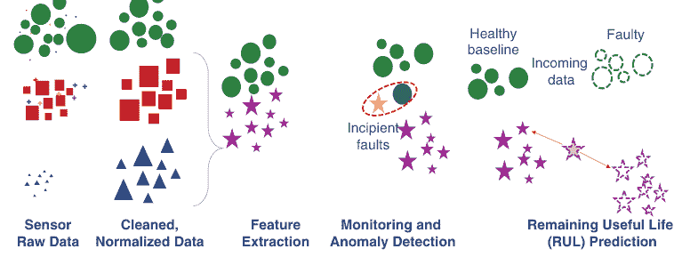

图 6.8 用于检测退化的 PHM 数据采集和处理。来源：Courtesy Anto Peter。

信号处理以消除数据中的噪声。多个“+”号代表方块传感器数据中的噪声。在此示例中，除了去除方块数据中的噪声外，还需要额外的信号处理来归一化三角形传感器数据。在此示例中，方块和三角形传感器数据用于创建新的数据集，图示为“星号”，以便与良好的健康状态进行比较。提取的数据可以与健康的基线数据进行比较以寻找异常。一旦检测到异常，就会确定在失效之前剩余的退化量。失效前的剩余时间称为“剩余使用寿命”（RUL）。失效前的剩余时间用于管理维护成本并防止非计划停机。

回到风扇示例，FMMEA 确定了由于润滑剂分解和劣化导致的轴承失效为最高优先级的失效机制。轴承中的润滑剂劣化可能是物理性的（即由于蒸发导致润滑剂损失）或化学劣化（即润滑剂氧化、聚合物分离、抗氧化剂消耗分解）。这可能由于机械载荷、温度、湿度或电场而发生。然后使用机械载荷和温度在加速应力寿命试验中开发出由于润滑剂分解和劣化导致的滚珠轴承退化和失效模型。随着滚珠轴承磨损，会出现振动增加、可听噪声、产生的热量和消耗的功率增加。传感器可以被选用来监控这些特性中的每一个（表 6.6）。振动和噪声传感器数据用于评估功率电平频谱的变化。可能可以在频域以及功率电平中检测到轴承退化。

## 表 6.6 用于监控轴承退化的传感器。

| Failure characteristic | Sensor to monitor health |
|---|---|
| Vibration | Accelerometer |
| Noise | Sound transducer |
| Temperature | Thermocouple |
| Power consumption | Power transducer |

## 6.8 元件降额

前面我们提到，大多数元件的可靠性在过去二十年中提高了 10–100 倍。有轶事证据显示改善幅度高达 10 000 倍。四数量级的改进在某些情况下可能是真实的，但正确使用元件而不对其施加过应力将为系统可靠性带来巨大回报。这将使元件成为不可靠性图景中非常小的一部分。

一种选择零件使其在电路中的应力值远低于其各自额定限值的设计实践称为降额。电容器的一个重要规格是击穿电压。建议选择电压和温度额定值远高于电路设计特定需求的电容器。二极管可能具有峰值反向电压额定值。选择额定值远高于电路应用的二极管将降低二极管的应力，并且它将在应用中更长时间地工作。有如此多的不同电子元件，以至于无法在此全部列举。这里提到的三个元件通常有多个参数应进行降额，而不仅仅是提到的那些。降额系统的示例包括 MIL-STD-975。

降额无处不在，与机械设计中使用的安全系数类似。有时是为了公共安全。电梯的最大重量要求就是降额的一种形式。

最简单地说，这意味着如果一个元件，例如电阻器，可以耗散 1 W，则将其用于从不要求超过其一半的电路中，它将更长时间地承受电路的应力。许多元件由于施加的应力而受到累积疲劳的影响。降额降低了这些应力的影响并大大延长了元件的使用寿命。当降额也应用于负载时，性能也可能得到改善。

在所有工程专业中，都有各种零件的规格。阀门有压力限制，电缆有负载限制，材料有温度限制。设计这些以及所有元件的使用方式，使其通过设计不会成为可靠性图景中的关键部分。

所有电气元件都应进行降额以优化元件寿命、降低元件故障率、提高制造良率并降低安全隐患的可能性。每个电气元件都应有制造商的数据表，标识在数据表中规定的工作限制内使用时元件的电气性能规格。元件制造商还应列出器件的绝对最大限制。如果绝对最大限制未在数据表中说明，应联系制造商以获取该信息。

通常，当电气元件在其规定的工作限制内使用时，应满足数据表中的所有电气规格。当元件在工作限制以上但低于绝对最大限制时使用时，它可能不再满足数据表中列出的所有电气规格。在推荐的工作限制以上但低于绝对最大限制使用元件可能会导致元件故障率增加及其使用寿命缩短。元件不应在任何时间内超过其绝对最大限制使用。有一个过程用于在


额定工作极限之上但低于绝对最大极限称为超额定，这将在下一节中讨论。

不幸的是，元器件制造商可能会在其数据手册规格中使用不同的术语来描述电气性能和限制，这可能导致误解。例如，考虑电气元器件的最大温度额定值。如果没有特别说明，温度额定值可能是环境温度、封装温度或结温。甚至管芯结温也可能指管芯整体温度或峰值结温。整体管芯温度可能比峰值结温低 10–20°C。

如果贵组织没有一套元器件降额指南，可以使用行业标准。可靠性分析中心（RAC）有一本名为《Electronic Derating for Optimum Performance》的书籍。还有许多其他降额指南，每种都针对不同类型的行业。降额指南是最佳实践的指导方针，不应作为设计规则使用。当元器件违反降额指南时，应触发调查，以确定从系统角度来看的严重性和风险。第一步是联系制造商，看看他们是否能提供关于可靠性与性能影响的指导。制造商可能已进行过测试并能够回答该问题。也有可能制造商对产品规格进行了降额，因此可能存在一定的裕度。制造商还可能提供降额图表，相对于您对该元器件使用的通用行业标准，这些图表能提供更好的降额指导。如果在调查后仍无法满足降额要求，您只剩下两个选择。您可以选择符合降额要求的其他元器件，或使用工程资源和资金来验证该器件在超出供应商推荐工作极限范围内的使用情况（超额定）。

## 6.9 元器件超额定

当所有替代方案都已耗尽且均不可接受时，就有一种流程可用于评估和验证元器件在超出其工作极限范围内的使用。该流程称为超额定，需要在加速应力下使用足够批次的样品进行测试和表征以确定其可接受性。然而，许多制造商在元器件超出其指定工作极限时使用，将不承担责任或承担责任。

电子元器件有许多不同的分类。今天使用的绝大多数电子元器件可归类为“商用现货”或 COTS 器件。商用级器件通常是该元器件的最低成本版本。电子元器件的其他等级分类为工业级、军用级和汽车级（表 6.7）。电子元器件以几种不同的元器件分类提供并不罕见，其由元器件型号号描述，作为可用选项的一部分。了解同一元器件在两种不同分类下的差异非常重要。有时唯一的区别是器件可使用的温度范围。一种半导体元器件可能同时提供商用和工业分类，其参数规格可能略有不同。参数差异将在数据手册中标出，通常以表格形式列出以便比较。有时，同一制造商生产的商用版和工业版器件之间的唯一区别是工业版由制造商在更高应力下进行了测试。

表 6.7 元器件等级温度分类。

| 元器件分类 | 温度范围 (°C) |
|---|---|
| Commercial | 0 to 70 |
| Industrial | −20 to 85 |
| Military | −55 to 125 |
| Automotive | −40 to 105 |
|  | −40 to 125 |

只有在穷尽所有其他替代方案以找到符合制造商推荐工作极限和降额指南的可接受解决方案后，才应考虑超额定。超额定代价高昂；需要大量资源和时间来验证元器件在其推荐工作条件之上的使用。建议与制造商讨论要求，因为无法保证元器件能够在其推荐工作条件之上通过验证。超额定需要确定哪些参数不符合设计要求。这些参数在使用超出推荐工作极限时需要重新表征。验证流程需要确定适当的样品数量、不同生产批次的数量、所需测试以及为达到所需置信水平而定义的成功标准。在测试开始前，确定哪些参数是关键的，哪些参数可以放宽。然后为每个待测试参数定义所需的测试裕度。验证流程需要完整记录，包括评估过程中使用的所有数据表、使用的设备包括型号、序列号和校准、使用的传感器类型及放置位置、执行的测试，包括日期和测试结果。

如果超额定超出了公司的核心能力，可使用顾问和具有在推荐工作极限之外验证元器件使用经验的测试机构来完成验证。元器件制造商也可能愿意评估元器件在其推荐工作条件之上的使用情况。这显然是理想的，因为他们拥有专业知识、经验、知识库、测试设备和测试程序，可在推荐工作极限之外执行功能和参数评估。验证的一个期望输出是元器件在其超出制造商推荐工作极限时使用时的失效率和有用寿命。

## Reference

1 Duane, J.T. (1964). Learning curve approach to reliability monitoring. IEEE Transactions on Aerospace 2: 2.

## Further Reading

O'Connor, P.D. (2002). *Practical Reliability Engineering*, 360. Wiley.

## Reliability Growth

H. Crow, P. H. Franklin, N. B. Robbins, *Principles of Successful Reliability Growth Applications*, 1994 Proceedings Annual Reliability and Maintainability Symposium, IEEE (1994).

J. Donovan, E. Murphy, *Improvements in Reliability-Growth Modeling*, 2001 Proceedings Annual Reliability and Maintainability Symposium, IEEE (2001).

L. Edward Demko, *On reliability Growth Testing*, 1995 Proceedings Annual Reliability and Maintainability Symposium, IEEE (1995).

G. J. Gibson, L. H. Crow, *Reliability Fix Effectiveness Factor Estimation*, 1989 Proceedings Annual Reliability and Maintainability Symposium, IEEE (1989).

D. K. Smith, *Planning Large Systems Reliability Growth Tests*, 1984 Proceedings Annual Reliability and Maintainability Symposium, IEEE (1984).

J. C. Wronka, *Tracking of Reliability Growth in Early Development*, 1988 Proceedings Annual Reliability and Maintainability Symposium, IEEE (1988).

## Reliability Demonstration

P. I. Hsieh, J. Ling, *A Framework of Integrated Reliability Demonstration in System Development*, 1999 Proceedings Annual Reliability and Maintainability Symposium, IEEE (1999).

Lu, M.-W. and Rudy, R.J. (2001). Laboratory reliability demonstration test considerations. *IEEE Transactions on Reliability* 50: 12–16.

K. L. Wong, *Demonstrating Reliability and Reliability Growth with Environmental Stress Screening Data*, 1990 Proceedings Annual Reliability and Maintainability Symposium, IEEE (1990).

## Prognostics and Health Management

Pecht, M. (2008). *Prognostics and Health Management of Electronics*. Wiley.


## 7
## FMEA

### 7.1 FMEA 的益处

仅次于高度加速寿命试验（HALT）和高度加速应力筛选（HASS）的工具是失效模式与影响分析（FMEA）。FMEA 是一种极其强大的工具，可以在没有昂贵设备的情况下应用。在 20 世纪 60 年代后期，使用 FMEA 作为改进产品设计的方法开始出现。它是一系列系统化的活动，旨在发现潜在的失效并推荐纠正措施以改进设计。这些潜在失效如果不被发现，将在产品完全开发后才会被发现。该过程最重要的结果是，它会在缺陷被无意中设计到产品中之前揭示出来。在这方面，它与 HALT 和 HASS 完全一样，因为它会在设计定型之前促使或识别出设计中需要更改的地方。FMEA 与 HALT 和 HASS 一样，应成为设计过程不可分割的一部分。

FMEA 过程通过以下方式支持设计过程：
- 通过知识丰富的团队客观地评估设计
- 在建造第一个原型之前改进设计
- 识别特定的失效模式及其原因
- 分配风险降低措施并跟踪至关闭

此外，FMEA 的输出可以为其他关键任务提供输入。这些包括：
- 测试和故障排除文档
- 服务手册
- 现场更换单元（FRU）识别

成功实施 FMEA 将做到以下几点：
- 在识别安全问题时提高产品的可靠性和质量。
- 提高客户满意度。
- 缩短产品开发时间。
- 跟踪纠正措施文档。
- 提高产品和公司的竞争力。
- 改善产品形象。

FMEA 使用的团队通常由以下部门组成：
- 设计工程（机械、电气、软件、热等）
- 制造工程
- 测试工程
- 材料采购
- 现场服务
- 质量和可靠性工程

### 7.2 FMEA 的组成部分

FMEA 由三个部分组成：功能框图（FBD）、故障树分析（FTA）和 FMEA 电子表格。

#### 7.2.1 功能框图（FBD）

FBD 是一个逐步的图表，详细说明了开发过程的功能。该过程分为三个部分——输入、过程和输出（见图 7.1）。FBD 是一个高层次的图表，详细说明了针对每个输入、过程和输出所发生的高层次过程。输入、过程和输出下确定的步骤不应过于详细（见图 7.2）。FBD 中确定的每个步骤都成为稍后使用 FTA 评估的过程。因此，通常三到五个步骤足以描述任何输入、过程或输出。十个或更多步骤可能对练习来说过于详细，并可能拖慢后续的 FMEA。

FBD 详细说明了作为给定输入下所进行过程的结果而产生的输出。输出是通过过程转换输入的结果。因此，在步骤 1 中，过程被描述为一系列事件。例如：
- 1. 对于收音机，你将拨盘调到一个无线电频率，通过电子过程你听到声音。（电子元件包括一系列电路，一一将天线处的信号转换为扬声器的可听声音。这一系列信号转换就是 FBD 中的过程。）
- 2. 直流电源有交流电输入，通过电子过程它有直流输出电压，例如 +12 V。（来自墙壁插座的交流电被转换为变化的直流电；它被滤波、调节并从电源作为稳定的直流电输出。这是一个简单电源的 FBD。）
- 3. 汽车变速箱有沿轴的旋转力作为输入，通过传动轴和机械差速器将该旋转力传递到驱动轮。（当发动机旋转时，力通过轴传递并通过离合器耦合到变速箱。变速箱的齿轮选择向驱动轮传递的动力量。然后，从变速箱传动轴，动力被传递到最终将力连接到车轮的差速器。这是变速箱的 FBD。）


图 7.1 功能框图。

# 手电筒原理图

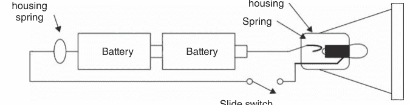

# 图 7.3 手电筒的原理图。

团队必须确保他们同意他们理解团队领导和文档所描述的设备。

FBD 从书写三个高层次标签开始：输入、过程和输出。标签可以用便签纸®¹ 写在上面并贴在墙上。便签纸是促进头脑风暴练习的工具箱的一部分。工具箱中应包含的一些其他物品如下：
- 1. 若干包 3″ × 5″ 便签纸（它们在头脑风暴中很有用）
- 2. 一面大空白墙或放在画架上的大纸翻页夹
- 3. 若干多色 felt-tip 记号笔
- 4. 一卷遮蔽胶带

FMEA 团队领导首先指示小组识别他们希望进行 FMEA 的每个重要过程。这是团队合作，通过头脑风暴练习完成。应使用原理流程图作为辅助。从原理流程图中，识别涉及的每个重要过程。（如果没有原理流程图，则团队将需要通过头脑风暴练习来识别设计的重大过程。）使用便签纸，为所有重要过程创建标签。然后，将标签适当分组为共同思想。最后，审查每个分组的标签并同意应对该过程进行 FMEA。

#### 7.2.1.2 填写功能框图

填写 FBD 有几种可能的方法；我们将介绍两种。两种方法都以相同的方式开始。首先，识别设计中发生的高层次过程。设计的原理流程图可以帮助识别这些高层次过程。接下来，先详细说明过程步骤；然后，识别过程发生所需的输入和输出。第二种方法反向进行，从每个高层次过程的输出开始。我们将简要描述两种不同方法的关键细节。它们都运作良好，适当的选择是个人偏好。

对于第一种方法，将前面识别的每个高层次过程作为功能框图的标题块放置。然后，在便签纸上写下三个 FBD 标签（输入、过程和输出）并将标签贴在每个 FBD 标题下方。接下来

手电筒过程的功能框图

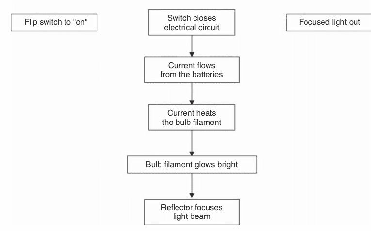

图 7.4 手电筒的功能框图。

描述在高层次标题下发生的过程。对于每个高层次过程，识别涉及的过程步骤或事件序列。一旦确定了过程步骤，就识别使高层次过程发生所需的必要输入。输入是支持过程所需的输入。将它们与“输入”标签对齐。最后，写下过程产生的输出，将它们放在“输出”标签下。图 7.4 显示了简单手电筒的 FBD 示例。

在另一种方法中，我们确定高层次过程所需的期望输出，将期望的输出语句写在黄色便签纸上并放在“输出”标签下。在下一步中，我们确定实现期望输出所需的所有必要输入并将它们与“输入”标签对齐。最后，开始写下将输入转换为期望输出所需的过程步骤。将这些标签放在“过程”标签下。

FBD 是一个需要每个人参与的互动任务。团队成员在便签纸上写标签并将它们放在适当的 FBD 块（输入、过程和输出）下，如图 7.5 所示。然后可以轻松地移动和重新排列标签。随着活动的进展，你会发现团队成员重新排列许多便签纸，直到就每个高层次过程的 FBD 达成一致。完成 FBD 后，与团队一起审查每个标签并确保每个人都理解标签并同意它。此步骤通常称为 scrubbing the wall，旨在确保每个人都理解并同意 FBD 上的每一项。当


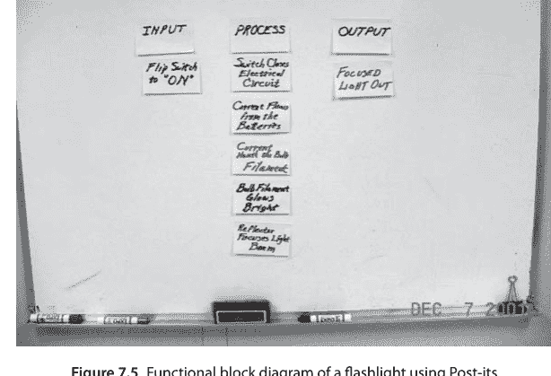

Figure 7.5 Functional block diagram of a flashlight using Post-its.

当每个人都对功能框图达成一致时，就该开始故障树分析了。

FMEA 过程会消耗大量的工程资源。减少这一时间的一种方法是提前准备 FBD。最高设计师或团队负责人可以在第一次团队会议之前准备好 FBD。这将节省时间并加快流程。最好在团队第一次会议前一到两周将 FBD 散发给团队成员审阅。如果 FBD 提前开发，应在第一次会议上进行评审，以获得团队对 FMEA 将执行的设计方面的共识。

## 7.2.2 The Fault Tree Analysis

FTA 是一种逻辑图形图，用于描述失效模式和原因。FTA 图形直观地显示了系统、子系统、组件、印刷电路板（PCB）或模块的所有失效。FTA 使用标准逻辑符号（Figure 7.6），这些符号通常在流程控制、质量控制、安全工程等流程图中使用，以连接事件序列。FTA 的输出提供了更好地理解可能导致失效模式的原因。FTA 的结果随后可以转移到 FMEA 电子表格中。FMEA 电子表格使用来自 FTA 的失效模式及其原因，并确定每个失效原因对设计的影响。FMEA 电子表格还用于识别最可能发生的失效模式，如我们稍后将展示的那样。FMEA 电子表格制定行动计划，以减少或消除失效的可能性。

### 7.2.2.1 Building the Fault Tree

开始故障树时，先说明来自功能框图的第一个失效模式。失效模式是通过取 FBD 中的第一项（从输入、过程或输出开始），并将其转化为失效陈述来定义的。这通常称为顶事件或高层失效模式。如果 FBD 的输出为“向输出提供 24 V”，则失效陈述应为：输出处没有 24 V。将标签“输出处没有 24 V”放在故障树的顶部。然后开始头脑风暴过程，创建一个可能导致 24 V 在输出处不存在的失效的贡献输入集合。

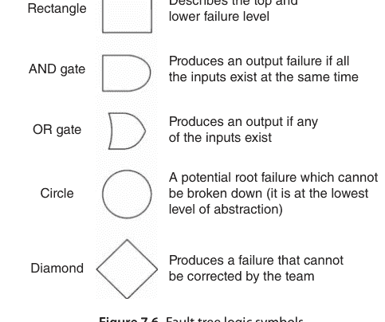

Figure 7.6 Fault tree logic symbols.

### 7.2.2.2 Brainstorming

头脑风暴是一个每个人都能平等贡献的过程。基本概念是每个人安静地坐着，并在黄色便签上写下想法。显然，团队的几名成员会有相似的想法。最初，这可能被认为是有害的或低效的。然而，让每个人都参与其中的好处是，更多想法会从团队中涌现。按如下方式设定头脑风暴会议的规则：

- 1. 没有坏主意。
- 2. 每个人写下两到三个标签并将其贴在树上。

在头脑风暴中，没有坏主意。每个人都需要感到舒适地提交自己的想法。先让每个人在便签上写下他或她的两到三个想法。当团队确信每个人都已完成时，就该开始 FTA 流程了。

将顶层（系统级）失效模式放在故障树的顶部。接下来，开始识别与上述失效模式相关的失效原因。您可以向下进行数个层级，将与上述失效模式相关的第二级、第三级、甚至第四级失效原因关联起来。使用便签陈述将每个后续失效原因放在前一个失效原因下方。要进入下一较低层级的失效原因，请问：必须发生什么事件才会导致更高层级的失效？通常，失效原因的抽象两到三层就足够了。目标不是追溯到根本原因，而是将设计周期中无法容忍的失效原因浮出水面。在各层级之间留出足够的空间用于连接线和逻辑门。继续进行该过程，直到达到所需的抽象层级。图 7.7 显示了手电筒示例的故障树样本。

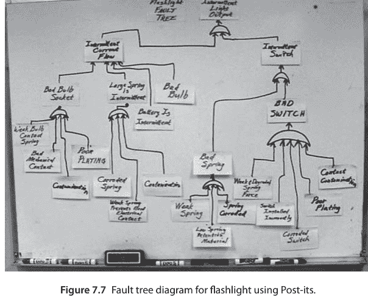

Figure 7.7 Fault tree diagram for flashlight using Post-its.

抽象层级将显著影响开发 FTA 所需的时间。如果团队认为有必要深入到设计的<|message|> 最基本方面，那么这可能是团队应该做的。然而，团队领导应利用他们对设计的专业知识和了解，防止团队陷入无尽的失效场景序列。所有失效模式都有原因。我们在 FTA 上圈出最低层级的失效原因，这将是转移到 FMEA 电子表格中的失效原因（Figure 7.8）。

根据设计复杂程度的不同，多个失效模式可能具有相同的成因。这是正常的，在 FTA 练习中很容易处理。创建几个相同的成因便签，并将其适当地作为输入放置在几个失效模式陈述中。随着您继续构建 FTA，很容易看出我们为何建议使用大墙来粘贴许多便签。

在构建 FTA 时，最终会达到需要做出决定的点。决定是您已达到足以评估其对设计影响的失效原因描述的充分层级。这些失效原因被圈出。然而，您可能达到无法继续的点，因为团队缺乏专业知识、知识或对失效原因的理解。这些失效原因用菱形标记，因为需要外部专业知识来解决。FTA 上所有最低层级的失效原因应为圆圈或菱形。此时，FTA 已完成。图 7.9 显示了一个简单的失效模式和原因逻辑图。

## 7.2.3 Failure Modes and Effects Analysis Spreadsheet

FMEA 电子表格是一种表格形式，用于捕获来自功能框图的过程步骤，并研究每个过程步骤如何失效（故障树）包括根本原因。

简要逻辑流程图

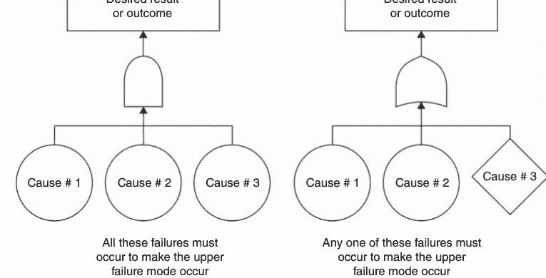

All these failures must occur to make the upper failure mode occur

Any one of these failures must occur to make the upper failure mode occur

Figure 7.8 Logic flow diagram.

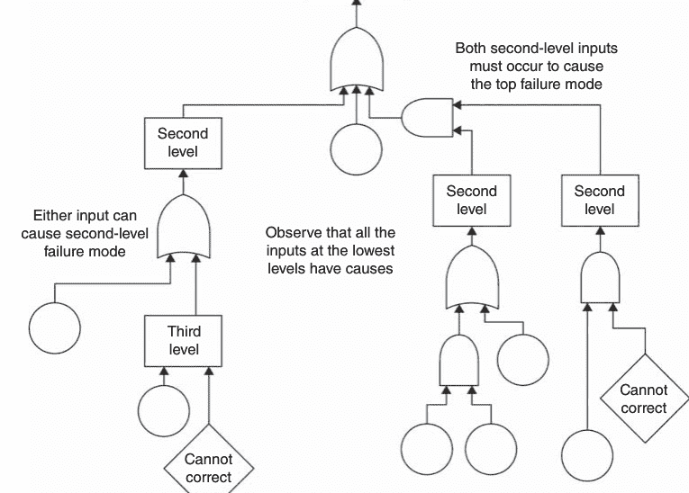

Figure 7.9 Fault tree logic diagram.

Table 7.1 中显示了一个 FMEA 电子表格示例。选定一名团队记录员将信息输入到电子表格表格中。记录员熟悉产品设计、命名法和三字母缩写（TLAs）非常重要，以便信息清晰且不会被误解。

FMEA 流程的下一阶段是将失效模式和原因插入 FMEA 电子表格中。这实际上是 FMEA 流程中容易的部分，因为故障树中的便签矩形就是失效模式。您只需将它们粘贴到失效模式列中。将来自 FBD 的最高层级失效模式插入第一行。然后，在下一列中输入来自故障树的成因。可能有多个成因，因此请确保为特定失效模式全部包含在内。记住，故障树中的矩形是失效模式，而流入矩形的圆圈和菱形是成因。在下一列中输入由失效模式引起的效应。这里也可能有多个效应；不要填写更多右侧列，最好稍后再做。取下一个失效模式并将其输入下一行。同样添加成因和效应。继续直到所有失效模式都得到处理。此时，您的矩形、圆圈和菱形将被完全消耗。参见 Figure 7.10 和 Table 7.1。

问：“此失效对系统或流程的其余部分有何影响？”在手电筒示例中，效应可能是：无光输出，或光线昏暗，或打开手电筒后不久光线就变弱，等等。充分完成效应列。然后，继续进行故障检测列。

现在，从顶部开始，在故障检测列下输入失效模式可能被检测到的机制。示例可能是：客户抱怨光线变暗过快，或实验室寿命测试、验证测试或设计 FMEA 的供应商资格认证，等等。将此列完成到表格的最底部。

继续进行严重度列。如果该量表不适合您的特定需求，则相应更改它（参考 Table 7.2 中的风险优先数（RPN）排名）。如果严重度较小，则分配较小的数字。严重度排名设定影响。对客户满意度严重影响的获得较大数字。继续直到该列完成（参考 Table 7.2 中的 RPN 排名）。

我们在此暂停，以强调一次一列地输入数据的重要性。当 FMEA 团队判断各种失效模式发生水平的等级时，如果他们保持在发生框架的思维中，他们对每个数字含义的解释往往不会漂移。如果团队从发生、严重度然后到可探测性进行切换，一个参数往往会混淆另一个参数。因为这是一个非常主观的测量，最好避免可能影响团队判断的任何因素。

现在在发生列中，分配 1 到 10 之间的数字，以您判断描述该特定失效模式的频率（参考 Table 7.2）。如果该量表不适合您的特定需求，则相应更改它。记住，这是您在整个 FMEA 中统一使用的量表。坚持这一列，直到所有发生排名都已输入。

以类似方式进行检测排名列。容易检测到的事物获得较小的数字。如果检测概率非常低，数字会更高。


## 表 7.1 FMEA 电子表格。

## 失效模式与影响分析

FMEA#:
公司/组织名称:
装配:
负责人:
日期:
团队成员:

| # | 失效模式 | 原因 | 影响 | 故障检测 | S | O | D | RPN | H | FRU | 建议措施 | 负责人 | 完成时间 | A |
| 1 | 2 | 3 | 4 | 5 | 6 | 7 | 8 | 9 | 10 | 11 | 12 | 13 | 14 | 15 |
|  |  |  |  |  |  |  |  |  |  |  |  |  |  |  |
|  |  |  |  |  |  |  |  |  |  |  |  |  |  |  |
|  |  |  |  |  |  |  |  |  |  |  |  |  |  |  |
|  |  |  |  |  |  |  |  |  |  |  |  |  |  |  |
|  |  |  |  |  |  |  |  |  |  |  |  |  |  |  |
|  |  |  |  |  |  |  |  |  |  |  |  |  |  |  |

D，探测评级；S，严重度评级；O，发生度；RPN，风险优先数；H，安全危害；FRU，现场更换单元；A，审核。

- 1. 行或列编号。提供一种引用问题的[content]

## 表 7.1 FMEA 电子表格。

## 失效模式与影响分析

FMEA#:
公司/组织名称:
装配:
负责人:
日期:
团队成员:

| # | 失效模式 | 原因 | 影响 | 故障检测 | S | O | D | RPN | H | FRU | 建议措施 | 负责人 | 完成时间 | A |
| 1 | 2 | 3 | 4 | 5 | 6 | 7 | 8 | 9 | 10 | 11 | 12 | 13 | 14 | 15 |
|  |  |  |  |  |  |  |  |  |  |  |  |  |  |  |
|  |  |  |  |  |  |  |  |  |  |  |  |  |  |  |
|  |  |  |  |  |  |  |  |  |  |  |  |  |  |  |
|  |  |  |  |  |  |  |  |  |  |  |  |  |  |  |
|  |  |  |  |  |  |  |  |  |  |  |  |  |  |  |
|  |  |  |  |  |  |  |  |  |  |  |  |  |  |  |

D，探测评级；S，严重度评级；O，发生度；RPN，风险优先数；H，安全危害；FRU，现场更换单元；A，审核。

- 1. 行或列编号。提供一种引用问题的方式。
- 2. 失效模式。对低级失效模式的简要描述。
- 3. 原因。什么可能导致失效发生？
- 4. 影响。此失效对顶层设计或流程有何影响？
- 5. 故障检测。为最小化或防止失效模式发生，可以采取什么措施？
- 6. 严重度（S）。1到10的度量单位，1为轻微，10为严重。严重度是从客户或终端用户的角度考虑的。
- 7. 发生度（O）。1到10的度量单位，10为最频繁，1为最不频繁。它是对观察到一次发生前的可能周期的估计；通常被视为现场失效问题。
- 8. 探测评级（D）。1到10的度量单位，1为失效模式将被探测到的概率非常高，10为不会被探测到的概率非常高。 （这可能令人困惑。较大的数字代表更难以探测的衡量标准。）
- 9. 风险优先数（RPN）。发生度、严重度和探测评级的乘积度量（将三者相乘即可得到RPN），该数值范围在1到1000之间。RPN数值越高，失效模式的风险越高。
- 10. 危害或安全（H）。此失效模式是否会造成危害？此失效模式是否会造成安全问题？
- 11. 现场更换单元（FRU）。用于为现场服务部门生成FRU建议。
- 12. 建议措施（做什么）。FMEA团队建议为减轻失效模式而必须采取的措施的简要描述。
- 13. 谁。被分配执行建议措施的人员。
- 14. 何时。建议措施应完成的日期。
- 15. 审核（A）。表示建议措施已令FMEA团队满意完成的核对占位符。

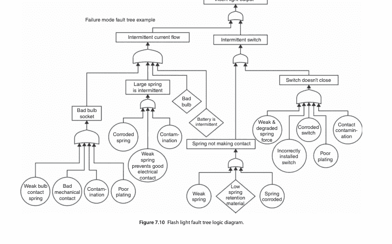

图 7.10 手电筒故障树逻辑图。

## 表 7.2 RPN 评级表。

| 发生度评级 | 严重度评级 | 可探测性评级 |
|---|---|---|
| 1 失效可能性极低或遥远 | 1 基本无影响 | 1 确定可探测 |
| 2 少于每 100 000 次 1 次 | 2 客户无法察觉 | 2 非常可能探测到 |
| 3 少于每 10 000 次 1 次 | 3 被有鉴别力的客户注意到 | 3 可能探测到 |
| 4 少于每 2000 次 1 次 | 4 被典型客户注意到 | 4 中等探测概率 |
| 5 少于每 500 次 1 次 | 5 轻微客户满意度 | 5 很可能探测到 |
| 6 少于每 100 次 1 次 | 6 一些可测量的性能下降 | 6 低探测概率 |
| 7 少于每 20 次 1 次 | 7 性能下降 | 7 探测可能性非常低 |
| 8 少于每 10 次 1 次 | 8 功能丧失 | 8 远程探测可能 |
| 9 少于每 5 次 1 次 | 9 主要功能丧失，客户不满意 | 9 非常遥远的探测 |
| 10 少于每 2 次 1 次 | 10 整个系统丧失，客户非常不满意 | 10 探测不确定 |

当严重度、发生度和可探测性列完成后，下一步是乘以三个指标来计算RPN。RPN数值范围在1到1000之间。完成所有RPN数值的输入后，你会发现FMEA开始成形。通常会有许多数值低于某一水平或基线，例如200。也会有一些数值高于该基线。RPN的大小将突出需要改进的重点领域。

下一个栏目，危害或安全，用于考虑失效模式是否可能伤害人员或造成伤害。如果FMEA团队认为此失效模式是安全问题，则在此栏目中填入“Y”表示是。继续向下用“Y”或“N”表示否，直到栏目完成。不要在此处分配数字。这不是要作为RPN的一部分相乘的指标。这要么是安全问题，要么不是，应适当处理。需要采取一些建议措施来消除此安全问题。

在下一个栏目FRU中，你可以帮助确定此失效模式是否最好通过在现场修复问题来处理。如果是，则在此FRU栏目下放置一个复选标记。FMEA流程并非旨在生成FRU清单的工具。这里它只是一个可用于为现场服务部门生成FRU建议的工具。

下一个栏目，建议措施，是FMEA可能陷入瓶颈的地方。这里是团队对将减轻失效模式的变更提出建议的地方。团队不应在此时就确定设计变更。每项建议都应分配给一位专家，他能最有效地处理失效模式。通常，那个人是团队成员。三项栏目可以同时处理，因为它们是下一个改进措施。

“建议措施”、“谁”和“何时完成任务”应同时讨论。这里是FMEA团队“分配者”就“谁”达成一致，并设定所有FMEA团队成员同意的完成日期。FMEA团队负责人可以以正常方式管理被分配任务的每位成员的活动。日期通常是项目需要完成建议措施的日期。

审核栏目供可靠性部门使用，以便他们跟踪FMEA中建议措施的状态。这确保了所有建议措施都得到FMEA团队的满意关闭。请注意，在ISO 9001公司和生物医学公司中，展示闭环纠正措施系统很重要。

图7.11中的示例FMEA电子表格与这些描述相匹配。团队负责人应填写表格的适当部分。它们是自解释的。

## 7.3 为FMEA做准备

要开始FMEA，团队需要一名负责人。该个人最有可能熟悉FMEA流程，能够指导团队取得成功。它不必是技术人员。负责人的首要目标是组建一个团队，该团队将协作以识别潜在的失效模式及其原因，并在设计发布前纠正问题。在第一次会议准备期间，负责人将收集描述设计或流程的文件。然后在第一次会议之前或在会议上将文件分发给每位团队成员。通常，希望提前一周或更长时间提交这些文件，以便成员有机会熟悉设计。以下是为设计FMEA准备所需文件的一般清单：

- 机械图纸
- 电气/电子原理图
- 设计流程算法/软件
- 识别输入和输出的流程文件
- 描述产品及其功能（s）的杂项项目
- 操作或功能框图

FMEA应在计划的生产前设计发布日期之前完成。到产品发布生产时，FMEA团队分配的所有建议和措施应已完成、关闭并记录。因此，在设计计划中为FMEA流程完成提供足够的时间很重要。根据装配的大小，FMEA流程通常（每装配）需要12–28小时完成。对于飞机等大型复杂产品，开展FMEA将花费更长时间。FMEA团队应由接受过FMEA培训的跨职能成员组成。不建议纳入未接受过FMEA培训的团队成员。不熟悉FMEA流程的团队成员通常会造成延误，因为他们不了解流程。如果整个团队需要FMEA培训，那么一位完全了解FMEA流程的熟练教练可以在大约4小时内完成此培训任务。


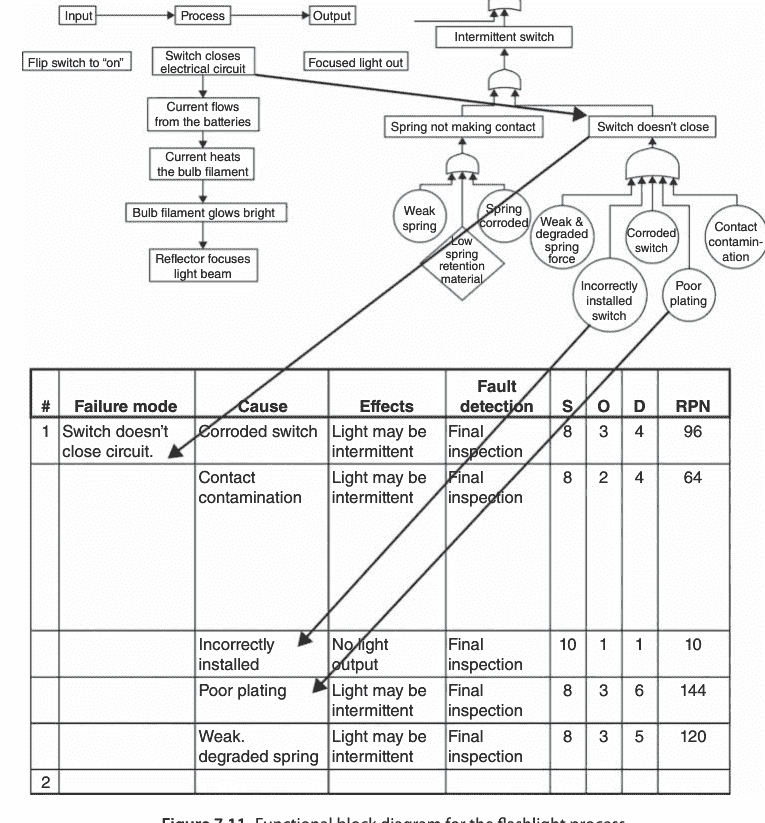

## Figure 7.11 Functional block diagram for the flashlight process.

FMEA 的第一步是由团队负责人描述该装配设计要实现的目标。做到这一点最简单的方法是向团队提供一个 FBD。该图基本上分为三个部分：输入、输出和功能过程。然后团队的任务是审查 FBD 并就装配的工作方式达成一致。

下一步是团队识别失效模式及其原因。这最好通过使用头脑风暴过程来实现。可以使用多种流程工具来记录团队的发现：
- 鱼骨图或因果图
- 流程图过程
- 故障树分析

FTA 是用于识别失效模式最常用的方法。因此，我们将描述使用故障树来识别失效模式及其原因的过程。设计团队可能已经熟悉 FTA 方法作为确定已知故障可能根本原因的一种方式。

故障树过程始于顶层故障，然后是第二层故障、第三层，依此类推。顶层故障代表最高或最基本的故障层级。它可以简单到打开电灯开关而灯不亮。第二层和第三层故障代表尝试开灯时发生的事件。然后使用逻辑门（即用于二进制流程的 AND、OR、NOR 逻辑）将较低层级的失效模式相互连接起来并连接到最高故障层级，从而将整个过程联系起来。在每个层级，失效模式可能有一个或多个原因。这些原因可以通过设计变更、制造工艺步骤、改进的材料选择等来缓解。在某些情况下，原因无法由团队解决，应留给外部专家处理。已识别的失效模式及其原因会对产品产生影响。失效模式始终是会以不同程度让客户不满意的东西。这些原因一旦被识别并纠正，就会大大提高客户满意度。

完成故障树后，已构建了失效模式及其原因的列表。此时，FMEA 过程已完成一半以上。下一步是填写 FMEA 电子表格。电子表格的示例如图 7.11 所示。

在图 7.4 和图 7.10 中，我们为手电筒 FMEA 建立了 FBD 和故障树。接下来，我们将在图 7.11 中说明失效模式和原因如何很容易地从 FTA 中取出并放置到 FMEA 电子表格上。

RPN 值的确定是团队为严重度、发生度和可探测度分配适当权重的结果。为简洁起见，FMEA 电子表格的其余部分未作说明。

当团队完成 FMEA 电子表格后，团队负责人要么为每个高 RPN 结果和任何与危害或安全相关的条目分配需要解决的措施，要么确定无需采取措施。该决定基于修复问题可用的工程资源以及发现的问题的严重程度。我们发现 80/20 规则是决定处理哪些问题的良好指南。80/20 规则假设已识别的 RPN 问题的前 20% 代表 80% 的潜在问题。请记住，所有潜在的安全问题都需要解决。所有建议的行动项目应在计划的生产发布前完成、关闭并记录在案。

本章开头提到，FMEA 过程仅次于 HALT 和 HASS。重要的是要指出，FMEA 相对于 HALT 和 HASS 有几个优势。HALT 过程成本高昂。FMEA 除了 FMEA 团队使用的时间外，几乎不需要其他支出即可完成。设计评审过程中使用的所有文档都可以在 FMEA 中再次使用。

引入和执行 FMEA 过程的成本与公司规模无关。FMEA 最好的部分是实施它的成本很小且与业务规模无关。此外，执行 FMEA 所花费的资源将通过减少总体开发时间而得到回收。

## 7.4 Barriers to the FMEA Process

通常，实现 FMEA 过程的最大障碍是让设计社区接受以系统和详细的方式审查某人的设计以实现可靠性设计的概念。大多数开发工程师认为他们设计的产品具有高度可靠性。其原因之一是对其技能的信心。另一个原因是大多数产品开发工程师很少意识到其先前设计导致的现场故障。通常，设计工程师从一项设计任务转到另一项设计任务。其他工程师，通常被称为维持工程师，负责解决生产和现场问题。维持工程与产品开发工程之间的脱节导致过去设计的错误在新设计中重复出现。如果产品开发工程师参与解决原始设计问题，这些设计问题就不会重复出现。

有一次，我指出一位设计工程师错误地将一个组件垂直安装（以节省电路板空间）。这最终会导致因运输或长期振动疲劳引起的故障。工程师回复说，他过去 20 年一直以这种方式设计该特定组件，从未出现过问题。我问工程师是否审查过其过去设计产生的故障报告。他说他从未审查过，而且这不是他的工作。然后我问他故障报告的频率如何。他说，“到目前为止，从未有过。” 这是一个非常大的障碍，叫做，我一直都是这样做的。这是一个存在于大多数经验丰富的设计工程师内心深处的障碍。你必须一个工程师一个工程师地克服这个障碍。经验最丰富的资深工程师将是最难改变设计可靠性评审方式的人。这并不意味着你应该先从经验较少的工程师入手。相反，先从资深工程师入手。他们会改变，一旦他们改变，你就会拥有已经受到全体员工高度尊重的盟友。当你得到他们的支持时，实施变更会更容易。

经验较少的工程师和应届大学毕业生更容易说服。他们没有固守自己特定的工具集，更 readily 接受 FMEA 过程。经验丰富的工程师往往更难说服，但他们的支持会说服其他工程师使用新流程。FMEA 过程中通常有一个微妙的优势，大约在 FMEA 过程的第一天或第二天出现。心理学家称之为“顿悟体验”。让我暂停一下举一个简单的例子。

几乎每个人在生命中的某个时候都必须更换过爆胎。当这种情况发生时，他们会把车顶起来并开始松开轮毂螺母。当他们这样做时，车轮会转动。然后，他们就遇到麻烦了。用一只手，他们会抓住车轮以防止它向一个方向旋转，同时用另一只手尝试向另一个方向松开每个轮毂螺母。最终，他们会把轮毂螺母拆下，取下爆胎，安装备胎并重新拧紧轮毂螺母。这通常发生的原因是我们很少接受过更换爆胎的培训。我们第一次更换时只能靠自己。然后有一天，我们会有“顿悟体验”。当看着别人松开轮毂螺母时，我们会发现这次车轮保持在低位，触及地面，然后每个轮毂螺母只松一点。这样他们就可以用双手握住轮毂扳手，让重力在轮胎仍在地面时固定轮胎。一旦所有轮毂螺母都松了，汽车就可以抬起，使轮胎不再接触地面。现在轮毂螺母可以用指尖轻松拧下。“顿悟。” FMEA 过程中也会发生这种情况。


在流程的某个阶段，一位工程师会观察到一种他从未考虑过的失效模式及其原因。这会令人感到惊讶。这就是预期的“顿悟体验”。它通常来自团队中最有经验的工程师。这个黄金时刻就是那位工程师被“转化”的时候。这并不意味着他完全接受了，但他的态度已经向更有利的方向转变，开始接受 FMEA 流程。

另一个障碍来自管理层，他们认为 FMEA 流程会延迟产品推出。这种看法并不符合现实。如果在设计周期的早期进行 FMEA，就不应影响设计完成日期。在 FMEA 中发现的一些问题本就会在设计验证期间出现，并导致项目延期。过去，当未使用 FMEA 流程时，这些问题最好是在设计验证中暴露出来。然后工程变更流程启动，产品在修复实施期间被延迟。FMEA 流程还可以节省时间，因为设计工程师可以把更多时间花在产品开发上，花更少时间修复之前的设计问题。设计问题最终都会被修复。它们可以在第一个原型机建造之前就被修复，此时成本最小，或者公司可以等到客户推动修复。

另一个重要障碍是，在初始实施阶段，FMEA 流程完成起来需要很长时间。这是正常的。该流程很复杂，并且与实施相关的学习曲线可能很陡峭。在 FMEA 结束时，让团队成员记录流程中的优势和劣势，以便可以进行改进。在你实施了几次 FMEA 并实施了流程改进建议后，流程会更快、更顺畅地进行。

有些人认为良好的设计评审足以发现所有设计疏漏，因此认为 FMEA 是多余的。项目经理的任务是满足交付日期，并会争辩说这两种流程都不必要。其他人则认为 FMEA 流程可以替代设计评审流程。他们争辩说应该二选一，而不是两者都做。设计评审和 FMEA 是两个完全不同的流程，具有不同的目标和目的。两者都需要。设计评审旨在确保满足设计要求，并且文档完整且正确。FMEA 流程旨在发现潜在的失效模式和不允许出现的安全问题，并实施设计变更以确保它们不会出现。为了开发高度可靠的产品，两者都需要进行。

FMEA 必须硬性地纳入产品开发计划中，以便在产品开发流程中何时进行以及何时完成不会产生混淆或模糊。设计 FMEA 可以早在第 2 阶段开始，当产品架构正在开发时。如果硬件或软件平台和/或架构是新的，则在第 2 阶段安排架构 FMEA。FMEA 允许及早发现潜在的失效模式。在开发周期的早期发现潜在失效模式意味着它们可以在成本最低的情况下得到解决。等到产品完全设计好后才会处理，将导致如果在开发周期的早期解决就不会做出的妥协。产品设计完成后才发现失效，会导致解决方案被妥协，因为开发成本和上市时间成为决策中的重要因素。需要多少

将用于制造。想法应作为停车场项目被记录下来，以便纳入流程 FMEA。

*将会议时间限制在较短的时间段内。* 马拉松式的 FMEA 努力是无成效的。FMEA 流程在智力上要求很高；在四到六小时后，团队很可能会变得精神疲劳且无成效。将 FMEA 会议限制在两到四小时的时间段内然后休息的做法效果很好。这使团队能够处理日常业务事务，而无需分散 FMEA 流程的注意力。

## 表 7.3 FMEA 停车场，用于记录不属于 FMEA 的重要问题。

| 停车场项目： | 谁 | 何时 |
|---|---|---|
| 1 |  |  |
| 2 |  |  |
| 3 |  |  |
| 4 |  |  |
| 5 |  |  |
| 6 |  |  |
| 7 |  |  |
| 8 |  |  |
| 9 |  |  |
| 10 |  |  |

## 7.6 使用宏提高 FMEA 效率和有效性

完成一次 FMEA 可能需要相当多的时间和人员资源。因此，它应成为持续改进计划的一部分，组织持续寻找使 FMEA 流程更高效的方法。寻找简化流程的方法，同时不牺牲练习的有效性。我第一次实施设计 FMEA 时，该流程需要整整一周才能完成。多年来我找到了简化流程的方法；现在完成一次 FMEA 通常需要 9–10 小时。我发现 Microsoft Excel 是运行 FMEA 的有效工具，只要创建宏来提高效率。使用宏开发工具，可以设计宏并创建宏按钮来自动化冗余和重复的流程，实现筛选，并提高文档的效率。以下是我们多年来为提高 FMEA 效率而添加的一些效率提升措施：

- 在对严重度、可探测性和发生度进行投票的过程中，建议你一次只关注一项的投票，即严重度、可探测性或发生度。创建一个宏按钮，以便当你选择一项进行投票时，例如严重度，它会隐藏可探测性和发生度。这将防止团队基于对其他因素的权重做出判断。团队不应在投票完成前看到 RPN 结果。这也最大限度地降低了在对每个问题进行投票时出现判断漂移的风险。

- 投票可以通过在单元格中输入数字或使用在每个单元格中创建的下拉菜单来完成。除了 1–5 或 1–10 的编号量表外，还应有一种方法来简化投票流程，如果团队已决定修复失效问题或决定失效问题不会发生。我们使用字母 Y 和 X 作为投票选项来解决这个问题。在投票过程中并不少见，当对某一项进行投票时，团队决定该问题如此重要，必须无论 RPN 分数如何都要修复。在这些情况下，我们将投票从数字量表改为 Y；这表示团队已决定修复此问题。一旦选择 Y 作为权重因子，其余投票量表，例如可探测性和发生度将被消除。这样团队就不会花费额外时间对该问题的其他 RPN 分类进行排名。投票时也可能出现团队了解到该问题已得到修复、设计已更改因此不再适用，或决定这不是一个真正的问题。在这些情况下，我们选择字母 X，以确保团队不会再花费任何时间对该问题进行投票或讨论。

- 根据产品和 FMEA 类型，可能可以自动化对检测、严重度和概率的投票过程。我们从可探测性开始。宏按钮会将所有故障检测响应提取到新工作表中的单列中。然后它运行删除重复项例程，以便删除任何重复的故障检测响应。有了这个缩减后的列表，团队随后会将故障检测响应分组到权重因子的不同桶中。如果团队决定使用 1–10 投票量表，则会有 10 个桶供团队将每个检测响应移入。团队在将故障检测响应放入 10 个桶中进行第一次尝试后，团队随后会审查结果以确保每个人都同意权重。一旦完成，宏可以交叉引用每个故障检测响应并输入适当的检测量表权重因子。根据产品，也可能提前定义所有可能的故障检测选项并以加权桶形式呈现。然后每个失效问题的故障检测单元格可以是具有可用检测选项的下拉菜单。当为每个问题输入检测信息时，投票过程可以自动填入检测权重值。

- 同样的流程也可能适用于严重度投票。为了确定严重度的权重因子，我们将所有影响响应的列表移入新工作表中的单列，每个响应都有自己的单元格。像之前一样，我们删除所有重复项，然后开始将每个唯一的严重度响应移入 10 个桶中的一个。完成后，团队审查 10 个桶并进行必要的微调。一旦完成，投票过程就自动化了，严重度值会被填入每个问题的单元格中。

- 同样的流程也可以重复用于发生度投票。在这种情况下，你使用与每个失效模式相关的原因将它们分类到可能概率的桶中。这有时比使用预定义的概率发生量表更容易。

- 在为单个失效模式集思广益“原因”时，团队识别出不止一个原因的情况并不少见。每个失效原因都需要自己的行项目，并为严重度、可探测性和发生度提供自己的投票值。在集思广益失效原因时，希望能够在一个单元格中捕获所有失效原因，而不会因每次新增失效原因而插入新行的麻烦。FMEA


creativity process should not be stifled due to the logistics of managing the FMEA spreadsheet. Once solution is to enter all the causes into a single cell with each cause separated by unique character like a pipe character “|.” This allows rapid entry of all the brainstorm ideas without being bogged down with continually adding additional rows to the spreadsheet. Once all the ideas are captured an Excel macro can search for the “|” and inserted in the next row below until there are no additional failure causes.

## 7.7 Software FMEA

Design FMEAs have been applied to product development with great success for a very long time. The design FMEAs have primarily focused on the physical hardware, architecture, safety, and manufacturing process for the product development. However, few have applied the success of design FMEAs to the software development process. This is especially true in organizations where the product being designed has been predominantly electrical or electromechanical systems that required minimal software and/or firmware. The amount of software and firmware required for product development is rapidly changing. Organizations are finding that the software and firmware required to develop next generation products is rapidly increasing, but the software development resources have not increased at the same pace to meet this increasing demand. The change can be so significant that there is no longer is the right mix of software and hardware design engineers for product development. As the level of software and firmware required for product development continues to increase, the number of software bugs also increases, but by a significantly greater proportion. The ratio of software to hardware bugs can easily be 50 or 100:1 or even higher. This is partly due to the fact that it is easier to apply DfR guidelines, lessons learned, and decades of well-documented circuit theory to make hardware designs reliable. It is also possible to write hardware requirements so the hardware can be fully functionally tested. The same cannot be said for software quality.

So why don’t organizations apply the success achieved with hardware design and process FMEAs to software product development? One reason is that there’s not a lot of training material on how to implement a software FMEA. This may seem strange, since software FMEAs have been around for quite a while, but they are primarily performed by companies whose main product is software.

A software failure mode is defined as any departure from the expected results that can be described at the subsystem, module, or component level. The failure mode describes how the subsystem, module, or component might not meet the design intent or produce the desired output. To identify potential failure modes, ask the question, “How could the subsystem, module, or component fail?” The failure mode of the component likely falls into one of four categories: not functioning, partially functioning, intermittently functioning, or resulting in an unintended function. A list of common failure modes is listed in Table 7.4.

The software can also fail if it is used in a way that was not intended, encounters an unexpected situation, unplanned environment, or an inexperienced user (pilot error). There can be many different causes for a software failure mode; a list of common software causes is captured in Table 7.5. A list showing how a failure mode can be broken down into failure causes is shown in Table 7.6.

### Table 7.4 Common software failure modes.

| Software failure modes |  |
|---|---|
| Algorithm error | Memory bit error |
| Computation error | Memory error |
| Data handling error | Memory overflow |
| Decision Logic flaw | Order fault |
| Error detection fault | Recovery fault |
| Fail to alarm | Reset error |
| False alarm | Rounding error |
| Faulty data | Sequence fault |
| Functionality fault | Synchronization error |
| Invalid operation | Timing fault |
| Invalid state | Typing error |
| Label error | Logic wrong |
| Logic error | Logic extra |
| Logic missing | Linkage error |
| Loop logic error |  |

### Table 7.5 Common causes for software failure.

| Software failure causes |  |
|---|---|
| Calculation error | Multitask deadlock |
| Counter rollover | Multithread deadlock |
| Divide by zero | Non-reentrant code executed reentrant |
| Finite precision error accumulation | Numerical overflow |
| Infinite loop | Output out of sequence |
| Initialization error | Output too early |
| Invalid code executed | Output too late |
| Invalid operation | Stack or heap size insufficient |
| Logarithm of zero | Unhandled exception |
| Logic defect | Unprotected critical sections where data in use may be interrupted |
| Memory leak | Unprotected critical sections where data in use may modified by other task |
| Memory not cleared | Wrong code executed |
| Missing data | Wrong formula |
| Multiprocess deadlock | Wrong units |

### Table 7.6 Failure modes and associated possible causes.

| Failure mode | Failure cause |
|---|---|
| Data input error | Data reversed and misplaced |
|  | Data redundant |
|  | Deficient data |
|  | Data precision error |
|  | Data out of range |
|  | Data error format |
|  | Right inputs refused |
|  | Right range but wrong value |
| Data output error | Numerical output inaccurate (too small, too large, noisy, or corrupt). |
|  | Unexpected non-numerical value |
|  | Pointer or index output incorrect (wrong address/index, null) |
|  | No/missing output |
| Execution flow failure | Early return/completion |
|  | Late return/completion |
|  | Fail to return/completion (hang, halt, terminate) |
|  | Diverted execution (e.g. incorrect branch, function call, raised exception or interrupt) |
| Time-sequence error | Data/signal too early |
|  | Data/signal too late |
|  | Data/signal too overtime |
|  | Data/signal too frequency abnormality |
|  | Out-of-sequence outputs |

The software FMEA is a top-down approach where the software is decomposed from subsystems to modules and then components. These components are treated like black boxes, describing the components’ functionality.

The software FMEA can start once the architecture is defined (for a software architecture FMEA) or when there is sufficient information available to construct a flowchart for the subsystem, module, and components being developed.

The software FMEA team must include the software developers and designers, plus some or all of the following functional groups:

- Application engineer
- Customer
- Design engineer
- Reliability engineer
- Software design engineer
- Software test engineer
- System engineer
- Hardware test engineer
- Others as required

Before starting a software FMEA, the following information is needed:

- A functional block diagram of the subsystem to be evaluated, broken down from the subsystem to the module and component level.
- Detailed flowchart or sequence diagrams of the software being developed.
- A description for each method or function in the FBD or class diagram including the required inputs and expected outputs at the component level.
- A description for how the software flowchart and FBD interface and interact.

The software design detail should be down to the lowest level of decomposition that the team will consider. This would include information regarding sequencing, data and control flow, state transition diagrams, messaging, logic description, and communication protocol. The software design detail should include information regarding the interfaces between the software items and the external systems. This would include the hardware-software interface.

## 7.8 Software Fault Tree Analysis (SFTA)

The software fault tree analysis (SFTA), like an FMEA, is a tool to anticipate failures and their underlying causes. The SFTA is an effective tool as part of a quality assurance program for defect prevention. The SFTA can be applied to requirements, design phase, architecture, safety, and to improve the effectiveness of the software verification/validation test plan. The SFTA is not typically applied to low-level code; it is applied at the component/module level and higher. It is an effective and efficient tool to identify weaknesses in the design and stated requirements, safety hazard, and potential failure. A SFTA can identify single points of failure, missing components, ambiguities, uncertainties, and issues with variable values or conditions. If probabilities are assigned to all the low-level causes, SFTA can be used to calculate the probability that a fault will occur. An example of this is shown in Figure 7.12 and based on Table 7.6 for an execution flow failure.

## 7.9 Process FMEAs

The first step in developing a process FMEA is to state desired outcome. What is expected to be achieved or produced from the process that is being evaluated? List the process steps in sequential order that take place in order to produce the desired output. For each process step, list the inputs and outputs that are required for the process. Each process step must have clearly defined requirements for success of the desired output. Assume that each input comes in a good state and should not be the cause for a failure mode. If an input could be the reason for a bad output, then that input should be included as one of the process steps so it can be evaluated for potential failure modes. It is often desired to keep the analysis of the process at a high level of abstraction.

The process FMEA should include all critical processes, including anything that is new or has not been done before. These critical processes can include customer requirements, industrial standards, product and operator safety, product and operator liability, and regulatory and compliance requirements.


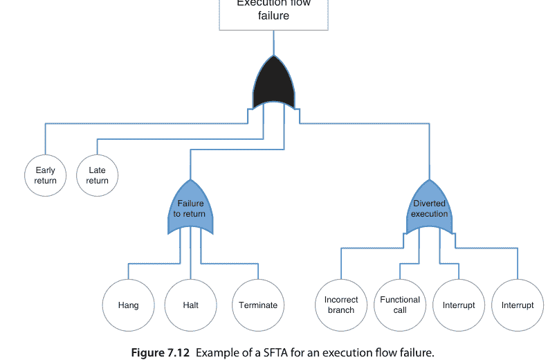

图 7.12 执行流程失效的 SFTA 示例。

过程 FMEA 从产品开发的第 4 阶段开始，可以在原型装配首次制造之前开始。然而，在进行过程 FMEA 时，在第一个原型制造后才开始过程 FMEA 是有益的。重要的是，所有将参与过程 FMEA 的团队成员都参与了第一次原型制造。开始 FMEA 的一个优势是在第一次制造后，可以将制造问题和经验教训纳入 FMEA 过程。过程 FMEA 的目标是通过产品制造的整个生命周期，证明关键属性要求，包括质量、可靠性、成本、生产率、可维护性和可服务性，这些对于成功是必要的。

过程 FMEA 与石川鱼骨图所遵循的过程非常相似。过程 FMEA 可以将相同的鱼骨标题作为过程评估的一部分包含在内。过程 FMEA 考虑与材料、测量、方法、环境、人力和机器相关的失效模式。过程 FMEA 研究过程、功能、工具或设施如何失效。通常，是制造工程师领导过程 FMEA。

过程 FMEA 团队可能包括以下任何或全部职能组：

- Customer
- Design engineer
- Industrial engineering
- Line foreman or supervisor
- Manufacturing engineer
- Material engineer
- Operators
- Process engineer
- Reliability engineer
- Safety engineer
- Software engineer
- Tooling engineer
- Test engineer
- Others as required.

## 7.10 FMMEA

失效模式、机理和影响分析（FMMEA）与 FMEA 非常相似，只是增加了识别每个失效原因相关失效机理的步骤。过程与 FMEA 相同。首先识别潜在的失效模式。失效模式是用户物理观察到的失效方式。失效原因是导致失效模式表现出来的驱动力。失效原因是导致失效机理背后的驱动力的应力，无论是内部还是外部。失效机理是驱动失效原因的过程。失效机理可以是化学、电、机械、物理、热或辐射应力。它可以是单一应力机理，也可以是多个应力机理共同作用导致失效模式。最后，失效效应是失效模式如何从用户角度影响其使用的情况。FMMEA 电子表格与 FMEA 电子表格相同，只是增加了失效机理一列。

FMMEA 可作为预测与健康管理（PHM）过程的一部分使用，以开发一种监测退化并估计失效前剩余时间的方法。PHM 在第 6.7.3 节中介绍。失效原因和机理用于制定预测（PHM）策略，确定用于监测磨损和退化的传感器类型，并为加速寿命试验制定测试计划，以开发从良好状态过渡到失效状态的数据集。然后使用加速寿命数据集开发一种使用实时传感器检测磨损和退化的方法。确定是什么导致了损伤以及应为预测而监测哪些参数非常重要。了解导致劣化的潜在失效机理或机理可能使缓解或管理机理成为可能，以延长使用寿命并减少停机时间。失效机理可用于改进设计并成为设计和验证过程的一部分。

几种机理可导致过应力与磨损，包括化学、电、机械、辐射或热应力：

- 化学应力的例子有腐蚀、污染、枝晶生长、解聚和金属间化合物生长。
- 电应力的例子有介电击穿、导电丝形成（CFF）、电过应力（EOS）、静电放电（ESD）、电迁移、热载流子注入（HCI）、热电子捕获、互扩散、二次击穿、射频（RF）尖峰、表面电荷、时变介电击穿（TDDB）和捕获电荷。
- 机械应力的例子有热膨胀系数（CTE）、蠕变、疲劳、界面脱粘、冲击、磨损和屈服。
- 辐射应力包括α粒子、γ粒子、氧化物中捕获电荷和紫外线。
- 热应力包括玻璃化转变（Tg）、相变、电阻加热、应力驱动扩散和热失控。

## 8
## 可靠性工具箱

### 8.1 HALT 过程

毫无疑问，可用于产品开发和制造过程的最重要工具是高度加速寿命试验（HALT）。多年来已应用了许多其他方法来提高产品可靠性，但 HALT 过程已成为提高产品可靠性最有效、最快的方法。

HALT 是一种加速试验，旨在产品首次出货前识别现场失效。它是在设计阶段对产品施加应力的方法，这将揭示缺陷、设计错误和设计裕度不足。在识别出这些设计问题后，可通过重新设计加以纠正。然后重复 HALT 过程，以验证设计更改是否有效，并且设计更改没有产生新的设计问题。HALT 过程非常简单，但很少有公司完全实施该过程。

事实上，许多公司没有建立可靠性计划。他们认为其质量计划足以实现产品可靠性。这些公司使用传统的产品开发方法。也就是说，产品在“制衡”措施下设计，如设计评审。设计评审检查以验证设计是否完整。例如，设计评审将验证用于构建设计的零件清单是否完整。设计评审还可能验证材料清单是否采用“标准格式”，通常由制造工艺定义。设计评审通常通过涉及所有相关职能组的并行活动来验证设计完整性，以审查文档包并验证设计是否完整。设计评审中涵盖的一些领域示例如下：

### Engineering

- Schematics
- Block diagrams
- Theory of operation
- Outline drawings
- Input/output descriptions
- Thermal design
- Component derating
- Power descriptions

### Manufacturing

- Design for manufacturing (DFM) guidelines
- Printed circuit board (PCB) guidelines
- Material list (bill of materials [BOMs])
- Assembly drawings
- Assembly instructions
- Manufacturing cost

### Test

- Design for test (DFT) guidelines
- DFT cost
- Test software
- Fixtures

### Supplier

- Approved suppliers
- Material costs
- Delivery lead times
- Alternate sourcing

### Software

- Software debug and validation

设计评审中涵盖的项目清单可能很长。大多数公司还使用某种形式的持续改进来改进和简化设计评审过程。通常被排除在设计评审之外的一个组成部分是可靠性，特别是现场可靠性信息。设计评审可能会涵盖一些可靠性问题，但这些问题通常基于经验教训。诸如降额、DFM 和 DFT 等问题会提高产品可靠性，有时会在设计评审中涵盖。然而，可靠性应该是设计评审过程的更大一部分。揭示设计中可靠性问题的最佳方式是通过 HALT。

在初始设计完成后，会制造原型以测试和验证设计是否符合规范。通常，并非所有要求都得到满足，需要重新设计。之后，在进行更改后，重新设计的原型单元会再次测试以“验证设计”。验证设计是否符合规范的过程称为设计验证测试（DVT）。此时，设计被认为已完成并准备投入生产。如果在 DVT 之前执行 HALT，很可能第一次就能通过 DVT。HALT 并非旨在取代 DVT。通过对第一个功能工程单元执行 HALT，可靠性问题在开发周期早期被识别并修复。最终结果是更快的上市时间和首次通过 DVT。

在传统方法中，产品被制造并运送给客户。在生产的第一年或两年中，现场失效会累积，消耗保修费用，并经常造成客户不满意。然后组建团队专门调查现场失效，确定其根本原因，并


开发纠正措施。随后是无休止的纠正工程变更通知（ECOs）流，以消除问题。设计问题可能需要数年时间才能解决，并延迟产品达到设计成熟度。这种长时间的延迟会对盈利能力和客户满意度产生不利影响。HALT 流程加快了产品设计周期，并显著减少了早期生产通常遇到的现场故障数量。

HALT 流程是一种加速测试，它会在相对较短的时间内、在任何产品进入现场之前诱发现场故障 [1]。一旦这些失效模式被识别出来，就可以通过重新设计将其消除。然后，通过在重新设计后应用 HALT，可以验证设计修复，并确保没有新的失效模式被设计到产品中。最终结果是获得无缺陷的最终产品，同时因保修索赔而损失的资金显著减少。HALT 是一种应力过程，它加速故障的发生，以便在首次发货前进行纠正。HALT 在首台单元发货前即可实现设计成熟度。因此，HALT 可以被视为“设计成熟度加速器”。

HALT 要求设备通电并处于运行状态，同时诊断系统监控设备是否正常运行。通过在应力下监控设备，可以检测到故障以及设备未能满足规格时的具体时间和环境条件。如果发生故障，则将受试设备（DUT）从 HALT 试验箱中取出并测试下一台设备。然后对下一台设备施加类似的应力，以了解其是否以类似方式失效。在对下一台设备进行 HALT 测试的同时，先前失效的设备将被评估以确定故障的根本原因。然后修复该设备并将其返回到 HALT 流程的下一步。经过五到六台设备进行 HALT 应力测试后，可以创建故障的帕累托图。帕累托图（图 8.1）绘制了五种（假设的）诱发的故障以及在五台测试单元中发现的每种故障的数量。

在图 8.1 中，设计团队可能会考虑不处理故障 E，因为它只在五台单元中的一台上发生。这通常被称为单次事件或异常，重要性不大。并非如此。如果对 30 台单元进行 HALT，很可能在 A 到 E 列中会有更多故障。可能还会有更多失效模式。关键在于，随着单元数量的增加，故障 E 不再显得微不足道；可能有更多组件存在故障模式 E。由于 HALT 中仅有五台单元的非常小的样本，即使是单个故障模式 E 也是重要的。对每一次 HALT 故障进行

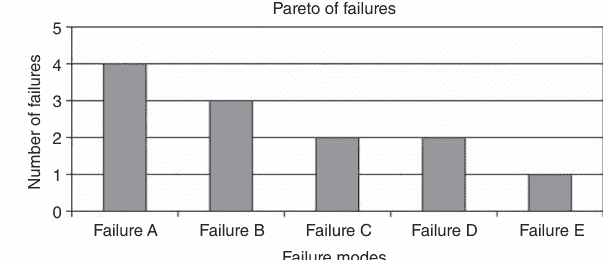

图 8.1 故障帕累托图。

根本原因的故障分析是必要的，因为它们都可能是现场故障模式。

HALT 流程的完整意图和目的是使单元失效。诸如故障分析之类的调查技术可深入到故障的根本原因，从而揭示真正的失效物理学。一旦这些故障被识别出来，就可以通过重新设计加以补救。

找到故障的根本原因至关重要。仅仅修复故障价值不大。一家主要汽车制造商发现，一些车辆在交付给经销商时电池完全没电，而同一辆卡车上的其他车辆则正常。更换电池解决了问题，使经销商能够销售产品。但是什么导致了一些电池失效？解决方案最终很简单。一些汽车在装载到运输拖车上时处于显著的角度。这导致后备箱盖传感器激活后备箱灯，但仅限于运输拖车后部处于陡峭倾斜的那些汽车。后备箱灯亮起是因为后备箱盖中的传感器因角度正确而将灯打开，就像后备箱盖打开一样。解决方案是在发货前断开电池连接以消除此问题。失效模式已知且根本原因被发现。纠正措施在短期内是可以接受的，长期解决方案即将到来。拆下并重新连接一根电池电缆比在经销商处更换电池要容易得多。

许多年前，收音机和电视使用真空管。它们相对不可靠，因为灯丝会烧毁，这是一个主要的失效模式。更换灯管的维修人员解决了问题，但没有找出根本原因。多年来，通过找到灯丝失效的根本原因并进行改进，灯丝设计延长了管状技术的寿命。尽管如此，灯管仍然会失效。然后，晶体管被发明了，灯丝失效的根本原因得以解决。晶体管中没有灯丝会失效。

## 8.1.1 HALT 中应用的应力类型

HALT 试验箱能够对产品施加两种不同类型的应力，即振动和温度。为了使 HALT 有效，至少需要这两种应力。然而，这些并不是可以施加以加速产品失效的唯一应力。与温度和振动结合应用的其他应力示例如下：

- 电压裕度测试
- 时钟频率
- 交流电源裕度测试（电压和频率）
- 功率循环
- 电压时序

上述应力可以先单独施加，然后再与其他应力组合施加。决定施加哪些应力的决策基于经验和可行性。至少需要振动和温度。这点在图 8.2 [2]¹ 中有所说明。该图来自 Qualmark Corporation 的工作，Qualmark Corporation 是一家 HALT 测试机构，是其对 47 个产品

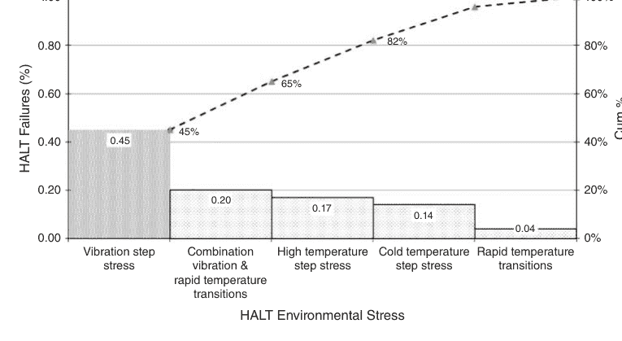

### 图 8.2 按应力类型划分的 HALT 故障百分比。

来自 33 家公司和 19 个不同行业的测试总结。测试从低温阶跃应力开始，按顺时针方向进行，最后以振动和快速温度变化的组合结束。如果仅进行温度测试，将识别出 35% 的设计故障。同样，如果仅进行振动测试，将识别出 45% 的设计故障。组合应力识别设计故障的强大功能显而易见。单独的温度或振动只能识别不到一半的可靠性设计问题。这就是为什么必须同时施加温度和振动以实现在相对较短的时间内加速尽可能多的现场故障的目标。

使用加速应力，先单独然后组合使用，将揭示可通过重新设计消除的可靠性设计问题。重新设计在设计周期的早期进行，此时实施成本最低。在设计得到纠正后，有必要使用 HALT 重新测试产品。这将确保修复措施有效，并且重新设计没有引入新的失效模式。

## 8.1.2 HALT 流程背后的理论

当产品设计完成后，会对其进行测试以验证其是否满足所有设计规范。设计规范可能包括：输出性能、温度、振动、冲击、电源水平、占空比、频率、失真、电源限制、海拔、湿度、温度等。我们将用单一规范（即温度）来说明这一点，并将其称为具有上限和下限（参见图 8.3）。这是产品必须满足的正常运行并符合设计规范的设计工作范围。

图 8.3 中描述的设计工作范围可以应用于所有设计规范。产品在工作范围内设计为正常运行


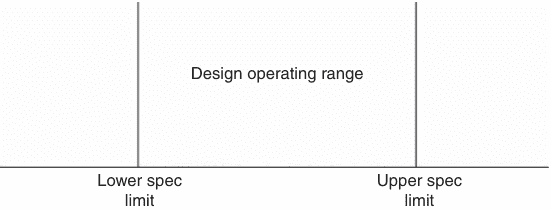

**Figure 8.3** 产品设计规范极限。

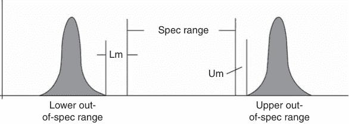

**Figure 8.4** 设计裕度。

function. 这是开发团队测试产品以确保通过 DVT 验收的范围。理想情况下，产品将在上下规范极限之外仍能正常工作，通常称为 *设计裕度*。这种设计裕度提供了一个安全范围，可容纳会降低产品生产良率的元器件、设计和工艺漂移。随着时间的推移，在现场使用中，产品性能开始漂移，导致系统失效。设计裕度有助于保持产品随时间的正常运行。这一点在图 8.4 中有所说明。阴影曲线显示了产品样本失效的分布情况。图表显示，当样本被应力至规范极限时，没有失效。事实上，第一次产品失效开始出现在超出上下设计裕度的点之后。

你可能会想知道为什么在上下设计极限之外没有阴影锥形分布。为了解释这一点，请考虑我们将对 1000 台量产单元进行应力测试，以找到产品失效的上下极限。我们会发现它们并不会在完全相同的点上全部失效。会有某个点，大多数单元在此失效。然后，当我们在该中心点之上和之下进行测试时，我们会发现失效单元的数量减少，最终降为零。

在测试首批原型时，通常并非所有设计规范都能满足。有时，安全裕度很少或根本没有。图 8.5 说明了规范的上限和下限“超出规范范围”已落入设计规范范围内的情况。在这种情况下，并非所有产品都能满足设计规范。该问题会在制造中表现为首次通过良率低和早期现场失效。

HALT 通过增加设计安全裕度来提高产品可靠性、DVT 验收率和首次通过生产良率。为了说明这一点，请参阅图 8.6。

# Figure 8.5 Some products fail product spec.

# Figure 8.6 HALT increases design margin.

在 HALT 中，我们将产品应力至其设计规范之外。应力变得如此之大，以至于产品不再工作。这被称为失效。然而，有两种可能的失效类型，即软失效和硬失效，如图 8.7 所示。它们被称为可恢复和不可恢复失效。要确定你遇到的是哪种失效类型，将应力水平降至其正常规范范围。如果产品恢复正常运行，则为软失效。如果产品仍无法运行，则为硬失效。产品可能需要在恢复正常运行前进行复位。如果是这样，这仍被视为软失效，因为修复产品不需要返工。硬失效需要故障排除以确定失效原因。所有硬失效都会在后续调查以确定失效的根本原因。

在 HALT 测试中，产品被应力至硬失效，确定失效的根本原因，并实施适当的更改设计。软失效也被设计消除。为了验证设计更改是否成功，我们进行第二次 HALT。如果失效模式被消除且没有新的失效模式出现，则认为设计修复是良好的。那么 HALT 如何提高产品可靠性、DVT 验收率和首次通过生产良率呢？

在 HALT 中引发的硬失效和软失效被设计出产品。通过这样做，它增加了“设计裕度”，即应力导致产品失效的范围。修复硬失效和软失效会使设计裕度变宽。通过纠正 HALT 中发现的失效，图 8.6 中的灰色阴影区域被推开，在设计规范与失效发生的应力点之间留出更大的设计裕度。最终结果是由于对工艺变化的敏感性提高，产品可靠性提高和生产良率提高。

HALT 有意将产品应力至规范极限之外以引起失效。然后，纠正这些失效。由此产生的产品更可靠，因为现场失效在设计阶段就被发现并得到修复。此外，产品现在可以按超出设计规范的规范极限运行。这一点在图 8.7 和 8.8 中进一步说明。

产品规范范围位于产品仍保持在规范内的上下工作点之间。理想情况下，产品应具有一定的裕度，在该裕度内仍可无故障运行。其衡量指标为上下工作裕度。当应力施加到产品超出这些裕度时，软失效将开始出现。继续增加应力将使产品达到硬失效。

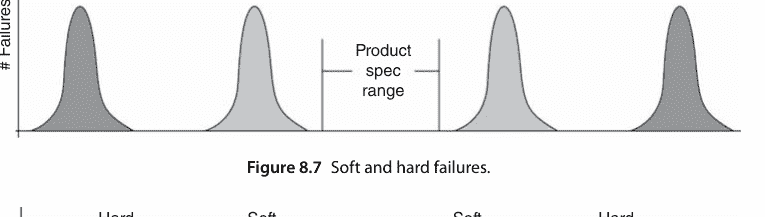

Figure 8.7 Soft and hard failures.

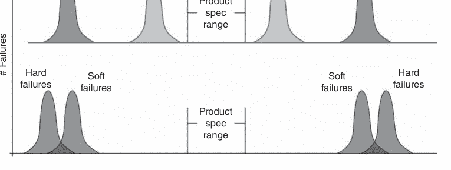

Figure 8.8 Impact of HALT on design margins.

失效。

## 8.1.3 HALT 测试液冷产品

HALT 室使用湍流强制空气流来加热和冷却被测产品。加热通常通过电阻线圈实现。HALT 室使用风扇将空气强制通过电阻线圈以加热空气。冷却是通过将储存在罐或杜瓦瓶中的液氮转化为气态形式来实现的。使用 PID（比例、积分和微分）控制电路，腔室在加热和冷却强制空气之间切换，以调节腔室空气流经产品，使其达到所需温度。对于可通过强制空气调节的产品来说，这效果很好。当被测产品使用液冷来控制产品时，这不起作用。液冷可能是通过热界面垫与电路紧密接触的冷板。产品也可能设计为浸没冷却，其中惰性液体在产品中循环以调节温度。在这两种情况下，使用强制空气在热应力方面并不是可接受或可行的方法。

一种解决方案是使用腔室空气来调节热调节被测产品的液冷剂。液冷剂流经热交换器，热交换器放置在腔室强制空气输出口前方（图 8.9）。腔室强制空气通过热交换器改变循环液体的温度，使其达到腔室设定温度。液冷剂通过泵循环通过热交换器，该泵将液体从储液罐强制输送。外部泵必须适用于腔室的温度范围。冷却液分配单元（CDU）可改装用于此目的。重要的是

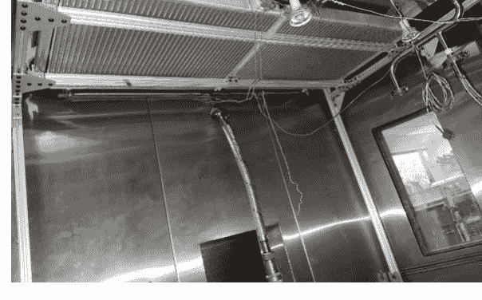

Figure 8.9 Two heat exchangers placed in front of chamber forced air.

确保所用液体在产品将被应力到的温度范围内不会沸腾。你可以与冷却液供应商合作，为此应用选择更高温度等级的液体。我们使用 HFE 7500，其沸点为 128 °C。

## 8.1.4 规划 HALT 测试

在产品进行 HALT 之前，需要进行一些规划。在 HALT 测试之前可能需要大量准备工作。可靠性工程师和主工程师应共同合作，确保在 HALT 流程开始当天一切就绪。以下是在测试开始前应准备好的项目清单：

- 1. 产品，最好是三到五个工作单元，外加一个备用单元。备用单元通常被称为金单元，因为它不用于应力测试；当存在细微的测试问题且难以判断 DUT 或测试仪器是否出现故障时使用。插入金单元将验证问题是否确实存在于 DUT。这可以大大加快故障排除过程。因此，通过使用该单元获得的信息是“金子”。
- 2. 测试仪器。这可能是产品本身之后清单上最重要的项目，因为必须发现和纠正失效。监测不良会遗漏一些失效，使 HALT 过程的效果不如预期。
- 3. 将被监测的输出规范和监测仪器。
- 4. 文档，即原理图、装配图、流程图等。
- 5. 用于将 DUT 固定到 HALT 台的机械夹具。
- 6. 输入和输出电缆。
- 7. 特殊设备，即液冷装置、风道、电源、其他支持设备等。
- 8. 软件，如有需要。
- 9. 拟施加于 DUT 的应力水平（由 HALT 团队确定并同意）。可以对产品施加哪些应力极限？如果产品具有温度内置保护电路，能否覆盖以允许更高的热应力？HALT 测试计划应包括在启用缓解计划以测试超出这些监测极限之前验证温度保护电路是否正常工作的验证。商定的测试极限应记录在表中，如表 8.1 所示。
- 10. 测试所需的时间。
- 11. 主工程师需要在整个 HALT 过程中待命。
- 12. 测试工程师协助失效分析。
- 13. 可靠性工程师和 HALT 室操作员——可靠性工程师通常撰写最终的 HALT 测试报告。

HALT 团队首先将 DUT 放置在 HALT 室中，并将其连接到电源、负载和仪器。然后，打开 DUT 并监测以验证其是否正常运行。此步骤是必要的，以确保测试设置正常运行。此处的运行时间取决于


## 测试设置验证

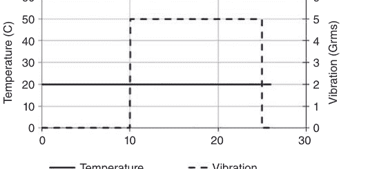

图 8.10 检查连接和功能性的测试设置剖面图。

## 温度阶跃应力与通电

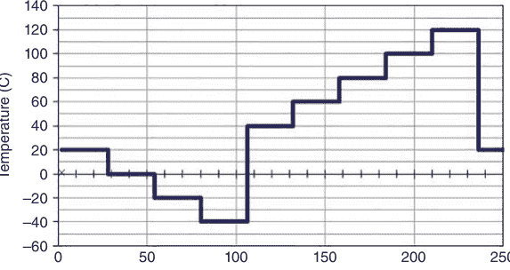

图 8.11 具有功率循环的温度阶跃应力以及每个步骤结束时的情况。

如果测试在低温下结束（即在 −20 °C 下发生硬失效），则在打开腔室门之前，应将 DUT 恢复到室温。腔室可能很快达到室温，但重要的是也要等待产品达到室温。这将防止在产品仍处于低温时打开腔室而导致产品表面形成冷凝。

温度测试始于以 10–20 °C 的增量逐步降低温度，典型驻留时间为 10 分钟。其思路是从最弱的应力开始，随着应力测试的继续而转向更强的应力。这样，细微的失效不会因过度应力测试而丢失。驻留时间取决于产品达到目标温度 90% 所需的时间以及完成完整测试所需的测试仪器诊断/检查器运行时间。

在被测产品热质量较高的区域放置热电偶，可以监控产品温度并确保产品在检查器/诊断开始运行前达到温度。大多数 HALT 腔室提供根据空气温度或产品温度控制腔室空气的选项。当产品具有较高的热质量时，选择产品温度是首选。其原因之一是，当腔室设置为控制的温度设定点与产品或空气温度之间存在显著差异时，热/冷热增强就会启动，具体取决于腔室设置为控制哪一个。随着产品或空气温度接近设定点，增强开始减小，并在达到设定点时最终变为零。如果腔室设置为控制空气温度，而产品具有较高的热质量（即产品温度变化缓慢），腔室空气会迅速达到设定点，从而切断增强，即使产品仍有大量时间达到设定点。这就是为什么最好根据产品对环境应力的响应来控制腔室。

被测产品在每个温度阶跃应力的开始或结束时进行通电循环。建议在每个热阶跃应力结束时进行通电循环。记录 DUT 无法通电的下限和上限。调查 DUT 无法通电的上、下温度极限的根本原因可以识别出电源、时序和温度敏感问题。继续温度阶跃应力至下限温度（表 8.1）。

**表 8.3 具有功率循环的温度阶跃应力，并在每个步骤结束时进行**

强制：组合冷热通电（−40 至 +80 °C）和温度阶跃应力（−40 至 +120 °C）a)

| Step | Description | Min/step | Sub totals (min) | Sub totals (h) |
|---|---|---|---|---|
| 5 | Set chamber temp to 20 °C. | 2 | 2 |  |
| 7 |  |  |  |  |
| 8 | Ramp the temperature 20 °C and soak for 10 min. During the temperature transition. | 11 | 13 |  |
| 9 | Run diagnostics to verify proper operation. Toggle the power off for a minimum of 1 min and on. | 15 | 28 |  |
| 10 | Repeat steps 8 and 9 until the lower temperature limit is reached. | 78 | 106 |  |
| 11 | Ramp up in 40 °C and soak for 10 min. | 2 | 108 |  |
| 12 | Perform power off/on test. | 3 | 111 |  |
| 13 | Run diagnostics to verify proper operation. | 15 | 126 |  |
| 14 | Increase temperature by 20 °C and soak for 10 min. During this time, toggle the power off and on. | 11 | 137 |  |
| 15 | Run diagnostics to verify proper operation. | 15 | 152 |  |
| 16 | Repeat steps 14 and 15 until the upper temperature limit is reached. Note: Do not exceed 120 °C. | 130 | 236 |  |
| 17 | Return chamber to 20 °C and let the system stabilize for 10 min. | 13.333333 | 249 |  |
| 18 | Run air purge before opening the chamber. |  | 249 | 4.2 |

a) Profile process: To reduce test time, it is recommended that you perform the cold and hot turn on during temperature step transition at the end of the temperature step stress. Once DUT is temperature stabilized (10 min typ), proceed with diagnostics to verify operational functionality. After functionality test perform power cycle and verify DUT turns on to a good state.

完成低温阶跃应力后，开始高温阶跃应力。将腔室逐步升至高于室温的第一个设定点。以类似的方式（10–20 °C 增量）逐步升高温度，直至达到高温极限。记录所有软失效和硬失效。如果在温度阶跃应力期间发生失效，建议停止并调查失效以确定根本原因。如果是软失效，请调查“绕过”失效元件的方法以便继续温度阶跃应力。这通常涉及将外部空气引入腔室以调节温度敏感元件，使其继续运行。完成高温阶跃应力后，将腔室设置回室温并允许产品温度稳定。在完成温度阶跃应力之前，运行检查器/诊断以验证 DUT 仍能正确工作。HALT 测试的第一个应力要素，温度阶跃应力，已完成。

温度阶跃应力测试完成后，开始振动阶跃应力。振动阶跃应力在腔室设置为室温，通常为 20 °C 时运行。振动阶跃应力的应力测试计划及其上限（如需要）应在测试开始前定义（图 8.12 和表 8.4）。以 5–10 Grms 的增量增加振动，直至达到腔室能力的极限或测试计划中指出的定义极限。

注意：测试计划中定义的振动测试极限通常是腔室振动极限。一些 HALT 实践者在每次振动阶跃应力测试完成后，会将振动降低至轻触振动（5 Grms）进行一次测试循环。其理由是，振动引起的失效可能在较高振动水平下不会显现给测试仪器，但在低振动水平下失效可能变得可检测。

继续逐步提高振动水平，直至达到为测试建立的最高应力水平。记录失效，当然也要追溯到根本原因，因为设计团队在现场支持 HALT 测试。旁注：一些组件已知在振动下存在问题，需要提前规划。振动敏感组件的例子有：机械继电器（它们在振动下会抖动并产生共振）、压电效应组件（即振荡器、滤波器等）。

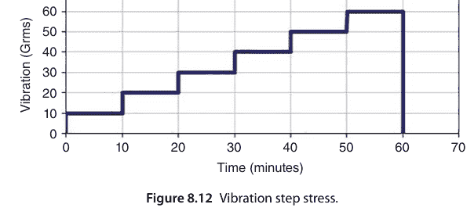

**表 8.4 振动阶跃应力**

振动阶跃应力：最大极限 60 Grms/分钟，以 10 Grms 步进。

| Description | Min/step | Sub totals (min) | Sub totals (h) |
|---|---|---|---|
| Set chamber temp to 20 °C. | 5 | 5 |  |
| Set the vibration level to 10 Grms, run for 10 min with diagnostics running. | 10 | 15 |  |
| Increase the vibration level in 10 Grms steps and diagnostics running for 10 min. Continue increasing vibration level by 10 Grms until the upper vibration limit is reached. 10 Grms steps for 10 min per step. Loop on diagnostics during vibration. | 50 | 65 |  |
| Stop the vibration. Verify proper DUT operation. | 15 | 70 |  |
| Total time |  | 70 | 1.17 |

一旦温度和振动阶跃应力测试完成，产品对每种环境应力的软失效和硬失效极限就已确定。从这两个测试中确定的极限用于后续的 HALT 测试。所需的最后一个 HALT 测试是组合温度和振动阶跃应力（表 8.5 和图 8.13）。该应力测试将温度和振动阶跃应力组合在一起，是对被测产品最具压力的测试。此测试的上、下应力极限基于振动和温度阶跃应力期间发现的上、下失效极限。一般经验法则是将上、下温度极限设定在温度阶跃应力期间确定的硬失效极限（或软失效极限）之上和之下 10 °C。

应力极限应始终低于硬失效极限。如果软失效导致产品无法自恢复、无法运行或关闭，则使用软失效极限来确定组合阶跃应力的最大应力。如果软失效是参数测试且导致产品超出规格，则是可以接受的。我们不期望 DUT 在超出其运行规格极限的应力下满足所有参数规格，但我们期望其功能正常。设置上振动应力极限的相同理论和过程也适用。振动阶跃应力极限设定在硬失效极限或软极限以下 10 Grms，如上所述。

许多实践者随后进行快速热循环应力测试（表 8.6 和图 8.14）。这时腔室温度会尽可能快速地变化。此测试的温度极限应比温度阶跃应力中确定的高温和低温失效极限低 10 °C（基本上与组合温度和振动阶跃应力中使用的温度极限相同）。


## 表 8.5 温度和振动阶跃应力。

|  | 强制性阶跃温度/阶跃振动应力：(−40 至 +120 °C（20 °C 步长），20/40/60 Grms） (60 °C min⁻¹)a | 时间（分钟） |  |  |
|  |  | Min/step | Sub totals (min) | Sub totals (h) |
| 32 | 将腔室温度设定为低温极限（即 −40 °C）并浸泡 5 分钟。 | 5 | 5 |  |
| 33 | 在 20 Grms 步长下执行振动阶跃应力，直至达到上限振动。每个步长停留 10 分钟/步。振动期间循环诊断。 | 30 |  |  |
| 34 | 以 20 °C 步长升高温度，直至达到上限温度 120 °C。在每个温度步长重复振动阶跃应力。 | 210 | 210 |  |
| 39 | 升温至 20 °C 并浸泡 5 分钟。验证 DUT 正常运行。 | 10 | 10 |  |
|  | Total |  | 225 | 3.8 |

a) Note: Set temperature boost to achieve rapid cycling (10 °C cold & 10 °C hot). Start at the low temperature limit (i.e. −40 °C). Set vibration at 20 Grms for each new step transition.

## 温度 & 振动阶跃应力

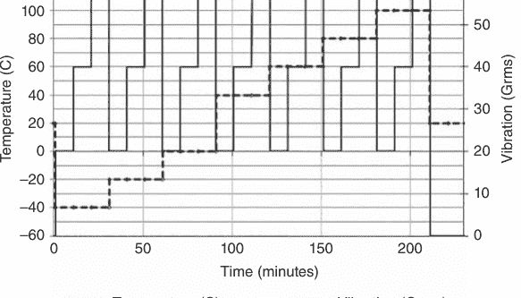

## 图 8.13 温度和振动阶跃应力。

应至少有三个循环，但五个循环是首选。目标是快速从一个温度极端过渡到另一个极端。达到目标温度后停留也很重要，通常为 10–15 分钟，基于产品的热质量，以确保产品达到目标温度。如果受应力产品具有较大的热质量，则尤其重要。腔室温度通常会比产品温度变化快得多。

## 表 8.6 快速热循环。

| | 可选快速温度循环： (60 °C min⁻¹)a) | Time in minutes | | |
| | | Min/step | Sub totals (min) | Sub totals (h) |
| 20 | Set temperature boost to achieve rapid cycling (10 °C cold, 10 °C hot). | | | |
| 21 | Verify proper operation of the DUT. | 15 | | |
| 22 | Close doors and set chamber to 20 °C. | 5 | | |
| 23 | Purge chamber with nitrogen for 2 min (nitrogen purge). | 2 | | |
| 24 | Ramp temperature cycle from upper limit −10 °C to lower limit −10 °C (limits identified in temperature stress test). Soak 10 min once product gets within 10 °C of set point (upper or lower limit). Loop on diagnostics during soak. | 33 | | |
| 25 | Enter the number of temperature cycles (repeat above step) ⇒ | 5 | 165 | |
| 26 | Ramp back to 20 °C and soak for 5 min. | 7 | | |
| 27 | Verify proper operation of the DUT. (Run diagnostics.) | 15 | | |
| 28 | Run air purge before opening the chamber. | | | |
| | Total | | 187 | 3.1 |

a) Note: When going cold, turn off any air being used to mitigate power boards. The airline can contain moisture that can lead to condensation.

因此腔室可能在设定的温度极限下进行热循环，但产品变化不大，因为在温度上没有停留以允许产品达到温度设定点。有几种方法可以避免此错误。您可以将腔室设置为由产品温度而不是腔室空气控制。在这种情况下，您将用于控制腔室的热电偶放置在热质量较高的位置。另一种方法是手动运行测试，将热电偶放置在产品的厚重部分，并在开始下一次温度斜坡之前等待其达到温度。快速热循环测试揭示了任何对热变化速率敏感的设计敏感性（表 8.6 和图 8.14）。

缓慢的温度斜坡是发现温度敏感不稳定性的有效方法（表 8.7 和图 8.15）。此测试的温度极限应为在温度阶跃应力中确定的低温和高低温失效极限之上和之下 10 °C（基本上与组合温度和振动阶跃应力中使用的相同温度极限）。缓慢的温度斜坡将揭示温度相关的不稳定性，如果不知道它们发生的温度窗口，则极难重现。不稳定性可能发生在非常狭窄的温度范围内，因此缓慢的温度斜坡可能是观察异常的唯一方法。此外，终端用户报告的最终被证明是由于温度敏感性而导致的故障将不包含重现所需的信息

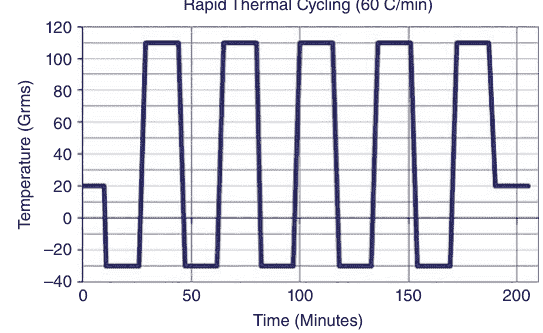

## 图 8.14 快速热循环。

## 表 8.7 缓慢温度斜坡。

| | Optional Slow temperature ramp: | Time in minutes | | |
| | | Min/step | Sub totals (min) | Sub totals (h) |
| 34 | Set temperature boost to achieve rapid cooling (10°C cold) | | | |
| 35 | Set temp to 20°C and soak for 5 min. | 5 | | |
| 36 | Set vibration to 0 Grms. Loop on diagnostics during vibration. | 0 | | |
| 37 | Ramp temp to lower temp limit (i.e. -40°C) less 10°C at 60°C min⁻¹. Add 10 min for dwell at lower temperature (reach temperature stability). | 11 | | |
| 38 | Soak at lower temp limit (i.e. -30°C) less 10°C for 5 min or till stable. | 5 | | |
| 39 | Set temperature boost back to 0 for hot and cold. | 0 | | |
| 40 | Ramp to upper temperature limit (i.e. 120°C) less 10°C at 1°C min⁻¹. | 142 | | |
| 41 | Loop on diagnostics during the entire ramp. | 0 | | |
| 42 | Set chamber temperature to 20°C and soak for 5 minutes when there. (60°C min⁻¹) | 1 | 162 | 2.7 |
| | TOTAL (mandatory and optional) test time = | 162 | 2.7 |

the instability. The instability could be an oscillation, an increase in noise, a reduction in output gain, power supply instability, automatic gain control (AGC) instability, a loss of phase lock, or an increase in phase noise. These are just a few failure modes that can occur over a narrow temperature range. In addition, because the phenomena only occurs within a narrow temperature range, a step stress may miss the window where this undesired behavior occurs. The slow temperature ramp provides you an opportunity to observe the instability or other unacceptable behavior as you sweep through the temperature changes.

## 缓慢温度斜坡

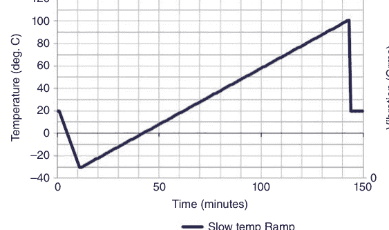

Figure 8.15 Slow temperature ramp.

## 表 8.8 具有不断变化振动水平的缓慢温度斜坡。

|  | Optional Slow temperature ramp and ramping up/down vibration: | Time in minutes |  |  |
|---|---|---|---|---|
|  |  |  | Sub totals (min) | Sub totals (h) |
| 34 | Set temperature boost to achieve rapid cooling (10°C cold) | Min/step |  |  |
| 35 | Set temp to 20°C and soak for 5 min. | 5 |  |  |
| 36 | Set vibration to 10 Grms. Loop on diagnostics during vibration. | 0 |  |  |
| 37 | Ramp temp to lower temp limit (i.e. −40°C) less 10°C at 60°C min⁻¹. Add 10 min for dwell at lower temperature (reach temperature stability). | 11 |  |  |
| 38 | Soak at lower temp limit (i.e. −30°C) less 10°C for 5 min or until stable. | 5 |  |  |
| 39 | Set temperature boost back to 0 for hot and cold. | 0 |  |  |
| 40 | Ramp to upper temperature limit (i.e. 120°C) less 10°C at 1°C min⁻¹. | 152 |  |  |
| 41 | Loop on diagnostics during the entire ramp. | 0 |  |  |
| 42 | Turn off vibration and ramp to 20°C. Soak for 5 min. (60°C min⁻¹) | 1 | 174 | 2.9 |
|  | TOTAL (mandatory and optional) test time = | 174 | 2.9 |  |

缓慢温度斜坡的一种变体包括不断变化（上下）振动（表 8.8 和图 8.16）。此测试的温度极限应为在温度阶跃应力中确定的高温和低温失效极限以下 10°C（基本上与组合温度和振动阶跃应力中使用的相同温度极限）。振动阶跃应力极限设定为硬失效极限或如上所述的软极限的 50%。搜索模式技术很有价值

## 缓慢温度斜坡 & 上下斜坡振动

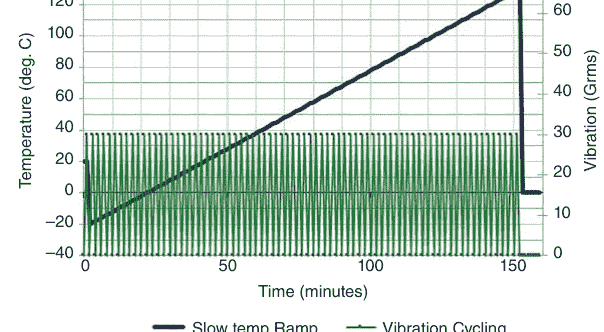

Figure 8.16 Slow temperature ramp with constantly varying vibration level.

where the soft failure is very close to the hard failure. The temperature increase slowly up at 1–2 °C min⁻¹ with the vibration level is oscillating up and down all the while the product is being continuously monitored.

Repeat these stresses in the same sequence on the next DUT and carefully note where there are similarities and differences. Continue until all the DUTs have completed HALT and the data is recorded. It might be best, in some cases, to save some of the DUTs and stop testing early. This will allow you to work on the failures to their root causes, and to apply the fixes to new systems.

It is very important to record the stress levels where the soft and hard failures occurred. Later, when you have made design corrections, these stress levels should have increased, thus increasing your operating margins.

The stresses thus far to accelerate failure have been environmental in nature, namely temperature and vibration. The same methodology can be applied to electromechanical stresses to accelerate failure. For example, the power supply voltage can be margined up and down from its nominal value. This should be part of the hardware DV, but is usually done at room or nominal ambient temperature. During HALT, this is test is repeated combined with environmental stress, typically temperature. If the product design uses multiple power sources or voltage references, then HALT should include voltage margining and varying power supply turn-on time strategy. This test should include all allowable cases at the upper and lower temperature limits with guard band added. This includes varying supplies up and down alone and in combination to cover the range of allowable states. Create a test matrix for the combination of voltage supply upper and lower limits at the upper and lower temperature limits. Power supplies will not all turn on at the same time.

Some components require multiple voltages to operate. This can be especially true for application specific integrated circuits (ASICs). It is important to verify that the component will not power on in a bad state based on the order the power supplies turn on. Sometimes the manufacturer will state this in the datasheet but was overlooked by


设计团队。元件制造商可能不知道在通电时可能出现的一种情况，即元件可能以不良或锁定状态开启。如果该器件是使用多种供电电压的 ASIC，就不太可能知道是否存在任何非法的上电条件。还有其他电气应力需要在组合和单独的情况下进行裕度分析。这些应力包括交流输入电压和交流线频率、时钟频率等。

## 8.2 高加速应力筛选（HASS）

一旦从 HALT 中识别出的可靠性设计问题被设计掉，产品就准备好进入制造阶段。然而，良好的设计只是战斗的一半。产品可靠性是通过良好的设计和制造工艺实现的。相反，设计缺陷和不良的制造工艺会导致现场故障。HALT 过程侧重于导致现场可靠性问题的设计问题。制造工艺变异也会存在，这可能会导致产品弱点，最终导致现场故障。能否将 HALT 过程应用于制造，以防止具有不可接受的工艺变异的产品出货？

HALT 过程可以间接应用于制造过程。制造中使用的过程称为 HASS。HASS 可以防止边际和有缺陷的单元被售出。HASS 的目的是在出货前识别出具有工艺相关缺陷和制造弱点的产品。HASS 在识别供应商提供的潜在有缺陷零件时也很有效。

HALT 和 HASS 使用类似类型的加速应力来识别故障。两个过程在产品通电并运行时也会对产品施加应力。但相似之处到此为止。HASS 以与 HALT 类似的方式对产品施加应力，但应力水平较低。HASS 是 HALT 的温和形式。HALT 是用于应力测试设计的手段，我们强调其中的“T”即测试。HALT 的目的是揭示与设计相关的故障。它是改进产品设计的积极工具，由设计工程执行。HALT 揭示了如果设计未修复，客户在现场将遇到的故障。

HASS 是一种应力筛选，最后一个“S”用于强调筛选。在产品制造后，它们会通过 HASS 以验证制造工艺是否受控。HASS 在制造中作为产品验收的手段执行。工艺变异会被 HASS 标记，并可立即纠正，以防止不合格产品出货。HASS 是一种反应性工具，用于确保制造工艺保持受控。

制造工艺越复杂，制造缺陷进入产品的机会就越大，从而使其可靠性降低。对制造工艺的控制至关重要。即使实施了最佳的制造实践，即统计过程控制（SPC）、持续改进、静电放电（ESD）保护和培训，由于工艺漂移和供应商问题，制造缺陷仍可能出现。HASS 的目的是通过或“筛选掉”不合格产品。生产线末端增加的 HALT 室，可对产品施加降低的应力，从而执行至关重要的 HASS 步骤。HALT 室和 HASS 室可以是同一个。这对于外包制造或低产量生产的小公司来说是一个选择。许多公司更喜欢避免

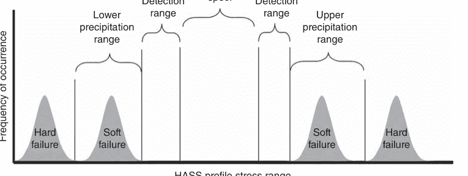

# 图 8.17 HASS 应力水平。

设计与制造之间的排程冲突，因此为 HALT 和 HASS 设置单独的室。HASS 室通常也更大，以便批量处理。

从 HALT 结果中，可以了解产品的运行和破坏极限。在 HASS 中，产品在超过其运行极限但低于破坏极限的水平下受到应力。HASS 配置文件由两部分组成，即沉淀筛选和检测筛选。测试从沉淀筛选开始。沉淀筛选是一种低于破坏极限且高于运行极限的应力水平。参见图 8.17。需要确定应用于产品的 HASS 筛选水平。温度的良好应力水平在破坏极限的 80% 至 50% 之间。初始振动应力水平设定为破坏极限的 50%。重要的是要保持在破坏极限以下；否则，很可能损坏好的产品。沉淀筛选的目的是充分损坏任何潜在缺陷（意味着它很坏但尚未被检测为坏），以便以后在检测测试中被检测到。然而，应力不得损坏或严重降低好的产品。一般来说，如果施加正确的应力水平，有缺陷的组件的退化速度将明显快于好的产品。筛选证明（POS）（在第 7.3.1 节中讨论）将确定沉淀应力是否过于严重或无效。

沉淀应力旨在充分损坏有缺陷的产品，以便将其与好的产品区分开来。我们通过检测筛选来识别不良产品。检测筛选在软失效极限和产品规格极限之间的温度应力水平下进行。将温度应力设定在规格极限和软失效极限之间。振动水平设定在 3 至 5 Grms 之间（通常称为轻微振动）。HASS 配置文件通常很短，通常三次到五次沉淀和检测循环就足够了。

### 8.2.1 筛选证明（POS）

HASS 对产品施加的环境应力会降低产品的预期寿命。这是不可避免的。HASS 的目标是提供足够高的应力水平以引发制造缺陷的识别，而不会移除过多的产品寿命。HASS 中移除多少产品寿命可以通过一种称为 POS 的过程来估计。

POS 过程很简单；只需重复 HASS 筛选直到产品失效。重复施加 HASS 应力会导致产品以加速速率退化。最终，由于应力的累积效应，产品将失效。如果需要 20 次才能使产品无法运行，那么可以合理估计每次 HASS 筛选会移除 5% 的产品寿命。如果 DUT 在仅四次 HASS 筛选后失效，则可以假设每次移除了产品寿命的 25%。在产品失效之前没有期望的最小应力循环数。一些公司希望在没有失效的情况下至少有 20 个循环。测试应在足够大的样本上运行，以确保正常的制造工艺变异得到考虑。

另一方面，如果你在 100 个循环中运行 HASS 测试而没有失效，HASS 应力水平可能设定得太低。一些从业者建议对产品进行接种以确定 HASS 筛选在检测有缺陷产品方面的有效性。对板进行接种需要故意在产品中插入制造缺陷。然后测试产品以确定缺陷是否在 HASS 筛选中被发现。接种缺陷的问题在于，很难插入能够真实代表产品缺陷（即制造工艺漂移或供应商变更）的接种缺陷。

HASS 有替代方案吗？HASS 是筛选制造产品缺陷的唯一方法吗？不，还有其他技术，但 HASS 是最有效的。替代方案是老化、环境应力筛选（ESS），当然还有完全没有环境应力的电气测试。

### 8.2.2 老化

老化过程可以应用于组件和最终产品作为最终验收测试。回顾第 6 章中的浴盆曲线；图 8.18。产品的早期故障率通常高于其使用寿命期间的故障率。这就是为什么有些人更喜欢购买一年的旧车，因为“问题已经解决”。老化旨在加速婴儿死亡率，以便在产品售出前发生故障。通常，婴儿死亡率故障发生在产品使用的第一年。产品故障

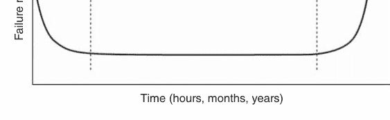

图 8.18 浴盆曲线。


通常在第一年中较高，因为可靠性和质量问题经常在此时暴露。理论上，你可以通过在产品出售前先在内部运行一年来避免高婴儿死亡率的故障率。这显然由于多种原因而不可行。然而，如果你能加速产品的第一年使用，即“对产品进行老化试验”，那么婴儿死亡率的故障率将在老化试验期间发生。老化试验必须足够长，以消除大部分早期寿命故障。

老化试验过程是对 100% 的生产产品进行的，通常包括在运行测试诊断的同时对产品进行通电和断电。老化试验通常运行 24–48 小时。产品还被保持在较高的温度，通常在其产品规格范围的上限，通过温度箱。

老化过程通常需要一到两天的测试时间，但有时会更长。为了规避这段较长的测试时间，老化试验箱往往很大，以便可以同时测试许多生产单元。这降低了测试成本并提高了吞吐量。大型的老化箱可能花费数十万美元。

老化试验，有时被称为偏置烘烤试验，其设计目的是加速老化过程。在 1970 年代和 1980 年代，由于所用元件存在相当大的差异，产品出现高婴儿死亡率故障率的情况并不少见。并发工程、设计指南以及全面质量管理（TQM）、持续改进和 SPC 等质量计划的出现改变了这一切。如今的元件可靠性提高了几个数量级。今天，几乎所有元件制造商都提供可靠的零件。产品的可靠性不再由元件的质量驱动，而是由设计和制造过程的质量驱动。这并不意味着零件选择不再是问题。如果你为工作选择了错误的零件，那么就预期会出现可靠性问题。但问题已不再是“不良零件”。

此外，研究表明，老化试验并不是一种有效的早期故障消除技术。研究表明，在元件级进行老化试验往往会因静电放电、操作和电气过应力而损坏更多的好零件，而不是识别出不良零件。

## 8.2.3 环境应力筛选（ESS）

另一种常见的“老化”试验称为 ESS。ESS 试验是一种环境应力试验，旨在加速有缺陷产品的失效。试验在产品运行并被监控的同时进行。ESS 与传统老化试验的主要区别在于，ESS 对产品施加多种应力。这些应力可能包括

- 温度循环
- 温度浸泡
- 振动

然而，与 HASS 不同，施加到产品上的应力通常低于产品规格极限。

传统的 ESS 测试可以短至 2–4 小时，也可以长达 24 小时，具体取决于测试。完成的成品被放入 ESS 室（温度/振动室）并通电。典型的 ESS 从温度循环曲线开始，其中温度升高到刚好低于产品的设计规格。当达到最高温度时，产品进行 1–2 小时的温度浸泡。监控设备将检测产品是否超出规格。高温浸泡后，产品在仍带偏置并运行的情况下过渡到低温。当达到较低工作温度时，产品再次进行 1–2 小时的冷浸泡。完成 ESS 的温度浸泡部分后，会进行快速温度循环测试。在监控继续的同时，温度在重复循环中升高和降低。

如果通过这种顺序过程将 ESS 总时间缩短至一天，那么在一天后发生的与制造过程相关的故障，如果过程再次失控，可能就不会被检测到。ESS 老化过程的另一个缺点是，可能要等一周才能发现制造过程错误。这意味着制造商可能会生产出许多不符合标准且仍需纠正的产品。

这是一种典型的两难困境。较短的 ESS 周期是期望的，以保持在制品成本低并减少 ESS 资源所需的大小和成本。较长的 ESS 周期是期望的，以捕捉用较短 ESS 周期无法检测到的制造过程缺陷。减少 ESS 窗口是一个很大的风险。可以很容易看出，ESS 概念可能提供一种糟糕的折中。

焊点故障和连接引线技术是现场发现的故障中名列前茅的。绝大多数可通过温度循环检测的这些故障，即使在为期五天的 ESS 中，也无法通过这几次循环检测到。这就是为什么客户在产品在现场使用数月或数年后才会发现这些故障。通常，需要数千次循环才能诱发这种类型的故障。你无法负担使用 ESS 过程来发现这些故障。

## 8.2.4 HASS 的经济影响

HASS 容纳的单元很少，仅仅是因为这些室往往相对较小。（一些 HASS 室制造商会为制造商的特定需求提供定制室。）如果 HASS 过程使用快速温度循环，那么室内的单元数量必然必须限制，以便所有 DUT 的内部温度能够迅速达到。由于 HASS 通常可以在很短的时间内完成，例如 30–60 分钟，因此每天可以通过 HASS 过程的单元数量很高。考虑到 HASS 过程也可以查看较小的样本，它可以更接近于缺陷可能被引入过程的实时时间。这在使用 HASS 时转化为更快的恢复过程。由于在制造中发现的大多数缺陷是与过程相关的缺陷而不是与设计相关的缺陷，因此检测和改进导致的流程延迟要短得多。一旦 HASS 过程使制造过程处于受控状态，确保顶级质量的成本就会显著降低。

制造爬坡意味着最初生产的单元很少，后来生产更多，然后达到完全生产量。HASS 需要应用于每个单元，直到清楚没有新的与过程相关的故障为止。由于过程在很大程度上由于 HASS 的发现而处于受控状态，可能不需要继续 HASS。但完全停止 HASS 是不明智的，因为过程漂移和变化会渗入系统并产生负面可靠性影响。应纳入审计过程。

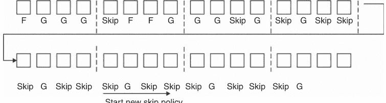

图 8.19 HASA 计划。来源：James McLinn 友情提供。

## 8.2.5 HASA 过程

高度加速应力审计™（HASA）是一种 HASS 审计过程。它定期检查过程，并在不进行审计时不会增加显著成本。

可以合理地假设，所有制造过程不会永远保持受控状态，而只会维持一段时间。一旦 HASS 验证制造过程处于过程控制之下，筛选就可以转移到跳批审计过程。可以不进行 HASS 制造的单元数量必须由制造过程的性质决定。如果每天可以生产 100 个单元并置于发货保留中，HASS 过程可以作为审计。将 100 个单元分成四组，每组 25 个，并按图 8.19 所示的结果对组进行抽样。

第一批有故障，接下来的三批都很好。跳过下一批并抽样其后的一批。该批有故障，回头检查被跳过的批。接下来，抽样接下来的两批。下一批有故障，其后的一批很好。抽样接下来的两批，两批都很好。跳过下一批并抽样其后的一批。该批很好，所以跳过下一批并抽样其后的一批。它也被发现是好的。所以跳过接下来的三批。抽样其后的一批；它很好，所以继续跳过接下来的三批。以这种方式继续，直到出现故障，然后回到每隔一批，直到连续找到三个好的样本为止。这是一个标准的跳批过程。

正如你所见，HASS 审计（HASA）之间生产的单元数量是许多变量的函数。理想情况下，HASA 筛查之间生产的单元数量应尽可能高，同时又足够小以适应成本效益的纠正措施。

## HALT、HASS、HASA 和 POS 效益总结

- 1. 电子设计/裕量改进
- 2. 包装设计改进
- 3. 零件选择改进
- 4. 生产过程改进
- 5. 软件实现改进
- 6. 快速设计和过程成熟
- 7. 减少总工程时间和成本
- 8. 降低保修成本
- 9. 提高平均故障间隔时间
- 10. 快速过程纠正措施


## 8.3 HALT 和 HASS 测试 chamber

先对 HALT chamber 做一个简要描述。首先，让我们先说明它不是什么，并用许多制造商执行的典型老化型流程来描述。典型的环境 chamber 具有升高和降低 chamber 内温度的能力。chamber 通过电阻丝通电加热。冷却通常使用空调形式实现。 （其中一些温度 chamber 使用液氮。）电阻丝可以快速升高烤箱温度，但不能快速冷却。空调冷却系统没有足够的热能力来快速降低 chamber 内的温度。环境 chamber 标准温度控制的这一不足导致测试周期时间很长。从环境温度到 140 °C 再降回 −40 °C 的单次温度循环，在高温和低温处各停留一小时，由于空调的缓慢和 chamber 内器件的热质量，完成可能需要五到六小时。标准老化烤箱的这种无能使生产单元的温度循环对制造商来说是不 desirable 的。

HALT chamber 是设计用于快速提供两种环境应力的环境 chamber。典型的 HALT chamber 可控制温度范围为 −100 °C 至 +200 °C。通过使用巨大的电阻组和专门调校的液氮低温系统，这些 chamber 可产生 60 °C min⁻¹ 的温度变化速率。一些具有先进低温管理的 chamber 可达到 80 °C min⁻¹ 范围的变化速率。通过特殊设计，液氮可以非常快速地抽吸进入 chamber，chamber 内的器件响应速度远快于老化型 chamber。 在 HALT chamber 中，众多的通风口和软管将高流量冷却或加热空气导向 DUT，以实现 DUT 非常快速的温度变化速率。位于 DUT 内部的热电偶将确保内部温度快速达到，以最大限度地减少整体周期时间。

HALT chamber 中的振动台也独一无二。它能够在三个方向线性移动和旋转运动；因此称为六个自由度（参见图 8.20）。

在许多角度和方向下安装有压缩空气驱动的活塞执行器。这些执行器以随机顺序运行。它们将能量传递给台面；因此，台面与执行器和谐运动。控制电子设备随机选择执行器并控制其何时运行以及运行的

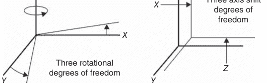

图 8.20 HALT chamber 具有六个同时自由度（运动）。

幅度。可以很容易想象，台面的底部安装有 8–16 个微型空气锤，安装在所有方向上，由微型操作员随机同时操作。台面安装在弹簧垫上，以便能够在六个自由度上移动。安装在台面上的测试器件会类似移动。执行器的频率响应为 DUT 赋予了宽广的频率范围。典型的台面振动频率范围为 2 至 10 000 Hz。台面通常可产生高达 60 Grms 的振动水平，作用于重量达 1000 磅或更多的被测器件。

## 8.4 加速可靠性增长（ARG）

通过第四阶段的可靠性活动主要集中于改进产品设计可靠性。在第四阶段结束时，产品已通过设计验证和设计验证。产品 alpha 和 beta 测试正在进行中，重点正转向制造和产品爬坡。然而，很可能在产品验证完成后，将会有硬件可靠性逃逸和软件质量问题在产品转移到制造后出现。当客户报告硬件可靠性和软件质量问题时，工程支持团队（由硬件和软件工程师组成）会迅速工作以识别根本原因并实施纠正措施。这种活动是被动的，并且基于终端用户通知您问题。因此挑战就在于，第五阶段可以做什么来将客户体验带入内部，从而有机会在终端用户体验到之前识别可靠性和质量逃逸？根据我的经验，我发现许多硬件可靠性和软件质量问题可以在第五阶段被发现，当运营团队正在验证生产爬坡就绪性时。有几个工具可以帮助您实现这一目标。其中两个更有效的工具称为 ARG（加速可靠性增长）和 ELT（加速早期寿命测试）。

在电子的早期，组件质量非常差，这是由于缺乏质量控制。问题的一部分是电气组件制造商不知道哪些关键工艺、材料和尺寸控制组件质量。因此，在此期间，制造商将组件老化纳入其中以引发和检测制造和测试过程中的潜在缺陷并不罕见。然而，组件老化并不是一个完美的过程，有缺陷的组件仍然会流向消费者。当消费者开始要求更高质量的组件时，这迫使制造商改进其质量控制。因此开始了长期的质量改进计划，如：TQM、六西格玛、零缺陷（ZDs）、质量圈、ISO 9000 等行业标准，以及质量功能展开（QFD）、持续改进、防错即 poka-yoke、Kaizen 和计划-执行-检查-行动（PDCA），仅举几个更受欢迎的计划。

随着时间的推移，组件制造商弄清楚了如何生产非常高质量的电气组件，其缺陷水平低到组件老化引发的缺陷比它捕获的更多。那时，“摆脱老化”（GOBI）策略变得流行，制造商改用“可接受质量水平”（AQL）等抽样计划。AQL 程序是必要的，以确保流程不会超出控制范围并防止假冒材料和零件进入生产流程。

在第四阶段产品开发结束时，重点转向产品制造和爬坡就绪。预计在第五阶段完成时，产品已准备好进行大批量制造，并且设计成熟度已达到可接受水平。

可靠性增长是通过故障报告、分析和纠正措施系统（FRACAS）随着故障被发现并永久消除而衡量产品可靠性改进的过程。如前所述，可靠性增长计划始于生产材料开始运送给终端用户。之后您必须等待终端用户发现并报告可靠性和质量问题。这会触发调查，可能导致重大的返工成本、客户不满和产品品牌受损。在产品运送给终端用户时才开始的可靠性增长计划是一种昂贵且低效的被动过程。识别现场故障的根本原因通常需要更长时间，因为设计团队已转向新项目，通常不会被拉回以支持现场故障问题。这也可能导致设计团队无法从过去的错误中学习。

可靠性增长不必是被动过程，应在第四阶段从第一个生产单元开始。ARG 计划的目标是在内部创造客户体验，以便在高产量生产爬坡之前发现设计和质量逃逸。这可以通过加速应力、足够运行时间和从生产材料中抽样来实现，以识别可靠性和质量逃逸。可靠性增长测试是在已通过制造和测试流程并准备运送给终端用户的生产材料上进行的（图 8.21）。在此扩展测试中发现的任何质量或可靠性问题都像现场故障一样对待，并记录到 FRACAS 中。

老化在针对已知失效模式和机制时最有效。然后可以定制应力以加速失效机制（引发）和检测故障。如果失效机制已知，加速率

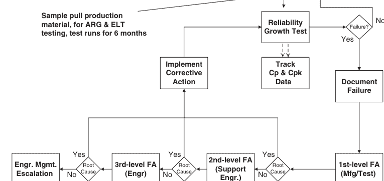

图 8.21 ARG 流程图。


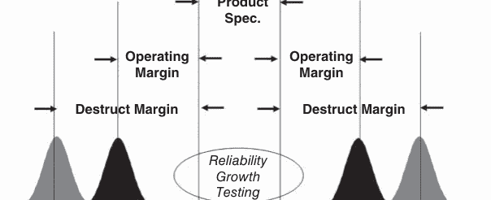

# 图 8.22 加速可靠性增长。

也可以计算出来。ARG 协议是一种扩展的烧入，在这种烧入中，失效模式和机理未知且旨在被发现。在 HALT 过程中，我们了解了产品的软失效和硬失效极限。ARG 应力设定为超出产品规格但在产品工作裕度范围内（图 8.22）。对于衍生产品设计，对过去设计和质量逃逸的回顾将为适当的加速协议提供洞见。图 8.23 显示了一个 ARG 和加速 ELT 程序的示例。ARG 程序的要求对于大批量产品与小批量产品应不同。风险也需要成为决策过程的一部分，以确定需要运行多少小时以及需要通过 ARG 程序循环的生产批次数量。

环境加速应力是温度，因此阿伦尼乌斯方程（8.1）可以提供加速因子的洞见。加速因子是一个常数乘数

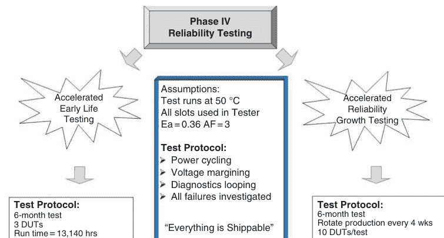

# 图 8.23 ARG 和 ELT 加速测试计划。

Phase IV
Reliability Testing

Accelerated
Early Life
Testing

Accelerated
Reliability
Growth Testing

Assumptions:
Test runs at 50 °C
All slots used in Tester
Ea=0.36 AF=3

Test Protocol:
Power cycling
Voltage margining
Diagnostics looping
All failures investigated

"Everything is Shippable"

Test Protocol:
6-month test
3 DUTs
Run time = 13,140 hrs
Accel. run time ~ 39,420 hrs

Test Protocol:
6-month test
Rotate production every 4 wks
10 DUTs/test
Run time = 43,800 hrs
Accel. run time ~ 131,400 hrs

它描述了两种应力之间的差异。在这种情况下，两种应力都是温度。加速应力温度为 50 °C，产品正常工作温度为 25 °C。当存在许多可能的失效模式时，每种模式都有其自身的失效机理和加速因子，可能与温度有关也可能无关。因此，将单一加速因子分配给热应力系统需要保守，并且仅为加速运行时间提供估计。在此示例中，我选择了一个保守的活化能 E_a 等于 0.36。

## 阿伦尼乌斯加速模型

```
AF = t₁ / t₂ = exp[ (Eₐ / k) (1/T₁ - 1/T₂) ]
(8.1)
```

where

|  |  |  |
|---|---|---|
| A | = | Constant |
| exp | = | Natural logarithm, base 2.7182818 |
| Eₐ | = | Activation energy for the reaction |
| k | = | Boltzman's constant = 8.625 × 10⁻⁵ eV/K |
| T | = | Absolute temperature (K) |
| t | = | Time |

## 8.5 加速早期寿命测试（ELT）

加速 ELT 的目的是识别非预期的早期寿命磨损机理。这些失效具有系统性，因此可能影响整个现场群体。非预期的早期寿命磨损机理是可靠性过程中的一次逃逸。它也可能是由于组件运行温度高于预期，导致其使用寿命显著缩短。它可能是大型组件与其安装的电路板之间热膨胀系数（CTE）不匹配所致。CTE 不匹配会在产品升温时产生显著的应变能，导致产品寿命早期出现焊点裂纹。一旦焊点裂纹形成，随后的热循环会因焊点断裂处产生的应力集中而使裂纹处的应力强度增大。结果是焊点裂纹会继续扩展，直到焊点连接完全分离。无意中使用超出其绝对最大推荐限值的组件很可能导致过早磨损。这可能是由于对绝对最大限值和推荐工作限值之间差异的误解所致。如果运气好，这些类型的设计错误会在 HALT 过程中通过逐步应力测试被检测出来。然而，如果在 HALT 中未被检测到，很可能最终会表现为早期寿命磨损失效。

加速 ELT 可以使用与 ARG 测试相同的测试用途（ARG），只是运行时间显著更长。样本量不必很大，因为我们希望检测的失效机理是由于磨损。通常，ELT 运行六个月，使用与 ARG 相同的测试协议。

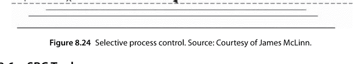

图 8.24 选择性过程控制。来源：Courtesy of James McLinn.

## 8.6 SPC 工具

可靠性是“随时间的质量”。本书早期我们讨论了可靠性与质量的区别；在这里，我们将指出如何使用一种众所周知的质量工具来提高可靠性。SPC 是一种用于最小化制造过程漂移的工具。该工具用于定期监控特定过程，以确保产品参数未漂移超出规格。SPC 过程建立了不可超过的上限和下限。当制造过程漂移接近这些极限时，操作员会被指示进行调整，使制造过程返回到这些极限的中心或理想设置，以便如图所示维持质量和一致性，如图 8.24 所示。

考虑整个制造过程可能都在 SPC 控制之下，并且在任何给定时间，许多被监控的过程都已漂移得太接近高水平。如果成品要在此时使用所有这些过程组装，该特定单元可能仍在质量标准内，仍符合所有规格，但已濒临在 SPC 过程监控的所有区域超出公差。将其与在所有 SPC 控制接近其中间值时制造的单元进行比较。后者单元显然会在这些参数因正常过程漂移或累积磨损而超出公差之前，在设计规格范围内工作很长时间。前者单元初始时就濒临质量规格之外，很小的应力和使用就可能使其超出设计规格。该单元可靠性低，可能会被 HASA 测试捕获。更宽的设计裕度可转化为现场可靠性改善。

考虑两个符合初始质量规格的单元，但只有一个单元可靠性高，因为它是在接近标称公差下制造的，另一个则不是。远离标称的单元将花费更多的保修费用。这是田口损失模型的依据。挑战在于识别在制造过程中可以经济控制的少数重要极限，以便单元保持在可接受的质量和可靠性标准范围内。SPC 工具已被用于按规格生产产品，并且通过收紧关键少数过程的上下公差，可以生产出可靠性更高的产品。当按上述方式使用时，SPC 既是质量工具也是可靠性工具。

## 8.7 FIFO 工具

使在货架上存放最久的单元先使用是公认的业务工具。会计术语 FIFO，先进先出，可应用于物料处理以提高可靠性。电子元件有引脚，最终会连接起来形成更大的组件。通常，这意味着它们将附着到电路板上，无论是通过表面贴装、通孔镀层技术，还是通过表面到表面（连接器）配合。这些元件在库存中、在货架上存放的时间越长，其电气引脚开始氧化和腐蚀的可能性就越大。这种氧化过程大大降低了这些引脚的可焊性。典型的电子装配有数百个甚至数千个电气连接。如果由于使用引脚存疑的元件而使其中少量连接变得不可靠，整个装配的可靠性可能会降低。

减少引脚氧化的一个方法是把所有元件放在装满氮气的袋子或容器中。通过减少元件周围的氧气环境，元件引脚的退化会大大降低。作为采购流程的一部分，易受氧化的材料可以采购于氮气填充容器中。这比使用 FIFO 控制库存更昂贵。

如果不使用 FIFO，旧的元件和材料会堆积在仓库货架的后面。最近采购的材料放在货架前面，通常是制造中首先使用的材料。有时，为满足订单需求，需要使用货架上所有的材料。在这种情况下，很可能在制造中以及之后在现场会出现焊接可靠性问题。通过控制订单数量并使用仓库中最旧的材料，可以保持焊接和连接可靠性处于高水平。还需要注意的是，你不知道这些元件在运送到贵公司之前可能在分销商的货架上存放了多长时间。

集成电路也是关键组件。它们有引脚，像大多数其他元件一样易受氧化，但它们还有另一个问题。塑料封装的集成电路在等待焊接到最终装配时会从大气中吸收水分。这在制造中可能是一个真正的问题。当元件通过焊接过程时，通常会被加热到远高于水的沸点的温度。元件中的水分会变成蒸汽。蒸汽在元件内部产生的压力有时大到足以造成微裂纹甚至导致分层。许多时候，这些潜在的失效在测试期间不会被发现。它们通常会表现为早期现场失效和高保修成本。这种失效机理被称为爆米花效应，因为失效的发生方式就像爆米花一样。

建议将集成电路和其他易受爆米花效应影响的塑料器件采购并储存在氮气容器中。此外，这些元件在通过焊接过程之前应在使用温暖的烘烤炉中预处理 24–48 小时。这种预处理使集成电路内部积累的水分缓慢迁移出来。因此，通过工艺变更消除了爆米花效应。

有时，为制造选定的全部或部分材料可能不需要，并可能存起来以后再用。它应放回氮气容器或投入工艺，以便在再次通过焊接工艺前重新进行预处理。未使用的材料经常被置于标准制造流程之外，因此对这一细节的关注很重要。预处理完成与放置在焊接工艺中的时间间隔取决于组件和


局部环境条件。预处理烤箱的期望温度各不相同，但可以从元器件制造商处获得。

## 参考文献

- 1 Silverman, M. (1998). Summary of HALT and HASS Results at an Accelerated Reliability Test Center. Santa Clara, CA: Qualmark Corporation.
- 2 Mike Silverman “HALT and HASS Results at an Accelerated Reliability Test Center,” IEEE Proceedings Annual Reliability and Maintainability Symposium, (© 1998 IEEE)

## 进一步阅读

R. J. Geckle, R. S. Mroczkowski, Corrosion of Precious Metal Plated Copper Alloys Due to Mixed Flowing Gas Exposure, Proc. ICEC and 36th IEEE Holm Conference on Electrical Contacts, Quebec, Canada, 1990, and IEEE Trans. CHMT (1992).

Gore, R., Witska, R., Ray Kirby, J., and Chao, J. Corrosive Gas Environmental Testing for Electrical Contacts. Research Triangle Park, NC: IBM Corporation.

## FMEA

- S. Bednarz, D. Marriot, Efficient Analysis for FMEA, 1998 Proceedings Annual Reliability and Maintainability Symposium (1998).
- M. Kennedy, Failure Modes and Effects Analysis (FMEA) of Flip-Chip Devices Attached to Printed Wiring Boards (PWB), IEEE/CPMT International Manufacturing Technology Symposium, IEEE (1998).
- M. Krasich, Use of Fault Tree Analysis for Evaluation of System Reliability Improvements in Design Phase, 2000 Proceedings Annual Reliability and Maintainability Symposium (2000).
- K. Onodera, Effective Techniques of FMEA at Each Life-Cycle Stage, 1997 Proceedings Annual Reliability and Maintainability Symposium, IEEE (2000).
- Prasad, S. (1991). Improving manufacturing reliability in IC package assembly using the FMEA technique. IEEE Transactions of Components, Hybrids and Manufacturing Technology 14 (3): 452–456.
- D. J. Russomanno, R. D. Bonnell, J. B. Bowles, Functional Reasoning in a Failure Modes and Effects Analysis (FMEA) Expert System, 1993 Proceedings Annual Reliability and Maintainability Symposium, IEEE (1993).
- SAE International (2012). Recommended Failure Modes and Affects Analysis (FMEA) Practices for Non-Automobile Applications. SAE. https://www.sae.org/standards/content/arp5580/.
- R. Whitcomb, M. Riox, Failure Modes and Effects Analysis (FMEA) System Development in a Semiconductor Manufacturing Environment, IEEE/SEMI Advanced Semiconductor Manufacturing Conference, IEEE (1994).

## HALT

J. A Anderson, M. N. Polkinghome, Application of HALT and HASS Techniques in an Advanced Factory Environment, 5th International Conference on Factory 2000, April, 1997.
C. Ascarrunz, *HALT: Bridging the Gap Between Theory and Practice*, International test Conference 1994, IEEE (1994).
R. Confer, J. Canner, T. Trostle, S. Kurz, *Use of Highly Accelerated Life Test Halt to Determine Reliability of Multilayer Ceramic Capacitors*, IEEE (1991).
N. Doertenbach, *High Accelerated Life Testing – Testing With a Different Purpose*, IEST, 2000 proceedings (February, 2000).
General Motors Worldwide Engineering Standards (2002). *Highly Accelerated Life Testing*. GM.
R. H. Gusciaoa, *The Use of Halt to Improve Computer Reliability for Point of Sale Equipment*, 1998 Proceedings Annual Reliability and Maintainability Symposium, IEEE (1998).
HnateK, E.R. (1999). *Let HALT Improve Your Product*. Nelson Publishing.
Hobbs, G.K. (1977). *What HALT and HASS Can Do for Your Products*. Nelson Publishing Inc.
Hobbs, G.K. (1997). What HALT and HASS can do for your products. In: *Hobbs Engineering, Evaluation Engineering*, 138. Qualmark Corporation.
Hobbs, G.K. (2000). *Accelerated Reliability Engineering*. Wiley.
Joseph Capitano, P.E. (1998). Explaining accelerated aging., *Evaluation Engineering* 46.
McLean, H. (1991). *Highly Accelerated Stressing of Products with Very Low Failure Rates*. Hewlett Packard Co.
McLean, H.W. (2000). *HALT, HASS & HASA Explained: Accelerated Reliability Techniques*. American Society for Quality.
Minor, E.O. *Quality Maturity Earlier for the Boeing 777 Avionics*. The Boeing Company.
M. L. Morelli, *Effectiveness of HALT and HASS*, Hobbs Engineering Symposium, Otis Elevator Company (1996).
D. Rahe, *The HASS Development Process*, ITC International Test Conference, IEEE (1999).
D. Rahe, *The HASS Development Process*, 2000 Proceedings Annual Reliability and Maintainability Symposium, IEEE (2000).
M. Silverman, *Summary of HALT and HASS Results at an Accelerated Reliability Test Center*, Qualmark Corporation, Santa Clara, CA, 1998 Proceedings Annual Reliability and Maintainability Symposium, IEEE (1998).
M. Silverman, HASS Development Method: Screen Development, Change Schedule, and Re-Prove Schedule, 1998 Proceedings Annual Reliability and Maintainability Symposium, IEEE (1998).
Silverman, M.A. *HALT and HASS on the Voicememo II™*. Qualmark Corporation.
Silverman, M. (n.d.). *Summary of HALT and HASS Results at an Accelerated Reliability Test Center*. Santa Clara, CA: Qualmark Corporation.
Silverman, M. *Why HALT Cannot Produce a Meaningful MTBF Number and Why this Should Not Be a Concern*. Santa Clara, CA: Qualmark Corporation, ARTC Division.
J. Strock, *Product Testing in the Fast Lane*, *Evaluation Engineering* (March, 2000).
Tustin, W. and Gray, K. (2000). Don’t let the cost of HALT stop you. *Evaluation Engineering* 36–44. www.evaluationengineering.com/dont-let-the-cost-of-halt-stop-you.

## HASS

T. Lecklider, How to Avoid Stress Screening, Evaluation Engineering, pp. 36–44 (2001).

Rahe, D. (1998). HASS from Concept to Completion. Quality Reliability Engineering International 14: 403–407. https://vdocuments.site/hass-from-concept-to-completion.html.

D. Rahe, The HASS Development Process, 2000 Proceedings Annual Reliability and Maintainability Symposium, IEEE (2000).

M. Silverman, HASS Development Method: Screen Development, Change Schedule, and Re-Prove Schedule, 2000 Proceedings Annual Reliability and Maintainability Symposium, IEEE (2000).

## 质量

Gupta, P. (1992). Process Quality Improvement – A Systematic Approach. Surface Mount Technology.

Carolyn Johnson, Before You Apply SPC, Identify Your Problems, Contract Manufacturing (May, 1997).

G. Kelly, SPC: Another View, Surface Mount Technology (October 1992).

Lee, S.-B., Katz, A., and Hillman, C. (1998). Getting the quality and reliability terminology straight. IEEE Transactions on Components, Packaging, and Manufacturing 21 (3): 521–523.

C.-H. Mangin, The DPMO: Measuring Process Performance for World-Class Quality, SMT (February, 1996).

Minor, E.O. (n.d.). Quality Maturity Earlier for the Boeing 777 Avionics. The Boeing Company.

S. M. Nassar, R. Barnett, IBM Personal Systems Group Applications and Results of Reliability and Quality Programs, 2000 Proceedings Annual Reliability and Maintainability Symposium (2000).

Oh, H.L. (1995). A Changing Paradigm in Quality. IEEE Transactions on Reliability 44 (2): 265–270.

T. A. Pearson, P. G. Stein, On-Line SPC for Assembly, Circuits Assembly, (October, 1992).

D. K. Ward, A Formula for Quality: DFM + PQM = Single Digit PPM, Advanced Packaging (June/July, 1999).

## 烧入

T. Bardsley, J. Lisowski, S. Wilson, S. VanAernam, MCM Burn-In Experience, MCM '94 Proceedings (1994).

D. R. Conti, J. Van Horn, Wafer Level Burn-In, Electronic Components and Technology Conference, IEEE (2000).

J. Forster, Single Chip Test and Burn-In, Electronic Components and Technology Conference, IEEE (2000).

T. Furuyama, N. Kushiyama, H. Noji, et al. Wafer Burn-In (WBI) Technology for RAM's, IEDM 93–639, IEEE (1993).

R. Garcia, IC Burn-In & Defect detection Study, (September 19, 1997).
C. F. Hawkins, J. Segura, J. Soden, et al. Test and Reliability: Partners in IC Manufacturing, Part 2, IEEE Design & Test of Computers, IEEE (October–December, 1999).
T. R. Henry, T. Soo, Burn-In Elimination of a High Volume Microprocessor Using I_DDQ, International Test Conference, IEEE (1996).
Jordan, J., Pecht, M., and Fink, J. (1997). How burn-in can reduce quality and reliability. The International Journal of Microcircuits and Electronic Packaging 20 (1): 36–40.
Kuo, W. and Kim, T. (1999). An overview of manufacturing yield and reliability modeling for semiconductor products. Proceedings of the IEEE 87 (8): 1329–1344.
W. Needham, C. Prunty, E. H. Yeoh, High Volume Microprocessor Test Escapes an Analysis of Defects our Tests are Missing, International Test Conference, pp. 25–34 (1992).
Pecht, M. and Lall, P. (1992). A physics-of-failure approach to IC burn-in, Advances in Electronic Packaging, 917–923. ASME.
A. W. Righter, C. F. Hawkins, J. M. Soden, et al. CMOS IC Reliability Indicators and Burn-In Economics, International Test Conference, IEEE (1988).
T. Sdudo, An Overview of MCM/KGD Development Activities in Japan, Electronic Components and Technology Conference, IEEE (2000).
Thompson, P. and VanOverloop, D.R. (1995). Mechanical and electrical evaluation of a bumped-substrate die-level burn-in carrier. Transactions On Components, Packaging and Manufacturing Technology, Part B 18 (2): 264–268, IEEE.

## ESS

H. Caruso, An Overview of Environmental Reliability Testing, 1996 Proceedings Annual Reliability and Maintainability Symposium, IEEE (1996).

Caruso, H. and Dasgupta, A. (1998). A fundamental overview of accelerated-testing analytic models. In: 1998 Proceedings Annual Reliability and Maintainability Symposium, 389–393. IEEE.

M. R. Cooper, Statistical Methods for Stress Screen Development, 1996 Electronic Components and Technology Conference, IEEE (1996).

Epstein, G.A. (1998). Tailoring ESS strategies for effectiveness and efficiency. In: 1998 Proceedings Annual Reliability and Maintainability Symposium, IEEE, 37–42.

S. M. Nassar, R. Barnett, Applications and Results of Reliability and Quality Programs, 2000 Proceedings Annual Reliability and Maintainability Symposium, IEEE (2000).

## 降额

Das, D., Pecht, M., and Pendse, N. (2005). Rating and Uprating of Electronic Parts. CALCE EPSC Press.


# 9
# 软件质量目标与度量

## 9.1 设定软件质量目标

不可能从软件发布中移除所有缺陷。即使可以，从经济角度来看也是不可行的。软件质量目标应通过基于对质量投资的投资回报率（ROI）分析来检查软件质量需求后设定。

并非所有产品的软件质量需求都相同。甚至单个产品的各个部分的需求也可能不同。那么，一个组织如何确定在软件质量上投入多少，以及将这些努力集中在产品的哪些部分上以确保物有所值呢？

在确定质量目标时，需要考虑缺陷的影响以及修复缺陷的成本。对于缺陷对客户影响很小或修复成本不高的产品（或产品组件），可接受的质量目标可能较低。另一方面，对于缺陷影响重大或修复成本非常高的产品（或组件），质量目标应设定得很高。

在极端情况下，网页上的一个错别字可能就是一个影响低、易于修复的缺陷。开发人员可以轻松更改，缺陷可在很短时间内得到纠正。在许多情况下，这种错别字根本不会产生任何实质性或财务影响。

在光谱的另一端，医疗设备中的缺陷可能导致用户死亡。这种缺陷逃逸代价高昂，可能导致诉讼、业务损失，并对品牌资产产生负面影响。在最极端的情况下，甚至可能导致企业失败。另一个例子可能是开发后期发现的严重设计缺陷。这种性质的缺陷在极端情况下可能导致迄今为止的所有产品开发工作被废弃，开发组织损失到目前为止的全部投资。同样，任务关键组件或功能中的缺陷可能导致技术或产品不可修复地失败。例如，火星探测器中的缺陷可能导致整个任务失败。

提高软件质量是有成本的，但应将其视为投资。该投资的回报来自于交付高质量软件所带来的未来收入的积极影响。提高软件质量的成本应进行成本效益分析，至少是非正式的。

避免或从产品中移除缺陷可能代价高昂。不可能发布一个保证没有缺陷的软件产品。随着产品剩余缺陷密度的降低，找到和移除软件缺陷的成本会增加。

也就是说，移除前几个缺陷的每个缺陷成本低于移除最后几个缺陷的成本。随着时间的推移，成本会趋于渐近。

相反，随着产品缺陷密度的降低，剩余缺陷的财务影响也会降低。一个非常有缺陷的产品可能完全失败，投资全部损失。总体而言，单个缺陷的财务影响是有限的。

因此，在项目进行过程中，剩余缺陷的财务影响会下降，而移除剩余缺陷的成本会上升。并非所有产品都相同，也并非所有缺陷都相等。单个缺陷可能造成灾难性的财务影响。其他缺陷可能根本没有任何财务影响。

开发产品和技术的组织通常预算有限。随着项目持续，改善软件质量的成本会增加，而随着预期逃逸数量的减少，潜在逃逸缺陷的财务影响会下降。逃逸的财务影响由以下因素评估确定：

- 1. 修复预计逃逸缺陷的成本。请记住，修复缺陷的成本会随着项目的进展而增加，在产品开发结束时发现的逃逸缺陷成本最高。
- 2. 逃逸缺陷造成的潜在收入损失。一个非常有缺陷的产品不会卖出，客户可能会要求退款，未来公司其他产品的销售也可能受到负面影响。
- 3. 因软件故障而产生的责任问题、诉讼等。
- 4. 任务失败的可能性

假设可以绘制一条曲线，显示如果允许剩余缺陷逃逸，其潜在财务影响。另一条曲线可以显示移除剩余缺陷的成本。这两条曲线相交的地方就是给定技术、产品或组件的质量目标的甜蜜点。这对每个产品都不相同。在缺陷财务影响非常高的产品中（例如医疗设备中的危及生命的缺陷），值得投入更多质量。在剩余缺陷财务影响较低的产品中，投入更多质量的价值也较低。以下两个图表显示了一些假设的缺陷移除成本与逃逸成本影响的分析。图 9.1 显示了一种情况，即逃逸的财务影响较低（也许是前面提到的网站示例）。图 9.2 显示了一种情况，即潜在逃逸的财务影响非常高（例如前面提到的医疗仪器软件示例）。在这两个图表中，曲线相交附近的突出区域是软件质量目标的可能目标。在第一种情况下，很明显可以容忍较少的投资，并且产品可以用更高的缺陷密度发布。在第二种情况下，需要投入更多资金将软件质量提高到更高的水平。

## 9.2 软件度量

彼得·德鲁克常被引用为说过：“如果你无法衡量它，你就无法改进它。”如果软件质量的健康状况和状态未知，就无法改善软件质量。软件开发流程也是如此。必须随着时间的推移收集适当的度量，以确定是否达到质量目标以及质量流程是否有效。有几个重要且有用的度量用于管理软件质量。

度量本身并不是万灵药。收集和跟踪软件质量测量是改进过程的第一步。度量用于管理软件发布并指导软件流程改进工作。

一些软件开发人员认为度量是分散注意力的且具有误导性，因此不应该使用。其他人担心度量会被用来衡量个人开发人员绩效，从而成为一种士气低落的管理做法。就像任何想法一样，反对者会找到缺陷，这对度量的使用也是如此。大多数软件开发度量都是估计值。当期望设置不正确，管理层期望实际项目绩效完全符合度量时，就存在危险。管理层会浪费时间试图确定或解释项目为何以小幅方式偏离度量。当使用度量不当来衡量个人开发人员生产力时，会出现鼓励错误行为的问题。这是一个如此常见的问题，以至于它被刻画在著名的《Dilbert》漫画中，经理为每个找到并修复的错误提供奖金，这反过来鼓励开发人员制造更多错误 [1]。

尽管不当使用度量会带来不期望的后果，但也不应因噎废食。收集数据和跟踪度量是有用的方法，可以确定项目的状态，指出项目何时何地出现偏差，并评估流程改进。以下度量在适当使用时是强大的工具。

### 质量 ROI 图表

图 9.1 质量 ROI 图表（逃逸的财务影响较低）。

### 质量 ROI 图表

图 9.2 质量 ROI 图表（逃逸的财务影响较高）。

## 9.3 代码行数（LOC）

代码行数（LOC）是软件中源代码的行数。LOC 是生成其他度量（如缺陷密度）的基础度量，通常用作估算软件工作量的因素。LOC 通常聚合为 1000 行的单位，通常称为 KLOC（千行代码）。

LOC 看起来像是一个简单的数字，但可以有几种不同的计数方式。LOC 可以指：

- 源代码中的总文本行数（本质上是换行符的计数）。
- 所有源代码行，包括注释和空白行。
- 逻辑 LOC。逻辑代码行是单个软件指令语句，无论该语句在文件中占用多少物理行。以下伪代码语句是一个逻辑代码行：

```
If (myVariable == TRUE) then
setSomeState = xyz;
```

- 物理 LOC。物理代码行是包含指令直到换行或回车符的行。上面列出的伪代码将被视为两个物理 LOC。

选择一个定义并始终如一地计数非常重要。为了计算 LOC 的目的，建议仅使用非注释、非空白的物理 LOC。

有许多可用的工具可以计算 LOC，许多 IDE 也提供 LOC 计数。大多数工具可以运行在文件夹或一组文件夹上，以给出整个项目的 LOC 计数。大多数这些工具能够计算多种不同语言编写的源代码。

还有许多其他行计数工具可用。行计数工具的典型输出如图所示 9.3 所示。在此示例中，“code”列的总和将是非空白、非注释的物理 LOC。

## 9.4 缺陷密度

缺陷密度是每单位软件的缺陷数量，其中软件单位通常以 1000 行代码（KLOC）为单位。预测软件项目的预期缺陷密度有两个主要原因很重要：


```
C:\tmp>cloc .
    7 text files.
    7 unique files.
github.com/AlDanial/cloc v 1.76  T=0.50 s (14.0 files/s, 3416.0 lines/s)
--------------------------------------------------------------------------------
Language    files    blank    comment    code
--------------------------------------------------------------------------------
C           3        55       174        880
C++         4        8        62         529
--------------------------------------------------------------------------------
SUM:        7        63       236        1409
--------------------------------------------------------------------------------
```

图 9.3 示例行数统计。

- 1. 估算项目预期缺陷数可为缺陷模型提供输入，该模型可用于判断项目距离实现其质量目标的程度。
- 2. 软件项目预期缺陷数的估算用于规划生产软件所需的工时。

通常，预期缺陷密度基于历史数据。软件组织应跟踪每个项目在发布前发现的缺陷数量以及产品发布后用户报告的缺陷数量（逃逸缺陷）。发现的缺陷数与逃逸缺陷数之和除以发布的规模即为该版本的缺陷密度。缺陷密度通常表示为每千行代码的缺陷数。

应为每个项目或产品发布跟踪缺陷计数和 LOC。这将提供准确估算缺陷密度所需的数据。随着时间的推移跟踪缺陷和代码规模可提供衡量软件质量随时间改善的手段。

缺陷密度也可以按功能、产品组件或技术进行跟踪。这种更具体的数据对于改进工时估算以及为产品或流程的改进区域提供洞察都很有帮助。在创建工时估算时，了解产品的某些部分可能由于高于平均水平的缺陷率而需要更多工时是非常有用的。同样，差异化的缺陷率数据在确定产品哪些区域需要改进时也是非常好的输入。

缺陷密度并非对所有项目都相同。三个关键因素会影响缺陷密度：

- 1. *用于编码软件的语言。* 通常，高级语言，如 Java 和 C#，产生的缺陷密度高于低级语言，如 C 或汇编语言。
- 2. *代码复杂度。* 更复杂的代码通常具有更高的缺陷密度。例如，多任务或实时软件往往具有更高的缺陷密度。旧的遗留软件也常属于此类。
- 3. *正在开发的软件应用软件的类型。* 高级软件（例如数据库或 Web 应用）往往具有较低的总体缺陷密度。

低级软件（例如处理硬件或设备驱动程序）通常具有更高的缺陷密度。

在大多数情况下，软件组可以收集整体软件发布的历史缺陷密度指标，而不必担心为给定项目区分不同的缺陷密度率。然而，如果同一软件组织交付的不同项目具有非常不同的特征，那么为每种类型的项目使用不同的缺陷密度估算可能是值得的。此外，如果被迫使用行业数据来创建初始缺陷密度估算，将其与正在开发的项目类型相匹配是有用的。

在首次使用缺陷模型时可能无法获得历史缺陷密度数据。如果是这种情况，可以使用通用的行业缺陷密度数据作为起点。随着实际数据的收集，估算的缺陷密度指标可以随时间细化。如果组织的历史数据不可用，则可以使用行业数据代替。根据 Capers Jones [2] 的研究，美国软件行业的平均缺陷移除率为 85%。也就是说，美国平均软件公司在发布前移除约 85% 的软件缺陷。正如第 9.4 节所述，最佳实践软件公司的逃逸率为每千行代码 1.3–2.6 个缺陷，具体取决于语言。因此，可以合理假设一个非常优秀的软件开发组的平均注入率为低级语言约每千行代码 9 个缺陷，高级语言约每千行代码 18 个缺陷。可以假设最佳实践软件组也会采用良好的缺陷预防技术。因此，这些引用的行业数字过低，在使用它们估算刚开始部署软件质量控制方法的组织的缺陷率时应向上取整。如果没有历史数据，我建议对低级语言使用每千行代码 10 个缺陷，对高级语言使用每千行代码 20 个缺陷。

## 9.5 缺陷模型

缺陷模型估算在项目期间将注入和/或发现的预期缺陷数。一些缺陷模型可以非常复杂，并预测项目每个阶段将注入和发现多少缺陷。简单的缺陷模型可能仅估算特定组件或项目预期创建的总缺陷数。

缺陷模型最好基于历史数据构建。如果没有历史数据，可以使用行业数据构建初始缺陷模型。

关于使用缺陷模型进行管理的注意事项，引用 George Box 的话：“所有模型都是错误的，但有些模型是有用的。”[3] 缺陷模型不应被视为金科玉律。它是一个估算，因此本质上不准确。缺陷模型无法预测代码在任何给定时间点的确切缺陷数，只能给出粗略估计。它应作为在任何时间点近似项目质量的一般指导原则使用。只要管理层不期望任何给定项目指标与模型完全匹配，缺陷模型就是管理项目的非常有用的工具。

缺陷模型使开发组织能够更有效地规划项目所需的工作。使用缺陷模型的估算使管理者能够规划工作，以便有足够的时间和资源来发现和修复足够的缺陷以实现期望的质量目标。管理者可以安排工作以防止缺陷堆积。最有效的方法是在项目进展过程中保持开放缺陷数量低并受控。推荐这种方法是因为如果在任何时间点允许开放缺陷数量变得过高，测试软件就会变得更加困难，更难隔离单个问题。当确定单个缺陷的根本原因和修复所需时间更长时，整体生产率会下降，项目将花费更长时间并花费更多费用。除此之外，如果缺陷计数过高，则新开发是在有缺陷的基础上进行的，这将导致开发进展过程中出现更多问题。

## 9.6 缺陷运行图

缺陷运行图显示了在软件产品开发和测试期间以及产品发布时软件发布质量随时间的状态。它允许管理者确定软件发布是否已实现其目标质量目标。

缺陷运行图由多个数据系列组成。第一个是软件发布期间预期发现和修复的总缺陷数。该数据由缺陷模型确定。第二个数据系列是在软件开发和测试发布期间随时间发现的总缺陷数。图表中的第三个数据系列是在发布期间任何给定时间开放的缺陷数量。缺陷运行图如图 9.4 所示。

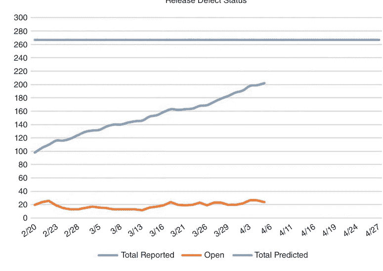


假设项目的新代码开发已经完成，当报告的缺陷总数达到预测的缺陷数量且未解决缺陷数量达到零时，软件被认为已达到其质量目标。解释缺陷运行图时需要注意以下几点。未解决缺陷的当前数量本身不足以显示发布就绪性。同样，如果报告的总计数等于（或大于）预测的缺陷数量，也是不够的。

预测的缺陷总数是一个估计，本身存在不准确性。预测的缺陷数量应作为粗略的衡量标准，而不是决定性标准。此外，如果开发团队在缺陷报告时高效地关闭发现的缺陷，未解决缺陷的数量可能在软件准备好发布之前就达到零。

使用缺陷运行图评估软件质量就绪性时，除了原始数字之外，管理人员还必须考虑开发和测试工作的状态。如果开发或测试尚未完成，即使数字看起来不错，软件也未准备就绪。为了帮助显示开发和测试的状态，可以在缺陷运行图上添加里程碑线，如图 9.5 所示。

缺陷运行图还提供了一种评估开发和测试团队是否按计划执行的机制。如果指标没有朝着预期目标收敛，则可能需要采取更多纠正措施。例如，如果在系统测试阶段（编码完成后）发现缺陷的速率似乎没有按斜率达到在期望日期的总预期缺陷，则应应用缓解计划。同样，

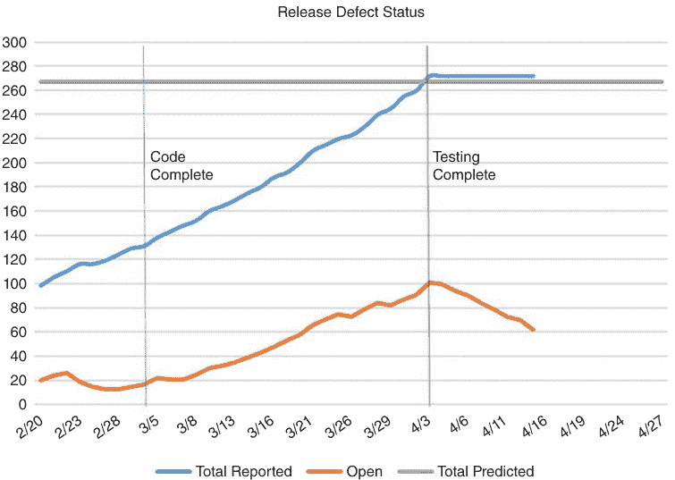

**Figure 9.5** Defect run chart 2.

如果缺陷关闭速率似乎没有按斜率在期望的发布日期将未解决缺陷降至零，则应采取缓解措施。

## 9.7 Escaped Defect Rate

逃逸缺陷是指产品发布后由终端用户发现的错误。虽然不可能从软件包中消除所有缺陷，但软件质量工作的目标是最大程度地减少逃逸缺陷的数量。

逃逸缺陷率是每千行代码（KLOC）的唯一逃逸缺陷数量。这应为每个版本跟踪。这意味着每个软件发布的新的和修改的代码行数需要记录。每个发布的终端用户报告的缺陷数量也必须按版本跟踪。重复报告的缺陷不应累加计数。

逃逸缺陷率是推荐的主要指标，用于确定软件质量是否随时间改善。应设定目标以针对逃逸率。在逐版本的基础上，如果软件质量流程在改善，则逃逸缺陷率应有所改善。

计算该目标逃逸率并非易事。其中一个主要因素是软件开发所使用的语言。与 C 或汇编语言等低级语言相比，Java 和 C# 等高级语言每行代码打包的功能更多。因此，高级语言的预期逃逸率将高于低级语言。为了缓解按 LOC 估算规模的问题，一些研究人员改用功能点（FP）而不是 LOC。功能点是衡量软件中功能量的语言中立指标。

Jones[2] 的研究表明，最佳行业逃逸缺陷率约为每功能点 0.13 个。根据 Quantitative Software Management（QSM）[4] 进行的研究，C 的平均 LOC/FP 为 97，C++ 为 50，C# 为 54，Java 为 53。一般而言，QSM 数据显示 LOC/FP 大致呈双峰分布；高级语言约为 50 LOC/FP，低级语言约为 100 LOC/FP，上下浮动 10%–15%。使用 QSM 和 Capers Jones 的数据，行业中最好的软件开发团队交付的代码缺陷逃逸率为：

C ~ 1.3 defects per KLOC

C++, C#, Java ~ 2.6 defects per KLOC

请注意，这些缺陷逃逸率不应与预期缺陷密度混淆。这些指标衡量的是不同的缺陷率。

跟踪每个发布的实际逃逸率需要仔细考虑。有几个因素会影响报告的逃逸率。包括采用新版本客户的数量以及该版本的使用时长。通常，使用量越多，报告的逃逸缺陷就越多，报告时间越早。因此，随着更多客户使用产品，报告缺陷的速率将会增加。随着时间的推移，逃逸缺陷的总数会增加。这将持续到后续软件版本可用并被客户采用为止，此时逃逸缺陷报告率将会下降。

### Escaped Defect Rate Per Release

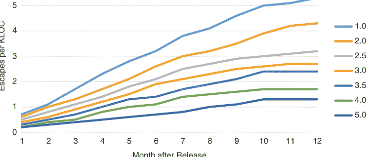

Figure 9.6 Comparative escape rates.

为了比较版本之间的改进，速率必须作为在限定时间段内的快照来查看。时间框可以根据发布节奏和客户采用率而变化；然而，通常最好将其限制为发布后一年，以便进行准确比较。每个发布后一年的每月报告的逃逸数量可以按月绘制。一个逃逸缺陷率比较图可能看起来像图 9.6。

软件开发组可以通过跟踪逐版本逃逸率来衡量其改进软件质量的进展。在这种特定情况下，从该图表可以明显看出，逃逸缺陷率从版本到版本在改善。

## 9.8 Code Coverage

单元测试应力求覆盖尽可能多的产品代码。在理想世界中，单元测试代码将测试 100% 的产品代码。然而，并非所有代码都可以通过单元测试进行测试。大多数单元测试框架可以在单元测试在框架中执行时生成单元测试覆盖的 LOC 报告。覆盖率指标应作为衡量单元测试是否充分的标尺。设定覆盖率目标有点有争议。实现 100% 覆盖是不切实际的。经验法则是，单元测试达到 90% 或更高的代码覆盖率是优秀的。低于 80% 的代码覆盖率可能是不够的。试图实现 100% 代码覆盖率的收益递减。

需要考虑的一点是，仅单元测试不足以保证产品代码没有缺陷。由于软件是有状态的，仅仅执行一次代码行不足以在所有状态下测试该代码。因此，即使有可能通过单元测试获得 100% 代码覆盖率，被测试的代码可能也并非完全没有缺陷。然而，强烈建议衡量代码覆盖率，因为代码覆盖率指标是确定代码测试的全面性的最佳方法之一。自动化构建和测试覆盖率可以在不增加软件开发组织人员额外工作量的情况下生成测试代码覆盖率的持续报告。

代码覆盖率通常由在运行单元测试时插入单元测试框架的工具来衡量。对于 Visual Studio，代码覆盖率分析内置于单元测试功能中，无需额外工具。有许多商业和开源工具可用于常见的单元测试框架（包括 Visual Studio）。其中一些免费工具是 Java 的 Jcov、gcov（GNU 代码覆盖工具）和 Google Test（gtest），可用于 C/C++。快速搜索网络会呈现许多其他工具。选择最适合您环境的工具。

代码覆盖率工具将报告哪些 LOC 未被执行，以及代码覆盖的百分比。这允许测试人员添加更多单元测试覆盖，直到尽可能多的代码得到测试。如果代码覆盖率工具集成到 IDE 中，例如 Visual Studio 代码分析，它可能会在 IDE 中直观地显示特定 LOC 的覆盖和未覆盖情况。其他工具生成报告，显示每个分析模块按行号的代码覆盖率。

单元测试不太可能，也可能没有必要，执行每一行代码。有些代码很难测试。最难测试的代码通常是错误处理代码，在那里可能很难模拟或创建各种错误条件。在决定跳过某些代码的单元测试时，必须考虑风险。应遵循四条一般规则来决定跳过某些代码的单元测试：

- 1. 所有非错误用例的代码必须由单元测试覆盖。
- 2. 所有常见错误条件代码必须经过测试。
- 3. 需要重大恢复处理的错误条件代码应经过测试。
- 4. 可以省略对处理非关键且难以重复错误的代码的测试。

除了风险之外，添加难以执行的 LOC 的单元测试的工作量应从投资回报率角度进行评估。如果成本过高，可能不适合为此类代码添加单元测试覆盖。然而，这并不意味着无法通过单元测试覆盖的代码不应经过验证。对于所有未被单元测试覆盖的代码，应采用其他验证方法。此代码可以通过系统测试覆盖，或需要额外的代码审查关注。

## References

1 Dilbert © 2018, Andrews McMeel Syndication, November 13, 1995, https://dilbert.com/strip/1995-11-13.

2 Jones, C. and Bonsignour, O. (2012). The Economics of Software Quality. Pearson Education Inc.

3 Box, G.E.P. (1979). Robustness in the strategy of scientific model building. In: Robustness in Statistics (ed. R.L. Launer and G.N. Wilkinson), 201–236. Academic Press.

4 Quantitative Software Management, Function point languages table, version 5.0 http://www.qsm.com/resources/function-point-languages-table.


## 延伸阅读

Ann Marie Neufelder，当前缺陷密度统计，SoftRel, LLC 2007 http://www.softrel.com/Current%20defect%20density%20statistics.pdf.

## 10

## 软件质量分析技术

### 10.1 根本原因分析

根本原因分析（RCA）是一种识别整个开发过程中薄弱环节的程序，目的是随着时间推移不断改进这些薄弱环节。在开发过程中，缺陷在发现时即被修复。在此过程中，很少投入时间去理解缺陷最初是如何被引入的。分析应该在特定项目开发过程之外进行，以识别存在的任何组织、流程和技术上的薄弱环节。RCA 是推动开发过程改进工作的最重要分析程序之一。

许多重要的 RCA 技术起源于 20 世纪 60 年代制造业的质量改进工作。它们随后被其他工程学科采用，并已成功使用了数十年。可用于 RCA 的工具和技术有很多。本章涵盖三种强大且更常用的方法。

在所有根本原因技术中，充分的人员参与非常重要。参与者应包括项目团队成员、额外的主题专家和流程专家。如果团队过小，或者没有来自具备必要经验和专业知识的群体的代表，任何 RCA 工作都可能会有所欠缺。

### 10.2 5 个为什么

5 个为什么是一种用于识别任何给定缺陷潜在根本原因的迭代技术。与分析缺陷总体的帕累托图不同，5 个为什么技术一次只用于单个缺陷。

顾名思义，在 5 个为什么方法中，在分析缺陷原因时会迭代地问五次“为什么会发生这种情况？”。每次问为什么都会更深入地挖掘潜在的根因。将 5 个为什么应用于根本原因分析的缺陷示例如下：

缺陷：机器人抓取器停止了。

+   1. 为什么？机器人的视觉系统无法检测到要抓取的零件。
+   2. 为什么？视觉算法无法检测到零件的边缘。
+   3. 为什么？光线角度在零件上造成了阴影。
+   4. 为什么？视觉系统未在不同光照条件下进行测试。
+   5. 为什么？视觉系统测试计划未经审查。

显然，为什么的问题可以无限继续下去；然而，人们发现通常五次迭代就足以找到最终的根本原因。

5 个为什么技术（以及其他 RCA 方法通常也是如此）的目标是最终识别可修复的流程弱点，以避免未来类似问题的再次发生。请注意，在此示例中，最终根本原因是流程中的不足，即测试开发流程。纠正这一缺陷的流程改进将提高所有软件质量，而不仅仅是防止单一类型的缺陷逃逸。

### 10.3 因果图

因果图对于发现缺陷的根本原因非常有效。这些图展示了结果（缺陷）与其可能原因之间的关系。因果图按类别组织输入，允许用户探索可能的根本原因。因果图也被称为鱼骨图（因为它们类似鱼骨架）或石川图（以其发明者石川馨博士的名字命名）。

在因果图中，待分析的结果放在图的右侧（与 5 个为什么一样，结果就是要进行根因分析的缺陷）。一条水平线绘制在结果的左侧。原因类别绘制为水平线上方和下方与其连接的斜线。每个类别线上添加详细的根本原因。如图 10.1 所示。

因果分析过程始于与 RCA 团队进行的头脑风暴会议，在会议上确定根本原因。然后团队将这些根本原因


图 10.1 通用鱼骨图。

分类到一组类别中。类别可以包括工具、基础设施、流程、方法和人员等。传统做法是让团队每位成员将自己的想法写在便利贴上。然后将便利贴贴在墙上，由团队将类似项目排列在一起，组织成类别。一旦团队就原因和类别达成一致，他们就会将其记录到因果图中。完整的因果图示例见图 10.2。

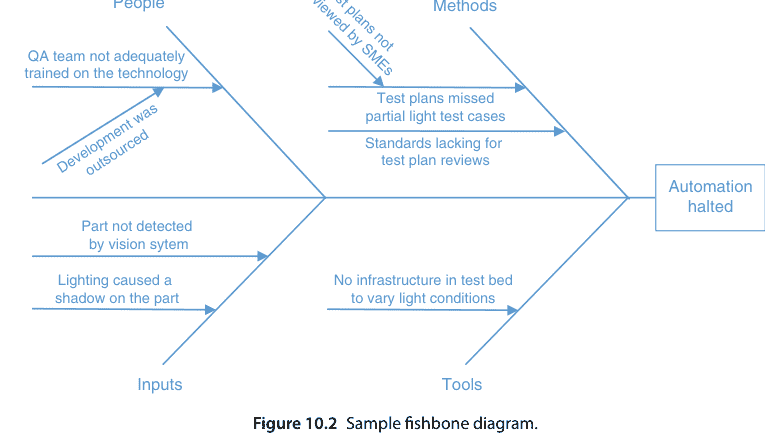

图 10.2 示例鱼骨图。

### 10.4 帕累托图

任何任务的一个关键方面是知道从哪里开始。最大的问题需要首先解决，以获取最大的投入产出比。帕累托图通常用于识别最常发生的缺陷类别（尤其是逃逸缺陷）或最常见的缺陷根本原因。

帕累托图是一种组织数据以确定改进工作优先顺序的方法。在帕累托图中，每个类别的项目数量经过排序，并放入条形图中，出现次数最多的类别最靠近 y 轴，较小的类别按递减顺序位于 x 轴上更靠右的位置。通常，需要大量的缺陷数据才能使帕累托图分析有意义。每个类别的百分比都会绘制出来，因此所有类别的总和为 100%。

帕累托图中的类别可以按技术领域、组件甚至按工程师来组织。可以使用不同的分类创建多个帕累托图，以探索不同的薄弱领域。此外，对于最大的缺陷类别，可以创建派生的帕累托图，以进一步了解薄弱领域。帕累托图的示例如图 10.3 所示。

# 按组件划分的缺陷

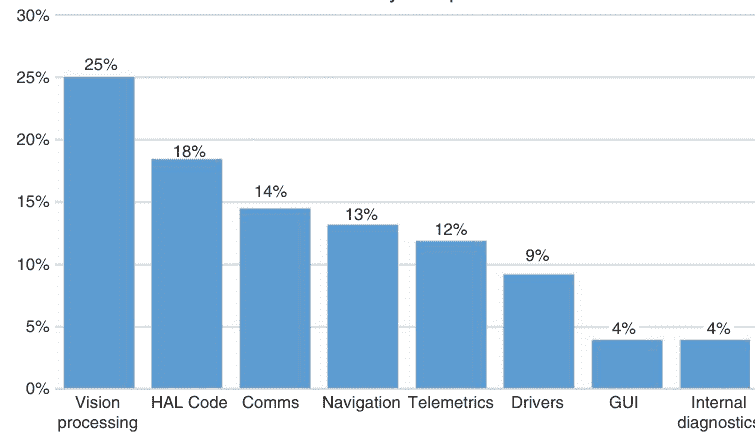

图 10.3 示例帕累托图。

帕累托图并不显示根本原因。它用于确定从哪里深入分析。在使用帕累托图分析缺陷数据后，应对最大的类别进行根本原因分析。这个过程应定期重复。通常，在每次软件发布几个月后，可以将前一次发布的逃逸缺陷数据放入帕累托图，以确定下一步的工作重点。如果有足够的流程改进活动在进行，类别百分比会随着时间而变化。

在分析缺陷的根本原因（使用 5 个为什么或因果图等技术）之后，也可以将这些原因放入帕累托图，以确定最重要的流程改进措施。例如，显示代码审查失败根本原因的帕累托图可能如图 10.4 所示。

从这个帕累托分析示例中得到的教训是，至少需要做出两项改进来提高代码审查的有效性：主题专家需要参与代码审查，并且必须在日程中为代码审查分配更多时间。此外，开发人员或许还应该参加一些关于如何进行有效代码审查的培训。

### 10.5 缺陷预防、缺陷检测与防御性编程

简单来说，缺陷预防包括从一开始就避免引入缺陷的技术。缺陷检测是一种用于发现软件中存在的缺陷的技术。从生产力、成本和质量的角度来看，完全不制造 bug 显然比发现并修复它们要高效得多。用于缺陷预防的多数技术已在前面讨论过。这些技术包括失效模式与影响分析（FMEA）、RCA 和评审。主要的缺陷检测


## 代码审查失败的根本原因

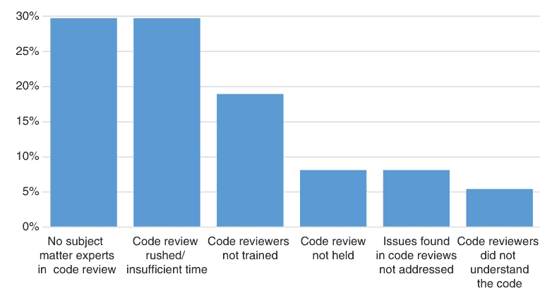

图 10.4 代码审查根本原因帕累托图。

技术包括前面讨论过的各种测试方法论。另一种已知的缺陷预防技术称为防御性编程。

防御性编程是在软件执行期间预见可能出现的问题并添加代码来处理这些错误和异常的艺术。任何编写良好的软件包中很大一部分都由处理错误和意外行为的代码组成。关于该主题没有 readily available 的权威研究，但估计高达 80% 的所有代码都是用来处理错误和异常的。错误或意外行为可能包括用户输入不正确、硬件错误、错误数据、有缺陷的代码、位错误等。另一类异常来自系统资源分配失败，例如软件尝试分配一块内存，但没有内存可用。

潜在错误应在代码设计和实现期间预见，并必须采取适当的错误处理措施。潜在错误或异常可使用诸如 FMEAs、故障树分析（FTA）和 RCA 等技术来识别。

每次代码与用户、外部数据、另一段代码或硬件交互时，该外部实体就会有机会表现不正确或意外。在可能的情况下，代码应编写为能够处理意外或不正确的响应。错误处理代码的行为会根据情况而变化。错误处理代码可能简单到显示错误消息并等待用户指示。在另一极端，代码可能设计为尝试从错误中恢复并继续按预期运行。

某些编程语言具有可用于错误和异常处理的特定结构。在其他语言中，开发人员必须自行实现检测错误并处理错误的机制。在所有情况下，开发人员必须提供在检测到错误时实际执行某些操作的代码。

大多数现代面向对象的语言都支持“throw”和“try-catch”结构，以便开发人员更轻松地构建错误处理代码。方法在检测到异常时可以“throw”错误。调用代码可以“catch”错误并处理它。这称为 try-block。图 10.5 中的伪代码显示了 try-block 和 throw 的使用示例。

旨在始终从错误中恢复并保持运行的代码称为容错。大多数软件不需要容错。即使必须容错的软件也不一定需要在其操作的所有方面提供容错。容错技术包括备份、冗余硬件和软件，以及将硬件（和软件）重置为已知工作状态的代码。容错不是本书的主题，因此该主题将不再进一步阐述。

除了包含适当的错误处理代码外，另一种不太明显的防御性编程技术是充分的代码文档。大多数代码在其生命周期中并非只工作一次。大多数软件会被使用和修改多年，有时甚至几十年。应用程序中的代码可能在很长一段时间内由许多工程师扩展或修复。文档完善的代码更容易理解，因此在以后修改时不太可能被破坏。胜任的代码文档是避免未来缺陷注入的关键防御性编程技术。这即使在原始代码作者稍后对其进行修改时也很重要。当原始工程师返回他们编写的一些代码时，他们对代码的理解会减弱。因此，在最初编写时，必须充分记录代码流程以及任何方法或函数签名。代码审查员应在审查期间将代码注释评估作为关键标准之一。

## 10.6 工作量估算

有人可能会问，为什么在产品可靠性和软件质量的书中包含工作量估算部分。答案是，如果项目规模不正确，特别是如果没有分配足够的时间或人员在需要时交付产品，那么质量将被牺牲以满足截止日期。更糟糕的是，项目可能会落后太多或问题太多，以至于整个项目被取消。根据 Standish Group 的研究 [1]，31% 的所有软件项目将在完成前被放弃，另外 52% 的软件项目成本几乎是其初始估计的两倍。软件项目失败率如此高的原因有很多。其中之一是项目一开始就没有正确估算规模。

估算开发软件项目所需工作量有各种方法，但它们都使用相同的经验法则：计数某些东西。也就是说，项目估算者列举项目中的某些标准并将该计数乘以时间系数。一些常见的项目方面包括估计的源代码行数（LOC）、需求数量和功能点数（FPs）。然后将这些计数乘以历史上实现和测试类似规模项目的所需工作量。例如，如果新项目估计为 5 KLOC（千行代码）的新代码，而历史数据显示实现和完全测试 1 KLOC 需要 40 人天的工作量，则新项目需要 200 人天的工作量。

顺便说一下，乍一看，40 人天的工作量似乎是编写 1000 LOC 所花费的非常多的时间。毕竟，当开发人员编写代码时，他们通常每天编写数百行代码。然而，当考虑到生产高质量软件产品发布所需的所有工作时，很明显，实际编写代码并不是开发人员在软件上花费的大多数时间。其他任务，包括编写需求、设计组件、审查、测试、调试和修复软件，都比仅仅编写代码花费更多时间。在确定开发软件包所需的工作量时，必须考虑所有这些任务。

如果历史工作量数据尚未被跟踪，近似一个起始估计并不太困难。假设当前软件项目不是组织实施的第一个软件项目，那么将有某些历史数据可用。

现有 LOC 可以通过在当前代码库上运行 LOC 计数工具来确定。投入到开发该代码的人天数可以估算。这将使组织能够得出每 KLOC 人天的系数。

为了改进未来的估算，应按项目为基础跟踪总劳动力和 LOC 的指标。随着时间的推移，随着输入数据的变得更准确，工作量估算的准确性将提高。

估算项目工作量的另一种方法是“相似”方法。使用相似方法时，工程师选择一个与新项目相似的历史完成项目，然后使用过去项目的工作量来估算新项目的工作量。估计值可以向上或向下修改，通常与计数某些东西相结合。例如，工程师可能会确定新项目 X 与历史项目 Y 相似，只是项目 X 有 10 个额外的输入和输出。因此，项目 X 的工作量将与完成项目 Y 的实际工作量相同，再加上实现和测试这 10 个额外输入和输出的额外估计工作量。

与所有估算一样，预测中存在固有的不准确性。决心更准确估算的组织将使用多种估算方法，并比较不同的估算以整合为综合工作量估算。使用不同方法创建多个工作量估算可以避免出现可能极不准确的单一估算。作为示例，项目可以通过 (i) 估算 LOC 和每 LOC 工作量、(ii) 估算功能点和每 FP 工作量、(iii) 按相似项目估算来确定规模。这三个估算值可以平均在一起，以得出用于项目规划的工作量估算。作为一般经验法则，除非需要非常高的工作量估算准确性，否则使用多种不同的估算技术来三角测量工作量估算所需要的工作可能不值得。

## 参考

1 Standish Group，CHAOS Report，2014。该报告可从 Standish Group 在此购买：https://www.standishgroup.com/store/services/chaos-report-decision-latency-theory-10-package.html。

## 进一步阅读

Cohn, M. (2006). Agile Estimating and Planning, 1e. Pearson Education.

Florac, W.A. and Carleton, A.D. (1999). Measuring the Software Process: Statistical Process Control for Software Process Improvement. Pearson Education.

Galorath, D.D. and Evans, M.W. (2006). Software Sizing, Estimation, and Risk Management: When Performance is Measured Performance Improves, 1e. Auerbach Publications.

Hill, P. (2010). Practical Software Project Estimation, 3e. McGraw-Hill.

Pfleeger, S.L., Wu, F., and Lewis, R. (2005). Software Cost Estimation and Sizing Methods, Issues, and Guidelines. RAND Corporation.

Stutzke, R. (2005). Estimating Software-Intensive Systems. Addison-Wesley.


