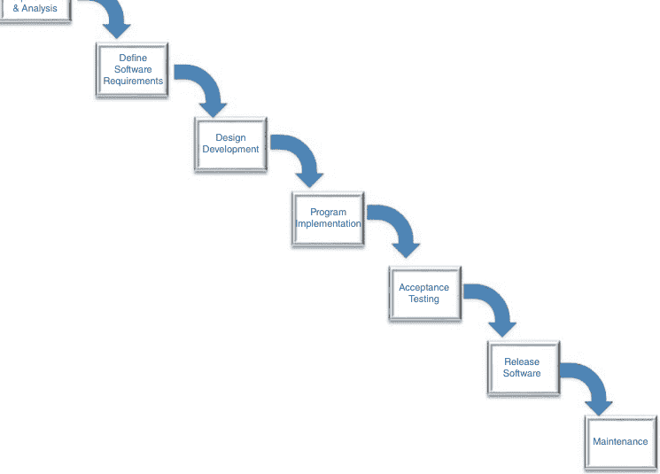
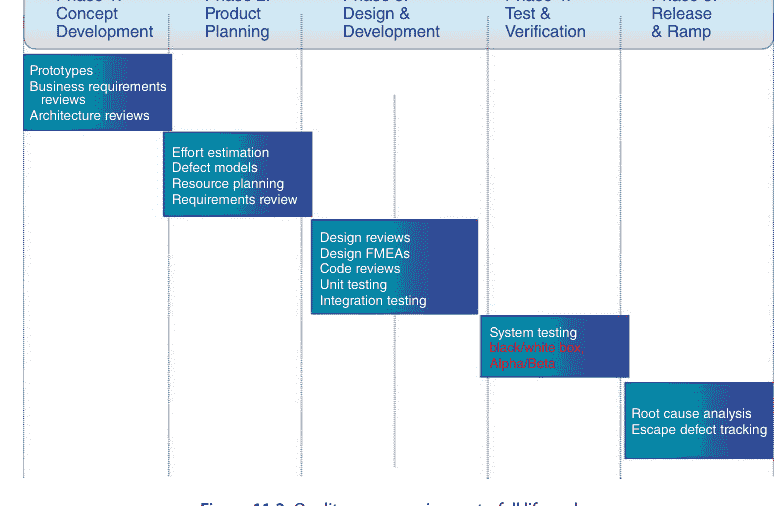
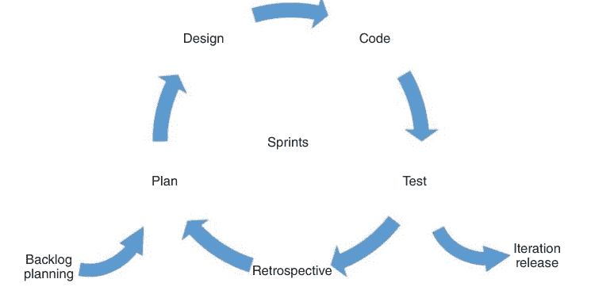
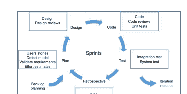

## 11 软件生命周期

软件开发本质上是迭代的。与硬件不同，软件永远不会完成。一旦一个版本的软件发布，开发人员就开始为下一个版本开发新功能和修复缺陷。所有软件生命周期都认识到这一事实。各种生命周期的主要区别在于每次迭代的持续时间。有些生命周期倾向于短而频繁的迭代，另一些则倾向于更长时间的迭代。在这些迭代中，大多数生命周期基本上执行相同类型的开发和验证活动。

以下章节介绍两种最常见的软件开发生命周期：瀑布模型和敏捷。还有一节描述了能力成熟度模型集成（CMMI），这是一个用于确定构成软件生命周期的一组流程有效性的框架。

### 11.1 瀑布模型

瀑布模型，有时被称为软件开发的经典模型，于20世纪70年代引入。瀑布从高处开始，向下游流动。软件开发的瀑布模型模仿了瀑布；它是一系列线性的软件过程。它从系统级需求开始，向下流动到软件需求，然后是软件设计、软件实现、软件集成、验收测试、软件发布和软件维护。瀑布只能向下流动，不能逆流而上（图11.1）。最初的瀑布方法不包括向先前阶段提供变更反馈的过程或方法。

瀑布方法被广泛使用，因为它易于计划实施，因为软件需求和交付物在开始时就已经定义。然而，它也要求在进入软件实现之前完全捕获软件需求。由于没有反馈，过程的每个阶段都应该在没有问题、缺陷或变更的情况下完成，才能进入下一阶段。在实践中，通常允许阶段转换，前提是未决的行动项目要跟踪到完成。它最适合于需求被充分理解且不太可能变更的项目，或者对于明确定义的功能集有严格交付时间框架的项目。



图 11.1 瀑布生命周期。

由于需求并非不可改变，瀑布生命周期通常包含正式的变更管理程序。变更管理程序允许在瀑布项目期间进行路线修正。

瀑布过程易于管理；软件开发遵循逻辑上的顺序事件进程。开发进展易于衡量并向参与者报告状态。瀑布方法遵循与硬件产品开发类似的进程，因此很容易映射它们的相互依赖关系。

然而，在进入下一阶段之前，几乎不可能保证任何阶段的正确性。需求可能没有被完全理解或存在歧义，新的客户需求或市场机会可能导致需求变更。测试发生在开发周期的后期，此时缺陷可能产生更严重的后果，并对开发进度产生更大的影响。你可以衡量从一个过程阶段到另一个过程阶段所取得的进展，但无法衡量开发阶段内部的进展。这些低效问题导致开发周期更长且更不可预测。

正如 Barry Boehm [1] 所述，瀑布模型的基本假设是：

- 需求可以预先知道。
- 需求没有未解决的高风险问题。
- 需求在项目期间不太可能发生大的变化。
- 实现需求的正确架构已被充分理解。
- 有足够的日历时间按顺序进行。

项目阶段...



图 11.2 瀑布生命周期中的质量过程。

图 11.2 显示了在瀑布生命周期中各种软件开发质量活动发生的时间。

### 11.2 敏捷

敏捷软件开发生命周期强调一系列迭代的短期开发周期，称为冲刺（sprint），每个冲刺交付一组功能完整、可供最终用户使用的软件功能。每个冲刺在前一个冲刺交付的软件基础上增量添加功能。冲刺通常为两到六周，但并没有特定的冲刺时长要求。在每个冲刺开始之前，有一个规划期来为冲刺做准备。每个冲刺完成后，会进行一次回顾分析会议，审查冲刺，目的是确定如何改进后续冲刺。

在每个冲刺期间，每个团队举行每日简短会议，专注于协调当天的工作。这个会议通常被称为每日站会，应控制在不超过15分钟。会议的目的是确保每个团队成员了解当天计划执行的工作，并识别可能阻碍该工作的任何问题。为了保持会议以协调为重点，必须避免在会议期间深入试图解决任何问题。可以召集其他工作会议来处理已识别的问题。

敏捷过程背后的一般理念之一是，正式文档和度量指标尽可能保持轻量化，以实现快速的开发周期。然而，每个冲刺确实包含需求、设计、编码和测试活动的完整执行，就像瀑布等其他生命周期一样。图 11.3 显示了一个典型冲刺中的活动。



图 11.3 冲刺活动。

几种软件开发生命周期属于敏捷过程的范畴。这些包括，例如，敏捷、Scrum、看板和极限编程（XP）。这些生命周期中的每一个都有略微不同的实践，但它们都共享一般敏捷原则：相对较短的重复冲刺，并在每个冲刺结束时交付功能完整的交付物。

图 11.4 显示了在敏捷生命周期中各种软件开发质量活动发生的时间。

### 11.3 CMMI

CMMI 实际上不是软件生命周期或一组流程。CMMI 是一种模型或框架，描述了成熟的软件生命周期中需要哪些软件流程，并为每种流程类型指定了一组属性。CMMI 可以应用于敏捷或瀑布软件生命周期。CMMI 最初由卡内基梅隆大学的软件工程研究所开发，现在由 CMMI 研究所管理。最初是为软件开发定义的，现在也有针对服务、交付和采购的 CMMI 模型。

CMMI 开发模型描述了22个过程域和5个过程成熟度级别。并非所有成熟度级别都要求覆盖所有过程域。较低的成熟度级别要求覆盖较少的过程域。表 11.1 描述了这些过程域。

最低的成熟度级别是一种临时的软件开发方法，没有多少可重复的流程和程序。最高的成熟度级别适用于那些已定义并拥有可重复流程的组织，这些流程覆盖软件开发的各个方面，并采用复杂的统计控制来度量和管理所有流程及流程演进。每个成熟度级别要求覆盖一部分过程域。随着成熟度级别的提高，该子集是递增的。表 11.2 列出了五个成熟度级别。



- 产品发布可以在每个冲刺之后或在一个史诗（一定数量的冲刺）之后进行。
- 缺陷模型和运行图可以应用于冲刺或史诗。
- 待办事项管理是冲刺之外持续进行的活动。
- 用户故事开发是待办事项管理的一部分。
- 根因分析可以在冲刺之外持续进行，作为待办事项和史诗管理的一部分。

图 11.4 一个史诗中的冲刺活动。


# 表 11.1 CMMI 过程域。

| 缩写 | 名称 | 描述 |
|---|---|---|
| CAR | 因果分析与解决 | 对结果进行根本原因分析并采取过程改进行动的过程。 |
| CM | 配置管理 | 对工作产品如需求文档、源代码等进行变更控制和审计。 |
| DAR | 决策分析与解决 | 正式的分析性决策过程。 |
| IPM | 集成项目管理 | 涉及所有利益相关者参与的项目管理。 |
| MA | 度量与分析 | 定义和跟踪用于衡量项目绩效的指标。 |
| OPD | 组织过程定义 | 选择项目所使用生命周期和过程的过程。 |
| OPF | 组织过程焦点 | 过程改进的过程。 |
| OPM | 组织绩效管理 | 将组织的绩效与整体业务目标保持一致并进行管理的过程。 |
| OPP | 组织过程绩效 | 过程绩效的分析性度量和指标。 |
| OT | 组织培训 | 将组织和项目技能水平与组织和项目目标保持一致的过程。 |
| PI | 产品集成 | 产品组件集成过程。 |
| PMC | 项目监控与控制 | 监控和管理项目进展和状态的过程。 |
| PP | 项目规划 | 创建项目计划的过程，包括创建工作量估算、进度计划等。 |
| PPQA | 过程和产品质量保证 | 监控过程执行合规性的过程。 |
| QPM | 定量项目管理 | 定量项目管理过程。 |
| RD | 需求开发 | 创建需求的过程。 |
| REQM | 需求管理 | 管理需求的过程，包括确保需求与工作产品之间的一致性。 |
| RSKM | 风险管理 | 识别和管理项目风险、制定缓解措施并执行计划的过程。 |
| SAM | 供应商协议管理 | 管理供应商，包括外包商和第三方组件的过程。 |
| TS | 技术方案 | 确定满足项目目标的适当技术方案（设计、实现等）的过程。 |
| VAL | 验证 | 证明已定义的产品适用于其用途，即它是正确的产品。 |
| VER | 确认 | 证明所构建的产品满足已定义的需求。 |

# 表 11.2 CMMI 成熟度等级。

| 等级 | 名称 | 描述 | 过程域 |
|---|---|---|---|
| Level 1 | 初始级 | 在通常非常被动的组织中以临时方式进行开发。 | 无 |
| Level 2 | 可管理级 | 已定义基本项目导向过程。开发组织仍相当被动。 | CM, MA, PMC, PP, PPQA, REQM, SAM |
| Level 3 | 已定义级 | 核心开发过程已定义并受管理。开发组织具有主动性，可以根据需要定制过程。 | DAR, IPM, OPD, OPF, OT, PI, RD, RSKM, TS, VAL, VER |
| Level 4 | 定量管理级 | 开发过程经过度量和控制。 | OPP, QPM |
| Level 5 | 优化级 | 强烈关注开发过程的持续优化。 | CAR, OPM |

开发组织由 CMMI Institute 认证的评估员正式进行评估。评估包括数周的预备工作，然后是为期两周的现场评审。结果发布在 CMMI Institute 注册库上。

软件组织从 1 级和 2 级发展到 3 级可能需要数年时间。如果开发组织在 3 级运行，则做得相当不错。改进到 4 级和 5 级是否有可辩护的投资回报率（ROI）则不一定。对任何开发组织而言，正确的成熟度等级完全取决于组织目标。熟悉 CMMI 模型要求是确定改进机会的有用手段，即使软件开发团队选择不进行评估。

## 11.4 如何选择软件生命周期

软件生命周期是工具。作为工程师，我们知道没有一种工具适合所有项目。同样，没有一种软件生命周期适合所有项目。每个生命周期都有其优势和劣势。需要注意的是，这里讨论的每个生命周期都有许多变体。每个生命周期的高级从业者都以使其更广泛地适用于不同项目类型的方式对其进行了扩展。一般来说，可用于确定哪种生命周期最合适的项目标准是：（i）项目的规模，（ii）开发团队的规模，（iii）开发团队的地理位置，（iv）需求、技术和架构的理解程度，（v）需求、技术或架构发生变化的可能性，以及（vi）返工的成本。

表 11.3 列出了本节讨论的基本软件生命周期的优势和劣势。总结如下：

- 瀑布模型最适合于需求和技术在先验情况下得到很好理解和/或开发团队可能庞大或分散的大型项目。
- 敏捷生命周期最适合于预期会发生变化且团队同地办公的小型项目。

# 表 11.3 生命周期比较。

| 生命周期 | 优势 | 劣势 |
|---|---|---|
| Waterfall | 1. 当需求在前期得到很好理解或可发现时，可以交付具有非常可预测的进度和成本的项目。<br>2. 强调正式文档使得与大型和/或地理上分散的开发团队合作更容易。<br>3. 对非常大的项目更容易管理。<br>4. 如果返工成本高，则更合适。 | 1. 如果需求经常变化或在先验情况下并不特别可知，则可能退化为混乱。<br>2. 对小型项目可能需要过多的开销。 |
| Agile | 1. 当用户可以接受增量发布时，可以更快地交付功能软件。<br>2. 当需求可能发生变化或在前期不甚了解时，非常适合开发软件。<br>3. 如果最终软件架构在前期未知，则风险更小的生命周期。<br>4. 当开发团队同地办公时，可以以更低成本交付软件。 | 1. 需要与客户或其代理持续沟通。<br>2. 如果客户不愿意频繁发布，则可能没有实际优势。<br>3. 如果开发团队庞大或地理上分散，则可能变得非常繁琐且容易出错。<br>4. 如果返工成本高，则可能很昂贵。 |

## 参考

1 Boehm, B. (2000). *Spiral Development: Experience, Principles, and Refinements.* University of Southern California Center for Software Engineering. http://csse.usc.edu/csse/event/2000/ARR/spiral%20development.pdf.

## 进一步阅读

Beedle, M. and Schwaber, K. (2002). *Agile Software Development with Scrum.* Pearson.
Boehm, B. (1988). A spiral model of software development and enhancement. *IEEE Computer* 21 (5): 61–72.
Chrissis, M.B., Konrad, M., and Shrum, S. (2011). *CMMI for Development: Guidelines for Process Integration and Product Improvement, 3e.* Addison-Wesley.
Kniberg, H. and Skarin, M. (2010). *Kanban and Scrum - Making the Most of Both.* C4Media Inc.
Martin, R.C. (2003). *Agile Software Development, Principles, Patterns, and Practices.* Pearson.

# 12

# 软件规程与技术

## 12.1 收集需求

在他所著的《爱丽丝梦游仙境》一书中，路易斯·卡罗尔写下了爱丽丝与柴郡猫之间的一段对话：

> "Would you tell me, please, which way I ought to go from here?"
> "That depends a good deal on where you want to get to," said the Cat.
> "I don't much care where –" said Alice.
> "Then it doesn't matter which way you go," said the Cat.
> "– so long as I get SOMEWHERE," Alice added as an explanation.
> "Oh, you're sure to do that," said the Cat, "if you only walk long enough." [1]

卡罗尔的引文常被总结为以下说法：“如果你不知道要去哪里，任何道路都会带你到达那里。”在开发软件的情况下，记录和验证需求是唯一知道要去哪里的方法。需求规定软件必须做什么。正确获取需求是交付成功产品的最重要的任务。如果需求错误，那么无论产品实现和测试得多好，软件都将失败，因为软件将无法满足其功能目的。因此，很明显，优质软件取决于准确且有良好记录的需求。

有不同的方法来记录需求，不同的软件开发生命周期偏好或禁止特定的需求记录和评审方法。传统的瀑布生命周期倾向于在流程开始时开发一份需求文档，详细描述所有用例和需求。敏捷流程创建具有验收标准的用户故事。用户故事以迭代方式创建和管理。在瀑布生命周期中，需求文档旨在具有决定性，并在进行任何软件设计或实现之前预期得到验证。在敏捷生命周期中，会创建初步用户故事的初始待办事项列表。在冲刺计划时，会为该冲刺选择一组用户故事，并在冲刺期间随后对其进行详细说明。在敏捷生命周期中，通常会随着时间的推移将新需求添加到待办事项列表中。

无论生命周期如何，以及它们如何被记录，需求都应在实施前与利益相关者进行评审。收集和验证需求并非易事。经常，用户和客户并不确定他们想要什么


他们想要什么。即使他们知道自己想要什么，用户通常也难以清楚地表达需求。有许多可用的需求获取技术。这些包括调查、访谈、对终端用户的观察、与主题专家进行头脑风暴以及原型制作。为了获得完整的需求集，建议使用其中几种获取技术并将结果合并并交叉引用。

除了客户需求外，还需要确定内部需求。内部需求可以包括约束条件（例如实施成本或需要融入现有架构）或非功能性需求（例如买还是建的指令）。

当涉及多个或众多目标客户时，选择适当的需求比软件仅面向特定终端用户时更困难。不同的用户可能有非常不同甚至相互矛盾的需求。当为具有多个预期客户的产品确定需求时，必须部署分诊流程。通常，这将涉及需求优先级排序流程，例如通过为每个需求分配投资回报率（ROI）或市场份额来加权每个需求。

需求需要涵盖产品的许多方面。有些需求是针对终端用户需求的外部需求，有些需求是满足内部需求的需求。确定任何给定产品需求时必须考虑以下领域，尽管并非所有领域都适用于每个产品：

- **功能性。** 提供给用户的特性和功能是最明显且必须做对的一组需求。如果产品不能满足客户的需求，产品将不会成功。如果功能集不正确，那么其他需求就无关紧要了。

- **安全性。** 必须确定产品所需的安全级别。某些终端用途显然要求高水平的安全性，例如银行应用程序。其他应用程序可能就不那么明显了。如果产品是医疗设备或可连接网络或远程访问的电机控制器，那么确保设备连接的安全可能至关重要，以避免恶意误用导致有害后果。即使产品是联网设备，例如本身不会造成伤害的物联网（Internet of Things）家电，如果不安全，它也可能被黑客用作攻击其他系统的平台。

- **性能。** 一些产品要求其功能快速执行。在某些情况下，性能可能是竞争性功能。例如，如果制造零件的产品比其他类似产品制造得更慢，则可能没有竞争力。性能的时间单位可能差异很大。例如，网络交换机可能需要在微秒内传输数据包，而用户界面可能只需在一秒内响应即可。然而，在这两种情况下，都必须定义并满足性能要求。

- **可用性、用户界面、用户体验。** 如果用户与产品交互，则必须足够易用且易于学习如何使用。必须仔细确定目标用户以及他们打算如何使用产品。例如，主要为新手用户设计的用户界面会让高级用户感到沮丧。

- **架构和工具。** 产品可能需要融入现有基础设施或技术。产品可能是现有产品的附加组件，因此需要在该基础设施中工作。或者产品可能 intended 用于与现有部署环境一起使用，例如特定的移动电话操作系统。一个常见的架构需求是，如果产品 intended 在多个环境中使用，则需要软件可移植性。许多产品需要与其他系统互操作的需求。

- **合规性。** 产品可能需要遵守有关安全、隐私、报告等的各种法规或工业标准。

- **商业。** 有各种类型的商业需求。通常有满足市场窗口或客户承诺的进度要求。几乎总是需要产品盈利或符合预定义预算。

- **兼容性。** 在为现有产品添加新功能时，通常需要与以前版本向后兼容的需求。这可能是需要与先前发布的文件格式或现有硬件等功能一起工作的要求。

在开发软件需求时，应考虑上述所有类型需求。由此产生的需求集必须进行优先级排序并精简为使产品可行的必要子集。

记录非需求也非常有用。这在几种不同的情况下尤其有帮助。首先，可能会有有争议的需求，最终决定不将其包含在产品或版本中。记录这些不予实施可以节省以后许多小时的指责和不快。记录非需求的另一个主要原因是存在隐含需求的错误预设的可能性。例如，如果有明确决定不提供向后兼容性，而以前的版本确实支持它。记录某些非需求可以防止不必要的工作被执行或次优的设计决策。

## 12.2 记录需求

需求可以用多种方式记录。最常见的方法是使用案例、用户场景、用户故事和统一建模语言（UML）用例图。

用例描述了一组“参与者”执行任务所采取的一系列步骤。参与者可以是人员、系统软件或硬件组件。步骤序列称为“流程”。用例中可以包含多个流程来描述替代步骤。用例还包括任务描述以及预条件和后条件。这种需求文档通常出现在瀑布型生命周期中。图 12.1 显示了具有需求的用例的简单示例。

在敏捷流程中，需求比瀑布生命周期中的需求正式得多。这并不意味着敏捷中的需求在某种程度上无效。敏捷需求以用户故事和验收标准的形式表达。用户故事和验收标准旨在保持简短。传统上，它们记录在索引卡上。今天，用户故事和积压工作通常使用工具进行管理；然而，其意图是保持简短和切中要害，就像它们仍然在索引卡上一样。如果本示例中的需求集以敏捷方式作为用户故事和验收标准记录，它们可能看起来像图 12.2。

请注意，敏捷用户故事往往比为瀑布型生命周期编写的传统用例和需求更短、更少详细。

一旦收集并记录了需求，就可以使用一些标准来确定记录的需求质量是否良好。如下

### UC1：机器人避免与物体碰撞

此用例描述了机器人移动以避免与物体碰撞。

参与者
机器人

预条件
PRE1. 机器人正在移动
PRE2. 机器人已检测到障碍物

后条件
POST1. 机器人已改变方向或停止移动

基本流程
B1. 机器人正在移动。
B2. 机器人的前部传感器已在机器人行进方向上检测到 15 厘米范围内的障碍物。
B3. 机器人未在其左侧传感器上检测到障碍物。
B4. 机器人改变方向 270°

替代流程 – 前方和左侧有障碍物
A1.1 在步骤 B3 机器人检测到左侧有障碍物。
A1.2 机器人未在其右侧传感器上检测到障碍物。
A1.3 机器人改变方向 90°。

替代流程 – 前方、左侧和右侧有障碍物
A2.1 在步骤 A1.2 机器人检测到右侧有障碍物。
A2.2 机器人未在其后部传感器上检测到障碍物。
A2.3 机器人反向行驶。

替代流程 – 四周都有障碍物
A3.1 在步骤 A2.2 机器人检测到后方有障碍物。
A3.2 机器人停止移动并鸣响蜂鸣器。

替代流程 – 传感器错误
A4.1 在步骤 B3 机器人无法读取其左侧传感器。
A4.2 机器人停止移动并点亮其错误 LED。

需求

- R1. 机器人应具有位于 0°、90°、180° 和 270° 的四个接近传感器。
- R2. 接近传感器应检测距离机器人 <= 15 厘米的物体。
- R3. 如果机器人检测到其路径中有物体，则应向左改变方向。
- R4. 如果机器人检测到前方和左侧有物体，则应向右改变方向。
- R5. 如果机器人检测到前方、左侧和右侧有物体，则应反向行驶。
- R6. 如果机器人检测到 0°、90°、180° 和 270° 有物体，则应停止移动。
- R7. 如果机器人无法向任何方向移动，则应鸣响其蜂鸣器。

图 12.1 示例需求。


作为用户
我需要机器人避免与其环境中的任何物体发生碰撞
以免机器人受损，也免得附近的任何东西受损或受害。

验收标准
1. 当机器人接近阻挡其路径的物体距离 <= 15 厘米时，机器人会改变方向。
2. 如果多个方向存在障碍物，机器人会尝试朝其他方向移动。

作为用户
我需要机器人通知我如果由于障碍物而无法移动
以便我可以在机器人无法完成任务时解决该情况。

验收标准
1. 如果所有方向都被障碍物阻挡，机器人将停止移动并鸣响蜂鸣器。

作为用户
我需要机器人通知我如果遇到内部硬件错误
以便我可以修复机器人。

验收标准
1. 当机器人无法读取传感器时，机器人会点亮红色错误指示 LED。

## 图 12.2 示例用户故事。

documented in ISO/IEC/IEEE 29148 [2], each good requirement must meet the following criteria:

- *Correct.* Each requirement accurately describes an attribute or capability of the system.
- *Unambiguous.* Each requirement has only one interpretation shared by all readers.
- *Implementable.* There is a cost-effective way to implement each requirement.
- *Verifiable.* The requirement is written such that one would be able to determine whether the implemented system satisfies the requirement. Furthermore, there is a cost-effective way to verify that the requirement has been met.
- *Consistent.* No requirement conflicts with any other current requirement for the product.
- *Complete.* The original user need is fully satisfied by the set of requirements.

In addition, the requirements must be prioritized to allow project managers and developers to choose the most important ones to include in the scope of any project. Typically, requirement priorities are limited to a few categories such as “must” (or “shall”), “should,” and “want.”

- *Must.* The highest-priority requirement that is necessary for the success of the project.
- *Should.* Middle-priority requirement that ought to be done if time allows. A “should” requirement adds significant value to the product, but will not prevent release of the software if not included.
- *Want.* Lowest-priority requirement category. Requirements in the “want” category should only be included if all “must” and “should” requirements have been implemented.

Different development organizations may use different terminology to identify the necessity of each requirement. For instance, some organizations may use “shall” instead of “must.” To avoid confusion, the development team should standardize specific terminology and educate the group to ensure that everyone understands the usage.

## 12.3 文档

与度量指标一样，文档在软件行业评论家中有其反对者。有些人会抱怨“文档或注释刚写完就过时了”，并且“代码才是真理的宝库”。当然，他们的话中有些道理。然而，创建良好的文档和代码注释的好处远远超过了此类文档不完美的事实。

创建准确的文档有诸多好处。文档使评审成为可能；没有适当的文档，就无物可审。文档，尤其是设计文档，提供了事物如何运作以及为何做出选择的历史记录。即使文档已过时，它仍可以为理解软件提供一个良好的起点。文档为不同团队之间有效沟通提供了机制。这在开发团队不在同一地点或产品由跨学科团队开发时尤其重要，例如产品由硬件和软件组成时。

软件行业文献涵盖了先前讨论过的所有良好文档的好处。然而，一个极其重要的原因却经常被忽视。把设计或代码以他人可理解的方式描述出来的行为，迫使开发人员充分理解自己的工作。

在我职业生涯早期，我有一次经历让我明白了这个教训。我无法决定采用两种方法中的哪一种来解决程序的技术问题。走投无路时，我向一位同事求助。我的同事耐心地看着我把每种方法都写在白板上，只偶尔说“是的，继续”或“然后呢？”。等我解释完每种方法的利弊后，我就清楚地知道哪一个更好。

这种经历如此常见，以至于它被称为橡皮鸭调试，如 Hunt 和 Thomas 在他们的书《程序员修炼之道》[3] 中所述。向他人解释问题的行为迫使我清晰地思考各种选择，进而使正确的选择变得显而易见。没有人能充分解释他不理解的东西。强迫开发人员编写文档并进行评审是一种确保开发人员真正理解他们打算做的事情的机制。

良好的文档有助于跨团队沟通，并在开发团队之间或与客户之间达成共识。经常，不同团队对正在构建的内容会有不同的设想。有效的文档是帮助应对这一问题的工具之一。完善的文档化需求为管理来自客户的不可避免的需求蔓延提供了一种机制。它们使开发团队能够清楚地记录变更请求，从而描述这些所需变更将如何导致进度和/或成本变更。

同样，充分的设计文档，特别是关于接口定义，可以降低不同开发团队交付无法按预期互操作的组件的概率。如果开发团队在需要集成的组件的设计上共同记录并评审设计，集成将进行得更加顺利。

文档至少应包括需求、架构/设计和测试计划。在本书后面的章节中，我们将讨论这三种类型的文档。文档不必特别复杂，但必须写得清晰。一些组织对每种类型文档的编写方式有非常正式的规范。为了促进每种类型文档的开发并使各种文档的评审更容易，建立标准可能有所帮助。然而，重要的是要创建文档并对其进行评审。评审在开发生命周期的每一步都至关重要：需求、设计、代码、测试等。

在包含硬件和软件的项目中，硬件设计由软件团队评审，以及反之亦然，尤为关键。每个工程团队各自孤立工作的情况非常普遍。往往，硬件或软件团队单独做出的设计决策会使另一方不必要地复杂化。这导致产品过于复杂，开发成本更高，且更容易出现质量和可靠性问题。避免这种情况的一个关键方法是让软件工程师参与硬件设计决策的评审，而设计尚未确定时，以及让硬件工程师在软件设计过程早期做出回应。硬件和软件设计不同步的问题应在组织层面通过创建跨职能团队来解决，这些团队监督整个产品，而不是作为单独的技术孤岛。

例如，从仅硬件的角度来看，两种硬件设计在复杂性和开发成本上可能是等价的。然而，其中一种设计可能使软件设计显著简化。让软件工程师参与硬件设计的评审可以帮助确保更好的整体产品设计决策。

无论工程师多么聪明或才华横溢，她永远不如一群工程师聪明。当工程师创建一组需求、或设计、或编写代码、或测试计划时，重要的是至少有一名其他工程师，最好是几名，评审该工作成果。评审者应包括在该技术方面具有领域专业知识的人，以及至少熟悉最终用户用例的人。

文档不必花哨，只要清晰简洁即可。它们可以是文本、PowerPoint 幻灯片、白板会议等。重要的是要将其记录下来并进行评审。

## 12.4 代码注释

软件工程师经常修改他人最初编写的代码，也许是为了修复错误或添加功能。代码中的注释缩短了除原始作者之外的开发人员学习该代码的曲线。注释良好的代码使后续工程师更容易理解代码如何工作并找到适当的位置进行修改。良好的代码注释甚至对

提醒原始作者代码的工作原理，如果在一段时间后需要对其进行修改。

许多软件产品都公开了应用程序编程接口（APIs）。其中一些 API 可能会被开发系统其他模块的工程师调用。适当的代码文档将促进外部开发人员使用 API，并且他们在调用 API 时犯错的可能性要小得多。许多产品都包含在软件开发工具包（SDKs）中的 API，旨在供客户使用。通常，这些 SDK 的文档由技术写作者编写。即使技术写作者是软件开发人员，如果代码有足够的注释，文档编写过程也会更容易、更高效。

注释块应包含在源代码文件的顶部以及文件中的每个方法或函数中。还应包含注释来描述变量、结构或有意义的代码流程。文件开头的注释块应包括：

- 代码文件中代码的整体目的和内容
- 如适用时的版权声明
- 代码文件的修订历史

每个方法或函数头的注释块应包括：

- 方法或函数（它做什么）的描述
- 方法或函数使用的概述
- 每个参数的描述
- 输出或返回代码的描述

有一些工具允许使用特定文档方案的注释被处理成外部用户文档。其中一些常用的是 Sandcastle、Doxygen 和 Natural Docs。其中最常见的两个可能是 Microsoft 标记格式和 Doxygen 格式。Microsoft 格式基于 XML 标签。包含 Microsoft XML 标签的注释可以轻松转换为 Microsoft 帮助文本或使用 IntelliSense（Microsoft Visual Studio 的一组功能）查看。Doxygen 是一款根据 GNU 通用公共许可证（GPL）免费提供的广泛使用的工具。包含 Doxygen 标记的注释可以提取为独立的 HTML 文档。

图 12.3 显示了一些经过良好文档说明的伪代码示例。

## 12.5 评审和检查

设计、代码和测试计划都应进行评审。举行评审的主要好处是，它是发现错误和缺陷的、迄今为止最经济的方法。在项目早期在评审期间发现问题，可以防止后期出现大量的返工甚至产品失败。考虑一个设计缺陷直到项目后期系统测试阶段才被发现的问题。在那时修复设计缺陷可能会因所需返工量而对进度产生重大影响。更糟糕的是，如果需求不正确并且在项目早期未被发现，整个产品可能毫无用处。

```
//
// This file contains code to read proximity sensors.
//
// Copyright (C) 2018 Jonathan Rodin. All rights reserved.
//
// Revision History:
// Date            Name        Notes
// 2018 Apr 11      J. Rodin    Refactored after code review
// 2018 Mar 27      J. Rodin    Initial creation
//
// read the ultrasonic proximity sensor to find range to nearest object
// Parameters:
//
//        eSensor - sensor to read
//
//        range - distance to detected object
//
// Output:
//
//        sets range to detected range in cm
//
//        if no object in range, sets range to -1
//
enum ESensor {Front=0, Right, Back, Left};
#define baseTriggerIO  10
#define baseEchoIO     13
#define errorLedIO     100

void proximitySensorCheck( ESensor eSensor, float range )
{
    float duration;

        // pulse sensor for 10 usecs
        digitalWrite(baseTriggerIO+eSensor, HIGH);
        delayuSecs(10);
        digitalWrite(baseTriggerIO+eSensor, LOW);

        // get the echo time
        duration = digitalRead(baseEchoIO+eSensor, HIGH);

        // returns -1 if nothing is in range
        range = convertToRange(duration)
}
```

### 图 12.3 代码注释示例。

评审的另一个主要优势是它们促进了技术人员之间的知识转移。如果更多工程师了解某事物的工作原理，那么在维护需要时支持该组件就更容易了。

没有一个人比精心挑选的团队更聪明。也没有任何单一的设计师或程序员熟悉每一种可能的设计模式、平台、技术等。团队总是有知识优势，并能看到作者忽略的事情。评审小组会发现作者遗漏的问题。更不用说作者或编码者很难在自己的工作中发现错误；第三方读者发现错误比作者更容易。评审的另一个好理由，正如前面所述，是向其他人解释一个主题会迫使作者思考计划。

每个技术工作产品的评审过程都有一些共同特征。评审应包括所有利益相关者的代表，并且评审应尽可能频繁和尽早举行。技术评审的利益相关者应代表几个不同的专业领域。他们应包括负责与被评审组件交互的任何其他组件的工程师。这包括如果被评审组件与硬件交互，则包括硬件工程师。反之，编写特定硬件组件代码的软件工程师应参加这些组件的设计评审。评审还应包括被评审技术或功能的主题专家。测试计划评审，尤其是系统测试计划，应包括一个或多个客户代表。根据组织和被测试组件的不同，这可能包括产品营销人员、产品负责人、软件质量保证（SQA）人员，甚至是实际客户。没有关于评审应涉及多少评审者的标准。

为了最大化生产力，评审应是迭代的，尽早开始，并分解为可管理的较小块。最好在可能需要签署的正式评审之前先进行非正式评审或检查。例如，早期设计评审可以只是白板会议，在那里可以收集反馈并就设计概念达成共识。最不productive的设计评审发生在工程师花费大量时间开发设计文档，然后在最后的评审中发现设计有缺陷时。进行迭代非正式评审以在途中进行方向修正，远比不这样做并到达错误目的地要好。

为代码评审创建狭窄的范围特别有益，以便在任何一次评审中评审少量代码。代码评审应尽早开始。在项目结束时等待并要求评审者阅读、理解并对大量代码提供反馈是非常困难且效率低下。不仅如此，要求评审者在项目后期检查大量代码几乎可以保证评审质量低下，因为评审者很可能匆忙并且可能没有全神贯注。

评审者应关注工作产品的功能方面。如果是设计评审，则重点应放在设计是否涵盖所有用例并满足需求，包括隐含需求如性能目标。代码评审者应重点确定代码是否实现了设计、代码是否涵盖所有错误和异常情况，以及代码是否正确实现。评审者有自然倾向花费太多时间纠正拼写错误、格式错误和编码标准违规。虽然修复格式问题和标准违规是好事，但检查更重要的是验证需求、设计和代码在功能上是否正确。尽管代码注释不是可执行代码的一部分，但评审者应确保存在足够的注释，并且这些注释充分描述了代码。

可能也有用的是对代码和设计进行安全评审。如果产品连接到网络或以其他方式可远程访问（例如


just running on a computer that is on a network), it is at risk for being tampered with or used as a vector for further attack. Since software security tends to be a specialized area of knowledge, it is generally useful to have a specific review or set of reviews that focuses on the security of the product. Security is an area where it may be useful to have an outside consultant participate in the reviews or do security testing.

The manner and count of code inspections can vary, depending on the circumstances. At minimum, at least one senior reviewer should review the code. However, larger, more detailed code inspections would be appropriate in the following cases:

- The programmer is new or inexperienced.
- The technology is particularly complex or is new to the coder or the organization.
- The component has many external dependencies or many other components have dependencies on it.
- There is a need to perform knowledge transfer.

In these cases, the code review team should be as large as necessary. Also, the developer holding the review might hold a code walkthrough prior to the actual review of the code. During a code walkthrough, the developer describes chunks of code as individual units and discusses their purpose and dependencies. The actual code inspection is held after the code walkthrough.

Reviewers should be on the lookout for common types of errors. Often checklists can be a useful tool to make sure reviews are complete and nothing is overlooked. The checklists should list the common types of errors appropriate for each work product (i.e. requirements, design, code, and test plans). Whether in checklists or not, work products should be checked for the following common potential errors during reviews:

1. Requirements reviews
   - Have all the types of requirements (functionality, security, performance, usability, architecture/tools, compliance, and commercial) been listed and prioritized?
   - Are the requirements correct, unambiguous, implementable, verifiable, consistent, and complete?
2. Design reviews
   - Does the design fulfill all of the requirements?
   - Does the design emphasize technology instead of the user? For example, has the designer chosen a technology because it is familiar or the hot new tool, rather than one that best meets the needs of the project?
   - Does the user interface design focus on looks rather than usability?
   - Does the design cover error and exception handling?
   - Is there too much interdependency between components? Is the design overly complex?
   - Is there clear separation of responsibility between the components?
   - Does the design make incorrect assumptions about the hardware? For instance, is the design targeting specific hardware features when it needs to be portable across hardware?
   - Does the design lock the software into a specific platform when it needs to be portable? For instance, does the design require specific operating system features when it needs to run on multiple operating systems?
   - Has analysis been done to determine which parts of the system require performance? Have those parts of the system been designed with performance in mind?
   - Does the design take into account multithreaded or parallel operations to prevent race conditions, data corruption, and deadlock situations?
   - Can the design scale with more hardware, users, and/or data?
   - Are interoperability standards, regulatory compliance, and compliance with industry standards accounted for?
   - Is some part of the design high risk? If so, perhaps plans could be put in place to mitigate the risk.
3. Code reviews
   - Are all of the design elements coded?
   - Are there any typos in the code?
   - Is the code well documented?
   - Are boundary conditions met with data structure access, for instance reading or writing off the end of an array?
   - Are there any off-by-one errors?
   - Are there any potential divide-by-zero errors?
   - Can the code use up all available memory?
   - Are all locks freed? Semaphores cleared? Flags set and unset?
   - Are there any overflow and underflow conditions?
   - Are there wrong order of operators or wrong formulas?
   - Are all variables correctly initialized? Do any data structures or memory blocks get reused without appropriate reinitialization?
   - Are there any memory leaks?
   - Are there endless loops?
   - Is there optimization occurring in the wrong or unnecessary code?
   - Is there improper use of global variables?
   - Has assignment accidentally been used instead of comparison (i.e. "=" instead of "==")?
4. Security reviews
   - Are users authenticated? Are external components and services authenticated?
   - Are passwords managed securely?
   - Is access authorized after authentication?
   - Is data storage and access secure?
   - Are operating system security features used correctly?
   - Is encryption used in communications or data?
   - Are there any hardcoded keys, passwords, or unsecure backdoors in the product?
   - Are unnecessary network ports left open on the system?
   - Can third-party code be run without appropriate authorization?
   - Is there any potential for cross site scripting?
   - Can the code be tampered with or modified by third parties or customers?
   - Are the code libraries signed?
5. Test plan reviews
   - Are there test cases for every requirement?
   - Are there test cases for edge/boundary conditions?
   - Are there test cases for error and exception conditions? Are there mechanisms to create or emulate error conditions?
   - Is there performance testing?
   - Are there test cases for scalability of data, users, and hardware?
   - Is there penetration testing?
   - Is there usability testing?

## 12.6 Traceability

Traceability is a means of verifying that no requirement, use case, feature, or test case has been omitted from the development plan execution. It is a critical step in assuring that the product is delivered as expected. Traceability verifies the linkage from requirements to design to implementation to quality assurance.

Software work products form a hierarchical tree. At the top are requirements. The next level down is architecture and design. Below that is code. At the bottom are test cases. The traceability task makes sure that for each requirement, there exists a design, code, and test cases. This ensures that no requirement go undesigned, unimplemented, or untested.

Traceability is usually both its own process step and integrated into the review process for each work product. Generally, a traceability matrix is created that lists each requirement with its derivative designs, code, and test cases. During each review the matrix is updated to list the associated work products. When all the other reviews are complete, a final review is held of the traceability matrix itself to verify that there are no missing linkages.

Traceability reviews may seem like a tedious bureaucratic process step; I felt that way when I first was introduced to them. However, I learned otherwise when I was surprised to find during a traceability review that one of my projects had missed several requirements.

## 12.7 Defect Tracking

It almost goes without saying that the quality of the software cannot be known unless the defects found in the software are tracked. If a record of each defect is not kept, then there is no way to know how many defects were found in the software nor if all the important defects were fixed. Defect tracking is critical to ensuring that the software quality meets its goals.

Lack of defect tracking, then, leads to unknown software quality. Moreover, none of the statistics mentioned in this book can be created without some sort of defect tracking. The number of escapes, the escape rate, and the defect density of the code are all unknowable unless each defect is recorded and monitored to resolution.

A defect tracking system (DTS), also known as a bug tracking system, is an application that records and monitors defect (bug) status. There are many open-source and commercial DTS available to facilitate defect tracking. All good DTS should have the following functionality:

- Defects should have status such that the user can tell if the defect is open, fixed, or verified. Other defect states could be supported to best support the software development and verification processes.


- 缺陷应可分配给工程师。任何给定的缺陷可能根据其状态分配给不同的工程师。
- 缺陷应与特定产品及其组件相关联。
- DTS 应支持一种工作流程，使得在对缺陷采取行动时，缺陷的状态和缺陷的分配应自动转换。例如，当缺陷被打开时，它可能会自动分配给特定的开发工程师；当它被修复时，它可能会自动分配给适当的 SQA 工程师。
- DTS 应在缺陷被打开或状态转换时向分配的工程师提供通知。此外，DTS 应允许向其他感兴趣的各方（如相关经理）发送通知。
- DTS 应允许用户向错误报告添加评论和附件（如日志和屏幕截图）。
- DTS 应提供丰富的报告集，用于确定缺陷计数、缺陷打开和关闭率以及根本原因分析。

部署和使用 DTS 将通过确保每位工程师及时知道有缺陷需要修复来提高生产率。此外，可以向错误报告添加信息以促进缺陷的修复。例如，当缺陷被打开时，报告可以指定重复缺陷所需的步骤。这将使重现、修复和测试变得更容易。

需要一个良好的 DTS 来跟踪产品的质量。一旦部署了 DTS，就必须要求工程师在 DTS 中输入错误报告并使用 DTS 来跟踪每个缺陷的解决情况。

## 12.8 软件和硬件集成

提高生产率的最佳方法之一是创建可重用的软件。通用功能可以以这样的方式编码，以便在项目到项目之间使用而无需更改。不仅这为后续项目节省了工作量，而且通过依赖经过测试的成熟代码也提高了产品质量。新的代码会有新的错误，必须在发布前彻底测试。重用的代码已经过测试并证明在生产中有效。额外的 SQA 可以仅限于回归测试。

代码可重用性可以应用于硬件和软件集成。通常，硬件会公开寄存器映射供软件使用以与硬件交互。然而，寄存器通常会随着硬件实现的改变而改变。这对重用提出了挑战；要么代码必须随着每次寄存器映射更改而更改，要么硬件设计人员受限于保持寄存器不变。解决此问题的方案是创建一个称为硬件抽象层（HAL）的薄软件层。HAL 在函数或方法级别为硬件公开功能接口，可由更高级别的软件调用。通常，软件和硬件团队共同设计该功能接口。HAL 将硬件实现细节隐藏在上层代码之外，以便更高级别的应用代码可以在项目之间重用，而无需担心实际硬件的寄存器分配。当硬件实现更改时，唯一需要更改的代码是 HAL 本身的代码，而且通常对该代码的更改很容易测试。事实上，创建和维护 HAL 也能更高效地对硬件本身执行设计验证（DV），因为它允许 DV 代码以及应用代码得到重用。因此，硬件团队在硬件和软件集成任务开始时，也能更高效地为软件团队提供更稳定的硬件。

通常，硬件团队创建和维护 HAL。由于硬件开发人员可能在项目之间甚至在开发特定组件的过程中更改寄存器映射，因此由他们在与硬件更改同时更改 HAL 的实现是最有效率的。

为了获得最大回报，HAL 应为许多硬件实现共有的功能创建。这将包括通用常见功能，如总线和通信接口，如 USB、JTAG、UART 和 SPI。对于您硬件类型共有的功能，HAL 也将非常有益。例如，开发 HAL 来控制电机、执行脉宽调制（PWM）、控制电源等都可能带来良好的投资回报。

图 12.4 显示了读取或写入 UART 的示例 HAL 接口。

```
// bool UartRead() reads data from the UART.
// returns TRUE if successful, FALSE if read fails.
// int dataLength: Size of read buffer.
// out String receiveBuffer: The data read from the UART.
// out int returnLength: The length of the returned data.
// out String errorMessage: Error message if call fails. Empty if successful.
//
bool UartRead(int dataLength, out String receiveBuffer, out returnLength, out String errorMessage);

// bool UartWrite() writes data to the UART.
// returns TRUE if successful, FALSE if write fails.
// int dataLength: Size of data to write.
// out String writeBuffer: The data to write to the UART.
// out String errorMessage: Error message if call fails. Empty if successful.
//
bool UartWrite(int dataLength, out String writeBuffer, out String errorMessage);
```

图 12.4 示例 UART HAL 代码。

以下是创建良好 HAL 的三个指导原则：

- 1. HAL 接口应使用清晰明确的名称命名，以便于理解并供更高级别的软件使用。如果 HAL 的函数名称晦涩难懂，它们可能会使 HAL 的使用者感到困惑。
- 2. 大多数 HAL 应支持初始化参数或在软件和硬件之间传递值的参数。
- 3. HAL 应保持在尽可能高的抽象级别，同时不包含任何应用代码级别的逻辑。

有时更高级别的代码需要读取或写入特定寄存器。通常，这在 DV 代码中会出现，其中执行测试然后读取寄存器以确认其正确性。可以提供 HAL 来通用地读取或写入寄存器。即使读取或写入寄存器的代码很容易编写，反复实现此类代码也是引入缺陷的机会。

重用代码是提高软件开发效率和软件质量的最佳方法之一。提供与硬件接口的软件重用的最有效技术之一是创建 HAL 以将软件与硬件隔离。使用 HAL 的好处包括在相似硬件之间移植软件的工作量更少、测试相似硬件实现的工作量更少，以及软件质量更好。

## 参考文献

- 1. Carroll, L. (1865). Alice's Adventures in Wonderland, first printed. New York Millennium 2014.
- 2. ISO/IEC/IEEE 29148 Systems and Software Engineering – Life Cycle Processes – Requirements Engineering, 2011.
- 3. Hunt, A. and Thomas, D. (2000). The Pragmatic Programmer: From Journeyman to Master. Addison Wesley Longman, Inc.
- 4. Stockton, N. (2014). What's Up with That?: Why It's so Hard to Catch Your Own Typos. Wired.

## 进一步阅读

Cockburn, A. (2001). Writing Effective Use Cases. Addison-Wesley.
Doxygen home page, http://www.stack.nl/~dimitri/doxygen
Freedman, D.P. and Weinberg, G.M. (1990). Handbook of Walkthroughs, Inspections, and Technical Reviews: Evaluating Programs, Projects, and Products. Dorset House.
Microsoft Inc., How to: Insert XML comments for documentation generation, https://docs.microsoft.com/en-us/visualstudio/ide/reference/generate-xml-documentation-comments
Microsoft, Inc., Recommended Tags for Documentation Comments (C# Programming Guide), https://docs.microsoft.com/en-us/dotnet/csharp/programming-guide/xml-doc/recommended-tags-for-documentation-comments
Wiegers, K. and Beatty, J. (2013). Software Requirements, 3e. Microsoft Press.


