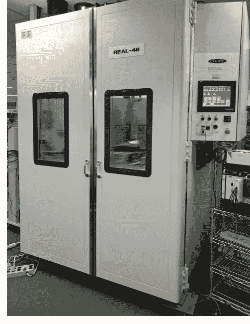

## 15
建立可靠性实验室

在没有适当规划和对成本考虑的理解的情况下在公司安装可靠性实验室可能会非常昂贵。首先，总公司销售额和相关的保修成本决定了任何计划的规模。这将指导规划者确定日常全职参与可靠性流程的人员数量。薪资支出是长期驱动因素，因为投资回报，即收回的保修资金，需要数年时间才能收回。当前的薪资预算必须能够在这一时期内吸收这些费用。这是最低要求。

然后还有其他主要费用：
- 设备成本
- 可靠性实验室空间
- 实验室工作台、办公桌和文件等
- 支持工具和设备
- 测试设备
- 机械夹具（在被测器件 [DUT] 与试验箱之间）
- 动态测试装置（在环境应力下操作 DUT）
- 消耗品（电力、材料、液氮 LN）
- 维护开销

### 15.1 可靠性人员配置

可靠性实验室本身并不能带来全部的底线节约，但它将是其中相当大的一部分。

首先，必须有一人领导该活动。此人必须具备基于经验的资格，或愿意聘请建立可靠性计划所需的专业知识。后者需要更长的时间，但建议您从组织外部聘请具有可靠性专业知识的人员来建立可靠性计划、建立可靠性实验室并实施可靠性流程变更。理想的候选人应具备以下特征技能和经验：
- 可靠性工程背景
- 高加速寿命试验（HALT）/高加速应力筛选（HASS）和环境应力筛选（ESS）
- 冲击和振动测试

- 统计分析
- 项目预算/估算
- 失效分析
- 进行可靠性培训
- 在实施新概念方面的说服力
- 工程学学士学位

薪资会因经验、资格、国家地区等而有所不同。具备可靠性工程师和经理招聘经验的招聘人员并不多，因此可能需要花费时间与招聘人员沟通，以解释该职位所需的技能、教育和经验。（有关此信息的网站可在 www.salary.com 上找到。）

## 15.2 可靠性实验室

本章剩余部分将讨论建立可靠性实验室时需要考虑的事项。表 15.1 和表 15.2 是矩阵，提供根据小型、中型和大型公司为每个问题提供的最佳选择建议。

实验室空间并非微不足道。除了 HALT 试验箱所需的空间外，还将需要以下要求：

- 液氮罐（如果大型外部罐超出预算）。请记住，将会有一些满罐、一些空罐，以及一两个半满罐需要处理。氮气罐直径约为 30 英寸，高 6 英尺，装满时重数百磅。
- 用于失效分析、维修和其他测试设备的实验室工作台。
- 用于局域网/互联网通信、一般报告准备等的办公空间。
- 在 HALT 试验箱中进出操作测试台架和升降机的空间。
- 不使用时存放其他设备的存储空间。
- 将参与 HALT 活动的工程支持人员的空间。
- 为每个人准备椅子，一些为实验室工作台高度，一些为办公桌高度。
- 工具柜， preferably 带脚轮。
- 储物柜。
- 将需要墙面空间用于大功率电源，即车间空气、冷却水源等。

需要支持工具和设备。一些必要的工具包括：

- *通用手工工具。* 需要用于焊接、拧紧、切割、固定等的工具。

表 15.1 年度销售额与典型保修成本相对应。

|  | Small ($) | Medium ($) | Large ($) |
|---|---|---|---|
| Annual sales | 1 000 000–5 000 000 | 10 000 000–50 000 000 | 100 000 000 and up |
| Annual warranty cost | 100 000–500 000 | 1 000 000–5 000 000 | 10 000 000 and up |

## 表 15.2 HALT 设施决策指南。

|  |  | Company size |  |  |
|  |  | Small | Medium | Large |
| HALT machine | Rent/lease | X | X |  |
|  | Buy |  | ? | X |
| HALT machine operator | Rent | X | ? |  |
|  | Hire operator |  | ? | X |
| Nitrogen tank | Dewars | X |  |  |
|  | Storage tank |  | X | X |
| Concrete tank mounting slab |  |  | X | X |
| Multiple Dewar manifold |  | X |  |  |
| Safety mats |  | N/A | X | X |
| Training | External | X | X | X |
|  | Internal |  | X | X |
| Mechanical fixtures |  | M | M | M |
| Test instrumentation |  | ? | ? | ? |
| Turnkey solution |  | N/A | ? | X |
| Room exhaust fans |  | N/A | N/A | X |
| Room oxygen monitors |  | N/A | N/A | X |
| Lab facilities |  | N/A | N/A | X |
| Travel costs |  | X |  |  |

X = likely best choice
? = depends on circumstances
R = rent
M = make

- 起重机。对于不能由一个人携带的大型 DUT 单位，需要起重机。
- 热工仪器。这些包括热电偶、热电偶焊接机、额外的加速度计（因为它们很容易失效）等。
- 测试设备。数字电压表、数字温度计、记录仪、夹式电流表、便携式氧气探测器（用于泄漏检测）、示波器、函数发生器、射频发生器、电源、可变频率频闪灯，以及您可能有的任何特殊需求。

还需要某种通用机械夹具（在 DUT 与试验箱之间），该夹具在振动测试时可将 DUT 机械固定在试验箱台面上，例如以下内容：

- 五金件。这包括带锁紧螺母的钻杆和横杆，以及用于将固定装置连接到 HALT 台面（通常，标准 3/8 英寸螺纹可在五金店找到）的各种长度的额外螺栓、螺母和平垫圈和开口垫圈。
- 机械压紧装置。这可能需要针对您的特定需求进行特殊设计。
- 牵引绳或电缆。这些用于吊起重型 DUT。

其中一些定制物品可能需要数周时间进行设计和制造，因此在此方面的规划很重要。

毫无疑问，动态测试设备或仪器可能是一项高成本项目。在 HALT 中，DUT 必须动态运行，以便在发生时检测到故障。实现这一点的仪器可能简单到仅使用电压表和示波器，也可能复杂到使用专门为这些测试设计的特殊硬件组件和专用软件。（通常，这种特殊设备可以成为制造过程中稍后 HASS 测试设备计划的一部分。）在此，规划至关重要。甚至进出 HALT 试验箱的电缆长度也被考虑在内。计划为 HALT 期间会承受应力的所有物品准备备件；这既可用于调试，也可用于更换测试过程中受损或退化的任何物品。

## 15.3 设施要求

需要规划的消耗品有：

- 动力和照明。在 HALT 期间施加大温度变化或对大热质量组件进行热循环时，动力可能相当可观。
- 液氮，按便携式杜瓦瓶或大型外部罐装配。这即使在最小的 HALT 系统中，每月也可能达到数千美元。（温度极值越宽、越快，消耗品成本就越高。）
- 维护开销。这包括补充实验室用品等。

## 15.4 液氮需求

液氮的成本会根据使用量和配送频率而有所不同。五十加仑的杜瓦瓶如果使用量很小，提供最低成本的解决方案。您可以存放多个罐子，并在空罐时推出一个。如果您计划使用大量液氮，那么更大的外部罐可能是最佳解决方案。罐子的放置位置可能出人意料地昂贵。分区法规和当地社区规划者的偏好会显著影响安装成本。在工业场所，可能只需要一个简单的混凝土板。这通常花费 $15 000–$40 000，具体取决于所需罐子的大小。如果社区要求存储罐与环境融合以具有更好的美观性，这可能会超过 $100 000，尤其是在抗震保护是板设计规范的一部分时。诸如覆盖罐子的格栅面板、夜间服务和罐装的路灯，以及从氮气卡车连接填充软管到罐子的车道位置的特殊包覆管道等，都将是必要的；清单可能很长。

大型罐的优点在于，通过批量购买，液氮成本可以大幅降低。外部罐可以设置电话线路/调制解调器以实现自动补给，因此无需人员搬运杜瓦瓶。这可以节省大量时间，尤其是在制造过程中。考虑到您的整体规划，拥有一个同时支持 HALT 和 HASS 工艺的罐子可能是个好主意。这可能由于需要额外的保温管道而花费更多，但通过仔细规划，甚至这些成本也可以得到控制。罐子可以更大，使用量成本会更低。补给次数也会减少，这也有助于降低成本。

从罐到 HALT 试验箱的管道中会发生损失。这可以通过使用保温、包覆管道几乎完全消除。一些氮气罐供应商可以将其作为完整的低温、交钥匙服务的一部分提供。他们会将管道设计作为整个系统的一部分进行定制。这很重要，因为 HALT 试验箱和液氮罐的放置位置会影响该管道的成本。通常为每英尺运行长度 $300。普通管道价格更低，但氮气损失很快就会累积。如果选择普通管道，每次使用 HALT 试验箱时都会出现霜冻积聚。这可能会导致其他问题。当冻结的水分最终变暖时，所产生的水可能会造成损坏和安全问题。

并非所有液氮罐都相等。有些在最大限度减少氮气损失方面做得更好。请咨询您的供应商。建议罐子配有保温输出流量阀。没有此阀的罐子会结霜并在阀门处形成直径可达 1–2 英尺的霜冻气泡。这意味着阀门在霜融化之前无法转动。阀门后发生的故障可能导致无法在罐子排空之前停止流动。保温阀不会结霜到无法操作，因此可以关闭。

每次 HALT 开始时，试验箱内都有含有湿度的室空气。在低于冰点的温度变化期间，它会结冰，并在试验箱加热时凝结。这种冷凝可能会损坏 DUT。建议在氮气罐上加装汽化器，将液氮的一小部分转化为气体。该气体可在每次测试开始时送入试验箱，以冲洗出试验箱本身的潮湿空气。对于选择杜瓦瓶的用户，可使用干燥氮气瓶用于此目的。请记住，这又是需要搬运、重新订购并保持可用的一个罐子。

根据计划使用量预算液氮成本。典型的 HALT 每周消耗 250 至 1000 加仑。这取决于温度循环速率和温度摆幅水平。液氮成本从每升 $0.80 到数美元不等。LN 的成本取决于租赁 LN 储存设备与拥有储存罐以及计划的 LN 年度使用量等因素。许多液氮配送合同都是自动续期的，这意味着它们会自动续订并对终止有设定的要求和条件。如果试验箱使用率高，每月液氮成本将达到数千美元。

## 15.5 空气压缩机要求

压缩机对于较大的 HALT 试验箱可达 $30,000。建议将压缩机放置在 HALT 实验室之外，最好在建筑物之外，以便压缩机噪音不会干扰人员。一些压缩机非常吵；请检查压缩机的分贝声级。如果压缩机位于工作区域，声级应保持在 65–70 dB。货比三家将帮助您发现安静的机型。通常，最佳机型的全功率运行噪音水平为 62 dBA，类似于相对安静的办公室的噪音水平。这意味着为了获得更安静的压缩机，计划购买一台不需要以其

maximum output level. A size larger than the chamber manufacturer specifies will still do the job, work more efficiently, and be quieter. When possible, place the compressor on the roof or outside the building. A rooftop unit requires an automatic restart feature on the compressor so that no one has to climb onto the roof to restart the unit after power failures.

Compressors use outside air for their source, assume that the air will contain water vapor (humidity) and oils (from pollution), which will now be in the airline. The water vapor needs to be removed from the airline and can be removed using a dryer/filter or a dehumidifier. Depending on the method used, the trapped water will need to be drained if it is being collected in an airtight container. The HALT chambers use pneumatic piston hammers to generate the table vibration. The hammers will corrode if there is water/moisture in the airline that was not filtered out. The HALT chamber manufacturers may have a filter system at the inlets of the chamber, but they will rapidly become ineffective if the facility is located in an area of high humidity. Having a water filtering mechanism as part of the air compressor will help lengthen the life of the pneumatic hammers. If you use the compressed air that is already in your facility, this problem may already be eliminated. However, it may not be a good idea to use existing compressed air from your facility in the HALT chamber.

If the facility’s compressed air already services other manufacturing processes, like delicate pick-and-place component equipment, then the periodic on and off of the HALT chamber with its relatively high usage, may create problems with other processes or equipment. This could create problems that will be almost impossible to diagnose. Therefore, it is best to have a local air compressor for the HALT and HASS process.

## 15.6 Selecting a Reliability Lab Location

Next, where to put the lab? The closer it is to the product development lab, the better. You want to make the necessity of the design engineers to walk over to the HALT lab as easy as possible. Do not place the lab in another building; this often tends to engineers being reluctant to make the journey and the loss is yours. It is desirable to have windows in the reliability lab so that passersby can see observe HALT and other reliability testing activities. This is especially beneficial when you have stockholders, customers, and other management heads tour the facilities. The reliability lab and reliability testing to make products reliable is part of the organizations core competency and a source of pride and distinction. It also communicates the importance of this activity.

The lab has to be large enough to contain the HALT chamber and all the other equipment. The HALT lab planning needs to take into account how product will be moved/wheeled in and how easily it can be placed into the chamber. Typically a 20′ × 28′ floor plan is needed. Anticipate growth; there should be sufficient space for a second HALT machine to be added in the future. It can be very costly if you have to move the HALT lab to a different area to make room for more HALT chambers.

The lab requires sufficient amperage for the chamber, typically 480 VAC, three-phase, at 200 A. This is for the larger chambers. Less amperage is required for the smaller chambers. This specification is available from the manufacturers. Compressed air for the product and test methods is also frequently used.

The lab can be completely up and running in 90 days from start to finish. This can be faster if sign-offs and community construction permits are expedited. In some communities, the zoning and construction permits can be exasperating in the amount of time they seem to waste. Be prepared for these delays. Get the city or town inspectors and zoning people involved early. This can help expedite the building process.

Often, companies begin with an outside service to start HALT, and later transition it in-house HALT facility. This might improve the planning of in-house facilities as the team becomes more experience in HALT. Outside services usually have a two- to six-week waiting period, because they also need to plan their facilities relative to typical five-day HALT exercises. HALT service will cost typically $5000 per week for just the rental. Other costs related to the actual testing described earlier should be included when considering total expenses.

If HALT will be done at an outside lab, additional planning will be needed for mechanically fixturing, cabling, supply and monitoring equipment, since the DUT needs to be operated dynamically during HALT. This will take time and resources and the HALT facility can provide guidance and support and may have some of the equipment and fixturing needed. Depending on how far away the outside HALT facility is, these costs can quickly add up. If you have to travel out of town for a week, the cost of the hotel, rental car, meals, and so on will have to be considered. A partial list of HALT facilities is including in the appendix.

## 15.7 Selecting a Halt Test Chamber

In choosing a HALT chamber, there are important items that need to be taken into consideration.

First, there is the cost of the HALT chamber itself. A HALT chamber can cost from $75 000 to $500 000, depending on the size needed and the manufacturer. Custom chambers can be even more expensive. We have found that, as a practical matter, the published costs are relatively competitive. A good negotiator can reduce the chamber costs, particularly if you know you will be growing and require additional HALT chambers in the future. If the plan is to do HALT and HASS, determine if one chamber will be adequate. Typically, the HALT chamber is located in an engineering environment and the HASS chamber is in a manufacturing/operations environment. If manufacturing material needs to be segregated from product development, two similar chambers will be required. Buying two or more chambers can help in price negotiation, even if you are not planning to purchase them at the same time.

Before any dollars are committed for HALT equipment, determine the magnitude of the dollars lost to cover product warranty. A significant portion of this warranty cost could be eliminated with HALT. Quantify the potential saving from reduced warranty cost due to the investment of a HALT chamber. The savings from removing product design failures before product release is often significant enough to show an return on investment (ROI) in less than a year after product release. Table 15.1 sizes your reliability budget relative to your warranty cost. (Remember that typically the warranty cost in a company that has little or no reliability processes in place usually falls in the range of 10% of the total sales dollar.)

The warranty figures may appear extremely large at first glance, but these are typical to a variety of industries. It is not unrealistic to achieve a 1–2% warranty cost after implementing an effective reliability and software quality processes, as outlined in the book. The savings can be substantial and provide an appealing ROI. Focus on all the costs that are subtracted from the sales dollars due to returned goods, rework, scrap, field service, costly design engineering changes, manufacturing process changes, hand versus automated processes, outsourcing costs, supplier relationships, inventory losses, and so on. These total costs are quite significant. Conduct a special audit, and use a consultant who specializes in identifying the cost of quality (reliability too), if needed, to objectively determine the true warranty cost.

Once at a division of a substantial Fortune 500 company, I was trying to establish the cost per warranty repair. I came to a figure of about $3,000 per fix. The management didn't believe it. I was asked to work on this figure with the senior financial manager to get the “right” number. After a time, we agreed that, depending on the specific product, the figure ranged from $2,700 to $3,100. I also told them that the warranty cost as a percentage of the sales figure would be in the 10–12% range. The top manager was in disbelief. He looked over his financial data and quickly came to the realization that it was 11.5%. He signed the purchase order for the HALT machine the very next day.

A lot of the warranty costs go unmeasured and are unknown to a manufacturer. These can be in areas such as increased personnel costs related to customer interactions to “iron out” a problem. In essence, any activity that the seller performs to make the customer happy with the delivered product can be warranty cost. Most importantly, what additional sales were lost due to poor quality and reliability? This is a difficult figure to determine, but it is very small when there is good quality and high reliability.

### 15.7.1 Chamber Size

The HALT chamber cost will usually be determined by the physical size of your product. If you manufacture items that are the size of a satellite receiver, then the HALT chamber can be less expensive. However, the HASS chamber might still have to be the larger-sized unit, so several units can through production HASS at a time in meet manufacturing through put requirements. Specific planning will determine the best mix.

The internal chamber size is, first and foremost, important. If it’s too small, the ability to HALT parts of the product or the entire product may be lost. The tables in the chamber are about 4 in. smaller than the chamber wall-to-wall dimensions in the x- and y-directions. This is so that the table can move in vibration in these directions. The table has a grid of 3/8 in. tapped holes that will facilitate screws and threaded rods to hold the DUT securely to the table. Most chambers have internal lights or lamps that can be swiveled for maximum adaptability. These lights take up space at the top of the chamber, so be sure that the chamber height is tall enough, even with the lighting fixtures at the top of the chamber. (The height of the chamber is really smaller by the amount of space the lamps take up.)

### 15.7.2 Machine Overall Height

The overall size of the HALT machine is important as it has to fit into the intended space (Figure 15.1). Size considerations often come into play when determining how the

图 15.1 ESPEC/Qualmark HALT 试验箱。

试验箱将从装卸码头移至实验室。请确保天花板和门尺寸允许此项搬运。显然，HALT 机器的放置位置很重要，但如何将其运到那里往往并非易事。

一台 HALT 机器的安装位置设在工程设施二楼的实验室附近。这台特定的 HALT 机器是较大型的设备之一。一名初级工程师被指派任务，核查 HALT 机器的制造商尺寸，并确保该设备能够放入 HALT 实验室。该年轻工程师报告说设备可以放入，只是勉强。他甚至还检查了 HALT 机器是否能够放入将它从一楼运至二楼的货运电梯。机器到达的那天，一切准备就绪，准备将设备从收货码头移至 HALT 实验室。三名非常强壮的设备搬运工被聘请进行重物搬运。清晨如计划那样，卡车带着新的 HALT 机器到达。

立刻就显而易见，有一个微小的问题被忽略了。装有 HALT 机器的大型木制运输箱无法放入收货码头的大门，因此暂时放在停车场上。木箱材料被拆除。然后租用一台工业叉车将机器重新放置到收货码头上。两台较小的升降设备被用来将试验箱移至实验室。但它放不进电梯。太高了，高出 2 英寸。制造商的图纸有误。尽管如此，三名搬运工毫不气馁。

搬运工用小木块和托盘千斤顶将设备抬高，足以拆下机器上的四个金属支腿，从而腾出 4 英寸，刚好足够。他们将机器降低到五根 1 英寸直径的电气导管上，并将机器滚入电梯。他们反向操作将其从电梯中移出。他们检查机器是否仍能放入实验室，确认无误后重新安装支腿并将设备放置在实验室中。

实验室经理此前已聘请一家专业工程公司认证建筑物是否足够坚固以支撑这台 5,000 磅的机器，以免楼下办公室工作人员的楼层坍塌。作为额外预防措施，他在 HALT 机器下方放置了一块 3/4 英寸厚的铝板，以帮助在实验室中分散重量。这种预防措施在第一层安装时通常不是必要的，当设备放置在混凝土基础上时。有些楼层实际上是网格状结构，架设在基础地面之上，以提供电缆和布线等的空间。如果设备将放置在这种瓷砖地板上，仍应明智地检查楼层强度。

从码头到 HALT 实验室的走廊天花板高度高于 8 英尺，但并不高太多。搬运工险些扯掉天花板上安装的出口指示灯和水喷淋头。该机器在机身低处安装了两个空气过滤器。它们低到足以被粗心的叉车操作员损坏。HALT 机器制造商非常理解，并在不收取费用的情况下更换了过滤器。

不用说，在将 HALT 机器安装到实验室设施时，必须考虑很多事情。请注意细节。

## 15.7.3 所需功率和消耗

运行 HALT 试验箱所需的功率可能为 480 VAC，三相 200 A。在规划阶段确保在 HALT 和 HASS 试验箱计划位置处有适当的电源可用。计划提供满足其他需求的电力，即为 DUT、测试和监控设备供电。实验室中通常需要 110 VAC，单相 20–30 A 用于仪器等。压缩机通常也需要三相电源。

## 15.7.4 可接受的运行噪声水平

多年前，HALT 试验箱的噪声水平过高，机器不得不放置在外部建筑物中。如今，它们的噪声水平已大幅降低，以 dBA 计。通常在机器以最高振动水平运行时，65 至 75 dBA 的噪声水平是可以接受的。对于某些机器，长时间高水平测试可能需要佩戴耳塞。

## 15.7.5 门的开启

较大的机型每侧有两个门。这使得所需的开启空间变小。这有助于降低 HALT 实验室的尺寸。较小的机器只有一个门，通常需要相同甚至更多的门开启空间。规划时应考虑这一点。

## 15.7.6 操作便捷性

机器的操作本质上是相同的，但操作方式差异很大。有些控制难以理解，而其他则像食谱一样简单。

## 15.7.7 配置文件创建、编辑和存储

HALT 测试配置文件必须由 HALT 操作员开发。它本质上是单一和组合的温度和振动应力刺激，以及操作员选择如何混合它们。一些软件系统允许轻松复制和编辑先前开发的配置文件。亲眼观察机器的运行将使您能够判断修改测试配置文件是否容易。稍加尽职调查，将在实验室创建测试配置文件时节省大量挫败感。HASS 流程使用预编程的生产配置文件。通常，HALT 流程如此经验性，以至于自动系统不切实际。HALT 更像是一种听觉；应力配置和测试过程在很大程度上取决于 DUT 在应力测试下的表现。HALT 因其本质而不能是自动化测试。HALT 不是通过/不通过测试。买方应确定自动配置文件功能的重要性。

## 15.7.8 温度变化速率

试验箱温度变化的速率是所有试验箱制造商的主要卖点。有些可达到 80–100 °C min⁻¹（即对于具有较小热质量的较小 DUT）。需要注意的是，Gregg Hobbs 博士写道，他从未发现缺陷与温度升降速率有关。 [1] 因此，也许这个“必备”功能并不那么重要。然而，在制造过程中，加热速率对于提高生产效率很重要。这就是升降速率发挥作用的地方。

## 15.7.9 内置测试仪器

一些 HALT 试验箱制造商只生产 HALT 试验箱。其他制造商生产各种环境试验箱，并提供各种测试仪器。通常，这些仪器集成到 HALT 软件中，因此非常兼容。这可能是一个重要特性。

## 15.7.10 安全

HALT 试验箱制造商提供第二来源氧气传感器和报警器，可在氮气泄漏、氧气水平可能耗尽的情况下提醒用户。它们通常来自专门从事气体检测的另一家制造商。为了节省一些费用，这些可以单独购买。

## 15.7.11 从下单到交付的时间

根据个人经验，HALT 机器不是现货购买。它们必须按订单生产，从收到采购订单起的时间通常为 10–12 周。

## 15.7.12 质保

每个制造商都有质保。典型标准为零件和人工两年。有些提供两次至三次预防性维护访问，由其承担费用，以确保试验箱按规格运行。在这些访问期间，他们可能会发现需要其他维修或提供软件更新。如果发现超出保修范围的问题，客户可能需要承担部分费用。其他制造商提供 90 天服务和一年零件保修，这也必须涵盖其物流。质保范围差异很大，因此请仔细审查试验箱供应商的质保政策。

## 15.7.13 技术/服务支持

技术/服务支持很重要。这可能意味着您可以联系某人寻求帮助。也可能意味着他们有现场服务人员，可以在系统故障后迅速赶到现场。有时，这意味着他们会加快零件交付，以便内部进行维修。确保对提供的服务包有明确的理解。务必勤勉地联系不同制造商试验箱的其他用户，检查他们的支持体验。我们发现，在某些情况下，尤其是制造商不在用户本地时，用户很快就成为其试验箱维修和维护方面的专家。

## 15.7.14 压缩空气需求

如前所述，请确保您厂内的空气系统能够满足 HALT 试验箱的需求。如果不能，请安全起见安装自己的专用空气压缩机。

## 15.7.15 照明

实验室照明很重要。请确保有足够的照明。HALT 试验箱内部可能很暗，除非有试验箱照明。请确保它是试验箱配置的一部分。

## 15.7.16 定制

客户经常有特殊需求。如果试验箱制造商能够制造定制机器，这将是一个巨大的优势。这可能意味着可以购买仅温度的机器，然后稍后添加振动部分。作者坚信，温度和振动是引发故障所需的最低限度两种应力。您的 HALT 团队提供其他所有应力，例如电压裕度、时间裕度等。仅温度是不够的。

提供了一个矩阵，以便读者根据矩阵中的建议做出最佳决定（表 15.2）。

提供了一个选择矩阵，以便您确定在选择机器和制造商时认为关键的项目（表 15.3）。

## 表 15.3 HALT 机器决策矩阵。

| 项目 # | 属性 | 公司及型号 # |  |  |  |  |  |  |  |  |
|---|---|---|---|---|---|---|---|---|---|---|
|  | 定量 | 示例 | 基准 # | 加权 | 公司 A | 基准 # | 加权 | 公司 B | 基准 # | 加权 | 按加权因子排序 |
|  | 型号 # | 型号 X1 |  |  | 型号 |  |  | 型号 |  |  |  |
| 1 | 振动水平最大值（in Grms） | 50 | 3 | 15 |  |  |  |  |  |  |  |
| 2 | 温度变化速率（in °C min⁻¹） | 60 | 3 | 15 |  |  |  |  |  |  |  |
| 3 | 工厂兼容性 | 可在工厂使用 | 3 | 15 |  |  |  |  |  |  |  |
| 4 | 内置测试仪器 | 是（未设计在内） | 1 | 15 |  |  |  |  |  |  |  |
| 5 | 机器可靠性 | 每 2 个月需要维修 | 3 | 5 |  |  |  |  |  |  |  |
| 6 | 噪音水平，in dBA | 75 | 3 | 15 |  |  |  |  |  |  |  |
| 7 | 安全 | 门有安全锁 | 3 | 15 |  |  |  |  |  |  |  |
| 8 | 机器尺寸 H'' | 102 | 3 | 9 |  |  |  |  |  |  |  |
| 9 | 机器尺寸 W'' | 54 | 3 | 9 |  |  |  |  |  |  |  |
| 10 | 机器尺寸 L'' | 52 | 5 | 15 |  |  |  |  |  |  |  |
| 11 | 室尺寸 H'' | 52 | 3 | 9 |  |  |  |  |  |  |  |
| 12 | 室尺寸 W'' | 52 | 3 | 9 |  |  |  |  |  |  |  |
| 13 | 室尺寸 L'' | 50 | 3 | 9 |  |  |  |  |  |  |  |
| 14 | 台面尺寸 L'' | 42 | 3 | 9 |  |  |  |  |  |  |  |
| 15 | 台面尺寸 W'' | 42 | 5 | 15 |  |  |  |  |  |  |  |
| 16 | 交货时间（周） | 5 周 | 5 | 15 |  |  |  |  |  |  |  |
| 17 | 保修（年） | 2 年 P & L | 3 | 9 |  |  |  |  |  |  |  |
| 18 | 成本（基础价格） | $145 000 |  |  |  |  |  |  |  |  |  |
|  | 仪器等选项 | $25 000 | 3 | 9 |  |  |  |  |  |  |  |
| 19 | 压缩空气需求 | 120 SCFM @ 90 PSIG | 3 | 9 |  |  |  |  |  |  |  |
| 20 | 最大静载荷 | 800 | 3 | 9 |  |  |  |  |  |  |  |
| 21 | 氮气管道数量 | 2 | 3 | 9 |  |  |  |  |  |  |  |
| 22 | 可达性（台面高度至地面） | 20 | 3 | 3 |  |  |  |  |  |  |  |
| 23 | 电缆端口 | 4 | 3 | 9 |  |  |  |  |  |  |  |
| 24 | 窗户尺寸（L'' × W''） | 18 × 18, 数量 2 | 3 | 3 |  |  |  |  |  |  |  |

## 表 15.3（续）

| 项目 # | 属性 | 公司及型号 # |  |  |  |
|---|---|---|---|---|---|
|  | 定量 | 示例 | 基准 # | 加权 | 公司 A | 公司 B | 基准 # | 加权 | 按加权因子排序 |
|  | 型号 # | 型号 X1 |  |  | 型号 |  | 型号 |  |  |
| 25 | 重量（in lbs） | 6500 | 3 | 3 |  |  |  |  |  |
| 26 | 多个杜瓦瓶连接 | 3 总计 | 3 | 9 |  |  |  |  |  |
| 27 | 安全垫可用 | 每扇门 1 个 | 5 | 15 |  |  |  |  |  |
| 28 |  |  |  |  |  |  |  |  |  |
| 29 |  |  |  |  |  |  |  |  |  |
| 30 |  |  |  |  |  |  |  |  |  |
| 定性 |  |  |  |  |  |  |  |  |  |
| 1 | 软件 | 易于使用 | 1 | 5 |  |  |  |  |  |
| 2 | 技术支持 | 是，本地 | 5 | 25 |  |  |  |  |  |
| 3 | 图形用户界面（GUI） | 8 | 3 | 9 |  |  |  |  |  |
| 4 | 生产的所有 HALT 机器总数 | 125 | 5 | 15 |  |  |  |  |  |
| 5 | 开展 HALT 室的年限 | 3 | 5 | 15 |  |  |  |  |  |
| 6 | 开展其他室的年限 | 无 | 3 | 9 |  |  |  |  |  |
| 7 | 定制化 | 是 | 3 | 9 |  |  |  |  |  |
| 8 | 人体工学 | 7 | 3 | 9 |  |  |  |  |  |
| 9 |  |  |  |  |  |  |  |  |  |
| 10 |  |  |  |  |  |  |  |  |  |
| 11 |  |  |  |  |  |  |  |  |  |
| 12 |  |  |  |  |  |  |  |  |  |
|  | 得分 = |  | 115 | 377 |  |  |  |  |  |

## 参考文献

1 Hobbs, G.K. (2005). Reflection on HALT and HASS. Evaluation Engineering (December).

## 16

## 招聘和配备合适的人才

### 16.1 为可靠性配备人员

可靠性实验室本身并不会带来全部的底线节约，但它将是其中相当重要的一部分。

首先，需要一个人来领导该活动。此人必须具备来自其他经验的资格，或愿意将当前职业抱负转移到可靠性工程上。后者需要更长的时间才能成长。建议您从现有员工之外寻求一位具有建立实验室并安装将使用的流程的经验的人。他的/她的核心技能集如表 16.1 所列将包括以下内容：

- 可靠性工程背景
- 高加速寿命试验（HALT）/高加速应力筛选（HASSs）和环境应力筛选（ESS）
- 冲击和振动测试
- 统计分析
- 失效预算/估算
- 失效分析
- 开展可靠性培训
- 在实施新概念方面的说服力
- 工程和/或物理学学位

#### 16.1.1 可靠性工程背景

寻找具有可靠性工程经验的人员，该经验在安装可靠性工具（如 HALT、失效模式和影响分析（FMEA）、元件降额指南等）方面有 5–10 年或更长时间。分析工程师是否培训过他人，如果有，培训了多少人，时间跨度如何，以及这种指导是否培养出了其他可靠性工程师。

#### 16.1.2 HALT/HASS 和 ESS

该候选人是否使用或操作过，或更好的是安装并使用过应力测试室（HALT/ESS）？有许多需要考虑的事情，这些内容在本章中有所涵盖。候选人能否在不违反任何保密协议的情况下提供过去的应力测试报告？是否有可靠性改进的证据，改进了多少以及在什么时间段内？测试是在内部还是外部进行的？了解该候选人实际做了什么来组织参与测试工作的工程师团队？这种技能是否已传授给他人？

#### 16.1.3 冲击和振动测试

一些应力测试是为了确保产品能够成功运输。通常，这种测试的需求不是持续的，而是间歇性进行的。这通常意味着测试是在测试机构进行的，在那里可以根据需要提供各种环境和运输测试。看看候选人是否有这方面的经验。了解在这些测试揭示设计缺陷时学到了什么以及做了什么。候选人是否参与过运输包装设计团队？该领域的技能可能非常有价值。

#### 16.1.4 统计分析

设计工程师接受了大量的数学培训，但不幸的是，统计学通常不是他们的工具箱的一部分。看看候选人是否接受过正式的统计学培训；两学期或以上的大学水平课程会很好。一种获得广泛接受的统计工具是 Weibull 分析。这用于帮助识别现场失效模式。当然，学位工程师可以学习使用该工具（数学相对简单），但具备统计技能有助于他们更快上手。看看他们是否有帕累托分析的经验。这将帮助他们迅速采取行动纠正最重要的问题。统计学可用于证明最终产品的可靠性。这对于管理层确保已达到可靠性目标非常有用。

#### 16.1.5 失效预算/估算

在产品生产后才知道新产品的可靠性可能对公司造成财务灾难。能够预算各个细分或组件的

## 表 16.1 各岗位的可靠性技能集。

|  | 可靠性技能 | 顾问或可靠性经理 | 可靠性工程师 | 可靠性技术员 |
|---|---|---|---|---|
| 1 | HALT/HASS | A | B | B |
| 2 | HALT 室经验 | A | C | C |
| 3 | HALT 室安装 | B | C | C |
| 4 | ESS | A | C | C |
| 5 | 冲击和振动 | A | C | C |
| 6 | 室经验 | B | C | C |
| 7 | 外部测试设施聘用 | A | B | C |
| 8 | 失效分析 | A | A | C |
| 9 | 统计技能 | A | C | C |
| 10 | 可靠性预算 | A | C | C |
| 11 | 可靠性估算 | A | C | C |
| 12 | 培训经验 | A | A | B |
| 13 | 导师制 | A | B | C |
| 14 | 举办研讨会 | B | C | C |
| 15 | FMEA | A | C | C |
| 16 | 已做过 FMEA | A | C | C |
| 17 | 已培训他人进行 FMEA | A | C | C |
| 18 | 元件降额 | A | B | C |
| 19 | 说服力 | A | C | C |
| 20 | 高能量 | A | B | B |
| 21 | 能展示成功案例 | A | B | B |
| 22 | 工程学位 | A | A | C |
| 23 | 电子（EE） | B | A | C |
| 24 | 机械（ME） | B | A | C |
| 25 | 物理 | B | A | C |
| 26 | 商业 | C | C | C |
| 27 | 高级学位 | B | B | C |
| 28 | 电子（EE） | B/C | B | C |
| 29 | 机械（ME） | B/C | B | C |
| 30 | 物理 | C | B | C |
| 31 | 商业（MBA） | A | C | C |
| 32 | 副学士学位 | C | C | A |
| 33 | 电子 | C | C | A |
| 34 | 机械 | C | C | B |
| 35 | 制图 | C | C | C |
| 36 | 继续学习 | B | B | B |
| 37 | 课程 | B | B | B |

## 表 16.1（续）

|  | 可靠性技能 | 顾问或可靠性经理 | 可靠性工程师 | 可靠性技术员 |
|---|---|---|---|---|
| 38 | 研讨会 | B | B | B |
| 39 | 出版物 | B | C | C |
| 40 | 书籍 | B | C | C |
| 41 | 杂志和期刊 | B | C | C |
| 42 | 同行中备受尊敬 | A | A | A |
| 43 | 非常可信 | A | A | A |
| 关键 | A = 必须具备 |  |  |  |
|  | B =  nice to have |  |  |  |
|  | C = 最不重要 |  |  |  |

制定一个系统可以帮助工程师识别并聚焦于那些很可能成为系统中最薄弱环节的装配部分。看看可靠性工程师候选人是否具备这方面的背景。可靠性预算允许及早识别高可靠性风险。

这可以在产品“必须出货”而为时已晚之前，提供在设计方案中做出替代选择的[content]

制定一个系统可以帮助工程师识别并聚焦于那些很可能成为系统中最薄弱环节的装配部分。看看可靠性工程师候选人是否具备这方面的背景。可靠性预算允许及早识别高可靠性风险。

这可以在产品“必须出货”而为时已晚之前，提供在设计方案中做出替代选择的余地。通过将可靠性估算（即源自可靠性估算工具或内部数据）与预算进行比较，可以形成闭环，因为这是对预算的合理性检查。任何人都可以确定（猜测）可靠性预算。但这些数字与实际数据的一致性如何？寻找可靠性预算和估算的例子。了解候选人是如何做的。

## 16.1.6 失效分析

每当有任何东西失效时，都有原因，或者用工程术语来说，就是根本原因。当工程师调查失效时，常见的做法是“跳到原因”。更常见的是，这样找到的原因是不正确的。看看候选人是否具备失效分析技能：要求举例；询问花费了多长时间。如果候选人解决了问题，通常会立即实施短期解决方案来修复问题，然后将长期解决方案作为设计变更添加到系统中。看看候选人是否参与过这些活动。评估纠正措施的有效性和及时性。

## 16.1.7 开展可靠性培训

寻找能够成为在贵公司培育可靠性能力种子的合适人选。了解这个人为了将这些知识传授给他人做了什么。他们是否指导过个人——频率如何，人数多少？同时也要了解候选人是否有持续努力学习更多知识，以便跟上可靠性技术发展的步伐。这些可靠性任务是否已被这些新合格的人员接管？候选人是否举办过正式的培训课程、研讨会、发表过论文等？如果是，主题是什么？他们是否在期刊、杂志或书籍上发表过文章？他们是否了解新的软件工具，这些工具可以使他们的工作更轻松、更高效？

## 16.1.8 说服力地实施新概念

作者认为，推荐并说服他人使用不熟悉的工具的能力是成功的“秘密成分”。从几乎没有或没有可靠性能力到拥有强大的可靠性能力的发展需要数年时间。这需要一位具备极大坚持性的可靠性工程师，以及来自高层管理层的同等程度的支持。有些人认为可靠性组的传达信息是“老生常谈”，在某种程度上确实如此。信息必须持续不断地传达，而传话者必须能够以一种具有说服力、又不会激怒其他员工的方式来传达。要推销任何东西，传达信息的人必须受人喜欢，否则努力将是徒劳的。（我们很少会从我们不喜欢的销售人员那里买东西。）研究候选人；看看这是否是他们个人特质的一部分。

## 16.1.9 工程和/或物理学位

可靠性工程师需要与各行各业的工程师打交道。没有一位可靠性工程师能掌握所有学科的技能，但这个人必须得到工程团队以及管理层的信任和尊重。如果他们拥有工程或物理学位，他们至少拥有与工程师沟通的一套扎实工具。确保候选人拥有这一工具。有些可靠性工程师拥有多个学位，其中许多人拥有高级学位。然而，有些人具有技术背景，但持有其他非技术学位。这也很好。关键在于他们知道什么；但拥有学位是一个良好的起点。

一些可靠性工程师是以下各种可靠性工程学会的成员或参加其会议，其中包括：

- IEEE 可靠性学会（http://www.ewh.ieee.org/soc/rs），在世界各地设有团体。
- 可靠性与可维护性研讨会（http://www.rams.org），许多可靠性工程师和其他人会在此聚会讨论该主题、发表论文，美国质量学会在此提供认证可靠性工程师考试。
- 可靠性工程师学会（SRE）（http://sre.org）等。

使用这些建议，选择一名可靠性专家。如果一名可靠性人员满足要求，那么就完成了。现在的任务是让这个新人将可靠性知识传授给他人。如果很明显新任可靠性工程师需要支持，那么这个支持人员可以从哪里找到？

我们建议您从现有员工中挑选一位受人尊敬的工程师。最好是有成功设计业绩记录、曾管理高生产率生产线或具有质量工程背景的人。让新的可靠性工程师在挑选其他内部工程师和技术人员时发挥重要作用。这将有助于确保与首席可靠性工程师的兼容性和忠诚度。给新增的员工工程师足够的时间和工具来快速上手。

如果考虑外部招聘，请聘请临时顾问或合同可靠性工程师。通常，这些人拥有广泛的经验，可以快速有效地启动工作。如果这是永久职位，那么可靠性工程招聘人员可能会满足您的需求。

薪水会因经验、资格、所在地区等而有很大差异。当前薪资信息的来源可以在 www.salary.com 上找到；该服务需要付费。那里可以找到五种级别的可靠性工程薪资。

## 16.2 软件工程师的配备

要使软件质量保证（SQA）完全有效，员工中需要一定的专业化。SQA 的专业化沿着两个不同的方向进行。第一类差异是基础设施工程师与测试员之间的区别。第二种专业化维度是按技术或使用模型领域专业知识划分。

自动化构建和测试是实现高效且可重复的软件质量执行所必需的关键能力。开发和维护这种自动化需要软件开发人员（基础设施工程师）来创建工具。这些基础设施工程师将设置自动化构建环境，编写脚本和代码以在新构建时触发测试套件的执行，并开发工具来跟踪测试执行情况并通知管理人员和软件开发人员测试结果。

市面上有许多构建和测试自动化工具。基础设施工程师的工作将是从一套现成工具和自定义脚本或程序中创建一个集成的基础设施。基础设施工程师主要是软件集成者和开发人员。基础设施工程师所需的语言将由所选构建和测试自动化工具集所使用的脚本或编程语言决定。组织需要的基础设施工程师数量取决于开发和维护构建和测试环境所需的工作量。需求可能从一名兼职基础设施工程师到数名全职工程师不等。对于非常大的软件项目、多个并发软件项目或特别复杂的环境，可能需要一名或多名全职基础设施工程师来提供支持。较小的项目和团队可以指派一名兼职工程师来完成自动化集成工作。

实际的测试计划开发和测试执行将由测试工程师执行。测试工程师应具备产品使用的领域专业知识。其中一些测试工程师几乎肯定需要具备特定类型测试或技术的领域专业知识。根据产品和测试类型，应配备以下广泛的领域：

- 终端用户使用模型专业知识。至少有一部分测试工程师需要了解客户对产品的预期使用情况。这些工程师将负责以客户使用产品的方式测试产品。具有使用模型领域知识的工程师还应被要求审查其他测试计划。
- 可用性工程师。如果产品具有大量的用户界面（UI），可用性工程师将提供显著的益处。他们应在用户界面实现之前很久就参与审查用户界面设计（甚至创建用户界面设计）。用户界面测试人员将与用户模型专家合作，专门制定测试计划，以测试 UI 是否直观、逻辑清晰且易于导航。
- 应用程序编程接口（API）测试人员。许多软件产品会向产品客户公开 API。测试 API 需要编写代码以适当的方式调用 API，以检查每个 API 是否按要求执行其功能，并在被错误调用时优雅地失败，通过测试合法和非法调用的范围。API 测试人员是软件开发人员，他们将了解客户编程使用模型。他们将编写程序以按客户预期的方式使用 API。
- 安全测试人员。测试产品安全性是一项非常专业的专业知识。最好由外部顾问来执行，他们拥有执行漏洞和渗透测试所需的专业工具和经验。

## 16.3 为工作选择错误的人

许多最好的公司都在内部招聘。一名设计工程师可以接受交叉培训成为一名制造工程师。一名系统架构师可以被培养为一名

在营销方面的职位。财务分析师可以被培训为项目经理。当一家公司有一位表现非常出色的人时，通常将此人调到新部门是个好主意。有时，但不一定，这会让该员工保持兴趣并提高公司员工的留存率。如果公司里有人能够培训该员工进入新领域，这就是一个好主意。也许，外聘培训可以满足公司的需求。然而，没有培训，被提拔的员工将起步缓慢，可能永远无法达到完全胜任。数字电子工程师可以被培训为程序员。工作相似性很大。如果他们与其他程序员一起工作，他们将更快地达到熟练水平。如果没有人培训这些有才华的人，那么他们进入新领域就会有困难。如果要求他们单干，他们可能无法提供真正所需的东西。可靠性工程尤其如此。

可靠性工程是容易陷入这种困境的领域之一。没有可靠性计划的公司通常会从制造、测试和设计中挑选一些最好的工程师成为可靠性工程师。尽管这些人工作努力、有才华、并受同行尊重，但他们没有工具来识别可靠性弱点并建议流程变更。这是将可靠性引入公司的一个弊端。简单地说，你可能不得不从外部招聘。

可靠性工程师必须对开发和增强产品可靠性所需的流程和概念有坚实的理解。此人必须有动力和主动性，在公司中安装流程，而公司对对每个人来说都是新方法论会产生自然的抵制。这是一项艰巨的任务，需要最高程度的奉献和毅力。此人必须具有能够适应周围人性格的个性。此人必须知道自己得到管理层一直到最高层的支持。最后，可靠性工程师必须是一名教师。小公司只能负担得起一名可靠性工程师，但需要所有流程。一名工程师无法完成所有任务。该工程师必须能够将可靠性知识传授给每个人。这一过程可能需要数年时间，但如果做得正确，其他员工也会接受可靠性流程的培训。试图在没有外部帮助的情况下自行安装可靠性的公司很可能会失败。
