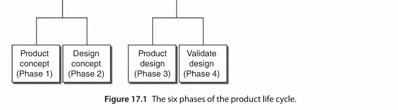
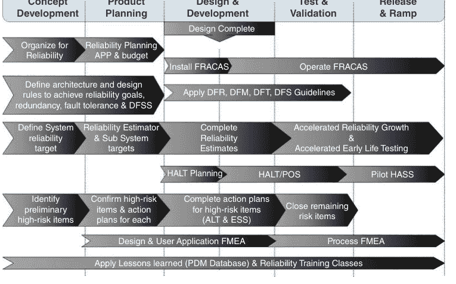
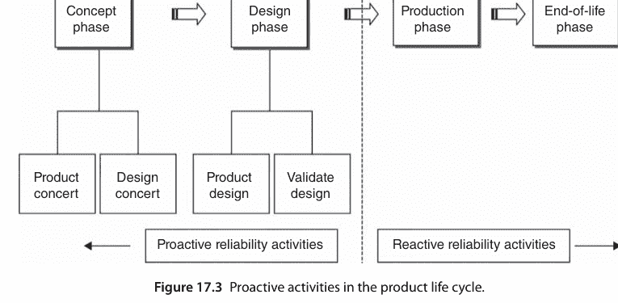

## 17 实施可靠性流程

消费者要求产品可靠、无缺陷、安全且有保障，这正在改变公司开发未来产品的方式。我们在 1970 年代看到过这种情况，当时美国消费者要求汽车质量更好。消费者的不满通过日本汽车销量增加而美国三大汽车制造商市场份额受损表现出来。当美国汽车行业意识到其市场份额因质量低下而下降时，它开始缓慢实施质量计划。变革关乎生存。在接下来的几十年里，新的质量计划不断演进，其中许多是短命的。今天，质量已成为大多数企业的重要组成部分。事实上，广泛接受的观点是“质量是每个人的工作”。经验表明，全面实施有效的质量计划需要多年时间。实施有效的可靠性计划也是如此。计划需要数年时间才能达到完全实施和有效。我们最近在锂电池可能燃烧、汽车可通过网络安全漏洞被接管等可靠性问题上看到了这一点。

### 17.1 可靠性是每个人的工作

1970 年代对产品质量改善的需求与 50 年后对产品可靠性改善的需求之间的相似性毋庸置疑。挑战在于组织能够多快地转型为设计和生产更可靠的产品。业务成功将基于组织能够转型为对产品可靠性承担共同责任的能力，“可靠性是每个人的工作。”

那些在高度可靠产品声誉方面最成功的公司，正是通过让每个人参与可靠性流程来实现的。如果可靠性计划未能将组织转型为对产品可靠性承担共同责任，结果将好不到哪里去。转型组织的额外成本很小，但不这样做的成本很大。

可靠性流程可以应用于任何组织，并在产品开发周期的任何时间实施。在开发计划后期实施流程可能会推迟产品的发布日期，因为该流程会暴露设计弱点，而这些弱点可能需要重新设计来修复发现的问题。这些变更很可能在没有可靠性流程的情况下也会被发现，即当客户抱怨时。实施可靠性流程似乎是一个艰难的决定，因为它对上市时间和盈利能力有影响，但这些利润可能迅速瓦解为产品召回、责任诉讼和高保修成本带来的重大损失。

### 17.2 正式化可靠性流程

每个可靠性计划的一个组成部分都是详细说明将要进行的活动以确保成功的计划。可靠性计划必须在实施前定义并达成一致。可靠性流程被正式化为一份文件，概述产品生命周期每个阶段的活动。文件化的可靠性流程是成功的关键要素。

可靠性计划描述了可靠性活动并为产品生命周期的每个阶段定义了预期的交付成果。在可靠性计划制定并正式化为文件后，下一步是在组织内创造对这种新方法以实现产品可靠性改善的认识。整个组织必须了解新流程，了解其参与程度，并意识到任何预算成本和进度影响。

可靠性活动必须纳入产品开发计划中，并为每个可靠性活动分配足够的时间。在项目开始时安排可靠性活动，以便对要求、所需资源和对产品交付的影响不会有意外。在产品生命周期的每个阶段完成后，审查可靠性流程以确定改进其未来项目有效性的方法。可靠性流程应通过参与者的反馈、定期审查最佳实践并实施新工具/技术来简化流程而持续改进。

在本书的第四部分，我们将介绍一个详细的流程，确定在产品生命周期每个阶段进行的可靠性活动。可靠性计划已被证明是成功的，并且包括公司设计和制造可靠产品所需的必要可靠性活动。要成功，组织必须将其理念转变为“把正确的事情做好”，以实现产品可靠性和软件质量目标。第四部分详细说明的可靠性计划代表了为实现产品可靠性而需要做到的“正确的事情”。这些可靠性和软件质量活动的实施可能不同，这取决于具体的业务类型和业务环境。因为并非所有公司都相同，企业文化各不相同，流程的实施方式也会有所不同。如果实施了持续改进流程，流程可以量身定制以最好地适应任何特定业务需求。通过这样做，公司不仅会“做正确的事情”，而且会“把正确的事情做好”。

任何实施可靠性计划或希望改善其产品可靠性计划的公司都可以使用此处介绍的可靠性流程。这些活动代表了产品可靠性所需的最低步骤。通过只选择那些可以轻松实施的活动，将在产品可靠性方面做出牺牲。在可靠性流程引入期间，设计团队常有的抱怨是这将推迟产品发布日期并增加产品成本。利用这个机会提醒批评者过去产品中犯的错误以及这些错误如何影响盈利能力、设计资源和产品发布日期。如果产品开发时间比

planned, the reliability process is one tool that will help. The reliability process reduces product development time by identifying significant reliability problems early in the development cycle where they are easier and cheaper to fix.

## 17.3 Implementing the Reliability Process

The reliability process can be applied at any stage of the product development cycle. Ideally, the process should begin at phase one of the product development cycle. Don't wait for the next new design cycle to begin the process. There is no better time than the present to start a reliability program. The greatest return on investment will always be with a reliability program that is implemented at the concept phase but it can be initiated at any stage of the product development life cycle. The goal should be to identify and fix all reliability issues as early as possible, because the cost to fix a reliability problem increases an order of magnitude in each subsequent phase. Taking a proactive approach to identify the reliability issues, early in product development, will result in a better product, with lower development costs, a shorter development time, and a greater return on investment. Often, the reliability improvements made in the development phase result in a reduction in the number of product fixes later.

## 17.4 Rolling Out the Reliability Process

There are many reliability activities that can be performed to improve product reliability. Some will produce more benefit than others. A list of references that will provide greater insight about these activities can be found at the end of this chapter in the bibliography.

In Chapter 7, we identified the reliability activities that provide the greatest benefit. How these reliability activities fall into the product life cycle is shown in Table 17.1.

How many of these reliability activities is your organization doing? Your present level of reliability involvement is one of the factors that will determine how best to implement the process. (Do you see anything in Table 17.1 that you are doing now?) Other factors (i.e. staffing constraints, organizational size, capital constraints, level of top down management support, product life cycle phase, and time-to-market constraints) are important to consider when developing your implementation plan. The most important factor in the implementation of the reliability process is early success. Expect constant resistance by an overwhelming number of highly intelligent individuals who can explain in painstaking detail why the process will not work in their application. If after implementing the process, the way these skeptics view the reliability activities has not at least changed to some small degree, the whole process will suffer an early death.

There will be glitches along the way with the implementation process, especially if this is new to the organization. The reliability process is a cradle-to-grave approach. It uses continuous improvement to fine-tune the process for the organizational culture and business environment.

In order to ensure success, roll out the reliability process strategically. It is more important to achieve early, recognized successes from rolling out only parts of the process than to push the organization through the entire process. Doing too many new things at one time is an almost impossible task. In other words, it is more important to do one to two things well than to do many things poorly.

### Table 17.1 Reliability activities for each phase of the product life cycle.

| Concept phase |  | Design phase |  | Product phase | End-of-life phase |
|---|---|---|---|---|---|
| Product concept | Design concept | Production design | Validate design |  |  |
| Reliability organizational structure | Reliability plan |  |  |  |  |
| Reliability goal | Reliability budgets | Reliability estimate | Reliability growth | Reliability growth |  |
|  |  | Design FMEA | Design FMEA | Process FMEA |  |
|  | Accelerated life testing plans | Accelerated life testing | HALT | HASS | HASA |
|  |  | ESS | POS | HASA |  |
|  | DFx | DFx | DFx | DFx | DFx |
|  |  |  | • Set up FRACAS
• Reliability growth | • FRACAS/Design issue tracking
• SPC
• 6-sigma
Burn-in accelerated reliability growth (ARG) and early life test (ELT) | • FRACAS/Design issue tracking
• SPC
• 6-sigma |
| Risk issues identified/mitigation plan | Risk issues status/mitigation plan revised | Risk issues status/mitigation plan revised | Risk issues closed |  |  |
| • Continuous improvement
• Quality teams
• Lessons learned | • Continuous improvement
• Quality teams
• Lessons learned | • Continuous improvement
• Quality teams
• Lessons learned | • Continuous improvement
• Quality teams
• Lessons learned | • Continuous improvement
• Quality teams
• Lessons learned | • Continuous improvement
• Quality teams
• Lessons learned |

Note: FMEA: Failure Modes and Effects Analysis; HALT: Highly Accelerated Life Test; HASS: Highly Accelerated Stress Screens; HASA: Highly Accelerated Stress Audit; ESS: Environmental Stress Screening; POS: Proof Of Screen; FRACAS: Failure Reporting, Analysis and Corrective Action System.

one to two weeks, engineering support will be needed to fix precipitated failures and to identify their root cause. Likewise, risk mitigation, failure reporting, analysis, and corrective action system (FRACAS), and DFx (design for manufacturing [DFM], design for service (and maintainability) [DFS], design for test [DFT], design for reliability [DFR], etc.) are all activities that require the participation of other functional groups. All of these activities can bring product development to a standstill if a reliability program is implemented all at once. The famine-to-feast strategy for implementing a reliability program when all these activities are new to the organization will be devastating.

In fact, there are only a few reliability activities that can be done by reliability engineers alone. These activities would include reliability budgets and estimates, component accelerated life and environmental stress testing, reliability growth tracking, and reliability demonstration. In addition, some of these activities (reliability budgets and estimates, reliability growth tracking, reliability demonstration) contribute little or nothing to improve product reliability.

How to decide the best strategy for implementation? Which of the reliability activities are the most important? Which must be implemented in order to achieve product reliability goals? Not surprisingly, there is no one program that will fit all businesses. If a product is produced for space travel, life support, nuclear reactors, and other mission-critical applications, the reliability effort will be significant and comprehensive. If the company produces extremely low cost, short product life, and disposable products, then the other end of the extreme is experienced. However, our experience has found that there are a few reliability activities that everyone should be doing in order to achieve the needed reliability improvements. These activities can be found in Table 17.2.

### Table 17.2 Reliability activities – what’s required, recommended, and nice to have.

| Functional activities | Concept phase |  | Design phase |  | Production phase | End-of-life phase |
| | Product concept | Design concept | Product design | Validate design |  |  |
| Every business needs |  | Design FMEA | Design FMEA | Design FMEA | Process FMEA | Continuous improvement |
|  |  |  |  | FRACAS | FRACAS | FRACAS |
|  |  |  |  | HALT | SPC/6-sigma | SPC/6-sigma |
|  |  |  |  | Early production |  |  |
|  |  |  |  | HASS |  |  |
| Will make life easier | Reliability goals | DFR | DFR | DFR | DFR | HASA |
|  |  |  |  | POS | HASA |  |
|  |  |  |  | Reliability growth | ARG |  |
|  |  |  |  |  | ELT |  |
| Nice to have |  | Reliability budgets | Reliability estimates |  | 100% HASS |  |
| Do if required |  |  |  |  | Reliability demonstration |  |

Note: SPC: Statistical Process Control.

产品的可靠性在产品开发的设计阶段就已确定。一旦产品设计完成，可靠性就会因制造不良、测试不足或供应商问题而下降。记住那句老话：“质量是设计出来的，不能靠测试检验出来。”可靠性也是如此。你不能靠制造或测试来获得可靠性。产品的可靠性取决于设计在不同使用环境和条件下以及预期使用时间内满足设计规范的程度。

最强大的两种产品开发可靠性工具，能够提高产品的可靠性，是 FMEA 和 HALT。如果一家企业缺乏可靠性计划，那么首先需要建立的可靠性活动就是 FMEA 和 HALT。设计 FMEA 是一种强大的工具，它利用设计团队的集体专业知识形成协同效应，从而找出在设计和设计评审中常被忽视的设计问题。当然，这些问题也可能在产品生命周期的后期被发现，但对公司来说成本会高得多。HALT 是将一个可工作的设计推向最可能在现场发生的可靠性故障的最佳方法。如果没有建立可靠性计划，那么首先将这两种可靠性工具引入产品开发是最需要的。

一旦这些工具成功实施，下一步就是制定 DFR 指南。目前似乎没有可购买的 DFR 指南，因此有必要在内部开发。设计指南应基于经验教训，重点关注过去可靠性问题的帕累托图。如果电容器在帕累托图上排名靠前，则应制定电容器选型和使用指南。DFR 指南还应包括降额等问题。制定 DFR 指南的最佳方式是创建过去可靠性问题的帕累托图，并从最大问题开始，制定可靠性设计规则以消除这些问题的重复。

## 17.5 培养可靠性文化

产品可靠性必须是每个人的工作。为了实现这一工作理念，需要将组织的文化转变为每个人都谈论产品可靠性问题的地方。让组织达到这一水平需要时间。在实施可靠性计划初期，在计划推广之前，需要先建立以下三个流程：

- 1. 将可靠性流程正式化为文件。
- 2. 对新的可靠性流程实施自上而下的培训。
- 3. 制定可靠性流程实施计划。

要使可靠性计划成功，需要从高级管理层到基层的承诺和支持。最好由高级管理层启动可靠性计划工作，并向组织传达业务需求和目标，以及成功实施软件质量和产品可靠性计划带来的益处。第一步是定义将遵循的可靠性流程。本书的第四部分提供了成功进行产品可靠性和软件质量开发的详细可靠性流程。

第二步是制定培训以教育组织了解新的可靠性流程。培训应以自上而下的方式推广。高级和

这是一项维持或获得市场份额的策略吗？是否曾出现过备受关注的产品召回问题？产品责任诉讼是否是一个问题？

了解这些问题的答案可以防止实施一个成本高昂且方向错误的可靠性计划。提高产品可靠性会产生成本。这些成本会影响利润。有效实施后，它们将带来显著的长期收益。然而，一种可靠但不具成本竞争力的产品会对市场份额产生不利影响。

如果首次实施可靠性计划，应进行高层目标设定，重点关注可靠性计划的实施。这些目标侧重于以下方面：

- - 组建可靠性组织
- - 建立可靠性实验室
- - 定义并记录可靠性流程
- - 在组织中实施可靠性流程
- - 制定可靠性设计指南和检查清单
- - 实施 FMEA
- - 实施 HALT、HASS 和 HASA
- - 实施 FRACAS

第二组目标是低层目标。低层目标是针对特定项目或产品的。目标是可衡量的、以结果为导向的、以客户为中心、具有时间性，并支持高层目标。它们对不同产品可能不同。项目目标的示例包括以下内容：

- - 在规定的时间和定义的环境使用条件下无故障运行
- - 缩短维修时间
- - 通过减少设计迭代缩短产品开发时间
- - 通过减少设计变更降低产品开发成本
- - 提高制造一次通过率 [通过提高设计裕度]

所定义的目标应可衡量并能在业务环境中得到支持。

## 17.7 培训

可靠性计划的最大收益是在第一个原型机建造之前所做的设计改进。不幸的是，可靠性在产品开发周期的早期阶段通常被放在次要位置。设计工程师不喜欢被告知如何做他们的工作。我们经常假设我们雇用的人都是专家，或者至少在他们工作的各个方面都是胜任的。不幸的是，这并不总是如此。这并不是说他们是糟糕的设计师；通常只是他们缺乏改进 DFR 所需的知识和技能。仅仅为设计师提供有关如何做出正确设计决策的培训并不会提高可靠性。在计划的主动阶段，重要的是为设计团队提供培训，以便他们做出的决策能导向可靠的产品设计。

将培训集中在产品可靠性曾出现问题的领域。例如，假设产品偶尔会出现起火问题。该产品设计了安全保险丝，旨在防止导致火灾的故障。调查发现保险丝设计不当。由于保险丝的正确选择和使用对产品极其重要，因此为设计团队提供有关保险丝正确使用的培训非常重要且有益。应定期提供培训，因为新员工不断进入和离开组织，而过去的经验教训会被遗忘。在组织内部提供培训有几种方式，其中一些常见的方法如下：

- 1. 利用内部专业知识内部开发培训。
- 2. 派遣员工参加研讨会课程和会议。
- 3. 使用外部专家/顾问授课。
- 4. 鼓励更高层次的教育。
- 5. 提供该主题的图书资料库。

理想情况下，组织内部有一位在保险丝设计和应用方面是专家的个人。与该个人合作设计有关保险丝的培训课程。当专业知识存在时，使用内部专业知识进行培训始终是首选方法。这是一种低成本的方法，同时还有助于传达特定主题的内部专业知识所在。大型组织通常拥有许多专家，他们的知识在解决已知问题时往往被低估。让培训材料、演示文稿等易于获取，以便那些在培训提供时未能参加的人也能使用。务必标明培训的作者，因为此人是该主题的内部资源。

虽然各公司会有独特且具体的培训需求，但以下主题是普遍需要的：

- 1. 电容器选型和使用
- 2. 冗余
- 3. 连接器选型和使用
- 4. 降额指南和使用
- 5. 机械可靠性
- 6. 扭矩和硬件叠加
- 7. 电磁干扰 [EMI]/射频干扰 [RFI] 屏蔽
- 8. 静电放电 [ESD] 保护和敏感性
- 9. 焊接可靠性
- 10. 腐蚀
- 11. 冷却技术
- 12. 材料选择

## 17.8 产品生命周期定义

可靠性计划最好的地方在于它可以在产品生命周期的任何阶段成功应用。可靠性流程可应用于产品修订、衍生产品、新平台产品或跨越式技术。流程的时机会影响所承担的风险水平、所需的工作量、所需资源或确保产品可靠性的必要时间框架。

在本书的第一部分，我们阐述了为什么产品可靠性对于任何想在当前商业环境中竞争的企业都至关重要。在第二部分，我们开发了提高产品可靠性所需的可靠性工具。在第三部分，我们探讨了组建可靠性团队和建立可靠性设施的流程。整个拼图中唯一缺失的部分就是可靠性流程的实施。因此，在第四部分，我们将把各个部分整合起来，形成完整的可靠性流程。

可靠性流程是一种贯穿产品从摇篮到坟墓的全生命周期方法，旨在提高产品可靠性。该流程应成为持续改进计划的一部分，将过去产品中汲取的经验教训应用于持续改进下一代产品。产品生命周期包括六个阶段：

- 1. 产品概念阶段
- 2. 设计概念阶段
- 3. 产品设计阶段
- 4. 设计验证阶段
- 5. 生产阶段
- 6. 生命周期结束阶段

这些阶段如图17.1所示。由于每个公司对产品生命周期阶段的定义可能不同，我们将简要描述每个阶段，以便您将其与您独特的产品开发结构相对应。

## 17.8.1 概念阶段

在概念阶段，产品在概念上被充分定义，足以让团队设计该产品。首先，根据市场和业务需求定义产品概念。然后开发设计概念，定义产品架构、物理特性、输入和输出、假设等。概念阶段定义了用于指导设计团队的设计需求、约束、特性和限制。概念阶段还可能包括设计优先级选择列表（例如，按优先级排序：成本、上市时间、性能、可靠性和可制造性），设计人员可统一使用该列表进行设计权衡。概念阶段期望输出的清单如下：

图17.1 产品生命周期的六个阶段。

### 产品概念阶段交付物

- 市场驱动的产品概念
- 产品特性需求
- 产品功能需求
- 性能规格
- 产品定位
- 由市场/业务驱动的上市时间
- 实现上市时间所需的人员配备
- 实现上市时间所需的资金

### 设计概念阶段交付物

- 系统和子系统设计架构
- 初步设计概念
- 设计规格
- 定义设计需要做什么
- 定义设计将不做什么
- 定义设计决策的权衡（例如，按优先级排序：成本、性能、上市时间、尺寸、重量等）
- 维护和可服务性需求

## 17.8.2 设计阶段

产品生命周期的下一个阶段称为设计阶段。它同样由两个独立的阶段组成。设计阶段始于产品设计阶段，设计团队在此阶段创建实现概念需求所需的设计细节。正是在设计阶段，开发出用于设计验证的工作原型。设计阶段也是创建产品文档包（印刷电路板[PCB]设计、原理图、物料清单、机械图纸等）的阶段。

产品设计阶段之后是设计验证阶段，在此阶段对工作原型进行测试，以验证设计是否满足概念阶段中提出的要求。在设计验证阶段结束时，设计被验证为可制造、可测试和可维护的。到设计验证阶段结束时，产品成本和利润率已得到充分了解，同时还有降低产品成本的策略。设计阶段期望输出的清单如下：

### 产品设计阶段交付物

- 原理图
- 工作原理说明
- 物料清单
- 机械图纸
- 产品成本核算
- 工作原型（硬件、软件）
- 供应商选择
- 系统和子系统测试策略
- 测试夹具
- 制造夹具

### 设计验证阶段交付物

- 验证设计性能是否符合规格
- 验证设计裕量是否充足
- 验证生产测试和夹具
- 验证产品和夹具的可制造性
- 工程变更指令已实施且变更已验证
- 可发货的产品

## 17.8.3 生产阶段

生产阶段始于设计向生产和制造过渡。生产阶段中的工程工作量显著减少，转为支持性工作。正是在生产阶段，制造开始提升产量以满足客户需求。生产阶段的活动侧重于支持产品制造、测试和客户支持。生产阶段发生的活动如下：

### 生产阶段交付物

- 制造过程控制
- 量产工具
- 供应商管理
- 库存控制
- 成本降低计划
- 周期时间改进
- 缺陷减少计划
- 现场服务和技术支持计划

## 17.8.4 生命周期结束和淘汰阶段

产品生命周期的最后一个阶段称为生命周期结束阶段。所有产品都有其使用寿命，最终都会达到淘汰点。生命周期结束阶段包括与产品最终终止相关的所有活动。这是产品生命周期的最后阶段，也是最容易被忽视的阶段。

### 生命周期结束阶段交付物

- 从库存中清除过时的零件和材料
- 处置产品支持不再需要的手册、文档等
- 推出过渡产品

## 17.9 主动和被动可靠性活动

产品生命周期中的可靠性活动可分为主动式或被动式（见图17.2）。主动式活动包括在首次客户发货之前为改善产品可靠性和可服务性所做的一切。本质上，我们试图通过识别可能在现场失效的环节来消除客户故障。

### 硬件可靠性流程

图17.2 硬件可靠性流程。

一旦产品发布进入制造阶段，可靠性活动就从主动式转变为被动式。在此之后进行的设计变更成本更高，实施时间也更长。事实上，产品发布后的设计变更会受到更严格的审查，并且由于其对公司利润的影响而不太可能被实施。在设计周期早期提出的相同变更请求则很可能被实施，因为实施成本低得多，不会影响现场产品，而且设计团队尚未转移到下一个项目。设计变更代表着商业决策，因为它们会影响产品和开发成本、产品发布日期以及保修成本。显然，重点应放在产品生命周期主动部分中优化面向可靠性的设计（DFR）上。

可靠性计划的主动区域在产品运送给客户之前识别所有潜在可靠性问题（图17.3）。主动阶段识别潜在的风险和安全问题，并解决所有可能发生的潜在可靠性问题。主动可靠性活动如下：

- 1. 在设计完成前进行失效模式与影响分析（FMEA）
- 2. 应用经验教训
- 3. 应用设计准则：
  - (a) 面向可靠性的设计（DFR）
  - (b) 面向制造的设计（DFM）
  - (c) 面向测试的设计（DFT）
  - (d) 面向可服务性和可维护性的设计准则（DFS）
- 4. 采用识别、沟通和缓解（ICM）方法以降低技术风险

Figure 17.3 Proactive activities in the product life cycle.

图 17.3 产品生命周期中的主动活动。

+   5. 完成设计仿真和建模
+   6. 在设计阶段之前完成设计规范和要求
+   7. 系统和子系统可靠性预算和估算
+   8. 高加速寿命试验（HALT）
+   9. 四角测试，在设计极限下测试

这些可靠性活动将在开发项目的早期提供最大的效益。通过在概念和设计阶段早期应用这些活动，可以减少开发时间、非重复性工程（NRE）成本以及设计迭代次数。通过在开发周期早期执行这些步骤，设计很可能第一次就无误。

产品获准投入生产后，可靠性活动变为被动。被动可靠性工具在产品发布到生产后使用。于是我们发现自己手忙脚乱地处理产品召回、产品警示和返工等棘手问题。发现这些问题往往代价高昂且耗时。当这些问题在开发周期的后期被发现时，通常会导致昂贵且耗时的设计变更，最终推迟产品发布日期。被动阶段使用的一些可靠性活动如下：

+   1. 高加速应力筛选（HASS）
+   2. 筛选验证（POS）
+   3. 可靠性增长曲线
+   4. 设计成熟度测试（DMT）
+   5. 在设计极限下进行功能测试
+   6. 故障报告分析与纠正措施系统（FRACAS）
+   7. 根本原因失效分析
+   8. SPC
+   9. 六西格玛

## Further Reading

## 进一步阅读

## Reliability Process

## 可靠性流程

H. Caruso, *An Overview of Environmental Reliability Testing*, 1996 Proceedings Annual Reliability and Maintainability Symposium, pp. 102–109, IEEE (1996).

U. Daya Perara, *Reliability of Mobile Phones*, 1995 Proceedings Annual Reliability and Maintainability Symposium, pp. 33–38, IEEE (1995).

W. F. Ellis, H. L. Kalter, C. H. Stapper, *Design for Reliability, Testability and Manufacturability of Memory Chips*, 1993 Proceedings Annual Reliability and Maintainability Symposium, pp. 311–319, IEEE (1993).

Evans, J.W., Evanss, J.Y., and Kil Yu, B. (1997). Designing and building-in reliability in advanced microelectronic assemblies and structures. *IEEE Transactions on Components, Packaging, and Manufacturing Technology, Part A* 20 (1): 38–45.

S. W. Foo, W. L. Lien, M. Xie, E. van Geest, *Reliability by Design a Tool to Reduce Time-To-Market*, Engineering Management Conference, IEEE 251–256 (1995).

W. Gegen, *Design For Reliability – Methodology and Cost Benefits in Design and Manufacture*, The Reliability of Transportation and Distribution Equipment, pp. 29–31 (March, 1995).

Golomski, W.A. (1995). *Reliability & Quality in Design*, 216–219, IEEE. Chicago: W. A. Golomski & Associates.

R. Green, An Overview of the British Aerospace Airbus Ltd., *Reliability Process, Safety and Reliability Engineering*, British Aerospace Airbus Ltd., IEEE, Savoy place, London WC2R OBL, UK, (1999).

D. R. Hoffman, M. Roush *Risk Mitigation of Reliability-Critical Items*, 1999 Proceedings Annual Reliability and Maintainability Symposium, IEEE, pp. 283–287.

J. Kitchin, Design for Reliability in the Alpha 21164 Microprocessor, Reliability Symposium 1996. Reliability – Investing in the Future. IEEE 34th Annual Spring. 18 April 1996.

Knowles, I. (1999). *Reliability Prediction or Reliability Assessment*. IEEE.

Leech, D.J. (1995). Proof of designed reliability. *Engineering Management Journal* 169–174.

Novacek, G. (2001). Designing for reliability, maintainability and safety. *Circuit Cellar*, January 126: 28.

S. M. Nassar, R. Barnett, *Applications and Results of Reliability and Quality Programs*, 2000 Proceedings Annual Reliability and Maintainability Symposium, IEEE (2000).
