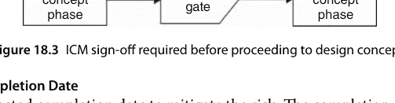

## Part IV

## 第四部分

## Reliability and Quality Process
for Product Development

## 产品开发的可靠性与质量流程

## 18

## 18

## Product Concept Phase

## 产品概念阶段

Product development begins with the concept phase. It consists of two parts, the product concept and design concept (discussed in Chapter 14). In the concept phase, a decision is made to develop a new product. During the concept phase marketing, engineering, operations, and field inputs yield product concept requirements. It does not matter if the product is a new platform or a derivative product; the process is the same. The concept phase is often conducted in a vacuum between senior engineering and marketing management. The decisions made during this time have a dramatic impact on the entire organization. It is in the concept phase that the product is defined on the basis of market needs, customer focus, product features, product cost, business fit, and product architecture. This may seem like a strange time to begin activities regarding product reliability because there's so little known about the actual product itself – after all, it is only a concept. No detailed design effort has started, so there's no work to be done on improving the design. The main reliability objectives in the concept phase are to form the reliability team, define the reliability process, establish product reliability requirements, and a first-pass risk assessment to conduct a Pareto study on previous reliability problems. These top reliability problems become design constraints for the design concept phase. A summary list of the reliability activities performed in the product concept phase along with the expected deliverables is shown in Table 18.1.

产品开发始于概念阶段。它包括两个部分，即产品概念和设计概念（见第 14 章讨论）。在概念阶段，会做出开发新产品的决定。在概念阶段，市场营销、工程、运营和现场的输入会产生产品概念需求。无论产品是新平台还是衍生产品，流程都相同。概念阶段通常在高级工程和市场营销管理之间在真空中进行。此期间做出的决策对整个组织都有巨大影响。产品是在概念阶段根据市场需求、客户关注点、产品特性、产品成本、业务契合度和产品架构来定义的。这似乎是开始进行产品可靠性活动的奇怪时机，因为对实际产品本身知之甚少——毕竟它只是一个概念。尚未开始详细设计工作，因此没有改进设计的工作可做。概念阶段的主要可靠性目标是组建可靠性团队、定义可靠性流程、建立产品可靠性要求，并进行一次风险评估以对以往的可靠性问题进行帕累托研究。这些主要可靠性问题成为设计概念阶段的设计约束。表 18.1 显示了在产品概念阶段执行的可靠性活动摘要以及预期的交付成果。

### 18.1 Reliability Activities in the Product Concept Phase

### 18.1 产品概念阶段的可靠性活动

During the concept phase, design decisions are made which may require new technologies, materials, and processes. The decisions made here can impose significant risk to the design, manufacturability and rampability, testability, serviceability, and product reliability. The product concept phase represents the first opportunity to identify significant risk, which can jeopardize the success of a program. The risk issues impact the entire organization. These issues need to be identified, agreed upon, and a risk resolution strategy (identify, communicate, and mitigate [ICM] plan) laid out. If the risk issues can be identified and agreed upon early in the program, the organization will have the needed time to plan and mitigate all significant risk before first customer ship. The product will be more reliable if the risk issues are resolved prior to product release.

在概念阶段，会做出可能需要新技术、材料和工艺的设计决策。这里做出的决策可能对设计、可制造性和爬坡能力、可测试性、可服务性和产品可靠性构成重大风险。产品概念阶段代表了识别可能危及项目成功的重大风险的第一个机会。风险问题影响整个组织。这些问题需要被识别、达成一致，并制定风险解决策略（识别、沟通和缓解 [ICM] 计划）。如果能在项目早期识别并就风险问题达成一致，组织将有足够的时间在首次客户发货前规划并缓解所有重大风险。如果在产品发布前解决风险问题，产品将更可靠。

### Table 18.1 Product concept phase reliability activities.

### 表 18.1 产品概念阶段可靠性活动。

| Participants | Reliability activities | Deliverables |
|---|---|---|
| • Marketing • Design engineering • Reliability engineering • Field support/service | 1. Form reliability organization and responsibility. 2. Define the reliability process. 3. Define product reliability requirements. 4. Capture and apply external lessons learned. 5. Develop risk mitigation form and have meeting to review each risk issue. | 1. Reliability team formed with agreement on the reliability activities. 2. Description of the reliability activities that will be performed. 3. Product level MTBF, mean time to repair (MTTR), availability defined. 4. Pareto top VOC reliability issues and recommendations. 5. Completed risk mitigation form and meeting results in acceptance of risk issues and planned mitigation. |
| • 市场营销 • 设计工程 • 可靠性工程 • 现场支持/服务 | 1. 组建可靠性组织和责任。 2. 定义可靠性流程。 3. 定义产品可靠性要求。 4. 捕获并应用外部经验教训。 5. 制定风险缓解表并召开会议审查每个风险问题。 | 1. 可靠性团队组建完成并就可靠性活动达成一致。 2. 将执行的可靠性活动的描述。 3. 产品级 MTBF、平均修复时间（MTTR）、可用性已定义。 4. 帕累托前列 VOC 可靠性问题及建议。 5. 完成的风险缓解表和会议结果导致风险问题被接受并计划缓解。 |

There are five major reliability activities that take place in the product concept phase. The five activities are the following:

产品概念阶段有五项主要可靠性活动。这五项活动如下：

+   1. 建立可靠性组织。
+   2. 定义可靠性流程。
+   3. 定义产品可靠性要求。
+   4. 捕获并应用经验教训。
+   5. 缓解风险。

### 18.2 Establish the Reliability Organization

### 18.2 建立可靠性组织

Every reliability effort requires staff to implement the reliability process. The reliability staffing may be small, and in many cases a single reliability engineer will suffice. There is no set rule as to how large the reliability team needs to be for success. Staffing the reliability team at 1% of the design team size is a good starting point. (The topic of staffing for reliability is covered in Chapter 11. Chapter 8 also addresses some of the problems with selecting the wrong individuals.)

每个可靠性工作都需要人员来实施可靠性流程。可靠性人员可能很少，在许多情况下一名可靠性工程师就足够了。没有固定的规则来确定可靠性团队需要多大才能成功。以设计团队规模的 1% 配置可靠性团队是一个良好的起点。（可靠性人员配置的主题在第 11 章中有所涉及。第 8 章也讨论了一些选择错误人员的问题。）

In forming the reliability team, selecting an individual who has strong leadership skills is the key. If the reliability program has been established, then selecting an individual with management or engineering skills will suffice. Small organizations may have only a single engineer supporting all the reliability activities. If you have a small organization, then select someone with good management skills.

在组建可靠性团队时，选择具有强大领导技能的个人是关键。如果可靠性计划已经建立，那么选择具有管理或工程技能的个人就足够了。小组织可能只有一名工程师支持所有可靠性活动。如果您有一个小型组织，那么选择具有良好管理技能的人。

Finally, the reliability workload is not constant in each phase of the product life cycle. The workload is small in the concept phase and reaches a peak in the design phase, when accelerated life and Highly Accelerated Life Testing (HALT) consume significant resources. In a high-quality organization, the reliability effort can transition to a quality effort in the design validation phase. Having quality and reliability teams

最后，可靠性工作量在产品生命周期的每个阶段并不恒定。工作量在概念阶段很小，并在设计阶段达到峰值，此时加速寿命和高度加速寿命测试（HALT）消耗大量资源。在高质量组织中，可靠性工作可以在设计验证阶段过渡到质量工作。拥有质量和可靠性团队

在设计验证期间共同参与可确保两个职能之间拥有共同的责任感、沟通和合作。让两个团队向同一位经理汇报工作将确保这两个团队之间不会形成障碍。
可靠性设计成员应具有扎实的专业技术背景，并具备产品设计的过往经验。质量团队的成员应具有扎实的制造、过程控制以及故障报告、分析和纠正措施系统（FRACAS）方面的专业技术背景。采用独立的团队是首选，因为很难找到在设计和制造两方面都具有丰富经验的个人。

## 18.3 定义可靠性流程

可靠性流程概述于第12章，并在本书的第四部分中详细阐述。使用详细的可靠性流程并根据自身具体需求进行调整。目标应是在前期定义流程，将其纳入产品开发计划中，并让所有人同意遵循该流程。一旦流程确定，应在概念阶段开展培训，以让所有人了解该流程。

## 18.4 定义产品可靠性要求

在产品概念阶段，一个重要的可靠性活动是设定产品可靠性要求。它应以市场为导向，并围绕目标客户需求展开。通常以平均故障间隔时间（MTBF）、可用性、可维修性和可维护性要求来描述。在设定系统级可靠性要求时，应考虑前一代产品的可靠性表现以及与主要竞争对手的对比情况（基准测试）。

在定义系统可靠性要求时，请问：

- 因产品可靠性不可接受而导致市场份额流失了吗？
- 如果产品可靠性提高，预计市场份额会增加多少？
- 产品可靠性改善后利润率可以提高多少？
- 客户对该产品的可靠性期望是什么？
- 客户愿意为提高的产品可靠性支付多少费用？

利用这些答案来更好地描述可靠性目标和[content]
在设计验证期间共同参与可确保两个职能之间拥有共同的责任感、沟通和合作。让两个团队向同一位经理汇报工作将确保这两个团队之间不会形成障碍。
可靠性设计成员应具有扎实的专业技术背景，并具备产品设计的过往经验。质量团队的成员应具有扎实的制造、过程控制以及故障报告、分析和纠正措施系统（FRACAS）方面的专业技术背景。采用独立的团队是首选，因为很难找到在设计和制造两方面都具有丰富经验的个人。

## 18.3 定义可靠性流程

可靠性流程概述于第12章，并在本书的第四部分中详细阐述。使用详细的可靠性流程并根据自身具体需求进行调整。目标应是在前期定义流程，将其纳入产品开发计划中，并让所有人同意遵循该流程。一旦流程确定，应在概念阶段开展培训，以让所有人了解该流程。

## 18.4 定义产品可靠性要求

在产品概念阶段，一个重要的可靠性活动是设定产品可靠性要求。它应以市场为导向，并围绕目标客户需求展开。通常以平均故障间隔时间（MTBF）、可用性、可维修性和可维护性要求来描述。在设定系统级可靠性要求时，应考虑前一代产品的可靠性表现以及与主要竞争对手的对比情况（基准测试）。

在定义系统可靠性要求时，请问：

- 因产品可靠性不可接受而导致市场份额流失了吗？
- 如果产品可靠性提高，预计市场份额会增加多少？
- 产品可靠性改善后利润率可以提高多少？
- 客户对该产品的可靠性期望是什么？
- 客户愿意为提高的产品可靠性支付多少费用？

利用这些答案来更好地描述可靠性目标和目标。

## 18.5 捕获并应用经验教训

在产品概念阶段，我们花时间反思以往项目中的可靠性问题。很难理解为什么公司会不断重复同样的错误。可靠性问题不断重现，即使将经验教训应用到新设计中相对容易。分布在全球各地的跨国大公司很难传达经验教训。公司规模越大，问题越大。因此，以往项目中出现的错误会不断重复，直到因客户极度不满或重大财务风险而获得高度关注。等到这种情况发生时，往往已经过去了数年，导致修复问题成为一场后勤噩梦。如果没有正式的流程来捕获、培训和应用经验教训，过去的可靠性问题将不断重复。这些经验教训应纳入可靠性设计（DFR）指南中。设计评审检查表是验证经验教训是否得到实施的另一种有效方法。解决方案必须成为捕获和实施经验教训的正式流程的一部分。

在产品概念阶段，最相关的经验教训是外部经验教训。（内部经验教训将在产品开发周期的设计概念阶段捕获和应用。）

在捕获外部经验教训时，应重点关注四个方面，具体如下：

- 1. 开展外部客户之声（VOC）。这里的客户是指终端用户、产品支持团队以及从事产品维修和保养的人员。
- 2. 审查 FRACAS 报告，然后对现场故障进行帕累托分析。
- 3. 确定过去的产品召回和安全警告。
- 4. 审查客户投诉档案。

针对以往产品的可靠性问题开展外部 VOC。重点围绕产品可靠性、可维修性和维护问题展开。这可以通过面对面访谈、电话调查、邮件问卷或互联网进行。某些方法可能比其他方法更有效，可能需要进行试验以确定最佳方法。聘请第三方进行此项活动可能是一个好主意，因为内部人员可能无法察觉到每一条投诉。不管选择哪种方法，都应保持调查的客观性，并为所有受访者使用相同的问卷。可以使用加权机制来区分客户对问题的重视程度，从而为每个问题关联有意义的优先级。在内部和外部对问卷进行预测试，以确保语言、权重尺度和每个问题的意图没有歧义。一旦收集到数据，应对结果进行汇总，以确定概念阶段文档中必须包含哪些可靠性问题。

另一个捕获经验教训的来源是 FRACAS 数据库。FRACAS 跟踪现场故障，按严重程度和发生频率进行排序，记录根本原因并跟踪解决措施的有效性。了解每个故障相关的根本原因非常重要。如果尚未确定根本原因，则可能需要在完成设计阶段前启动活动以确定根本原因。如果无法确定根本原因，则无法保证问题不会在下一代产品中再次出现。

每个组织面临的一个重大挑战是确定故障的根本原因。其原因之一是许多组织缺乏将复杂故障与根本原因联系起来的技术技能和专业知识。找到根本原因需要理解故障背后的物理原理。一旦确定了故障的根本原因，纠正问题就变得容易。如果未识别出根本原因，修复措施可能会纠正一个不存在的问题，而问题将在未来再次出现。

用于确定故障根本原因的一种技术是“5 个为什么”，（之前在第 10 章第 10.2 节中讨论过）。为说明这一点，考虑一个标准手电筒，在打开时不发光。问题追溯到灯泡未获得所需的电池电压。问题进一步追溯到电池电压与弹簧之间没有良好的电气接触。此时，很难确定问题的根本原因。问题可能是弹簧腐蚀、弹簧不正确或太弱、弹簧未正确安装、弹簧材料电阻过大、电池触点污染或电池接触不良。

于是我们第二次提问：“为什么电池和弹簧之间接触不良？” 这个问题的答案是弹簧松动。弹簧松动的原因有很多：例如，可能是由于弹簧批次不良、安装了错误的弹簧、弹簧安装不当、固定弹簧的卡扣损坏等。

于是我们第三次提问：“为什么弹簧松动？” 这次我们发现安装了错误的弹簧。此时我们似乎找到了问题的根本原因，但我们不知道为什么会安装错误的弹簧。安装错误弹簧的原因可能有：物料清单错误、从仓库中取出错误的弹簧、供应商错误标记弹簧或订购了错误的弹簧。由于仍有未解答的问题，我们尚未达到问题的根本原因。

于是我们第四次提问：“为什么安装了错误的弹簧？” 这次我们发现采购订购了错误的弹簧。随着你不断剥离洋葱的每一层，你会更接近问题的根本原因。然而，直到你理解采购为何订购错误的弹簧，你才算真正找到了问题的根本原因。

于是我们最后一次提问：“采购为何订购错误的弹簧？” 这次你发现装配所需的弹簧缺货，而经销商建议购买一个等效弹簧。该弹簧最终证明并非等效。现在你已经找到了问题的根本原因，可以开始探索永久性纠正问题的解决方案。例如，工程部门必须批准所有零件替换，制造部门必须在替代零件投入使用前对其进行测试以验证其符合性。由于采购人员被告知该弹簧是等效零件，工程部门也可能犯同样的错误。为防止未来再次发生，所有替代零件必须在投入生产线使用前在系统中得到验证。你也可以使用 HALT 来评估替代零件的适用性。（在紧张的情况下，你可能仍需订购替代组件以满足生产计划，但对替代组件的评估必须在将其投入生产线之前完成。）

最后，确定过去的客户投诉、安全警告和产品召回以及每个问题相关的根本原因。按严重程度和发生频率对列表进行帕累托分析。

将过去问题的所有经验教训合并成一个按严重程度的帕累托图。该列表将在设计概念阶段用于说明新产品中将如何避免重复过去的问题。

## 18.6 缓解风险

在第 5 章中，我们介绍了一种管理产品开发中固有风险问题的方法。技术、组件、工艺、供应商和安全都是可能存在重大可靠性风险的领域。如果这些问题得不到解决，它们很可能会在以后以制造、测试或客户发现的可靠性问题形式出现。消除这一问题的最佳方式是通过风险缓解。风险缓解计划不仅能消除设计中的可靠性问题，还能防止因开发周期后期需要重新设计而导致的产品开发延迟。

在第 5 章中，我们还展示了如何捕获和记录风险问题。所有职能部门都有责任制定风险缓解计划。初始风险缓解计划在产品概念阶段制定。缓解计划在产品开发周期的每个阶段都会更新，以反映风险缓解的进展并增加新发现的风险问题。在产品概念阶段结束之前，会安排一次会议让所有职能部门汇报其风险问题。该会议是一个正式的活动，即风险缓解会议，是产品开发流程的一部分。

风险缓解会议旨在审查重大风险问题，并就缓解这些问题的风险、成本和资源达成一致；并且在向客户发货前有足够的时间进行缓解。产品概念阶段的开发成本很小，而在设计阶段会显著增加。风险缓解会议是管理层判断项目是否应获得资金进入下一阶段，还是因风险问题不太可能在满足产品市场窗口的时间内得到解决而被取消的有用方式。据经验，有多少产品在完成前被取消了？它们是因为进度太落后、成本过高或技术问题未解决而被取消的吗？这些项目在产品开发周期的哪个阶段被取消？通常是在开发计划后期，在开发预算已超支且仍有一系列设计问题需要解决之后。那些几乎没有希望解决关键风险问题的项目会在项目早期被识别，并在浪费大量资本和人力资源之前就被终止。如果该项目对业务成功至关重要，则可以分配资源来确定问题的根源并提出补救建议。

在产品概念阶段接近尾声时计划风险缓解会议。如果只有两个部门参与产品概念，即市场营销和工程，那么会议会很短。然而，正如我们在表 18.1 中所示，尽可能多地纳入职能部门是一个好主意。特别是可靠性、客户服务/客户支持、制造和测试应纳入概念阶段风险缓解会议。至少在风险缓解会议前一周，应整理一份风险缓解资料包，其中包含参与职能部门识别出的风险问题。如果信息能提前传阅，让各组织有足够时间审查问题、理解问题并在缓解会议前讨论，会议将进行得更顺利。资料包应包括会议中将要展示的所有材料。产品概念阶段风险缓解表单的示例见图 18.1。通过在产品概念阶段开始风险缓解，您将显著提高产品按时、按预算开发的可能性。

日期：07/01/2001
产品名称：
负责人：Mr. Jones

## 可靠性 ICM – 产品概念阶段

| 项目编号 | 识别与分析风险 | 风险严重程度 | 风险识别日期 | 风险接受 Y/N | 高层缓解计划 | 所需资源 | 完成日期 | 成功指标 | 调查替代解决方案？ |
|---|---|---|---|---|---|---|---|---|---|
| 1 |  |  |  |  |  |  |  |  |  |
| 2 |  |  |  |  |  |  |  |  |  |
| 3 |  |  |  |  |  |  |  |  |  |
| 4 |  |  |  |  |  |  |  |  |  |
| 5 |  |  |  |  |  |  |  |  |  |
| 6 |  |  |  |  |  |  |  |  |  |
| 7 |  |  |  |  |  |  |  |  |  |
| 8 |  |  |  |  |  |  |  |  |  |

风险缓解签署：

图 18.1 产品概念阶段风险缓解表单。

### 18.6.1 填写风险缓解表单

风险缓解表单有九个部分。我们尝试过更简单的版本，但最终总是回到这种更详细的程度。填写表单的详细说明如下。

### 18.6.1.1 识别与分析风险

调查风险有两个部分：识别风险和分析风险。第一部分，识别风险问题，通常是最困难的。在项目如此早期的阶段确定风险问题可能是一个真正的挑战。产品概念阶段的风险问题将与技术和可靠性相关。由于设计尚未开始，风险问题可能很少且不详细。以下问题可以帮助您识别产品概念风险问题：

寻找技术风险问题的地方：
- 是否需要新技术？
- 是否有处于技术前沿、尖端或领先边缘的新技术？
- 是否需要针对该技术的新工艺（制造、返工和测试）？
- 是否几乎没有或没有关于这些技术的公开信息？
- 是否只有一家供应商提供这种新技术？
- 这种新技术是否尚未商业化？
- 任何对项目成功至关重要的问题？

寻找可靠性风险问题的地方：
- FRACAS 报告和过去项目经验教训的帕累托图
- 外部 VOC 的结果
- 过去产品召回和安全警告的文件

图 18.3 在进入设计概念前需要 ICM 签署。

### 18.6.1.7 完成日期

输入缓解风险的预期完成日期。完成日期必须支持首次客户发货日期。注意该日期是否已推迟，特别是如果已多次推迟。这是一个强有力的迹象，表明风险很高和/或缓解风险的资源不足。

### 18.6.1.8 成功指标

成功指标是缓解风险中最重要且经常被忽视的因素之一。风险缓解活动往往在没有明确成功所需结果的方向下启动。这常常导致做得过多或做错活动来缓解风险。通过明确定义成功指标，负责缓解风险的团队将专注于支持成功指标的活动。通过让其他职能部门在前期就同意成功指标，后续在产品开发中不会出现脱节。

### 18.6.1.9 调查替代解决方案

对于任何在关键路径上对项目成功至关重要的风险，或风险等级在 8 到 10 之间（红色高等级）的风险，都应制定应急计划来缓解风险。通常，应急计划会对产品设计或产品交付日期产生重大影响。因此，确定何时需要做出启动应急计划活动的决定非常重要。

### 18.6.2 风险缓解会议

在进入设计概念阶段之前进行的最后活动是风险缓解会议，在该会议上审查所有风险问题。在风险缓解会议中，每个部门都会汇报其风险问题，其目标是实现以下结果：
- 1. 沟通所有重大的技术风险问题
- 2. 就风险问题的严重程度达成一致
- 3. 就缓解风险问题的策略达成一致
- 4. 就风险缓解成功的指标达成一致
- 5. 就所需资源和缓解风险的资源可用性达成一致
- 6. 就缓解风险所需的时间表达成一致
- 7. 就风险的必要性及/或是否需要追求替代解决方案达成一致

风险缓解会议要求对每个风险问题进行签署。通过要求对每个问题进行签署，ICM 流程就像一个项目门控，只有在风险问题可控时项目才会继续进行（图 18.3）。下一阶段开发的资本和人员形式的项目资金取决于高级管理层对风险问题的签署。

