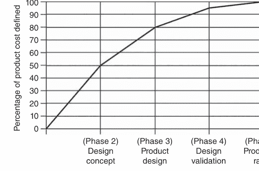
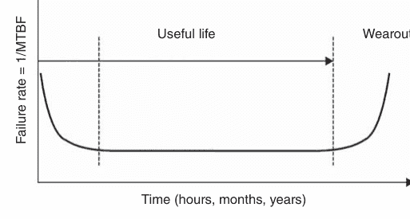
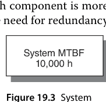
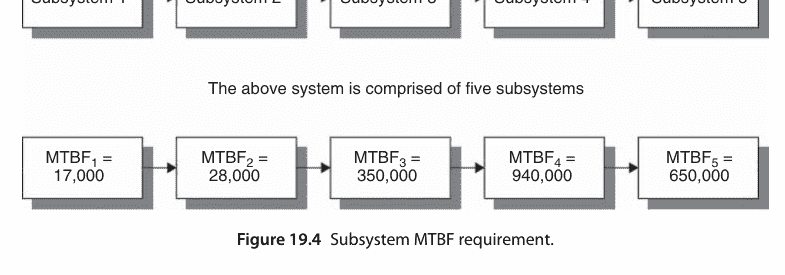
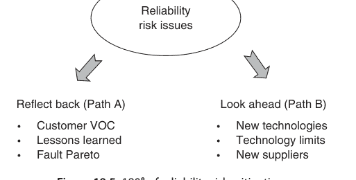
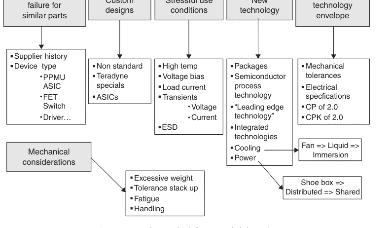
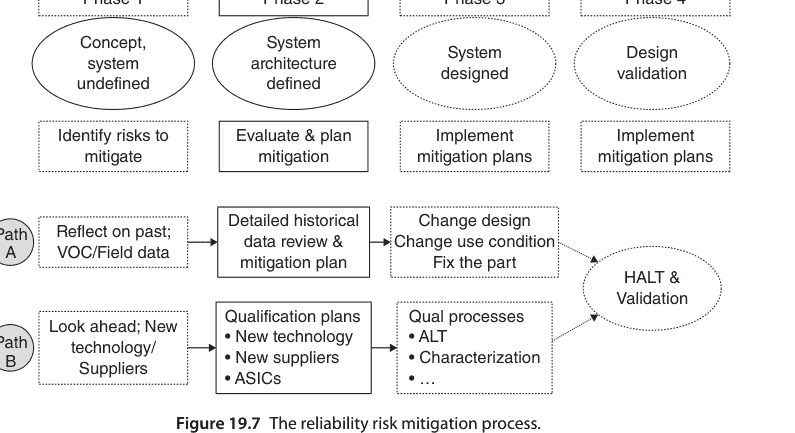
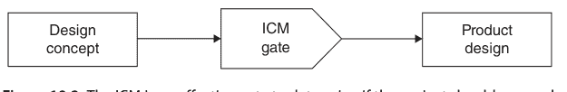

## 设计概念阶段

此前，在产品概念阶段，产品需求是基于市场驱动的产品特性来定义的——成本、预测需求、目标客户以及业务契合度。这就是我们产生一套设计需求的地方，并且可能包括高层系统架构。一旦这些产品需求被定义，就必须开发一个设计概念来满足这些需求。设计概念阶段使用产品需求来开发更低层的设计架构。设计概念阶段完成后，外形尺寸、重量、输入输出（I/O）、功率、冷却等的规格就确定了。

## 19.1 设计概念阶段的可靠性活动

在设计概念中做出的决策决定了设计产品所需使用何种类型的组件、材料和技术。这些决策对产品的成本、开发时间、设计复杂性、可制造性、可测试性、可维修性和可靠性有重大影响。设计概念阶段完成后，约有一半的产品成本已确定（见图 19.1）。产品成本是盈利能力的重要因素。这就是设计概念阶段用于确保产品成本目标可实现的地方。

设计概念阶段进行五项可靠性活动：

- 1. 为子系统和板级装配设定可靠性要求和预算。
- 2. 定义可靠性设计指南。
- 3. 修订风险缓解。
- 4. 安排可靠性活动和资本预算（可靠性活动纳入项目开发计划）。
- 5. 决定风险缓解签署日。

这些步骤在表 19.1 中有更详细的说明。遵循这些步骤后，团队应反思哪些做法有效（哪些无效）。

产品概念团队通常仍然很小，由市场、工程和可靠性部门的关键设计人员组成。到目前为止投入的开发成本和人员资源也相对较小。一旦产品从概念阶段进入设计阶段，所需要的人员和资本资源就会大幅增加。由于设计阶段需要投入大量的人员和资本资源，因此必须对开发计划的成功有高度的信心。

Improving Product Reliability and Software Quality: Strategies, Tools, Process and Implementation, Second Edition. Mark A. Levin, Ted T. Kalal and Jonathan Rodin.
© 2019 John Wiley & Sons Ltd. Published 2019 by John Wiley & Sons Ltd.



## 图 19.1 影响产品成本的机会。

## 表 19.1 设计概念阶段可靠性活动。

| 参与者 | 设计概念阶段 |  |
|---|---|---|
|  | 可靠性活动 | 交付物 |
| • 可靠性工程
• 市场营销
• 设计工程（电气、机械、软件、热等）
• 制造工程
• 测试工程
• 现场服务/客户支持
• 采购/供应管理
• 安全和法规人员 | 1. 定义更低层级的可靠性设计目标。
2. 定义可靠性设计规则。
3. 修订风险缓解。包括内部可靠性 VOC（制造和测试）和新技术问题。
4. 可靠性预算（资本和人员）以及可靠性活动纳入项目开发计划。
5. 审查状态并就每个风险问题和缓解计划达成一致。风险缓解会议。 | 1. 子系统和板级可靠性预算（MTBF）、服务和维修要求（MTTR 和可用性）、以及产品使用寿命和使用环境。
2. 识别 DFR、DFM、DFT、DFS 等的指南要求。
3. Pareto 顶部可靠性问题及建议。风险缓解计划更新变更。
4. 可靠性费用已预算，可靠性活动（风险缓解、FMEA、HALT、HASS）已安排进项目时间线。
5. 风险缓解会议并同意进入下一阶段。 |

注：DFM：可制造性设计；DFR：可靠性设计；DFS：可服务性设计（和可维护性）；DFT：可测试性设计；FMEA：失效模式和影响分析；HALT：高加速寿命试验；HASS：高加速应力筛选；MTBF：平均故障间隔时间；MTTR：平均修复时间；VOC：客户之声。

设计概念阶段的可靠性活动主要侧重于捕捉可能使开发计划脱轨的风险问题。通过捕捉这些问题并制定缓解计划，可以在产品概念阶段结束时评估是否继续进行产品设计，或在关键风险问题得到解决前暂停其进展。

## 19.2 设定可靠性要求和预算

产品从产品概念过渡到设计概念后，可靠性团队必须提供可靠性设计要求的指导。这些要求可能包括以下内容：

- 1. 产品使用环境
- 2. 产品使用寿命
- 3. 子系统和印刷电路板装配（PCBA）可靠性预算
- 4. 服务和维修

### 19.2.1 产品使用环境要求

客户使用环境是针对典型客户或客户使用的极端情况来定义的。设定针对典型客户的要求将优化产品成本以实现最优设计。然而，这可能会导致在环境极端条件下运行的客户出现更高的故障率。为客户使用的极端情况设计将导致产品更复杂且成本更高，但可靠性会更高（这在高可靠性军用产品中很明显）。产品可能拥有更大的潜在市场，但会以溢价出售。这种更高的产品价格会影响销售。最好为最优客户群设计产品，通常称为市场的“甜点”。一旦环境确定，这些要求就成为产品的环境规范。

环境要求包括运行和非运行规范。非运行要求考虑存储和运输。一些运输和装运环境问题如下：

- 1. 如果产品出口海外，它是否会暴露于盐雾中，以及持续多久？产品将在装卸码头停留多长时间？它是否会暴露于雨、雪、冰雹或灰尘中？空运可以避免许多这些问题。
- 2. 产品将暴露于何种类型的振动冲击水平和振动频率谱？研究运输环境以设计适当的运输容器/方法可以避免所谓的“到货即死”或客户投诉的开箱即坏故障。
- 3. 产品将在何种环境中存储？它是否会被运往沙漠地区，货物温度可能过高？它是否会存放在潮湿的气候中？它可以在这些环境中存储多长时间？

运行限制是为产品预期正常运行的环境定义的。运行限制可能包括工作温度范围、振动范围和频率谱、运行周期、线路电压/频率变化、跌落或冲击测试、潮湿暴露或浸水测试、腐蚀性环境等。一旦定义，就可制定测试计划来验证设计。



图 19.2 浴盆曲线。

### 19.2.2 产品使用寿命要求

定义产品的使用寿命要求非常重要。使用寿命是指故障率从随机事件转变为基于正常磨损的可预测事件的时间段（见图 19.2）。大多数产品开发在进行时都没有关于产品所需使用寿命的任何指导。如果一开始没有定义，设计团队之间对使用寿命要求会有不同的看法。磨损的常见例子是寿命为 2,000 小时的灯泡。2,000 小时定义了灯泡的使用寿命。它可以轻松重复，如果对足够大的样本进行测试，每次都会得到类似的结果。

使用寿命设计要求很重要，因为它们影响设计成本、架构和复杂性。设定要求过于严格会使产品成本更高并延长设计开发时间。这些要求也是正确选择设计中组件所必需的。要求由市场驱动，由市场研究支持，并特定于正在开发的产品。使用寿命要求可以设计为满足客户市场的甜点，或为预期客户使用的极端情况设计。

产品的寿命通常由一定量的客户使用时间来定义。产品开发团队可能会以年为单位定义系统运行使用寿命，例如七年。

同一产品的寿命可以用不同方式定义。定义使用寿命要求的一些方式是

- 最小无故障配合次数（连接器、可拆卸配件等）
- 最小开/关次数（继电器、硬盘、润滑轴承等）
- 最小运行小时数（风扇和电机、泵、密封件、过滤器等）

这些其他要求与系统要求相关。尽管定义方式不同，但不同使用寿命要求之间仍有一致性


不同。考虑一个使用寿命为七年的产品。该产品有一个可拆卸的附件，市场研究预计该附件每周会被拆卸五次。此附件的使用寿命可以为其定义一个最小的无故障啮合次数。在这种情况下，其计算为：

Cycles (min) = (7 years) × (52 weeks/year) × (5 cycles/week) = 1,820 cycles

一旦这些要求被定义，下一步的任务就是验证到组件级别，确保每个部件都符合使用寿命要求。这看起来可能是一项令人望而生畏的任务，但事实并非如此。许多组件将按其器件和组件封装类型进行分组和评估。例如，所有碳膜贴片电阻都可以按封装类型分组（即 0805、0603、0402 等）。一些组件制造商会指定使用寿命。零件的使用寿命通常是其环境和使用条件的功能。例如，电解电容器制造商会指定其电容器在特定温度下的最大使用寿命，即在 105 °C 下为 2,000 小时。产品的运行温度可能只有 55 °C。这将增加电容器的预期使用寿命。对于许多电解电容器，有一个经验法则，即每降低 10°C 温度，使用寿命就会翻倍。因此，我们应预期电容器的使用寿命会延长至 64,000 小时。

那些在产品使用寿命到来之前就会磨损的组件需要设计为可维护和可维修。通过提前设定要求，就有一个流程来捕获和解决那些不符合客户预期寿命要求的组件。将产品寿命结束前就会磨损的部件设计为易于更换，将有助于降低维修成本并提高客户满意度。

## 19.2.3 子系统和印刷电路板组件（PCBA）可靠性预算

在前一阶段，系统可靠性要求已定义。例如，系统需要具有 10 000 MTBF（平均故障间隔时间）。在设计概念阶段，系统可靠性预算会细化到子系统和电路板级别。可靠性预算不会定义到组件级别，原因有几个。首先，在设计概念阶段，用于设计产品的组件仅部分已知。其次，更重要的是，可靠性预算的目的之一是为设计团队在开始设计子系统、电路板和接口时提供指导。可靠性预算用于识别可靠性风险问题。由于资源和时间有限，可靠性预算可以引导可靠性活动朝对产品最有益的方向进行。可靠性预算还可以提供关于哪个组件更适合实现可靠性目标的指导，以及确定是否需要冗余以提高可靠性的需求。

系统可靠性要求已在产品概念阶段定义；图 19.3 显示了系统可靠性预算示例。系统可靠性预算还可以包括平均维修时间、可维修性、可用性和产品寿命要求等要求。一旦架构



被定义，为构成系统或产品的全部子系统、电路板和机械组件分配可靠性预算。所有子系统可靠性预算的总和必须等于之前定义的系统可靠性。

如果可靠性以 MTBF（以小时为单位）定义，则将每个 MTBF 的倒数相加。每个子系统的 MTBF 预算数字不能直接相加。如果子系统的可靠性以 FIT（每十亿小时的故障数）定义，则可以直接相加以确定等效系统 FIT 率。FIT 数字可以通过取 FIT 数字的倒数并乘以十亿来转换为 MTBF，从而得到以小时为单位的 MTBF 数字。

```
MTBF = (1 / FIT) × (1 × 10⁹)
```

图 19.4 显示了子系统 MTBF 预算如何相加以等于系统可靠性预算的示例。假设您正在进行一项新产品开发，其系统可靠性预算（以 MTBF 表示）在产品概念阶段被定义为 10,000 小时。在设计概念阶段，系统架构显示系统由五个主要子系统组成。可靠性组织随后被要求为这五个主要子系统定义 MTBF 预算。MTBF 预算代表可靠性对不同子系统 MTBF 要求所需值的最佳估计。如果该产品是一个完全新产品，则可靠性预算可能只是对每个不同子系统的有根据的猜测。然而，如果新产品与以前的产品有许多相似之处，就有一个关于以前产品可靠性的知识数据库，可细分为其子系统直至板级。故障报告、分析和纠正措施系统（FRACAS）将包含有关以前产品可靠性的信息，可细分为其系统和子系统组件。要了解有关 MTBF 的更多信息，请参阅第 6 章和附录 B。

System MTBF

```
= 1 / ( (1 / MTBF₁) + (1 / MTBF₂) + (1 / MTBF₃) + (1 / MTBF₄) + (1 / MTBF₅) )
```

```
= 1 / ( (1 / 17,000) + (1 / 28,000) + (1 / 350,000) + (1 / 940,000) + (1 / 650,000) )
```

```
= 10,000
```

如何确定预算数字？最好的方法是回顾类似子组件的过去性能、导致该性能的关键因素，以及如果在新产品中消除这些问题所期望的结果。

第一次设定可靠性预算（针对每个子系统）总是会最困难。随着每个新项目，它会变得更容易。这是因为您可以利用之前项目的经验教训，并对子系统和电路板级别的可靠性预算应为多少有更好的了解。附录 B 更详细地讨论了 MTBF 计算。



## 图 19.4 子系统 MTBF 要求。

## 19.2.4 维修和服务要求

维修和服务要求可以简单到允许更换故障设备所需的最大时间。它还可以包括关于在正常使用期间预期被更换的设备的模块化性的声明。更换期间是否可以使用专用工具或设备？最好将正常维修所需的专用工具和设备的需求设计掉。最后，是否会有任何要求以防止更换部件的错误安装或对齐？

## 19.3 定义可靠性设计指南

可靠性人员负责确保新设计是可靠的。然而，可靠性工程师并不设计产品。设计师才设计。因此，设计团队拥有他们可以遵循的设计规则集，以便为可靠产品做出正确决策非常重要。这可以通过一套产品可靠性的设计规则来实现。这些规则被称为产品设计的可靠性设计（DFR）指南。遵守 DFR 指南应是设计概念阶段达成一致的要求之一。DFR 指南帮助设计师做出正确的决策。这些指南是广泛的，涵盖产品设计的各个方面。它们必须纳入之前项目中获得的所有可靠性经验教训。DFR 指南应成为设计检查清单或用于确保设计已准备好投入制造的其他类似手段的一部分。可靠性设计规则会随着新问题、新技术和新能力而随时间变化。将这些变化传达给设计团队的最佳方式是通过定期为组织提供 DFR 课程。提供培训课程作为讨论新的可靠性指南、之前指南的变更以及征求反馈的机会，了解这些指南将如何影响设计工程。利用培训机会来发现 DFR 指南是否存在差距，或可靠性设计问题是否未被应用。

DFR 指南应易于设计团队访问。实现此目的的一种方法是将其放在公司内联网上，以便随时访问。将指南放在内联网上使设计团队能够在无需可靠性人员参与每个问题的情况下做出正确的决策。每条可靠性指南都应清晰具体地说明问题。DFR 指南不应过于笼统而无法在设计中应用。指南应说明条件


在可靠性是一个关注点的地方。每条 DFR 指南都应定义其对产品可靠性的影响。最后，每条指南都应指出通过降额或降低工作温度等方法来提高可靠性的方法等等。每条 DFR 指南都应包含建议的替代方案。（提供不要做什么的做法是好的；同时提供替代解决方案则更好。）

## 19.4 修订风险缓解

识别、沟通和缓解（ICM）流程在产品开发的每个阶段重复进行，以识别新的风险问题并报告上一阶段风险缓解进展的状态。在产品概念阶段，对产品的设计知之甚少。正因如此，所识别的风险问题大多以客户为中心。在设计概念阶段，有关该设计结构将是什么样子的细节开始显现。随着关于产品设计的更多细节开始形成，新的风险问题将会出现。因此，风险缓解流程在设计概念阶段重复进行。

如果这些新的风险问题得不到解决，将会导致产品导入出现重大延迟。延迟的原因是，如果风险问题未得到解决，它们将在项目后期浮现，需要解决。项目后期解决风险问题，对项目的影响就越显著。在原型中发现重大问题会造成成本高昂并延迟产品发布，因为重新设计和实施修复需要时间。理想情况下，风险问题应在设计验证之前被识别并得到缓解。

### 19.4.1 识别风险问题

风险缓解需要 180° 的方法。风险问题可以通过回顾过去的问题并向前看以了解哪些新问题构成重大风险来找到（图 19.5）。在产品概念阶段，我们回顾了外部经验教训。在该阶段我们捕获了来自客户反馈、FRACAS、投诉文件、产品召回和安全警告的经验教训。使用帕累托图，识别出主要问题并转移到风险缓解计划中。这些问题随后被插入到高层风险缓解计划中并被跟踪至关闭。



这些风险问题是过去的经验教训。捕获这些问题、制定缓解计划并跟踪这些计划的进展情况的过程就是风险缓解。将外部经验教训纳入概念需求将有助于确保它们不会重演。

回顾时，外部经验教训被捕获到产品概念中。在本阶段我们捕获来自制造、测试、设计和可靠性的内部经验教训。内部经验教训作为新的风险问题被添加到风险缓解计划中。

### 19.4.2 回顾过去（捕获内部经验教训）

回顾过去最有效的方法是通过回顾（希望是）有记录的过去经验教训。如果没有机制来捕获过去的经验教训，你可以预期会不断重复同样的错误。这在产品爬坡、为满足需求而增加人员的增长阶段尤其如此。对上一项目经验教训的全面回顾包括检查出了什么问题、什么不起作用以及什么运作良好。这是在产品概念阶段执行的相同活动，只是它侧重于识别内部经验教训。捕获内部经验教训时应关注四个领域。四个经验教训来自：

- 1. 制造和返工
- 2. 测试
- 3. 元器件和供应商问题
- 4. 可靠性

捕获来自以前项目的经验教训的最佳方式是在其达到批量生产一年后记录过去项目的问题。每个职能部门都应负责记录在产品开发、早期生产和产品爬坡期间重大的问题。在产品投产期间捕获影响项目的問題，可以最大限度地减少人们随着时间推移忘记事情或已离职人员的影響。在文档中具体说明问题的影響。问题可能导致测试中首次通过率低；包含预期产量和实际产量有助于量化问题的严重程度。定义产量的常见方式是每百万件缺陷数（PPM）和过程控制图。为测试和过程控制设定所需的 PPM 率和生产控制限值将有助于在生产早期识别问题。如果贵公司有内部网，则可以发布以前项目的经验教训并供所有人使用。

### 19.4.3 向前看（捕获新的风险问题）

未知中也存在风险（图 19.5）。向前看是用于识别新的风险问题的方法，通常基于过去的经验。例如，如果专用集成电路（ASIC）有设计相关故障的历史，则 ASIC 应成为风险缓解问题。向前看需要识别技术、供应商、制造、测试和设计问题，这些问题会带来独特且难以解决的挑战。这些风险问题如果未得到缓解，很可能会在以后表现为可靠性问题（图 19.6）。



图 19.6 寻找新的可靠性风险的位置。

以下问题将有助于识别新的风险问题：

## 寻找设计风险的位置

- 是否需要新技术？
- 是否使用新的元器件封装？
- 设计的任何方面是否接近或超过技术极限？
- 是否需要复杂的 ASIC 或混合电路？
- 哪些部件是定制的或非标准的？
- 你是否会接近或超过任何元器件、封装或设计的应力极限？
- 是否有严格的电气规格？
- 是否有严格的机械公差和公差累积？
- 重量过大是否是一个问题？
- 是否存在材料不匹配或不兼容问题？
- 是否存在腐蚀或其他化学反应问题？
- 是否存在独特的热问题？
- 是否有任何元器件过早磨损的担忧？
- 类似部件或器件类型是否有问题历史？
- 是否有元器件的静电放电（ESD）敏感性超过能力？根据使用条件，应考虑三种 ESD 模型（人体模型、机器模型和带电器件模型）。
- 元器件数量是否超过能力？

## 寻找制造风险的位置

- 是否需要新工艺？
- 是否需要新封装？
- 是否有高引脚密度部件超过现有工艺能力？
- 新设计是否推动了制造能力的现有极限？
- 元器件数量是否超过制造能力？
- 设计是否需要高部件密度（每平方英寸部件数）？
- 是否会有任何特殊处理要求或担忧？
- 是否有需要小封装尺寸的新元器件超过现有能力？
- 是否有需要大封装的新元器件超过现有能力？
- 是否有需要重封装的新元器件超过现有能力？
- 是否有需要高缺陷机会数（DPMO）封装的新元器件超过现有能力？

## 寻找供应商风险的位置

- 是否有新的定制部件带来特殊风险？
- 新设计是否需要超过现有供应商极限的印刷电路板（PCB）技术（例如尺寸、重量、线宽和间距、走线层数、芯材尺寸、铜箔重量、材料选择和材料兼容性）？
- 拟议供应商中是否有问题历史？
- 新设计是否需要供应商资格认证？
- 供应商规模小是否会带来特殊风险问题（供应能力、财务稳定性等）？
- 是否有任何关键元器件无法双源供应？

## 寻找测试风险的位置

- 是否有因访问限制而无法测试的新元器件或新封装？
- 高引脚数/密度的元器件封装是否带来特殊测试挑战？
- 产品是否推动了测试能力的极限？
- PCB 部件数量是否高到超过测试节点能力？
- 新元器件封装是否太小而无法探针测试？
- 是否有因访问问题而无法测试的新元器件封装？
- 是否有混合电路或其他无法完全测试的部件？
- 是否有 PPM 率高的部件会导致首次通过率低？

使用风险缓解工具有效地捕获风险问题并分配数值以识别风险的严重程度。每个风险问题都被分配一个数字，表示风险严重程度的程度。严重程度排名最高的风险问题需要首先解决。所有高风险问题都应在首次原型之前无法解决时制定替代解决方案的计划。这些风险问题将对实现上市时间目标的能力产生重大影响。如果这些风险问题得不到解决，一旦产品进入全面生产，很可能会再次表现为可靠性问题。

一旦团队同意这些风险问题是必要的，就会制定风险缓解计划，并设定时间表来定义风险将被缓解的时间。最后，风险缓解计划确定将用于确定风险问题成功缓解的指标。定义成功风险缓解的指标经常被忽视。


太多程序在解决问题的过程中耗费了大量时间和资源。用于解决风险问题的各项工作往往做得很好，但却没有围绕风险缓解所需的重点展开。换句话说，虽然进行了大量的测试和分析，但由于没有围绕问题陈述和成功指标展开，问题并未得到纠正。通过明确定义实现成功风险缓解所需的条件，问题陈述更容易得到解决。

确保在设计阶段尽早识别所有风险问题的一种方法是召开跨职能风险缓解会议，审查设计概念并识别风险关注点。风险缓解流程在设计概念阶段早期就开始，通过启动会议讨论设计概念并征求跨职能团队的反馈。然后，各职能组有责任开始记录和跟踪风险问题。在设计概念阶段定期，跨职能团队应召开会议讨论风险问题的状态，识别新问题，并讨论替代解决方案。

## 19.5 安排可靠性活动和资本预算

可靠性中经常被忽视的一项活动是需要提前进行的规划。规划至关重要。通过将可靠性活动安排到项目时间表中，可以避免诸如“这些可靠性活动会让我们无法满足市场窗口”、“我无法腾出你需要的资源，因为每个人都在处理关键路径上的项目”、“项目进行到现在已经太晚了，无法修复我们发现的任何问题。早在项目初期就做这个就好了”之类的常见争论。没有借口不将这些活动纳入项目时间表。安排日程可确保这些活动在产品开发周期的适当阶段进行，而不是产品投产时。你可以确信，产品投产后从高度加速寿命试验（HALT）和失效模式及影响分析（FMEA）中发现的任何问题，几乎肯定不会得到实施。

将可靠性活动安排到项目时间表中也证实了管理层对这些活动的承诺，以及这些活动对项目的重要性。参与不是可选项。典型的 FMEA 完成需要半周到一整周的时间。这不包括修复发现问题所需的时间。为此活动安排一周时间通常就足够了。复杂系统应分解为较小的部分，以便在一周内完成。请记住，这是一项并行活动，需要其他职能组将其安排到其项目时间表中。

即使由外部供应商执行，也应规划和安排 FMEA。由外部供应商采购的子系统和定制设计零件也需要进行 FMEA。FMEA 应是供应商和客户之间的联合工作。如果外部供应商不熟悉 FMEA，则必须额外分配时间进行培训。培训可以一次性在开始时进行，也可以在三个主要部分（功能框图、故障树和 FMEA 表格）之前进行。如果供应商距离很远，参与者不可能全部在同一房间进行 FMEA 并非实际操作。我们曾使用 Microsoft NetMeeting® 将不同设施连接起来并保持每个人专注，取得了显著成功。可能会出现计算机防火墙问题需要解决，但该流程可与远程站点非常有效地执行。

另一项必须安排的重要活动是 HALT。为每个子组件的 HALT 活动预留一到两周时间。通常会进行第二次 HALT 测试，以验证设计修复并确保设计改进不会在产品中引入新的失效模式。HALT 安排至关重要，因为在进行 HALT 测试之前需要进行许多活动。HALT 需要大量的前期准备。在进行 HALT 测试之前，需要以下事项：

- HALT 测试计划
- 应力量级限制
- 机械夹具
- 输入/输出电缆
- 仪器仪表
- 测试软件就绪
- 产品测试硬件已构建并调试
- 已确定 HALT 团队（团队必须在 HALT 测试期间在场，随着测试的进行以实现最佳效率）

这些活动通常在实际 HALT 测试前数月就开始进行。足够提前安排这些活动可确保在测试硬件时做好准备。最后一刻的计划保证了启动缓慢、因疏忽而浪费时间等等。HALT 规划活动在第 15 章中有详细说明。

最后，可靠性活动会产生资本支出，应纳入项目开发成本预算。大部分费用用于 HALT 测试。HALT 测试通常需要四个工作测试设备，其中三个会被破坏性测试。第四个是用于故障排除的黄金单元，可退回用于其他用途或出售。然而，三块板的物料成本可能因产品而异且相当可观。此外，HALT 还可能产生其他费用，即夹具、电缆、测试硬件/设备、电力和运行腔室所需的液氮。如果 HALT 测试由外部测试服务执行，这也需要预算。HALT 测试可能会发现需要进一步失效分析的坏件。因此，明智的做法是规划和预算一定量的外部失效分析工作以及可能的加速寿命测试。

通过彻底做好可靠性活动的规划，出现阻碍的风险降至最低。规划阶段将列出需要开展的所有活动、其预计持续时间和这些事件需要发生的时间范围。不会对其对项目和满足市场窗口的影响感到意外。执行这些活动所需的资源将在项目早期纳入预算，以便在需要时资金可用。如果存在资本限制，则应尽早做出调整，以免影响关键组件。

## 19.6 确定风险缓解签批日

在设计概念阶段结束时，整个团队了解项目的风险问题，并应跨职能协作以实现风险缓解。大多数项目风险问题应在概念阶段完成时被识别。



### Figure 19.7 The reliability risk mitigation process.

新的协同效应将形成，团队将更高效地消除共同的项目风险。团队将更好地理解和欣赏设计概念阶段做出的决策将如何影响产品可靠性、成本和上市时间。

请记住，在设计概念结束时，会安排一次计划的风险缓解会议，以审查所有重大风险问题。风险缓解会议应在设计被允许进入设计概念阶段之前举行。风险缓解会议充当项目门控，在此决定是否进入产品开发的下一阶段（图 19.7）。如果风险未得到充分管理，则项目成功可能面临风险。到产品概念阶段结束时，仅花费了总项目开发成本的一小部分。超过此点需要大量资本投入和资源。风险管理是确定项目是否准备好继续推进的有效工具（图 19.8）。

风险缓解会议的结构与产品概念阶段所使用的结构相同。此会议必须出席。在会议之前，会为所有参与者准备一份风险缓解问题包。该包包括会议中将要展示的所有材料。风险缓解会议审查所有重大风险问题，以确定它们是否会在首次客户发货前得到缓解。风险缓解会议安排在设计概念阶段结束时。



### Figure 19.8 The ICM is an effective gate to determine if the project should proceed.


## 19.7 反思哪些做法有效

概念阶段结束、设计阶段开始前的最后一个活动是反思。在反思步骤中，你回顾概念阶段，看看哪些做法有效，哪些无效。及早记录所学教训，以免被遗忘并注定重复。记录研究结果和建议，以便将其纳入未来项目。反思有助于可靠性流程的持续改进。
