## 20
## 产品设计阶段

### 20.1 产品设计阶段

现在产品的概念、需求和架构已完全定义，产品的设计可以开始。在产品设计阶段，生产工作原型所需的一切都将被开发。在此阶段结束时，将会有完整产品文档包。这将包括原理图、工作原理、轮廓图、物料清单（BOM）、软件、装配和机械图纸。还将有一个可用于设计验证的工作原型，该验证将在产品开发的下一阶段进行。到本阶段结束时所做的决策将决定产品的成本、设计、制造、测试和服务复杂性，并将决定提高产量有多困难。除非产品完全重新设计，否则 80–90% 的产品成本已确定。在此阶段降低成本以减少产品成本的努力通常仅限于降低材料成本，因为此时重新设计在成本上并不划算。

强调产品成本是因为可靠性是有成本的。成本方程有两种方式。首先，使用更高可靠性的组件和增加冗余会带来额外的材料成本。增加的成本应根据预期可靠性改善以及市场愿意为提高可靠性支付多少费用进行评估。也有与首次正确设计产品相关的成本节约。通常，在产品发布初期，产品会有大量工程设计变更（参见第 1 章）。产品开发结束时的设计变更会增加产品的生产成本，并且在需要大量返工和改造时可能会降低产品可靠性。

设计阶段分为两部分（图 20.1），产品设计阶段和设计验证阶段。大多数工程设计活动发生在设计阶段。产品开发团队到目前为止相对较小，并在设计产品、生产工作原型和创建文档包时显著增加。一个设计良好且可靠、可制造的产品带来的额外好处是确保设计团队能够被释放去从事下一个项目。如果设计存在问题，则需要工程支持来修复设计问题。抽调关键设计资源来修复过去的问题会负面影响支持未来产品设计所需的资源。一些公司通过成立持续工程组来解决这个问题。他们的重点是在产品投产后解决设计问题。持续工程组通常由经验较少的设计师和工程师组成，以修复他们未参与的设计。当有持续团队来解决问题时，他们的发现必须反馈给设计团队，以便采取改进措施防止问题重复。

通常，开发更可靠的设计会产生成本。保修成本节约通常可以证明这些早期增加的成本是合理的。修复设计问题所需的资本支出、工程资源和时间可能非常可观。当加上持续工程活动成本时，这个更完整的图景将更能表明不可靠产品的实际成本是多少。

最后，设计阶段是产品设计可以主动改进的最后机会。一旦产品进入设计验证阶段，设计变更的成本和进度影响会显著增加。产品验证中发现的问题修复成本更高，并可能影响产品发布日期。因此，在产品设计阶段需要给予重大关注，以确保产品设计可靠。

产品设计阶段有八项可靠性活动（表 20.1）。

### 20.2 可靠性估算

随着项目从概念转向设计，生产产品所需的材料被定义。一旦 BOM 确定，即可进行可靠性估算。可靠性估算针对构成系统的每个电路板和子系统进行。估算考虑 BOM 中的每个项目并将其与可靠性数值匹配。该可靠性数值通常以 FIT 表示（每十亿小时故障次数）。每个 BOM 项目的 FIT 数值相加以计算总 FIT。所有单个 FIT 的总和提供了该板或子系统可靠性的估算。可靠性工程通常负责确定系统、子系统和电路板的可靠性估算。当涉及冗余或组件没有恒定失效率时，估算可靠性会更复杂。处理此问题的数学复杂，超出了本书的范围。希望对此主题有更好理解的人可参考本章末尾的参考文献部分。

可靠性估算提供了产品可能最不可靠区域的见解。这些估算还指出了对降低可靠性估算贡献最大的 BOM 项目。没有足够的资源（资本和人员）对所有东西进行可靠性测试或对每个组件进行寿命测试。通过了解可靠性问题可能存在于何处，关键资源可以集中在产品预期最不可靠的区域。可靠性估算是一种确保在产品预期最不可靠的区域给予显著可靠性关注的技术。

可靠性估算按对可靠性影响从最高（负面）到最低（最小）排序后，可提供需要重点关注可靠性改进工作的组件帕累托列表。帕累托确定了对可靠性影响最显著的组件。在这些情况下，您可以评估替代组件或设计变更（包括冗余等策略）以评估可靠性改进。可靠性估算也可能有助于确定是否需要为更可靠的组件支付更多费用。

# 表 20.1 产品设计阶段的可靠性活动。

| Participants | Product design phase | Product design phase |
|---|---|---|
| Participants | Reliability activities | Deliverables |
| • Reliability | 1. Reliability estimates developed for all lower level assemblies. Identify all items, early wear out items. | 1. Reliability estimate spreadsheet and a Pareto by component and subassembly highest failure rate items. Pareto early wearout items for service and maintenance strategies. |
| • Marketing<br>• Design engineering (electrical, mechanical, software, thermal, etc.)<br>• Manufacturing engineer<br>• Test engineer<br>• Field service/customer support<br>• Purchasing/supply management<br>• Safety & regulation | 2. Implement risk mitigation plans.<br>3. Apply reliability design guidelines (DFM, DFR, DFT, DFS).<br>4. Perform design FMEA.<br>5. Install FRACAS.<br>6. Begin HALT planning.<br>7. Update lessons learned.<br>8. Review status and agree on each risk issue and mitigation plans. Hold risk mitigation meeting. | 2. Risk mitigation meeting and agreement to proceed to next phase.<br>3. Checklist or review that design guidelines has been followed and variances are acceptable.<br>4. Completed FMEA spreadsheet (Table 7.1) and closure on FMEA action items.<br>5. Structured FRACAS database and user input interface.<br>6. Detailed plan and schedule for HALT.<br>7. Updated lessons learned database, communicate to design team new issues and revise risk mitigation plan if needed.<br>8. Risk mitigation meeting and agreement to proceed to next phase. |

Note: DFM: design for manufacturing; DFR: design for reliability; DFT: design for test; DFS: design for service (and maintainability); FMEA: failure modes and effects analysis; FRACAS: failure reporting, analysis, and corrective action system; HALT: Highly Accelerated Life Test.

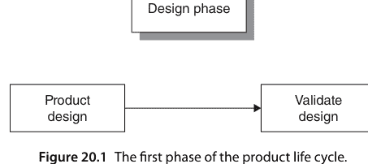

图 20.1 产品生命周期的第一阶段。


关于是否需要进行可靠性估算以及其提供的价值存在显著分歧。首先，可靠性估算可能与你在现场实际实现的可靠性存在显著差异。导致这种不确定性的因素有很多。可靠性估算可能因组件或设备制造商、使用条件、所应用的降额以及供应商提供的可靠性数据的准确性，而与实际观测到的可靠性存在显著差异。你对这种变异性的考虑程度将导致更现实的可靠性估算。

然而，可靠性估算需要花费大量的时间和资源来计算。重要的是要确定是否从可靠性估算中获得了价值。出于合同原因或因为客户已习惯于此，可能有必要进行可靠性估算。然而，如果该活动并未带来可靠性改进，则应停止该活动或确定其未提供价值的原因。

## 20.3 实施风险缓解计划

风险问题首先在概念阶段被识别，并制定了高层级的缓解计划。风险缓解过程在产品设计阶段继续进行。在此阶段，详细的风险缓解计划以及实施方案被制定。到设计阶段结束时，构建和测试工作原型所需的所有细节都已制定。随着系统设计架构、BOM、原理图和机械图纸的开发，额外的风险问题被识别并添加到风险缓解计划中。到设计阶段结束时，所有风险问题都应被识别并制定缓解计划。这发生在设计验证阶段结束之前。

### 20.3.1 缓解回顾性捕获的风险问题

使用 180° 方法，风险缓解问题是通过回顾和向前展望捕获的。缓解过去问题的策略和计划与向前展望的不同。缓解已知问题的策略通常可归为四类。缓解过去问题的策略如下：

- 1. 设计剔除。
- 2. 改变使用条件。
- 3. 修复零件。
- 4. 修复工艺。

#### 20.3.1.1 设计剔除（或使用替代零件/供应商）

在设计中曾有不可靠历史的零件通常可以被设计剔除。寻找一种不需要使用该组件的替代设计方案。可能完全消除不可靠的组件；该组件的目的可能不再必要。设计通常会被回收并修改用于下一代设计或衍生产品。回收设计避免了重复造轮子。然而，随着时间的推移，部分电路可能不再需要，因为其功能不再需要、使用或要求。原始设计人员可能已离职，而新设计人员为方便起见直接复制。设计评审和失效模式及影响分析（FMEAs）可以揭示设计中不再使用或不需要的部分。回收的另一个潜在风险是零件停产。在设计中采用即将停产的零件可能会导致产品开发不必要的延迟。另一方面，回收旧设计将利用组织的知识产权。这是非常理想的，只要设计是可靠的。

一个例子是设计中使用了三相电机作为冷却泵。当泵电机接线错误时，它实际上可能运行一两天，但很快电机绕组就会烧毁，冷却系统将失效。更换电机在金钱和生产时间损失方面都很昂贵。多年来，已纳入一种特殊继电器以规避这种接线错误可能性。它以这样的方式连接，使得电机只有在正确连接时才能运行。该继电器有助于在没有接线失误的情况下使新系统投入运行。它仅在系统首次激活时才需要。一旦明确电机正确运行，继电器就完成了其工作。该解决方案已使用多年，是一项成熟的安全措施。

然而，在这种情况下，该继电器在可靠性帕累托图上排名靠前。继电器触点和磁绕组都容易发生故障。如果继电器绕组失效，系统将无法工作，因为继电器需要在正确绕组连接前通电。因此，继电器绕组失效可能导致不必要的停机。

随着当今新型三相电机驱动器的出现，电源直接连接到驱动电子设备。驱动电子设备具有这样的特性：无论三相如何接线，内部二极管都会将电流正确地重新定向以适应所有接线情况。你不再可能错误接线电机。尽管如此，由于知识产权的回收，仍在使用安全继电器。现在由于风险缓解过程，纳入电机驱动电子设备的新设计不再使用安全继电器。

随着时间的推移，经过验证的设计解决方案会被纳入其中，而不会对其持续需求进行彻底分析。有时，如安全继电器案例所示，旧解决方案降低了整个系统的可靠性。

设计剔除的另一个原因是现在有更好的方法来实现相同功能，甚至可能需要更少的零件。随着电子产品变得更小、更集成，可能用具有可靠性良好记录的新技术取代有问题的电子产品。

#### 20.3.1.2 改变使用条件

可能存在使用具有可靠历史记录的组件但在特定设计中出现问题的情形。通常，原因与使用条件有关。一个例子是观察到一种半导体放大器，制造商将其指定为高度可靠。该放大器在其他设计中使用时没有任何问题。然而，在此特定应用中，其故障率很高。问题与放大器在高于其额定温度规格的条件下运行有关。在此示例中，该零件的额定工作温度为 85 °C，但超出了 45 °C。高工作温度导致设备过早失效。只需通过改善冷却或采用多个在较低功率下运行的放大级来降低设备温度即可解决问题。当此类问题得到解决时，应将其添加到设计评审检查清单中或纳入可靠性设计指南，以防止在不同设计中再次发生。

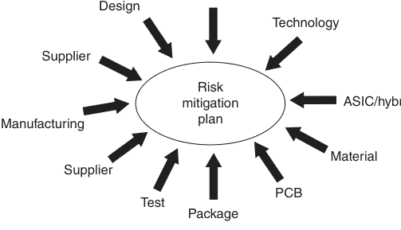

图 20.2 向前展望以识别风险问题。

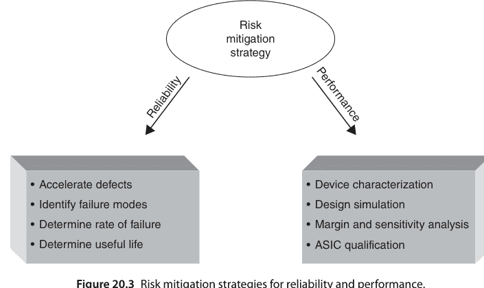

图 20.3 可靠性和性能的风险缓解策略。

回答这些问题需要测试。回答这些问题的测试会有所不同。我们将考虑两种类型，如图 20.3 所示。测试针对可靠性相关和性能相关的疑问。第一种测试类型（性能测试）模拟各种使用操作条件，以便找到器件表征、裕度分析和识别使用条件的极限。这种类型的测试也可能耗时且繁琐。许多人选择不进行器件表征。那些不进行的人在设计故障出现时几乎肯定会后悔，而这些故障本可在这种类型的测试期间被识别出来。这种测试的目的在于获得对器件在各种输入、负载和使用条件下的行为的理解，识别关键操作参数，并了解设计裕度如何被环境所削弱。了解这一点将有助于防止设计出产品可能无法运行的场景。这是设计师至关重要的信息，但只能通过测试来学习。


另一种类型的测试（可靠性测试）需要环境应力来激发缺陷。环境应力被施加以引起（诱发）失效，确定失效率，确定失效模式，和/或估计使用寿命。不幸的是，没有单一的测试可以回答这些问题。相反，测试计划是基于对预期失效内容和原因的了解而制定的。了解这一点后，就会制定加速测试策略来回答这些问题。没有通用测试。这种类型的测试可能昂贵且耗时。如果您不确定哪种测试最有效，那么使用外部顾问是明智的。环境测试设施是了解哪些测试合适的良好知识来源。

通常，产品的设计使用寿命明显长于设计验证阶段的测试时间。将产品测试五年以验证其满足规定的使用寿命是不切实际的。要了解产品或组件随时间的性能需要加速测试。加速测试回答以下可靠性风险问题：

- 它将如何失效？
- 何时失效？
- 失效模式是什么？
- 何时磨损？
- 失效模式是否会被应力加速？

了解产品在更具压力的环境中何时失效以及失效的根本原因有助于回答这些问题。一旦获得这些知识，就会进行改进以消除失效模式，减少发生频率，和/或延长失效发生所需的时间。通过环境应力测试加速的许多类型的失效模式可以外推到较低应力下的频率。根据加速寿命测试确定使用寿命的数学方法最好留给可靠性工程师。结果仅与该特定失效模式相关。大多数产品有许多失效模式。因此，可能需要几种不同的加速寿命测试来更好地了解特定组件、设备或设计的可能失效模式。获取这些知识所需的测试称为加速寿命测试。

## 20.3.2.1 加速寿命测试

加速寿命测试使设备暴露于高于设备正常经历的环境应力，以缩短使其失效所需的时间。这种类型的应力测试通过压缩失效所需的时间来快速诱发失效。失效是由于在夸大的应力水平下累积疲劳造成的。例如，将回形针弯开 90° 然后弯回会夸大回形针所经历的应力。如果我们重复此过程，我们将加速回形针的使用寿命。

进行加速寿命测试是因为将设计为 10 年使用寿命的产品测试 10 年以验证其符合规格是不切实际的。加速寿命测试压缩了失效发生所需的时间。然后将加速寿命测试的结果用于验证产品或设备是否能在其设计使用寿命内存活。

加速寿命测试背后的数学很复杂，最好由可靠性工程师执行。然而，测试过程很容易概念化。通过数学或经验方法，为所执行的加速寿命测试和预期使用环境确定加速因子（加速率）。通过应用加速率，可以确定使用寿命。

混合流动气体测试可用于确定设备在现场是否会腐蚀。这是经验性执行的加速寿命测试的一个例子。在此测试中，产品在受控环境中暴露于混合流动气体。气体加速腐蚀。根据模拟的环境，有不同的气体混合物组合和浓度水平。通过经验测试，已确定混合流动气体暴露两天相当于您使用环境中的一年。通过了解产品设计寿命，很容易加速设备中发生的腐蚀。

假设一种设计需要一种新型连接器，其触点比以前使用过的任何连接器都多。此外，该连接器使用比以前设计更小的焊球连接到板上。该连接器的一个可能风险问题是它无法承受其所需的使用寿命，因为连接器可能出现焊点失效。加速寿命测试（在本例中为温度循环）将回答这个问题。为缓解此风险问题，使用标准制造工艺将连接器焊接到板上，制作测试板。然后将板放入温度箱中进行温度循环（即 0–100 °C）以加速焊点失效。通过测量焊点的电阻，我们可以确定需要多少次温度循环才会失效。然后在不同的温度极限下重复测试（即 0–130 °C）以确定失效循环次数。完成两组测试后，可以计算出数学加速率。然后使用加速率确定连接器在其使用寿命期间是否会出现焊点失效。

上述两个例子说明了如何使用加速测试来评估随时间的性能。有许多不同类型的加速寿命测试。此外，对于特定测试，可以施加许多不同的应力水平。这种类型的测试需要时间和成本。然而，如果您设计了一个预期使用寿命为七年的连接器，而它在三年后失效，则成本可能很高。首先，预计现场所有使用该连接器的产品将在测试中发现的该时间段左右失效。其次，失效不会在三年内被发现，因此可能有大量产品受到影响。如果连接器失效是安全问题，则召回可能代价高昂。

有许多不同类型的加速寿命测试，具体取决于您希望诱发或评估的失效（表 20.3）。表 20.2 中显示了一些在加速寿命测试中常用的应力。

这些应力可以单独或组合施加，具体取决于您希望诱发的失效类型。这些测试的关键是保持应力水平低于材料物理性质发生变化的阈值。如果导致此失效的应力远高于测试材料（s）的物理限制，则由此产生的失效（s）将不代表客户使用期间可能实际发生的情况。换句话说，如果应力温度熔化了组件的塑料外壳，那么您并没有加速其失效时间。相反，您已经确定并超过了组件的物理限制。这些信息对于确定组件的使用寿命没有用处，只对其最高使用限制有用。

工业中使用的有许多不同的标准加速寿命测试（表 20.2）。这些测试可能有许多变化。一些更常见的加速寿命测试在表 20.3 中描述：

### 表 20.2 常见的加速寿命测试应力。

| Typical HALT stresses |  |
|---|---|
| 1 | Temperature |
| 2 | Vibration |
| 3 | Mechanical shock |
| 4 | Humidity |
| 5 | Pressure |
| 6 | Voltage |
| 7 | Power cycling |

### 表 20.3 环境应力测试。

| Accelerated stress test | Test conditions |
|---|---|
| High Temperature Operating Life (HTOL) | Temperatures vary as a function of the device in test. |
| Highly Accelerated Stress Test (HAST) | 130 °C, 85% RH for 100 h |
| Autoclave | 121 °C, 100% RH 103 kPa. Between 96 and 500 h |
| Temperature humidity bias (THB) | Typical: 85 °C & 85 RH Between 500 and 2000 h |
| Temperature cycling | Varies 500–1000 cycles typical −65–0 °C Low temp. 100–150 °C high temp. |
| Temperature storage | Varies 200 °C, 48 h 150–1000 °C 125–2000 °C 175–2000 °C |
| Operating life | 125–150 °C 1000–2000 h |
| Thermal shock | 500–1000 cycles typical −65–125 °C 15 min dwells at each temperature |
| Random vibration | Varies greatly on the basis of user environment and product |

高温工作寿命（HTOL）。这是一种工作或偏置测试，其中设备在一段较长时间内保持在较高温度。主要的


本测试的目的是加速由化学反应引起的失效。示例包括互扩散、氧化和 Kirkendall 空洞。润滑剂干涸也可以在高温下加速。加速速率可以用阿伦尼乌斯方程建模。该测试的结果可用于确定在较低温度下的使用寿命，即 65 °C。

- *高度加速应力测试 (HAST)。* 这可以是一种偏置测试，其中器件在受控湿度水平存在的情况下保持在高温环境中，持续较长时间。通过使用高于水的沸点的温度，100 °C，对测试进行高度加速。测试在加压环境中进行，其中压力可提高到 1 个大气压以上。该测试的主要目的是加速与温度和湿度相关的失效。湿度可导致材料降解、金属化腐蚀、引线可焊性下降、线键合失效、键合焊盘分层、金属间化合物生长，以及塑料封装元件中的爆米花现象（封装中吸收的水分在组装回流期间迅速沸腾并导致外壳开裂）。

- *高压釜。* 该测试通常被称为压力锅测试。器件被放置在底部存有水的加压室中。器件在饱和蒸汽中悬置并加压至 103 kPa（千帕），同时保持在 121 °C 的高温下。通过将器件悬置在室内的水面上方至少 1 cm 的高度来实现浓缩蒸汽。该测试可高度加速水分渗透和电化学腐蚀。

- *温度湿度偏置 (THB)。* 这是一种工作或偏置测试，其中器件在受控湿度水平存在的情况下保持在高温环境中，持续较长时间。测试不在加压环境中进行，温度保持在 85 °C，湿度水平保持在 85% 相对湿度。该测试的主要目的是加速与温度和湿度相关的失效。湿度可导致材料降解、引线可焊性下降，以及塑料封装元件中的爆米花现象（封装中吸收的水分在组装回流期间迅速沸腾并导致元件本体开裂）。失效时间 的加速速率可以用 Peck 模型描述。该测试的结果可用于确定在较低温度和湿度下的使用寿命，即 65 °C 和 45% 相对湿度。

- *温度循环。* 这是一种器件在测试期间可能通电也可能不通电的测试。器件被循环至低温极限并通常保持至少 10–15 分钟，然后过渡到高温并再次保持至少 10–15 分钟。高温和低温极限之间的温度转换会不断重复。该测试的目的是加速热膨胀和收缩的影响，以观察什么会疲劳。这是评估焊点和互连可靠性的常见测试。加速速率由 Coffin–Manson 方程建模。该测试的结果可用于确定使用寿命，已知器件会经历更温和的温度并且发生频率更低（即工作时为 65 °C，器件关闭时为 25 °C）。

- *高温存储。* 这是一种非工作测试，用于加速与温度相关的缺陷。该测试的主要目的是加速与温度和湿度相关的失效。这些失效是化学反应的结果，该反应

在高温下加速。示例包括互扩散、氧化和 Kirkendall 空洞。润滑剂干涸也可以在高温下加速。加速速率由阿伦尼乌斯方程建模。该测试的结果可用于确定在较低温度下的使用寿命，即 65 °C。

热冲击。该测试与温度循环类似，只是温度设定点之间的转换时间非常短。通过能够在两个腔室之间穿梭产品的双温腔室来实现短转换时间。热冲击可加速密封件和封装材料的开裂和发丝裂纹以及气密封装泄漏。

## 20.3.2.2 风险缓解进展

跟踪已采取的解决风险问题的进展非常重要。到设计阶段结束时，大多数风险问题应得到解决。更重要的是，最高风险问题应已关闭或接近关闭。跟踪缓解风险问题进展的一种方法是风险缓解增长曲线，如图 20.4 所示。风险缓解曲线说明了缓解风险所取得的进展。曲线的斜率表示新问题被识别的速率。当没有新的风险问题出现时，曲线会趋于平坦。

并非所有风险问题都具有相同的严重性。风险问题分为三个类别：高、中、低。每个风险类别分别绘制，以便单独跟踪关键风险问题直至关闭。高风险问题是最重要的，应优先于低风险问题。针对中、低风险问题所取得的进展也在可靠性增长曲线中绘制。

如果高风险问题未得到解决，则进入下一开发阶段可能会导致推进一个不太可能成功的项目的承诺。风险缓解增长曲线说明了缓解风险问题所取得的进展。

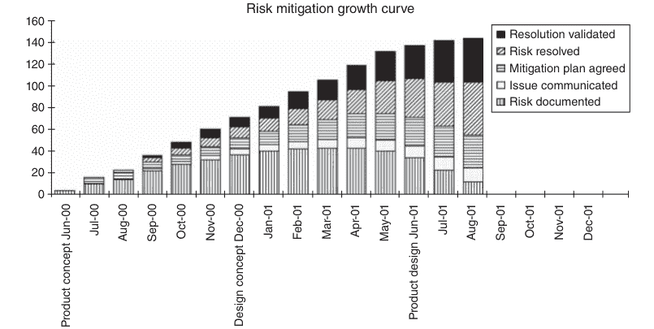

图 20.4 风险增长曲线显示了风险问题被识别和缓解的速率。

到设计阶段结束时，已花费了项目开发资源的大部分。完成产品开发所需的资源，无论是资本还是人力，都是巨大的。到设计阶段结束时，大多数风险问题应已得到解决。风险缓解增长曲线表明了在项目中缓解风险所取得的进展和状态。

## 20.4 设计可靠性指南 (DFR)

产品开发周期不断被压缩。缩短开发周期给设计团队带来更大压力，要求其开发出可靠的产品。更糟糕的是，今天的产品设计得更小、更轻、更快、更便宜。这些因素都会影响产品可靠性。如果开发周期过短，可能没有足够的时间在交付客户之前缓解可靠性问题并对新技术、材料、供应商和设计进行鉴定。当设计师努力在紧迫的市场窗口内开发产品时，他们不太可能花时间解决可靠性问题。这一问题可部分通过可靠性设计指南得到解决，这些指南能快速为设计师提供可靠性问题的指导。可靠性设计指南是可靠性工具箱中少数能够主动提高产品可靠性的工具之一。然而，能够在构建和测试第一个原型之前提高设计可靠性的工具并不多。

可靠性工程师可以就如何改进设计以提高可靠性 (DFR) 为设计师提供建议。他们可以识别传统上不可靠的组件，建议更可靠的替代设计策略，并评估降额和冗余的影响。然而，除非有庞大的可靠性团队，否则不太可能让可靠性工程参与到每一个设计决策中。每天做出设计决策的设计师数量远多于能够审查这些决策的可靠性工程师。事实上，要求对 DFR 的每个方面进行可靠性审查是不现实的。可靠性不应是执法职能。更有效的方法是围绕过去的可靠性问题制定 DFR 指南，并对这些指南进行培训以及对指南进行更新。应定期进行培训，以确保设计工程师了解 DFR 指南并讨论他们可能与指南产生的冲突。设计工程师必须非常清楚如何应用 DFR 指南至关重要，因为他们负责设计决策。可靠性工程师支持设计团队，解释指南背后的需求以及如何应用它们。在无法遵循设计指南的情况下，设计师和可靠性工程师之间会进行讨论以寻求解决。

请记住，可靠性是设计师的责任，而不是可靠性工程师的责任。设计师最终对产品设计、其可靠性、可制造性和可测试性负责。这听起来像是不切实际的要求。设计师通常不知道如何改进设计的可靠性。拥有 DFR 指南可以让设计师在产品 ever 测试之前做出正确的决策。可靠性工程师负责制定这些指南并提供实施指导。可靠性工程师还负责在无法满足可靠性要求时与设计师合作。


设计指南以黑白分明的方式定义，但在其解释上会出现灰色地带。不幸的是，并非每个应用都是黑白分明的。这些灰色调代表潜在的风险区域，有时需要通过测试或外部专家意见来解决。随着灰色地带的解决，DFR 指南会修订以反映变化。指南可能不会涵盖设计的各个方面，尤其是与前沿技术相关的方面。这些问题最好在风险缓解计划中得到体现，其结果纳入设计指南中。指南应不断修订以反映持续改进，并反映当前技术和在现有产品中出现的新的可靠性问题。

应用可靠性指南涉及评估影响产品故障率、维修成本、安全、形象、利润和上市时间的权衡。提高可靠性的设计决策可能会对产品成本、制造难易度和设计复杂性产生负面影响。最好避免过度设计或设计出没人愿意付费的产品。这需要对可靠性要求、设计权衡、责任、保修成本和消费者影响有市场理解。销售不可靠产品的影响可能要数年后才会被知晓。然而，随着客户不满情绪的传播，可以预期市场份额会下降。不可靠产品的成本还体现在返工、废料以及产品生命周期后期才发现的昂贵召回中。

与客户不满导致的业务损失相关的还有额外成本因素。今天的消费者对产品可靠性了解得更多得多。随着互联网的出现，不满的客户通过聊天室和现在可以在热门网站上找到的客户产品评论，对未来销售的影响更大。这可能是最大的威胁。今天的消费者精通电脑，可以轻松研究产品的可靠性历史。不幸的是，这些网页上的大多数产品评论都是不满客户的结果。为了生存，所开发和生产的产品必须可靠。实现这一目标并满足苛刻的上市时间要求最好的方式是在并行工程努力中纳入 DFR 指南。

大多数公司今天在产品开发过程中都有设计用于制造（DFM）和设计用于测试（DFT）指南。DFM 和 DFT 的好处已被充分理解。设计团队了解 DFM 和 DFT 如何减少产品开发时间并减少产品发布时的工程变更数量。DFM 和 DFT 指南在设计阶段应用，通常包含一个检查清单，以验证过去的错误不会重演。这些 DFM 和 DFT 指南是随着时间的推移从经验教训中发展而来的。这些经验教训随后通过一套指南传达，并成为最终设计批准和签署所需的检查清单的一部分。

DFM 和 DFT 中使用的相同技术和流程适用于可靠性设计指南。应用设计指南的过程已经到位；大多数公司的问题是他们没有可靠性设计指南，也不知道如何创建它们。谈到可靠性设计指南，似乎我们回到了石器时代，设计被扔给制造部门。然后它就成为质量和制造团队或维持工程组的责任。

| Requirements/options: | Reliability impact/benefit: |
|---|---|
| 1. Temperature stress (Rule #1):<br>For every 10 °C increase in temperature the useful life decreases by a factor of 2.<br><br>2. Ripple current stress (Rule #2):<br>Stay below 50% of the maximum ripple allowed.<br><br>3. Voltage stress (Rule #3):<br>For voltage stress derating above 67%, the expected life increases by the fifth power of the rated voltage (V_r)/applied voltage (V_a). | Derating greatly improves the life of the electrolytic capacitor in addition to ensuring greater protection from spikes that can cause shorted capacitors. |
| Detail: | |
| The expected life of a capacitor is described as the maximum expected life (Condition a) at rated temperature times the acceleration factors: temperature (T), voltage (V) and ripple current (I).<br><br>L_b = L_a × A_t × A_r × A_v<br><br>L_b = L_a × 2^((T_0 - T)/10) × 2 × (1 - (I/I_0)^2) × (V_r/V_a)^5<br><br>L_a = Lifetime under condition a, L_b = Lifetime under condition b, A_t = Temperature acceleration, A_v = Voltage acceleration, A_r = Ripple current acceleration. | |

## Figure 20.5 DFR guideline for electrolytic capacitor usage. Source: Courtesy of Teradyne, Inc.

## 20.4.1 Derating Guidelines

降额指南对任何产品开发计划都至关重要，应成为 DFR 指南的一部分。如果没有降额指南，很可能客户的一些故障是由于应力水平超过了组件规格所致。此外，设计中具有足够的降额将导致设计裕度增加。具有足够设计裕度的设计具有较低的测试百万分率（PPM）故障率和更高的生产一次通过率。

没有必要从头开发降额指南。行业中有几种降额指南可以购买。这些指南涵盖了广泛的用户，因此工程师可能无法直接使用它们。然而，为您的特定应用和用户环境量身定制降额指南是一项简单的任务。降额指南可从可靠性分析中心获得。订购信息如下：

Electronic Derating for Optimum Performance
Reliability Analysis Center
201 Mill Street
Rome, NY 13440-6916
http://rac.iitri.org/

一旦指南到位，它们就可以成为设计评审过程的一部分。降额还应成为设计核对清单的一部分，以在设计评审前验证是否符合指南。

## 20.5 Design FMEA

在构建和测试任何产品之前，设计阶段最强大的可靠性工具是 FMEA 工具。设计 FMEA 必须在为采购和生产签署设计之前执行。设计 FMEA 活动在任何原型机建造之前进行。如果您从未在组织中执行过 FMEA，那么这个领域几乎肯定会遇到阻力。原因不明，设计师很难接受设计 FMEA 的概念。他们经常会指出设计过程中纳入的许多设计检查足以消除错误，“我们一直都是这样做的。” 通常，用于发现问题的设计评审包括基于常见错误制定的检查清单、同行评审、自动仿真程序以及用于验证是否符合设计指南的自动设计检查程序。这些流程对设计过程有价值且必要。然而，它们在能够识别的问题类型方面存在局限性。因为 FMEA 是一个并行工作，所以潜在的可靠性和安全问题可以在对项目影响最小的地方被识别和修复。

在第 7 章中，详细讨论了 FMEA 流程。我们建议使用第 7 章中介绍的材料来开发 FMEA 培训计划。在进行设计 FMEA 之前，至关重要的是所有参与者都接受过该流程的培训。在组织中首次进行设计 FMEA 很困难。如果参与者未接受过流程培训，那么 FMEA 会议将高度无效。未经培训的参与者倾向于将团队带离正题，更有可能质疑该流程。与其在进行设计 FMEA 时边做边培训，不如推迟一周设计 FMEA 评审，以便每个人都接受培训。培训不必很长，但每个人都需要熟悉该流程。

应为设计的所有重要部分执行 FMEA。这包括整个系统和子系统，包括印刷电路板组件（PCBAs）。

进行设计 FMEA 的最佳时机是在设计完成后但在最终设计评审之前。设计变更通常由 FMEA 导致，因此在 FMEA 项目关闭之前进行最终设计评审毫无意义。设计 FMEA 的好处包括：

- Discovery of design errors
- Identification of system failures due to interconnects


- 因接地问题导致的失效模式识别
- 若电压不同时出现序列时的失效模式识别
- 高风险可靠性元件失效时的影响分析（例如，钽电容短路失效时可能产生的失效效应是什么？）
- 安全、法规或合规性问题的识别
- 因软件错误导致的失效模式识别
- 测试的全面性

设计 FMEA 的输出是一份需要纠正措施的设计问题清单。纠正措施清单按每个问题的严重程度进行排序。团队完成 FMEA 电子表格并生成纠正措施清单后，下一步是决定将解决哪些问题以及由谁来执行。通常在此阶段会出现混淆，不知道应解决哪些问题。显然，所有安全、法规和合规性问题都需要得到解决。遗憾的是，决定应解决哪些非安全相关问题并没有标准规则。需要考虑的因素包括可用资源和修复问题的时间。一些公司使用 80/20 规则，即前 20% 的纠正措施问题占潜在问题的 80%。一旦确定将修复哪些问题，下一个挑战就是将这些问题跟踪到关闭。经常会出现问题被确定为需要修复，但由于缺乏后续跟进，它们仍然未得到解决。一个简单的解决方案是生成一份用于跟踪 FMEA 问题到关闭的单一表格。

## 20.6 安装失效报告分析与纠正措施系统

失效报告、分析与纠正措施系统（FRACAS）是一个闭环反馈系统，用于收集和记录数据、分析趋势，并将硬件和软件问题追踪到根本原因和纠正措施。FRACAS 为问题解决提供从摇篮到坟墓的解决方案。FRACAS 用于验证失效的遏制和解决。良好的 FRACAS 能在可靠性问题出现时识别它们，并跟踪在识别根本原因和纠正措施方面取得的进展。最后，FRACAS 用于将问题跟踪到关闭，如果没有它，对底线的冲击可能很显著，问题识别/解决可能只不过是猜测。

FRACAS 在设计阶段安装。安装可以简单到将新产品纳入 FRACAS 数据库并确保适当的数据录入字段到位。FRACAS 首先在原型阶段运行，在识别设计缺陷后将其录入。设计人员负责录入这些数据；因此他们应接受充分培训并熟悉 FRACAS 软件和数据库。他们应能够轻松访问数据库，并且数据库应具有足够的容量来管理预期的工作量。如果 FRACAS 是新的，则在开始构建原型前应留出足够的时间来调试软件。如果在原型开始时 FRACAS 有缺陷、笨拙或难以使用，很可能设计问题不会被录入数据库。相反，它们会被记录在笔记本、废纸和个人电脑上，很可能被遗失或丢失，永远无法跟踪到关闭。

实施 FRACAS 需要以下内容：

- 1. 识别将用于对信息进行排序的关键产品参数（例如日期、制造商、零件号、数量、装配位置等）。这是一个更长的列表，但现有的失效报告表格可用于此来源。
- 2. 决定 FRACAS 系统将是手动的（纸质系统）还是选择计算机化方法。这不是一个微不足道的工作，尤其是如果是计算机化的。FRACAS 将考虑所有不符合或不可接受的内容：
  (a) 工程开发数据
  (b) FMEA 建议
  (c) 高加速寿命试验（HALT）发现
  (d) 高加速应力筛选（HASS）/高加速应力审核（HASA）发现
  (e) 来料检验不合格
  (f) 在制品制造失效报告
  (g) 现场失效报告
  (h) 客户反馈
- 3. 识别将参加失效报告委员会（FRB）的人员以及领导该委员会的人员。质量经理通常领导 FRB。FRB 负责人必须有权推动所有问题得到解决。委员会将由制造、采购、设计工程（维持工程）、市场、产品管理以及可能其他部门的人员组成。

## 20.7 HALT 规划

规划是 HALT 测试的重要部分，其耗时可能超过测试本身。在 HALT 开始前需要解决许多问题。首先，需要就将进行 HALT 的对象达成一致。在确定 HALT 的装配体后，需要就将测试的装配体数量达成共识。HALT 应至少有三到五个装配体，另外一个单元仅用于调试（“金”单元）。HALT 是一种破坏性测试。测试后，装配体无法修复并出售，因为产品已损失了相当大一部分使用寿命。如果装配体昂贵，则关于破坏性测试的单元数量可能会有争论。避免只测试单个单元。如果在测试设施进行测试，这是不切实际的。只有一个单元进行测试的问题是，每次失效后会有显著的停机时间。排除故障和修复失效所需的时间可能很长。如果有多个单元，则在排除故障和修复失效装配体时，测试可以用下一个单元继续进行。HALT 规划流程在图 20.6 中以图形方式说明。

设计团队及其管理层必须认可。管理层为支持 HALT 工作投入资源，传达了将执行可靠性活动以改进产品设计的承诺。在确定将进行 HALT 测试的装配体后，下一步是为每个装配体组建 HALT 团队。团队是跨职能的，由软件、测试、制造、设计工程和可靠性的人员组成。跨职能团队的目的是在测试前解决与支持 HALT 工作相关的所有问题。使用清单以确保所有问题都得到解决。图 20.7 显示了 HALT 清单示例。如果计划将 HALT 外包给测试设施，此步骤将有助于管理测试成本和测试时间。

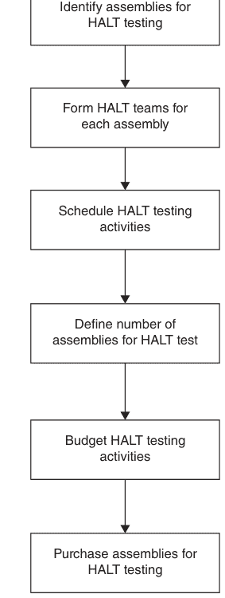

图 20.6 HALT 规划流程。

## 20.8 HALT 测试开发

在 HALT 规划阶段，已确定用于 HALT 测试的装配体以及要测试的装配体数量。然后为每个装配体组建团队以支持 HALT 活动。规划到位后即可开始 HALT 测试开发。测试开发的目标是在测试开始前做好一切准备以支持 HALT 工作（图 20.8）。在 HALT 中，为每个装配体组建开发团队，具体取决于所需的特定技能。团队的第一个活动是定义将执行的 HALT 应力测试。定义 HALT 测试首先要识别将对装配体施加哪些应力以揭示可靠性问题。

在为每个装配体识别应力后（表 20.2），可能需要识别上下应力极限。可能没有已知的上下限。极限是在组件因已知应力水平而发生物理状态变化时定义的。装配体中上温度极限的一个例子是导致连接器外壳熔化的温度。没有理由将装配体应力超过已知的物理限制。超过上限时识别的失效与实际现场失效无关。

在定义 HALT 测试计划后，其余的 HALT 测试开发活动可以继续进行。HALT 规划中的三个活动领域是

- 机械夹具
- 电气测试计划和执行
- 软件测试计划和执行

机械测试计划包括定义装配体如何在 HALT 室中机械夹具固定。机械夹具应优化振动室到 DUT 的能量传递。机械夹具不应在装配体中引入共振。夹具应尽可能轻且机械强度高。有几家公司制造通用机械夹具。这些公司的列表可在附录 A 中找到。在机械夹具开发后，最好通过在 DUT 上安装加速度计来测试夹具。

|  |  | HALT 规划会议于 ______ AM/PM 举行 |  |
|---|---|---|---|
| 最新修订 |  | = 本周需要讨论（HALT 规划者将其高亮以在下次 HALT 规划会议上讨论 A#） |  |
| mm/dd/yyyy |  | = 行动完成（HALT 负责人完成行动时将完成日期加深） |  |
| 行动负责人 | 完成日期 | A# | 活动 | 备注 |
|  |  | 1 | HALT 周日期设定 |  |
|  |  | 2 | HALT 周实验室可用 | 联系人姓名、地址及电话 |
|  |  | 3 | HALT 团队已确定 |  |
|  |  | 3.1 | 设计师 | 姓名及电话 |
|  |  | 3.2 | 软件 | 姓名及电话 |
|  |  | 3.3 | 测试 | 姓名及电话 |
|  |  | 3.4 | 可靠性 | 姓名及电话 |
|  |  | 3.5 | 室技术员 | 姓名及电话 |
|  |  | 3.6 | 维修设施 | 联系人姓名、地址及电话 |
|  |  | 4 | HALT 周液氮可用 | 如需订购罐装补充 |
|  |  | 5 | 装配体（DUT）可用于 HALT 周 |  |
|  |  | 6 | HALT 需要额外接口单元 | 是-否 |
|  |  | 7 | HALT 可用额外接口单元 |  |
|  |  | 8 | 可用于从仪器连接到 DUT 的电缆 | 是否需要备用电缆？ |
|  |  | 9 | HALT 可用电源 |  |
|  |  | 10 | HALT 可用电源电缆 | 是否需要备用电缆？ |
|  |  | 11 | HALT 可用机械夹具 |  |
|  |  | 12 | 验证机械夹具与 DUT 配合工作 |  |
|  |  | 13 | 已确定 HALT 测试的测试仪器 |  |
|  |  | 14 | HALT 测试仪器可用 |  |
|  |  | 15 | 制作带到 HALT 实验室物品清单 |  |
|  |  | 16 | 制作运送到 HALT 实验室物品清单 |  |
|  |  |  |  |  |
|  |  |  |  |  |

# 图 20.7 HALT 规划清单。


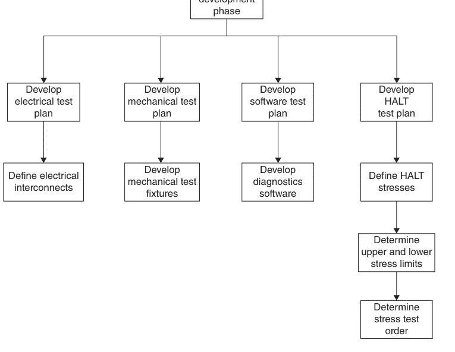

## 图 20.8 HALT 开发阶段。

将加速度计放置在振动台上，并在 DUT 上放置数个加速度计，以验证机械能量传递是否高效。在螺纹紧固件上，使用机械锁紧装置如止动垫圈，以确保 DUT 安全地固定在振动室中。

开发电气测试计划通常更为复杂。理想情况下，它应与制造装配所开发的测试计划相同。然而，在 HALT 测试时，制造测试计划尚未完成的情况并不少见。制造的测试计划也可能不适用于 HALT 测试。为制造测试设计的电路板床钉工装在 HALT 室中表现不佳。测试开发团队可能需要为 HALT 测试开发专用工装。电气测试计划必须包括如何为 DUT 供电以及测试期间将连接至装配的哪些 I/O 信号。HALT 测试的策略是仅将待测装配置于 HALT 室中，而所有外部电源、支持逻辑、负载和测试 I/O 均置于室外。这可能并不总是容易实现。

开发软件测试计划通常更为直接。为在制造中测试产品而开发的软件通常可用于 HALT 测试。重要的是要确定 HALT 测试所需的软件，并确保在测试时软件已准备就绪。用于 HALT 的软件需要在 HALT 测试前完成验收。

在 HALT 开始之前，以下问题需要得到解答：

- 1. 将测试哪些装配？
- 2. 可以测试哪些装配？
- 3. 需要省略什么？

对于每个特定装配：

- 1. 测试所需每个装配的数量是多少？
- 2. 需要进行哪些测试以验证正常运行？
- 3. 可以在 HALT 室中进行哪些测试以验证正常运行？
- 4. 进行 HALT 测试需要什么软件？
- 5. 进行 HALT 测试需要什么硬件？
- 6. 谁来制作电路板（使用生产工艺和工具）？
- 7. 谁来调试电路板？
- 8. 进行 HALT 测试需要哪些机械测试夹具？
- 9. 进行 HALT 测试是否需要任何特殊的电气测试夹具？
- 10. 进行 HALT 测试需要哪些线缆和互连？
- 11. HALT 测试是否需要任何特殊的冷却板？
- 12. 进行 HALT 测试是否需要任何特殊的电源要求？
- 13. 进行 HALT 测试是否需要任何特殊的测试设备？

后勤和排期问题：

- 1. 将测试的可靠性装配的材料成本是多少？
- 2. 所需的工程开发时间和资源是多少？
- 3. 所需的软件工程开发时间和资源是多少？
- 4. 所需的机械夹具开发时间和资源是多少？
- 5. 所需的工程测试开发时间和资源是多少？
- 6. 所需的制造开发时间和资源是多少？

## 20.9 风险缓解会议

到设计阶段结束时，产品开发资源已消耗了相当一部分。随着项目接近设计阶段完成，安排一次风险缓解会议。会议应重点关注为缓解最严重风险问题所取得的进展。在首个原型之前为缓解最严重风险所取得的进展，是项目管理状况的强有力晴雨表。如果新风险问题的产生率（风险缓解斜率）未趋于平缓，则设计仍可能处于变动状态。如果风险问题的关闭率未提高，可能表明缺乏解决关键问题的承诺。如果最重大的风险问题直到项目后期才得到解决并缓解，则可能出现重大重新设计和项目延误。此外，如果最严重风险问题未取得令人满意的进展，则必须启动替代解决方案。

风险缓解会议应重点关注这些问题。各职能小组定期会面，审查每个风险问题的进展和解决策略。会议的目的是确定是否已取得足够进展，以及项目是否应进入设计验证阶段。风险缓解会议向高级管理层报告自上一个开发阶段以来各小组为缓解风险所取得的进展。如果项目不太可能成功，就没有必要花费大量资金用于原型。

## 进一步阅读

### FMEA

S. Bednarz, Douglas Marriot, Efficient Analysis for FMEA, 1998 Proceedings Annual Reliability and Maintainability Symposium (1998).
M. Kennedy, Failure Modes and Effects Analysis (FMEA) of Flip-Chip Devices Attached to Printed Wiring Boards (PWB), IEEE/CPMT International Manufacturing Technology Symposium, IEEE (1998).
M. Krasich, Use of Fault Tree Analysis for Evaluation of System Reliability Improvements in Design Phase, 2000 Proceedings Annual Reliability and Maintainability Symposium (2000).
K. Onodera, Effective Techniques of FMEA at Each Life-Cycle Stage, 1997 Proceedings Annual Reliability and Maintainability Symposium, IEEE (2000).
Prasad, S. (1991). Improving manufacturing reliability in IC package assembly using the FMEA technique. IEEE Transactions of Components, Hybrids and Manufacturing Technology 14 (3): 452–456.
SAE (2001). Recommended Failure Modes and Affects Analysis (FMEA) Practices for Non-Automotive Applications. SAE.
D. J. Russomanno, R. D. Bonnell, J. B. Bowles, Functional Reasoning in a Failure Modes and Effects Analysis (FMEA) Expert System, 1993 Proceedings Annual Reliability and Maintainability Symposium, IEEE (1993).
R. Whitcomb, M. Riox, Failure Modes and Effects Analysis (FMEA) System Development in a Semiconductor Manufacturing Environment, IEEE/SEMI Advanced Semiconductor Manufacturing Conference, IEEE (1994).

### HALT

J. A. Anderson, M. N. Polkinghome, Application of HALT and HASS Techniques in an Advanced Factory Environment, 5th International Conference on Factory 2000 (April, 1997).
C. Ascarrunz, HALT: Bridging the Gap Between Theory and Practice, International test Conference 1994, IEEE (1994).
R. Confer, J. Canner, T. Trostle, S. Kurz, Use of Highly Accelerated Life Test Halt to Determine Reliability of Multilayer Ceramic Capacitors, IEEE (1991).
N. Doertenbach, High Accelerated Life Testing – Testing with a Different Purpose, IEST, 2000 Proceedings (February, 2000).
General Motors Worldwide Engineering Standards, Highly Accelerated Life Testing, General Motors (2002).
R. H. Gusc iaoa, *The Use of Halt to Improve Computer Reliability for Point of Sale Equipment*, 1998 Proceedings Annual Reliability and Maintainability Symposium, IEEE (1998).
E. R. Hnatek, Let HALT Improve Your Product, *Evaluation Engineering.* (n.d.)
G. K. Hobbs, What HALT and HASS Can Do for Your Products, *Evaluation Engineering.* (n.d.)
Hobbs, G.K. (1997). What HALT and HASS can do for your products. In: *Hobbs Engineering, Evaluation Engineering*, 138. Qualmark Corporation.
Hobbs, G.K. (2000). *Accelerated Reliability Engineering*. Wiley.
P. E. Joseph Capitano, Explaining Accelerated Aging, *Evaluation Engineering*, p. 46 (May, 1998).
McLean, H.W. (2000). *HALT, HASS & HASA Explained: Accelerated Reliability Techniques*. American Society for Quality.
Minor, E.O. (n.d.). *Quality Maturity Earlier for the Boeing 777 Avionics*. The Boeing Company.
M. L. Morelli, *Effectiveness of HALT and HASS*, Hobbs Engineering Symposium, Otis Elevator Company (1996).
D. Rahe, *The HASS Development Process*, ITC International Test Conference, IEEE (1999).
D. Rahe, *The HASS Development Process*, 2000 Proceedings Annual Reliability and Maintainability Symposium, IEEE (2000).
M. Silverman, *HASS Development Method: Screen Development, Change Schedule, and Re-Prove Schedule*, 1998 Proceedings Annual Reliability and Maintainability Symposium, IEEE (1998).
Silverman, M.A. (n.d.). *HALT and HASS on the Voicememo II™*. Qualmark Corporation.
M. Silverman, *Summary of HALT and HASS Results at an Accelerated Reliability Test Center*, Qualmark Corporation, Santa Clara, CA, 1998 Proceedings Annual Reliability and Maintainability Symposium, IEEE (1998).
Silverman, M. (n.d.). *Summary of HALT and HASS Results at an Accelerated Reliability Test Center*. Santa Clara, CA: Qualmark Corporation.
Silverman, M. (n.d.) *Why HALT Cannot Produce a Meaningful MTBF Number and Why This Should Not be a Concern*. ARTC Division, Santa Clara, CA: Qualmark Corporation.
J. Strock, Product Testing in the Fast Lane, *Evaluation Engineering* (March, 2000).
W. Tustin, K. Gray, Don’t Let the Cost of HALT Stop You, *Evaluation Engineering*, pp. 36–44. (n.d.)


# 21

## 设计验证阶段

在前一阶段，已开发出设计产品所需的原理图、物料清单和概要图纸。此外，功能原型也已存在。现在，在设计验证阶段，对功能原型进行测试，以验证设计是否符合规范。这是设计发布用于生产前识别设计、质量、可靠性、制造、测试和供应商问题最后的机会。识别所有设计相关问题需要制造工程、测试工程、可靠性以及设计工程之间协同努力，才能全面评估设计。此时，在设计验证阶段，所有这些职能部门都在项目上工作。每个部门对产品的可靠性都有不同的关注点。每个人都在勤奋工作，以在生产发布前解决所有剩余的风险问题。制造部门正在验证特殊工具和装配工艺的爬坡能力。测试工程正在检查测试硬件、软件和测试夹具。可靠性部门正在对产品施加应力，以了解其失效方式。工程部门正在测试原型，以验证设计是否在有裕量的情况下满足概念要求。在此阶段识别出大部分设计问题（缺陷）。

这是工程在向客户交付产品前识别和修复设计相关问题的最后机会。一旦产品发布到生产，设计团队将被重新分配到下一个平台或衍生产品。如果设计相关问题在生产后期出现，解决问题的责任通常不在于原始设计工程师。相反，可持续工程将支持此项活动。该团队可能不具备原始设计团队的技术经验和知识。这就是为什么在验证阶段识别和修复设计问题如此重要的原因。验证阶段进行的活动如表 21.1 所示。

### 21.1 设计验证

在设计阶段结束时，采购部门获取用于原型测试和评估的材料。然后使用标准制造工艺组装电路板。设计工程师不应自行组装原型，因为这是制造和测试部门及早发现问题的机会。组装完成后，工程部门开始验证设计的符合性，以符合概念阶段制定的要求和规范。全面验证设计需要时间和耐心。在此阶段，不幸的是，许多项目发现自己进度落后且超出预算。存在自然倾向，即缩短设计验证过程，以便生产可以开始。如果在未完成设计验证的情况下发货，肯定会导致大量的返工、工程变更订单（ECO）活动以及更高的故障率。在未了解产品在各种客户环境和使用条件下如何表现的情况下发布产品存在重大风险。

设计验证是在各种负载、输入、环境和使用条件下测试设计以了解其性能的过程。实质上，你是在表征性能能力和识别设计中的局限性。设计验证测试还涉及加速应力测试，以便可以识别潜在的现场故障。一旦了解这些信息，就可以改进设计以提高性能和增强可靠性。此外，可以根据设计所能实现的能力来定义产品性能能力。如果设计规范的某些方面无法满足，则在发布前降低产品规范是可能的。设计验证过程可提高设计的可靠性和性能，如图 21.1 所示。

设计验证测试首先在环境或标称条件下测试设备的性能。然后在上、下限规定的温度工作极限下测试设备，以验证其能够安全地并符合规范运行。然后在超过规范的温度下测试产品，以确定设计裕量有多少。设计裕量很重要，因为设计裕量与制造中的首次通过率之间存在关系。具有足够设计裕量的设计也具有较高的首次通过测试良率。相反，如果没有设计裕量，产品在测试中可能出现更高的故障率。设计裕量可以补偿组件的变异性。

### 表 21.1 设计验证阶段的可靠性活动。

| 参与者 | 验证设计阶段 |  |
|---|---|---|
| | 可靠性活动 | 交付物 |
| • 可靠性工程<br>• 市场营销<br>• 设计工程（电气、机械、软件、热等）<br>• 制造工程师<br>• 测试工程<br>• 现场服务/客户支持<br>• 采购/供应管理<br>• 安全与法规 | 1. 设计和性能验证。<br>2. HALT 工作原型。故障追溯到根本原因并在设计中纠正。产品进行最终 HALT 以验证修复。<br>3. 使用证明屏蔽（POS）测试验证 HASS 有效性。<br>4. 运行 FRACAS。原型期间的所有故障均输入 FRACAS 数据库并跟踪至关闭。加速可靠性增长（ARG）和早期寿命测试（ELT）规划。<br>5. 执行 FMEA（仅对重大设计变更）以及过程 FMEA。<br>6. 所有风险问题的关闭。审查状态并就每个风险问题和缓解计划达成一致。风险缓解会议。 | 1. 产品性能规范得到验证，并记录任何限制。<br>2. HALT 故障、应力水平和根本原因记录在报告中。纠正措施计划以消除失效模式。最终 HALT 报告验证修复。<br>3. POS 验证 HASS 协议的有效性。<br>4. FRACAS 报告。<br>5. 完成的 FMEA 电子表格以及纠正措施项目的关闭。<br>6. 风险缓解会议并同意进入下一阶段。风险问题需要在生产阶段前得到缓解。 |

注：FMEA，失效模式和影响分析；FRACAS，故障报告、分析和纠正措施系统；HALT，高加速寿命试验；HASS，高加速应力筛选；POS，证明筛选。

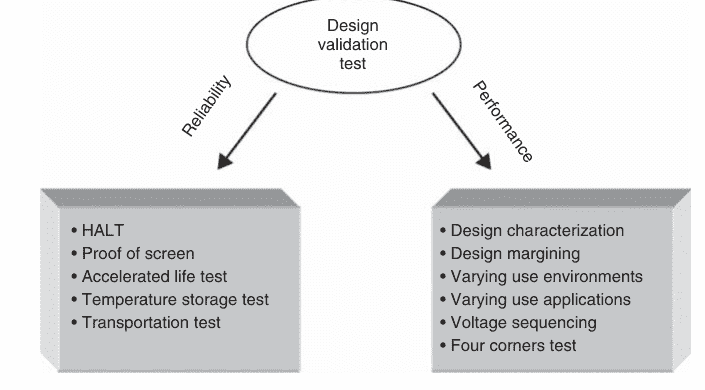

图 21.1 验证阶段的可靠性活动。

### 21.2 使用 HALT 引发故障

高加速寿命试验（HALT）测试在电路板、子组件以及系统或产品级别执行。系统级 HALT 如果系统物理尺寸很大则可能很困难。存在三个问题。第一，大多数 HALT 试验箱无法容纳大型系统。第二，很难将足够的振动能量输入到大型系统中以引发故障。第三，试验箱中产品温度变化可能对高效 HALT 来说过长。唯一不执行 HALT 测试的地方是组件级别。加速寿命测试，如第 15 章所定义，是加速故障、识别失效模式并确定组件级别可靠性的最佳方法。

在此阶段的某个时间点，需要采购材料并组装用于 HALT 的组件。对于昂贵的组件，最好在有保证设计可行之前推迟购买昂贵物品用于 HALT。如果项目交期长、最小采购量或高非经常性工程（NRE）费用，则不总是可能。如果为 HALT 购买了所有材料但原型无法工作，部分材料很可能最终被报废。新平台产品的风险大于衍生产品的风险。也不建议对经过大量工程修复、飞线和粘贴组件的电路板执行 HALT。大量返工的问题在于，HALT 中出现的问题可能源于返工的质量而非设计和制造过程的质量。返工量过多的电路板应修订板图以纳入设计变更。原型组装后最好咨询设计工程，以尽早了解原型的功能。

HALT 应在采用与最终产品相同的物料清单构建的组件上执行。用于原型和 HALT 的不同供应商的材料可能会识别出原型部件或工艺中存在问题，而该部件或工艺不在最终产品中。此外，一些问题将无法识别，因为如果组件或制造工艺不属于原型工艺，则无法出现问题。原型与最终产品不同的部件示例如下：

- *机加工零件。* 它们在应力下的响应与铸造件不同。
- 手工焊接与自动装配。
- *定制零件。* 有时供应商使用与最终生产版本中将使用的不同制造工艺或工具为原型提供零件。
- 插座式零件与非插座式零件。
- *印刷电路板（PCB）。* PCB 可以由小型快速周转工厂制造，而非标准制造商。

使用不同供应商进行原型制作还可能存在另一个问题。假设供应商 A 提供快速周转交付并用于原型。供应商 B 用于生产。如果供应商 A 在设计中发现问题并在其图纸上修复，通知设计师，但设计师未能更新其文件，则问题可能再次在生产中出现，并会手忙脚乱地弄清原因。在 PCB 制造中，制造商使用不同的（通常是定制的）软件程序来检查板图中的布局问题。这些问题影响 PCB 制造的良率，制造商会修复它们。PCB 制造商认为这是制造服务的一部分，并例行“清理”你的设计。然而，供应商可能不会通知你这些修复。在材料测试并发现可接受后，它将被转移到将用于批量生产的 PCB 制造商。设计问题未在 artwork 中修复，因此在生产中出现原型中未识别的问题。这种问题是可以避免的。不要允许供应商对 artwork 或设计进行任何更改而不提交及时的工程变更请求。

用于 HALT 测试的组件应使用将在生产中使用的标准制造工艺构建。生产所需的任何特殊工具都应在测试板装配中使用。不要在原型实验室手工组装用于 HALT 的电路板。以生产装配相同的方式构建测试组件。HALT 将揭示制造以及设计相关问题。因此，最好尽可能模拟设计和制造过程。

在对产品进行 HALT 之前，需要进行一些最终规划。在 HALT 之前需要大量的准备工作。可靠性工程师和


设计工程师必须确保在 HALT 开始之前一切就绪。以下是在测试开始前必须准备好的项目清单：

- 1. 将要测试的产品，五台工作单元，以及一台被视为 golden 的额外单元。“golden unit” 不会进行应力测试；它在出现测试问题或故障时使用。golden unit 用于判断问题出在被测产品还是测试仪器上。插入 golden unit 将验证问题是否确实存在于产品中。这将大大加快故障排除过程。golden unit 也用于故障排除，因为失效产品可以与 golden unit 进行比较以缩小故障源。因此，通过使用该单元获得的信息确实是“golden”。
- 2. *Test instrumentation.* 这在产品本身之后可能是清单上最重要的项目，因为必须发现并纠正故障。监测不良会遗漏一些故障，并使 HALT 过程的效果不如预期。
- 3. 将要监测的输出规格以及监测仪器。
- 4. 文档，例如，原理图、装配图、流程图等等。
- 5. 将产品固定到 HALT 台上的机械夹具。
- 6. 输入和输出电缆。
- 7. 输入和输出液体冷却软管。
- 8. 特殊设备，即液体冷却装置、冷水机、风道、电源、其他支持设备等等。
- 9. 如需则提供测试软件。
- 10. 拟施加于产品的应力水平（由 HALT 团队确定并达成一致）。
- 11. 安排所需的测试时间。
- 12. 负责的设计工程师在整个 HALT 过程中可提供支持。
- 13. 测试工程师在整个 HALT 过程中可提供支持，用于调试测试仪器问题并协助失效分析。
- 14. 可靠性工程师和 HALT 试验室操作员在整个 HALT 过程中可提供支持。（可靠性工程师记录测试并撰写最终的 HALT 测试报告。）

完成所有准备工作后，即可开始 HALT 以诱发故障。测试可能短至几天，也可能长达数周。测试时长取决于可用于测试的装配数量、修复故障所需的时间、故障发生的频率，以及因测试设置和设备问题导致的停机频率和时长。

建议 HALT 测试使用六个装配件。其中一个装配件为“golden unit”，不进行应力测试。你可以用更少的装配件进行 HALT 测试，但过程会更长，且可能无法识别出较少的设计问题。使用“golden unit”来检查系统，并在故障发生时作为故障排除辅助。其他五个单元用于 HALT 测试。将第一个装配件放入试验室并以能有效传递试验室空气到装配件的方式进行定位。然后将其固定到试验室的振动台上。使用锁紧硬件进行固定和仪器安装）。确保 I/O 牢固连接到产品上。最后，将应力监测传感器连接到产品上（即加速度计和热电偶）。加速度计可用 Super Glue® 或任何其他类型的氰基丙烯酸酯粘合剂粘贴。热电偶使用导热粘合剂或 Kapton® 胶带粘贴。

Figure 21.2 HALT process flow.

## 21.2.2 Room Ambient Test

一旦一切固定到试验室，关闭舱门并打开测试试验室。将试验室设置为室温环境并进行氮气吹扫以排出试验室内残留的水分。打开产品并使其稳定，然后执行第一次诊断测试以验证一切正常运行。此步骤验证测试设置是否正常运行。测试时间取决于验证一切正常运行所需的时间。通常取决于测试软件运行完整功能测试所需的时间。测试软件应达到 100% 测试覆盖率。能够运行完整功能测试是理想的，但并非总是可行。当完整测试覆盖率不可行时，必须确保至少有足够的测试覆盖率来判断产品是否正常运行，或者在测试软件完成后进行第二次 HALT。

## 21.2.3 Tickle Vibration Test

在确认测试设置、HALT 试验室和产品正常运行后，运行一次测试以确保所有机械连接牢固。这是通过 tickle vibration test 实现的。tickle vibration test 施加 2 至 5 Grms 之间的低水平振动。试验室温度设置为保持室温环境，并重复产品的功能测试以验证设备机械牢固且没有松动连接（Figure 21.3）。

## 21.2.4 Temperature Step Stress Test and Power Cycling

在开始温度阶跃应力测试之前，定义温度上下应力物理极限（Table 21.2）。这些极限代表可能发生物理材料变化（通常称为相变）的点并导致失效。温度极限可能基于已知的绝对最大允许极限，在该极限下可预期灾难性失效。最高温度极限可能基于内部热保护电路导致关机且无法安全绕过。例如，塑料外壳的连接器在达到温度阈值时会熔化或变软。在此温度下发生失效是预期之中的，代表设计限制而非产品失效。

温度阶跃应力从环境温度开始，通常以 10 °C 或 20 °C 的增量降至较低温度。测试从最弱应力开始，随着测试的进行逐步增加应力。这样可以避免因过度应力测试而丢失细微故障。温度达到后，产品停留足够长时间以达到温度稳定，通常为 10–15 分钟。停留时间包括运行功能测试以验证正常运行所需的时间。完成第一次温度阶跃应力测试后，对产品进行电源循环以验证其能否开机、启动并进入已知良好状态。继续进行下一个温度阶跃应力并重复温度停留，随后运行功能测试、检查器、诊断、内置自检或其他程序测试协议以验证正常运行。测试完成后，如同之前一样对产品进行电源循环以验证其能否在已知良好状态下开机。此过程一直持续到达到较低的“冷”温度极限。达到最低温度极限后，将产品恢复至室温并进行功能测试以验证产品运行正确。产品现在开始温度阶跃应力直至达到较高的“高温”极限。

温度阶跃应力测试一直持续到诱发故障为止。记录故障发生的点。现在将应力降低到之前的应力水平，以确定系统是否恢复。如果系统重新开始工作，则该故障被确定为软故障。如果系统未恢复，则该故障被确定为硬故障。记录故障及其引起的应力水平。

可能存在“临时修补”失效元件以继续增加应力的可能性。如果修复简单，可能在产品仍在试验室中时实施。如果需要故障排除，则取出产品并将其放置

Table 21.2 HALT Profile test limits and test times.

Profile for Standard HALT Instrument

Ambient temperature is considered to be 20 C.

| Enter diagnostics run time and stress limits | Run Time (Minutes) |
|---|---|
| Calibration | 10 |
| Checkers/Diagnostics | 5 |
| Other diagnostics (describe) | 0 |
| Enter Lower temperature Limit (degrees C) | -40 |
| Enter Upper Temperature Limit (degrees C) | 120 |
| Enter Upper Vibration Limit (Grms) | 60 |
| Total Diagnostic Run Time | 15 |
| Total Mandatory Test Time/DUT (hrs) | 10.4 |

# Test Setup Verification

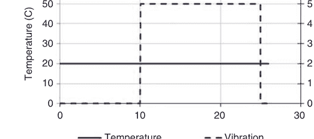

Figure 21.3 HALT test setup verification test.


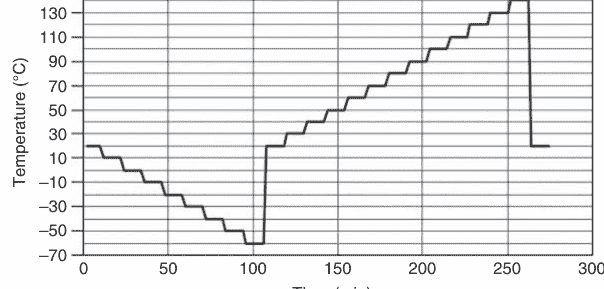

Figure 21.4 Temperature step stress.

next product in the chamber for testing. One advantage of having five units for test is that HALT testing can continue while the recently failed unit is being fixed.
After the high temperature has been reached, the product is returned to room temperature. At the end of this test, the upper and lower soft temperature limits (soft failure) and the upper and lower destruct limits (hard failure) have been identified. The first stress test, temperature step stress, is now complete. Figure 21.4 shows this test graphically.

## 21.2.5 Vibration Step Stress Test

The next stress test is a vibration step stress that is applied to the product. In this test, the product is maintained at ambient temperature while vibrational stresses are increased in 5–10 Grms increments. The test continues until the limit of the chamber’s capability is reached, the upper vibrational limit is reached, or the product can no longer survive higher stress levels. With each step in vibration, the product is tested to verify proper operation. When stress levels exceed 20 Grms, it may be necessary to run a tickle vibration to detect failure. Many times vibration-caused failures do not reveal themselves to the test instrumentation at the higher vibration levels, but the failure becomes apparent at the lower levels. Document failures and troubleshoot to root cause. The vibrational step stress test is shown graphically in Figure 21.5.

## 21.2.6 Combinational Temperature and Vibration Test

After testing has been completed for single types of stresses, combinational stresses are applied. The first combinational stresses are temperature and vibration. In this test, the temperature starts at ambient and is stepped in 10–20 °C increments until just below the upper and lower destruct limits are reached. The product remains at each temperature stress, while vibrational stresses are induced on the product in 10–20 Grms increments. At each vibration stress level, the product is allowed to stabilize and functional testing is performed.
It is very important to record the stress levels at which the soft and hard failures occurred. Later, when you have made design corrections these stress levels should have

## Rapid Thermal Cycling (60 C/min)

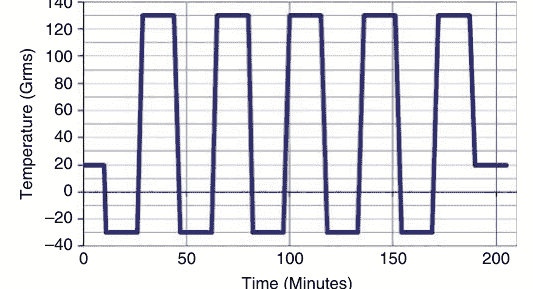

Figure 21.7 Rapid thermal cycling (60 °C min⁻¹).

## Slow Temperature Ramp

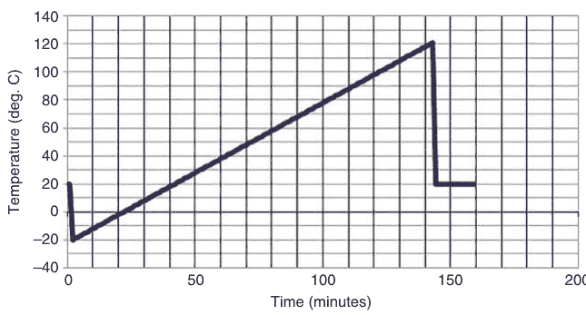

Figure 21.8 Slow temperature ramp.

## 21.2.8 Slow Temperature Ramp

Depending on the product, there may be additional stresses that are appropriate. The reliability tests that follow may be necessary depending on the product and the reliability requirements. The slow temperature ramp tests (Figure 21.8) can uncover instabilities that are temperature dependent. The temperature limits for this test are typically 10–20 °C below the high and low hard failure temperature limits determined in temperature step stress (basically the same temperature limits used for the combinational temperature and vibration step stress). The slow temperature ramp will uncover temperature related instabilities that can be extremely difficult to reproduce if you don’t know the temperature window they occur in. The instability or anomaly may occur over a very narrow temperature range making it difficult to discover without running a so a slow temperature ramp. A failure reported by the user that occurs at a particular temperature will not have the temperature information included in the failure complaint. Unless

you know to repeat the test at the temperature where the instability or anomaly occurs, you will not be able to duplicate the complaint. This type of failure often gets reported as a no fault found (NFF) or could not duplicate fault. The instability could be an oscillation, an increase in noise, a reduction in output gain, power supply instability, automatic gain control (AGC) instability, a loss of phase lock, or an increase in phase noise. These are just a few failure modes that can occur over a narrow temperature range. In addition, because the phenomena only occurs within a narrow temperature range a step stress may miss the window where this undesired behavior occurs. The slow temperature ramp provides you an opportunity to observe the instability or other unacceptable behavior as you sweep through the temperature changes.

## 21.2.9 Combinational Search Pattern Test

A relatively new HALT technique created by Dr. Greg Hobbs is the “search pattern technique.” The idea is to slowly sweep temperature and rapidly sweep vibration simultaneously. Starting with the product at room temperature (or about 25 °C), the temperature is lowered to the lower stress limit, say −40 °C. At the same time, vibration is sweeping as fast as it can between 0 and 20 Grms. Typically, the vibration will go from the low level to the high level and back down again in less than 30 seconds (this is adjustable in some HALT chambers). Once the vibration stresses are started, the temperature is slowly swept from −40 to +140 °C (hypothetical values) and then back to room temperature. If the temperature rate of change is set to 2 °C per minute, the entire test will take 4.4 hours (refer to Figure 21.9).

The search pattern technique is valuable where the soft failure is very close to the hard failure. The temperature changes slowly while the product is being continuously monitored. This allows the test to be stopped before a hard failure is encountered. This opens opportunities for some failure investigation before the hard failure is found. Another advantage of slowly sweeping temperature over temperature step stress is that it will reveal any oscillations or instabilities that occur only at a specific temperature point or

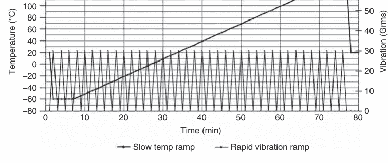

Figure 21.9 Slow temperature ramp and sinusoidal amplitude vibration.

narrow range. If you use step stresses, there is a possibility that you will pass over the point of instability.

## 21.2.10 Additional Nonenvironmental Stress Tests

Depending on the product, there may be additional stresses that are appropriate. Some additional stresses that can be applied are DC power supply voltage margining (first single supplies then different supply voltages in combination), AC line input voltage and frequency margining, timing margining, output loading, clock oscillator frequency variation, power cycling, and power sequencing.

## 21.2.11 HALT Validation Test

During HALT, failures will surface. Each HALT failure is documented either through a failure reporting, analysis, and corrective action system (FRACAS) system or in some other form to log failures (see Figure 21.10). Some of the failures will be fixed while the unit is in the chamber. Others may require a “band-aid” fix so that testing can continue. Often, components that have failed are removed that will require failure analysis to determine root cause. Getting to root cause for all failures is one of the requirements of HALT. After HALT is completed, there will be a list of failures identified along with the root cause and the stress required to precipitate the failure. Ideally, everything that fails is fixed through design changes. However, this is not always practical. Each design change has an associated economic and schedule impact that can be weighed against the improvement in design margin, reliability, and first-pass yield. The level of stress required to precipitate the change can also play a role in the decision to fix a particular

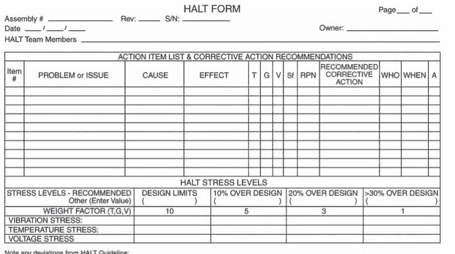

Figure 21.10 HALT form to log failures.

failure. There should be a commitment to fix all failures through design change except when it can be shown to not make economic or business sense.

After all the agreed upon design changes have been implemented, a final validation HALT test is performed to verify the effectiveness of the design changes and to ensure no new failures were injected into the product. This test can be on a single device, although testing several is desirable. In addition, the validation HALT test doesn't need to be as rigorous as the original HALT; increasing the stress level increments will shorten the test time.

Finally, keeping track of all the testing that was performed in HALT can be difficult. There are many different types of tests performed and the sequence can vary. In addition, keeping track of which units were tested when, test equipment failures, and test anomalies can be challenging. Developing a form to track all this activity will be a life-saver later when it is time to write the HALT report. A sample form can be found in Figure 21.11.

## 21.3 Proof of Screen (POS)

During the HALT test, the product's soft and hard failure limits were identified. The HALT limits determine the appropriate Highly Accelerated Stress Screen (HASS) that will be used to weed out manufacturing defects in production. HASS is described in detail in Chapter 8. HASS applies accelerated stress levels to the product so that process-related defects are precipitated to fail. HASS replaces traditional burn-in or other forms of environmental stress screens (ESSs) because it is more efficient at removing process defects and is less damaging to the product life (cumulative stress from burn-in is less).

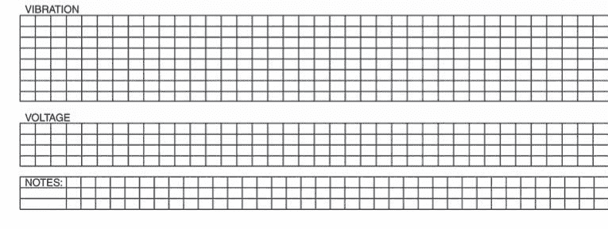

Figure 21.11 HALT graph paper for documenting test.


HASS 轮廓由两部分组成，沉淀筛选和检测筛选。测试从沉淀筛选开始。沉淀筛选是一种应力水平，其低于破坏极限且高于工作极限。沉淀筛选会加速工艺缺陷至失效（参见图 21.12）。需要确定应用于产品的 HASS 筛选水平。温度的良好应力水平在破坏极限的 80% 至 50% 之间。初始振动应力水平为破坏极限的 50%。保持低于破坏极限非常重要；否则很可能会损坏合格产品。沉淀筛选的目的是充分损坏有缺陷的产品，以便在测试中被检测到。坏产品在装配通过检测筛选时被识别出来。

在检测筛选期间，温度应力降低至低于软失效极限但高于产品规格极限的水平。HASS 轮廓通常很短，通常 3 至 5 个沉淀和检测循环足以在客户使用期间发生之前检测到故障。

检测和沉淀筛选作为一个操作执行。你将温度提高到超过软失效范围但低于损坏水平（这是沉淀阶段），然后应力降低到低于软失效水平，此时“合格”的装配会恢复（这是检测范围）。如果它没有恢复，则检测到缺陷。

HASS 轮廓不得损坏或严重降低合格产品。一般来说，如果施加正确的应力水平，有缺陷的装配将以显著快于合格产品的速率退化，从而可以轻松检测到。HASS 轮廓也必须足够严重以使工艺缺陷沉淀至失效。会使用筛选证明（POS）来确保 HASS 水平不会通过移除过多的产品寿命来损坏合格产品，但足以识别有缺陷的单元。

HASS 筛选对产品施加的环境应力将移除产品使用寿命的一部分。这是不可避免的。HASS 筛选的目标是提供足够高的应力水平以沉淀制造缺陷，同时不会移除过多的产品寿命。HASS 中移除的产品寿命可以通过 POS 估计。

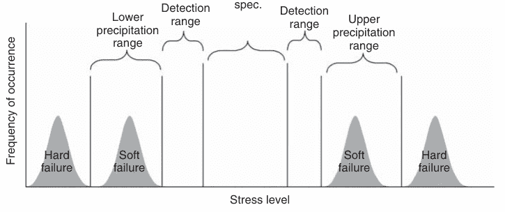

图 21.12 HASS 应力水平。

POS 过程在合格产品上一次又一次地重复 HASS 筛选，直到其失效。每次 HASS 筛选都会移除部分产品寿命。重复施加 HASS 应力会导致产品以加速速率持续退化。最终，产品会失效，因为应力会持续退化产品直到达到磨损。 如果需要 20 次 HASS 循环才能使产品无法运行，则可以合理估计每次 HASS 筛选会移除 5% 的产品寿命。如果设备在仅 4 次 HASS 筛选后失效，则可以假设每次移除的产品寿命为 25%。在产品失效之前没有期望的最小应力循环数。一些公司希望在没有失效的情况下至少有 20 个循环。测试应在足够大的样本量上运行，以确保考虑正常制造过程变化。

另一方面，如果你在 100 个循环内运行 HASS 测试而没有失效，则 HASS 应力水平可能设置得太低。一些从业者建议在进行 POS 时对产品进行植入，以确定 HASS 筛选在检测有缺陷产品方面的有效性。对板进行植入需要故意将已知的制造缺陷插入产品中。产品接受 HASS 以确定缺陷是否能在 HASS 筛选期间被发现。植入缺陷的问题在于，很难插入能够真实代表产品缺陷的植入缺陷（即制造过程漂移或供应商变更）。

## 21.4 高加速应力筛选（HASS）

在完成 HALT 并实施设计更改后，会执行重新 HALT 以验证设计修复的有效性并确保在重新设计/重新设计中没有产生新的可靠性问题。HALT 的输出之一是确定产品的软失效和硬失效极限。HALT 的结果随后用于开发用于筛选生产/制造材料的 HASS 轮廓。在 HASS 轮廓发布到生产之前，它必须经过 POS 以验证 HASS 轮廓的有效性并确保 HASS 轮廓不会损坏或降低合格产品。结果是发布到制造以帮助加速设计成熟度和爬坡准备的 HASS 轮廓。结果是用于生产 HASS 的如图 21.13 所示的轮廓。

## 21.5 运行 FRACAS

FRACAS 已在前一阶段安装。FRACAS 数据库（通常是购买的软件程序）根据用户的特定应用进行定制。数据库的定制是 FRACAS 安装和验收过程的一部分。

随着产品进入设计验证阶段，原型被制造并测试以验证产品的性能。在开发测试和设计验证期间，产品中会出现故障。尤其是开发早期阶段，存在一种自然倾向，即非正式地对待这些故障。它们通常记录在笔记本、纸片上，有时甚至在没有任何记录的情况下就被修复。不管故障看起来多么微不足道，将任何故障视为无关紧要都是短视的。这些故障通常会在项目后期重新出现，此时纠正成本更高。

| Variables |  |  |  |  |
|---|---|---|---|---|
|  | Temp. (C) | Vib. (Grms) | HALT Hard Fails Temp | Vib |
| Start/End | 20 | 0 |  |  |
| Min | -40 | 0 | -50 |  |
| Max | 80 | 30 | 100 | 60 |
| Detect H | 40 | 3 |  |  |
| Detect L | 10 | 3 |  |  |
| Hot Soak | 20 min. |  |  |  |
| Cold Soak | 15 min. |  |  |  |
| Diagnostic run time | 15 min. |  |  |  |
| Thermal Ramp | 60 C/min |  |  |  |
| Transmissibility |  |  |  | 40% |
| Total GRMS Minutes | 1,016 |  |  |  |

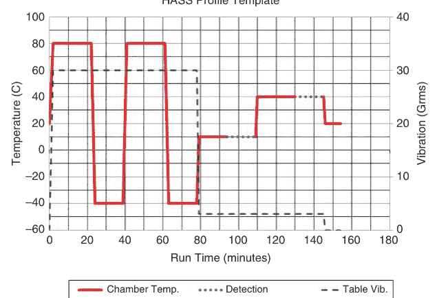

### 图 21.13 HASS 轮廓。

FRACAS 防止这种情况发生。FRACAS 在第一个原型制造后开始运行。从那时起发生的每个故障都记录在 FRACAS 数据库中。故障以及确定根本原因和纠正措施的活动都被记录。FRACAS 将跟踪解决故障的进展情况以及新故障发生的速率。这将提供设计成熟速度或是否仍处于波动状态的良好指示。

为了使 FRACAS 有效，每个识别出故障的人都必须使用它。防止设计人员在原型阶段使用自己的系统记录故障可能是一个困难的挑战。问题可以通过在前一阶段提供有关如何使用 FRACAS 数据库的培训来解决。结合管理层承诺所有设计人员都将使用 FRACAS 数据库记录每个故障，将确保成功。

## 21.6 设计 FMEA

在产品设计阶段，对每个子装配、电路板和系统级进行了失效模式和影响分析（FMEA）。完成该任务需要大量的人力和资源。设计验证阶段的 FMEA 并非旨在重复之前的努力，而是补充它。设计验证 FMEA 通过仅评估因设计验证、HALT 和其他设计相关故障而产生的重大设计更改（ECO）来补充之前的努力。对于简单的 ECO，例如元件值更改，不需要进行 FMEA。重大的 ECO 更改通常会导致新的板或机械布局。设计验证阶段进行的设计 FMEA 仅针对已更改的部分。FMEA 不会对整个装配重复；只有对设计所做的重大更改才需要使用 FMEA 进行分析。执行设计更改的 FMEA 所需的时间将明显少于原始 FMEA 所需的时间。

## 21.7 风险问题的关闭

在设计验证阶段结束时，产品已完成并准备上市。之前捕获的高风险问题应在设计验证阶段结束前关闭。在设计验证阶段结束时，不应有未解决的高风险问题；无论风险是设计、制造、测试、供应商还是可靠性问题都不重要。任何未解决的高风险问题都代表风险缓解过程中的逃逸。每个高风险问题都有一个应急（备份）缓解计划，应在进入生产阶段前解决风险问题。如果在进入生产阶段前未解决高风险问题，则需要。

未解决高风险问题的升级是必要的，因为这些问题一旦产品上市往往会成为昂贵的问题。升级过程在设计验证阶段完成前就开始。升级通过将问题提升至高级管理层开始。通常，这些问题与风险管理方式、解决问题所使用的资源类型或解决问题人员技能有关。高级管理层必须确定问题为何未得到解决并实施更改以修复它。

在设计验证阶段结束时，产品已准备好销售。


## 进一步阅读
### FMEA
S. Bednarz, D. Marriot, Efficient Analysis for FMEA, 1998 Proceedings Annual Reliability and Maintainability Symposium (1998).

M. Kennedy, Failure Modes and Effects Analysis (FMEA) of Flip-Chip Devices Attached to Printed Wiring Boards (PWB), IEEE/CPMT International Manufacturing Technology Symposium, IEEE (1998).

M. Krasich, Use of Fault Tree Analysis for Evaluation of System Reliability Improvements in Design Phase, 2000 Proceedings Annual Reliability and Maintainability Symposium (2000).

K. Onodera, Effective Techniques of FMEA at Each Life-Cycle Stage, 1997 Proceedings Annual Reliability and Maintainability Symposium, IEEE (2000).

Prasad, S. (1991). Improving manufacturing reliability in IC package assembly using the FMEA technique. IEEE Transactions of Components, Hybrids and Manufacturing Technology 14 (3): 452–456.

D. J. Russomanno, R. D. Bonnell, J. B. Bowles, Functional Reasoning in a Failure Modes and Effects Analysis (FMEA) Expert System, 1993 Proceedings Annual Reliability and Maintainability Symposium, IEEE (1993).

SAE Recommended Failure Modes and Effects Analysis (FMEA) Practices for Non-Automobile Applications, SAE (Reaffirmed 2012) https://www.sae.org/standards/content/arp5580/.

R. Whitcomb, M. Riox, Failure Modes and Effects Analysis (FMEA) System Development in a Semiconductor Manufacturing Environment, IEEE/SEMI Advanced Semiconductor Manufacturing Conference, IEEE (1994).

### 加速方法
H. Caruso, A. Dasgupta, A Fundamental Overview of Accelerated-Testing Analytic Models, 1998 Proceedings Annual Reliability and Maintainability Symposium, IEEE (1998).

M. J. Cushing, Another Perspective on the Temperature Dependence of Microelectronic-Device Reliability, 1993 Proceedings Annual Reliability and Maintainability Symposium (1993).

J. Evans, M. J. Cushing, P. Lall, R. Bauernschub, A Physics-of-Failure (POF) Approach to Addressing Device Reliability in Accelerated Testing of MCMS, IEEE (1994).

Lall, P. (1996). Tutorial: temperature as an input to microelectronics-reliability models. IEEE Transactions on Reliability 45 (1): 3–9.

### ESS
H. Caruso, An Overview of Environmental Reliability Testing, 1996 Proceedings Annual Reliability and Maintainability Symposium, IEEE (1996).

### HALT
H. Caruso, A. Dasgupta, *A Fundamental Overview of Accelerated-Testing Analytic Models*, 1998 Proceedings Annual Reliability and Maintainability Symposium, pp. 389–393 IEEE (1998).
M. R. Cooper, *Statistical Methods for Stress Screen Development*, 1996 Electronic Components and Technology Conference, IEEE (1996).
G. A. Epstein, *Tailoring ESS Strategies for Effectiveness and Efficiency*, 1998 Proceedings Annual Reliability and Maintainability Symposium, 37–42, IEEE (1998).
S. M. Nassar, R. Barnett, *Applications and Results of Reliability and Quality Programs*, 2000 Proceedings Annual Reliability and Maintainability Symposium, IEEE (2000).

J. A Anderson, M. N. Polkinghome, *Application of HALT and HASS Techniques in an Advanced Factory Environment*, 5th International Conference on Factory 2000 (April, 1997).
C. Ascarunz, *HALT: Bridging the Gap Between Theory and Practice*, International test Conference 1994, IEEE (1994).
R. Confer, J. Canner, T. Trostle, S. Kurz, *Use of Highly Accelerated Life Test Halt to Determine Reliability of Multilayer Ceramic Capacitors*, IEEE (1991).
N. Doertenbach, *High Accelerated Life Testing – Testing With a Different Purpose*, IEST, 2000 proceedings (February, 2000).
General Motors Worldwide Engineering Standards, *Highly Accelerated Life Testing*, GM (2002).
R. H. Gusciaoa, *The Use of Halt to Improve Computer Reliability for Point of Sale Equipment*, 1998 Proceedings Annual Reliability and Maintainability Symposium, IEEE (1998).
HnateK, E.R. (1999). *Let HALT Improve Your Product*. Nelson Publishing.
Hobbs, G.K. (1997). What HALT and HASS can do for your products. In: *Hobbs Engineering, Evaluation Engineering*, 138. Qualmark Corporation.
Hobbs, G.K. (2000). *Accelerated Reliability Engineering*. Wiley.
Hobbs, G.K. (1977). *What HALT and HASS Can Do for Your Products*. Nelson Publishing Inc.
Joseph Capitano, P.E. (1998). Explaining accelerated aging., *Evaluation Engineering* 46.
McLean, H. (1991). *Highly Accelerated Stressing of Products with Very Low Failure Rates*. Hewlett Packard Co.
McLean, H.W. (2000). *HALT, HASS & HASA Explained: Accelerated Reliability Techniques*. American Society for Quality.
Minor, E.O. *Quality Maturity Earlier for the Boeing 777 Avionics*. The Boeing Company.
M. L. Morelli, *Effectiveness of HALT and HASS*, Hobbs Engineering Symposium, Otis Elevator Company (1996).
D. Rahe, *The HASS Development Process*, ITC International Test Conference, IEEE (1999).
D. Rahe, *The HASS Development Process*, 2000 Proceedings Annual Reliability and Maintainability Symposium, IEEE (2000).
M. Silverman, *Summary of HALT and HASS Results at an Accelerated Reliability Test Center*, Qualmark Corporation, Santa Clara, CA, 1998 Proceedings Annual Reliability and Maintainability Symposium, IEEE (1998).

M. Silverman, *HASS Development Method: Screen Development, Change Schedule, and Re-Prove Schedule*, 1998 Proceedings Annual Reliability and Maintainability Symposium, IEEE (1998).
Silverman, M.A. (n.d.). *HALT and HASS on the Voicememo II™*. Qualmark Corporation.
Silverman, M. (1998). *Summary of HALT and HASS Results at an Accelerated Reliability Test Center*. Santa Clara, CA: Qualmark Corporation.
Silverman, M. (n.d.). *Why HALT Cannot Produce a Meaningful MTBF Number and Why this Should Not be a Concern*. Santa Clara, CA: Qualmark Corporation, ARTC Division.
J. Strock, Product Testing in the Fast Lane, *Evaluation Engineering* March, (2000).
Tustin, W. and Gray, K. Don’t let the cost of HALT stop you. *Evaluation Engineering* 36–44.

## 22
## 软件测试与调试

显然，在发布软件之前需要对其进行测试。测试有多个阶段，按顺序执行以实现最有效的缺陷检测。首先由开发人员测试其代码，然后交由软件质量保证（SQA）继续测试。开发人员测试包括单元测试和集成测试。SQA 测试侧重于系统测试。单元测试在隔离状态下对单个组件进行测试。集成测试以受控方式检查模块之间的交互。系统测试对整个软件包进行测试。测试应按以下顺序进行：

Unit testing → Integration testing → System testing

每个步骤成功完成后再开始后续的测试步骤。按此顺序测试比尝试以不同顺序运行这些测试要高效得多。当先测试单个组件（在单元测试期间）时，后续测试可以专注于查找集成或系统缺陷，同时确信各个模块相对稳健。如果一次性测试所有软件，就很难找到缺陷的根本原因。花费大量时间试图确定缺陷所在的位置。这会导致生产率显著下降。有关不同类型测试的详细信息可在以下各节中找到。

### 22.1 单元测试

单元测试针对最小的可测试代码单元运行，即方法、函数或过程（取决于语言）。单元测试的目的是在将软件交付或在更高级别测试之前，确保最低层的代码正常工作。单元测试由软件开发人员运行。它们应在代码交付到代码仓库之前运行。在将软件移交给 SQA 组织进行测试之前也一定应运行它们。

通常，软件开发人员会编写特定的单元测试代码来测试其低层代码。通常，单元测试和产品软件开发是迭代过程。软件开发人员会编写产品代码，然后执行其单元测试，发现错误，修复代码，并重复直到所有单元测试通过。在许多情况下，单元测试是在编写产品代码之前编写的。有一个开发方法称为测试驱动设计，其中所有测试都在任何代码开发之前编写，作为一种手段


For C:          "#include <assert.h>"
For .Net in Visual Studio:  "using Microsoft.VisualStudio.TestTools.UnitTesting;"
For Java:      use "-ea" or "-enableassertions" on the Java command line

Figure 22.1 Assert functions can be used with an appropriate header.

forcing the developer to understand the requirements. Product code to be tested is often referred to as “code under test.”

In some cases, the unit test code can be straightforward. The unit test code sets up some required environment, executes the code under test, and checks that the results are correct. Unit test frequently follow the arrange, act, assert (AAA) pattern. In this pattern, the unit test first arranges the environment to allow the code under test to be called. Then the unit test acts, by calling the code under test. Finally, the unit test uses an assertion to verify that the code under test worked as expected. An assertion (or an assert) is a function that verifies a condition or behavior against an expected result. Assert functions are generally defined in a library and can be used by including the appropriate header, as shown in Figure 22.1.

Many modern IDEs (integrated development environments) have either built-in support or plug-ins available for creating, executing, and managing unit tests. There are also standalone unit test frameworks available that run outside of an IDE. Almost all modern software languages have either IDE support or available unit test frameworks to assist with unit test management.

There are many unit test frameworks available, in fact too many unit test frameworks to list them all, but some of the more widely used frameworks include:

- Visual Studio Unit Testing Framework (formerly called MSTest) is a unit test framework for .Net languages that is integrated and ships with Visual Studio.
- JUnit is a free open source unit test framework designed for use with the Java programming language.
- CppTest is a free open source unit test framework for use with the C/C++ programming language.
- Boost Test Library is a free open source unit test framework for use with the C/C++ programming language.
- Google Test (aka GTest) is a free open source unit test framework for use with the C/C++ programming language.

In many cases, the code under test references system components outside of itself. In these cases, the unit test code must employ a technique called mocking, where those external references are provided (mocked up) by the unit test code. There are various open source and commercial mocking tools available to assist with this task. In some cases, the extent of external references is so great that they may not be mockable. In these cases, unit testing may not be applicable to the code under test, and other test techniques should be used.

## 22.3 System Tests

System tests focus on overall software requirements and features. They test the software as a complete package. System testing is performed by the SQA engineers. It should be done after developers have successfully executed all unit tests and integration tests. It would be a waste of time if system tests were attempted prior to unit and integration test completion, since the software would probably be too buggy for SQA engineers to make significant progress.

The system test plans should have one or more test cases for each requirement, feature, or user story that has been specified. It is typical in system testing for each feature to have its own test plan with multiple test cases.

In a product with hardware and software, the system test must be executed on the actual hardware. If the hardware can be configured in multiple ways, then the overall system test plan should include running tests on each of the configurations. It is not necessary that every system test case be run on every hardware configuration. However, the overall system test plan must test every requirement and each configuration must have enough test cases executed to have confidence that the product works for each.

System tests clearly focus on testing the features of the integrated system. Test authors typically think about this in terms of testing of user visible functional requirements. For some products, a couple of implicit functional areas should be considered for inclusion in system tests. Those are performance and scalability testing. Performance testing verifies that the integrated product operates at the required speed. Depending on the product, this might include verifying functionality such as throughput, user interface response time, or transaction processing time.

Related to performance testing is scalability testing. Scalability testing verifies that the product can scale up to the largest configuration required. Scalability testing includes verifying functionality such as the support for the maximum number of users, the largest amount of data, the most interconnected nodes, maximum memory usage, peak performance, or the maximum number of monitored systems. Scalability testing is often used to determine the maximum supportable system size.

Scalability and performance testing are frequently combined to characterize the impact to performance caused by scaling the system up to its limits. A typical feature system test plan might look something like Figure 22.2.

## 22.4 Regression Tests

Regression means to return to a previous less-developed state. In software, regression specifically means a return from a working state to a nonworking state. Regressions occur when a code change introduces a new defect to working code. Often, a software defect that breaks working code is just referred to as a regression.

In any nontrivial software, many different components must interact properly for the software to work correctly. As noted in the unit test section, unit tests are not sufficient to ensure that the software system works correctly as an entirety. Thus, a developer might make changes to the code, achieve passing unit tests for those changes and yet still break something elsewhere in the system. Therefore, it is necessary that a full regression

suite of tests be developed to regularly test the entire software system to ensure that no regressions are introduced.

Regression test suites should be automated. Manual execution of test suites is tedious, labor intensive, and error prone. Automated regression test suites can be run frequently. It is recommended that regression tests should be run every time there is a new software build. This allows for the earliest possible detection and repair of regressions.

Unit tests make a good foundation on which to start building a good regression test suite. It is recommended that unit test code should be gathered together and run as part of the regression test. Some integration tests and system tests should be automated and included in the regression test suite as well, since unit tests are not sufficient to discover all defects.

Tests added to the regression test suite should be chosen to provide adequate coverage of the entire software system. It might be possible, though unlikely, that every test developed could be automated and put into the regression test suite. There are several reasons why adding every possible test to the regression suite is generally not practical. First, not all tests can be automated. Second, regression test suites should run relatively quickly to give timely feedback to developers and to avoid interfering with subsequent builds. If a regression test were to take say a day or longer, then developers would not be able to quickly fix defects they may have introduced. This, in turn, leads to productivity loss when other developers are delayed due to a broken system preventing them from making progress.

One common approach is to have two different regression test suites. One suite would include a strategic subset of tests for a short regression suit that can be run frequently but still provides adequate overall coverage. This is generally referred to as a smoke test. The other regression test suite would be more complete and would run less frequently. The smoke test suite could run with each build, while the full regression test suite might run once a day, for instance overnight, or even once a week, perhaps during the weekend.

As the software is continuously developed over time, the number of tests in a test suite will continue to grow as well. This can lead to test suites that may take a long time to execute. For the purposes of keeping the test suite as efficient as possible, the individual tests in the suite should be examined periodically to eliminate unnecessary tests. For instance, tests that never fail may not be adding value and possibly be removed. Likewise, tests that always fail should be fixed or removed.

| Test Name | Obstruction response system test |  |  |  |  |  |
|---|---|---|---|---|---|---|
| SQA Engineer(s): | D. Smith |  |  |  |  |  |
| Approvers: | J. Jones |  |  |  |  |  |
| Approval Date: | 1/23/2018 |  |  |  |  |  |
| Plan Metrics: |  |  |  |  |  |  |
|  | Total test cases | 5 |  |  |  |  |
|  | Test cases executed | 1 |  |  |  |  |
|  | Test cases passing | 1 |  |  |  |  |
|  | Test cases to be run | 4 |  |  |  |  |
|  |  |  |  |  |  |  |
| Test ID | Requirement / Feature | Test Name | Precondition(s) | Test Steps | Expected Result | Date Run | Status (Pass, Fail, NA) | Defects filed |
| 1 | Blocked forward | Right turn | Robot moving forward | Place obstruction in front of robot | Turn right 90° | 2/14/18 | Pass |  |
| 2 | Blocked forward and right | Left turn | Robot moving forward | Place obstructions in front and to the right of the robot | Turn left to -90° |  |  |  |
| 3 | Blocked front and sides. | U-turn | Robot moving forward | Place obstructions in front, to the right and left of the robot | Reverse direction, turn 180° |  |  |  |
| 4 | Blocked all directions | Emergency stop | Robot moving forward | Place obstructions completely around the robot | Stop and sound buzzer. |  |  |  |
| 5 | Sensor error | Sensor failure alert | Robot moving forward | Disconnect sensor wire | Stop and light LED. |  |  |  |

Figure 22.2 Sample test plan.

Regression test suites should be automated. Manual execution of test suites is tedious, labor intensive, and error prone. Automated regression test suites can be run frequently. It is recommended that regression tests should be run every time there is a new software build. This allows for the earliest possible detection and repair of regressions.

Unit tests make a good foundation on which to start building a good regression test suite. It is recommended that unit test code should be gathered together and run as part of the regression test. Some integration tests and system tests should be automated and included in the regression test suite as well, since unit tests are not sufficient to discover all defects.

Tests added to the regression test suite should be chosen to provide adequate coverage of the entire software system. It might be possible, though unlikely, that every test developed could be automated and put into the regression test suite. There are several reasons why adding every possible test to the regression suite is generally not practical. First, not all tests can be automated. Second, regression test suites should run relatively quickly to give timely feedback to developers and to avoid interfering with subsequent builds. If a regression test were to take say a day or longer, then developers would not be able to quickly fix defects they may have introduced. This, in turn, leads to productivity loss when other developers are delayed due to a broken system preventing them from making progress.

One common approach is to have two different regression test suites. One suite would include a strategic subset of tests for a short regression suit that can be run frequently but still provides adequate overall coverage. This is generally referred to as a smoke test. The other regression test suite would be more complete and would run less frequently. The smoke test suite could run with each build, while the full regression test suite might run once a day, for instance overnight, or even once a week, perhaps during the weekend.

As the software is continuously developed over time, the number of tests in a test suite will continue to grow as well. This can lead to test suites that may take a long time to execute. For the purposes of keeping the test suite as efficient as possible, the individual tests in the suite should be examined periodically to eliminate unnecessary tests. For instance, tests that never fail may not be adding value and possibly be removed. Likewise, tests that always fail should be fixed or removed.

## 22.5 Security Tests

There are three main types of security testing: vulnerability scans, penetration testing, and static code analysis. Vulnerability scans are run internally on the system on which the product will be deployed. Penetration testing is run from outside of your product and its systems. There is often significant overlap between vulnerability testing and penetration testing. Static code analysis is run on the code base.

Vulnerability and security scanning takes place on the system itself to identify known vulnerabilities and risks. The term system as used here is defined as computers, operating system, and networks. Several industry groups research and publish lists of known security vulnerabilities. Those groups include the National Cybersecurity and Communications Integration Center's (NCCIC), the CERT Division of the Software Engineering


卡内基梅隆大学软件工程研究所（SEI）和 OWASP（开放式 Web 应用安全项目）。各种安全厂商开发漏洞扫描器，用于检查这些组织发布已知的漏洞。漏洞扫描将发现软件将运行其上的系统已知问题。这些工具不会发现软件本身的安全漏洞。然而，如果平台不安全，产品也不安全。

渗透测试是一种安全测试类型，其中会发起模拟外部攻击，以确定软件或系统是否可以被入侵和利用。渗透测试（通常称为 pen testing）通常由外部团队执行，他们会尝试入侵产品。渗透测试人员用来入侵产品的一些漏洞是由前面提到的漏洞扫描工具识别的。因此，建议先运行漏洞扫描并关闭任何漏洞，然后再进行渗透测试。与查找特定已知安全风险的漏洞扫描不同，渗透测试可以发现代码本身引入的一些新漏洞。渗透测试人员还经常使用各种商业或免费提供的工具来发起攻击。

静态代码分析器是分析源代码以查找特定类型代码错误的工具。总体而言，它们充当自动代码审查员。SCA 工具通常实现许多可启用的规则，用于查找特定类型的编码错误，包括已知的代码安全错误。SCA 可以在源代码上运行以增强代码审查。有效地实施 SCA 工具可能需要相当多的工作，但除了发现安全漏洞外，还可以提高整体代码质量。

有许多工具可用于进行安全扫描。用于安全测试的一些常用工具是：

- 1. 漏洞和安全扫描器以及渗透测试人员
  - Aircrack-ng, http://www.aircrack-ng.org
  - Burpsuite, https://portswigger.net/burp
  - OWASP Zed Attack Proxy (ZAP), https://www.owasp.org/index.php/OWASP_Zed_Attack_Proxy_Project
  - Nessus, Tenable, https://www.tenable.com/products/nessus/nessus-professional
  - Nexpose, Rapid 7, https://www.rapid7.com/products/nexpose
  - Nmap, https://nmap.org
- 2. 静态代码分析器
  - Coverity, Synopsys, https://www.synopsys.com/content/dam/synopsys/sig-assets/datasheets/SAST-Coverity-datasheet.pdf
  - Flawfinder, open source, https://www.dwheeler.com/flawfinder
  - .NET Security Guard, open source, https://dotnet-security-guard.github.io
  - Parasoft, http://www.parasoft.com
  - SonarQube, https://www.sonarqube.org

## 22.6 创建测试用例的指南

所有类型的测试（单元测试、集成测试和系统测试）都应由一组测试用例组成。测试用例描述输入、预期输出和行为。所有测试套件必须有一组测试用例来测试以下条件：

- **测试正常执行。** 提供合法输入并验证组件产生正确结果的测试用例。
- **测试边界条件。** 许多缺陷发生在系统或组件的消费者提供输入时，该输入正好处于软件可接受值的边界条件。 这些测试用例提供在合法输入值的限制附近的输入。这应包括在可接受输入条件附近的合法和非法测试用例。
- **测试错误条件。** 软件需要对其优雅处理非法使用或输入的能力进行测试。错误条件的预期结果可能包括显示错误消息或错误恢复和错误处理功能。通常，软件系统中很大一部分代码旨在处理错误条件。如果未测试错误条件，则可以相当确定软件将无法按预期工作。

此外，可能还需要以下类型的测试用例：

- **性能测试。** 如果软件性能很重要，则应开发测试用例。这可能是针对整个系统软件或子系统组件。
- **可用性测试。** 不良的用户界面会使原本完美的软件系统无法使用。如果软件向用户呈现任何非平凡的用户界面，则应包含可用性测试。这些通常在开发的需求和设计阶段执行。
- **耐久性测试。** 某些类型的软件缺陷在短时间的测试运行中不会明显表现出来。将测试套件循环运行很长时间，例如连续运行数天，将发现其他情况下不明显的缺陷。例如，内存泄漏可能很小，以至于几次测试执行不足以使其明显。
- **探索性测试。** 一种测试程序，其中 SQA 工程师以非脚本化的方式使用产品，以发现可能源于特定使用事件序列或软件状态的问题。

足够的测试覆盖率规定，对于上面描述的每种测试用例类别，都应有许多测试用例。没有神奇的数字可以描述适当的测试用例数量。应进行分析以确定需要多少种类型的测试用例才能提供足够的测试覆盖率。代码覆盖率指标的审查可以提供有关是否存在足够测试用例的输入。然而，请记住，仅靠代码覆盖率不足以确定是否已进行充分测试。

## 22.7 测试计划

每种类型测试的测试用例应记录在测试计划中。应有多个测试计划，具体取决于软件项目的规模。每个组件都应有自己的单元测试计划。每个需要集成的组件集都应有集成测试计划。应有一个或多个系统测试计划来记录系统测试用例。每个功能可能都有一个系统测试计划。同样，如果执行性能或可用性测试，则应有测试计划来记录这些测试用例。

创建测试计划可获得四个主要好处：

- 1) 测试计划可以并且应该被审查。这提供了一种机制来确保测试用例足够广泛，以提供对正在测试代码的充分覆盖。它还作为一种手段来检查各个测试用例是否正确并且确实会测试预期功能。
- 2) 测试计划允许跟踪测试完成情况。随着每个测试用例的执行，其状态应得到更新。通过创建和跟踪测试计划，可以确保所有测试软件的步骤确实已执行并通过。
- 3) 测试计划提供从需求到测试的可追溯性。
- 4) 测试可以完全重复或在未来的测试周期中重用，以进行苹果对苹果的比较。

测试计划没有要求的格式。它可以简单到文本文件或电子表格中的列表。然而，无论测试计划如何记录，它都应具有以下几个属性：

- 测试计划应识别由计划覆盖的正在测试的代码。
- 对于每个测试用例，应有测试用例的描述以及它测试的内容。
- 对于每个测试用例，应有测试用例何时执行、结果以及是否发现任何缺陷的记录。

随着每个测试用例的执行，测试计划中的相应记录应使用执行日期和结果进行更新。无论测试用例通过还是失败，结果都应记录。结果可以用简单的通过或失败的标记来记录。性能测试用例可能包含测试用例执行时间的数值。

在软件发布给最终用户之前，应审查测试计划以验证所有必要的测试用例都已执行并通过。

## 22.8 缺陷隔离技术

### 22.8.1 仿真

仿真可用于验证架构假设、模拟系统的性能，并在硬件不可用时测试软件。本节仅关注其中最后一个；使用模拟硬件测试软件。在行业文献中，使用模拟硬件测试软件通常称为软件在环（SIL）和硬件在环（HIL）测试。SIL 和 HIL 技术由航空和汽车行业开创。SIL 和 HIL 的区别在于 HIL 更充分地模拟低级电路的行为，并且通常由在定制硬件上运行的仿真辅助。仅模拟硬件系统子集的软件，例如仅硬件接口，通常称为仿真。为本节目的，我不会区分仿真和仿真，我将使用仿真一词指代两者。

仿真不是用实际硬件测试的替代品。软件显然不能仅用模拟硬件完全测试。然而，使用模拟硬件测试软件有几个主要好处：


- 通过硬件仿真进行测试可以获得软件开发人员生产力的提升。通常，硬件永远不会及时可用，也永远没有足够的硬件供所有软件开发人员进行测试。因此，使用仿真进行测试可以通过消除阻塞性依赖，使软件开发人员更具生产力。
- 使用仿真硬件测试软件提供了一种创建可重复确定性测试的机制，以便对软件进行频繁的回归测试。可能没有足够的硬件可用于专用回归测试环境。而且在开发周期的早期，可用的硬件可能不够可靠，无法以可重复的结果运行。
- 使用仿真硬件测试软件有助于隔离难以识别的错误。在集成系统时，尤其是软件和硬件时，很难确定给定缺陷的根本原因所在。缺陷可能出在软件中，也可能出在硬件中，也可能出在两者之间的接口中。如果硬件或软件都不成熟，在尝试集成之前未得到充分测试，则尤其如此。在这种情况下，整个系统可能不稳定到足以在尝试追踪问题时造成巨大的生产力损失。当软件可以在集成之前在没有实际硬件的情况下进行测试时，结果是集成更快、更容易，故障识别时间更快。
- 使用真实硬件，测试软件对难以诱发的硬件错误条件的处理极其困难。仿真硬件提供了一种注入仿真故障以测试软件错误处理代码的机制。当尝试测试处理危险或有害条件代码时，这甚至更有用。软件如何处理汽车碰撞或右侧喷气发动机失效，或失控的热事件？在实际集成系统中测试这些类型的条件非常困难，甚至可能不可能，而且肯定非常昂贵。因此，航空和汽车行业一直是使用仿真硬件测试软件的早期采用者和倡导者。

仿真的级别不同，创建仿真的方法也不同。仿真的类型和创建仿真的方法部分取决于要仿真的硬件类型以及硬件开发团队的验证实践。硬件仿真范围从几乎完整的仿真行为到部分行为再到简单的回环/回显类型的仿真。

如今，开发 FPGA 和专用集成电路（ASIC）的硬件团队通常会创建相当完整的仿真模型，以便对其功能进行硬件设计验证（DV）。有许多工具可用于创建仿真或生成 C 代码以及某种形式的 HDL（硬件描述语言）。Altera、National Instruments、Mathworks、Synopsys、Cadence 和 Xilinx 等供应商都提供生成某种形式仿真的工具。一些硬件团队选择使用手工开发的仿真来验证其实现，而不是使用工具自动生成代码。如果你的硬件团队已经为 DV 创建了这种类型的仿真，那么它们可以被改编用于测试软件。

使用为硬件 DV 创建的完整仿真测试软件的一个限制是执行它们可能非常耗时。硬件的软件仿真可能比实际硬件慢 1000 倍以上。实际硬件中需要毫秒的操作，在仿真中运行可能需要数秒或更长时间。仿真软件显然无法实时运行。使用完整硬件仿真运行软件用例的实际运行可能需要数小时或数天。尽管运行这种仿真需要很长时间，但如果有可用仿真，则测试软件与完整仿真相对是很有用的软件验证步骤。硬件可用性通常会因交货周期长而滞后。

由于完全执行硬件仿真通常太慢，无法在日常软件测试和回归测试中实用地使用。因此，对于更频繁的仿真测试使用，建议使用回环或回显仿真。回环仿真是指已开发软件来仿真硬件接口，其中对该接口的调用返回预编程的值。这可以是专门写入接口的值或硬编码值。与前面描述的更完整的仿真不同，回环测试不允许软件使用真实硬件行为进行测试，但它确实提供了在没有硬件可用的情况下测试大量软件的能力。回环仿真具有足够快的执行时间以允许频繁的测试运行。回环仿真还使某些类型的硬件错误测试变得非常容易，例如挂起的硬件和超时，以及错误结果。

通常，软件团队根据已发布的硬件接口规范创建回环仿真。对于软件验证团队来说，创建回环仿真是一项增量工作。开发回显类型仿真器通常只占整体软件验证工作的几个百分点。从创建和使用回环仿真中获得的质量投资回报率是值得付出的努力。

一旦仿真器开发完成，就应该以多种方式使用。仿真器应在软件开发过程中使用，以便开发人员在交付前测试其代码。应建立自动化回归测试，以确保后续代码交付不会导致任何次要破坏。开发人员测试和回归测试应针对轻量级仿真运行，例如回环仿真器。系统集成测试计划应包括将集成软件与完整硬件仿真一起运行。系统集成测试应针对可用的最完整的硬件仿真运行。

在所有使用仿真测试的情况下，测试用例应包括仿真标称硬件行为以及各种错误条件的仿真。使用仿真硬件测试软件将导致在与实际硬件集成时更早发现缺陷，并在集成时更好地识别缺陷位置。

## 22.9 仪器化与日志记录

调试软件始终是一个挑战。没有足够的信息了解软件状态进行调试会更加困难。对代码进行仪器化以生成其状态日志可以提供查找缺陷根本原因所需的大部分信息。在某些情况下，日志可能是调试问题的唯一方法。这在尝试调试嵌入式系统或现场出现的问题时经常如此。

通常最好有两个版本的软件，一个版本带调试代码进行仪器化，一个版本不进行仪器化。让调试代码始终执行会减慢软件执行速度。即使在性能不是问题的情况下，仍然存在调试文件的管理问题，这很容易填满文件系统。代码应包含条件编译的日志语句。构建软件时，应同时构建调试版本和非调试版本。甚至可能值得拥有多个级别的调试代码，其中记录更多或更少的内部软件状态详细信息。如果产品将部署在会被主动监控的环境中，例如网络，则应始终记录错误消息，但不记录调试信息。

在最基本层面上，每个方法或函数应记录以下信息：

- 方法或函数进入的时间戳
- 传递给方法或函数的参数值
- 方法或函数退出的时间戳
- 方法或函数退出时的参数值和返回码
- 方法或函数期间发生的错误

每个日志消息应包含优先级。Syslog 协议标准（RFC 5424）包含日志消息优先级的良好定义。它们是：

- 0. 紧急。系统无法使用。
- 1. 警告。必须立即采取行动。
- 2. 严重。严重情况。
- 3. 错误。错误情况。
- 4. 警告。警告情况。
- 5. 通知。正常但重要情况。
- 6. 提示。提示性消息。
- 7. 调试。调试级消息。

可能记录的额外信息包括函数或方法所属的所有私有属性或变量的值，以及使用的任何全局变量的值。 presumably，大多数日志消息将是“提示性”或“调试”。仪器化代码的（不完整）片段可能看起来像图 22.3。

如果仪器化正确，执行软件的调试版本将产生软件操作的时间戳轨迹。这将提供有价值的信息，使开发人员能够确定问题或缺陷发生的时间和地点。正确仪器化调试代码的日志片段可能看起来像图 22.4。

日志文件应在所有软件组件之间具有通用格式。这将使整体日志文件更易于阅读和解释。如果每个软件组件都有唯一的日志格式，分析日志以查找问题的根本原因时理解软件流程将花费更长时间。

日志文件格式应以使用自动化工具分析日志为目的构建。在许多情况下存在日志格式标准，例如 syslog，已有许多分析工具。对于开发人员和调试人员来说，利用这些工具可以让生活变得轻松得多。例如，不仅有许多开源和现成的工具可用于分析 syslog 文件，而且许多操作系统还包含用于格式化、存储和转发 syslog 消息的实用程序。在某些情况下，例如网络管理，假定所有日志都采用通用标准（在网络中，是 syslog 和 SNMP），这允许集中


// int ChangeOrientation(int angle)
// changes the robot's orientation by some angle
// angle = 0 to 360 degrees
// returns success or an error code
// see enums for return values

enum return_code { Success, Illegal_angle, Rotation_Failure };
enum priority { Emergency, Alert, Critical, Error, Warning, Notice, Informational, Debug };

int ChangeOrientation( int angle )
{
    int rc;
    double wheelAmount;

    // debug log rotate() entry
#ifdef DEBUG
log(Debug, get_system_time(), id->sin_addr, "enter ChangeOrientation(), turn angle = %d", angle);
#endif /* DEBUG */

    // check that angle is legal, must be between 0 and 360
    // if the angle is 0 or 360, then do nothing
    if (angle > 0 && angle < 360) {
        // calculate how much to turn the wheels
        // if left turn (i.e. angle is > 180) then calculate negative turn value
        if ( angle <= 180)
            wheelAmount = (angle / 360) * ((trackWidth * PI) / wheelCircumference);
        else {
            angle -= 180;
            wheelAmount = (angle / 360) * ((trackWidth * PI) / wheelCircumference);
            wheelAmount *= -1;
        }

        // PointTurn() does a point turn where
        // the left wheel turns forward and the right wheel turns in reverse by wheelAmount
        rc = PointTurn(wheelAmount);

        // handle failure of PointTurn()
        if (rc > 0) {
            log(Error, get_system_time(), myIpAddr, "PointTurn() failed with error %d", rc);
            return Rotation_Failure;
        }
    } else if (angle < 0 || angle > 360) {      // if angle is illegal, log it and return a failure
        log(Error, get_system_time(), id->sin_addr, "illegal angle specified %d", angle);
        return Illegal_angle;
    }

#ifdef DEBUG
log(Debug, get_system_time(), id->sin_addr, "exiting rotate() successfully");
#endif /* DEBUG */
    return Success;
}

## 图 22.3 示例日志代码。

所有组件的管理。各种行业设备监控和跟踪的新标准正在出现，例如，自动化工厂中设备和传感器的新兴标准（VDI 5600 for Factory 4.0）。如果您的产品预计部署在异构环境中，则建议您使用该环境中已定义的适当标准日志协议和格式。

```
<7> Mar 12 12:27:00.003 198.162.1.33 SensorCheck(), forward sensor: obstruction identified
<7> Mar 12 12:27:00.003 198.162.1.33 SensorCheck(), right sensor: clear
<7> Mar 12 12:27:00.003 198.162.1.33 SensorCheck(), calling ChangeOrientation(90)
<7> Mar 12 12:27:00.004 198.162.1.33 enter ChangeOrientation(), turn angle = 90
<7> Mar 12 12:27:00.004 198.162.1.33 enter PointTurn(), wheelAmount = 0.5
<7> Mar 12 12:27:00.006 198.162.1.33 PointTurn() exiting successfully
<7> Mar 12 12:27:00.006 198.162.1.33 ChangeOrientation() exiting successfully
<7> Mar 12 12:27:00.007 198.162.1.33 SensorCheck() exiting successfully
```

## 图 22.4 示例日志文件摘录。

## 延伸阅读

J. Engblom, G. Girard, B. Werner, Testing Embedded Software using Simulated Hardware, ERTS Conference 2006, 2006.
Gerhards, R. (2009). RFC 5424 – The Syslog Protocol. IETF Trust.
Júnior, J.C.V.S., Brito, A.V., and Nascimento, T.P. (2015). Verification of embedded system designs through hardware-software co-simulation. International Journal of Information and Electronics Engineering 5 (1).
King, P.J. and Copp, D.G. (2008). Hardware in the loop for automotive vehicle control systems development and testing. Measurement and Control Journal 39 (1).
Kohl, S. and Jegminat, D. (2005). How to Do Hardware-In-The-Loop Simulation Right. SAE International.
The CERT Division of the Software Engineering Institute (SEI), https://www.sei.cmu.edu/about/divisions/cert/index.cfm
The Open Web Application Security Project, https://www.owasp.org
The National Cybersecurity and Communications Integration Center's (NCCIC), https://www.us-cert.gov
