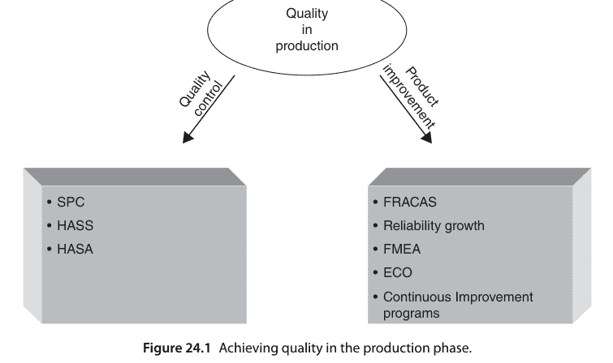
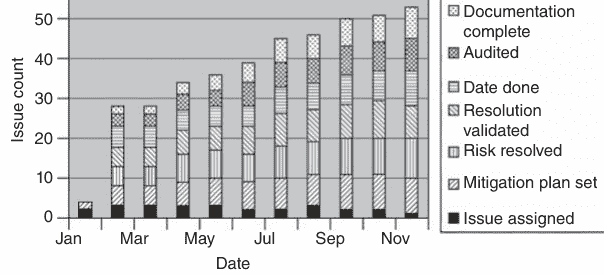
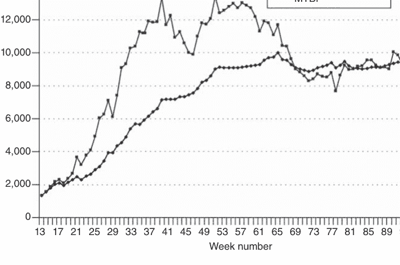
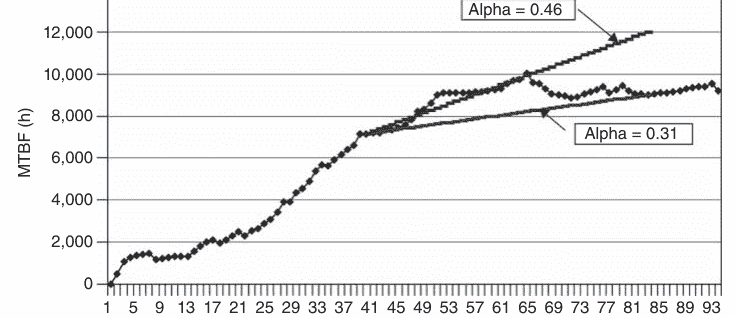
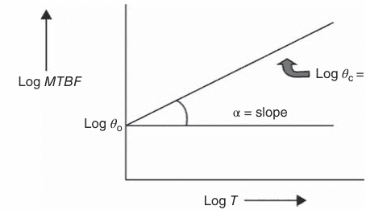
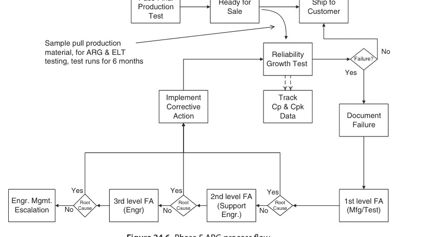
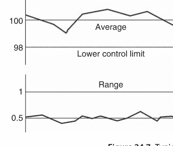

## 24 生产阶段

生产阶段有两个主要目标。第一个是生产爬坡（表 24.1）。此处的目标是快速实现设计成熟度并爬坡至期望的生产水平。第二个主要目标是建立机制（质量控制），以确保在实现批量生产之前产品的质量。生产阶段发生的活动如图表 24.2 所示。

### 24.1 加速设计成熟度

产品进入生产后，必然会出现问题。这些问题阻碍了实现批量生产的能力，包括快速增加或减少批量生产的能力。这些问题影响制造和测试良率，由设计和工艺问题共同组成。这些问题是产品开发过程中出现的逃逸，是由于设计和可靠性流程执行不当造成的。这通常是由于未执行或未能在风险缓解、高度加速寿命试验（HALT）、器件验证测试（DVT）、失效模式和影响分析（FMEA）以及高度加速应力筛选（HASSs）中识别的问题上采取闭环措施所致。当正确实施时，这些可靠性工具能够使产品快速达到设计成熟度。

当设计的固有可靠性得以实现时，设计被认为已成熟。通常在生产初期，会出现设计、制造、测试和可靠性问题，这些问题严重到需要进行设计变更来修复。在实施所有这些修复后，产品开始达到可靠性目标。此时，设计已达到成熟度，出现的质量/可靠性问题已很少见。公司在达到设计成熟度时最常见的问题是，它们花费太长时间来识别这些问题，甚至更长时间来识别根本原因和纠正措施。

产品达到批量生产时，设计必须处于成熟状态。当设计达到成熟度时，大多数工程资源不再需要支持该产品。这些宝贵的工程资源随后可以指向其主要目标，即开发新产品以增加市场份额并扩大业务。实现设计成熟度需要时间，但可靠性流程会加速这一进程。

### 表 24.1 生产爬坡阶段 5 的可靠性活动。

| 参与者 | 可靠性活动 | 交付物 |
|---|---|---|
| Operations/Manufacturing | 1. 所有产品在达到可接受通过率前均进行 HASS。ARG 和 ELT 测试。 | 1. HASS 通过/失败报告。ARG 和 ELT 报告，包含运行小时数、测试单元数，所有故障提交至 FRACAS。 |
| Reliability engineering | 2. 运行 FRACAS。所有产品和客户故障均录入 FRACAS 数据库并跟踪至关闭。 | 2. 定期 FRACAS 和 FRB 会议。故障跟踪至关闭。 |
| Design engineering | 3. 开始可靠性增长。产品运行时间和故障事件录入可靠性增长图表。评估消除失效模式的进展。 | 3. 可靠性增长曲线。 |
| Manufacturing engineer | 4. 执行 FMEA（仅对重大设计变更）及工艺 FMEA。 | 4. 完成的 FMEA 电子表格及纠正措施项的闭环。 |
| Test engineering | 5. 启动 SPC 程序。监控并根据需要调整生产良率。 | 5. 生产质量数据报告。 |
| Field service/customer support |  |  |
| Purchasing/supply management |  |  |
| Safety and regulation |  |  |

注：FMEA：失效模式和影响分析；FRACAS：故障报告、分析与纠正措施系统；HASS：高度加速应力筛选；SPC：统计过程控制；FRB：故障评审委员会。

新产品达到设计成熟度通常需要两到五年时间。最初，产品的故障率很高（平均故障间隔时间 [MTBF] 很低）。当产品达到成熟度时，故障率趋于平稳，达到设计 MTBF 所能实现的水准。此时，与设计相关的問題很少出现；产品可靠性停止以价值（MTBF）提升。此时，产品已达到其可实现的 MTBF。假设制造过程中没有太多变异，生产中的首次通过良率也会趋于平稳。简单来说，当产品达到设计成熟度时，除非对设计进行重大更改，否则很难进一步提高产品的质量和可靠性。

产品达到设计成熟度所需的时间很重要，因为这正是产品达到最低成本结构的时候。因此，很容易理解为什么在生产阶段早期要大力推动实现产品爬坡能力和良率目标。产品生命周期将继续缩短，技术将以更快的速度推动产品过时。如果达到设计成熟度所需的时间也无法减少，则开发的产品可能在达到设计成熟度之前就已过时。幸运的是，我们所介绍的可靠性流程是加速设计成熟度的最有效方法。

产品开发阶段的所有艰苦工作已产生可靠且稳健的设计。产品已设计为可靠，但这本身并不能保证成功。仍有更多工作要做。制造和测试中的质量控制不佳会使产品不可靠。然而，实现制造中的高质量并不困难。只需少数工具即可确保所生产产品的质量。这些工具分为两类，质量控制和产品改进，如图 24.1 所示。

### 表 24.2 生产发布阶段 6 的可靠性活动。

| 参与者 | 产品阶段 |  |
|---|---|---|
| | 可靠性活动 | 交付物 |
| • Reliability engineering<br>• Manufacturing engineer<br>• Test engineering<br>• Field service/customer support<br>• Purchasing/supply management<br>• Safety and regulation | 1. 生产通过率达到后，将 HASS 切换为 HASA。<br>2. 运行 FRACAS。所有产品和客户故障均录入 FRACAS 数据库并跟踪至关闭。<br>3. 继续可靠性增长。产品运行时间和故障事件录入可靠性增长图表。评估消除失效模式的进展。<br>4. 执行 FMEA（仅对 ECO）及工艺 FMEA。<br>5. 继续 SPC 程序。监控并根据需要调整生产良率。 | 1. HASA 通过/失败报告。<br>2. 定期 FRACAS 和 FRB 会议。故障跟踪至关闭。<br>3. 可靠性增长曲线。<br>4. 完成的 FMEA 电子表格及纠正措施项的闭环。<br>5. 生产质量数据报告。 |

注：HASA：高度加速应力审核；ECO：工程变更通知。

### 24.1.1 产品改进工具

如前所述，生产爬坡期间的首要目标是尽快实现批量生产和设计成熟度。产品发布后可能会出现各种严重程度的问题。有些影响客户，即“开箱即坏”故障（也称为到货即坏 [DOA]）、安装问题和高故障率。其他问题影响制造，即首次通过良率低、返工和报废量大、骨场堆积高（等待修复的故障产品）。

产品改进工具通过专注于数据收集和数据趋势分析来检测产品早期问题，从而解决这些问题。然后将每个问题追溯到根本原因并采取纠正措施。当出现影响重大但问题解决并不容易的问题时，会制定遏制计划作为短期修复。遏制解决方案通常比设计修复成本更高。随后使用相同的工具来验证修复是否有效。

### 图 24.1 生产阶段实现质量。

### 24.1.1.1 FRACAS

故障报告、分析与纠正措施系统（FRACAS）始于设计验证阶段。随着原型测试、设计验证和 HALT 中出现产品故障，它们被录入 FRACAS 数据库，并跟踪其进展至根本原因和纠正措施。设计转移到生产时，设计验证期间出现的问题应已解决、验证并实施。FRACAS 数据库提供了做出该判断的能力。

一旦设计进入生产，FRACAS 系统就会发生变化。在设计验证期间，除客户 alpha 和 beta 测试外，产品开发团队识别了所有故障。一旦产品进入生产，故障报告数据可能来自许多不同的地方。内部而言，故障数据可能来自装配、测试、接收检验、元件工程、供应商管理以及可靠性（列表还在继续）。此外，故障报告还可能来自外部来源，如客户、客户服务和支持、现场服务和维修以及市场营销。故障报告信息来自如此多不同的来源，这可能成为一个问题。

当故障报告来自许多不同的来源时，很可能数据会被录入并存储在不同的地方。FRACAS 是识别故障模式的极其有效的工具，以便尽早发现问题。如果数据存储在不同的数据库中，则收集识别趋势所需的数据变得困难甚至不可能。这通常是其中一个

- SPC
- HASS
- HASA

- FRACAS
- Reliability growth
- FMEA
- ECO
- Continuous Improvement programs




FRACAS 最大的问题。不同的团队使用不同的系统进行故障报告。让所有人都使用同一个 FRACAS 系统往往难以实现；通常，团队不愿更换系统，要么是因为成本、时间和无法满足其需求，要么是因为无法将现有数据库转移到新格式。所有这些问题都是合理的问题；越早解决越好。

FRACAS 系统的另一个常见问题是数据的一致性。正如我们指出的那样，故障报告可能来自许多不同的来源。输入到 FRACAS 中的报告数据的质量往往是问题的来源。记录故障到 FRACAS 数据库中常见的一些问题是数据不完整、故障信息不足、故障报告不一致（同一故障描述不同，因此故障的严重程度可能未知），以及故障数据未录入。通过结构良好的 FRACAS 系统可以最大程度地减少这些问题，有些问题甚至可以完全消除。

数据会持续不断地输入到 FRACAS 数据库中。这些数据会被分析以确定故障趋势和严重程度。然而，仅有识别和跟踪故障的过程并不能保证这些故障会被解决，更不用说及时解决了。为了使 FRACAS 系统有效，需要一个故障评审委员会（FRB）来监督问题解决。FRB 由负责产品并有权解决问题的团队成员组成。FRB 由以下成员组成：

- FRB 负责人（高级管理人员）
- 设计团队代表（可召入其他人员）
- 可靠性工程师
- 制造代表。

该团队代表了最低限度的团队参与。FRB 团队定期开会，通常每周一次。会议出席是强制性的，因此，如果团队成员无法出席，其指定的后备人员将顶替。FRB 团队的任务是审查故障报告、问题严重程度 [FRACAS 系统可以分配设计严重程度，类似于 FMEA 中使用的风险优先数（RPN）流程]，并对问题进行优先级排序。然后 FRB 指派适当的团队成员负责最重要的问题。这些人员将主要问题追溯到根本原因，确定纠正措施并实施修复。然后使用 FRACAS 数据库来验证修复是否有效。被指派负责解决问题的 FRB 成员必须有权实施所需的更改。如果制造部门被指派解决需要工程设计更改的问题，他们不太可能成功。设计问题应分配给设计团队解决；制造部门不应寻找方法对问题进行“临时修补”。（随着主要问题的解决，次要问题将成为新的主要问题，依此类推。）

## 24.1.1.2 设计问题跟踪

一种非常简单的替代 FRACAS 的方法，用于跟踪不符合项直至关闭，即设计问题跟踪。这不过是一个“行动项目”清单，外加一个堆积条形图来绘制活动进展情况。如图 24.2 所示，该图表跟踪故障缺陷从文档化，到分配，到故障解决和验证，最后到关闭。条形的高度（y 轴）将在



图 24.2 设计问题跟踪图。

不再出现新问题时停止增加。该图表跟踪问题识别到关闭的过程，而非问题发生的频率。

设计问题跟踪系统适用于小型企业和简单产品。设置简单，无需定制或昂贵的软件来管理。这可以使用任何常见的计算机软件电子表格应用程序，例如 Microsoft Excel 来设置。设计问题跟踪是 FRACAS 的一种替代方法。无论您选择使用哪种系统（FRACAS 或设计问题跟踪），它们都需要与 FRB 协同工作以解决问题。

## 24.2 可靠性增长

FRACAS 提供了一种有效流程，可快速识别问题并监控解决进展。然而，FRACAS 并不能表明产品相对于概念阶段设定的可靠性目标的性能如何。概念阶段早期就设定了可靠性目标，即产品将具有 10 000 小时的 MTBF。在产品设计和制造后，您需要有一定程度的保证，产品将达到其可靠性目标。要确定产品相对于可靠性目标的性能如何，需要可靠性增长。可靠性增长的示例如图 24.3 所示。该图表显示了产品的当前累计和滚动平均产品可靠性。源自 FRACAS 活动的产品改进应在可靠性增长图表中可见。在累计 MTBF 图中，由于累计运行时间很多，与最近具有最新改进的产品短运行时间相比，改进会不那么明显。这个问题很容易通过 13 周滚动平均可靠性增长曲线解决。滚动平均值更好地说明了对产品所做的短期改进。

可靠性增长与 FRACAS 活动协同工作。通常，当新产品发布时，初始可靠性较低，因为 FRACAS 中识别出的尚未解决的问题。在每个问题解决后，产品

### 系统 MTBF



图 24.3 可靠性增长图。

可靠性会提高，因为又有一个失效机制被设计掉了。这种不断提高的产品可靠性（针对新生产的产品）通过可靠性增长进行跟踪。但您如何知道改进产品可靠性的进展是否可以接受？为提高产品可靠性所做的努力是否对产品可靠性产生了影响？可靠性改进是否足够快以满足业务需求？

可靠性增长曲线显示了 FRACAS 对提高产品可靠性的影响。这提供了当前产品可靠性以及其改善速率的快照。通过跟踪可靠性增长，可以就过去可靠性工作的有效性做出决定。然而，重要的是要确定可靠性改进是否进展太慢而无法满足业务需求。可靠性增长也可以用来估计产品的未来可靠性。了解这一点后，可以就产品设计是否以足够快的速度成熟以满足业务需求做出决定。示例如图 24.4 所示。

未来可靠性增长可以使用 Duane 曲线进行估计。Duane 曲线根据当前可靠性增长速率提供了实现可靠性目标所需时间的估计。可靠性增长速率如图 24.5 所示。Duane 观察到，可靠性基于累计 MTBF（θc）随总时间的对数-对数尺度作图而改善。该图可以用一条直线表示，使用

```
Log θc = log θo + α(log T − log To)
```



图 24.4 与预测的可靠性增长图对比。



图 24.5 Duane 曲线。

其中：

|  | = |  |
|---|---|---|
| θ_c | = | θ_o (T/T_o)^α |
| θ_c | = | 总累计时间除以总故障数 |
| θ_o | = | 时间 T_o 时的观测累计 MTBF |
| α | = | 增长率，0.1 ≤ α ≤ 0.6 |
| T | = | 预期累计产品小时数，T > T_o |
| T_o | = | 实际累计产品小时数。 |

可靠性增长速率基于值 α，该值是可靠性增长曲线的斜率。如果 α 值更接近 0.1，则为提高产品可靠性所做的可靠性工作很小，影响不大。如果 α 值更接近 0.6，则可靠性工作非常雄心勃勃，对提高产品可靠性有显著影响。通过将期望的可靠性增长速率与实际增长


rate, a determination can be made regarding the need to make changes in the reliability activity.

The implementation of reliability growth requires assigning a lead person responsible for tracking reliability growth. Often, this is a reliability or quality engineer. However, the skill needed is not at the engineering level, so production personnel are well suited and can be trained for this task. The reliability growth report and the FRACAS report are the primary reports used by the FRB to evaluate progress.

## 24.2.1 Accelerated Reliability Growth (ARG)

The reliability activities through Phase 4 focused on improving design reliability and software quality. At the end of Phase 4, the product has gone through design verification, design validation, and alpha testing. The design is considered to be complete and beta testing under way. The focus now shifts toward production ramp readiness for volume manufacturing release at Phase 5 closure. However, in all likelihood there will be reliability escapes, software quality issues, manufacturing and supplier quality issues at the end of Phase 4 closure that surface after the product has been released for volume manufacturing. When these products start being returned in volume for issues relating to hardware reliability, software quality, workmanship, failed to work (referred to as dead on arrival, or DOA) or have a high infant mortality rate as reported by customers, engineering support teams (composing of hardware engineering, sustaining engineering, manufacturing engineering, and software engineering) are quickly redirected to work on identifying root cause and implement corrective action.

These activities are very disrupting to an organization, significantly impact future product development and cause future product release commitment dates to be missed. The organization can be tossed into a reactive firefighting effort. Waiting for the end user to notify you of a reliability or quality issue, makes this a reactive effort that can have significant financial ramifications if found after there is a large install base. These issues need to be discovered before Phase 5 closure when production is released for volume manufacturing. The question becomes, how can these issues be discovered before the product is released for volume manufacturing? In essence, can the customer experience and discovery of quality and reliability escapes be brought in house providing an opportunity to resolve or fix these issues at the lowest cost and least impact to product development? I have found that many of the hardware reliability and software quality issues can be discovered before Phase 5 closure when the operations group is focused on production ramp readiness. It is also easier to keep the product development team engaged on issues that surface in Phase 5, and will result in quicker time to root cause determination. Once Phase 5 closes, the design team typically disperses to work on the next product or project. It will be harder to pull those resources back in to investigate a reliability escape or quality issue. Two effective tools to help achieve this goal are called accelerated reliability growth (ARG) and accelerated early life test (ELT). Both of these tools help accelerate reliability growth and design maturity.

Accelerating design maturity is a proactive process that starts once Phase 4 closes with the first production units. The goal of an ARG program is to create the customer experience in house in a way that allows for the discovery of the design and quality escapes before high volume production ramp. This can be achieved through an accelerated stress with sufficient run time and sampling from production material to identify the reliability



## Figure 24.6 Phase 5 ARG process flow.

and quality escapes. Reliability growth testing is performed on production material that has gone through the manufacturing and test process and is ready for shipment to the end-user (Figure 24.6). Any quality or reliability issues found in this extended testing is treated like a field failure and is logged into the FRACAS system. The material used for ARG is material that has gone through manufacturing and passed, so any failures are like customer failures and should be investigated to determine root cause and have an associated corrective action.

The ARG testing should be an accelerated stress test, typically at elevated temperatures and include frequent power cycling.

## 24.2.2 Accelerated Early Life Testing (ELT)

The accelerated ELT is intended to identify unintended early life wear out mechanisms. These failures are systemic in nature so it can potentially affect the entire field population. The unintended early life wear out mechanism is an escape in the reliability process. It can be due to a component running hotter than anticipated, causing it to have a significantly shorter useful life. It can be a significant coefficient of thermal expansion (CTE) mismatch between a large component and the circuit board it is mounted to. The CTE mismatch can create significant strain energy as the product heats up causing it to develop solder cracks early in the product life. Once the solder crack is created, additional thermal cycles cause the stress intensity at the crack to be greater due to a stress concentration created at the solder fracture. The result is that the solder crack continues to propagate until there is a full separation of the solder connection. A component that is unintentionally used beyond its absolute maximum recommended limits is likely to suffer premature wear out. This may be due to a misunderstanding between the differences between absolute maximum limits and recommended operating limits. If you're

lucky these types of design errors get detected during HALT when you step stress the part. However, if it doesn't get detected in HALT it is very likely to end up as an early life wear out failure.

The accelerated ELT is typically the same test used for ARG testing except that it runs for a significantly longer time. The sample size does not have to be large because the failure mechanism we are concerned about is wear out. Typically, ELT runs for a period of six months using the same test protocol as ARG.

## 24.3 Design and Process FMEA

Design FMEAs identify shortcomings in product design and safety and health hazards. When a design is changed because of market needs, added capability, new features, errors, field failures, and so on, a design FMEA can once again protect against design oversights. The entire design doesn't need to have a complete FMEA; usually, just that portion that has been changed. Having a record of the original design FMEA, will greatly speed this process to completion.

Can an FMEA be applied to more than just designs as a tool for improvement? Yes, an FMEA can be applied to manufacturing, assembly, test, receiving inspection, process equipment, and fabrication processes. In fact, the majority of the FMEA activity in this phase is process-related. The process FMEA should be used before implementing any significant changes in the manufacturing process. This ensures that the changes do not impact product quality and reliability. As with design FMEAs, having a record of the original process FMEA will greatly speed this process. This way, any mistakes can be detected and corrected before HASS. This will save time and money.

The FMEA process was described in detail in Chapter 7. The FMEA in this situation is a structured method to study a process that seeks to anticipate and minimize unwanted performance or unexpected failures.

The process is the same for both a design and process FMEA. The major difference is that the participants required will be different. The other major difference in a process FMEA is that it asks the question “what can go wrong with the process?” A process FMEA can also be an effective tool to determine the critical process to monitor for quality control. An FMEA, in this situation investigates the critical processes in the manufacturing process that effect product quality. Next, it determines what process controls need to be in place to prevent rejects and defective products from reaching the customer. The results can then be part of the quality controls used to ensure product quality.

### 24.3.1 Quality Control Tools

The reliability activities throughout product development ensured that the product was designed for reliability and has ample design and process margin. When a product is designed with sufficient process margin, then controlling quality in manufacturing is all that is needed for success. The quality control tools are designed to achieve this task. There is always a risk of escapes in the manufacturing process where nonconforming products are released for sale. The rate of escapes is related to the first-pass yield of the product. Products with poor yields tend to have higher escape rates than products with


高的一次通过率。这是确保产品质量的重要原因之一，必须具有足够的设计和工艺裕度。

在传统的质量计划方法中，识别关键工艺并持续监控和控制这些工艺，使其保持在可接受的变异范围内。重点在于检测和纠正工艺缺陷，以确保最高的质量水平。这些活动是对制造过程中下游捕获的工艺变化做出反应。为了使这些技术有效，必须尽可能地将其推向更上游，以最大限度地减少制造逃逸。理想情况下，这需要在任何工艺之后立即进行，其中变异性至关重要。在装配工艺中，可能需要自动检测设备（即 X 射线和光学）来检测关键工艺中的变化，例如焊膏沉积、元件放置和焊点质量。早期检测是关键。不要仅依赖在线路和功能测试来确定产品质量。这样不仅可以最大限度地减少返工成本和受影响的产品数量，而且还可以最大限度地减少不合格产品的逃逸率。用于监控制造过程控制的技术称为统计过程控制（SPC）。

质量控制还有其他方法。最值得注意的是质量功能展开（QFD）技术。QFD 是识别可能影响产品满足客户需求和要求的能力的所有因素的过程。实质上，识别可能影响客户满意度的因素。QFD 方法的优点在于征求“客户之声”输入，因此诸如手感和外观等问题也可以被考虑。

## 24.3.1.1 SPC

今天制造的大多数高科技产品都是按照既定的质量标准生产的。质量标准是通过使用质量控制流程实现的。质量控制流程纳入了 SPC，以定义上、下过程控制限。当工艺超出限值时，生产线会停止运行，从而使问题得到高度关注，并通知相关人员。

SPC 图表使用统计监控来控制制造过程并保持公差。其优点是生产成本降低、良率提高、材料报废减少、保修成本降低以及可扩展性。所选用于监控的工艺参数很重要。困难在于能够识别影响产品质量的关键工艺参数。这些关键参数必须可控。

图 24.7 显示了一个通用控制图。控制图具有上、下控制限，工艺必须保持在这些限值内。工艺不能超出这两个限值。对于此示例，一根杆被切割至关键长度 100 cm。选择了一种抽样方法以及抽样计划。在生产了预定数量的产品后，会抽取一个随机选择的样本批次（通常为 30 个）以验证工艺是否受控。样本批次的切割长度被测量，并记录平均长度并绘制在控制图上。范围图是工艺变异的平均值（围绕所需切割长度的正负值）。只要变异的平均值在可接受的控制限内，范围图就表明工艺受控。随着时间的推移，工艺可能会漂移超出控制。控制图可确保识别出不可接受的工艺漂移，并且纠正措施可使工艺恢复受控。



SPC 图表描绘了一个可以在 100 cm 左右变化的工艺，± 2 cm（即长度切割为 100 cm 的杆）。

从图表来看，工艺受控且未超出控制限。

请注意，范围是一个绝对数值，因此它永远不是负数。

图 24.7 典型的 SPC 图表。

工艺在达到不合规之前所处理的单位时间或数量是抽样过程的抽样率。样本数量和抽样率可能有所不同。对于稳定工艺，过程控制所需的样本更少，抽样周期也更不频繁。存在优化抽样大小和频率的技术，以便将检验成本降至最低。该过程的另一个好处是运行过程控制图所需的技能水平最低。这意味着最接近工艺的人员可以负责确保工艺保持受控，并在需要时进行调整。只有当生产人员无法控制工艺时，才需要工艺工程师来诊断和纠正情况。

控制图可用于控制建立最终产品质量的重要参数。一些例子是：钻孔深度、输出电压、输出功率、光照水平、粘附力、重量、显示器显示精度等等。列表由产品质量规范决定。

控制图有许多变体，但它们都必须持续监控。监控点之间的时间间隔是根据在遇到不可接受的错误之前变化率或工艺漂移的速率而变化的。每个 SPC 数据收集系统都是经验确定的，整个 SPC 系统中的每个监控步骤可能都有不同的监控周期。最好将此任务自动化。凭借当今的工艺工具，存在各种计算机化和手持式 SPC 数据收集和绘图设备。它们可以消除数据收集、计算和绘制结果工作的繁琐。将 SPC 应用于制造过程为控制已设计良好的产品的工艺提供了一种直接的方法。对于需要更大控制和控制精度的工艺控制，可以应用六西格玛方法。

将 SPC 实施到制造过程中需要以下内容：

- 1. 选择将学习 SPC 技能的关键人员。他们将成为内部培训师，致力于内部培养 SPC 技能。（质量控制经理是合适人选。）
- 2. 识别需要受控的关键参数。哪些应先做，其次做，等等？（审查并按帕累托分析故障报告，以揭示未受控的不合格情况。）
- 3. 确定实施 SPC 流程所需且成本可接受的硬件和软件。（有许多公司生产 SPC 工具；使用互联网会发现许多。）
- 4. 确定一个“启动”日，所有参与新 SPC 流程的人员都将参与其中。

SPC 流程的一个例子是电路板制造中使用的波峰焊机。产品子组件是具有用于元件引线的镀通孔的电子印刷电路板。元件“插装”到板上后，引线被修剪到长度，板被放置在输送系统上。然后它缓慢通过波峰焊工艺，引线通过熔融焊料浴。浴槽有一个装置，可在浴槽中形成波浪或凸起，以便元件引线浸入正确的时间。经过此工艺后，焊料冷却，引线牢固地焊接到板上。当时该工艺未处于 SPC 控制之下。有一天，测试组发现焊料缺陷率非常高，并确定这是由于波峰焊工艺造成的。

对工艺、机器和人员进行审查后，未发现任何可归因于焊料缺陷原因的因素。然而，问题仍然存在。然后，质量经理决定对波峰焊工艺实施 SPC。不久，他就将焊料缺陷与一天中的时间相关联。他仍然不知道问题的根本原因，但他的控制图显示焊料温度在一天中的某个时间突然下降，并且可以追溯到表现出缺陷的电路板。他坐在生产线上只是观察。然后他看到新的波峰焊操作员在机器运行过程中去吃午饭时向浴槽中扔了几块焊料锭。这导致焊料在短时间内温度偏低。后来确定这是焊料缺陷的原因。在这里，SPC 温度显示焊料浴的温度下降到足以导致缺陷的程度，但不足以引起波峰焊机方面的太多关注。

## 24.3.1.2 六西格玛

六西格玛是一种过程控制方法，在过去二十五年中获得了大量认可。它假设一切都呈正态分布，并且生产过程误差检测系统实际上可以测量到百万分之一的差异。这种精度很少需要。要成为六西格玛专家所需的培训并不简单。这种特殊技能造成了一个问题。公司已有的专业知识和人才必须为六西格玛专家让路，而这些专家通常只能提供统计支持。除非专家是实际执行纠正措施的人，否则六西格玛统计人员与公司实际知识库之间始终存在脱节。

在现有员工中建立六西格玛能力需要数月时间来培养。建议立即实施更简单的 SPC 流程，以使该控制机制到位并运行起来。在建立 SPC 系统后，可能正是派遣关键人员接受六西格玛培训的合适时机。你可能会发现，对于你的公司来说，尤其是在可靠性改进的早期阶段，它可能根本不需要。


## 24.3.1.3 HASS 和 HASA

HASS，如前所述，是一种用于检测制造过程或进入产品的材料中不可接受变化的过程。HASS 比传统上用于降低早期失效的产品老化试验更高效。高度加速应力审核（HASA）只是在抽样或审核的基础上实施的 HASS 过程。

传统的产品老化试验通常无效且成本高昂。环境应力筛选（ESS）是降低产品早期失效的更有效方法，且运行时间显著更短。然而，HASS 通常比 ESS 更能有效识别与制造相关的缺陷产品，并且对产品造成的损害更小。

所有这些“老化”技术都需要运行时间，需要资本成本来设置，并降低首次通过率。说服管理层需要对最终产品进行应力测试以降低早期失效往往很困难。产品需要快速投产且不能阻碍产品投产的压力很大。因此，通常需要妥协，以便同时实现业务和质量目标。如果产品开发成功遵循了可靠性流程，设计应该是可靠的并且具有足够的裕度。如果事实确实如此，那么 HASA 将成为确保产品质量得以维持的最经济有效的方法。

如果产品开发期间的可靠性流程被缩短、跳过或省略，则可能需要某种形式的 100% ESS 或 HASS 测试来剔除缺陷产品。只要设计变更将产品故障率降至可接受水平，这种测试就会继续进行。经过良好实施的可靠性计划的回报在制造初期就能看到，因为昂贵的老化测试很快就会转变为审核（HASA）流程。能够迅速切换到 HASA 而不是筛选每件产品的显著成本节约。

这些工具用于实施控制、监控，并在不合格成为最终产品的一部分之前识别不可接受的过程。此外，还有促进持续改进的工具。

## 进一步阅读

### FMEA

- S. Bednarz, D. Marriot, *Efficient Analysis for FMEA*, 1998 Proceedings Annual Reliability and Maintainability Symposium (1998).
- M. Kennedy, *Failure Modes and Effects Analysis (FMEA) of Flip-Chip Devices Attached to Printed Wiring Boards (PWB)*, IEEE/CPMT International Manufacturing Technology Symposium, IEEE (1998).
- M. Krasich, *Use of Fault Tree Analysis for Evaluation of System Reliability Improvements in Design Phase*, 2000 Proceedings Annual Reliability and Maintainability Symposium (2000).
- K. Onodera, Effective Techniques of FMEA at Each Life-Cycle Stage, 1997 Proceedings Annual Reliability and Maintainability Symposium, IEEE (2000).

### 质量

- Gupta, P. (1992). Process quality improvement – a systematic approach. Surface Mount Technology.
- Johnson, C. (1997). Before you apply SPC, identify your problems. Contract Manufacturing.
- Kelly, G. (1992). SPC: another view. Surface Mount Technology.
- Lee, S.B., Katz, A., and Hillman, C. (1998). Getting the quality and reliability terminology straight. IEEE Transactions on Components, Packaging, and Manufacturing 21 (3): 521–523.
- Mangin, C.-H. (1996). The DPMO: Measuring Process Performance for World-Class Quality. SMT.
- S. M. Nassar, R. Barnett, IBM Personal Systems Group Applications and Results of Reliability and Quality Programs, 2000 Proceedings Annual Reliability and Maintainability Symposium (2000).
- Oh, H.L. (1995). A Changing Paradigm in Quality. IEEE Transactions on Reliability 44 (2): 265–270.
- Pearson, T.A. and Stein, P.G. (1992). On-line SPC for assembly. Circuits Assembly.
- Ward, D.K. (1999). A formula for quality: DFM + PQM = single digit PPM. Advanced Packaging.

### 可靠性增长

- H. Crow, P. H. Franklin, N. B. Robbins, Principles of Successful Reliability Growth Applications, 1994 Proceedings Annual Reliability and Maintainability Symposium, IEEE (1994).
- J. Donovan, E. Murphy, Improvements in Reliability-Growth Modeling, 2001 Proceedings Annual Reliability and Maintainability Symposium, IEEE (2001).
- L. Edward Demko, On Reliability Growth Testing, 1995 Proceedings Annual Reliability and Maintainability Symposium, IEEE (1995).
- G. J. Gibson, L. H. Crow, Reliability Fix Effectiveness Factor Estimation, 1989 Proceedings Annual Reliability and Maintainability Symposium, IEEE (1989).
- Prasad, S. (1991). Improving manufacturing reliability in IC package assembly using the FMEA technique. IEEE Transactions on Components, Hybrids and Manufacturing Technology 14 (3): 452–456.
- D. J. Russomanno, R. D. Bonnell, J. B. Bowles, Functional Reasoning in a Failure Modes and Effects Analysis (FMEA) Expert System, 1993 Proceedings Annual Reliability and Maintainability Symposium, IEEE (1993).
- SAE (2001). Recommended Failure Modes and Effects Analysis (FMEA) Practices for Non-Automobile Applications. SAE.
- R. Whitcomb, M. Riox, Failure Modes and Effects Analysis (FMEA) System Development in a Semiconductor Manufacturing Environment, IEEE/SEMI Advanced Semiconductor Manufacturing Conference, IEEE (1994).

### 老化试验

- T. Bardsley, J. Lisowski, S. Wilson, S. VanAernam, *MCM Burn-In Experience*, MCM '94 Proceedings (1994).
- D. R. Conti, J. Van Horn, *Wafer Level Burn-In*, Electronic Components and Technology Conference, IEEE (2000).
- J. Forster, *Single Chip Test and Burn-In*, Electronic Components and Technology Conference, IEEE (2000).
- T. Furuyama, N. Kushiyama, H. Noji, M. Kataoka, T. Yoshida, S. Doi, H. Ezawa, T. Watanabe, Wafer Burn-In (WBI) Technology for RAMs, IEDM 93–639, IEEE (1993).
- R. Garcia, IC Burn-In & Defect detection Study, (September 19, 1997).
- Hawkins, C.E., Segura, J., Soden, J., and Dellin, T. (1999). Test and reliability: partners in IC manufacturing, part 2. *IEEE Design & Test of Computers*, IEEE.
- T. R. Henry, T. Soo, *Burn-In Elimination of a High Volume Microprocessor Using IDDQ*, International Test Conference, IEEE (1996).
- Jordan, J., Pecht, M., and Fink, J. (1997). How burn-in can reduce quality and reliability. *The International Journal of Microcircuits and Electronic Packaging* 20 (1): 36–40.
- Kuo, W. and Kim, T. (1999). An overview of manufacturing yield and reliability modeling for semiconductor products. *Proceedings of the IEEE* 87 (8): 1329–1344.
- W. Needham, C. Prunty, E. H. Yeoh, *High Volume Microprocessor Test Escapes, an Analysis of Defects our Tests are Missing*, International Test Conference, pp. 25–34.
- Pecht, M. and Lall, P. (1992). A physics-of-failure approach to IC burn-in. *Advances in Electronic Packaging*, ASME 917–923.
- A. W. Righter, C. F. Hawkins, J. M. Soden, P. Maxwell, *CMOS IC Reliability Indicators and Burn-In Economics*, International Test Conference, IEEE (1988).
- T. Sudo, *An Overview of MCM/KGD Development Activities in Japan*, Electronic Components and Technology Conference, IEEE (2000).
- Thompson, P. and Vanoverloop, D.R. (1995). Mechanical and electrical evaluation of a bumped-substrate die-level burn-in carrier. *Transactions on Components, Packaging and Manufacturing Technology, Part B* 18 (2): 264–268, IEEE.

### HASS

- Lecklider, T. (2001). How to avoid stress screening. *Evaluation Engineering* 36–44.
- D. Rahe, *The HASS Development Process*, 2000 Proceedings Annual Reliability and Maintainability Symposium, IEEE (2000).
- Rahe, D. *HASS from Concept to Completion*. Qualmark Corporation.
- M. Silverman, *HASS Development Method: Screen Development, Change Schedule, and Re-Prove Schedule*, 2000 Proceedings Annual Reliability and Maintainability Symposium, IEEE (2000).

- 寻找专门获取和储存这些组件的供应商。
- 偶尔，生产商会了解到某种组件已过时，而最后一次采购无法满足其需求。 （专门从事这一市场的供应商很可能被用作早期预警盟友，以帮助避免这一问题。）
- 确定需要多少即将无法获得的零件来支持产品寿命，以便进行最后一次采购以满足这一需求。
- 一旦确定某零件即将停产，应将其标记为“已停产”并“禁止在新设计中使用”。
- 作为新产品开发流程的一部分，确保有一个物料清单（BOM）检查步骤，审查所有 BOM 中的零件停产情况。这将避免设计中使用在生产时才意识到停产的零件。

找到替代零件时，良好做法是对产品进行高度加速寿命试验（HALT）以验证其符合规格的性能。

## 25.2 产品终止

在某个时间点，企业被迫停止为销售而制造产品。此外，还需要决定停止支持产品。这两个决定不需要同时发生。当产品正在逐步淘汰时，应进行以下活动以实现妥善关闭：

1. 从仓库中移除不再需要的物品：
   - (a) 零件和组件
     - 报废
     - 折价出售
     - 为新产品返工
   - (b) 文献资料
     - 电路图
     - 手册
     - 物料清单
2. 将旧制造工艺从生产中转变出来：
   - (a) 制造生产线和/或单元
   - (b) 生产线库存
   - (c) 测试夹具和设备
   - (d) 工艺
3. 结束持续工程支持。

## 25.3 项目评估

最后，应进行一次审查，以研究整个产品生命周期中获得的经验教训。哪些计划本可以制定来减轻在下一产品中可能再次发生的出现问题？是否应向流程中添加额外的检查？计划的生命周期是否与产品实际发生的情况相符？是否应审查生命周期，以及审查频率？还有许多项目和后续行动


可以添加到流程中以开发更顺畅的产品生命周期，并且进行生命周期结束评审将有助于确保更好的结果。

## Further Reading

R. Solomon, P. A. Sandborn, M. G. Pecht, Electronic Part Life Cycle Concepts and Obsolescence Forecasting, IEEE (2000).

## 26
## Field Service

你做得很好，但仍会出现一些故障，无论是在内部还是在现场。知道这一点后，你必须尽可能让这种 eventuality 变得不那么痛苦。这样做将降低成本并减少客户不满。将维修和维护纳入考虑是产品设计要求的一部分。通过设计，你可以提供易于维护且能快速恢复服务的产品。

### 26.1 Design for Ease of Access

当子组件或部件发生故障时，便于访问可使维修更快更可靠。设计便于访问通常不会给产品增加太多或不增加成本；也就是说，只要在设计阶段就考虑到产品的这一方面。

通常，一种产品会有多个子组件组成整体。设计系统使这些较小的单元能够快速轻松地拆卸和更换，这是一个可访问性的优势。设计应允许服务技术人员在无需松动或拆卸其他组件的情况下到达任何可能发生故障的组件。当情况并非如此时，处理其他子组件、扭转电缆、拆卸滑轮、皮带、支架等可能会导致未来出现意外的故障或延长服务时间。

当发生故障的组件可以在不拆卸其他部件的情况下拆卸和更换时，维修后的可靠性会更高。这是因为为了维修某个部件而拆卸其他组件，存在损坏未受影响组件的风险，并且重新组装相关的复杂性增加。我们都有这样的经历：为一个问题进行维修后，很快又出现一个新问题，这很可能是由不当的重新组装或调整引起的。

### 26.2 Identify High Replacement Assemblies (FRUs)

接受你的产品会出现一些故障。识别出那些比其他组件更需要经常维修的组件。设计系统使这些部分能够轻松拆卸、维修和更换，而无需访问系统的其他部分。这样做将使系统服务事件对你和你的客户来说不那么痛苦。

在考虑更换项目时，务必识别出需要定期维修和/或更换的项目，例如风扇、过滤器、皮带、驱动轮、液体、电路板、电池等。知道需要更换什么并使这一步变得简单是设计工作的一部分。在适用情况下，识别出应按计划更换的项目。

具有冷却风扇的电源有两个故障规范。电源的平均故障间隔时间（MTBF）可能为数十万小时，而电源中的风扇寿命可能只有 20 000 至 80 000 小时。当风扇故障时，电源会检测到风扇旋转停止并关闭以防止过热故障。选择风扇寿命长的电源，而不仅仅是 MTBF 高的电源。确保这些风扇可以轻松更换——即使在现场。风扇的库存维修成本比电源低。在需要将这些电源退回制造商维修的情况下，将风扇更换作为维修合同的一部分，以确保新维修的电源不会因风扇即将到期而很快再次故障。

大型系统中通常使用多个风扇。在一组具有相同寿命预期的相同风扇中，其中一个风扇会最先故障。最好一次性更换整个组。润滑剂流失是风扇故障的主要原因。组内所有风扇的环境相似，因此每个风扇的油损失将非常相似。最先故障的风扇表明其他风扇也将很快跟进。一次全部更换。了解风扇故障率后，可以启动预防性更换计划。它们可以在计划维护期间更换，从而避免使用期间发生故障。

风扇、电机、泵、过滤器、密封件等是需要定期更换的组件，就像汽车中的风扇皮带一样。一些子组件附着在这些磨损件上。通常，风扇被作为整个单元的一部分，例如电源。这意味着当风扇故障时，整个子组件需要更换。避免这种情况的方法是使风扇本身成为一个子组件。带风扇的子组件通常有许多电线需要在更换单元获取时断开和重新连接。将风扇放在自包含单元中可以简化布线拆卸和连接，因为即使对于复杂的风扇系统，也只需要断开和重新连接几根电线。现场更换单元（FRU）需要在设计中识别并传递给为现场提供这些物品的人员。记住，故障模式和影响分析（FMEA）流程可以帮助识别 FRU。

预防性服务规划可以降低总服务成本。使用故障报告（故障报告、分析和纠正措施系统 [FRACAS]）来识别那些在磨损方面更可预测的区域，并安装旨在用于计划停机时间的服务计划。应用使用率并库存这些物品，以确保没有停机。

在需要更换过滤器的情况下，考虑在设计中添加过滤器流量传感组件。这可以帮助你的客户避免运行期间的停机时间。同样，确保过滤器可以轻松更换。添加低液位指示器以避免可能通过简单的换油或补充液体步骤即可避免的灾难性故障。

### 26.3 Wearout Replacement

一些磨损件需要特别的安排。白炽灯需要灯座，一些继电器、接触器、断路器等也是如此。可以为这些组件添加灯座以便于快速服务。然而，添加任何类型的连接器（灯座）都会降低可靠性。在添加连接器时要谨慎。

### 26.4 Preemptive Servicing

当你自行维修产品时，考虑更换一些已显示出可预测磨损时间的零件或组件。电解电容器会像风扇因蒸发而失去油一样失去电容器中的液体。环境温度越高，发生得越快。检查 FRACAS，如果这是问题所在，并在维修过程中更换这些零件。考虑使用在这种环境中能更持久的组件（从 85 到 105 °C 的电解电容器，因为它们在高温下寿命大约长四倍）。旋转设备如风扇会受到安装方式的影响（球轴承设备在垂直轴位置比套筒轴承设备更可靠；然而，它们对冲击更敏感）。关键是使用 FRACAS 来识别那些产品寿命低于预期的磨损件。

一些复杂的系统会监控关键组件，即 CAT 扫描仪中的 X 射线管、大型电路板阵列中接触插入/拔出循环次数、录音带/磁盘重录次数等。其中一些高端系统实际上通过互联网连接到工厂服务组，以在计划维护期间预先订购维修用备件。这些系统确保服务人员和更换硬件同时到达，以实现高效维修。这保持了非常高的可用性。

检查当前现场更换项目时，可能变得明显的是一些磨损件需要更换过于频繁。在这里，你可以在设计定稿前更换为更可靠的组件。在产品开发周期的早期修复这个问题，比产品已经在现场后再修复成本更低。

### 26.5 Servicing Tools

当系统需要调整时，确保设计考虑到调整工具需要去哪里才能进行调整。使插入该工具进行调整变得容易。注意系统所在的<|message|> 环境。会有足够的照明吗，还是系统的盖子会阻挡进行适当维修所需的光线？某些调整是否在照明不良的刻度上读取？在设计中使该区域更可见。

服务工具的选择也很重要。设计以适应价格低廉且易于获得的工具。如果你的产品销售遍及全球，请考虑工具在外国的可用性。即使槽型和十字螺丝刀在全球都很常见，也要避免使用它们，因为它们可能会因刮擦而留下小碎片


拧紧时螺丝头部会受损。这些金属冰柱会进入各处并导致其他故障和损坏。带槽六角机螺钉是一个不错的替代品。Torx 螺钉甚至更好，而且在制造现场作为更换的螺丝刀头使用寿命更长，但它们在全球范围内的可获得性不如前者。在某些情况下，设计需要专用工具。当您的产品需要专用工具时，请确保它能通过您的设施方便获得。然而，请记住，专用工具的设计、制造和库存成本昂贵。普通工具的成本要低得多。

大型系统可能需要拆卸非常重的子组件。人力有时无法完成这项工作。大型系统通常有多个重型子组件，例如动力单元、空调、大型电路板组件等。确保设计团队在需要专用工具时进行接口沟通（再次咨询现场服务人员）。努力设计一种工具用于所有这些任务，而不是为每个主要子组件设计一种专用工具。甚至要考虑更普通的工具需求。选择只需要一种尺寸螺丝刀的螺丝尺寸。这也能降低服务工具的成本和数量。

现场服务组将有一套规定的工具，他们携带这些工具到现场维修设备。获取该清单，复印并传达给公司每个设计师。明确说明这些就是他们可考虑用于现场使用的工具。只有在得到现场服务人员的认可后，才能添加新工具。把设计验证流程中安排一天让设计师拆卸、调整、重新校准并更换他们的设计作为一部分。让每个人都执行此服务步骤。设计组在设计产品时就会考虑到工具组，因此即使在之前也能做出更好的工具选择工作。新工具会增加成本，使工具箱更重，而且往往是不必要的。但是，有时专用工具是必要的。

当您发现设计团队需要专用工具时，请询问原因。审查服务工具包中的所有工具，并与服务人员合作，看看现有工具组是否能完成工作。如果所有方法都失败，专用工具可能就是必要的。

确实，服务人员为自己的工具感到自豪，对许多人来说，工具越多越好。但在他们必须长途携带这些工具后，他们往往会重新思考这个想法。花时间审计服务人员的工具箱。看看他们的工具包中是否有不在规定清单上的工具。了解为什么会添加任何工具。您可能会了解到，使用该附加工具的组件如果没有它就无法维修或拆卸，或者它比设计师指定的工具更好。服务技术人员不可避免地会在服务工具包中添加一些工具。然而，查看他们添加的内容却能提供非常有价值的指导。

## 26.6 服务环路

某些组件需要互连电缆。在可能的情况下，为这些电缆增加一些长度，以便于拆卸和更换。这称为服务环路。将这些内部组件的连接器定位，以便在子组件拆卸前可以拔下，并在子组件牢固安装后重新插上。这种额外的安全预防措施是一项宝贵的服务功能。设计时应使一人即可完成工作。派两名维修人员去现场会更昂贵。对于客户拥有内部服务人员的情形，这也有助于降低他们的成本。

设计机柜，使服务人员能够在不笨拙操作的情况下进行工作并使用仪表和其他工具。在机柜中增加一个用于测试设备的电源插座是一个加分项。

当部件易于拆卸以便维修时，系统恢复运行所需的时间就会缩短。这也可以作为设计的一部分。某些系统在维修后需要校准。设计子组件时应考虑到这一点。也许，通过对子组件进行隔间化，可以使大多数维修无需新的调整或校准程序。这加快了维修速度，并使系统能迅速投入使用。

## 26.7 可用性或维修时间周转

可用性是设计的重要组成部分。设计时应考虑快速维修周期。可用性是可以测量的，并且是可与可靠性工作一起使用的指标。平均故障间隔时间被称为 MTBF。系统恢复到用户手中所需的时间是平均修复时间（MTTR）。它们在数学上通过一个称为可用性的术语相关联，以正常运行时间的百分比表示：

可用性 = MTBF/(MTBF + MTTR)
× 100（以正常运行时间的百分比表示）

该等式表明，可用性在 MTTR 最低时最大。较大的 MTTR 会极大地影响相当大的 MTBF。（一辆故障很少但需要从另一个国家更换零件的汽车是不理想的。）

## 26.8 通过冗余避免系统故障

在需要高可靠性的地方，可能需要冗余。这是指设计人员使用额外的组件并联使用，使得当一个组件失效时，其他组件仍能处理负载。这通常用于电源。五台 500 000 小时 MTBF 的电源作为一组运行且全部都需要时，组合 MTBF 为 100 000 小时。并联再增加一台电源（共六台），可将电源组的实际可靠性延长至数百万小时，具体取决于计划检查失效单元的时间以及在另一单元失效前更换失效单元的时间。这被称为 N + 1 冗余。这可以用于开关和连接器触点、流体管路和硬盘驱动器。清单无穷无尽。

当组件的可靠性非常高且失效概率极低时，就可消除冗余或本地备件的需求。一些高端汽车配备防爆轮胎；路上没有备胎可供更换。这些轮胎在高速行驶时可保持瘪胎状态行驶长达 100 英里，以便驾驶员能到达服务设施进行更换。

## 26.9 随机失效与磨损失效

必须指出，现场的故障是由随机故障和磨损型故障驱动的。磨损在很大程度上可通过设计在服务计划中得到解决。FRACAS 系统中数据的积累可以帮助确定所需更换物品的数量。

## 进一步阅读

Steinberg, D.S. (2000). *Vibration Analysis for Electronic Equipment*, 3e, 9. Wiley.
