# 前言

渗透测试或道德黑客是一种合法且万无一失的方式来识别系统中的漏洞。通过彻底的渗透测试，您可以抵御大多数威胁。

本学习路径首先深入解释了黑客和渗透测试是什么。您将深入了解经典的 SQL 和命令注入漏洞，并发现利用这些漏洞以确保系统安全的方法。您还将学习如何创建和定制 payload 以规避反病毒软件并绕过组织的防御。无论是利用服务器漏洞和攻击客户端系统，还是入侵手机和安装后门，本学习路径都将指导您完成所有这些以及更多内容，以提高您对在线攻击的防御能力。

在本学习路径结束时，您将拥有入侵系统并识别其所有漏洞所需的知识和技能。

本学习路径包含以下 Packt 产品的内容：

- 使用 Kali Linux 进行 Web 渗透测试 - 第三版
  作者 Juned Ahmed Ansari 和 Gilberto Najera-Gutierrez
- Metasploit 渗透测试 Cookbook - 第三版
  作者 Daniel Teixeira 和 Abhinav Singh

# 本书适合谁

本学习路径专为希望学习漏洞利用并充分利用 Metasploit 框架的安全专业人员、Web 程序员和渗透测试人员设计。需要具备一定的渗透测试和 Metasploit 理解，但基本的系统管理技能和阅读代码的能力是必须的。


## 本书涵盖内容

第 1 章，渗透测试与 Web 应用简介，涵盖渗透测试、Kali Linux 和 Web 应用的基础概念。首先从渗透测试本身的定义和其他关键概念开始，然后介绍在进行专业渗透测试前需要考虑的事项，例如定义范围和参与规则。随后我们深入 Kali Linux 并了解 Web 应用的工作原理，重点关注对渗透测试人员更相关的方面。

第 2 章，使用 Kali Linux 搭建你的实验室，是对将在后续章节中使用的测试环境的技術回顾。我们首先解释 Kali Linux 是什么以及它包含哪些用于测试 Web 应用安全的工具；接下来我们查看将在后续章节中用于演示漏洞和攻击的易受攻击 Web 应用。

第 3 章，侦察与 Web 服务器画像，展示了渗透测试人员和攻击者用来获取目标应用开发、托管和支持所使用技术的信息的技巧和工具，并识别可能被进一步利用的第一个薄弱点，因为根据渗透测试的标准方法论，第一步是尽可能多地收集有关目标的信息。

第 4 章，身份验证与会话管理缺陷，顾名思义，专门用于检测、利用和缓解与应用内用户识别和职责分离相关的漏洞，首先解释不同的身份验证和会话管理机制，然后说明这些机制如何存在设计或实现缺陷，以及恶意行为者或渗透测试人员如何利用这些缺陷。

第 5 章，检测与利用基于注入的缺陷，解释了最常见注入缺陷的检测、利用和缓解方法，因为就安全性而言，开发人员最关心的问题之一是其应用容易受到任何类型的注入攻击，无论是 SQL 注入、命令注入还是其他攻击，这些都可能对 Web 应用构成重大风险。

第 6 章，查找与利用跨站脚本 XSS 漏洞，从解释什么是跨站脚本漏洞开始，到其为何构成安全风险，到如何识别 Web 应用是否易受攻击，以及攻击者如何利用它来窃取用户敏感信息或使其在不知情的情况下执行操作。

第 7 章，跨站请求伪造、识别与利用，解释了什么是跨站请求伪造攻击以及其工作原理。然后我们讨论检测启用该攻击的缺陷的关键因素，其次是利用技术，最后提供预防和缓解建议。

第 8 章，攻击加密实现中的缺陷，首先介绍从渗透测试人员角度有用的加密概念，例如 SSL/TLS 的一般工作原理、加密的概念和算法的回顾，以及编码和哈希；然后我们描述用于识别弱 SSL/TLS 实现的工具，以及利用已知漏洞的方法。接下来，我们介绍自定义加密算法和实现中缺陷的检测与利用。我们以在使用加密通信或存储敏感信息时如何防止漏洞的建议结束本章。

第 9 章，在 Web 应用上使用自动化扫描器，解释了在 Web 应用上使用自动化扫描器和模糊测试工具时需要考虑的因素。我们还解释了这些扫描器的工作原理以及模糊测试是什么，其后是 Kali Linux 中包含的扫描和模糊测试工具的使用示例。我们以渗透测试人员在对 Web 应用执行自动化扫描后应采取的行动作为结尾，以便为应用开发者提供有价值的结果。

第 10 章，安全专业人员的 Metasploit 快速提示，包含如何在不同平台上安装 Metasploit、构建渗透测试实验室、配置 Metasploit 使用 PostgreSQL 数据库以及使用工作区的方法。

第 11 章，信息收集与扫描，讨论使用 Metasploit 进行被动和主动信息收集、端口扫描、扫描技术、枚举，以及与 Nessus、NeXpose 和 OpenVAS 等扫描器的集成。

第 12 章，服务器端利用，包括 Linux 和 Windows 服务器利用、SQL 注入、后门安装和拒绝服务攻击。

第 13 章，Meterpreter，涵盖与 Meterpreter 相关的所有命令、通信通道、键盘记录器、自动化、加载框架插件、使用 Railgun 等内容。

第 14 章，后利用，涵盖后利用模块、权限提升、进程迁移、绕过 UAC、传递哈希攻击、使用 Incognito 和 Mimikatz、后门 Windows 二进制文件、枢轴、端口转发、凭据收集以及编写后利用模块。

第 15 章，使用 MSFvenom，讨论 MSFvenom 有效载荷和有效载荷选项、编码器、输出格式、模板，以及如何使用受信任证书的 Meterpreter 有效载荷。

第 16 章，客户端利用与反病毒绕过，解释如何利用 Windows 10 机器、反病毒和 IDS/IPS 绕过、宏利用、人机接口设备攻击、HTA 攻击、如何通过 MITM 攻击后门可执行文件，以及如何创建 Linux 木马和 Android 后门。

第 17 章，社会工程工具包，包括如何开始使用社会工程工具包、 spear-phishing 攻击向量、网站攻击向量、使用多攻击 Web 方法以及感染性媒体生成。

第 18 章，使用渗透测试模块，涵盖辅助模块、DoS 攻击模块、后利用模块以及模块分析和构建。

## 如何充分利用本书

为了成功利用本书，读者建议对以下主题有基本了解：

- Linux 操作系统安装
- Unix/Linux 命令行使用
- HTML 语言
- PHP Web 应用编程
- Python 编程
- 一台 Metasploitable 2 易受攻击机器
- 一台 Metasploitable 3 易受攻击机器
- 一台 Windows 7 x86 客户端机器
- 一台 Windows 10 客户端机器
- 一台 Android 操作系统设备或虚拟机

唯一所需的硬件是一台个人电脑，其操作系统能够运行 VirtualBox 或其他虚拟化软件。至于规格，建议的配置如下：

- Intel i5、i7 或类似 CPU
- 500 GB 硬盘
- 8 GB 内存
- 互联网连接

## 下载示例代码文件

您可以从 www.packt.com 的账户下载本书的示例代码文件。如果您在其他地方购买了本书，您可以访问 www.packt.com/support 并注册以直接将文件发送到您的邮箱。

您可以按照以下步骤下载代码文件：

1. 在 www.packt.com 登录或注册。
2. 选择 SUPPORT 选项卡。
3. 点击 Code Downloads & Errata。
4. 在搜索框中输入书名并按照屏幕上的说明操作。

下载文件后，请确保使用最新版本解压或提取文件夹：

- Windows 的 WinRAR/7-Zip
- Mac 的 Zipeg/iZip/UnRarX
- Linux 的 7-Zip/PeaZip

本书的代码包也托管在 GitHub 上，地址为 https://github.com/PacktPublishing/Improving-your-Penetration-Testing-Skills。如果代码有更新，将在现有 GitHub 仓库中更新。

我们还有来自我们丰富图书和视频目录的其他代码包，可在 https://github.com/PacktPublishing/ 查看！快来看看吧！


## 下载彩色图片

我们还提供了一份包含本书中使用的屏幕截图/图表彩色图片的 PDF 文件。你可以从这里下载：https://www.packtpub.com/sites/default/files/downloads/9781838646073_ColorImages.pdf。

## 使用的约定

整本书中使用了多种文本约定。

CodeInText：表示文本中的代码词、数据库表名、文件夹名、文件名、文件扩展名、路径名、虚拟 URL、用户输入和 Twitter 账号。示例：“The msfdb command allows you to manage the Metasploit Framework database, not just initialize the database.”

代码块如下所示：

```
print_status psh_exec(script)
print_good 'Finished!'
```

任何命令行输入或输出写成如下形式：

```
root@kali:~# systemctl start postgresql
```

Bold：表示新术语、重要词语或你在屏幕上看到的词语。例如，菜单或对话框中的词语在文本中以这种方式出现。示例：“Select the Kali Linux virtual machine and click on Settings.”


警告或重要说明如下所示。


提示和技巧如下所示。

## 联系我们

我们非常欢迎读者的反馈。

**总体反馈：** 如果您对本书的任何方面有疑问，请在邮件主题中提及书名并发送邮件至 `customercare@packtpub.com`。

**勘误：** 尽管我们已尽一切努力确保内容的准确性，但难免会出错。如果您在本書中发现错误，我们将不胜感激您向我们报告。请访问 www.packt.com/submit-errata，选择您的图书，点击勘误提交表单链接并输入详细信息。

**盗版：** 如果您在互联网上发现我们作品的任何形式的非法拷贝，我们将不胜感激您提供位置地址或网站名称。请通过 `copyright@packt.com` 联系我们并附上材料链接。

**如果您有兴趣成为作者：** 如果您在某个领域有专业知识并且有兴趣撰写或为图书做出贡献，请访问 `authors.packtpub.com`。

## 评论

请留下评论。阅读并使用本书后，不妨在您购买的网站上留下评论。潜在读者可以借此看到并使用您的公正意见来做出购买决定，我们 Packt 可以了解您对我们产品的看法，而我们的作者可以看到您对他们图书的反馈。感谢您！

有关 Packt 的更多信息，请访问 `packt.com`。

## 1
渗透测试和 Web 应用简介

Web 应用使用 HTTP 协议进行客户端-服务器通信，并需要 Web 浏览器作为客户端界面。它可能是现代公司中最普遍的应用类型，从人力资源的组织氛围调查到公司网站的 IT 技术服务。甚至厚客户端和移动应用以及许多物联网 IoT 设备也通过 Web 服务以及嵌入其中的 Web 界面使用 Web 组件。

不久前，人们认为安全只需要在组织边界和网络层面进行，因此公司在物理和网络安全上花费了大量资金。然而，由于组织内外都依赖 Web 技术，这带来了一种某种程度上虚假的安全感。近年来，我们看到有关数百万条记录的惊人数据泄露和入侵的新闻，包括信用卡号码、健康记录、家庭地址以及来自世界各地的人们的社会安全号码 SSN。许多此类攻击都是通过利用 Web 漏洞或设计缺陷开始的。

现代组织承认它们依赖于 Web 应用和 Web 技术，并且它们与网络和操作系统一样容易受到攻击——如果不是更甚的话。这导致提供 Web 攻击防护或防御服务的公司数量增加，以及诸如 **Web 应用防火墙 WAF**、**运行时应用自保护 RASP**、Web 漏洞扫描器和源代码扫描器等技术的出现或增长。此外，越来越多的组织发现，在向最终用户发布应用之前测试其安全性很有价值，这为有才华的黑客和安全专业人员提供了机会，让他们利用自己的技能查找漏洞并提供修复建议，从而帮助公司、医院、学校和政府拥有更安全的应用并不断改进软件开发实践。

### 主动安全测试

**渗透测试** 和 **道德黑客** 是通过执行与任何一天可能发生的真实攻击相似的攻击来主动测试 Web 应用的方式。它们以受控的方式执行，目的是尽可能多地发现安全漏洞，并提供有关如何减轻此类漏洞带来的风险的反馈。

在向最终用户发布应用之前为公司进行安全测试是非常有益的。事实上，一些注重安全的公司几乎已完全将渗透测试、漏洞评估和源代码审查集成到其软件开发周期中。因此，当它们发布新应用时，该应用已经经过了各种测试和修复阶段。

### 不同的测试方法

人们经常对以下术语感到困惑，互换使用而没有理解，虽然这些术语的一些方面重叠，但也存在需要您注意的细微差别：

- Ethical hacking
- Penetration testing
- Vulnerability assessment
- Security audits

### Ethical hacking

很少有人意识到 hacking 是一个被误解的术语；它对不同的人意味着不同的东西，而且更常见的是，黑客被认为是一个坐在黑暗房间里没有社交生活且怀有恶意的人。因此，词 ethical 被加在 hacking 之前。术语 ethical hacker 用于指代致力于识别系统中的漏洞和弱点、向系统供应商或所有者报告，并在某些时候帮助他们修复系统的专业人员。道德黑客使用的工具和技术与 cracker 或黑帽黑客使用的相似，但目的不同，因为它以更专业的方式使用。道德黑客也被称为安全研究员。

### Penetration testing

渗透测试是我们将在本书中经常使用的术语，它是道德黑客的一个子集。它是描述道德黑客所做工作的更专业的术语。如果您计划从事道德黑客或安全测试的职业，那么您经常会看到职位招聘标题为 Penetration Tester。尽管渗透测试是道德黑客的一个子集，但两者在许多方面有所不同。它是识别系统中漏洞并找出漏洞是否可被利用的更精简的方式。渗透测试由测试者和被测试系统所有者之间的合同管理。您需要定义测试范围以识别要测试的系统。需要定义参与规则，以确定测试的方式。

### Vulnerability assessment

有时，组织可能只想识别系统中存在的漏洞，而不实际利用它们并获得访问权限。漏洞评估比渗透测试更广泛。漏洞评估的最终结果是一份按优先级排列的漏洞报告，最严重的问题列在顶部，风险较小的列在报告的下方。这份报告对知道自己存在安全问题并需要识别和优先处理最关键问题的客户非常有帮助。


## 安全审计

审计是一种系统性的程序，用于衡量系统状态是否符合预先确定的标准。这些标准可以是行业最佳实践或内部检查清单。审计的主要目标是衡量和报告合规性。如果您正在审计一台 Web 服务器，初始需要关注的一些事项包括服务器上的开放端口、服务器上启用的有害 HTTP 方法（如 TRACE）、使用的加密标准以及密钥长度。

## 执行渗透测试时的注意事项

在计划执行渗透测试项目时，无论是作为专业渗透测试员为客户服务，还是作为公司内部安全团队的一部分，在开始 engagement 之前，始终需要考虑某些方面。

## 参与规则

参与规则（RoE）是一份文件，规定了渗透测试的执行方式。在开始渗透测试之前，应在 RoE 中明确说明的一些指令如下：

- 测试的类型和范围
- 客户联系方式
- 客户 IT 团队通知
- 敏感数据处理
- 状态会议和报告

### 测试的类型和范围

测试的类型可以是黑盒、白盒或介于两者之间的灰盒，这取决于 engagement 的执行方式以及与测试团队共享的信息量。

在每种类型的测试中，存在可以做和不可以做的事情。在 **黑盒测试** 中，测试团队从组织外部攻击者的视角工作，因为渗透测试员从零开始，尝试识别网络拓扑图、已实施的防御机制、面向互联网的网站和服务等等。尽管这种方法在模拟外部攻击者方面可能更真实，但您需要考虑的是，此类信息可能很容易从公开来源收集，或者攻击者可能是不满的员工或前员工，他们已经拥有这些信息。因此，如果例如目标是仅供员工使用的内部应用程序，采用黑盒方法可能会浪费时间和金钱。

**白盒测试** 是指测试团队被提供有关目标的所有可用信息，有时甚至包括应用程序的源代码，以便在侦察和扫描上花费的时间很少或没有。灰盒测试则是在向测试团队提供部分信息（如应用程序的 URL、用户级文档和/或用户账户）时进行的。

**灰盒测试** 在测试 Web 应用程序时尤其有用，因为主要目标是查找应用程序本身的漏洞，而不是托管服务器或网络中的漏洞。渗透测试员可以使用用户账户来采用恶意用户或通过社会工程获得访问权限的攻击者的观点。


在决定测试范围时，客户与测试团队需要评估哪些信息是有价值且需要保护的，并据此确定需要测试哪些应用程序/网络以及对信息的访问程度。

### 客户联系方式

我们可以同意，即使我们在进行测试时采取了所有必要的预防措施，有时测试也会出错，因为它涉及让计算机做一些糟糕的事情。拥有客户方的正确联系信息确实有帮助。渗透测试经常被视为演变成 **拒绝服务（DoS）** 攻击。客户方的技术团队应 24/7 可用，以防计算机宕机，需要硬重启才能恢复在线。


渗透测试 Web 应用程序的优势在于它可以在专门为此目的构建的环境中进行，从而使测试人员能够降低对客户生产资产产生负面影响的风险。

### 客户 IT 团队通知

渗透测试还被用作检查支持人员应对事件和入侵尝试的准备情况的手段。您应与客户讨论测试是已宣布还是未宣布的。如果是已宣布的测试，请确保您告知客户时间和日期，以及测试（攻击）将从哪些源 IP 地址进行，以便避免其 IT 安全团队错过任何真实的入侵尝试。如果是未宣布的测试，请与客户讨论如果测试被自动化系统或网络管理员阻止会发生什么。测试就此结束，还是继续测试？这都取决于测试的目标，是为了测试基础设施的安全性，还是为了检查网络安全和事件处理团队的响应。即使您进行的是未宣布的测试，也要确保升级矩阵中的某人知道测试的时间和日期。Web 应用程序渗透测试通常是已宣布的。

### 敏感数据处理

在测试准备和执行期间，测试团队将被提供并可能发现有关公司、系统和/或其用户的敏感信息。敏感数据处理需要在 RoE 中特别关注，并应采取适当的存储和通信措施（例如，测试人员计算机上的全盘加密，如果通过电子邮件发送报告，则加密报告，等等）。如果您的客户受《健康保险流通与责任法案》（HIPAA）、《格雷姆-里奇-比利雷法案》（GLBA）或欧洲数据隐私法等各种法规的约束，只有授权人员才能查看个人用户数据。

### 状态会议和报告

沟通是成功渗透测试的关键。测试团队与客户组织之间应定期安排会议，并由测试团队发布例行状态报告。测试团队应介绍他们已达到的进展以及到目前为止发现了哪些漏洞。客户组织还应确认其检测系统是否因渗透尝试而触发任何警报。如果正在测试 Web 服务器并且部署了 WAF，它应该记录并阻止攻击尝试。作为最佳实践，测试团队还应记录测试进行的时间。这将有助于安全团队将日志与渗透测试相关联。

WAF 通过分析客户端和服务器之间的 HTTP/HTTPS 流量工作，并且能够检测和阻止对 Web 应用程序的最常见攻击。

## 渗透测试的局限性

尽管建议进行渗透测试并且应定期进行，但渗透测试存在一定的局限性。测试的质量及其结果将直接取决于测试团队的技能。渗透测试无法找到所有漏洞，这是由于测试范围的限制、渗透测试员对测试环境的访问限制以及测试人员使用的工具的限制。以下是渗透测试的一些局限性：

- **技能限制**：如前所述，测试的成功和质量将直接取决于渗透测试团队的技能和经验。渗透测试可分为三大类：网络、系统和 Web 应用程序渗透测试。如果让擅长网络渗透测试的人从事涉及 Web 应用程序测试的项目，您将得不到正确的结果。鉴于今天互联网上部署的庞大技术数量，很难找到精通全部三项的人。测试人员可能对 Apache Web 服务器有深入的了解，但可能第一次遇到 IIS 服务器。过往经验在测试成功中也起着重要作用；将低风险漏洞映射到具有高威胁水平的系统是一种只能通过经验获得的技能。
- **时间限制**：渗透测试通常是短期项目，必须在预定义的时间段内完成。测试团队需要在该期间内产生结果并识别漏洞。另一方面，攻击者有更多时间来开展攻击，可以仔细计划。渗透测试员还必须在测试结束时制作报告，描述方法、已识别的漏洞和执行摘要。必须定期截取屏幕截图，然后添加到报告中。显然，攻击者不会撰写任何报告，因此可以把更多时间投入到实际攻击中。


- **自定义利用的局限性：** 在某些高度安全的环境中，常规的渗透测试框架和工具几乎无用，团队需要另辟蹊径，例如通过创建自定义利用并手动编写脚本来达到目标。创建利用极其耗时，会影响测试的整体预算和时间。无论如何，编写自定义利用应是任何有自尊心的渗透测试人员的技能组合之一。
- **避免 DoS 攻击：** 黑客和渗透测试是让计算机或应用程序执行其未被设计为执行的操作的艺术。因此，有时测试可能会导致 DoS 攻击而不是获得系统访问权限。许多测试人员不会运行此类测试以避免无意中导致系统停机。由于系统未针对 DoS 攻击进行测试，因此更容易受到脚本小子的攻击，他们只是在寻找此类可通过互联网访问的系统，以便通过将其下线来寻求名声。**脚本小子** 是缺乏技能的个人，他们利用计算机系统中易于找到且众所周知的弱点来获得知名度，而不理解或不在乎潜在的有害后果。应向客户说明 DoS 测试的利弊，这将有助于他们做出正确的决定。
- **访问的局限性：** 网络被划分为不同的段，测试团队通常只有对可从互联网访问的、具有服务器的那些段进行测试的访问权限和权利，以模拟真实世界的攻击。然而，此类测试将无法检测到客户端所在内部网络上的配置问题和漏洞。
- **所用工具的局限性：** 有时，渗透测试团队只允许使用客户批准的工具和利用框架列表。无论是免费版本还是商业版，没有任何一种工具是完整的。测试团队需要了解这些工具的知识，并且在功能缺失时需要找到替代方案。

为了克服这些局限性，大型组织设有专门的渗透测试团队，研究新漏洞并定期进行测试。其他组织除了渗透测试外，还会定期进行配置审查。

## Web 应用测试的需求

随着面向互联网的网站数量巨大以及越来越多的组织在线开展业务，Web 应用程序和 Web 服务器对攻击者来说极具吸引力。Web 应用程序遍布公共和私有网络，因此攻击者不必担心目标不足。只需一个 Web 浏览器即可与 Web 应用程序交互。Web 应用程序中的某些缺陷，例如逻辑缺陷，甚至可以被外行利用。例如，由于逻辑实现不当，如果一家公司拥有一个电子商务网站，允许用户在结账流程后将商品添加到购物车中，而恶意用户通过反复试验发现了这一点，他们就可以轻松利用此漏洞而无需任何特殊工具。

Web 应用程序中的漏洞也为传播恶意软件和病毒提供了途径，这些病毒可以在几分钟内传播到全球。网络犯罪分子通过利用 Web 应用程序并安装恶意软件，然后将其传递给应用程序的用户，从而获得可观的经济收益。

边缘防火墙对流向 Web 服务器的入站 HTTP 流量更为宽松，因此攻击者无需打开任何特殊端口。HTTP 协议是在多年前设计的，并未提供任何内置安全功能；它是一种明文协议，需要额外使用 HTTPS 协议层来保护通信。它也不提供单独的会话标识，并将其留给开发人员设计。许多开发人员直接从大学招聘，他们仅具有编程语言的理论知识，且没有 Web 应用程序编程安全方面的先前经验。即使漏洞被报告给开发人员，他们修复起来也需要很长时间，因为他们更忙于 Web 应用程序的功能创建和增强部分。


安全编码始于 Web 应用程序的架构和设计阶段，因此需要在开发周期早期集成。后期集成安全将证明是困难的，并且需要大量返工。在开发阶段早期使用威胁建模识别风险和威胁，确实有助于最大程度地减少 Web 应用程序生产就绪代码中的漏洞。

投入资源编写安全代码是最大程度减少 Web 应用程序漏洞的有效方法。然而，编写安全代码说起来容易做起来难。

## 抵御 Web 应用程序攻击的理由

抵御 Web 应用程序攻击的一些最令人信服的理由如下：

- 保护客户数据
- 遵守法律和法规
- 声誉损失
- 收入损失
- 防止业务中断。

如果 Web 应用程序交互并存储信用卡信息，则需要遵守支付卡行业（PCI）制定的规则和法规。PCI 有具体指南，例如审查 Web 应用程序中所有代码的漏洞或安装 WAF 以减轻风险。

当 Web 应用程序未经过漏洞测试且攻击者获得客户数据访问权限时，如果客户因公司未充分保护其数据而对公司提起诉讼，这可能会严重影响公司的品牌。它也可能导致收入损失，因为许多客户将转向可能保证更好安全的竞争对手。Web 应用程序的攻击也可能导致服务严重中断，如果是 DoS 攻击、服务器因清理暴露数据而下线，或进行取证调查。这可能会在财务报表中产生负面影响。

这些理由足以说服贵组织的 senior 管理层投资资金、人力和技能等资源，以提高 Web 应用程序的安全性。

## Kali Linux

在本书中，我们将使用 Kali Linux 提供的工具来完成我们的测试。Kali Linux 是一个基于 Debian 的 GNU/Linux 发行版。Kali Linux 由安全专业人员用于执行进攻性安全任务，并由一家名为 Offensive Security 的公司维护。Kali Linux 的前身是 BackTrack，它是渗透测试人员在 2013 年被 Kali Linux 取代之前六年多使用的主要工具之一。2015 年 8 月，Kali Linux 的第二个版本发布，代号为 Kali Sana，2016 年 1 月，它切换到滚动发布。

这意味着软件会持续更新，而无需更改操作系统版本。Kali Linux 附带大量流行的黑客工具，所有先决条件均已安装，可直接使用。我们将深入研究这些工具，并使用它们来测试易受主要缺陷影响的 Web 应用程序，这些缺陷在真实世界的 Web 应用程序中发现。

## 针对渗透测试人员的 Web 应用程序概述

Web 应用程序涉及的远不止 HTML 代码和 Web 服务器。如果你不是积极参与 Web 应用程序开发的程序员，那么你很可能不熟悉 HTTP 协议的内部工作原理、Web 应用程序与数据库交互的不同方式，以及当用户点击链接或在其 Web 浏览器中输入网站 URL 时到底发生了什么。

作为渗透测试人员，了解信息如何从客户端流向服务器和数据库然后返回客户端非常重要。本节将包含信息，帮助没有 Web 应用程序渗透测试先前知识的个人利用 Kali Linux 提供的工具进行端到端的 Web 渗透测试。你将获得以下内容的广泛概述：

- HTTP 协议
- HTTP 中的头部
- 使用 Cookie 进行会话跟踪
- HTML
- Web 应用程序架构

## HTTP 协议

在 Web 服务器和客户端之间承载 Web 应用程序流量的底层协议称为超文本传输协议（HTTP）。HTTP/1.1，即协议最常见的实现，定义在 RFCs 7230-7237 中，取代了在 RFC 2616 中定义的旧版本。最新版本，称为 HTTP/2，于 2015 年 5 月发布，定义在 RFC 7540 中。第一个版本 HTTP/1.0 现在被认为已过时，不建议使用。


随着互联网的演进，后续版本的 HTTP 协议中添加了新功能。在 HTTP/1.1 中，添加了持久连接、OPTIONS 方法以及 HTTP 对缓存支持方式的若干改进。

RFC 是由 **Internet Engineering Task Force (IETF)** 创建的描述互联网标准和协议的详细技术文档。RFC 文档的最终版本成为一种标准，可以在应用程序中实现协议时遵循。

HTTP 是一种客户端-服务器协议，其中客户端（网页浏览器）向服务器发出请求，服务器则对请求作出响应。服务器的响应大多以 HTML 格式的页面形式出现。默认情况下，HTTP 协议使用端口 80，但 Web 服务器和客户端可以配置为使用不同的端口。

HTTP 是一种明文协议，这意味着客户端和服务器之间传输的所有信息都未加密，可以被通信链路中的任何中间方看到并理解。为了解决 HTTP 设计中的这一缺陷，发布了一种新的实现，它使用 **Secure Sockets Layer (SSL)** 协议建立加密通信通道，然后通过该通道发送 HTTP 数据包。这被称为 HTTPS 或 HTTP over SSL。近年来，SSL 已被逐渐取代，取而代之的是更新的协议 **Transport Layer Security (TLS)**，目前版本为 1.2。

## 了解 HTTP 请求和响应

HTTP 请求是客户端发送给服务器以获取某些信息或执行某些操作的消息。它由空行分隔的两个部分组成：头部和主体。头部包含与请求本身、预期响应、Cookie 以及其他相关控制信息有关的所有信息，而主体则包含交换的数据。HTTP 响应具有相同的结构，只是其中包含的信息内容和用途发生了变化。

## 请求头部

以下是使用 Web 应用程序代理在浏览 www.bing.com 时捕获到的 HTTP 请求：

```
GET / HTTP/1.1
Host: www.bing.com
Cache-Control: max-age=0
Upgrade-Insecure-Requests: 1
User-Agent: Mozilla/5.0 (X11; Linux x86_64) AppleWebKit/537.36 (KHTML, like Gecko) Ubuntu Chromium/60.0.3112.113 Chrome/60.0.3112.113 Safari/537.36
Accept: text/html,application/xhtml+xml,application/xml;q=0.9,image/webp,image/apng,*/*;q=0.8
Accept-Language: es-ES,es;q=0.8,en;q=0.6
Cookie: SRCHD=AF=NOFORM; SRCHUID=VA=... [truncated]
Connection: close
```

此头部中的第一行指示了请求的 method：GET，请求的资源：/（即根目录）以及协议版本：HTTP 1.1。HTTP 头部中还可以包含其他多个字段。我们将讨论最相关的字段：

- **Host**：这指定了所请求资源的 Host 和端口号。Web 服务器可能包含多个站点，或包含诸如共享托管或负载均衡等技术。此参数用于区分由同一基础设施提供的不同站点/应用程序。
- **User-Agent**：此字段由服务器用来识别将接收信息的客户端类型（即 Web 浏览器）。对开发人员而言很有用，因为响应可以根据用户的配置进行适配，因为 HTTP 协议和 Web 开发语言中的并非所有功能都与所有浏览器兼容。
- **Cookie**：Cookie 是在客户端和服务器之间交换的临时值，出于多种原因使用，其中之一是保持会话信息。
- **Content-Type**：这指示服务器请求主体中包含的媒体类型。
- **Authorization**：HTTP 允许通过此参数进行每次请求的客户端身份验证。身份验证有多种模式，最常见的是 Basic、Digest、NTLM 和 Bearer。

## 响应头部

服务器在接收到请求并处理其内容后，可能作出如下所示的消息响应：

```
HTTP/1.1 200 OK
Cache-Control: private, max-age=0
Content-Length: 109264
Content-Type: text/html; charset=utf-8
Vary: Accept-Encoding
P3P: CP="NON UNI COM NAV STA LOC CURa DEVa PSAa PSDa OUR IND"
Set-Cookie: SRCHUID=A=F=NOFORM; domains=bing.com; expires=Tue, 10-Sep-2019 04:07:23 GMT; path=/
Set-Cookie: SRCHUIDV=2&GUID=30674151ABFF404A861581B0DE6F5FFC75d6mncHq1; domains=bing.com; expires=Tue, 10-Sep-2019 04:07:23 GMT; path=/
Set-Cookie: SRCHUID=D=20170910; domains=bing.com; expires=Tue, 10-Sep-2019 04:07:23 GMT; path=/
Set-Cookie: _SS=SID=27821837BF3962692F05I2CEBEP03SEC; domain=bing.com; path=/
Y_MSedge-Ref: Ref A: P0FFFC0AEF14589F9E6E5CEB003E3D0 Ref B: SYDEGE0412 Ref C: 2017-09-10T04:07:23Z
Set-Cookie: _EDGE_S=F=16SID=27821837BF3962692F05I2CEBEP03SEC; path=/; httponly; domain=bing.com
Set-Cookie: _EDGE_V=1; path=/; httponly; expires=Fri, 05-Oct-2018 04:07:23 GMT; domain=bing.com
Set-Cookie: MUIBD=27E4E5EF894C3C01439E567FA126225; path=/; expires=Fri, 05-Oct-2018 04:07:23 GMT; domain=bing.com
Set-Cookie: MUIBD=27E4E5EF894C3C01439E567FA126225; path=/; httponly; expires=Fri, 05-Oct-2018 04:07:23 GMT
Date: Sun, 10 Sep 2017 04:07:23 GMT
Connection: close

<!DOCTYPE html PUBLIC "-//W3C//DTD XHTML 1.0 Transitional//EN" "http://www.w3.org/TR/xhtml1/DTD/xhtml1-transitional.dtd"><html lang="es">
```

响应头部的第一行包含状态码（200），这是一个三位数代码。这有助于浏览器了解操作的状态。以下是一些重要字段的详细信息：

- **Status code**：没有名为 status code 的字段，但该值会传递在头部中。2xx 系列的状态码用于向 Web 浏览器传达操作成功。3xx 系列用于指示重定向，当服务器希望客户端连接到另一个 URL 时，例如网页被移动。4xx 系列用于指示客户端请求错误，用户必须修改请求后重新发送。5xx 系列表示服务器端错误，因为服务器无法完成操作。在前面的头部中，状态码为 200，表示操作成功。完整的 HTTP 状态码列表可在 https://developer.mozilla.org/en-US/docs/Web/HTTP/Status 找到。
- **Set-Cookie**：如果定义了此字段，将在客户端建立 Cookie 值，服务器可使用它来识别客户端并存储临时数据。
- **Cache-Control**：这指示响应的内容（图像、脚本代码或 HTML）是否应存储在浏览器的缓存中以减少页面加载时间，以及应如何执行此操作。
- **Server:** 此字段指示服务器类型和版本。由于此信息可能对潜在攻击者感兴趣，因此最好将服务器配置为省略其响应，如前述屏幕截图中的头部所示。
- **Content-Length:** 此字段将包含一个值，指示响应主体中的字节数。它用于使另一方知道当前请求/响应何时结束。

所有头部字段的详尽列表及其用法可在以下 URL 找到：http://www.w3.org/Protocols/rfc2616/rfc2616-sec14.html。

## HTTP 方法

当客户端向服务器发送请求时，还应告知服务器对所需资源执行什么操作。例如，如果用户只想查看网页内容，它将调用 GET 方法，这会告知服务器将网页内容发送给客户端 Web 浏览器。

本节描述了几种方法。对渗透测试人员而言，它们很有兴趣，因为它们指示了两个端点之间正在进行何种类型的数据交换。

### GET 方法

GET 方法用于检索由 URL 标识或由其标识的进程生成的信息。GET 请求可以从客户端获取参数，然后通过 URL 本身传递给 Web 应用程序，方法是附加问号 ?，后跟参数名称和值。如以下头部所示，当你在 Bing 搜索引擎中发送有关 Web 渗透测试的搜索查询时，它会通过 URL 发送：

```
GET /search?q=web+penetration+testing&qs=n&form=QBRE&sp=-1&pq=web+penetration+testing&sc=5-23&sk=&cvid=B22FED6E8E6047E295E62FE5E282C96 HTTP/1.1
Host: www.bing.com
Upgrade-Insecure-Requests: 1
User-Agent: Mozilla/5.0 (X11; Linux x86_64) AppleWebKit/537.36 (KHTML, like Gecko) Ubuntu Chromium/60.0.3112.113 Chrome/60.0.3112.113 Safari/537.36
Accept: text/html,application/xhtml+xml,application/xml;q=0.9,image/webp,image/apng,*/*;q=0.8
Referer: http://www.bing.com/
Accept-Language: en-ES,en;q=0.8,en-US;q=0.6
Cookie: SRCHD=...; SRCHUID=...; ...
Connection: close
```


## The POST method

The POST method is similar to the GET method. It is used to retrieve data from the server, but it passes the content via the body of the request. Since the data is now passed in the body of the request, it becomes more difficult for an attacker to detect and attack the underlying operation. As shown in the following POST request, the username (login) and password (pwd) are not sent in the URL but rather in the body, which is separated from the header by a blank line:

```
POST /shepherd/login HTTP/1.1
Host: 192.168.56.101
User-Agent: Mozilla/5.0 (X11; Linux x86_64) AppleWebKit/537.36 (KHTML, like Gecko) Ubuntu Chromium/60.0.3112.113 Chrome/60.0.3112.113 Safari/537.36
Content-Length: 34
Cache-Control: max-age=0
Origin: http://192.168.56.101
Upgrade-Insecure-Requests: 1
Content-Type: application/x-www-form-urlencoded
Accept: text/html,application/xhtml+xml,application/xml;q=0.9,image/webp,image/apng,*/*;q=0.8
Referer: http://192.168.56.101
Accept-Language: es-ES,es;q=0.8,en;q=0.6
Cookie: PHPSESSID=pk6rn1ckj0ck4igcjfcol1; Server=...; ...
Connection: close

login=admin&pwd=admin&submit=login
```

## The HEAD method

The HEAD method is identical to GET, except that the server does not include a message body in the response; that is, the response of a HEAD request is just the header of the response to a GET request.

## The TRACE method

When a TRACE method is used, the receiving server bounces back the TRACE response with the original request message in the body of the response. The TRACE method is used to identify any alterations to the request by intermediary devices such as proxy servers and firewalls. Some proxy servers edit the HTTP header when the packets pass through it, and this can be identified using the TRACE method. It is used for testing purposes, as it lets you track what has been received by the other side.

## The PUT and DELETE methods

The PUT and DELETE methods are part of WebDAV, which is an extension of the HTTP protocol and allows for the management of documents and files on a web server. It is used by developers to upload production-ready web pages onto the web server. PUT is used to upload data to the server whereas DELETE is used to remove it.

In modern day applications, PUT and DELETE are also used in web services to perform specific operations on the database. PUT is used for insertion or modification of records and DELETE is used to delete, disable, or prevent future reading of pieces of information.

## The OPTIONS method

The OPTIONS method is used to query the server for the communication options available to the requested URL. In the following header, we can see the response to an OPTIONS request:

```
HTTP/1.1 200 OK
Date: Sun, 10 Sep 2017 16:24:15 GMT
Server: Apache/2.2.14 (Ubuntu) mod_mono/2.4.3 PHP/5.3.2-1ubuntu4.30 with Suhosin-Patch proxy_html/3.0.1 mod_python/3.3.1 Python/2.6.5 mod_ssl/2.2.14 OpenSSL/0.9.8k Phusion_Passenger/4.0.38 mod_perl/2.0.4 Perl/v5.10.1
Allow: GET,HEAD,POST,OPTIONS,TRACE
Vary: Accept-Encoding
Content-Length: 0
Content-Type: text/html
```


Understanding the layout of the HTTP packet is really important, as it contains useful information and several of the fields can be controlled from the user end, giving the attacker a chance to inject malicious data or manipulate certain behavior of applications.

## Keeping sessions in HTTP

HTTP is a stateless client-server protocol, where a client makes a request and the server responds with the data. The next request that comes is treated as an entirely new request, unrelated to the previous one. The design of HTTP requests is such that they are all independent of each other. When you add an item to your shopping cart while shopping online, the application needs a mechanism to tie the items to your account. Each application may use a different way to identify each session.

The most widely used technique to track sessions is through a session ID (identifier) set by the server. As soon as a user authenticates with a valid username and password, a unique random session ID is assigned to that user. On each request sent by the client, the unique session ID is included to tie the request to the authenticated user. The ID could be shared using the GET or POST method.

When using the GET method, the session ID would become a part of the URL; when using the POST method, the ID is shared in the body of the HTTP message. The server maintains a table mapping usernames to the assigned session ID. The biggest advantage of assigning a session ID is that even though HTTP is stateless, the user is not required to authenticate every request; the browser would present the session ID and the server would accept it.

Session ID also has a drawback: anyone who gains access to the session ID could impersonate the user without requiring a username and password. Furthermore, the strength of the session ID depends on the degree of randomness used to generate it, which could help defeat brute force attacks.

## Cookies

In HTTP communication, a cookie is a single piece of information with name, value, and some behavior parameters stored by the server in the client's filesystem or web browser's memory. Cookies are the de facto standard mechanism through which the session ID is passed back and forth between the client and the web server. When using cookies, the server assigns the client a unique ID by setting the Set-Cookie field in the HTTP response header. When the client receives the header, it will store the value of the cookie; that is, the session ID within a local file or the browser's memory, and it will associate it with the website URL that sent it. When a user revisits the original website, the browser will send the cookie value across, identifying the user.

Besides session tracking, cookies can also be used to store preferences information for the end client, such as language and other configuration options that will persist among sessions.

## Cookie flow between server and client

Cookies are always set and controlled by the server. The web browser is only responsible for sending them across to the server with every request. In the following diagram, you can see that a GET request is made to the server, and the web application on the server chooses to set some cookies to identify the user and the language selected by the user in previous requests. In subsequent requests made by the client, the cookie becomes part of the request:

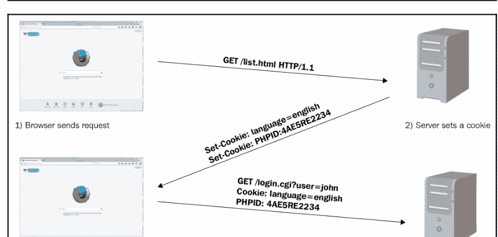

## Persistent and nonpersistent cookies

Cookies are divided into two main categories. Persistent cookies are stored on the client device's internal storage as text files. Since the cookie is stored on the hard drive, it would survive a browser crash or persist through various sessions. Different browsers will store persistent cookies differently. Internet Explorer, for example, saves cookies in text files inside the user's folder, AppData\Roaming\Microsoft\Windows\Cookie, while Google Chrome uses a SQLite3 database also stored in the user's folder, AppData\Local\Google\Chrome\User Data\Default\cookies. A cookie, as mentioned previously, can be used to pass sensitive information in the form of session ID, preferences, and shopping data among other types. If it's stored on the hard drive, it cannot be protected from modification by a malicious user.

To solve the security issues faced by persistent cookies, programmers came up with another kind of cookie that is used more often today, known as a nonpersistent cookie, which is stored in the memory of the web browser, leaves no traces on the hard drive, and is passed between the web browser and server via the request and response header. A nonpersistent cookie is only valid for a predefined time specified by the server.

## Cookie parameters

In addition to the name and value of the cookie, there are several other parameters set by the web server that defines the reach and availability of the cookie, as shown in the following response header:

```
HTTP/1.1 200 OK
Content-Type: text/html; charset=UTF-8
Cache-Control: no-cache, no-store, max-age=0, must-revalidate
Date: Tue, 25 Nov 2014 18:22:25 GMT
Set-Cookie ID=b34erdfWS, Domain=email.com, Path=/mail, Secure, HttpOnly, Expires=Wed, 26 Nov 2014 10:18:14 GMT
```

The following are details of some of the parameters:

- **Domain**: This specifies the domain to which the cookie would be sent.
- **Path**: To lock down the cookie further, the Path parameter can be specified. If the domain specified is email.com and the path is set to /mail, the cookie would only be sent to the pages inside email.com/mail.
- **HttpOnly**: This is a parameter that is set to mitigate the risk posed by Cross-site Scripting (XSS) attacks, as JavaScript won't be able to access the cookie.
- **Secure**: If this is set, the cookie must only be sent over secure communication channels, namely SSL and TLS.
- **Expires**: The cookie will be stored until the time specified in this parameter.

## HTML data in HTTP response

The data in the body of the response is the information that is of use to the end user. It usually contains HTML-formatted data, but it can also be JavaScript Object Notation (JSON) or eXtensible Markup Language (XML) data, script code, or binary files such as images and videos. Only plaintext information was originally stored on the web, formatted in a way that was more appropriate for reading while being capable of including tables, images, and links to other documents. This was called Hypertext Markup Language (HTML), and the web browser was the tool meant to interpret it. HTML text is formatted using tags.

HTML is not a programming language.


## 服务器端代码

脚本代码和 HTML 格式由网络浏览器解释并呈现。这称为 **客户端代码**。检索客户端请求的信息、会话跟踪以及应用程序的大部分逻辑所涉及的流程都是在服务器上通过 **服务器端代码** 执行的，该代码使用 PHP、ASP.NET、Java、Python、Ruby 和 JSP 等语言编写。此代码会生成输出，然后可以使用 HTML 进行格式化。当您看到以 `.php` 扩展名结尾的 URL 时，表示该页面可能包含 PHP 代码。然后它必须通过服务器的 PHP 引擎运行，这使得在网页加载时可以生成动态内容。

## 多层 Web 应用程序

随着今天使用更复杂的 Web 应用程序，传统的在单个系统上部署 Web 应用程序的方式已成为过去的故事。将所有鸡蛋放在一个篮子里并不是部署业务关键型应用程序的明智方式，因为它严重影响了应用程序的性能、安全性和可用性。单个服务器托管应用程序以及数据的简单设计仅适用于流量不大的小型 Web 应用程序。设计 Web 应用程序的三层方法是前进的方向。

## 三层 Web 应用程序设计

在三层 Web 应用程序中，表现层、应用层和数据层之间存在物理分离，描述如下：

- **表现层**：这是接收客户端连接的服务器，也是响应发送回客户端的出口点。它是应用程序的前端。**表现层** 对 Web 应用程序至关重要，因为它是用户与应用程序其余部分之间的接口。在表现层接收到的数据会传递给应用层中的组件进行处理。接收到的输出使用 HTML 格式化，并在用户的 Web 客户端上显示。Apache 和 nginx 是开源软件程序，Microsoft IIS 是在表现层部署的商业软件。

- **应用层：** 耗处理器的处理和应用程序的主要逻辑由 **应用层** 负责。一旦表现层从客户端收集所需数据并将其传递给应用层，该层工作的组件就可以对数据应用业务逻辑。然后输出返回到表现层以发送回客户端。如果客户端请求数据，则从数据层提取数据，处理成对客户端有用的形式，然后传递给表现层。Java、Python、PHP 和 ASP.NET 是在应用层工作的编程语言。

- **数据访问层：** 实际的存储和数据存储库在 **数据访问层** 工作。当客户端需要数据或发送数据以供存储时，它会由应用层传递到数据访问层以进行持久存储。该层工作的组件负责维护数据并保持其完整性和可用性。它们还负责管理来自应用层的并发连接。MySQL 和 Microsoft SQL 是在该层工作的两种最常用的技术。**结构化查询语言（SQL）** 关系数据库现在在 Web 应用程序中最常用，尽管 NoSQL 数据库，例如 MongoDB、CouchDB 和其他 NoSQL 数据库，它们以与关系数据库传统的行列表格式不同的形式存储信息，也被广泛使用，尤其是在大数据分析应用程序中。SQL 是一种数据定义和查询语言，许多数据库产品将其作为检索和更新数据的标准支持。

下图显示了表现层、应用层和数据访问层如何协同工作：

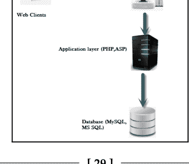

## Web 服务

Web 服务可以被视为不包含表现层的 Web 应用程序。面向服务的架构允许 Web 服务提供者轻松地与该服务的消费者集成。Web 服务使不同的应用程序能够相互共享数据和功能。它们允许消费者通过互联网访问数据，而无需应用程序知道数据的格式或位置。

当您不想公开数据模型或用于访问数据的逻辑，但仍希望数据可供其消费者随时使用时，这变得极其重要。一个例子是股票交易所公开的 Web 服务。在线经纪商可以使用此 Web 服务获取有关股票的实时信息，并在自己的网站上以自己的表现风格和品牌向最终用户展示。经纪商网站只需调用服务并请求公司的相关数据。当服务回复数据时，Web 应用程序可以解析信息并显示它。

Web 服务是平台无关的。股票交易所应用程序可以用任何语言编写，并且服务仍然可以被调用，而不管用于构建应用程序的底层技术如何。服务提供者和消费者需要达成一致的唯一事情是数据交换的规则。

目前开发 Web 服务有两种不同的方法：

- 简单对象访问协议（SOAP）
- 表述性状态转移（REST），也称为 RESTful Web 服务。

## 介绍 SOAP 和 REST Web 服务

SOAP 一直是开发 Web 服务的传统方法，但它有许多缺点，应用程序现在正转向 REST 或 RESTful Web 服务。使用 SOAP Web 服务时，XML 是唯一可用的数据交换格式，而 REST Web 服务可以使用 JSON 和其他数据格式。尽管由于额外的安全规范，在某些情况下仍推荐使用基于 SOAP 的 Web 服务，但轻量级的 REST Web 服务由于其简单性，已成为许多 Web 服务开发者的首选方法。SOAP 是一种协议，而 REST 是一种架构风格。亚马逊、Facebook、Google 和 Yahoo! 已经转向 REST Web 服务。

REST Web 服务的一些功能如下：

- 它们非常适合 CRUD 操作
- 它们具有更好的性能和可扩展性
- 它们可以处理多种输入和输出格式
- 开发人员连接 Web 服务的学习曲线更小
- REST 设计理念与 Web 应用程序相似

CRUD 代表创建、读取、更新和删除；它描述了持久存储的四个基本功能。

SOAP 相对于 REST 的主要优势是 SOAP 与传输无关，而 REST 仅在 HTTP 上工作。REST 基于 HTTP，因此影响标准 Web 应用程序的相同漏洞也可能被利用。幸运的是，可以应用相同的最佳安全实践来保护 REST Web 服务。

开发 SOAP 服务时固有的复杂性，其中 XML 数据被包装在 SOAP 请求中然后使用 HTTP 发送，迫使许多组织转向 REST 服务。它还需要一个 Web 服务定义语言（WSDL）文件，提供与服务相关的信息。必须维护一个 UDDI 目录，在其中发布 WSDL 文件。

REST 服务的基本思想是，而不是使用 SOAP 等复杂机制，它直接通过 HTTP 与服务提供者通信，无需任何额外协议。它使用 HTTP 来创建、读取、更新和删除数据。

由 SOAP 基于 Web 服务的消费者发送的请求如下：

```
<?xml version="1.0"?>
<soap:Envelope
xmlns:soap="http://www.w3.org/2001/12/soap-envelope"
soap:encodingStyle="http://www.w3.org/2001/12/soap-encoding">
    <soap:body sp="http://www.stockexchange.com/stockprice">
        <sp:GetStockPrice>
            <sp:Stockname>xyz</sp:Stockname>
        </sp:GetStockPrice>
    </soap:Body>
</soap:Envelope>
```


另一方面，发送到 REST Web 服务的请求可能像这样简单：

```
http://www.stockexchange.com/stockprice/Stockname/xyz
```

应用程序使用 GET 请求从 Web 服务读取数据，这开销很低，并且与冗长复杂的 SOAP 请求不同，对开发者来说编码起来很容易。虽然 REST Web 服务也可以使用 XML 返回数据，但很少使用的 JSON 才是返回数据的首选方法。

## Web 服务中的 HTTP 方法

REST Web 服务可能与标准 Web 应用程序中的 HTTP 方法处理方式不同。这种行为取决于开发者的偏好，但将 POST、GET、PUT 和 DELETE 方法与 CRUD 操作相关联的做法越来越流行。最常见的方法如下：

- Create: POST
- Read: GET
- Update: PUT
- Delete: DELETE

一些应用程序编程接口（API）实现会交换 PUT 和 POST 的功能。

## XML 和 JSON

XML 和 JSON 都被 Web 服务用于表示结构化的数据集或对象。

如前几节所述，XML 使用基于标签和属性的语法，以及这些标签的值；例如，应用程序的文件菜单可以表示如下：

```
<menu id="m_file" value="File">
  <popup>
    <item value="New" onclick="CreateDocument()" />
    <item value="Open" onclick="OpenDocument()" />
    <item value="Close" onclick="CloseDocument()" />
  </popup>
</menu>
```

JSON 相反，使用一种更经济的语法，类似于 C 和 Java 编程语言。相同的菜单以 JSON 格式如下：

```
{
  "menu": {
    "id": "m_file",
    "value": "File",
    "popup": {
      "item": [
        {"value": "New", "onclick": "NewDocument()"},
        {"value": "Open", "onclick": "OpenDocument()"},
        {"value": "Close", "onclick": "CloseDocument()"}
      ]
    }
  }
}
```

## AJAX

异步 JavaScript 和 XML（AJAX）是多种现有 Web 技术的组合，它使客户端能够在后台发送请求并处理响应，而无需用户的直接干预。它还能让服务器减轻部分应用程序逻辑处理任务的负担。AJAX 允许你与 Web 服务器通信，而无需用户在 Web 浏览器中显式发起新的请求。这使得服务器响应更快，因为网页的各个部分可以单独更新，从而改善用户体验。AJAX 使用 JavaScript 在不重新加载整个网页的情况下连接并从服务器检索信息。

以下是使用 AJAX 的一些好处：

- **Increased speed**: 使用 AJAX 的目标是提高 Web 应用程序的性能。通过更新单个表单元素，服务器所需的处理最少，从而提高性能。客户端的响应性也得到了极大改善。
- **User friendly**: 在基于 AJAX 的应用程序中，用户无需重新加载整个页面即可刷新网站的特定部分。这使得应用程序更具交互性和用户友好性。它还可以用于执行实时验证和自动完成。
- **Asynchronous calls**: 基于 AJAX 的应用程序设计为向 Web 服务器发出异步调用，因此得名 Asynchronous JavaScript and XML。这使用户能够在网页的某个部分在幕后更新时与之交互。
- **Reduced network utilization:** 由于不必每次都进行整页刷新，网络利用率降低。在加载大图像、视频或动态内容（如 Java 小程序或 Adobe Flash 程序）的 Web 应用程序中，使用 AJAX 可以优化网络利用率。

## AJAX 的构建块

如前所述，AJAX 是构建 Web 应用程序时使用的常见 Web 技术的混合体。应用程序使用这些 Web 技术设计的方式决定了它是否是一个基于 AJAX 的应用程序。以下是 AJAX 的组成部分：

- **JavaScript:** 基于 AJAX 的应用程序最重要的组件是客户端 JavaScript 代码。JavaScript 在后台与 Web 服务器交互，并在显示给用户之前处理信息。它使用 **XMLHttpRequest (XHR)** API 在服务器和客户端之间传输数据。XHR 存在于后台，用户对其的存在毫不知情。
- **Dynamic HTML (DHTML):** 一旦数据从服务器检索并由 JavaScript 处理，网页的元素就需要更新以反映服务器的响应。完美的例子是你在填写在线表单时输入用户名。表单会动态更新，以反映并告知用户该用户名是否已在网站上注册。使用 DHTML 和 JavaScript，你可以即时更新页面内容。DHTML 在 AJAX 之前就已存在。仅使用 DHTML 的主要缺点是它严重依赖客户端代码来更新页面。大多数时候，你没有在客户端加载所有内容，并且需要与服务器端代码交互。这就是 AJAX 发挥作用的地方，它通过 XHR 对象在客户端代码和服务器端代码之间建立连接。在 AJAX 之前，你必须使用 JavaScript 小程序。
- **Document Object Model (DOM):** DOM 是一个用于组织 HTML 或 XML 文档中元素的框架。它是表示和交互 HTML 对象的约定。逻辑上，可以想象 HTML 文档被解析为一棵树，其中每个元素都被视为一个树节点，每个节点都有自己的属性和事件。例如，HTML 文档的 body 对象将具有 `text, link, bgcolor` 等特定属性。每个对象也有事件。此模型允许 JavaScript 接口动态访问和更新页面的内容，使用 DHTML。DHTML 是浏览器功能，DOM 充当实现它的接口。

## AJAX 工作流程

下图说明了基于 AJAX 的应用程序的各个组件之间的交互。与传统的 Web 应用程序相比，AJAX 引擎是主要新增部分。AJAX 引擎的额外层充当通过 AJAX 进行的所有请求和响应的中间人。AJAX 引擎是 JavaScript 解释器：

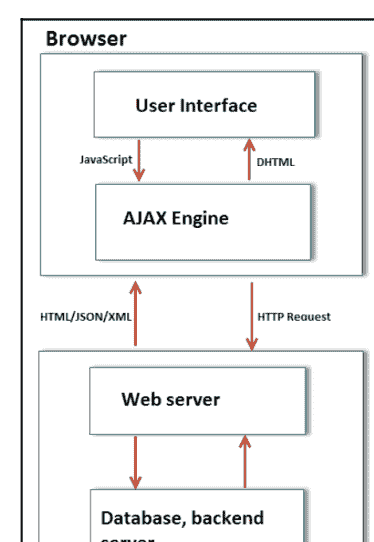

以下是用户与基于 AJAX 的应用程序交互的工作流程。用户界面和 AJAX 引擎是客户端 Web 浏览器上的组件：

1. 用户输入网页的 URL，浏览器向服务器发送 HTTP 请求。服务器处理请求并返回 HTML 内容，通过 Web 渲染引擎由浏览器显示。在 HTML 中，网页嵌入在 JavaScript 代码中，当遇到事件时由 JavaScript 解释器执行。
2. 与网页交互时，用户会遇到使用嵌入式 JavaScript 代码并触发事件的元素。一个例子是 Google 搜索页面。一旦用户开始输入搜索查询，底层的 AJAX 引擎就会拦截用户的请求。AJAX 引擎通过 HTTP 请求将请求转发给服务器。此请求对用户是透明的，用户无需显式单击提交按钮或刷新整个页面。
3. 在服务器端，应用程序层处理请求并以 JSON、HTML 或 XML 形式将数据返回给 AJAX 引擎。AJAX 引擎将此数据转发给 Web 渲染引擎，由浏览器显示。Web 浏览器使用 DHTML 仅更新网页的选定部分以反映新数据。

当你遇到基于 AJAX 的应用程序时，请记住以下额外要点：

- XMLHttpRequest API 在幕后实现了魔术。由于其名称过长，通常称为 XHR。首先实例化一个名为 `xmlhttp` 的 JavaScript 对象，用于发送和捕获来自服务器的响应。需要浏览器支持 XHR 才能使 AJAX 工作。所有领先 Web 浏览器的最新版本都支持此 API。
- AJAX 中的 XML 部分有点误导。应用程序可以使用除 XML 之外的任何格式，例如 JSON、纯文本、HTTP，甚至图像在 AJAX 引擎和 Web 服务器之间交换数据。JSON 是首选格式，因为它轻量且可以转换为 JavaScript 对象，这进一步允许脚本轻松访问和操作数据。
- 多个异步请求可以并发发生，而无需等待一个请求完成。
- 许多开发者使用 AJAX 框架，这简化了应用程序设计任务。JQuery、Dojo Toolkit、Google Web Toolkit（GWT）和 Microsoft AJAX 库（.NET 应用程序）是众所周知的框架。

AJAX 请求的示例如下：

```
function loadfile()
{
    //initiating the XMLHttpRequest object
    var xmlhttp;
    xmlhttp = new XMLHttpRequest();
    xmlhttp.onreadystatechange=function()
```

{
    if (xmlHttp.readyState==4)
    {
        showContents(xmlHttp.responseText);
    }
    //GET method to get the links.txt file
    xmlHttp.open("GET", "links.txt", true);
}

The function loadfile() first instantiates the xmlhttp object. It then uses this object to pull a text file from the server. When the text file is returned by the server, it displays the contents of the file. The file and its contents are loaded without user involvement, as shown in the preceding code snippet.

## HTML5

The fifth version of the HTML specification was first published in October 2014. This new version specifies APIs for media playback, drag and drop, web storage, editable content, geolocation, local SQL databases, cryptography, web sockets, and many others, which may become interesting from the security testing perspective as they open new paths for attacks or attempt to tackle some of the security concerns in previous HTML versions.

## WebSockets

HTTP is a stateless protocol as noted previously. This means that a new connection is established for every request and closed after every response. An HTML5 WebSocket is a communication interface that allows for a permanent bidirectional connection between client and server.

A WebSocket is opened by the client through a GET request such as the following:

```
GET /chat HTTP/1.1
Host: server.example.com
Upgrade: websocket
Connection: Upgrade
Sec-WebSocket-Key: x3JJHMbDL1EzLkh9GBhXDw==
Sec-WebSocket-Protocol: chat, superchat
Sec-WebSocket-Version: 13
Origin: http://example.com
```

If the server understands the request and accepts the connection, its response would be as follows:

```
HTTP/1.1 101 Switching Protocols
Upgrade: websocket
Connection: Upgrade
Sec-WebSocket-Accept: HSmrc0sMlYUkAGmm5OPpG2HaGWk=
Sec-WebSocket-Protocol: chat
```

The HTTP connection is then replaced by the WebSocket connection, and it becomes a bidirectional binary protocol not necessarily compatible with HTTP.

## 2
Setting Up Your Lab with Kali Linux

Preparation is the key to everything; it becomes even more important when working on a penetration testing project, where you get a limited amount of time for reconnaissance, scanning, and exploitation. Eventually, you can gain access and present a detailed report to the customer. Each penetration test that you conduct will be different in nature and may require a different approach from the tests that you conducted earlier. Tools play a major role in penetration testing. So, you need to prepare your toolkit beforehand and have hands-on experience with all of the tools that you will need to execute the test.

In this chapter, we will cover the following topics:

- An overview of Kali Linux and changes from the previous version
- The different ways of installing Kali Linux
- Virtualization versus installation on physical hardware
- A walk-through and configuration of important tools in Kali Linux
- Vulnerable web applications and virtual machines to set up a testing lab

## Kali Linux

Kali Linux is a security-focused Linux distribution based on Debian. It's a rebranded version of the famous Linux distribution known as BackTrack, which came with a huge repository of open source hacking tools for network, wireless, and web application penetration testing.

Although Kali Linux contains most of the tools of BackTrack, the main objective of Kali Linux was to make it portable to be installed on devices based on ARM architectures, such as tablets and the Chromebook, which makes the tools easily available at your disposal.

Using open source hacking tools comes with a major drawback—they contain a whole lot of dependencies when installed on Linux, and they need to be installed in a predefined sequence. Moreover, the authors of some tools have not released accurate documentation, which makes our life difficult.

Kali Linux simplifies this process; it contains many tools preinstalled with all of the dependencies, and it is in a ready-to-use condition so that you can pay more attention to an actual attack and not on simply installing the tool. Updates for tools installed in Kali Linux are released frequently, which helps you keep the tools up to date. A noncommercial toolkit that has all of the major hacking tools preinstalled to test real-world networks and applications is the dream of every ethical hacker, and the authors of Kali Linux made every effort to make our lives easy, which lets us spend more time on finding actual flaws rather than on building a toolkit.

## Latest improvements in Kali Linux

At Black Hat USA 2015, Kali 2.0 was released with a new 4.0 kernel. It is based on Debian Jessie, and it was codenamed as Kali Sana. The previous major release of Kali was version 1.0 with periodic updates released up to version 1.1. Cosmetic interface changes for better accessibility and the addition of newer and more stable tools are a few of the changes in Kali 2.0.

Some major improvements in Kali 2.0 are listed here:

- **Continuous rolling updates:** In January 2016, the update cycle of Kali Linux was improved with the shift to a rolling release, with a major upgrade in April 2017. A rolling release distribution is one that is constantly updated so that users can be given the latest updates and packages when they are available. Now users won't have to wait for a major release to get bug fixes. In Kali 2.0, packages are regularly pulled from the Debian testing distribution as they are released. This helps keep the core OS of Kali updated.
- **Frequent tool updates**: Offensive Security, the organization that maintains the Kali Linux distribution, has devised a different method to check for updated tools. They now use a new upstream version checking the system that sends periodic updates when newer versions of tools are released. With this method, tools in Kali Linux are updated as soon as the developer releases them.
- **A revamped desktop environment**: Kali Linux now supports a full GNOME 3 session. GNOME 3 is one of the most widely used desktop environments, and it is a favorite for developers. The minimum RAM required for running a full GNOME3 session is 768 MB. Although this is not an issue, considering the hardware standards of computers today; if you have an older machine, you can download the lighter version of Kali Linux that uses the Xfce desktop environment with a smaller set of useful tools. Kali Linux also natively supports other desktop environments such as KDE, MATE, E17, i3wm, and LXDE. Kali 2.0 comes with new wallpapers, a customizable sidebar, an improved menu layout, and many more visual tweaks.
- **Support for various hardware platforms**: Kali Linux is now available for all major releases of Google Chromebooks and Raspberry Pi. NetHunter, the hacking distribution designed for mobile devices, which is built upon Kali Linux, has been updated to Kali 2.0. The official VMware and VirtualBox images have also been updated.
- **Major tool changes**: The Metasploit Community and Pro packages have been removed from Kali 2.0. If you require these versions, you need to download it directly from Rapid7’s website (https://www.rapid7.com/). Now, only Metasploit Framework—the open source version—comes with Kali Linux.

## Installing Kali Linux

The success of Kali Linux is also due to the flexibility in its installation. If you want to test a system quickly, you can get up and running with Kali Linux in a few minutes on an Amazon cloud platform, or you can have it installed on a high-speed SSD drive with a fast processor if you want to crack passwords using a rainbow table. With Linux as its base, every part of the operating system can be customized, which makes Kali Linux a useful toolkit in any testing environment. You can get Kali Linux from its official download page at https://www.kali.org/downloads/.

Kali Linux can be installed in numerous ways on several platforms:

- **The USB mode**: Using tools such as Rufus, Universal USB Installer in Windows, or `dd` in Linux, you can create a bootable USB drive from an ISO image.
- **Preinstalled virtual machines**: VirtualBox, VMware, and Hyper-V images are available to download from the official Kali Linux site. Just download and import any one of them to your virtualization software.
- **Docker containers**: In recent years, Docker containers have proved to be useful and convenient in many scenarios and have gained favor over virtualization in some sectors. The official Kali Linux image for Docker is found at: https://hub.docker.com/r/kalilinux/kali-linux-docker/.
- **Kali Linux minimal image on Amazon EC2**: Kali Linux has an **Amazon Machine Image (AMI)** available for use in the AWS marketplace at: https://aws.amazon.com/marketplace/pp/B01M26MMTT.
- **Kali NetHunter**: This is an Android ROM overlay. This means that Kali NetHunter runs on top of an Android ROM (be it original or custom). It is currently available for a limited number of devices, and its installation may not be as straightforward as the other Kali versions. For more information about Kali NetHunter, refer to: https://github.com/offensive-security/kali-nethunter/wiki.
- **Installing on a physical computer**: This may be the best option for a professional penetration tester who has a laptop dedicated to testing and who requires the full use of hardware such as the GPU, processor, and memory. This can be done by downloading an ISO image and recording it onto a CD, DVD, or USB drive, and then using it to boot the computer and start the installer.

Based on personal preference, and with the goal of saving memory and processing power while having a fully functional and lightweight desktop environment, throughout this book, we will use a setup consisting of a VirtualBox virtual machine with the Xfce4 Kali Linux ISO installed on it.


## 虚拟化 Kali Linux 与在物理硬件上安装的对比

虚拟化软件的流行使其成为在虚拟化平台上安装测试机的有吸引力的选择。虚拟化软件以低成本提供丰富的特性集，并省去了双启动机器的麻烦。另一个大多数虚拟化软件包提供的有用功能是克隆虚拟机，你可以用它来创建同一台机器的多个副本。在真实的渗透测试中，你可能需要克隆和复制你的测试机，以便在 Kali Linux 中安装额外的黑客工具并进行配置更改，同时保留早期镜像的副本以在虚拟化环境中用作基础镜像。这可以非常轻松地实现。

一些虚拟化软件具有回滚到快照的功能，即，如果你搞坏了测试机，你可以回到过去并恢复一个干净的状态，在此基础上进行工作。

根据需要修改分配给虚拟机的 RAM 数量、虚拟磁盘大小以及虚拟处理器数量是虚拟化软件的另一个知名功能。

除了使虚拟化平台如此有吸引力的功能外，还存在一个主要缺点。如果渗透测试涉及测试网络上使用的密码强度或其他处理器密集型任务，你将需要一个高性能的处理器和一个专用于该任务的 GPU。在虚拟平台上破解密码不是明智之举，因为它会减慢进程，并且由于虚拟化开销，你无法将处理器用到最大容量。

虚拟化平台的另一个功能让很多人感到困惑，那就是网络选项。桥接、仅主机和 NAT 是虚拟化软件提供的三个主要网络选项。桥接网络是执行渗透测试的推荐选项，因为虚拟机将表现得好像连接到物理交换机一样，并且数据包会未经修改地从主机机器发出。

## 在 VirtualBox 上安装

与多平台兼容的 Oracle VirtualBox 可从 https://www.virtualbox.org/wiki/Downloads 获取。还建议你下载并安装相应的扩展包，因为它提供 USB 2.0 和 3.0 支持、RDP、磁盘加密以及一些有趣的功能。

从 Kali 下载页面选择你喜欢的版本。如前所述，我们将使用 Xfce4 64 位 ISO（https://www.kali.org/downloads/）。你可以根据硬件或偏好选择任何其他版本，因为不同版本的已安装工具或对其的访问不会有所不同——除非你选择仅包含操作系统和少量工具的精简版。

## 创建虚拟机

首先打开 VirtualBox 并创建一个新的虚拟机。为其选择一个名称（我们将使用 Kali-Linux），并将类型设为 Linux，版本设为 Debian（64 位）。如果你选择了 32 位 ISO，请将版本更改为 Debian（32 位）。然后，点击下一步：

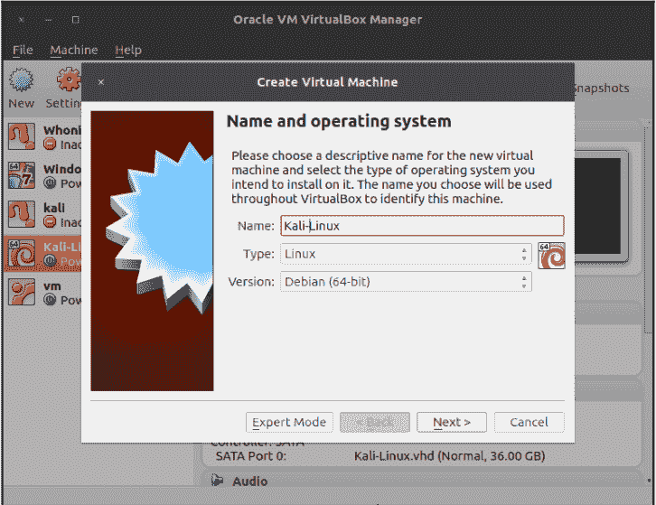

在出现的下一个屏幕中，选择为虚拟机保留的内存量。Kali Linux 最低可使用 1 GB RAM 运行；然而，虚拟机的推荐设置是 2-4 GB。我们将为我们的机器设置 2 GB。记住，你的主机计算机需要内存来运行其他程序，也许还有其他虚拟机：


在下一步中，我们将为虚拟机创建一个硬盘。选择 **现在创建虚拟硬盘** 并点击 **创建**。在下一个屏幕中，让类型保持为 **VDI（VirtualBox 磁盘映像）** 和 **动态分配**。然后，选择文件名和路径；你可以保持原样。最后，选择磁盘大小。我们将使用 40 GB。刚安装的 Kali Linux 使用 25 GB。选择磁盘大小，然后点击 **创建**：


## 安装系统

现在虚拟机已创建，在 VirtualBox 列表中选择它并点击顶部栏中的设置。然后，转到存储并选择带有 CD 图标的空驱动器。接下来，我们将配置虚拟机使用你刚下载的 Kali Linux ISO 作为可启动驱动器（或实时 CD）。点击右侧的 CD 图标，然后点击选择虚拟光盘文件...，并导航到 Kali ISO 下载的文件夹：

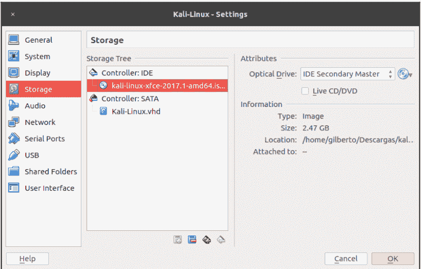

接受设置更改。现在所有设置都已完成，启动虚拟机，你将能够看到 Kali 的 GRUB 加载器。选择图形安装并按 Enter：

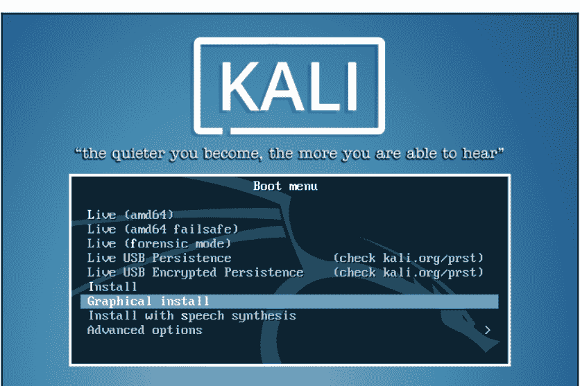

在接下来的几个屏幕中，你需要选择语言、位置和键盘映射（键盘布局）：

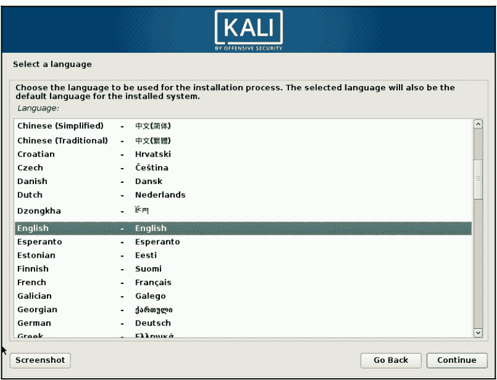

之后，安装程序将尝试网络配置。这里不应该有问题，因为 VirtualBox 默认对所有新虚拟机设置 NAT 网络适配器。然后，你将被要求输入主机名和域名。如果你的网络不需要特定值，请保持这些值不变并点击继续。

接下来，你将被要求为 root 用户设置密码。这是系统中权限最高的用户，因此即使虚拟机仅用于练习和测试目的，也请选择一个强密码。选择你的时区并点击继续。

现在你已到达需要选择系统安装位置和硬盘分区的地方。如果没有特定偏好，请选择第一个选项，**引导分区**。选择使用整个磁盘的选项并点击 **继续**。在下一个屏幕，或在完成磁盘分区配置后，选择 **完成分区并将更改写入磁盘**，并点击 **继续**：

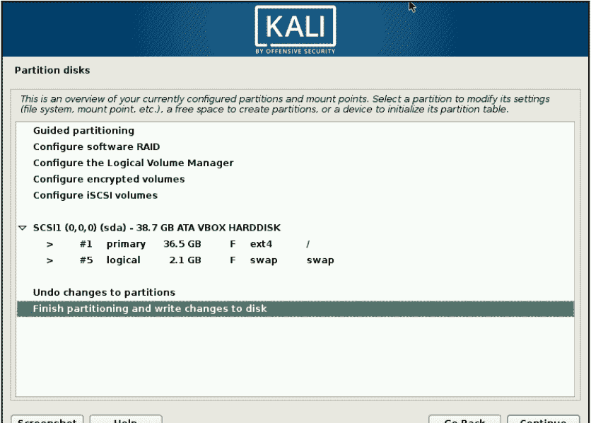

在下一个屏幕中点击 **继续** 以将更改写入磁盘，安装将开始。

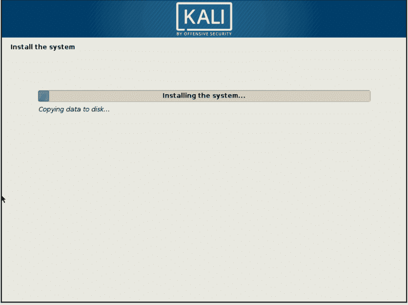

安装完成后，安装程序将尝试配置更新机制。验证你的主机计算机已连接到互联网，保持代理配置不变，并在被问及是否要使用网络镜像时选择 **是**：

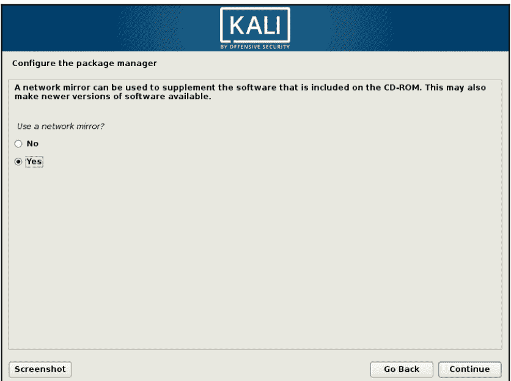

安装程序将为 APT，Debian 包管理器生成配置文件。下一步是配置 GRUB 启动加载器。被问及时选择是，并将其安装在 /dev/sda：

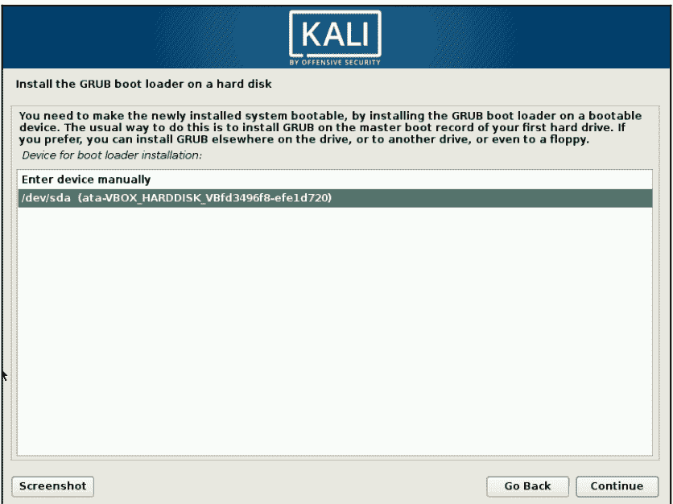

接下来，你应该会看到安装完成消息。点击继续以重新启动虚拟机。此时，你可以从存储配置中移除 ISO 文件，因为你不再需要它。

虚拟机重新启动后，你将被要求输入用户名和密码。使用 `root` 用户和安装期间设置的密码：

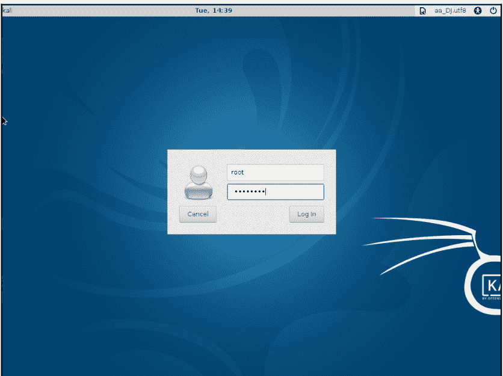

## Kali Linux 中的重要工具

一旦 Kali Linux 运行起来，你就可以开始使用工具了。由于本书涉及 Web 应用程序黑客攻击，我们将花费大部分时间的主要工具都可以通过 **应用程序 | Web 应用程序分析** 访问。以下屏幕截图显示了 **Web 应用程序分析** 中存在的工具：

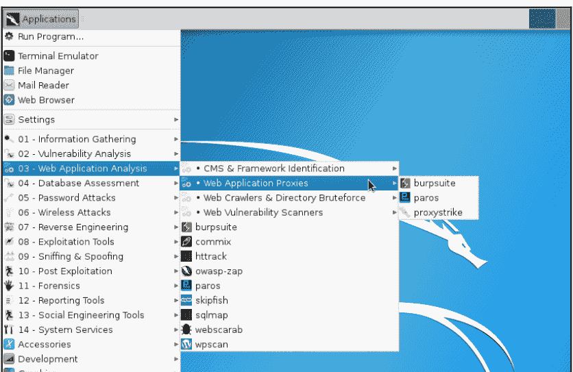

在 Kali Linux 中，**Web 应用程序分析** 中的工具进一步分为四个类别，如下所列：

- CMS & 框架识别
- Web 应用程序代理
- Web 爬虫和目录暴力破解
- Web 漏洞扫描器


## CMS 与框架识别

**内容管理系统（CMS）**在互联网上非常流行，数百个网站都使用其中之一——WordPress 部署。插件和主题是 WordPress 网站不可或缺的一部分。然而，这些附加组件存在大量安全问题。WordPress 网站通常由对安全漠不关心的普通用户管理，他们很少更新其 WordPress 软件、插件和主题，这使得这些站点成为极具吸引力的攻击目标。

## WPScan

**WPScan** 是一个用 Ruby 编程语言编写的、预装在 Kali Linux 中的非常快速的 WordPress 漏洞扫描器。

可使用 WPScan 提取以下信息：

- 插件列表
- 主题名称
- 使用暴力破解技术获取的弱密码和用户名
- 版本详情
- 可能存在的漏洞

Kali Linux 中还列出了一些额外的 CMS 工具，见以下小节。

## JoomScan

**JoomScan** 可以检测 Joomla CMS 中已知漏洞，例如文件包含、命令执行和注入缺陷。它探测应用程序并提取目标运行的确切版本。

## CMSmap

CMSmap 未包含在 Kali Linux 中，但可从 GitHub 轻松安装。这是一款针对最常用的 CMS 的漏洞扫描器：WordPress、Joomla 和 Drupal。它使用 Exploit Database 来查找 CMS 中已启用插件的漏洞。要下载它，请在 Kali Linux 终端中执行以下命令：

```
git clone https://github.com/Dionach/CMSmap.git
```

## Web 应用程序代理

HTTP 代理是 Web 应用程序黑客工具包中最重要的工具之一，Kali Linux 包含其中几种。你可能在某个代理中错过的功能，一定会在另一个代理中出现。这凸显了 Kali Linux 及其庞大工具库的真正优势。

HTTP 代理是一种介于浏览器和网站之间、拦截两者之间所有流量的软件。Web 应用程序黑客的主要目标是深入了解应用程序的内部工作原理，而最好的实现方式就是充当中间人，拦截每个请求和响应。

## Burp Proxy

Burp Suite 已成为 Web 应用程序测试的事实标准。其众多功能提供了 Web 渗透测试人员所需几乎所有工具。专业版包含可进行主动和被动扫描的自动化扫描器，并在 Intruder（Burp 的模糊测试工具）中增加了配置选项。Kali Linux 包含免费版本，该版本不具备扫描功能，也无法保存项目；此外，其模糊测试工具 Intruder 也有一些限制。可通过 Applications | Web Application Analysis | Web Application Proxies 访问。Burp Suite 是一个功能丰富的工具，包含 Web 蜘蛛、Intruder 和用于对 Web 应用程序进行自动化定制攻击的重放功能。我将在后面的章节中更深入地介绍 Burp Suite 的多个功能。

Burp Proxy 是一个非透明代理，第一步需要将代理绑定到特定的端口和 IP 地址，并配置 Web 浏览器使用该代理。默认情况下，Burp 监听 127.0.0.1 回环地址和 8080 端口号：

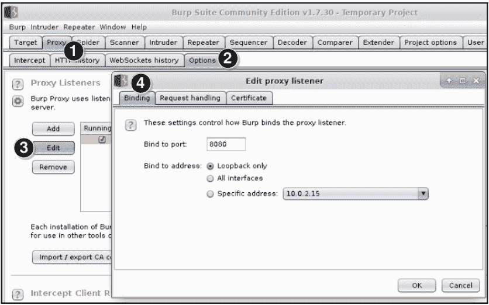

确保选择一个未被其他应用程序使用的端口，以避免冲突。记下端口和绑定地址并将其添加到浏览器的代理设置中。

默认情况下，Burp Proxy 仅拦截来自客户端的请求。它不会拦截来自服务器的响应。如有需要，可在 Proxy 的 Options 选项卡中手动打开，进一步在 Intercept Server Responses 部分进行设置。

## 自定义客户端拦截

如果想要缩小拦截的 Web 流量范围，也可以设置特定规则。如以下屏幕截图所示，你可以匹配特定域、HTTP 方法、Cookie 名称等的请求。一旦流量被拦截，你就可以编辑值，将其转发到 Web 服务器并分析响应：

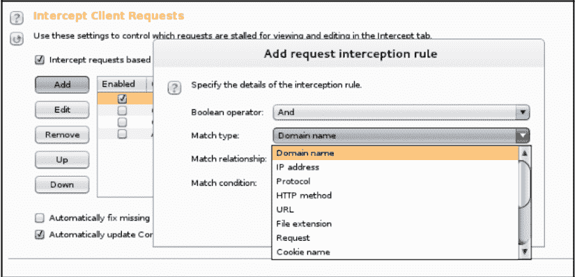

## 实时修改请求

在 Match and Replace 部分，你可以配置规则，让其查找请求中的特定值并在无需人工干预的情况下实时编辑。Burp Proxy 包含其中若干规则。其中最值得注意的是用于将用户代理值替换为 Internet Explorer、iOS 或 Android 设备的规则：

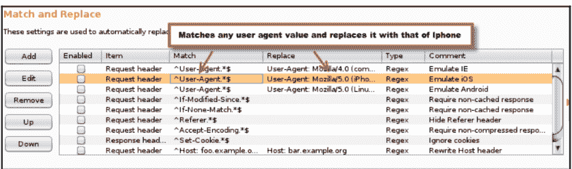

## Burp Proxy 与 HTTPS 网站

Burp Proxy 也适用于 HTTPS 网站。为了解密通信并能够分析它，Burp Proxy 会拦截连接，自称 Web 服务器，并签发由其自身 SSL/TLS 证书颁发机构（CA）签名的证书。然后代理以用户身份向实际的 HTTPS 网站展示自己，并使用 Web 服务器提供的证书加密请求。来自 Web 服务器的连接随后在代理处终止，代理解密数据并使用自签名 CA 证书重新加密，该证书将显示在用户的 Web 浏览器上。以下图表解释了此过程：

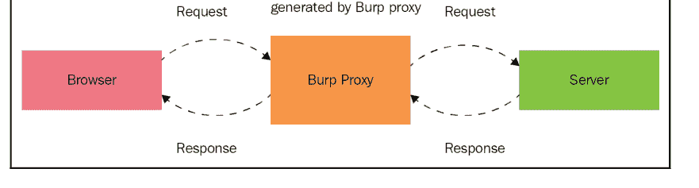

Web 浏览器会显示警告，因为证书是自签名的且不受 Web 浏览器信任。由于你知道是 Burp Proxy 拦截了请求而非恶意用户，可以安全地为 Web 浏览器添加例外。或者，你也可以通过点击 Proxy Listeners 中的相应按钮导出 Burp 的证书，方法是转到 Proxy | Options，然后将证书导入浏览器并使其成为受信任的证书：

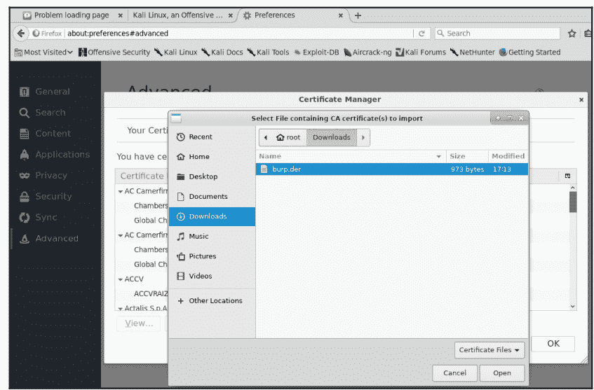

## Zed Attack Proxy

Zed Attack Proxy（ZAP）是由开放 Web 应用程序安全项目（OWASP）维护的、功能齐全的开源 Web 应用程序测试套件，OWASP 是一个致力于 Web 应用程序安全的非营利社区。与 Burp Suite 一样，它也具有可拦截和修改 HTTP/HTTPS 请求和响应的代理，尽管使用起来可能不如 Burp 容易。你偶尔会发现某个代理缺少的小功能在另一个代理中可用。例如，ZAP 包含一个强制浏览工具，可用于识别服务器中的目录和文件。

## ProxyStrike

Kali Linux 中还包含一个名为 ProxyStrike 的主动代理。该代理不仅拦截请求和响应，还主动查找漏洞。它具有查找 SQL 注入和 XSS 缺陷的模块。与之前讨论的其他代理类似，你需要配置浏览器使用 ProxyStrike 作为代理。它会在后台自动爬取应用程序，结果可导出为 HTML 和 XML 格式。

## Web 爬虫和目录暴力破解

某些应用程序具有普通用户在使用 Web 应用程序时看不到的隐藏 Web 目录。Web 爬虫尝试探索 Web 页面中的所有链接和引用并找到隐藏目录。除了某些代理的爬虫和抓取功能外，Kali Linux 还包含一些非常有用的工具用于此目的。

## DIRB

DIRB 是一款命令行工具，可帮助你使用字典文件（例如，可能的文件名列表）发现 Web 服务器中的隐藏文件和目录。它可以执行基本身份验证并使用会话 Cookie 和自定义用户代理名称来模拟 Web 浏览器。我们将在后面的章节中使用 DIRB。

## DirBuster

DirBuster 是一个 Java 应用程序，可对 Web 应用程序的目录和文件名执行暴力攻击。它可以使用包含可能文件和目录名称的文件，或生成所有可能的组合。DirBuster 使用通过在互联网上浏览并收集开发人员在真实 Web 应用程序中使用的目录和文件而制作的列表。DirBuster 由 OWASP 开发，目前已是一个非活跃项目，现作为 ZAP 攻击工具提供，而非独立工具。


## Uniscan

**Uniscan-gui** 是一个综合工具，可以检查现有目录和文件，还可以对目标执行基本的端口扫描、traceroute、服务器指纹识别、静态测试、动态测试和压力测试。

## Web Vulnerability Scanners

**漏洞扫描器** 是一种工具，运行在目标上时，能够向目标发送请求或数据包并解释响应，以识别可能的安全漏洞，例如配置错误、过时版本、缺乏安全补丁以及其他常见问题。Kali Linux 还包含多个漏洞扫描器，其中一些专门针对 Web 应用。

## Nikto

**Nikto** 是 Web 渗透测试人员长期喜爱的工具。虽然最近为其添加的功能不多，但其开发仍在继续。它是一款功能丰富的漏洞扫描器，可用于测试不同 Web 服务器上的漏洞。它声称可以检查多种流行 Web 服务器上的软件过时版本和配置问题。

Nikto 的一些知名功能如下：

- 它可以生成多种形式的输出报告，如 HTML、CSV、XML 和文本
- 它使用多种技术来测试漏洞，以减少误报
- 它可以直接登录到 Metasploit
- 它执行 Apache 用户名枚举
- 它通过暴力攻击查找子域名
- 它可以自定义每个目标的最大执行时间，然后再转到下一个目标

## w3af

**Web Application Attack and Audit Framework (w3af)** 是一款 Web 应用漏洞扫描器。它可能是 Kali Linux 中包含的最完整的漏洞扫描器。

## Skipfish

**Skipfish** 是一款漏洞扫描器，它首先使用递归爬取和预建词典为目标网站创建交互式站点地图。然后对地图中的每个节点进行漏洞测试。扫描速度是其区别于其他 Web 漏洞扫描器的主要特点之一。它以其自适应扫描功能而闻名，可根据上一步收到的响应做出更智能的决策。它能在相对较短的时间内提供对 Web 应用的全面覆盖。Skipfish 的输出格式为 HTML。

## Other tools

以下工具并非完全以 Web 为重点的漏洞扫描器，但它们是 Kali Linux 中包含的有用工具，可以帮助你识别目标应用中的弱点。

## OpenVAS

**Open Vulnerability Assessment Scanner (OpenVAS)** 是 Kali Linux 中的网络漏洞扫描器。渗透测试应始终包含对目标系统的漏洞评估，而 OpenVAS 在识别网络侧漏洞方面做得很好。OpenVAS 是 Nessus 的一个分支，Nessus 是市场上领先的漏洞扫描器之一，但其 feed 完全免费并采用 GPL 许可。最新版本的 Kali Linux 不包含 OpenVAS，但可以使用 APT 轻松下载并安装，如下所示：

```
$ apt-get install openvas
```

在 Kali Linux 中安装后，使用 OpenVAS 前需要进行初始配置。转到 **Applications | Vulnerability Analysis**，并选择 **OpenVAS initial setup**。Kali Linux 需要连接到互联网以完成此步骤，因为该工具会下载所有最新的 feed 和其他文件。设置结束时，会生成一个密码，用于 GUI 界面的登录：

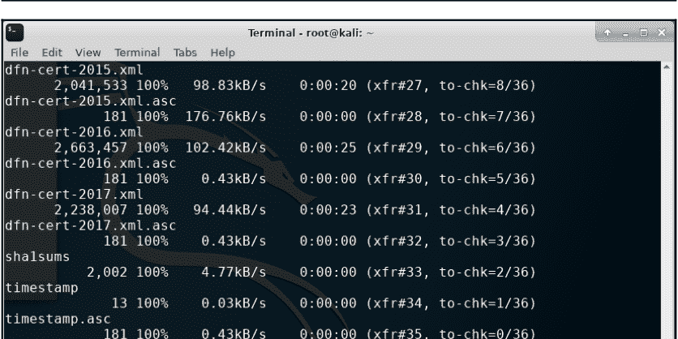

现在你可以通过将浏览器指向 https://127.0.0.1:9392 来打开图形界面。接受自签名证书错误，然后使用 admin 用户名和初始配置期间生成的密码登录。

OpenVAS 现在可以对任何目标运行漏洞扫描。你可以在登录后更改密码，方法是导航到 Administrations | Users 并选择用户名旁的编辑用户选项（用扳手标记）。

GUI 界面分为多个菜单，如下所述：

- **Dashboard**：可自定义的仪表板，展示与漏洞管理、扫描主机、最近发布的漏洞披露和其他有用信息相关的内容。
- **Scans**：在此可以启动新的网络 VA 扫描。你还可以在此菜单下找到所有报告和发现。
- **Assets**：在此可以找到扫描中积累的所有主机。
- **SecInfo**：所有漏洞及其 CVE ID 的详细信息都存储在此处。
- **Configuration**：在此可以配置各种选项，如警报、调度、报告格式。主机和开放端口发现的扫描选项也可以通过此菜单自定义。
- **Extras**：与 OpenVAS GUI 相关的设置，如时间和语言，可以在此菜单中完成。
- **Administration**：添加和删除用户以及 feed 同步可通过 Administration 菜单完成。

现在让我们看看 OpenVAS 的扫描结果。我扫描了三台主机，并在其中两台上发现了一些高风险漏洞。你可以进一步点击单个扫描并查看已识别漏洞的详细信息：

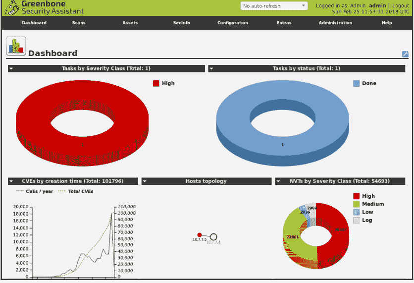

## Database exploitation

没有一次完整的 Web 渗透测试是不测试后端数据库安全性的。SQL 服务器始终是攻击者的目标列表，在渗透测试期间需要特别关注，以关闭可能泄露数据库信息的漏洞。**SQLNinja** 是一款用 Perl 编写的工具，可用于攻击 Microsoft SQL 服务器漏洞并获得 shell 访问权限。类似地，**sqlmap** 工具用于利用易受 SQL 注入攻击的 SQL 服务器并进行指纹识别、检索用户和数据库信息、枚举用户以及执行更多操作。SQL 注入攻击将在第 5 章 *Detecting and Exploiting Injection-Based Flaws* 中进一步讨论。

## Web application fuzzers

**fuzzer** 是一种旨在向 Web 应用注入随机数据的工具。Web 应用模糊测试器可用于测试缓冲区溢出条件、错误处理问题、边界检查和参数格式检查。模糊测试的结果是揭示 Web 应用漏洞扫描器无法识别的漏洞。模糊器采用试错方法，在识别缺陷时需要耐心。

## Using Tor for penetration testing

有时，Web 渗透测试可能包括绕过服务器端的某些保护、过滤或阻止，或避免被检测或识别，以便以类似于现实世界恶意黑客的方式进行测试。**Onion Router (Tor)** 提供了一个有趣的选项来模拟黑帽黑客用来保护其身份和位置的步骤。虽然试图提高 Web 应用安全性的道德黑客不应该担心隐藏其位置，但使用 Tor 可以让你额外测试边缘安全系统，例如网络防火墙、Web 应用防火墙和 IPS 设备。

黑帽黑客采用各种方法来保护其位置和真实身份；他们不使用永久 IP 地址，并不断更改它以迷惑网络犯罪调查人员。如果成为黑帽黑客的目标，你会发现来自不同 IP 地址范围的端口扫描请求，而实际的利用将具有你的边缘安全系统首次记录的源 IP 地址。在获得客户的必要书面批准后，你可以使用 Tor 来模拟攻击者，从系统通常不会看到连接的未知 IP 地址连接到 Web 应用。使用 Tor 使追踪入侵尝试回溯到实际攻击者变得更加困难。

Tor 使用由相互连接的网络中继组成的虚拟电路来弹跳加密的数据包。加密是多层的，释放数据到公共互联网的最终网络中继无法识别通信的来源，因为整个数据包都被加密，并且在每个节点只解密其中一部分。目标计算机将数据包的最终出口点视为通信的来源，从而保护用户的真实身份和位置。以下来自电子前沿基金会 (https://www.eff.org) 的图表解释了这一过程：

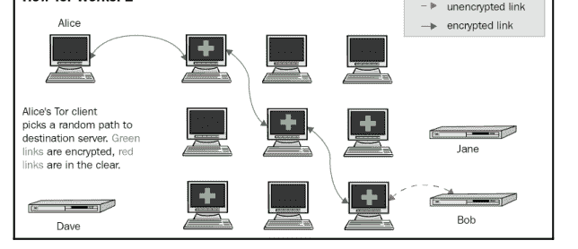

Kali Linux 预装了 Tor。有关如何使用 Tor 和安全注意事项的更多信息，请参阅 Tor 项目网站：
https://www.torproject.org/.

可能有一些工具和应用程序不支持 socks 代理，但可以配置为使用 HTTP 代理。Privoxy 是一款充当 HTTP 代理的工具，可以链接到 Tor。它也包含在 Kali Linux 中。


## 可用于练习的易受攻击的应用程序和服务器

如果没有此类资产所有者的明确书面授权，在互联网上对服务器和应用程序进行扫描、测试或利用漏洞在大多数国家都是非法的。因此，你需要拥有并控制一个实验室，在那里你可以练习和开发你的测试技能。

在本节中，我们将回顾你在学习 Web 应用程序渗透测试时所拥有的一些选择。

## OWASP 破损 Web 应用程序

OWASP 的 Broken Web Applications（BWA）项目是一个易受攻击的 Web 应用程序集合，以虚拟机的形式分发，旨在为学生、安全爱好者和渗透测试专业人员提供一个学习和开发 Web 应用程序测试技能、测试自动化工具以及测试 Web 应用防火墙（WAF）和其他防御措施的平台：

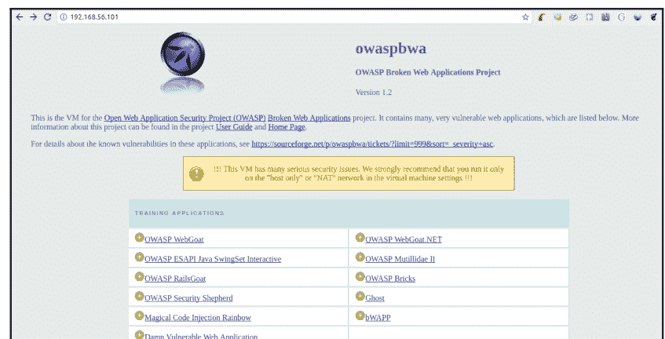

截至本文撰写时，BWA 的最新版本为 1.2，于 2015 年 8 月发布。尽管它已有好几年历史，但对于有志于渗透测试的人来说，它是一个很好的资源。它包含一些最完整的有意被破坏的 Web 应用程序，用于测试目的，并且涵盖了许多不同的平台；请考虑以下示例：

- **WebGoat**：这是一个以教育为重点的基于 Java 的 Web 应用程序。它包含最常见 Web 漏洞的示例和挑战。
- **WebGoat.NET 和 RailsGoat**：它们分别是 WebGoat 的 .NET 和 Ruby on Rails 版本。
- **Damn Vulnerable Web Application (DVWA)**：这可能是最受欢迎的有意易受攻击的 Web 应用程序。它基于 PHP，并包含常见漏洞的培训部分。

OWASP BWA 还包括 *逼真* 的易受攻击 Web 应用程序，即模拟真实世界应用程序的有意易受攻击 Web 应用程序，你可以在其中寻找比前面列出的应用程序中更不明显的漏洞。一些示例如下：

- **WackoPicko**：这是一个可以发布图片并购买其他用户照片的应用程序
- **The BodgeIt Store**：这模拟了一个在线商店，需要在其中寻找漏洞并完成一系列挑战
- **Peruggia**：这模拟了一个社交网络，你可以在其中上传图片、接收评论并对其他用户的图片进行评论

还有一些已知漏洞的真实 Web 应用程序版本来补充此集合，你可以对其进行测试和利用；请考虑以下示例：

- WordPress
- Joomla
- WebCalendar
- AWStats

有关 Broken Web Applications 项目的更多信息和下载链接可以在其网站上找到：
https://www.owasp.org/index.php/OWASP_Broken_Web_Applications_Project.

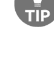

## WARNING

安装 OWASP BWA 时，请记住它包含存在严重安全问题的应用程序。不要在具有互联网访问权限的物理服务器上安装易受攻击的应用程序。使用虚拟机，并将其网络适配器设置为 NAT、NAT 网络或仅主机。

## Hackazon

**Hackazon** 是 Rapid7 的一个项目，Rapid7 是 Metasploit 的制造商。它最初旨在演示其 Web 漏洞扫描器的有效性，然后作为开源发布。这是一个现代 Web 应用程序（即它使用 AJAX、Web 服务和其他你在当今网站和应用程序中会找到的功能）。Hackazon 模拟了一个在线商店，但其中内置了多个安全问题。你可以在以下位置在线练习：http://hackazon.webscantest.com/. 另外，如果你想设置虚拟服务器并在那里安装和配置它，请访问：https://github.com/rapid7/hackazon.

## Web Security Dojo

来自 Maven Security 的 **Web Security Dojo** 项目是一个自包含的虚拟机，其中包含易受攻击的应用程序、培训材料和测试工具。该项目非常活跃地开发和更新。截至本文撰写时，最新版本为 3.0，于 2017 年 5 月发布。它可以从以下位置获得：https://www.mavensecurity.com/resources/web-security-dojo.

## 其他资源

有如此多的优秀应用程序和虚拟机可用于学习和练习渗透测试，这个列表可以延续很多页。在这里，我将列出一些除已提及之外的其他工具：

- **ZeroBank:** 这是一个易受攻击的银行应用程序：
  http://zero.webappsecurity.com/login.html.
- **Acunetix's SecurityTweets:** 这是一个类似 Twitter 的应用程序，专注于 HTML5 安全：http://testhtml5.vulnweb.com/#/popular.
- **OWASP's vulnerable web applications directory:** 这是公开可用的用于安全测试的易受攻击 Web 应用程序的精选列表：https://github.com/OWASP/OWASP-VWAD.
- **VulnHub:** 一个易受攻击的虚拟机和 **Capture The Flag (CTF)** 挑战的存储库。它包含一些带有 Web 应用程序的虚拟机：https://www.vulnhub.com.
