## 3 侦察和剖析 Web 服务器

多年来，恶意攻击者找到了各种渗透系统的方法。他们收集目标的信息，识别漏洞，然后发动攻击。一旦进入目标，他们就会尝试隐藏自己的痕迹并保持隐藏。攻击者不一定遵循我们相同的顺序，但作为渗透测试员，遵循此处建议的方法将帮助你以结构化的方式进行评估；此外，在每个阶段收集的数据将有助于准备对客户有价值的报告。攻击者的最终目标是控制你的系统；因此，他们可能不会遵循任何顺序的方法来实现这一点。作为渗透测试员，你的目标是识别尽可能多的漏洞；因此，遵循逻辑方法非常有用。此外，你需要富有创造力并跳出思维定式。

渗透测试的不同阶段如下：

- **Reconnaissance**：这涉及调查公开可用信息并了解目标的底层技术以及组件之间的关系
- **Scanning**：这涉及通过手动测试或自动扫描在目标中寻找可能的开口或漏洞
- **Exploitation**：这涉及利用漏洞、破坏目标并获得访问权限
- **Maintaining access (post-exploitation)**：设置在被利用资产上提升权限或以替代方式访问的手段；安装后门、利用本地漏洞、创建用户和其他方法
- **Covering tracks**：这涉及删除攻击的证据；通常，专业的渗透测试不涉及最后这个阶段，因为能够重建测试人员所遵循的路径为防御团队提供了宝贵的信息，并有助于提高目标的安全水平

侦察和扫描是渗透测试的初始阶段。渗透测试的成功在很大程度上取决于在这些阶段收集的信息质量。在本章中，你将作为渗透测试员工作，并使用被动和主动侦察技术提取信息。然后你将使用 Kali Linux 提供的不同工具探测目标，以提取进一步的信息并使用自动化工具找到一些漏洞。

## Reconnaissance

**Reconnaissance** 是防御部队使用的术语，意思是以不引起注意的方式获取有关敌人的信息。攻击者和渗透测试员应用相同的概念来获取与目标相关的信息。信息收集是侦察的主要目标。在此初始阶段收集的任何信息都被认为很重要。处理恶意内容的攻击者会基于侦察阶段学到的信息，并逐步推进到利用阶段。一小部分看似无害的信息可能有助于你在测试的后期阶段突出一个严重缺陷。渗透测试员的一项宝贵技能是能够将单独风险较低但组合起来影响很大的漏洞串联起来。

渗透测试中侦察的目标包括以下任务：

- 使用 Whois 记录、搜索引擎和 DNS 服务器识别 IP 地址、域名、子域名以及相关信息。
- 从公开可用资源如 Google、Bing、Yahoo! 和 Shodan 等积累有关目标网站的信息。Internet Archive（https://archive.org/），一个充当互联网上所有网页数字档案的网站，可以在侦察阶段揭示一些非常有用的信息。该网站自 1996 年以来一直在归档缓存页面。如果目标网站最近创建，则 Internet Archive 缓存它需要一些时间。
- 在社交网络网站的帮助下识别与目标相关的人员，例如 LinkedIn、Facebook、Flick、Instagram 或 Twitter，以及 Maltego 等工具。


- 使用 Geo IP 数据库、Google Maps 和 Bing Maps 的卫星图像确定目标的物理位置。
- 手动浏览 Web 应用程序并创建站点地图以了解应用程序的流程，并使用 Burp Suite、HTTP Track 和 ZAP Proxy 等工具进行爬取。

在 Web 应用程序渗透测试中，侦察可能不会如此广泛。例如，在灰盒方法中，此阶段可以收集的大多数信息都由客户提供；此外，范围可能严格限制在测试环境中运行的目标应用程序。为了完整起见，本书将采取通用的方法。

## 被动侦察与主动侦察

从真正的意义上讲，侦察始终应该是*被动*的。这意味着侦察绝不应直接与目标交互，并且应从第三方来源收集所有信息。然而在实际实施中，在对 Web 应用程序进行侦察时，你经常会与目标交互以获取最新的更改。被动侦察依赖于缓存的信息，可能不包括目标上最近的更改。虽然你可以使用与目标相关的公开信息学到很多东西，但以不会触发防火墙和入侵防御设备的方式与网站交互始终应包含在此阶段的范围内。

一些渗透测试人员认为被动侦察应包括浏览目标 URL 并导航通过公开内容；然而，其他人则认为它不应涉及任何针对实际网站的网络数据包。

## 信息收集

如前所述，侦察的主要目标是在避免触发入侵检测机制的检测和警报的同时收集信息。被动侦察用于从公开资源中提取与目标相关的信息。在 Web 应用程序渗透测试中开始时，你会得到一个 URL。然后你将确定整个网站的范围并尝试连接不同的部分。被动侦察也被称为 **开源情报 (OSINT)** 收集。

在黑盒渗透测试中，你对目标没有任何先前信息，必须像不知情的攻击者一样接近它，侦察发挥着主要作用。网站的 URL 是你唯一拥有的东西，以扩展你对目标的了解。

## 域名注册详情

每次注册域名时，你都必须提供有关你的公司或业务的详细信息，例如名称、电话号码、邮寄地址，以及用于技术和计费目的的特定电子邮件地址。域名注册商还将存储你的权威 DNS 服务器的 IP 地址。

检索到这些信息的攻击者可以出于恶意目的使用它。注册时提供的联系人姓名和号码可用于社会工程攻击，例如通过电话欺骗用户。邮寄地址可以帮助攻击者进行 wardriving 并找到未受保护的无线接入点。纽约时报在 2013 年遭到攻击，当时其 DNS 记录被恶意攻击者篡改，该攻击者对管理该域的注册商的域名经销商进行网络钓鱼攻击。篡改 DNS 记录对网站的运行有严重影响，因为攻击者可以将其用于将 Web 流量重定向到不同的服务器，并且更正后的更改可能需要长达 72 小时才能到达遍布全球的公共 DNS 服务器。

## Whois – 提取域名信息

Whois 记录用于检索域名所有者向域名注册商提供的注册详情。它是一种用于提取有关域名及其相关联系信息信息的协议。你可以查看注册域名的个人/实体的姓名、地址、电话号码和电子邮件地址。Whois 服务器由区域互联网注册管理机构 (RIR) 运营，可以直接通过端口 43 查询。在互联网早期，只有一个 Whois 服务器，但随着互联网的扩展，现有的 Whois 服务器数量已增加。如果请求的域的信息不在查询的服务器上，则请求将被转发到域名注册商的 Whois 服务器，结果返回给最终客户端。

Kali Linux 内置了 Whois 工具，可以从终端运行。通过该工具检索到的信息仅与域名所有者更新的信息一样准确，如果注册商网站上的更新详情不正确，有时可能会具有误导性。此外，域名所有者可以通过订阅域名注册商提供的额外服务来阻止与你的域相关的敏感信息，之后注册商将显示其自己的详情而不是你的域的联系详情。

在 whois 命令后跟目标域名应显示一些有价值的信息。输出将包含注册商名称和返回信息的 Whois 服务器。它还将显示域名的注册时间和到期日期，如以下屏幕截图所示：

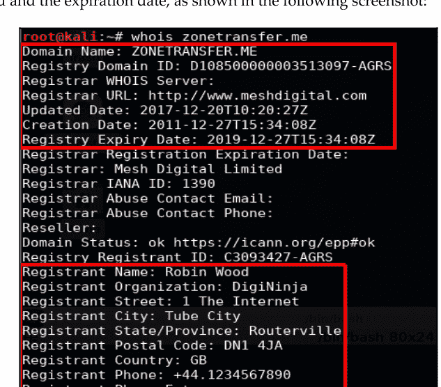

如果域名管理员在到期日期之前未能续订域名，域名注册商将释放该域名，之后任何人都可以购买它。输出还指出了域名的 DNS 服务器，可以进一步查询以查找域中的其他主机：

```
Admin Email: robin@digininja.org
Registry Tech ID: C4439188-AGRS
Tech Name: Webfusion Limited
Tech Organization: Webfusion Limited
Tech Street: 5 Roundwood Avenue
Tech City: Stockley Park
Tech State/Province: Uxbridge
Tech Postal Code: UB11 1FF
Tech Country: GB
Tech Phone: +44.8712309525
Tech Phone Ext:
Tech Fax:
Tech Fax Ext:
Tech Email: services@123-reg.co.uk
Name Server: NSZTM1.DIGI.NINJA
Name Server: NSZTM2.DIGI.NINJA
DNSSEC: unsigned
URL of the ICANN Whois Inaccuracy Complaint Form: https://www.icann.org/wicf/
>>> Last update of WHOIS database: 2018-02-25T09:44:05Z <<<
```

## 使用 DNS 识别相关主机

一旦你获得了权威 DNS 服务器的名称，你就可以使用它来识别域中的其他主机。DNS 区域不一定只包含 Web 服务器的条目。在互联网上，每个需要主机名来标识服务的技术都使用 DNS。邮件服务器和 FTP 服务器使用 DNS 将主机解析为 IP 地址。通过查询 DNS 服务器，你可以识别目标组织中的其他主机；它还有助于你识别可从互联网访问的其他应用程序。citrix.target-domain.com 或 webmail.target-domain.com 的记录可以引导你找到可从互联网访问的其他应用程序。

## 使用 dig 进行区域传输

DNS 服务器通常实现复制（即主服务器和辅助服务器）以提高可用性。为了将主机解析数据库从主服务器同步到辅助服务器，会进行一种称为区域传输的操作。辅助服务器请求区域（该服务器负责的域的一部分）数据，主服务器则以数据库的副本进行响应，其中包含它可以解析的 IP 地址-主机名对。

DNS 服务器的配置错误允许任何人请求区域传输并获取这些服务器的已解析主机的完整列表。使用 Linux 中的 Domain Internet Groper (dig) 命令行工具，你可以尝试执行区域传输以识别域中的其他主机。区域传输通过 TCP 端口 53 进行，而不是标准 DNS 端口 UDP 端口 53。

dig 命令行工具主要用于查询 DNS 服务器以获取主机名。像 dig google.com 这样简单的命令会显示域的 IP 地址以及托管其 DNS 区域的 DNS 服务器的名称（也称为名称服务器）。有许多类型的 DNS 记录，例如邮件交换器 (MX)、SRV 记录和 PTR 记录。dig google.com mx 命令显示 MX 记录的信息。

除了通常的 DNS 任务外，dig 命令还可用于执行 DNS 区域传输。

让我们请求对 zonetransfer.me 的区域传输，这是一个由 Robin Wood (DigiNinja) 为教育目的制作的易受攻击的域。请求使用 dig 命令发出，用于 zonetransfer.me 域的 AXFR（区域传输）注册到 nsztm1.digi.ninja 服务器：

```
$ dig axfr zonetransfer.me @nsztm1.digi.ninja
```


如以下屏幕截图所示，如果区域传输已启用，dig 工具会在终端中转储区域中的所有条目：

```
root@kali:~# dig axfr zonetransfer.me @NSZTM1.DIGI.NINJA | cut -d " " -f1-3
; <<>> DiG
;; global options:
zonetransfer.me. 7200 IN SOA nsztm1.digi.ninja. robin.digi.ninja. 2014101603
zonetransfer.me. 7200 IN RRSIG SOA 8 2
zonetransfer.me. 7200 IN NS nsztm1.digi.ninja.
zonetransfer.me. 7200 IN NS nsztm2.digi.ninja.
zonetransfer.me. 7200 IN RRSIG NS 8 2
zonetransfer.me. 7200 IN A 217.147.177.157
zonetransfer.me. 7200 IN RRSIG A 8 2
zonetransfer.me. 300 IN HINFO "Casio fx-700G" "Windows"
zonetransfer.me. 300 IN RRSIG HINFO 8 2
zonetransfer.me. 7200 IN MX 0 ASPMX.L.GOOGLE.COM.
zonetransfer.me. 7200 IN MX 10 ALT1.ASPMX.L.GOOGLE.COM.
zonetransfer.me. 7200 IN MX 10 ALT2.ASPMX.L.GOOGLE.COM.
zonetransfer.me. 7200 IN MX 20 ASPMX2.GOOGLEMAIL.COM.
zonetransfer.me. 7200 IN MX 20 ASPMX3.GOOGLEMAIL.COM.
zonetransfer.me. 7200 IN MX 20 ASPMX4.GOOGLEMAIL.COM.
zonetransfer.me. 7200 IN MX 20 ASPMX5.GOOGLEMAIL.COM.
zonetransfer.me. 7200 IN RRSIG MX 8 2
zonetransfer.me. 301 IN TXT "google-site-verification=typP28J7JAUHA9fw2sHXMgcCCOI6X8mmoVio4VLMewxA"
zonetransfer.me. 301 IN RRSIG TXT 8 2
zonetransfer.me. 3600 IN NSEC _sip._tcp.zonetransfer.me. A NS
zonetransfer.me. 3600 IN RRSIG NSEC 8 2
zonetransfer.me. 300 IN DNSKEY 256 3 8
zonetransfer.me. 300 IN DNSKEY 256 3 8
zonetransfer.me. 300 IN DNSKEY 257 3 8
zonetransfer.me. 300 IN RRSIG DNSKEY 8 2
zonetransfer.me. 300 IN RRSIG DNSKEY 8 2
_sip._tcp.zonetransfer.me. 14000 IN SRV 0
_sip._tcp.zonetransfer.me. 14000 IN RRSIG SRV
_sip._tcp.zonetransfer.me. 3600 IN NSEC 157.177.147.217.IN-ADDR.ARPA.zonetransfer.me. SRV
_sip._tcp.zonetransfer.me. 3600 IN RRSIG NSEC 8
157.177.147.217.IN-ADDR.ARPA.zonetransfer.me. 7200 IN
157.177.147.217.IN-ADDR.ARPA.zonetransfer.me. 7200 IN
157.177.147.217.IN-ADDR.ARPA.zonetransfer.me. 3600 IN
157.177.147.217.IN-ADDR.ARPA.zonetransfer.me. 3600 IN
asfdbautdns.zonetransfer.me. 7900 IN AFSDB 1
asfdbautdns.zonetransfer.me. 7900 IN RRSIG AFSDB
asfdbautdns.zonetransfer.me. 3600 IN NSEC asfdbbox.zonetransfer.me.
asfdbautdns.zonetransfer.me. 3600 IN RRSIG NSEC
asfdbbox.zonetransfer.me. 7200 IN A 127.0.0.1
asfdbbox.zonetransfer.me. 7200 IN RRSIG A 8
asfdbbox.zonetransfer.me. 3600 IN NSEC asfdbvolume.zonetransfer.me. A
asfdbbox.zonetransfer.me. 3600 IN RRSIG NSEC 8
```

Shell 命令，例如 `grep` 或 `cut`，对于处理命令行工具的输出非常有用。在前面的示例中，`cut` 与 `|` 管道字符一起使用，以仅显示由 `-d " "` 空格字符分隔的每行 `dig` 命令结果的前三个元素。在此屏幕截图中，列由制表符分隔，最后列中的信息由空格分隔。

你经常会发现，即使主 DNS 服务器阻止区域传输，该域的辅助服务器可能允许它。`dig google.com NS +noall +answer` 命令将显示该域的所有名称服务器。

尝试从 `facebook.com` 的 DNS 服务器执行区域传输失败，因为该公司已正确锁定其 DNS 服务器：

```
; <<>> DiG 9.10.3-P4-Ubuntu <<>> axfr facebook.com @A.NS.FACEBOOK.COM
;; global options: +cmd
; Transfer failed.
```

执行 DNS 查找以搜索 IP 地址是被动侦察。然而，一旦你使用 `dig` 或 `nslookup` 等工具进行区域传输，它就变成了主动侦察。

## DNS 枚举

在真实的渗透测试项目中，找到允许匿名区域传输的配置错误服务器是非常罕见的。可以使用其他技术来发现与域相关的主机名或子域，Kali Linux 包含一些有用的工具来实现这一点。

## DNSenum

DNSenum 是一个命令行工具，可自动识别基本 DNS 记录，例如 MX、邮件交换服务器、NS、域名服务器或 A——域的地址记录。它还尝试对所有已识别的服务器进行区域传输，并且具有尝试反向解析的能力，即给定 IP 地址获取主机名，以及对子域和主机名进行暴力破解，即查询主机名的存在以获取其 IP 地址。以下是查询 zonetransfer.me 的示例：

```
root@kali:~# dnsenum zonetransfer.me
Smartmatch is experimental at /usr/bin/dnsenum line 698.
Smartmatch is experimental at /usr/bin/dnsenum line 698.
dnsenum VERSION:1.2.4

----- zonetransfer.me -----

Host's addresses:
-----------------
zonetransfer.me.          6524  IN  A   217.147.177.157

Name Servers:
-------------
nsztm1.digi.ninja.        10122 IN  A   81.4.108.41
nsztm2.digi.ninja.        10122 IN  A   167.88.42.94

Mail (MX) Servers:
------------------
ASPMX4.GOOGLEMAIL.COM.    293   IN  A   173.194.219.26
ASPMX5.GOOGLEMAIL.COM.    293   IN  A   74.125.192.26
ASPMX3.GOOGLEMAIL.COM.    293   IN  A   74.125.201.26
ASPMX2.GOOGLEMAIL.COM.    293   IN  A   74.125.198.26
ALT2.ASPMX.L.GOOGLE.COM.  293   IN  A   74.125.201.27
ALT1.ASPMX.L.GOOGLE.COM.  293   IN  A   74.125.198.27
ASPMX.L.GOOGLE.COM.       293   IN  A   74.125.203.27

Trying Zone Transfers and getting Bind Versions:
-------------------------------------------------

Trying Zone Transfer for zonetransfer.me on nsztm1.digi.ninja ...
zonetransfer.me.         7200  IN  SOA   (
zonetransfer.me.         7200  IN  RRSIG  (
zonetransfer.me.         7200  IN  NS    nsztm1.digi.ninja.
zonetransfer.me.         7200  IN  NS    nsztm2.digi.ninja.
zonetransfer.me.         7200  IN  RRSIG  (
zonetransfer.me.         7200  IN  A     217.147.177.157
```

区域传输结果如下：

```
Trying Zone Transfers and getting Bind Versions:

Trying Zone Transfer for zonetransfer.me on nsztm1.digi.ninja ...
zonetransfer.me. 7200 IN NS nsztm1.digi.ninja.
zonetransfer.me. 7200 IN NS nsztm2.digi.ninja.
zonetransfer.me. 7200 IN A 217.147.177.157
zonetransfer.me. 300 IN HINFO "Casio"
zonetransfer.me. 7200 IN MX 0
zonetransfer.me. 7200 IN MX 10
zonetransfer.me. 7200 IN MX 10
zonetransfer.me. 7200 IN MX 20
zonetransfer.me. 7200 IN MX 20
zonetransfer.me. 7200 IN MX 20
zonetransfer.me. 7200 IN MX 20
_sip._tcp.zonetransfer.me. 14000 IN SRV 0
asfdbautdns.zonetransfer.me. 7900 IN AFSDB 1
asfdbbox.zonetransfer.me. 7200 IN A 127.0.0.1
asfdbvolume.zonetransfer.me. 7800 IN AFSDB 1
canberra-office.zonetransfer.me. 7200 IN A 202.14.81.230
cmdexec.zonetransfer.me. 300 IN TXT ";"
dc-office.zonetransfer.me. 7200 IN A 143.228.181.132
deadbeef.zonetransfer.me. 7201 IN AAAA dead:beaf::
deadbeef.zonetransfer.me. 3600 IN NSEC dr.zonetransfer.me.
dr.zonetransfer.me. 300 IN LOC 53
dr.zonetransfer.me. 3600 IN NSEC DZC.zonetransfer.me.
DZC.zonetransfer.me. 7200 IN TXT AbCdEfG
DZC.zonetransfer.me. 3600 IN NSEC email.zonetransfer.me.
email.zonetransfer.me. 7200 IN A 74.125.206.26
Info.zonetransfer.me. 3600 IN NSEC internal.zonetransfer.me.
internal.zonetransfer.me. 300 IN NS intns1.zonetransfer.me.
internal.zonetransfer.me. 300 IN NS intns2.zonetransfer.me.
intns1.zonetransfer.me. 300 IN A 167.88.42.94
AXFR record query failed: no socket TCP[167.88.42.94] Connection timed out
intns1.zonetransfer.me. 3600 IN NSEC intns2.zonetransfer.me.
intns2.zonetransfer.me. 300 IN A 167.88.42.94
intns2.zonetransfer.me. 3600 IN NSEC office.zonetransfer.me.
office.zonetransfer.me. 7200 IN A 4.23.39.254
ipv6actnow.org.zonetransfer.me. 7200 IN AAAA 2001:67c:2e8:11::c100:1332
owa.zonetransfer.me. 7200 IN A 207.46.197.32
owa.zonetransfer.me. 3600 IN NSEC robinwood.zonetransfer.me.
```

## Fierce

Fierce 由 mschwager 在 Fierce: A DNS reconnaissance tool for locating non-contiguous IP space (https://github.com/mschwager/fierce)，GitHub © 2018 中介绍如下：

> Fierce 是一个半轻量级扫描器，可帮助定位指定域的非连续 IP 空间和主机名。

Fierce 使用区域传输、字典攻击和反向解析来收集域的主机名和子域以及其 IP 地址，并且可以选择搜索相关名称，例如域 company.com、corpcompany.com 或 webcompany.com。在以下示例中，我们将使用 search 来识别 google.com 的主机名：

```
root@kali:~# fierce -dns google.com
DNS Servers for google.com:
    ns2.google.com
    ns4.google.com
    ns1.google.com
    ns3.google.com

Trying zone transfer first...
    Testing ns2.google.com
        Request timed out or transfer not allowed.
    Testing ns4.google.com
        Request timed out or transfer not allowed.
    Testing ns1.google.com
        Request timed out or transfer not allowed.
    Testing ns3.google.com
        Request timed out or transfer not allowed.

Unsuccessful in zone transfer (it was worth a shot)
Okay, trying the good old fashioned way... brute force

Checking for wildcard DNS...
Nope. Good.
Now performing 2280 test(s)...
216.58.203.100  academico.google.com
216.58.203.109  accounts.google.com
216.58.203.110  admin.google.com
216.58.203.110  ads.google.com
216.58.203.110  ai.google.com
216.58.203.110  alerts.google.com
216.58.203.100  ap.google.com
216.58.203.110  apps.google.com
216.58.203.100  asia.google.com
216.58.203.110  billing.google.com
216.58.203.105  blog.google.com
216.58.203.110  business.google.com
216.58.203.110  calendar.google.com
216.58.203.110  careers.google.com
216.58.203.110  catalog.google.com
216.58.203.110  chat.google.com
216.58.203.110  classroom.google.com
216.58.203.110  code.google.com
74.125.204.129  corp.google.com
216.58.203.110  d.google.com
216.58.203.110  designer.google.com
216.58.203.110  developer.google.com
216.58.203.110  developers.google.com
```


## DNSRecon

DNSRecon 是 Kali Linux 中包含的另一个有用工具。它可以通过多种技术收集 DNS 信息，包括区域传输、字典请求和 Google 搜索。在下面的屏幕截图中，我们将通过区域传输 (-a) 对 zonetransfer.me 进行枚举、通过 Whois 获取的 IP 地址空间的反向分析 (-w)，以及 Google 搜索 (-g)：

```
root@kali:~# dnsrecon -a -w -g -d zonetransfer.me
[*] Performing General Enumeration of Domain: zonetransfer.me
[*] Checking for Zone Transfer for zonetransfer.me name servers
[*] Resolving SOA Record
[*] SOA nsztml.digi.ninja 81.4.108.41
[*] Resolving NS Records
[*] NS Servers found:
[*] NS nsztml.digi.ninja 81.4.108.41
[*] NS nsztm2.digi.ninja 167.88.42.94
[*] Removing any duplicate NS server IP Addresses...
[*] Trying NS server 167.88.42.94
[-] Zone Transfer Failed for 167.88.42.94!
[*] Port 53 TCP is being filtered
[*] Trying NS server 81.4.108.41
[+] 81.4.108.41 Has port 53 TCP Open
[+] Zone Transfer was successful!!
[*] SOA nsztml.digi.ninja 81.4.108.41
[*] NS nsztml.digi.ninja 81.4.108.41
[*] NS nsztm2.digi.ninja 167.88.42.94
[*] NS intsn1.zonetransfer.me 167.88.42.94
[*] NS intsn2.zonetransfer.me 167.88.42.94
[*] TXT google-site-verification=tyP28J7H4wJHA9fw2sHXMgCC0C16XBmoV104VLMeWxA
[*] TXT Remember to call or email Pippa on +44 123 4567890 or pippa@zonetransfer.me when making DNS changes
[*] TXT '<script>alert('Boo')</script>'
[*] TXT AbcDeFG
[*] TXT zonetransfer.me service provided by Robin Wood - robin@digi.ninja. See http://digi.ninja/projects/zonetransfer.me.php
[*] TXT ' ; } ; echo Shellshocked
[*] TXT ' or 1=1 --
[*] TXT Robin Wood
[*] PTR www.zonetransfer.me 217.147.177.157
[*] MX @zonetransfer.me ASPMX.L.GOOGLE.COM 74.125.203.27
[*] MX @zonetransfer.me ASPMX.L.GOOGLE.COM 2404:6800:4008:c07::1b
[*] MX @zonetransfer.me ALT1.ASPMX.L.GOOGLE.COM 74.125.198.27
[*] MX @zonetransfer.me ALT1.ASPMX.L.GOOGLE.COM 2607:f8b0:4003:c05::1b
[*] MX @zonetransfer.me ALT2.ASPMX.L.GOOGLE.COM 74.125.201.27
[*] MX @zonetransfer.me ALT2.ASPMX.L.GOOGLE.COM 2607:f8b0:4001:c01::1a
[*] MX @zonetransfer.me ASPMX2.GOOGLEMAIL.COM 74.125.198.26
[*] MX @zonetransfer.me ASPMX2.GOOGLEMAIL.COM 2607:f8b0:4003:c05::1a
[*] MX @zonetransfer.me ASPMX3.GOOGLEMAIL.COM 74.125.201.26
[*] MX @zonetransfer.me ASPMX3.GOOGLEMAIL.COM 2607:f8b0:4001:c01::1a
[*] MX @zonetransfer.me ASPMX4.GOOGLEMAIL.COM 173.194.219.27
[*] MX @zonetransfer.me ASPMX4.GOOGLEMAIL.COM 2607:f8b0:4002:c03::1a
[*] MX @zonetransfer.me ASPMX5.GOOGLEMAIL.COM 74.125.192.26
```

## 使用 Nmap 暴力破解 DNS 记录

Nmap 附带了一个脚本，用于通过暴力破解技术查询 DNS 服务器以查找额外的主机。它使用 vhosts-defaults.lst 和 vhosts-full.lst 字典文件，其中包含 Nmap 开发团队多年来收集的大量常见主机名列表。文件位于 /usr/share/nmap/nselib/data/。Nmap 会为该文件中的每个条目向 DNS 服务器发送查询，以检查 DNS 区域中是否存在该主机名的 A 记录。

如以下屏幕截图所示，暴力破解脚本返回了积极的结果。它通过查询 A 记录识别了 DNS 区域中的一些主机：

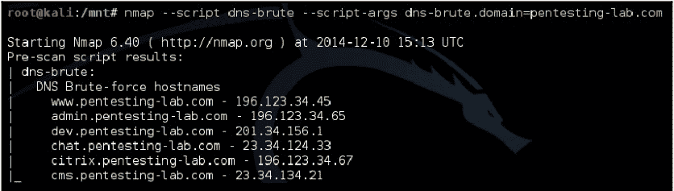

## 使用搜索引擎和公共站点收集信息

现代搜索引擎是公开信息收集和被动侦察的宝贵资源。通用搜索引擎如 Google、Bing 和 DuckDuckGo 允许我们使用高级搜索过滤器查找特定域中的信息、特定文件类型、URL 中的内容以及特定文本模式。还有专门的搜索引擎，如 Shodan，可让您搜索主机名、开放端口、服务器位置以及多种服务中的特定响应头。

## Google dorks

**Google dorks** 技术，也称为 *Google hacking*，最初是对 Google 高级搜索选项的滥用，后来扩展到其他也包含类似选项的搜索引擎。它搜索特定的字符串和参数，以从组织或目标获取有价值的信息。以下是渗透测试人员可能有用的一些示例：

- 可以搜索特定站点或域中的 PDF 文档，如下所示：
  ```
  site:example.com filetype:pdf
  ```
- 可以搜索特定域的电子邮件地址引用，同时排除该域的站点：
  ```
  "@example.com" -site:example.com
  ```
- 可以搜索 example.com 中标题或 URL 中包含 admin 字的管理站点：
  ```
  intitle:admin OR inurl:admin site:example.com
  ```
- 您还可以查找指示可能存在 SQL 注入漏洞的特定错误消息：
  ```
  "SQL Server Driver][SQL Server]Line 1: Incorrect syntax near"
  site:example.com
  ```

Google 和其他搜索引擎中有成千上万种可能有用的搜索组合。Offensive Security，Kali Linux 的创建者，还维护了一个公开的搜索字符串数据库，可能为渗透测试人员提供有用的结果，可在以下位置获得：https://www.exploit-db.com/google-hacking-database/。

## Shodan

Shodan (https://shodan.io) 是一种不同类型的搜索引擎；它帮助您查找连接到互联网的设备，而不是网页中的内容。像 Google 一样，它具有运算符和特定的语法来执行高级和特定的搜索。此屏幕截图显示了对与 google.com 相关的所有主机名的搜索：

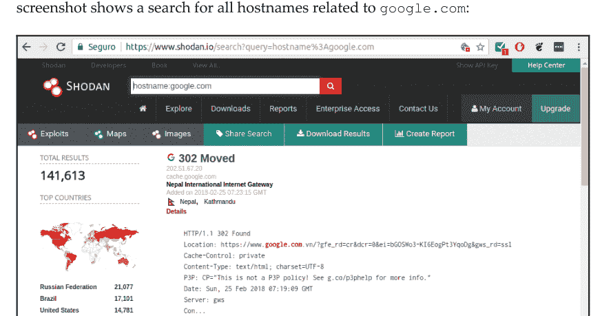

使用 Shodan 进行主机名搜索示例

要利用 Shodan 的高级搜索功能，首先需要创建一个帐户。免费帐户会产生有限的结果数量，一些选项受到限制，但仍然非常有用。Shodan 可用于查找以下内容：

- 属于某个域的暴露于互联网的服务器可以这样找到：
  ```
  hostname:example.com
  ```
- 可以通过指定 Server 参数找到特定类型的设备，例如 CCTV 相机或 **工业控制系统 (ICS)**：
  ```
  Server: SQ-WEBCAM
  ```
- 可以找到特定的开放端口或服务，例如使用常见端口的 Web 服务器：
  ```
  port:80,443,8080
  ```
- 可以这样找到特定网络范围内的主机：
  ```
  net:192.168.1.1/24
  ```

有关 Shodan 搜索选项和运算符的有用参考可以在以下位置找到：
https://pen-testing.sans.org/blog/2015/12/08/effective-shodan-searches.

## theHarvester

**theHarvester** 是 Kali Linux 中包含的命令行工具，它充当各种搜索引擎的包装器，用于从不同的公共来源（例如搜索引擎和 PGP 密钥服务器）查找与域相关的电子邮件帐户、子域名、虚拟主机、开放端口/横幅以及员工姓名。在最近的版本中，作者添加了执行 DNS 暴力破解、反向 IP 解析和 **顶级域名 (TLD)** 扩展的能力。

在下面的示例中，theharvester 用于收集有关 zonetransfer.me 的信息：

```
root@kali:~# theharvester -b all -d zonetransfer.me

**************************************************
*                                                *
*   TheHarvester                                *
*                                                *
*   TheHarvester Ver. 2.7                       *
*   Coded by Christian Martorella               *
*   Edge-Security Research                      *
*   cmartorella@edge-security.com               *
**************************************************

Full harvest..
[-] Searching in Google..
        Searching 0 results...
        Searching 100 results...
[-] Searching in PGP Key server..
[-] Searching in Bing..
        Searching 50 results...
        Searching 100 results...
[-] Searching in Exalead..
        Searching 50 results...
        Searching 100 results...
        Searching 150 results...

[+] Emails found:

pippa@zonetransfer.me
pixel-1506786993611511-web-@zonetransfer.me
pixel-1506786996891728-web-@zonetransfer.me
xss.zonetransfer.me@xss.zonetransfer.me

[+] Hosts found in search engines:
----------------------------------------
[-] Resolving hostnames IPs...
127.0.0.1:asfdbbox.zonetransfer.me
4.23.39.254:office.zonetransfer.me
207.46.197.32:owa.zonetransfer.me
54.206.51.177:staging.zonetransfer.me
217.147.177.157:testing.zonetransfer.me
217.147.177.157:www.zonetransfer.me
[+] Virtual hosts:
```


## Maltego

Maltego 是一款专为 OSINT 而广泛使用的专有软件。Kali Linux 包含 Maltego 社区版，完成在线注册后即可免费使用，但存在一些限制。Maltego 对数据片段（例如电子邮件地址和域名）执行转换以获取更多信息，并将所有结果以图表形式显示，展示不同对象之间的关系。转换是对特定对象公开信息的搜索，例如搜索与域名相关的 IP 地址，或与电子邮件地址或个人姓名相关的社交媒体账户。以下截图显示了 Maltego 的主界面：

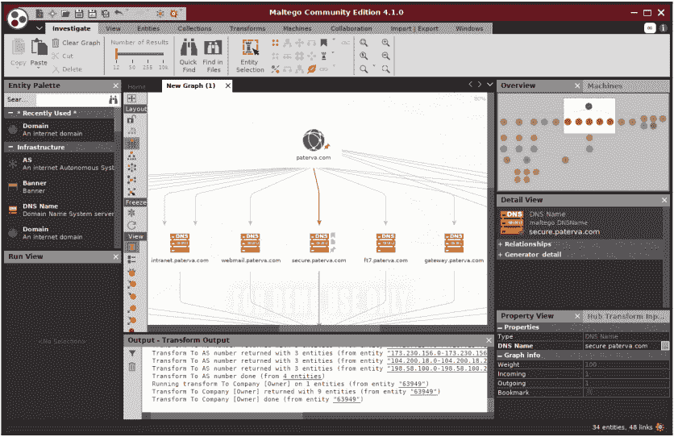

Maltego 界面

## Recon-ng – 信息收集框架

OSINT 收集是一项耗时且手动的过程。与目标组织相关的信息可能分散在多个公共资源中，积累和提取与目标相关的信息是一项困难且耗时的任务。大多数组织的 IT 预算不允许在此类活动上花费太多时间。

Recon-ng 就是渗透测试人员一直需要的工具。它是一款功能强大的信息收集工具。Recon-ng 是一款非常交互式的工具，与 Metasploit 框架类似。该框架使用多种不同的来源收集数据，例如 Google、Twitter 和 Shodan。某些模块在查询网站之前需要 API 密钥。密钥可以通过在搜索引擎网站上完成注册来生成。其中一些模块使用付费 API 密钥。

要在 Kali Linux 中启动 Recon-ng，请导航到应用程序菜单并单击信息收集子菜单，或直接在终端中运行 recon-ng 命令。你将在右侧窗格中看到 Recon-ng 的列表。与 Metasploit 类似，当框架运行时，你可以输入 show modules 来查看随附的不同模块。有些模块是被动的，而其他模块则主动探测目标以提取所需信息。

尽管 Recon-ng 有几个利用模块，但该工具的主要任务是协助侦察活动，并且其中有大量模块可用于此目的：

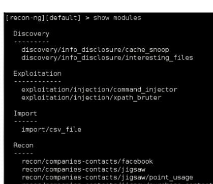

Recon-ng 可以查询多个搜索引擎，其中一些是通过网络请求查询的；也就是说，该工具复制了当普通用户在搜索框中输入文本并单击搜索按钮时发出的请求。另一个选项是使用引擎的 API。这通常比使用自动化工具的效果更好。使用 API 时，搜索引擎可能需要 API 密钥来识别发送这些请求的身份并应用配额。该工具比人类工作更快，并且通过分配 API 可以跟踪使用情况并防止有人滥用服务。因此，请确保不要使搜索引擎不堪重负，否则你的查询可能会被拒绝。

所有主要搜索引擎都为注册用户提供持有 API 密钥的选项。例如，你可以在 https://azure.microsoft.com/en-us/try/cognitive-services/?api=bing-web-search-api 生成 Bing 的 API 密钥。

此免费订阅每月提供 5,000 次查询。一旦密钥生成，就需要使用以下命令将其添加到 Recon-ng 工具的 keys 表中：

```
keys add bing_api <api key generated>
```

要显示你在 Recon-ng 中存储的所有 API 密钥，请输入以下命令：

```
keys list
```

### 使用 Recon-ng 进行域名枚举

收集目标网站的子域名信息将帮助你识别网站的不同内容和功能。目标组织提供的每个产品或服务可能都有一个专门的子域名。这有助于以连贯的方式组织多样化的内容。通过识别不同的子域名，你可以创建站点地图和流程图，相互连接各个部分，更好地理解网站的流程。

### 子级和顶级域名枚举

使用 Bing Web 主机名枚举模块，我们将尝试在 https://www.facebook.com/ 网站上找到额外的子域名：

- 1. 首先你需要使用 load recon/domains-hosts/bing_domain_web 命令加载模块。接下来，输入 show info 命令，它将显示描述该模块的信息。
- 2. 下一步是在 SOURCE 选项中设置目标域名。我们将其设置为 facebook.com，如屏幕截图所示：

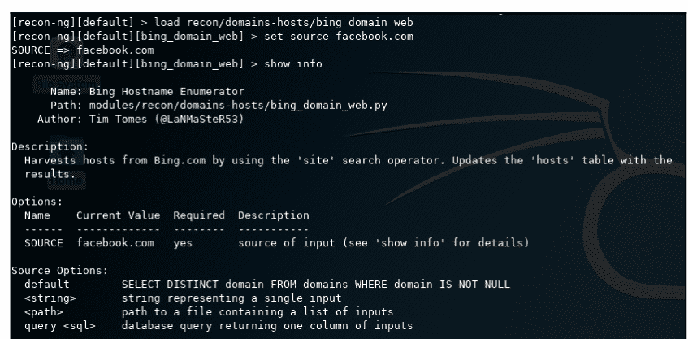

- 3. 准备就绪后，使用 run 命令启动模块。该工具首先查询几个域名，然后使用 (–) 指令删除已查询的域名。然后它再次搜索额外的域名。这里最大的优势是速度。除了速度快之外，输出还以纯文本形式存储在数据库中。这可以作为输入提供给 Nmap、Metasploit 和 Nessus 等其他工具。输出显示在以下屏幕截图中：

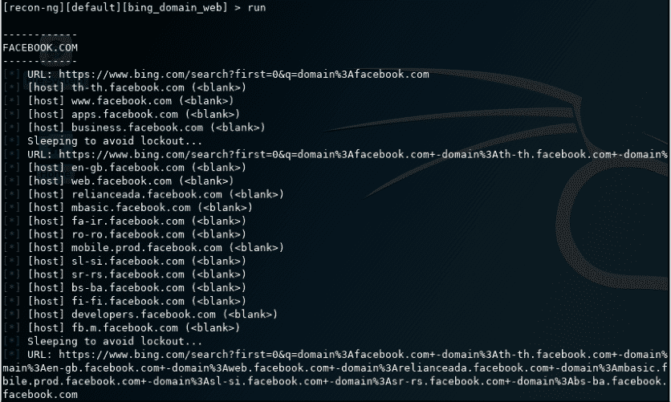

DNS 公共后缀暴力破解模块可用于识别顶级域名 (TLD) 和二级域名 (SLD)。许多基于产品和服务的企业为每个地理区域设有单独的网站；你可以使用此暴力破解模块来识别它们。它使用 /usr/share/recon-ng/data/suffixes.txt 中的词表文件来枚举额外的域名。

### 报告模块

你运行的每个侦察模块都会将输出存储在单独的表中。你可以将这些表导出为多种格式，例如 CSV、HTML 和 XML 文件。要查看 Recon-ng 工具使用的不同表，你需要输入 show 并按两次 Tab 键以列出自动完成功能的可用选项。

要将表导出为 CSV 文件，请通过输入 use reporting/csv 加载 CSV 报告模块。 （可以使用 load 命令代替 use，效果相同。）加载模块后，设置文件名和要导出的表，然后输入 run：

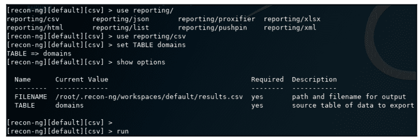

以下是 Recon-ng 中对渗透测试人员非常有帮助的一些额外侦察模块：

- **Netcraft 主机名枚举器：** Recon-ng 将收集 Netcraft 网站并累积与目标相关的所有主机，并将它们存储在 hosts 表中。
- **SSL SAN 查找：** 许多启用 SSL 的网站使用单个证书跨多个域工作，利用 **主题备用名称 (SAN)** 功能。该模块使用 http://ssltools.com/ 网站检索证书 SAN 属性中列出的域名。
- **LinkedIn 已认证联系人枚举器：** 这将从 LinkedIn 个人资料中检索联系人并将它们存储在 contacts 表中。
- **IPInfoDB GeoIP：** 这将使用 IPInfoDB 数据库显示主机的地理位置（需要 API）。
- **Yahoo! 主机名枚举器：** 这使用 Yahoo! 搜索引擎在域中定位主机。拥有多个搜索引擎的模块可以帮助你找到可能未被其他搜索引擎索引的主机和子域名。
- **地理编码器和反向地理编码器：** 这些模块使用 Google Map API 根据提供的坐标获取地址，并根据给出的地址检索坐标。然后信息存储在 locations 表中。
- **Pushpin 模块：** 使用 Recon-ng pushpin 模块，你可以从流行的社交网络网站提取数据，将其与地理位置坐标关联并创建地图。两个广泛使用的模块如下：
  - **Twitter 地理位置搜索：** 这会在给定坐标特定半径范围内搜索 Twitter 上上传的媒体（图像和推文）
  - **Flickr 地理位置搜索：** 这会尝试定位从给定坐标周围区域上传的照片

这些 pushpin 模块可用于将人员映射到物理位置，并确定谁在特定时间出现在给定坐标。积累的信息并转换为 HTML 文件后，可以将其映射到精确坐标处的卫星图像。使用 Recon-ng，你可以仅使用公开可用资源创建庞大的主机、IP地址、物理位置和人员数据库。

侦察应始终以从各种公共资源中提取信息并识别可被攻击者用于直接或间接针对组织的有用敏感数据的目标进行。

## 扫描 – 探测目标

渗透测试需要在有限的时间内进行，而侦察阶段是获得时间最少的阶段。在真实的渗透测试中，你会与客户分享侦察阶段收集的信息，并就应包含在扫描阶段的目标达成共识。

在此阶段，客户还可能向你提供在侦察阶段未识别出的额外目标和域名，但它们将被纳入实际的测试和利用阶段。这是为了通过包含黑客和白帽黑客的方法来获得测试的最大收益，你将像恶意攻击者一样开始测试，随着进展提供额外信息，从而获得目标的准确视图。

一旦确定了托管网站的目标服务器，下一步涉及收集有关操作系统和该特定服务器上可用服务的额外信息。除了托管网站外，一些组织还启用了 FTP 服务，并且根据需要也可能打开其他端口。


作为第一步，你需要识别出在 Web 服务器上除 80 端口和 443 端口之外额外开放的端口。

扫描阶段包含以下步骤：

- 端口扫描
- 操作系统指纹识别
- Web 服务器版本识别
- 底层基础设施分析
- 应用识别

## 使用 Nmap 进行端口扫描

**网络映射器**，通常称为 Nmap，是最广为人知的端口扫描器。它能以很高的成功率发现 TCP 和 UDP 开放端口，并且是渗透测试人员工具箱中的重要软件。Kali Linux 已预装 Nmap。Nmap 会定期更新，并由一个活跃的开发者团队维护这一开源工具。

默认情况下，Nmap 不会向所有端口发送探测。Nmap 只检查 `nmap-services` 文件中指定的前 1,000 个常用端口。每个端口条目都有一个对应的数字，表示该端口开放的可能性。这极大地提高了扫描速度，因为不太重要的端口被省略了。根据目标的响应，Nmap 会判断端口是开放、关闭还是被过滤。

## 端口扫描的不同选项

运行 Nmap 端口扫描的直接方式称为 **TCP 连接扫描**。此选项用于扫描开放的 TCP 端口，并使用 `-sT` 选项调用。连接扫描执行完整的三次握手 TCP 握手（SYN-SYN / ACK-ACK）。它能提供更准确的端口状态，但更可能被目标机器记录，并且比替代的 SYN 扫描更慢。SYN 扫描使用 `-sS` 选项，不会与目标完成握手，因此不会在该目标机器上被记录。然而，SYN 扫描产生的报文可能会触发防火墙和 IPS 设备，并且有时会被此类设备默认阻止。

当 Nmap 使用 -F 标志调用时，它将扫描前 100 个端口而不是前 1,000 个端口。此外，它还提供 `--top-ports [N]` 标志选项，可让你自定义扫描，以从 nmap-services 文件中扫描 N 个最流行的端口。许多组织可能有在非 nmap-services 文件中的端口上监听的应用。对于此类情况，你可以使用 -p 标志为 Nmap 定义要扫描的端口、端口列表或端口范围。

共有 65535 个 TCP 和 UDP 端口，应用程序可以使用其中任何一个端口。如果你愿意，可以使用 -p 1-65535 或 -p- 选项测试所有端口。

以下屏幕截图显示了前面命令的输出：

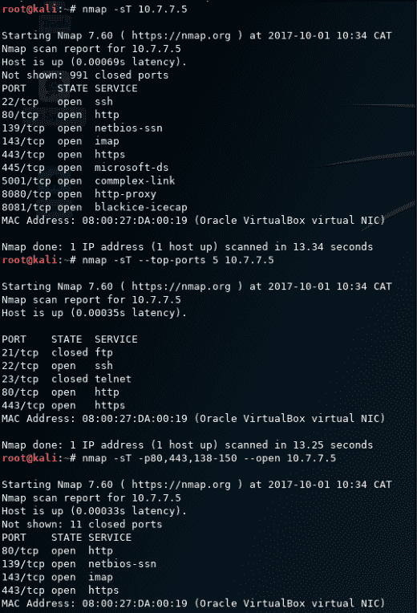

在渗透测试中，保存结果并保留你运行的所有工具的日志非常重要。你应该保存笔记和记录以更好地组织项目，并将日志保存为预防措施，以防目标出现问题。你可以返回日志并检索可能对重新建立服务或识别故障来源至关重要的信息。Nmap 有多种 -o 选项可将结果保存为不同文件格式：-oX 用于 XML 格式，-oN 用于 Nmap 输出格式，-oG 用于可 Grep 文本，-oA 用于全部格式。

## 使用 Nmap 规避防火墙和 IPS

除了针对 TCP 的不同扫描外，Nmap 还提供了多种选项，有助于在从组织网络外部扫描目标时绕过防火墙。以下是这些选项的描述：

- **ACK 扫描：** 此选项用于规避某些路由器上的规则，这些规则只允许来自内部网络的 SYN 数据包，从而阻止默认的连接扫描。这些路由器只允许内部客户端通过路由器建立连接，并会阻止所有源自外部网络且 SYN 位被置位的数据包。当使用 `-sA` 标志调用 ACK 扫描选项时，Nmap 会生成仅设置 ACK 位的数据包，欺骗路由器使其相信该数据包是对内部客户端建立的连接的响应，并允许数据包通过。ACK 扫描选项无法可靠地判断终端系统上的端口是开放还是关闭，因为不同系统对非请求 ACK 的响应方式不同。然而，它可用于识别路由器后面的在线系统。
- **防火墙规则中的硬编码源端口：** 许多防火墙管理员会配置防火墙规则，允许来自外部网络的入站流量，其源端口为 53、25 和 80 等特定端口。默认情况下，Nmap 会随机选择源端口，但它可以配置为使用特定源端口以使用 `--source-port` 选项规避此规则。
- **自定义数据包大小：** Nmap 和其他端口扫描器发送特定大小的数据包，而防火墙现在已定义规则来丢弃此类数据包。为了规避这种检测，Nmap 可以配置为使用 `--data-length` 选项发送不同大小的数据包。


- **自定义 MTU**：Nmap 还可以配置为发送具有较小 MTU 的数据包。扫描将使用 `--mtu` 选项以及 MTU 值一起执行。这可用于规避一些较旧的防火墙和入侵检测设备。新防火墙会在将流量发送到目标机器之前重新组装流量，因此很难规避它们。MTU 必须是 8 的倍数。以太网 LAN 的默认 MTU 为 1,500 字节。
- **分片数据包**：绕过 IDS 和 IPS 系统的一种常见而有效的方法是分片数据包，以便在这些防御机制分析时，它们与恶意模式不匹配。Nmap 具有此能力，可在执行完整 TCP 扫描（`-sT`）时使用 `-f` 选项。
- **MAC 地址欺骗**：如果目标环境中配置了规则，仅允许来自特定 MAC 地址的网络数据包，你可以配置 Nmap 设置特定 MAC 地址以进行端口扫描。端口扫描数据包也可以使用 `--spoof-mac` 选项配置为具有特定 MAC 地址。

## 识别操作系统

在识别出 Web 服务器上的开放端口后，你需要确定底层操作系统。Nmap 提供了多个选项来实现此目的。操作系统扫描使用 `-O` 选项执行；你可以添加 `-v` 以获得详细输出，以了解确定操作系统的底层测试：

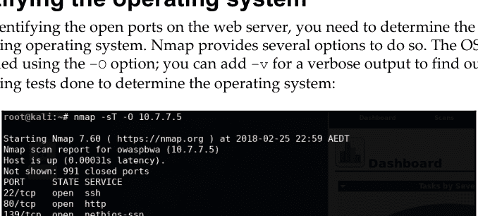

熟练的黑客不会依赖单一工具的结果。因此，Kali Linux 配备了多种指纹识别工具；除了使用 Nmap 运行版本扫描外，你还可以使用 Amap 等工具获得第二意见。

## 配置服务器概况

一旦确定了底层操作系统和开放端口，你就需要识别在开放端口上运行的确切应用程序。扫描 Web 服务器时，你需要分析在操作系统之上运行的 Web 服务的风味和版本。Web 服务器基本上处理来自应用程序的 HTTP 请求并将其分发到 Web；Apache、IIS 和 nginx 是最广泛使用的 Web 服务器。除了版本之外，在进入利用阶段之前，你还需要识别 Web 服务器上启用的任何额外软件、功能和配置。

Web 应用程序开发严重依赖于 PHP 和 .NET 等框架，并且每个 Web 应用程序将根据用于设计它的框架需要不同的技术。

除了 Web 服务器的版本扫描之外，你还需要识别支持 Web 应用程序的附加组件，例如数据库应用程序、加密算法和负载均衡器。

多个网站通常部署在同一物理服务器上。你只需要攻击渗透测试项目范围内的网站，并且需要正确理解虚拟主机才能做到这一点。

## 识别虚拟主机

许多组织的网站由服务提供商使用共享资源托管。共享 IP 地址是他们使用的一种最有用且最具成本效益的技术。你经常会在对特定 IP 地址执行反向 DNS 查询时看到返回多个域名。这些网站使用基于名称的虚拟主机，并通过主机头值与托管在同一 IP 地址上的其他网站唯一标识和区分。

这类似于多路复用系统。当服务器接收到请求时，它会通过查阅请求头中的 Host 字段来识别并将请求路由到特定主机。这在第 1 章《渗透测试和 Web 应用程序简介》中进行了讨论。


在与网站交互并制定攻击时，识别托管类型非常重要。如果 IP 地址托管多个网站，则必须在攻击中包含正确的 host 头值，否则将无法获得预期结果。这也可能影响该 IP 地址上托管的其他网站。直接使用 IP 地址进行攻击可能会产生不良结果，并可能命中超出范围的元素。如果此类元素不属于客户组织所有，这甚至可能产生法律影响。

## 使用搜索引擎定位虚拟主机

你可以通过分析 DNS 记录来确定多个网站是否托管在同一个 IP 地址上。如果多个名称指向同一个 IP 地址，则会使用 host 头值来唯一标识网站。`dig` 和 `nslookup` 等 DNS 工具可用于识别返回相似 IP 地址的域名。

你可以使用 http://ipneighbour.com/ 网站来识别是否有其他网站托管在给定的 Web 服务器上。以下示例显示了与 Wikipedia 相关的多个网站托管在同一个 IP 地址上：

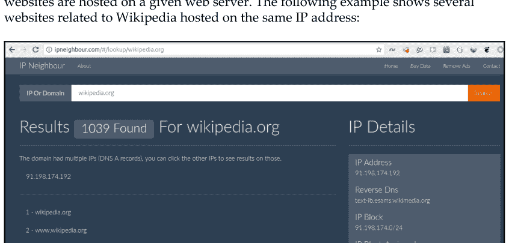

## 识别负载均衡器

高需求的网站和应用程序使用某种形式的负载均衡来在服务器之间分配负载并保持高可用性。网站的交互性使得对最终用户而言，在整个会话期间访问同一服务器对于获得最佳用户体验至关重要。例如，在电子商务网站上，一旦用户将商品添加到购物车，就期望用户在结账页面完成交易时再次连接到同一服务器。随着负载均衡器等中间件的引入，确保负载均衡器将用户的后续请求发送到同一服务器变得非常重要。

有几种技术可用于在服务器之间负载均衡用户连接。DNS 最容易配置，但不可靠，也无法提供真正的负载均衡体验。硬件负载均衡器是今天用于将流量路由到网站并在多个 Web 服务器之间保持负载的设备。

在渗透测试期间，有必要识别所使用的负载均衡技术，以便对网络基础设施有一个整体的了解。识别后，你现在必须测试负载均衡器后面的每个服务器是否存在漏洞。与客户团队的协作也是必需的，因为不同厂商的硬件负载均衡器使用不同的技术来维护会话粘性。

### 基于 Cookie 的负载均衡器

硬件负载均衡器使用的一种流行方法是向最终客户端的浏览器中插入一个 cookie，将用户绑定到特定服务器。该 cookie 的设置与 IP 地址无关，因为许多用户将位于代理或 NAT 配置之后，并且大多数用户将使用相同的源 IP 地址。

每个负载均衡器都有自己的 cookie 格式和名称。此信息可用于确定是否使用负载均衡器以及其提供商是谁。负载均衡器设置的 cookie 还可能泄露与目标相关的敏感信息，这对渗透测试人员可能有用。

Burp Proxy 可以配置为拦截连接，你可以通过分析头部来查找 cookie。如以下屏幕截图所示，目标正在使用 F5 负载均衡器。长数值实际上是包含池名称、Web 服务器 IP 地址和端口的编码值。因此，这里负载均衡器 cookie 泄露了不应泄露的关键服务器详细信息。负载均衡器可以配置为设置自定义 cookie，使其不泄露此类详细信息：

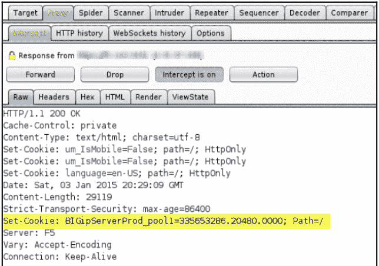

F5 负载均衡器的默认 cookie 格式如下：

```
BIGipServer<pool name>=<coded server IP>.<coded server port>.0000
```

### 识别负载均衡器的其他方法

以下是识别负载均衡器等设备的几种其他方法：

- **分析服务器之间的 SSL 差异**：不同 Web 服务器的 SSL 配置可能存在细微变化。分配给池中 Web 服务器的证书上的时间戳可能有所不同。SSL 配置的差异可用于确定负载均衡器后面是否配置了多个服务器。
- **重定向到不同的 URL**：另一种在服务器之间负载均衡请求的方法是通过重定向客户端到不同的 URL 来分配负载。用户可能浏览到网站 www.example.com，但被重定向到 www2.example.com。另一用户的请求被重定向到 www1.example.com，然后从不同的服务器提供网页。这是识别负载均衡器的最简单方法之一，但由于管理开销和安全影响，并不常实施。
- **负载均衡器的 DNS 记录**：DNS 区域中的主机记录可用于得出该设备是否为负载均衡器的结论。
- **负载均衡器检测器：** 这是 Kali Linux 中包含的一个工具。它确定网站是否使用负载均衡器。从 shell 执行该工具的命令是 `lbd <website name>`。该工具附带免责声明，称其为概念验证工具，容易出现误报。
- **Web 应用防火墙 (WAF)：** 除了负载均衡器外，应用程序还可能使用 WAF 来抵御攻击。Kali Linux 中的 WAFW00F Web 应用防火墙检测工具能够检测路径中是否存在任何 WAF 设备。可以通过导航到 **信息收集 | IDS/IPS 识别** 来访问该工具。

## 应用程序版本指纹识别

运行在知名端口上的服务，例如端口 25 和端口 80，可以很容易地识别，因为它们被广泛已知的应用程序使用，例如邮件服务器和 Web 服务器。**互联网号码分配机构 (IANA)** 负责维护端口号的官方分配，并且映射可以从每个操作系统中的端口映射文件中识别出来。然而，许多组织在更适合其基础设施的端口上运行应用程序。你经常会看到内部网站运行在端口 8080 而不是端口 80，或端口 8443 而不是端口 443。

端口映射文件只是一个占位符，应用程序可以在开发者设计的任何开放端口上运行，违背了 IANA 设定的映射。这正是你需要执行版本扫描来确定 Web 服务器是否确实运行在端口 80 上，并进一步分析该服务的版本的原因。

### Nmap 版本扫描

Nmap 有几个选项可用于执行版本扫描；版本扫描可以与操作系统扫描结合使用，也可以单独运行。Nmap 通过发送一系列数据包探测目标，然后分析响应以确定确切的服务及其版本。

要仅启动版本扫描，请使用 `-sV` 选项。操作系统扫描和版本扫描可以使用 `-A`（激进）选项组合在一起，该选项还包括路由跟踪和执行某些脚本。如果没有与扫描选项一起定义端口，Nmap 将首先使用默认的 1,000 个常用端口列表对目标执行端口扫描，并从中识别出开放端口。

接下来，它将向开放端口发送探测并分析响应，以确定该特定端口上运行的应用程序。收到的响应与 nmap-service-probes 文件中庞大的签名数据库进行匹配。这与 IPS 签名的工作方式类似，其中网络数据包与包含恶意数据包签名的数据库进行匹配。版本扫描选项的好坏仅取决于该文件中签名的质量。

以下屏幕截图显示了前面命令的输出：

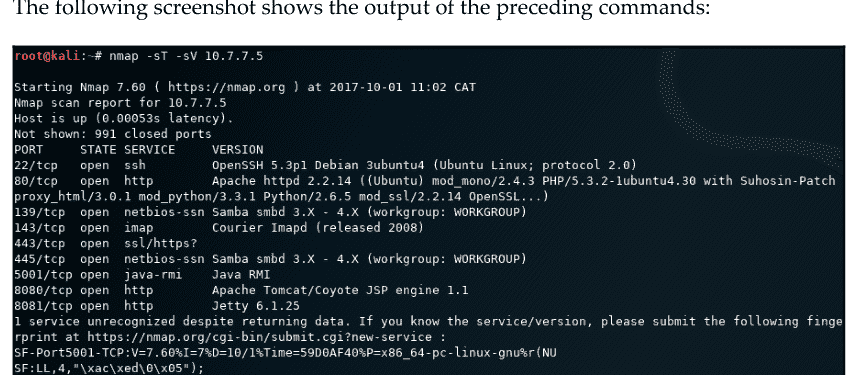

你可以向 Nmap 项目报告不正确的结果和未知端口的新签名。这有助于提高未来版本中签名的质量。

### Amap 版本扫描

Kali Linux 还附带一个名为 Amap 的工具，该工具由 The Hacker's Choice (THC) 小组创建，其工作原理与 Nmap 类似。它通过发送多个数据包探测开放端口，然后分析响应以确定该端口上监听的服务。

发送到目标端口的探测在名为 appdefs.trig 的文件中定义，而收到的响应则与 appdefs.resp 文件中的签名进行分析。


在渗透测试期间，使用多种工具探测端口以排除任何误报或漏报非常重要。仅依赖一种工具的特征签名在测试期间可能证明是致命的，因为你未来的利用将取决于在此阶段识别出的服务及其版本。

你可以使用 -bqv 选项调用 Amap，它将只报告开放端口并以 ASCII 打印收到的响应以及与其相关的一些详细信息：

```
root@kali:~# amap -bqv 10.7.7.5 21 22 25 80 443
Using trigger file /etc/amap/appdefs.trig ... loaded 30 triggers
Using response file /etc/amap/appdefs.resp ... loaded 346 responses
Using trigger file /etc/amap/appdefs.rpc ... loaded 456 triggers

amap v5.4 (www.thc.org/thc-amap) started at 2017-10-02 12:30:24 - APPLICATION MAPPING mode

Total amount of tasks to perform in plain connect mode: 115
Protocol on 10.7.7.5:443/tcp (by trigger http) matches http - banner: <!DOCTYPE HTML PUBLIC "-//IETF//DTD HTML 2.0//EN">
<html><head><title>400 Bad Request</title></head><body><h1>Bad Request</h1><p>Your browser sent a request that this server could not understand.<br />
Reason You're speaking plain HTTP to an SS
Protocol on 10.7.7.5:443/tcp (by trigger http) matches http-apache-2 - banner: <!DOCTYPE HTML PUBLIC "-//IETF//DTD HTML 2.0/EN">
<html><head><title>400 Bad Request</title></head><body><h1>Bad Request</h1><p>Your browser sent a request that this server could not understand.<br />
Reason You're speaking plain HTTP to an SS
Protocol on 10.7.7.5:80/tcp (by trigger http) matches http - banner: HTTP/1.1 200 OK\r\nDate Mon, 02 Oct 2017 213024 GMT\r\nServer Apache/2.2.14 (Ubuntu) mod_mono/2.4.3 PHP/5.3.2-ubuntu4.30 with Suhosin-Patch proxy_html/3.0.1 mod_python/3.3.1 Python/2.6.5 mod_ssl/2.2.14 OpenSSL/0.9.8k Phusion Passenger/4.0.38 mod_perl/2
Protocol on 10.7.7.5:80/tcp (by trigger http) matches http-apache-2 - banner: HTTP/1.1 200 OK\r\nDate Mon, 02 Oct 2017 213024 GMT\r\nServer Apache/2.2.14 (Ubuntu) mod_mono/2.4.3 PHP/5.3.2-ubuntu4.30 with Suhosin-Patch proxy_html/3.0.1 mod_python/3.3.1 Python/2.6.5 mod_ssl/2.2.14 OpenSSL/0.9.8k Phusion Passenger/4.0.38 mod_perl/2
Protocol on 10.7.7.5:22/tcp (by trigger ssl) matches ssh - banner: SSH-2.0-OpenSSH_5.3p1 Debian-8ubuntu4\r\n
Protocol on 10.7.7.5:443/tcp (by trigger ssl) matches ssl - banner: JFY9hDWmGN E\l+Gignu\-byk\v00\t\rr0\t\r*H\r010Uo
waspbwa r0l30102213282\r22123121238Z0D0Uwaspbwa0\r\t\rH\r0f_qKRRM\M;wRp342x8a7'RE.LC\W'B09'::d0fn o6QaL] sS60\r*t#R(M)Jz?Q7*rCyh7E> o!f\v!l\w?qE0q\yQEM\rJ0 3ERf]@G\jN\f9_R\vT0.cr-ZyB\v(*)2Fzc
Waiting for timeout on 19 connections ...

amap v5.4 finished at 2017-10-02 12:30:36
```

## 指纹识别 Web 应用框架

了解用于开发网站的框架的知识，可以让你在识别未修补版本中可能存在的漏洞方面占据优势。

例如，如果网站是在 WordPress 平台上开发的，可以在该网站的网页中找到其痕迹。大多数 Web 应用框架都有可供攻击者用来确定所使用框架的标记。

有几个地方可能会透露有关框架的详细信息。

## HTTP 头部

除了定义 HTTP 事务的操作参数外，头部还可能包含对攻击者有用的额外信息。

在下面的示例中，使用 Firefox 中的开发工具（F12 键），你可以从 Server 字段确定正在使用 Apache Web 服务器。此外，使用 X-AspNet-Version 可以判断 ASP.NET 版本 2 是开发框架。这种方法并不总是有效，因为头部字段可以通过服务器端的正确配置而被禁用：

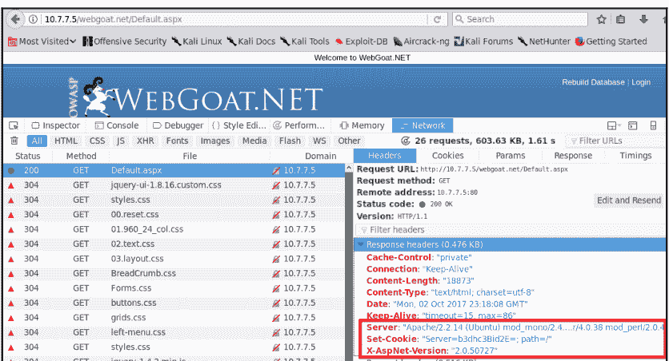

应用框架还会创建新的 Cookie 值，这些值可以揭示底层使用的框架，因此也要留意 Cookie。

HTML 页面源代码中的注释也可能表明用于开发 Web 应用的框架。页面源中的信息还可以帮助你识别使用的其他 Web 技术。

## WhatWeb 扫描器

WhatWeb 工具用于识别网站使用的不同 Web 技术。它包含在 Kali Linux 中，可以通过转到 Applications | 03 - Web Application Analysis | Web Vulnerability scanners 来访问。它识别用于设计 Web 应用的不同内容管理系统、统计/分析包和 JavaScript 库。该工具声称拥有超过 900 个插件。它可以在不同的攻击级别下运行，以平衡速度和可靠性。该工具可能仅凭单个网页上的信息就能识别网站，也可能递归查询网站以识别使用的技术。

在下一个示例中，我们将使用该工具针对 OWASP BWA 虚拟机，并启用 -v 详细选项。这会打印出与识别出的技术相关的一些有用信息：

```
root@kali:~# whatweb -v 10.7.7.5
WhatWeb report for http://10.7.7.5
Status      : 200 OK
Title       : owaspbwa OWASP Broken Web Applications
IP          : 10.7.7.5
Country     : RESERVED, ZZ
Summary     : Passenger[4.0.38], HTML5, Python[2.6.5], OpenSSL[0.9.8k], HTTPServer[Ubuntu Linux], Apache[2.2.14 (Ubuntu)] mod_mono/2.4.3 PHP/5.3.2-1ubuntu4.30 with Suhosin-Patch proxy_html/3.0.1 mod_python/3.3.1 Python/2.6.5 mod_ssl/2.2.14 OpenSSL/0.9.8k Phusion Passenger/4.0.38 mod_perl/2.0.4 Perl/v5.10.1, Perl[5.10.1], JQuery, Apache[2.2.14] mod_mono/2.4.3 mod_perl/2.0.4,mod_python/3.3.1,mod_ssl/2.2.14,proxy_html/3.0.1, Email[admin@metacorp.com,admin@owaspbwa.org,bob@ateliergraphique.com,cycloneuser@cyclone.transfers.com,jack@metacorp.com,test@thebudgeteistore.com], Script[text/javascript], PHP[5.3.2-1ubuntu4.30](Suhosin-Patch)
Detected Plugins:
[ Apache ]
The Apache HTTP Server Project is an effort to develop and maintain an open-source HTTP server for modern operating systems including UNIX and Windows NT. The goal of this project is to provide a secure, efficient and extensible server that provides HTTP services in sync with the current HTTP standards.
Version     : 2.2.14 (from HTTP Server Header)
Module      : mod_mono/2.4.3,mod_perl/2.0.4,mod_python/3.3.1,mod_ssl/2.2.14
Module      : proxy_html/3.0.1
Google Dorks: (3)
Website     : http://httpd.apache.org/
[ Email ]
Extract email addresses. Find valid email address and syntactically invalid email addresses from mailto: link tags. We match syntactically invalid links containing mailto: to catch anti-spam email addresses, eg. bob at
```

## 扫描 Web 服务器的漏洞和配置错误

到目前为止，我们已经处理了目标的基础设施部分。现在我们需要分析底层软件并尝试了解其下运行的不同技术。使用默认配置设计的 Web 应用容易受到攻击，因为它们为恶意攻击者提供了多个利用应用的入口。

Kali Linux 提供了多个工具来分析 Web 应用的配置问题。扫描工具通过遍历整个网站并寻找有趣的文件、文件夹和配置设置来识别漏洞。服务器端脚本语言，例如 PHP 和 CGI，如果未正确实现且运行在旧版本上，则可使用自动化工具进行利用。

## 使用 Nmap 识别 HTTP 方法

在 Web 渗透测试期间对 Web 服务器的第一个直接请求之一应该是识别 Web 服务器支持哪些方法。你可以使用 Netcat 打开与 Web 服务器的连接并使用 OPTIONS 方法查询 Web 服务器。你也可以使用 Nmap 来确定支持的方法。

在不断增长的 Nmap 脚本库中，你可以找到一个名为 http-methods.nse 的脚本。当你使用 --script 选项运行该脚本并加上目标时，它将列出目标上允许的 HTTP 方法，并指出危险的方法。在下面的屏幕截图中，你可以看到它在运行，其中检测到多个已启用的方法，并指出 TRACE 是一个有风险的方法：

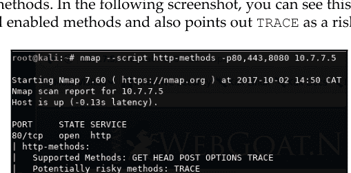


## 使用 Metasploit 中的辅助模块测试 Web 服务器

以下模块对于渗透测试人员测试 Web 服务器是否存在漏洞很有用：

- `dir_listing`: 此模块将连接到目标 Web 服务器并确定其是否启用了目录浏览。
- `dir_scanner`: 使用此模块，您可以扫描目标是否存在有趣的 Web 目录。您可以为模块提供自定义创建的字典或使用默认字典。
- `enum_wayback`: 这是一个有趣的模块，它查询 Internet Archive 网站并查找目标域中的网页。可能已被取消链接的旧网页可能仍然可访问，可以使用 Internet Archive 网站找到。您还可以识别网站多年来所经历的变化。
- `files_dir`: 此模块可用于通过定位配置文件的备份和源代码文件来扫描服务器是否存在数据泄露漏洞。
- `http_login`: 如果网页具有通过 HTTP 运行的登录页面，您可以使用 Metasploit 字典尝试对其进行暴力破解。
- `robots_txt`: robots 文件可能包含一些未探索的 URL，您可以使用此模块查询它们以找到未被搜索引擎索引的 URL。
- `webdav_scanner`: 此模块可用于查找服务器是否启用了 WebDAV，这基本上是将 Web 服务器转变为文件服务器。

## 识别 HTTPS 配置和问题

任何管理任何类型敏感或个人身份信息（姓名、电话号码、地址、健康；信用；或税务记录、信用卡和银行账户信息等）的网站或 Web 应用程序都需要实现一种机制来保护信息在客户端和服务器之间以及反之亦然传输过程中的安全。

HTTP 诞生为一种明文协议。因此，它不包括保护客户端和服务器之间交换的信息免受成功拦截的第三方查看和/或修改的机制。作为对此问题的变通方法，在客户端和服务器之间创建加密通信通道，并通过它发送 HTTP 数据包。HTTPS 是通过安全通信通道实现的 HTTP 协议。它最初是在 **Secure Sockets Layer (SSL)** 上实现的。SSL 于 2014 年被弃用并被 **Transport Layer Security (TLS)** 取代，尽管仍有许多站点支持 SSLv3，无论是由于配置错误还是为了向后兼容。

支持旧加密算法存在一个主要缺点。大多数旧的密码套件被发现可以被密码分析师在合理的时间内使用今天可用的计算能力轻易破解。

专门的攻击者可以从云服务提供商租用廉价的计算能力并用它来破解旧密码并获得明文信息的访问权限。因此，使用旧密码会提供虚假的安全感，应该被禁用。客户端和服务器只能协商被认为安全且在实践中非常难以破解的密码。

Kali Linux 包含许多工具，允许渗透测试人员识别 SSL/TLS 实现中的此类配置错误。在本节中，我们将回顾其中最受欢迎的工具。

### OpenSSL 客户端

包含在几乎所有 GNU/Linux 发行版中的 **OpenSSL** 是基本的 SSL/TLS 客户端，包含有助于您对 HTTPS 服务器执行一些基本测试的功能。

一个基本测试是与服务器建立连接。在此示例中，我们将连接到端口 443 上的测试服务器（默认 HTTPS 端口）：

```
openssl s_client -connect 10.7.7.5:443
```

您可以在以下屏幕截图中显示的结果中看到有关连接参数和证书交换的广泛信息。值得注意的是，连接使用了 SSLv3，这本身就是一个安全问题，因为 SSL 已被弃用，并且存在已知漏洞，可能导致信息的完全解密，例如 Padding Oracle On Downgraded Legacy Encryption (POODLE)，我们将在后面的章节中讨论：

```
root@kali:~# openssl s_client -connect 10.7.7.5:443
CONNECTED(00000003)
depth=0 CN = owaspbwa
verify error:num=18:self signed certificate
verify return:1
depth=0 CN = owaspbwa
verify return:1
---
Certificate chain
 0 s:/CN=owaspbwa
   i:/CN=owaspbwa
---
Server certificate
-----BEGIN CERTIFICATE-----
MIJBnTCCAQYCCQdmhw3dcsK5SzANBgkqhkiG9w0BAQUFADATMR... [certificate data truncated in image]
-----END CERTIFICATE-----
subject=/CN=owaspbwa
issuer=/CN=owaspbwa
---
No client certificate CA names sent
Server Temp Key: DH, 1024 bits
---
SSL handshake has read 1167 bytes and written 374 bytes
Verification error: self signed certificate
---
New, SSLv3, Cipher is DHE-RSA-AES256-SHA
Server public key is 1024 bit
Secure Renegotiation IS supported
Compression: NONE
```

您经常会看到密码套件写成 ECDHE-RSA-RC4-MD5。格式分为以下几部分：

- **ECDHE**: 这是密钥交换算法
- **RSA**: 这是身份验证算法
- **RC4**: 这是加密算法
- **MD5**: 这是哈希算法

SSL 和 TLS 密码套件的综合列表可以在以下位置找到：

https://www.openssl.org/docs/apps/ciphers.html.

您可以使用 OpenSSL 测试目标的一些其他选项如下：

- **禁用或使用特定协议**：使用 `-no_ssl3`、`-no_tls1`、`-no_tls1_1` 和 `-no_tls1_2` 选项，您可以禁用相应协议的使用并测试目标接受哪些协议
- **测试特定协议**：`-tls1`、`-tls1_1` 和 `-tls1_2` 选项仅测试指定的协议


如今，接受 SSL 和 TLS 1.0 不被认为安全。TLS 1.1 在某些应用中可以接受，但 TLS 1.2 是推荐的选项。

### 使用 SSLScan 扫描 TLS/SSL 配置

SSLScan 是一个命令行工具，它对指定的目标执行各种测试，并返回 SSL/TLS 服务器接受的协议和密码的综合列表以及在安全测试中有用的其他信息：

```
sslscan 10.7.7.5
```

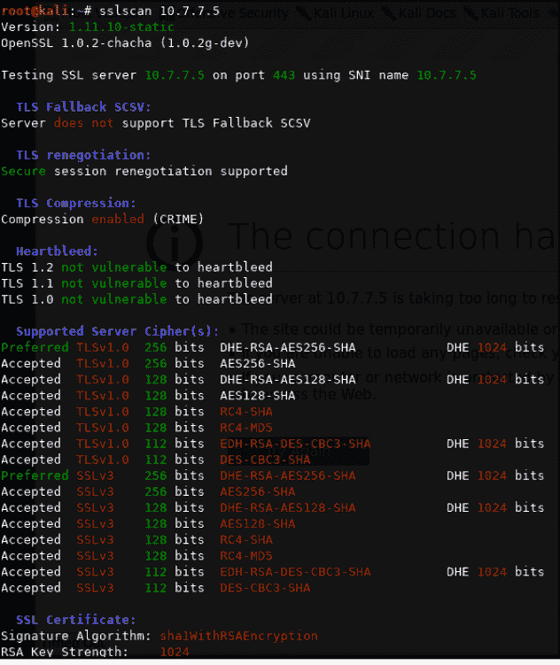

您可以使用 SSLScan 的颜色代码快速了解显示结果在安全方面的严重程度。红色（允许 SSLv3 并使用 DES 和 RC4 密码）表示不安全的配置，而绿色或白色是推荐的。

命令的输出可以使用 --xml=<filename> 选项导出为 XML 文档。

### 使用 SSLyze 扫描 TLS/SSL 配置

SSLyze 是一个 Python 工具，可以通过类似 SSLScan 的方式连接到服务器来分析服务器的 SSL/TLS 配置。它能够同时扫描多个主机，并且还可以测试性能并使用客户端证书进行相互身份验证。以下命令在测试机器上运行常规 HTTPS 扫描（这包括 SSL 版本 2、SSL 版本 3 和 TLS 1.0、TLS 1.1 和 TLS 1.2 检查、证书的基本信息以及压缩、重协商和 Heartbleed 的测试）：

```
sslize --regular 10.7.7.5
```

您可以在以下屏幕截图中看到结果：

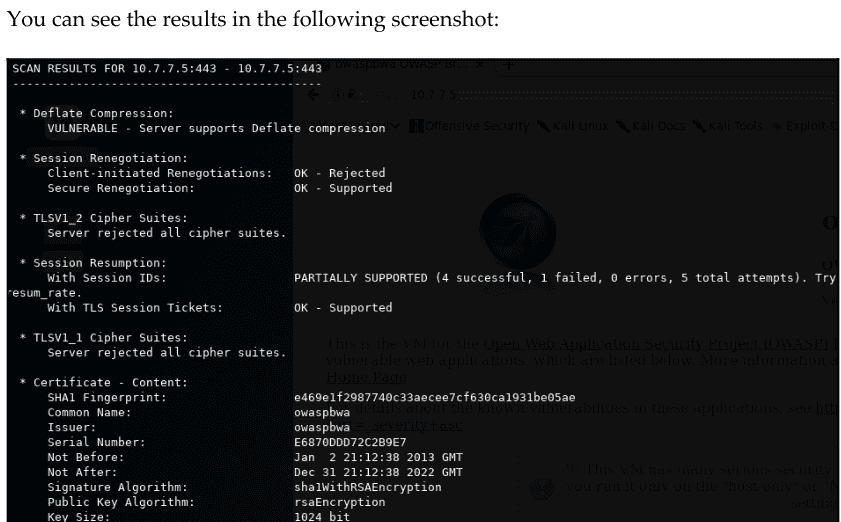

### 使用 Nmap 测试 TLS/SSL 配置

Nmap 包含一个名为 ssl-enum-ciphers 的脚本，可以识别服务器支持的密码套件，并根据密码强度对其进行评级。它使用 SSLv3、TLS 1.1 和 TLS 1.2 进行多次连接。该脚本还会突出显示如果它识别出 SSL 实现容易受到先前发布漏洞的影响，例如 CRIME 和 POODLE：

```
root@kali:~# nmap --script ssl-enum-ciphers -p 443 10.7.7.5
Starting Nmap 7.60 ( https://nmap.org ) at 2017-10-03 14:09 CAT
Nmap scan report for 10.7.7.5
Host is up (0.00024s latency).

PORT     STATE SERVICE
443/tcp  open  https
| ssl-enum-ciphers:
|   SSLv3:
|     ciphers:
|       TLS_DHE_RSA_WITH_3DES_EDE_CBC_SHA (dh 1024) - D
|       TLS_DHE_RSA_WITH_AES_128_CBC_SHA (dh 1024) - A
|       TLS_DHE_RSA_WITH_AES_256_CBC_SHA (dh 1024) - A
|       TLS_RSA_WITH_3DES_EDE_CBC_SHA (rsa 1024) - D
|       TLS_RSA_WITH_AES_128_CBC_SHA (rsa 1024) - A
|       TLS_RSA_WITH_AES_256_CBC_SHA (rsa 1024) - A
|       TLS_RSA_WITH_RC4_128_MD5 (rsa 1024) - D
|       TLS_RSA_WITH_RC4_128_SHA (rsa 1024) - D
|     compressors:
|       DEFLATE
|       NULL
|     cipher preference: client
|     warnings:
|       64-bit block cipher 3DES vulnerable to SWEET32 attack
|       Broken cipher RC4 is deprecated by RFC 7465
|       CBC-mode cipher in SSLv3 (CVE-2014-3566)
|       Ciphersuite uses MD5 for message integrity
|       Weak certificate signature: SHA1
|   TLSv1.0:
|     ciphers:
|       TLS_DHE_RSA_WITH_3DES_EDE_CBC_SHA (dh 1024) - D
|       TLS_DHE_RSA_WITH_AES_128_CBC_SHA (dh 1024) - A
|       TLS_DHE_RSA_WITH_AES_256_CBC_SHA (dh 1024) - A
|       TLS_RSA_WITH_3DES_EDE_CBC_SHA (rsa 1024) - D
|       TLS_RSA_WITH_AES_128_CBC_SHA (rsa 1024) - A
|       TLS_RSA_WITH_AES_256_CBC_SHA (rsa 1024) - A
|       TLS_RSA_WITH_RC4_128_MD5 (rsa 1024) - D
|       TLS_RSA_WITH_RC4_128_SHA (rsa 1024) - D
```


## 爬取 Web 应用程序

在测试大型真实世界应用程序时，你需要采用更详尽的方法。作为第一步，你需要确定应用程序的规模，因为有若干决策取决于它。你所需的资源数量、工作的估算以及评估的成本都取决于应用程序的大小。

Web 应用程序由相互链接的多个网页组成。在开始评估应用程序之前，你需要对其进行映射以确定其规模。你可以手动遍历应用程序，像普通用户一样点击每个链接并查看内容。在手动爬取应用程序时，你的目标应该是尽可能识别出尽可能多的网页——从经过身份验证和未经过身份验证用户的角度来看。

手动爬取应用程序既耗时又容易遗漏。Kali Linux 提供了许多可用于自动化此任务的工具。Burp Suite 中的 Burp Spider 工具以爬取 Web 应用程序而闻名。它通过自动化编目应用程序中各种网页的繁琐任务来工作。它通过请求一个网页、解析其中的链接，然后向这些新链接发送请求，直到所有网页都被映射的方式工作。这样，整个应用程序都可以被映射，而不会忽略任何网页。


> CAUTION:
> 由于爬取是自动化的过程，因此需要了解该过程和应用程序的工作原理，以避免爬虫执行敏感请求，例如密码重置、表单提交和信息删除。

## Burp Spider

Burp Spider 使用被动和主动方法映射应用程序。

当你启动 Burp Proxy 时，它默认以被动爬取模式运行。在此模式下，当浏览器配置为使用 Burp Proxy 时，它会使用代理请求的所有内容更新站点地图，而不会发送任何进一步的请求。被动爬取被认为安全，因为你可以直接控制爬取的内容。这在包含你不想触发的管理功能的关键应用程序中很重要。

为了有效映射，应将被动爬取模式与主动模式一起使用。最初，允许 Burp Spider 在你浏览时被动地映射应用程序，当你找到需要进一步映射的感兴趣的网页时，可以触发主动爬取模式。在主动模式下，Burp Spider 将递归请求网页，直到映射所有 URL。

以下屏幕截图显示了被动爬取的输出，当你点击应用程序中的各种链接时。确保在 Web 浏览器中将 Burp 设置为代理，并且在被动映射应用程序之前关闭拦截：

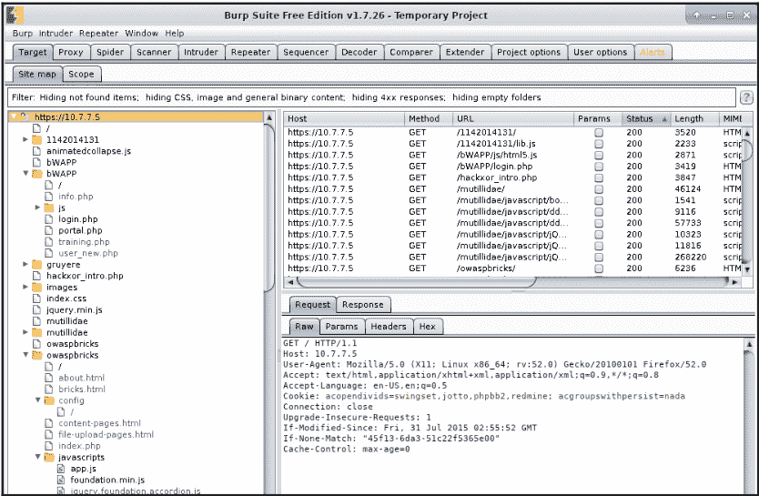

当你想主动爬取一个网页时，在站点地图部分右键单击该链接并点击 Spider this branch。立即执行此操作后，主动爬取模式就会启动。在 Spider 部分，你会看到已发出请求，并且站点地图部分将被新项目填充，如以下屏幕截图所示：

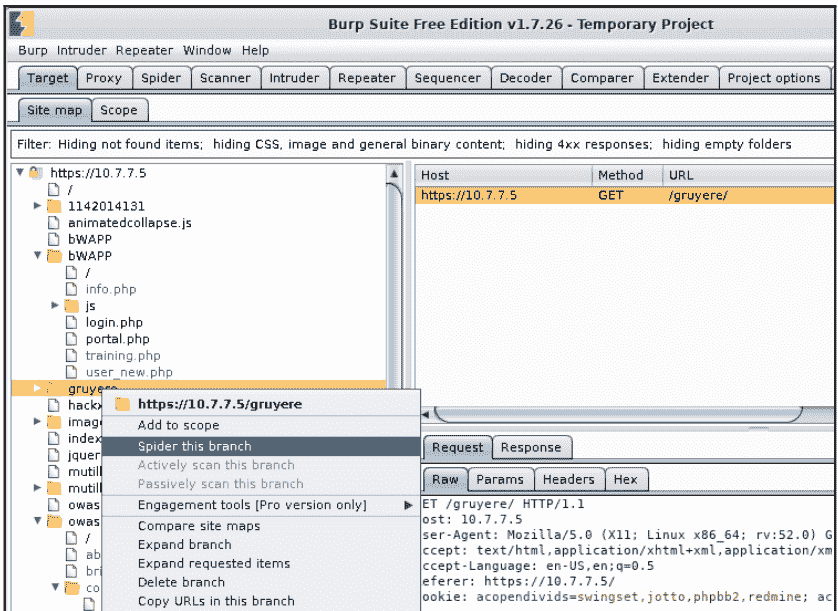

当主动爬取运行时，它会显示已发出的请求数量和其他一些详细信息。在 **Spider Scope** 部分，你可以使用正则表达式字符串创建规则来定义目标：

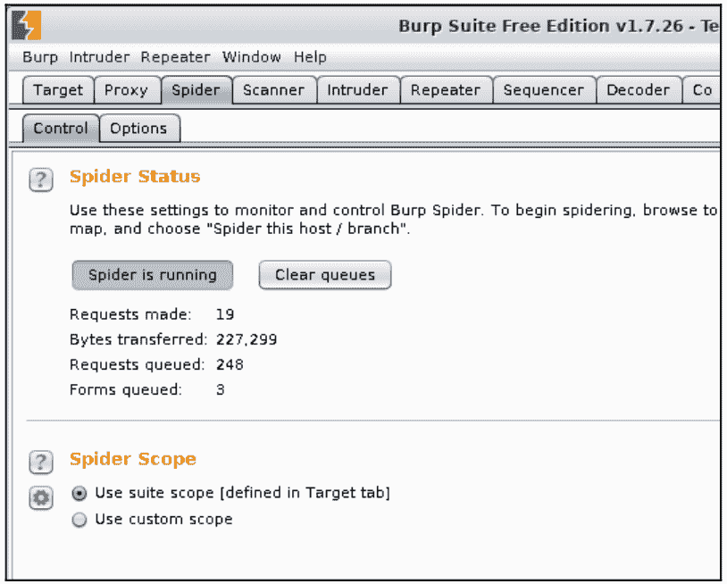

## 应用程序登录

应用程序可能要求在允许你查看内容之前进行身份验证。Burp Spider 可以配置为在爬取时使用重新配置的凭据对应用程序进行身份验证。在 Spider 部分的 Options 选项卡中，你可以定义凭据或选择 Prompt for guidance 选项。当你选择 Prompt for guidance 选项时，如果爬虫遇到登录页面，它将显示一个提示，你可以在其中输入用户名和密码，如下所示：

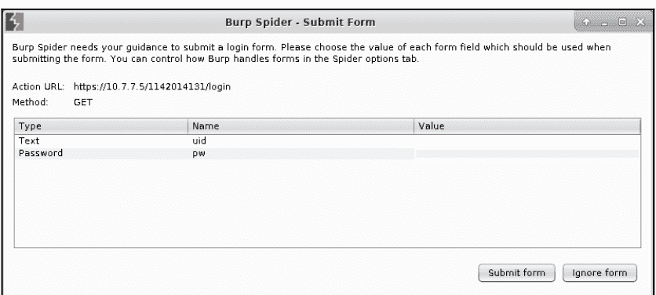

## 目录暴力破解

也称为强制浏览，目录暴力破解是请求应用程序或服务器页面中没有直接链接的文件和服务器目录的过程。这通常是通过从常用名称列表中获取目录和文件名来完成的。Kali Linux 包含一些用于完成此任务的工具。我们将在此处探讨其中两个。

## DIRB

DIRB 可以递归扫描目录并查找 Web 服务器中具有不同扩展名的文件。它可以自动检测非标准 404 的 Not Found 代码。然后它可以将结果导出到文本文件，在服务器需要有效会话的情况下使用会话 cookie，并进行基本 HTTP 身份验证和上游代理等其他功能。以下屏幕截图显示了 DIRB 的基本使用，使用默认字典并将输出保存到文本文件：

```
root@kali:~# dirb http://10.7.7.5 -o dirb_result_10.7.7.5.txt

-----------------
DIRB v2.22
By The Dark Raver
-----------------

OUTPUT_FILE: dirb_result_10.7.7.5.txt
START_TIME: Tue Oct  3 14:46:17 2017
URL_BASE: http://10.7.7.5/
WORDLIST_FILES: /usr/share/dirb/wordlists/common.txt
-----------------

GENERATED WORDS: 4612

--- Scanning URL: http://10.7.7.5/ ---
+ http://10.7.7.5/.bash_history (CODE:200|SIZE:302)
==> DIRECTORY: http://10.7.7.5/assets/
==> DIRECTORY: http://10.7.7.5/cgi-bin/
+ http://10.7.7.5/cgi-bin/ (CODE:200|SIZE:1070)
+ http://10.7.7.5/crossdomain (CODE:200|SIZE:200)
+ http://10.7.7.5/crossdomain.xml (CODE:200|SIZE:200)
==> DIRECTORY: http://10.7.7.5/evil/
+ http://10.7.7.5/favicon.ico (CODE:200|SIZE:3638)
==> DIRECTORY: http://10.7.7.5/gallery2/
==> DIRECTORY: http://10.7.7.5/icon/
==> DIRECTORY: http://10.7.7.5/images/
+ http://10.7.7.5/index (CODE:200|SIZE:1227)
+ http://10.7.7.5/index.html (CODE:200|SIZE:28067)
==> DIRECTORY: http://10.7.7.5/javascript/
==> DIRECTORY: http://10.7.7.5/joomla/
==> DIRECTORY: http://10.7.7.5/phpBB2/
==> DIRECTORY: http://10.7.7.5/phpmyadmin/
+ http://10.7.7.5/server-status (CODE:403|SIZE:215)
==> DIRECTORY: http://10.7.7.5/test/
```

## ZAP 的强制浏览

DirBuster 是 OWASP 维护的目录暴力破解工具，现在已集成到 OWASP ZAP 中作为强制浏览功能。要使用它，你启动 OWASP-ZAP（在 Kali 的菜单中，转到 03 - Web Application Analysis | owasp-zap）并配置浏览器使用它作为代理；与 Burp 被动爬取相同，ZAP 会注册你浏览的所有 URL 以及它们从服务器请求资源。因此，你浏览目标，检测到的文件和目录会记录在 ZAP 中。接下来，在你想要进行强制浏览的目录上右键单击，然后转到 Attack | Forced Browse site / Forced Browse directory / Forced Browse directory (and children)。站点、目录或目录及其子目录之间的选择取决于你想要扫描的内容——站点表示从服务器根目录开始扫描，目录仅表示所选目录，目录及其子目录表示所选目录递归：

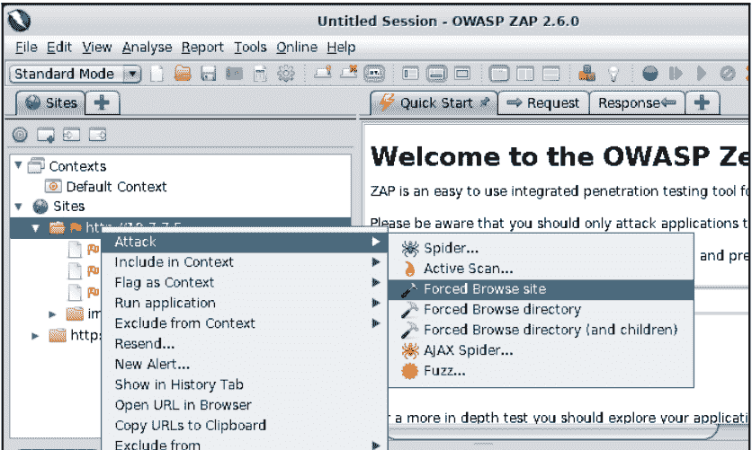

之后，选择名称列表文件（字典）并点击开始按钮。现有目录和文件可能会显示在同一选项卡中：

## 4

## 身份验证和会话管理缺陷

Web 应用程序的主要目的是允许用户访问和处理存储在远程位置的信息。有时这些信息是公开的，而其他时候可能是用户特定的甚至是保密的。此类应用程序要求用户在被允许访问此类信息之前证明其身份。此身份验证过程称为 **authentication**，它要求用户提供身份证明，可能包括以下一项或多项：

- 用户 *知道* 的东西：例如用户名和秘密密码
- 用户 *拥有* 的东西：如智能卡或发送到用户手机的特殊代码
- 用户 *本身* 的东西：语音、面部、指纹或其他任何生物识别机制

第一种替代方案在 Web 应用程序中最常见。在某些情况下，例如银行或内部企业应用程序，可能使用一种或多种剩余方法。

HTTP 是一种无状态和无连接的协议。这意味着客户端发送到服务器的每个请求都被服务器视为与该客户端或任何其他客户端发送的任何先前或未来请求无关。因此，用户登录 Web 应用程序后，下一个请求将被服务器视为第一个请求。因此，客户端需要在每个请求上发送其凭据。这会为该敏感信息增加不必要的暴露，并对通信造成不必要的负担。


为了让 Web 应用能够跟踪用户的活动，并根据用户对自身环境所做的更改来维护应用状态，同时在不要求用户对每次操作都登录的情况下将他们与其它用户区分开来，已经开发出了一系列技术。这被称为 **会话管理**。

在本章中，我们将回顾现代 Web 应用中通常如何执行身份验证和会话管理，并学习如何识别和利用此类机制中最常见的一些安全缺陷。

## Web 应用中的身份验证方案

在深入具体的渗透测试概念之前，让我们回顾一下现代 Web 应用中身份验证是如何完成的。

## 平台身份验证

使用 **平台身份验证** 时，用户在每个请求的头部发送其凭据，使用 `Authorization` 变量。即使他们只需提交一次凭据，浏览器或系统也会存储它们，并在需要时使用它们。

平台身份验证有几种不同的类型。最常见类型在以下小节中讨论。

### Basic

这种平台身份验证类型中，用户名和密码附加在 `Authorization` 头部并使用 base64 编码。这意味着任何看到请求头的人都能够将凭据解码为明文，因为 base64 编码不是加密格式。

以下截图显示了登录信息如何以 base64 发送以及如何解码：

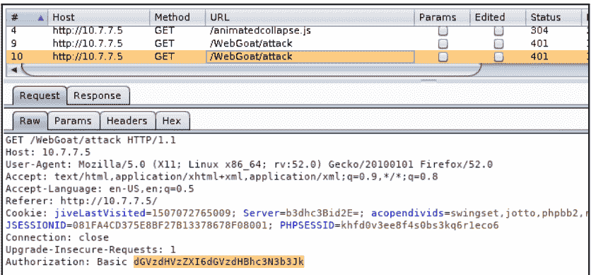

你可以使用 Burp Suite 的 Decoder 将 base64 转换为 ASCII 文本：

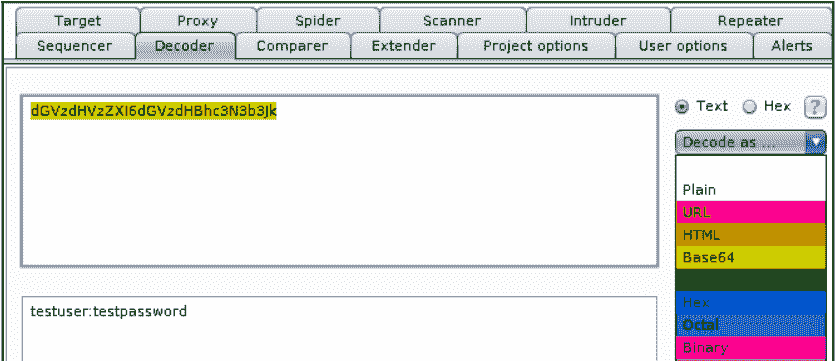

### Digest

**Digest authentication** 比基本身份验证安全得多。当客户端想要访问受保护资源时，服务器发送一个随机字符串作为挑战，称为 **nonce**。客户端随后使用此 nonce 以及用户名和密码计算 MD5 哈希并将其发送回服务器进行验证。

### NTLM

**NTLM** 是摘要身份验证的一种变体，其中使用 Windows 凭据和 NTLM 哈希算法来转换应用程序用户名和密码的挑战。该方案需要多次请求-响应交换，并且服务器和任何中间代理必须支持持久连接。

### Kerberos

该身份验证方案使用 **Kerberos** 协议对服务器进行身份验证。与 NTLM 一样，它不会要求用户名和密码，而是使用 Windows 凭据登录。该协议使用与 Web 服务器分开的 **Authentication Server (AS)**，并且涉及一系列协商步骤以进行身份验证。步骤如下：

- 1. 客户端向 AS 发送用户名（ID）。
- 2. AS 在数据库中查找 ID 并使用哈希密码加密会话密钥。
- 3. AS 将加密的会话密钥和包含用户 ID、会话密钥、会话过期时间和其他数据的票据（TGT），用服务器的密钥加密后发送给客户端。如果密码不正确，客户端将无法解密其会话密钥。
- 4. 客户端解密会话密钥。
- 5. 当客户端想要访问 Web 服务器上的受保护资源时，它需要在一条消息中发送 TGT 和资源 ID，并在另一条消息中发送用会话密钥加密的客户端 ID 和时间戳。
- 6. 如果服务器能够解密接收到的信息，它会用 AS 的密钥加密并用客户端的会话密钥进一步加密的客户端到服务器票据进行响应。
- 7. 借助来自 AS 的这些信息，客户端现在可以向 Web 服务器请求资源。

在下面的图中，你可以看到该过程的图形表示：

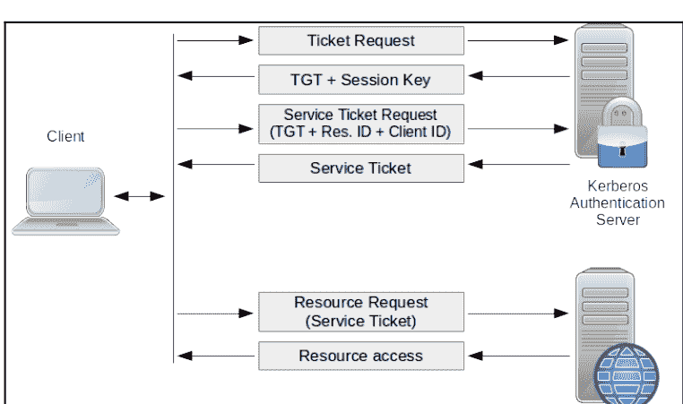

### HTTP Negotiate

也称为 *Windows Authentication*，**HTTP Negotiate** 方案使用 Windows 凭据并根据 Kerberos 是否可用在 Kerberos 和 NTLM 身份验证之间进行选择。

## 平台身份验证的缺点

虽然 Kerberos 和 NTLM 方案被认为安全，即使是摘要或基本身份验证也可以通过 TLS 使用，恶意行为者拦截通信并窃取凭据的风险较低，但平台身份验证在安全性方面仍存在一些固有缺点。如下所示：

- 凭据发送次数更多，因此其暴露风险和在中间人（MITM）攻击中被捕获的风险更高，尤其对于基本、摘要和 NTLM 方案而言。
- 平台身份验证没有注销或会话过期选项。使用 Windows 身份验证时 **Single Sign On (SSO)** 处于启用状态，会话在用户打开应用程序主页面时立即开始，无需询问用户名和密码，并且如果过期会自动续期。攻击者一旦获得用户机器或 Windows 账户的访问权限，就会立即获得对应用程序的访问权限。
- 平台身份验证不适合公共应用程序，因为它们需要比最流行的基于表单的身份验证更高的技术和行政投入来设置和管理。

## 基于表单的身份验证

这就是我们更熟悉的身份验证类型：包含用户名和密码字段以及提交按钮的 HTML 表单：

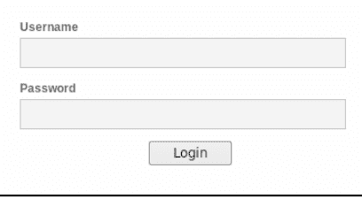

这种身份验证因情况而异，因为其实现完全取决于应用程序。尽管如此，最常见的方法遵循以下步骤：

- 1. 用户填写身份验证表单并点击 **Submit** 按钮。客户端（Web 浏览器）随后将包含用户名和密码的请求发送到服务器，以明文形式发送，除非应用程序进行了客户端加密。
- 2. 服务器接收信息并在数据库中检查用户是否存在，并比较存储的密码和提交的密码（或密码哈希）。
- 3. 如果用户存在且密码正确，服务器会以肯定消息响应，可能包括重定向到用户主页以及会话标识符（通常作为 cookie），以便用户无需再次发送凭据。
- 4. 客户端接收响应，存储会话标识符并重定向到主页。

从渗透测试角度来看，这无疑是最有趣的身份验证方法，因为没有标准的方法来实现它（即使存在最佳实践），并且由于实现不当，通常是大量漏洞和安全风险的来源。

## 双因素身份验证

如前所述，要向应用程序证明你的身份，你必须提供你知道的东西、你拥有的东西或你本身的东西。每种标识符都称为一个因素。 多因素身份验证（MFA）源于为某些应用程序提供额外安全层的需求，并在例如密码被攻击者猜测或窃取的情况下防止未经授权的访问。

在大多数 Web 应用中，双因素身份验证（2FA）意味着用户必须提供用户名和密码（第一因素）以及一个特殊代码或一次性密码（OTP），该代码临时且由用户拥有的设备随机生成，或由服务器通过短信或电子邮件发送给用户。用户随后将 OTP 提交回应用程序。更复杂的应用程序可能在密码之外实现智能卡或某种形式的生物识别，例如指纹的使用。由于这需要用户拥有额外的硬件或专用设备，这类应用程序要少得多。

大多数银行应用程序都实现了某种形式的 MFA，最近，公共电子邮件服务和社交媒体开始推广并强制其用户使用 2FA。

## OAuth

OAuth 是访问委托的开放标准。当 Facebook 或 Google 用户允许第三方应用程序访问其账户时，他们不会与这些应用程序共享其凭据。相反，服务提供商（Google、Twitter 或 Facebook）会共享一个特殊的访问令牌，允许这些应用程序根据用户授予的权限检索用户账户的特定信息或访问某些功能。


## 会话管理机制

**会话管理**涉及在登录时创建或定义会话标识符、设置非活动超时、会话过期以及在注销时使会话失效；此外，它还可能扩展到根据用户的权限进行授权检查，因为会话 ID 必须与用户关联。

## 基于平台认证的会话

当使用平台认证时，最常用的方法是使用已包含的头部，其中包含凭据，或将响应挑战作为用户会话的标识符，并通过应用程序的逻辑来管理会话过期和注销；尽管如前所述，常见的情况是，在平台认证的情况下，没有会话超时、过期或注销。

如果使用 Kerberos，则 AS 发出的令牌已包含会话信息并用于管理此类会话。

## 会话标识符

会话标识符在表单认证中更为常见，但在我们使用平台认证时也可能存在。**会话标识符**，或**会话 ID**，是在用户每次在应用程序内发起会话时分配给每个用户的唯一数字或值。此值必须与用户的 ID 和密码不同。用户每次登录时它必须不同，并且必须随每个请求发送到服务器，以便服务器能够区分来自不同会话/用户的请求。

在客户端和服务器之间发送会话 ID 的最常见方式是通过 cookie。一旦服务器接收到一组有效的用户名和密码，它就会将该登录信息与会话 ID 关联起来，并响应客户端，将此类 ID 作为 cookie 的值发送。

在以下屏幕截图中，您将看到一些包含会话 cookie 的服务器响应的示例：

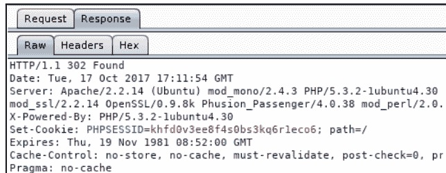

在前面的示例中，一个 PHP 应用程序设置了一个名为 PHPSESSID 的会话 cookie。

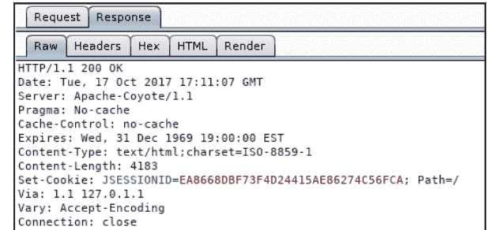

在前面的示例中，一个 Java 应用程序设置了一个名为 JSESSIONID 的会话 cookie。

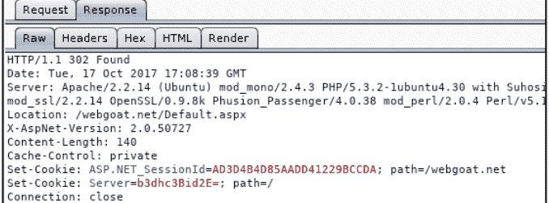

在前面的示例中，一个 ASP.NET 应用程序设置了一个名为 `ASP.NET_SessionId` 的会话 cookie。

## Web 应用程序中的常见认证缺陷

我们花了一些时间讨论 Web 应用程序中不同认证机制的工作原理。在本节中，您将学习如何识别和利用其中的一些最常见的<|start|>安全失败。

## 缺乏认证或错误的授权验证

在上一章中，您看到了如何使用 DIRB 和其他工具来查找可能未被 Web 服务器上的任何页面引用的目录和文件，或可能包含特权功能的文件，例如 `/admin` 和 `/user/profile`。如果您能够直接浏览到这些目录并在其中使用功能而无需认证，或者如果您以标准用户身份认证，您可以浏览到应用程序的管理区域或仅通过浏览即可修改其他用户的个人资料，那么该应用程序在其认证和/或授权机制方面存在重大安全问题。

## 用户名枚举

在黑盒和灰盒渗透测试场景中，发现应用程序的有效用户列表可能是第一步之一，尤其是如果该应用程序不是商业产品，因此您可以在网上查找默认用户。

在 Web 应用程序中枚举用户是通过分析在登录、注册和密码恢复页面等位置提交用户名时的响应来完成的。以下是一些常见的错误消息，当您向此类页面提交表单时可以找到它们，这些消息会告诉您您可以枚举用户：

- "User foo: invalid password"
- "invalid user ID"
- "account disabled"
- "this user is not active"
- "invalid user"

让我们回顾一个非常简单的示例，说明如何从在提供错误用户名时给出过多信息的 Web 应用程序中发现有效用户名。使用来自 Broken Web Applications (BWA) 虚拟机的 OWASP WebGoat，IP地址为 10.7.7.5。

首先运行 Burp Suite 并配置浏览器使用它作为代理（在 Firefox 中，导航到 首选项 | 高级 | 网络 | 连接 | 设置）：

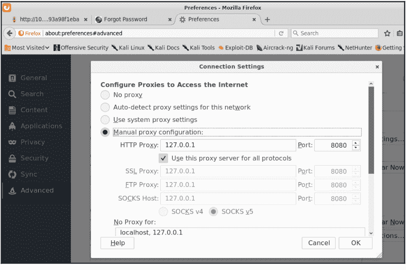

接下来，使用 webgoat 默认用户和 webgoat 密码登录 WebGoat，然后进入 Authentication Flaws | Forgot Password：

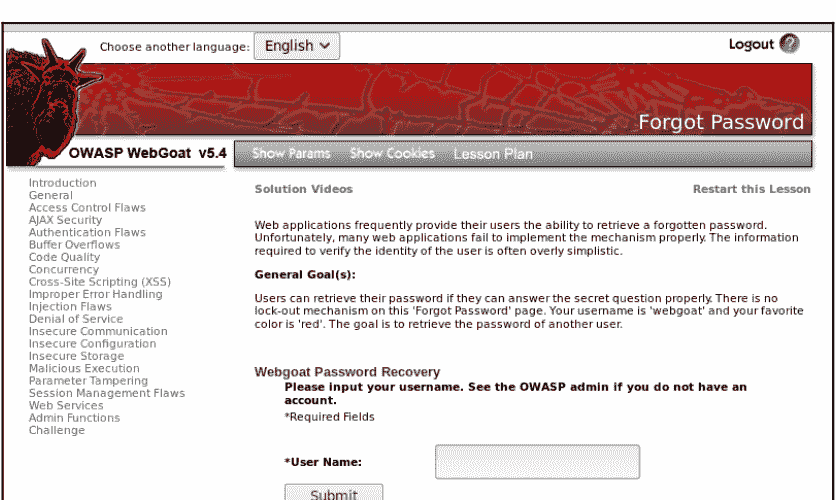

这是一个密码恢复表单，需要用户名才能继续恢复过程。您可以输入一个不存在的用户名，例如 nonexistentuser，并提交它以查看结果：

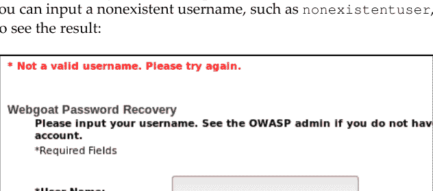

用户名无效，您将无法继续进行密码恢复。您可以假设当用户有效时，您将获得不同的响应。

现在让我们使用 Burp Suite 的 Intruder 来尝试找到一个有效名称。首先，在 Burp Proxy 的历史记录中查找请求并将其发送到 Intruder（按 Ctrl + I 或右键单击并选择 发送到 Intruder）：

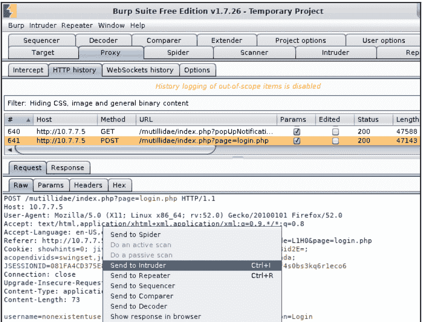

接下来，切换到 Intruder 选项卡，然后切换到您的请求编号，最后切换到 Positions。您可以看到所有可由客户端修改的参数默认都被选中。单击 Clear 以取消选择它们，然后仅选择用户名值并单击 Add：

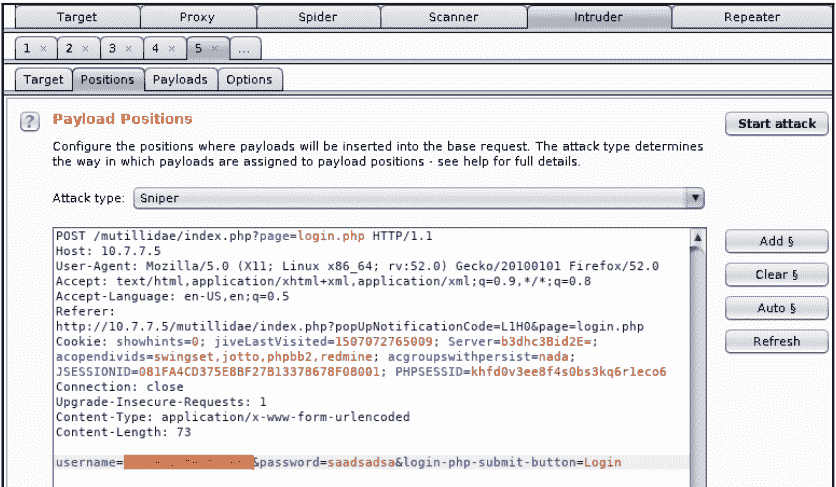

Intruder 自动化向服务器发送多个请求，用用户提供的输入替换所选值，并记录所有响应以供您分析。现在添加一个要尝试的用户名列表，而不是已提交的用户名。

Burp Intruder 有四种不同的攻击类型，描述了输入将如何用有效载荷填充：

- **Sniper:** 这使用单个有效载荷集，并一次选择一个输入位置，对每个有效载荷集中的每个值进行选择。请求的数量将是有效载荷集的长度乘以输入位置的数量。
- **Battering ram:** 这使用单个有效载荷集，并同时为有效载荷集中的每个值选择所有输入位置。请求的数量将是有效载荷集的长度。
- **Pitchfork:** 这使用多个输入位置，并且需要为每个位置提供一个有效载荷集。它一次提交每个有效载荷集中每个输入对应的一个值。发出的请求数量将是最短有效载荷集的长度。
- **Cluster bomb:** 使用多个输入时，有效载荷集 1 中的所有元素将与有效载荷集 2 的所有元素配对，依此类推，直到有效载荷集 n。攻击中发出的请求数量由所有有效载荷集大小的乘积决定。


接下来，在 Intruder 内部切换到 **Payloads** 选项卡。保持 **Payload set** 不变，并在 **Payload Options [Simple List]** 部分单击 **Load...**；这旨在加载包含您想要尝试的名称的文件。幸运的是，Kali Linux 在 `/usr/share/wordlists` 目录中包含大量字典和词表。

在此示例中，您将使用
`/usr/share/wordlists/metasploit/http_default_users.txt：`

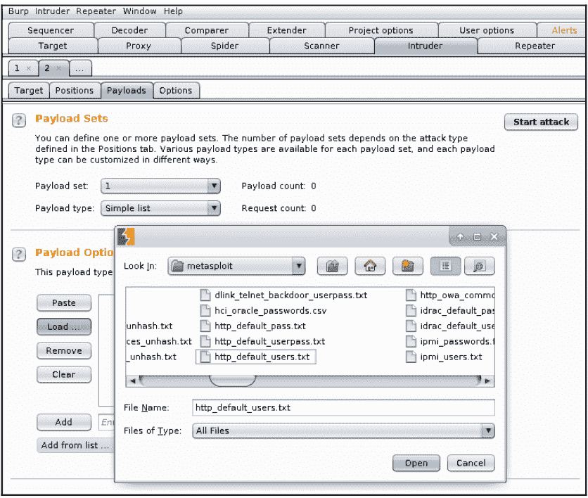

现在您已定义了请求和输入位置，并且有效载荷列表已准备就绪，单击 Start Attack：

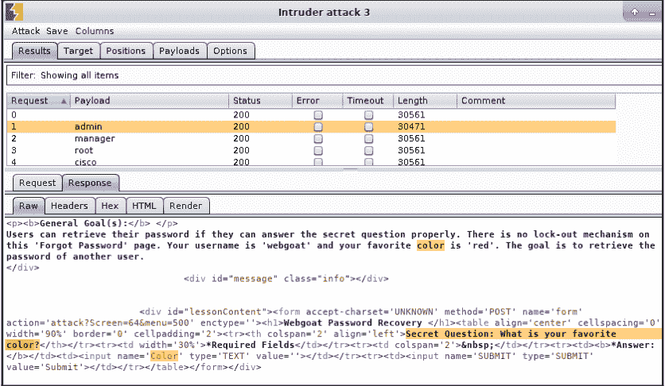

正如您在结果中看到的那样，所有尝试过的名称都有相同的响应；只有一个例外。您会注意到 admin 的响应长度不同，如果您查看响应的正文，您会看到它正在询问密码恢复问题。因此，admin 是一个有效的用户名。


只要应用程序对有效和无效用户名显示不同的响应，就可以使用用户名枚举。此外，一些应用程序在注册新用户时包含验证，以确保名称不重复。如果此验证在表单提交之前完成，则有一个 Web 服务执行此类验证，您可以使用它进行枚举。


