# 通过暴力破解和字典攻击发现密码

一旦你在应用程序中识别出有效用户，下一步自然是尝试找到这些用户的密码。获取用户有效密码的方法有很多，从在不同服务器上模仿原始站点并利用社会工程学诱骗用户提交信息，到利用不安全的密码恢复机制，再到如果密码很常见就进行猜测。

暴力破解是一种尝试所有可能的字符组合来发现有效密码的方法。当应用程序允许一到三个甚至四个字符的密码时，这种方法效果很好。如果允许此类密码，那么至少有一名用户在使用它们。

对于更长的密码，暴力破解攻击完全不切实际，因为在发现一个有效密码之前，你需要向应用程序发送数百万（甚至数十亿）次请求。加上这一点，执行此类攻击所需的时间要比渗透测试标准的一到两周计划长得多（极其长）。对于这种情况，我们依赖于人类因素的可预测性——即使从实际角度来看，八个或更多字符密码的可能组合几乎是无限的，我们人类倾向于只使用其中一小部分作为密码，而且最常见的密码非常常见。

为了利用这一事实，有字典包含常见或默认密码，或已知在之前对热门网站的攻击中泄露的密码。使用这些字典，你可以减少发现有效密码所需的尝试次数，并增加在字典中找到它的几率，因为该词已被许多人用作密码。


自2012年以来，SplashData 根据对被黑和泄露密码集合的分析，发布了世界上使用最多的密码列表。2017年和2016年的结果可以在 https://www.teamsid.com/worst-passwords-2017-full-list/ 和 https://www.teamsid.com/worst-passwords-2016/ 查看。每年都会发布另一份列表，即 Keeper 密码管理器发布的列表：https://blog.keepersecurity.com/2017/01/13/most-common-passwords-of-2016-research-study/。

## 使用 THC Hydra 攻击基本认证

**THC Hydra** 是黑客和渗透测试人员长期喜爱的在线密码破解工具之一。

在线破解意味着对服务的登录尝试实际上会被执行。这可能会产生大量流量，并在服务器上部署安全和监控工具时触发警报。因此，在对应用程序或服务器进行在线暴力破解或字典攻击时，你应格外小心，并调整参数以获得最佳速度，同时避免压垮服务器、触发警报或锁定用户账户。

TIP
当存在监控或在一定次数失败尝试后锁定账户时，进行在线攻击的一个好方法是每个用户开始时使用三到四个密码，或少于锁定阈值的数量。选择最明显或最常见的密码（例如，`password`、`admin` 或 `12345678`），如果没有结果，就回到侦察阶段以获取更好的密码列表，并在几分钟或几个小时后重试。

THC Hydra 能够连接到各种服务，如 FTP、SSH、Telnet 和 RDP。我们将使用它对使用基本认证的 HTTP 服务器进行字典攻击。

首先，你需要知道实际处理登录凭据的 URL。启动你的 *Kali 机器*，打开 Burp Suite，并配置浏览器使用它作为代理。你将使用易受攻击的虚拟机和 WebGoat 应用程序。当你尝试访问 WebGoat 时，会弹出一个要求输入登录信息的对话框。如果你提交任意随机用户名和密码，会再次出现相同的对话框：

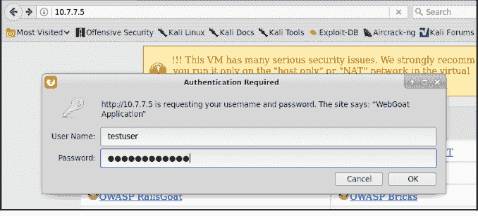

即使尝试不成功，该请求也已在 Burp 中注册。接下来，查找其中包含 Authorization: Basic 头部的请求：

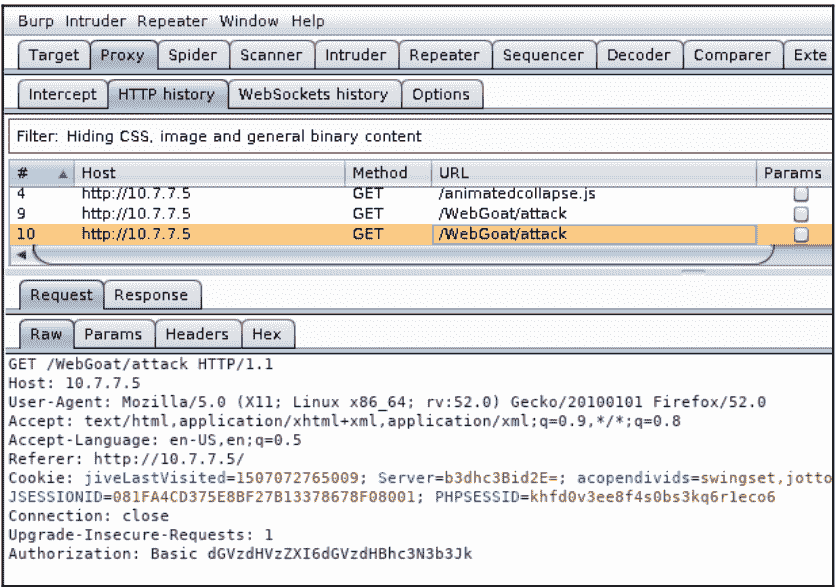

现在你知道处理登录的 URL 是 http://10.7.7.5/WebGoat/attack。这足以运行 Hydra，但首先你需要有一个可能的用户名列表和一个密码列表。在真实场景中，可能的用户名和密码将取决于组织、应用程序以及你对用户了解的知识。对于本次测试，你可以使用以下针对名为 WebGoat 的应用程序的可能用户列表，并将其指定为安全测试的目标：

- admin
- webgoat
- administrator
- user
- test
- testuser

至于密码，你可以尝试一些最常见的密码并添加应用程序名称的变体：

- 123456
- password
- Password1
- admin
- webgoat
- WebGoat
- qwerty
- 123123
- 12345678
- owasp

将用户名列表保存为 `users.txt`，密码列表保存为 `passwords.txt`。首先，运行 `hydra` 不带任何参数以查看帮助和执行信息：

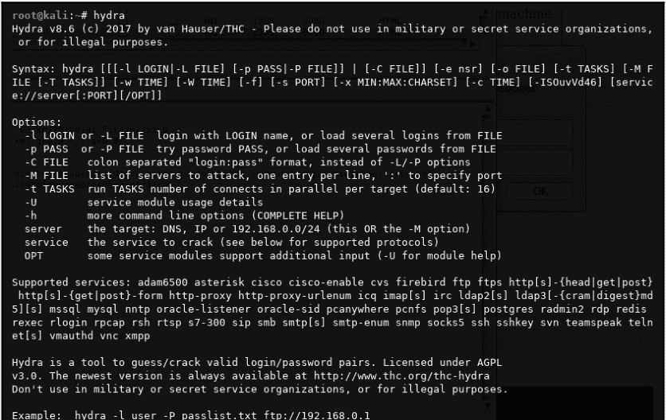

你可以看到它需要 -L 选项添加用户列表文件，-P 添加密码列表文件，以及协议、服务器、端口和可选信息，格式为：protocol://server:port/optional。运行以下命令：

```
hydra -L users.txt -P passwords.txt http-get://10.7.7.5:8080/WebGoat/attack
```

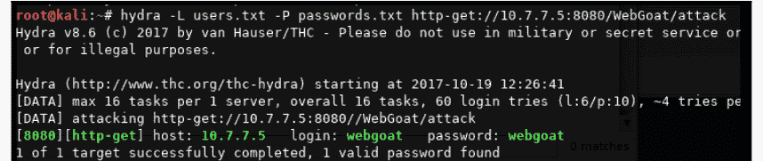

你会发现 webgoat 用户和 webgoat 密码的组合被服务器接受。

使用 Hydra 时一个有用的选项是 -e，带有 n、s 或 r 修饰符，可以处理登录输入，发送空密码（n）、用户名作为密码（s）、反转用户名并用作密码（r），以及 -u，它先循环用户。这意味着它会用单个密码尝试所有用户，然后再进行下一个密码。这可以防止你被某些防御机制锁定。

## 攻击基于表单的认证

由于没有标准实现，且 Web 应用程序在验证和攻击预防方面更灵活，登录表单在暴力破解时带来了一些特殊挑战：

- 用户名和密码参数没有标准名称、位置或格式
- 登录尝试没有标准负面或正面响应
- 客户端和服务器端验证可能会阻止某些类型的攻击或重复提交请求
- 认证可能分多步进行；即在一页询问用户名，在下一页询问密码

幸运的是，对于渗透测试人员来说，大多数应用程序使用基本的 HTML 表单模式，通过 POST 请求发送用户名和密码作为参数，并在登录成功时重定向到用户主页，登录失败时显示错误或重定向到登录页。你现在将研究执行此类表单字典攻击的两种方法。相同的原理适用于几乎所有基于表单的认证，只是响应解释方式和提交所需参数有所不同。

## 使用 Burp Suite Intruder

与基本认证攻击一样，你首先需要识别执行实际认证的请求及其参数，以便攻击正确的目标。

在以下截图中，左侧你会看到 OWASP Bricks 中的认证表单（在易受攻击的虚拟系统主菜单中，进入 Bricks | Login pages | Login #3），右侧你可以看到通过 POST 方法的请求。你会注意到 username 和 passwd 参数在正文中发送，而没有 Authorization 头部：

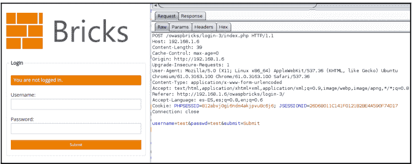


对该登录页面进行字典攻击，首先需要分析响应，以识别失败登录与成功登录的区别：

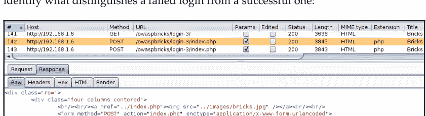

在截图中，你可能会观察到失败的响应包含 "Wrong user name or password." 文本。当然，这不会出现在成功登录中。

接下来，将请求发送到 Intruder，并选择 username 和 passwd 参数作为输入。然后，选择 Cluster bomb 作为攻击类型：

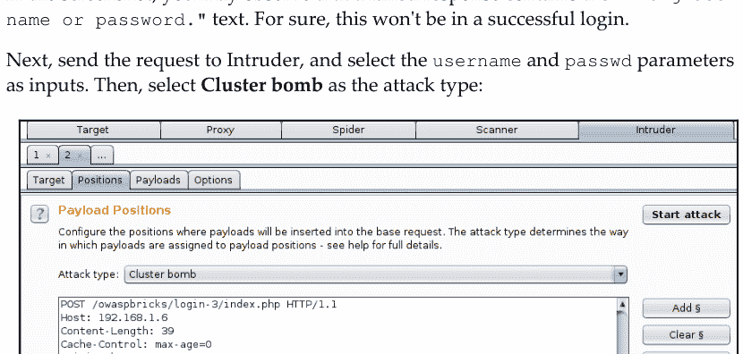

接下来，前往 Payloads 选项卡，选择 payload set 1，并加载之前使用的用户名文件：

对于 payload set 2，我们也将使用上一练习中使用的密码文件：

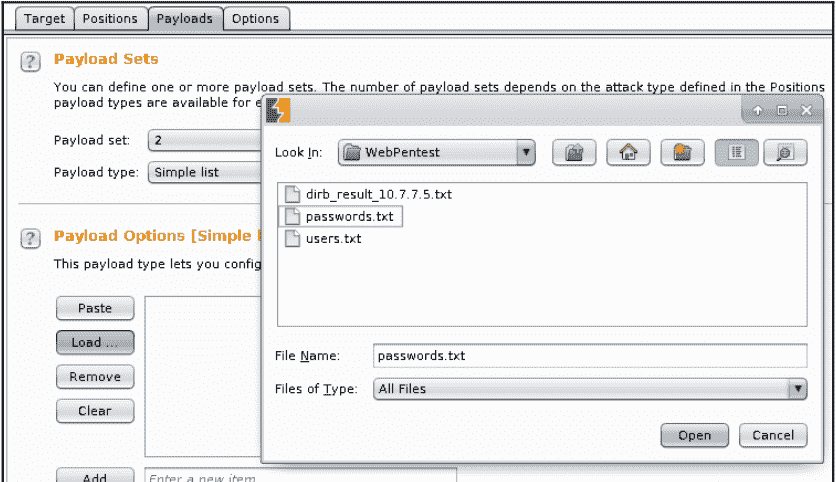

如本截图所示，向服务器发送了 60 个请求，因为你有 6 个用户名和 10 个可能的密码：

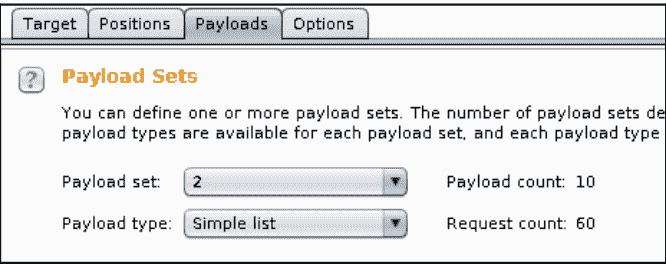

你可以在此时启动攻击，然后分析响应，并了解某些登录组合是否成功。然而，Burp Intruder 有一些功能可以让你的生活更轻松，不仅适用于像这样简单的示例，而且在攻击复杂的真实世界应用时也适用。前往 Options 选项卡，然后前往 Grep - Match，让 Intruder 在响应中查找特定文本，以便你轻松识别成功的那个。点击 Flag result items with responses matching these expressions 框，清除当前列表，并在 Enter a new item 框中输入以下内容：

```
Wrong user name or password.
```

按 Enter 或点击 Add。Intruder 将标记所有包含此消息的响应；因此未被标记的可能代表成功登录。如果你知道正确的登录消息，可以查找该消息并直接识别出正确的凭据集：

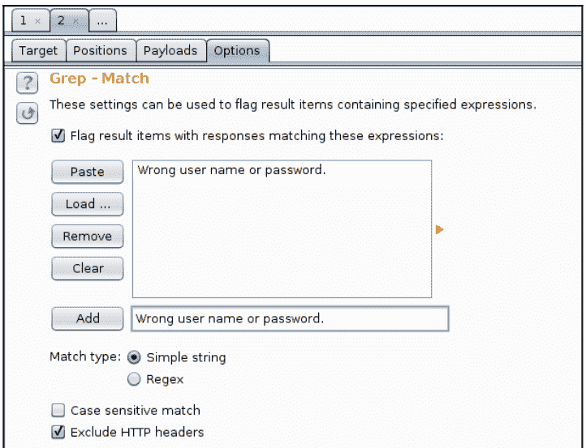

启动攻击，并等待结果：

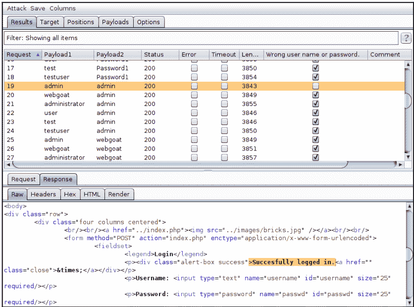

看起来你至少找到一个有效的用户名及其密码。

## 使用 THC Hydra

在 Hydra 支持的众多协议中，有 http-get-form、http-post-form、https-get-form 和 https-post-form，分别是 GET 和 POST 方法发送的 HTTP 和 HTTPS 登录表单。利用上一练习中的相同信息，你可以使用以下命令使用 Hydra 运行字典攻击：

```
hydra 10.7.7.5 http-form-post "/owaspbricks/login-3/index.php:username=^USER^&passwd=^PASS^&submit=Submit:Wrong user name or password." -L users.txt -P passwords.txt
```

```
root@kali:~/WebPentest# hydra 10.7.7.5 http-form-post "/owaspbricks/login-3/index.php:username=\"USER^&passwd=^PASS^&submit=Submit:Wrong user name or password." -L users.txt -P passwords.txt
Hydra v8.6 (c) 2017 by van Hauser/THC - Please do not use in military or secret service organizations, or for illegal purposes.

Hydra (http://www.thc.org/thc-hydra) starting at 2017-10-26 14:16:36
[DATA] max 16 tasks per 1 server, overall 16 tasks, 60 login tries (l:6/p:10), ~4 tries per task
[DATA] attacking http-post-form://10.7.7.5:80//owaspbricks/login-3/index.php:username="USER^&passwd=^PASS^&submit=Submit:Wrong user name or password.
[80][http-post-form] host: 10.7.7.5   login: admin   password: admin
1 of 1 target successfully completed, 1 valid password found
[WARNING] Writing restore file because 5 final worker threads did not complete until end.
[ERROR] 5 targets did not resolve or could not be connected
[ERROR] 16 targets did not complete
Hydra (http://www.thc.org/thc-hydra) finished at 2017-10-26 14:16:41
```

你可能会注意到，在这种情况下的语法与你之前使用 Hydra 时略有不同。让我们一起检查一下：

+   1. 首先，你有 `hydra` 命令和目标主机（`hydra 10.7.7.5`）。
+   2. 然后是你想要测试的协议或服务（`http-form-post`）。
+   3. 接下来是引号 (`"`) 中的协议特定参数，并用冒号分隔：
+      1. URL (`/owaspbricks/login-3/index.php`)
+      2. 请求体，由 `^USER^` 表示，Hydra 应在此处放置用户名，以及 `^PASS^` 表示密码应放置的位置
+      3. 失败的登录消息（`Wrong user name or password.`）
+      4. 最后是用户名和密码列表，由 `-L` 和 `-P` 表示

## 密码重置功能

另一个 Web 应用中常见的薄弱点是密码恢复和重置功能的实现。

由于应用程序需要用户友好，且部分用户会忘记密码，因此应用程序需要提供一种方式让这些用户重置或恢复密码。提出此问题的安全解决方案并非易事，许多开发人员可能会留下渗透测试人员或攻击者可以利用的薄弱环节。

## 恢复而非重置

面对用户忘记密码时该怎么办的问题，你可以选择两种主要选项：

+   - 允许他们恢复旧密码
+   - 允许他们重置它

应用程序允许用户恢复旧密码这一事实预设了应用程序设计中的一些安全缺陷：

+   - 密码以可恢复的方式存储在数据库中，而不是使用单向哈希算法，而后者是存储密码的最佳实践。
+   - 在服务器端代码中，客服代理或系统管理员可以恢复密码。攻击者也可能通过社会工程或技术利用来实现这一点。
+   - 当密码通过电子邮件、电话或在网页上显示等方式传回给用户时，密码会面临风险。中间人或旁观者捕获此类信息的方式有很多。

## 常见的密码重置缺陷

应用程序允许用户恢复或重置密码的非常常见的方法是询问一个或多个问题，只有合法用户应该知道答案。这包括出生地、第一所学校、第一只宠物的名字和母亲的娘家姓。问题开始出现时，应用程序提出的问题对潜在攻击者来说并不那么保密，如果用户是名人或政客等公众人物时问题会加剧，因为他们生活的许多细节都是公开的。

第二层保护是不直接提供密码重置功能的访问权限，而是发送包含密码重置链接的电子邮件或短信。如果在尝试重置密码时请求此电子邮件或电话号码，很可能你可以伪造此信息，用你的号码替换用户的号码，并重置任何用户的密码。

如果电子邮件或电话号码得到正确验证，并且无法伪造它们，重置链接仍可能未正确实现。有时这些链接包含一个参数，指示 ID，例如将要重置密码的用户的编号或名称。在这种情况下，你所需要做的就是使用你控制的用户生成一个链接，并将该参数更改为你想要重置密码的用户。

另一种可能的失败是此类重置链接在首次合法使用后未被失效。在这种情况下，如果攻击者通过任何方式获得该链接的访问权限，他们可以再次访问并重置用户的密码。

## 2FA 实现中的漏洞

Web 应用中最常见的 MFA 形式是使用随机生成的数字（四到八位）作为 OTP，用户可从专用设备、移动应用（如 Google Authenticator、Authy、1Password 或 LastPass Authenticator）获取，或通过服务器按需发送的短信或电子邮件获取。

在渗透测试期间，当存在以下条件时，你可以检测并利用此过程中的一些实现缺陷：

+   - OTP 数字不是完全随机的，可以被预测。
+   - OTP 未链接到分配给它的用户。这意味着你可以为一个用户生成 OTP 并在另一个用户上使用。
+   - 同一个密码或令牌可以多次使用。
+   - OTP 提交尝试次数没有限制。这为暴力攻击打开了可能性，而暴力攻击更有可能成功，因为 OTP 通常是较短的数字字符串。
+   - 发送 OTP 通过电子邮件或短信时未验证用户信息，允许攻击者伪造电子邮件地址或电话号码。
+   - OTP 的过期时间对于应用程序的目的来说太长。这扩大了攻击者获取有效未使用令牌的时间窗口。


- 新生成的 OTP 不会使之前的 OTP 失效，因此例如，如果用户因首次尝试网络失败而多次为同一操作请求令牌或密码，攻击者可能会使用较早的尝试来复制该操作或执行另一个接受相同令牌的操作，即使合法操作已经执行。
- 依赖于访问应用程序的设备。如今，人们的手机上拥有银行应用程序、个人电子邮件、社交网络、工作电子邮件以及许多其他应用程序。因此，你应该三思后再使用电子邮件、短信或移动应用作为第二重身份验证因素。

## 检测和利用不当的会话管理

如前所述，会话管理允许应用程序在用户每次请求时无需提交其凭据的情况下跟踪用户活动并验证授权条件。这意味着如果会话管理未正确执行，用户可能能够访问其他用户的信息或执行超出其权限级别的操作，或者外部攻击者可能获得用户的信息和功能访问权限。

## 使用 Burp Sequencer 评估会话 ID 的质量

**Burp Sequencer** 是一种统计分析工具，可让你收集大量值，例如会话 ID，并对其进行计算以评估它们是否随机生成，或只是混淆或编码。这在处理复杂的会话 cookie 时很有用，因为它可以让你了解 cookie 的生成方式以及是否存在攻击或预测它们的方法。

要使用 Burp Sequencer，首先需要找到设置会话 cookie 的响应。它通常是对成功登录的响应，其中包含 Set-Cookie 头。在以下屏幕截图中，你可以看到为 WebGoat 的会话劫持练习设置会话 cookie（WEAKID）的响应（转到 WebGoat | Session Management Flaws | Hijack a Session）：

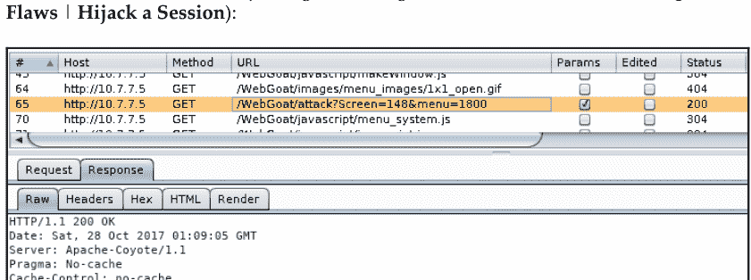

乍一看，响应的值似乎是唯一的且难以猜测。第一部分看起来像一个 ID，第二部分似乎是时间戳，也许是纳秒级的过期时间。猜测会话结束的确切纳秒应该非常困难，对吧？嗯，正如你将看到的，这并不是最好的方法。

在 Burp Proxy 的历史记录中找到该响应，并右键单击它。你将看到 **Send to Sequencer** 选项。进入 Sequencer 后，你需要选择要聚焦的响应部分：

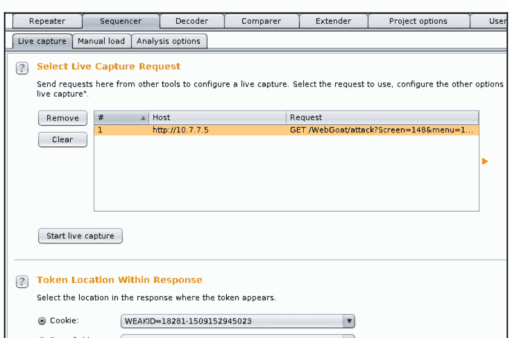

你可以选择分析 cookie、表单字段或响应的自定义部分。在本例中，选择 WEAKID cookie 并单击 Start live capture。它将开始向服务器发出请求以尽可能捕获不同的 cookie 值。完成后，单击 Analyze now 执行分析。在结果中，Sequencer 将指示分析的值是否足够随机以及是否适合作为会话 ID。正如你所见，WEAKID 很弱且易于预测：

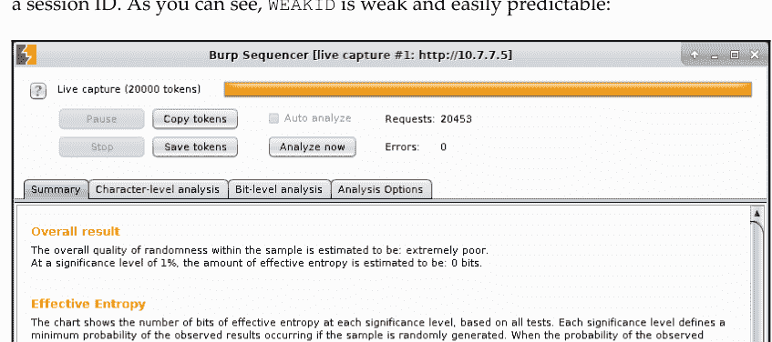

**Entropy** 是衡量信息随机性程度的指标。结果显示 WEAKID 的随机性为零，这意味着它完全可预测，不适合作为会话 ID。Sequencer 还提供了有关字符串中每个字节和位的分布和显著性的更详细信息。

在以下屏幕截图中，你将看到字符分析图表。你可以看到第 3、4、15、16 和 18 位的字符变化比第 0 位或第 5 到 13 位的字符变化多得多，后者似乎根本没有变化。此外，第 0 到 4 个字符表明是一个计数器或递增数字，因为最后一个字符的变化比前一个字符多，而那个字符又比前一个字符多，依此类推。我们将在下一节中验证这一点：

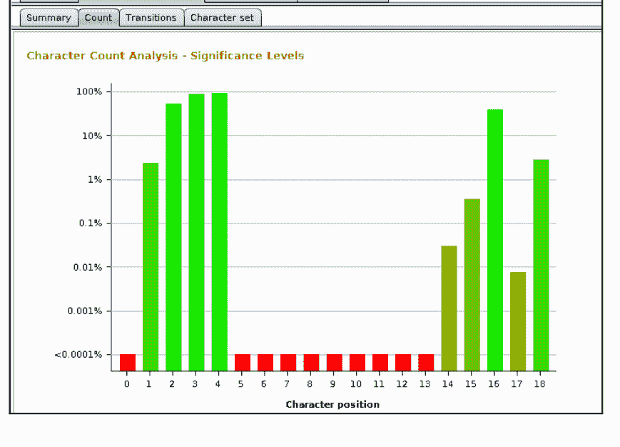

## 预测会话 ID

我们已经识别出一个似乎可预测的会话 ID。现在让我们尝试找到一个有效的会话。为此，你将使用接收 cookie 的相同请求并将其发送到 Intruder。在本例中，你只需重复相同的请求多次。然而，Intruder 需要插入点才能运行，因此向请求添加一个头（Test: 1）并在其值中设置插入位置：

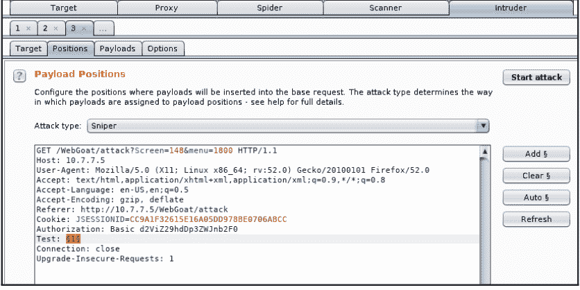

你将在此测试中发送 101 个请求，因此将有效负载设置为 Numbers 类型，从 0 递增到 100：

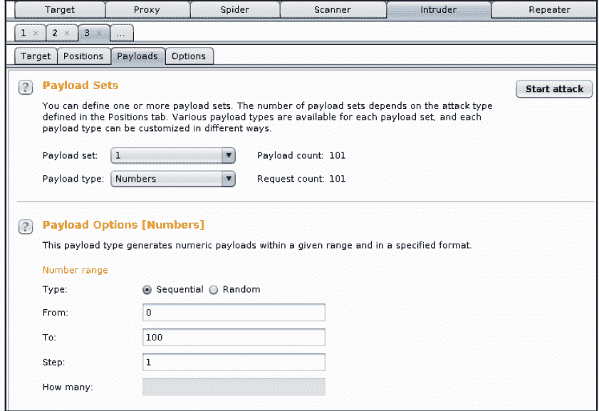

现在转到 **Options** 选项卡，并在 **Grep-Extract** 部分添加一个项目。确保 **Update config based on selection below** 复选框已选中，并仅选择 cookie 的值：

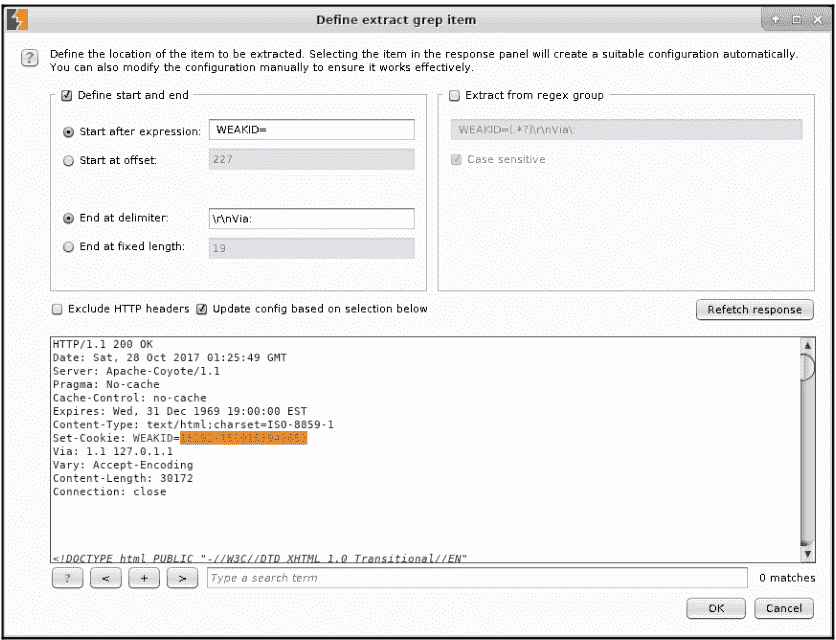

单击 **OK** 然后单击 **Start attack.**

现在你可以在 Intruder 的结果表中看到 WEAKID 值，并且可以验证 cookie 值的第一部分是顺序数字，第二部分也始终递增。这取决于服务器接收到请求的时间。如果查看以下屏幕截图，你可以看到序列中存在一些间隙：

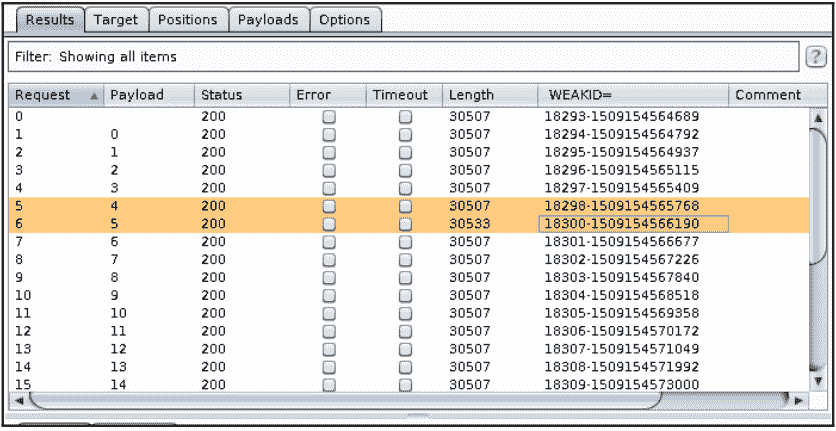

当前活动会话的前半部分是 18299。我们知道这一点，因为服务器没有给我们该值，我们知道它随着每次请求而递增。我们还知道第二部分是时间戳，并且也取决于会话 cookie 被分配的时间。因此，我们要寻找的值的第二部分必须介于我们已知的两个值之间：1509154565768 和 1509154566190。由于这两个数字之间的差异很小（422），我们可以使用 Intruder 轻松暴力破解该值。

现在再次取相同的原始请求并再次将其发送到 Intruder。这次，向其中添加一个 cookie。在 JSESSIONID 的值之后，添加以下内容（请记住根据你的结果调整值）：

```
; WEAKID=18299-1509154565768
```

选择最后四个字符，并在那里添加位置标记：

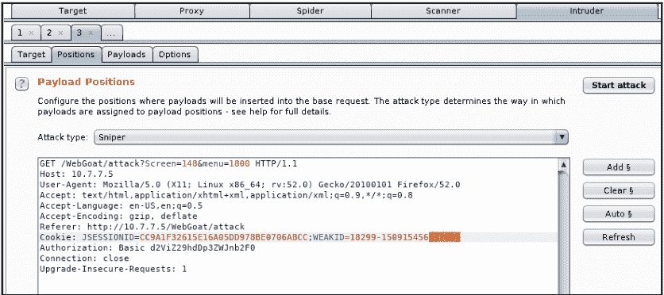

现在，在 Payloads 选项卡中，攻击将尝试从 5768 到 6190 的数字：

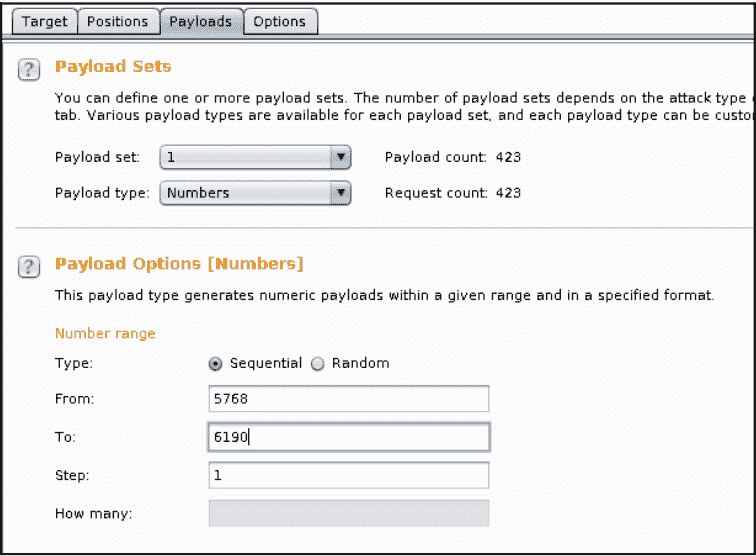

最后，添加一个匹配表达式，以便你清楚地知道何时获得成功结果。此时，你只知道未经身份验证的用户应有的消息。你会假设经过身份验证的用户（具有有效的会话 cookie）不会被要求登录：

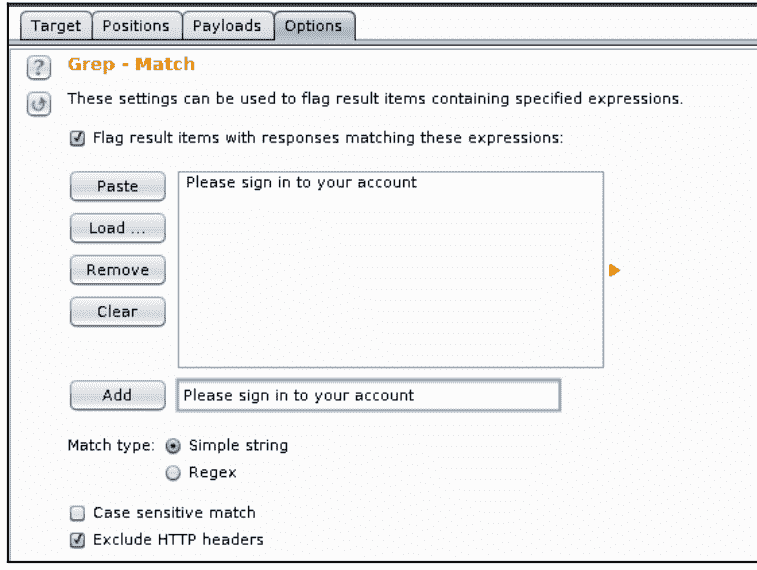

启动攻击，并等待 Intruder 找到结果：

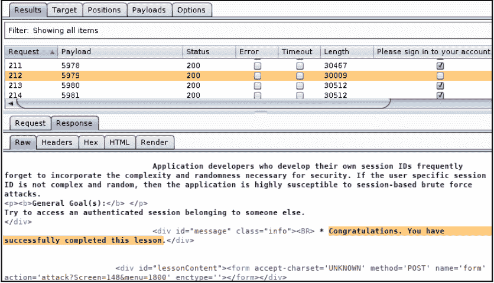

你现在拥有一个有效的会话 ID。要使用它，你需要做的就是用你刚刚找到的会话 cookie 值替换你的会话 cookie 值，然后访问页面以劫持他人的会话。我把这个留给你测试。

## 会话固定

有时，用户提供的信息用于生成会话 ID，更糟糕的是，用户提供的信息成为会话 ID。当这种情况发生时，攻击者可以强制用户使用预定义的标识符，然后监控应用程序以查看该用户何时开始会话。这称为会话固定。

WebGoat 有一个有些简单但非常具有说明性的演示来展示此漏洞（转到 WebGoat | Session Management Flaws | Session Fixation）。我们将使用它来说明如何执行此攻击。

- 1. 第一步将你设定为攻击者。你需要制作一封电子邮件，在发送给受害者的链接中包含一个会话 ID（SID）值，因此向 Goat Hills Financial 的链接添加该参数，任意值，例如 &SID=123：

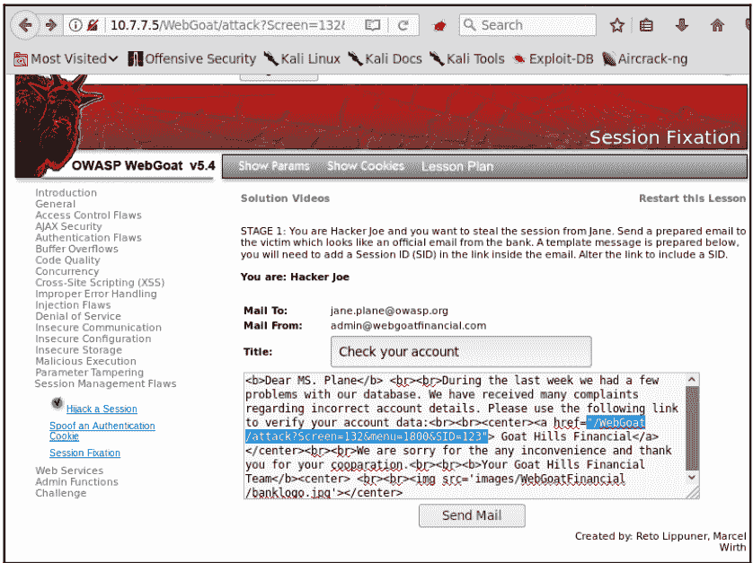

攻击者发现 Goat Hills Financial 网站使用 GET 参数来定义会话标识符，并向该机构的客户发送钓鱼邮件。


2. 在此练习步骤中，你扮演受害者，从攻击者处接收邮件：

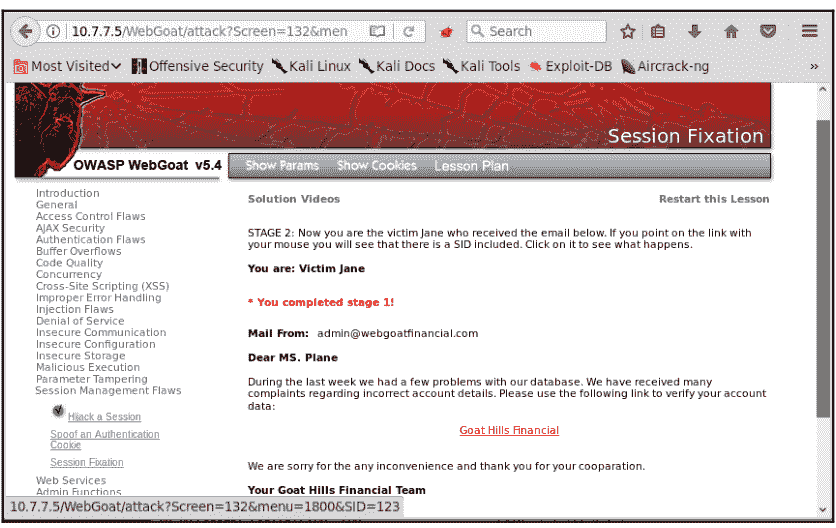

由于邮件似乎来自 admin@webgoatfinancial.com 而显得合法，你点击了链接，该链接将你发送到登录页面并据此登录。现在存在一个有效的会话，该会话使用攻击者发送的参数。

3. 下一阶段要求攻击者以受害者相同的站点登录：

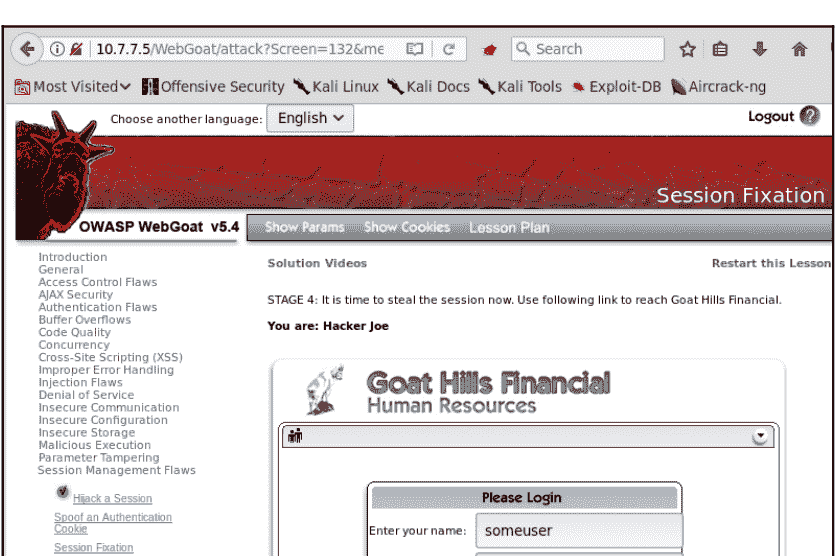

你使用 Burp Proxy 拦截请求并编辑它以包含受害者用于登录的 SID 参数：

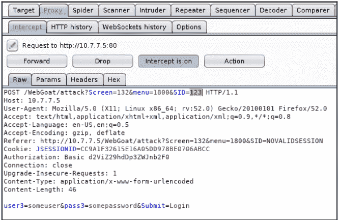

4. 你现在已获得对受害者个人资料的访问权限：

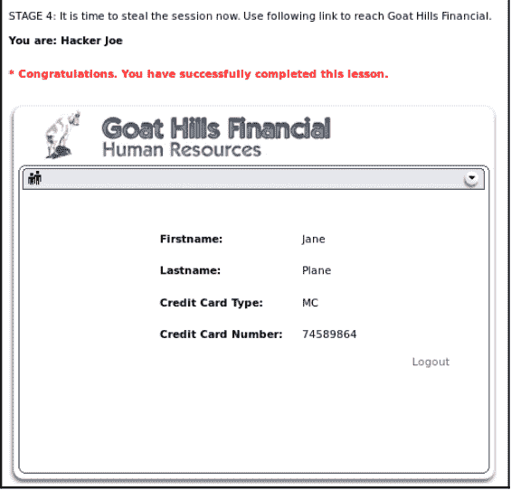

在此示例中，会话 ID 的管理存在两个主要缺陷：

- 首先，会话 ID 是通过用户提供的信息生成的，这使得攻击者更容易识别有效值并将其与现有用户关联。
- 其次，一旦经过身份验证的会话开始后，标识符不会改变（例如，受害者登录后），这就是“会话固定”一词的来源，因为攻击者能够预设会话 ID 对受害者而言将具有的值，从而使使用该相同值劫持受害者的经过身份验证的会话成为可能。

## 防止身份验证和会话攻击

Web 应用程序中的身份验证是一个难以解决的问题，迄今为止尚未找到通用解决方案。正因如此，防止该领域应用程序中的漏洞在很大程度上是特定于案例的，开发人员需要根据特定的用例和用户配置文件在可用性和安全性之间找到平衡。

即使对于会话管理，我们也可以这么说，因为当前的方法仍然是对 HTTP 协议缺陷的变通方法。可能随着 HTML5 和 WebSockets 或类似技术的出现，你在未来将拥有一些更好的替代方案。

尽管如此，仍然可以为身份验证和会话管理定义一些通用指南，这将有助于开发人员提高攻击者的安全门槛，我们可以在寻找缺陷并向客户提出建议时将其作为参考。

## 身份验证指南

以下是身份验证指南列表：

- 用户名或用户标识符必须对每个用户唯一且不区分大小写（`user` 与 `User` 相同）。
- 强制执行强密码策略，防止使用以下内容作为密码：
  - 用户名作为密码
  - 短密码（即少于八个字符）
  - 单一大小写密码，即全小写或全大写
  - 单一字符集，例如全为数字、全为字母，且不使用特殊字符
  - 数字序列（123456、9876543210）
  - 名人、电视节目、电影或虚构人物（Superman、Batman、Star Wars）
  - 公共词典中的密码，例如最常见的 25 个密码
- 提交登录信息时始终使用安全协议，例如 TLS。
- 不要在错误消息或响应代码中泄露有关用户名存在或有效性的信息（例如，当未找到用户时不要返回 404 代码）。
- 为防止暴力攻击，在一定次数的失败尝试后实施临时锁定：五次是一个平衡良好的数字，因此用户连续五次登录失败将被锁定一段时间，例如二十分钟或三十分钟。
- 如果实现了密码重置功能，请要求用户名或电子邮件以及可用的安全问题。然后，将一次性重置链接发送到用户注册的电子邮件或通过 SMS 发送到其手机。该链接必须在用户重置密码后或在一定时间内（如果未发生，则可能为几个小时）后禁用。
- 在实施 MFA 时，优先使用第三方且经过广泛测试的框架，例如使用移动应用程序时的 Google Authenticator 或 Authy，或需要物理令牌或智能卡时使用 RSA 或 Gemalto 设备。
- 避免实施自定义或自制的加密和随机生成模块，并优先使用知名库和框架中的标准算法。
- 在敏感任务上要求重新身份验证，例如用户权限更改、敏感数据删除或全局配置更改的修改。


OWASP 在 https://www.owasp.org/index.php/Authentication_Cheat_Sheet 上提供了有关在 Web 应用程序上实施身份验证的最佳实践的快速指南。

## 会话管理指南

以下是会话管理指南列表：

- 无论使用何种身份验证机制，始终实施会话管理并在每个页面和/或每个请求上验证会话。
- 使用长、随机且唯一的会话标识符。优先使用 ASP.NET、PHP 和 J2EE 等主要 Web 开发语言中已实现的机制。
- 用户登录和注销时生成新的会话 ID。永久使已使用的会话 ID 无效。
- 在合理的不活动时间后使会话无效并注销用户——15 到 20 分钟。提供安全性与可用性之间的良好平衡。
- 始终为用户提供明确的注销选项；即提供注销按钮/选项。
- 使用会话 cookie 时，确保设置所有安全标志：
  - 使用 `Secure` 属性以防止在未加密的通信中使用会话 cookie。
  - 使用 `HttpOnly` 属性以防止通过脚本语言访问 cookie 值。这降低了 **跨站脚本 (XSS)** 攻击的影响。
  - 使用非持久性会话 cookie，不带 `Expires` 或 `Max-Age` 属性。
  - 将 `Path` 属性限制为服务器的根目录（`/`）或应用程序托管的特定目录。
  - `SameSite` 属性目前仅由 Chrome 和 Opera Web 浏览器支持。这通过防止 cookie 被外部站点发送到服务器来提供防止信息泄露和 **跨站请求伪造 (CSRF)** 的额外保护。
- 将会话 ID 与用户的角色和权限关联，并在每个请求上使用它来验证授权。


有关此主题的更深入建议可在 OWASP 的 *Session Management Cheat Sheet* 中找到，网址为 https://www.owasp.org/index.php/Session_Management_Cheat_Sheet。
