## 9 在 Web 应用上使用自动化扫描器

到目前为止，你已经学习了如何在 Web 应用中查找和利用漏洞，主要是通过手动逐个测试一个参数或一个请求。虽然这是发现安全缺陷的最佳方式，特别是与应用内部信息流、业务逻辑和授权控制相关的缺陷，但在专业的渗透测试中，有时由于时间、范围或数量的原因，项目无法完全通过手动测试来处理，需要使用自动化工具来帮助加速发现漏洞的过程。

在本章中，我们将讨论在使用自动化漏洞扫描器扫描 Web 应用时需要考虑的方面。你还将了解 Kali Linux 中包含的扫描器和模糊测试工具以及如何使用它们。

## 使用自动化扫描器前的注意事项

Web 应用漏洞扫描器的运行方式与其他类型的扫描器，例如 OpenVAS 或 Nessus，有所不同。后者通常连接到主机上的端口，获取在这些端口上运行的服务类型和版本，然后将此信息与漏洞数据库进行核对。相反，Web 应用扫描器会在应用页面中识别输入参数，并在每个参数上提交大量请求以探测不同的有效载荷。

由于以这种方式运行，自动化扫描几乎肯定会在数据库中记录信息、生成活动日志、更改现有信息，并且如果应用具有删除或恢复功能，甚至可能擦除数据库。

渗透测试人员在将 Web 漏洞扫描器作为测试手段之前必须考虑的关键事项如下：

- 检查范围和项目文档，确保允许使用自动化工具。
- 在专门为此目的设置的環境中进行测试（QA、开发或测试）。仅在客户明确要求下才使用生产环境，并让他们知道存在损坏数据的固有风险。
- 更新工具的插件和模块，以便结果与最新的漏洞披露和技术保持同步。
- 在启动扫描前检查扫描工具参数和范围。
- 将工具配置为最高级别的日志记录。日志在发生任何事件时以及用于验证发现和报告时都将非常有用。
- 不要让扫描器无人看管。你不需要盯着进度条，但应不断检查扫描器的运行情况以及被测试服务器的状态。
- 不要依赖单一工具——有时不同工具对同一种测试会得到不同的结果。当一种工具遗漏某些漏洞时，另一种可能找到它但遗漏其他内容。因此，如果你在测试范围内使用自动化扫描器，请使用多个工具，并考虑使用 Burp Suite Professional 或 Acunetix 等商业产品。

## Kali Linux 中的 Web 应用漏洞扫描器

Kali Linux 包含多个用于 Web 应用自动化漏洞扫描的工具。我们已经检查了一些这些工具，特别是那些专注于特定漏洞的工具，例如用于 SQL 注入的 sqlmap 或用于跨站脚本（XSS）的 XSser。

接下来，我们将介绍以下一些更通用的 Web 漏洞扫描器的基本用法：

- Nikto
- Skipfish
- Wapiti
- OWASP-ZAP

## Nikto

Nikto 是一个长期经典的工具，也许是世界上最广泛使用和最知名的 Web 漏洞扫描器。即使其扫描操作并不深入，其发现也比较通用（总体上与过时的软件版本、使用易受攻击的组件或通过分析响应头检测到的错误配置有关），Nikto 仍然是一个非常有用的工具，因为它拥有广泛的测试集，并且不太可能破坏系统。

Nikto 是一个命令行工具。在下面的屏幕截图中，nikto 使用参数 -h 指定要扫描的主机或 URL，-o 指定输出文件。文件的扩展名决定了报告的格式。其他常见格式有 .csv（逗号分隔文件）和 .txt（文本文件）：

要了解更多详细信息以及使用 nikto 的其他选项，请使用 -H 选项运行它以获取完整帮助。

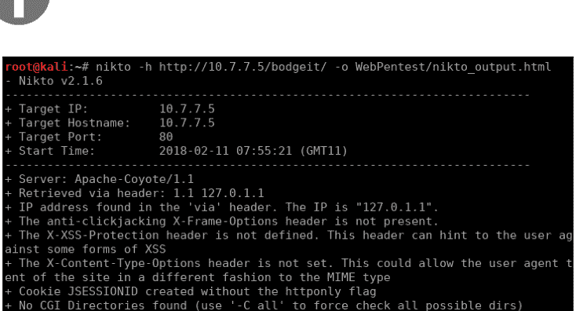

现在让我们看看上一次扫描的报告是什么样的：

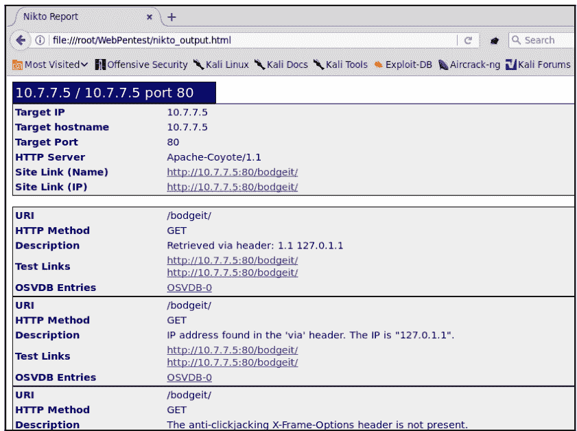

根据这两个屏幕截图，你可以看到 Nikto 识别了服务器版本以及响应头中的一些问题。特别是，IP地址披露了缺少一些保护头，例如 X-Frame-Options 和 X-XSS-Protection，并且会话 cookie 未包含 HttpOnly 标志。这意味着它可以通过脚本代码检索。

## Skipfish

**Skipfish** 是一款非常快速的扫描器，可以帮助识别以下漏洞：

- 跨站脚本
- SQL 注入
- 命令注入
- XML/XPath 注入
- 目录遍历和文件包含
- 目录列表

根据其 Google Code 页面（http://code.google.com/p/skipfish/）：

> Skipfish 是一款主动式 Web 应用安全侦察工具。它通过递归爬取和基于字典的探测为目标站点准备交互式站点地图。生成的地图随后会用来自多个主动（但 hopefully 非破坏性）安全检查的输出进行注释。工具生成的最终报告旨在作为专业 Web 应用安全评估的基础。

Skipfish 的使用非常简单。你只需提供要扫描的 URL 作为参数。可选地，你可以添加输出文件并微调扫描。要对测试 VM 中的 WackoPicko 应用运行 Skipfish 并生成 HTML 报告，请使用以下命令：

```
skipfish -o WebPentest/skipfish_result -I WackoPicko http://10.7.7.5/WackoPicko/
```

-o 选项指示报告存储的目录。-I 选项告诉 Skipfish 仅扫描包含字符串 WackoPicko 的 URL，排除 VM 中其余的应用。最后一个参数是你要开始扫描的 URL。

当命令启动时，会出现一个信息屏幕。你可以按任意键或等待 60 秒让扫描开始。扫描开始后，会显示以下状态屏幕：

```
skipfish version 2.10b by lcamtuf@google.com

- 10.7.7.5 -

Scan statistics:

    Scan time : 0:00:36.910
    HTTP requests : 9113 (249.9/s), 19973 kB in, 2674 kB out (613.6 kB/s)
    Compression : 5678 kB in, 31052 kB out (69.1% gain)
    HTTP faults : 1 net errors, 0 proto errors, 0 retried, 0 drops
    TCP handshakes : 186 total (53.5 req/conn)
    TCP faults : 0 failures, 1 timeouts, 1 purged
    External links : 2333 skipped
    Reqs pending : 844

Database statistics:

    Pivots : 121 total, 16 done (13.22%)
    In progress : 39 pending, 52 init, 13 attacks, 1 dict
    Missing nodes : 4 spotted
    Node types : 1 serv, 36 dir, 8 file, 8 pinfo, 54 unkn, 14 par, 0 val
    Issues found : 50 info, 2 warn, 10 low, 6 medium, 0 high impact
    Dict size : 105 words (105 new), 11 extensions, 256 candidates
    Signatures : 77 total
```

扫描完成后，会显示如下摘要屏幕：

```
[+] Copying static resources...
[+] Sorting and annotating crawl nodes: 1373
[+] Looking for duplicate entries: 1373
[+] Counting unique nodes: 180
[+] Saving pivot data for third-party tools...
[+] Writing scan description...
[+] Writing crawl tree: 1373
[+] Generating summary views...
[+] Report saved to 'WebPentest/skipfisk_result/index.html' [0xc2eacd32].
[+] This was a great day for science!
```


此外，一旦扫描完成，报告将在指定的文件夹中准备就绪。下面的屏幕截图显示了 Skipfish 报告的示例：

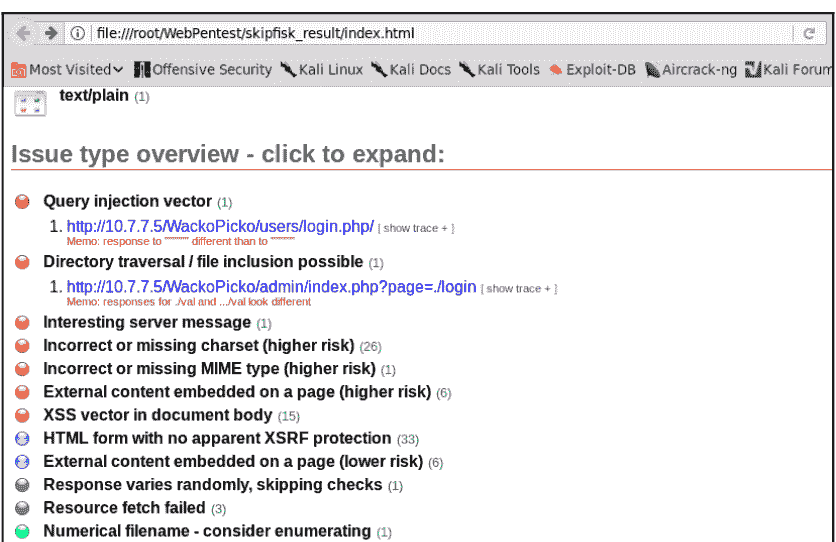

报告按 Skipfish 识别出的漏洞风险从高到低排序（红色点到橙色点）。例如，Skipfish 在登录页面中识别出 SQL 注入漏洞，查询注入向量，扫描器将其评定为高风险。它还识别出目录遍历或文件包含以及可能的 XSS 漏洞，评定为中等风险，等等。

## Wapiti

Wapiti 是一款基于命令行的主动维护的 Web 漏洞扫描工具。Wapiti 3.0 版本于 2018 年 1 月发布（http://wapiti.sourceforge.net/）；然而，Kali Linux 仍包含之前的版本（2.3.0）。根据 Wapiti 网站，该工具包含用于检测以下漏洞的模块：

- 文件泄露（本地和远程包含/require、fopen、readfile...）
- 数据库注入（PHP/JSP/ASP SQL 注入和 XPath 注入）
- XSS（跨站脚本）注入（反射型和永久型）
- 命令执行检测（eval()、system()、passthru()...）
- CRLF 注入（HTTP 响应拆分、会话固定...）
- XXE（XML 外部实体）注入
- 使用已知潜在危险文件（借助 Nikto 数据库）
- 可被绕过的弱 .htaccess 配置
- 提供敏感信息的备份文件存在（源代码泄露）
- Shellshock（又名 Bash 漏洞）

要启动 Wapiti，您需要在命令行中发出启动命令，后跟要扫描的 URL 和选项。

在下面的屏幕截图中，Wapiti 在易受攻击的虚拟机上对 BodgeIt 的 HTTPS 站点进行运行，报告生成在 wapiti_output 目录中（-o 选项）。您可以跳过 SSL 证书验证，因为测试虚拟机使用的是自签名证书。Wapiti 将在未验证的情况下停止扫描，因此使用 --verify-ssl 0 来绕过此类验证。您不应发送超过 50 个相同请求的变体（-n 选项）。这是为了防止循环。最后，使用 2> null 可以防止标准错误输出过度填充屏幕，因为扫描器会发出多个带有非预期值的请求，而 Wapiti 的输出可能非常冗长：

```
wapiti https://10.7.7.5/bodgeit/ -o wapiti_output --verify-ssl 0 -n 20 2> null
```

然后您将在屏幕上看到以下输出：

```
root@kali:~/WebPentest# wapiti https://10.7.7.5/bodgeit/ -o wapiti_output --verify-ssl 0 -n 20 2> null
Wapiti-2.3.0 (wapiti.sourceforge.net)

Note
======
This scan has been saved in the file /root/.wapiti/scans/10.7.7.5.xml
You can use it to perform attacks without scanning again the web site with the "-k" parameter
[*] Loading modules:
mod_crlf, mod_exec, mod_file, mod_sql, mod_xss, mod_backup, mod_htaccess, mod_blindsql, mod_pentxss, mod_nikto

[+] Launching module exec
Received a HTTP 500 error in https://10.7.7.5/bodgeit/advanced.jsp
Evil url: https://10.7.7.5/bodgeit/advanced.jsp%3Benv
Received a HTTP 500 error in https://10.7.7.5/bodgeit/basket.jsp
Evil request:
POST /bodgeit/basket.jsp HTTP/1.1
Host: 10.7.7.5
Referer: https://10.7.7.5/bodgeit/product.jsp?prodid=2
Content-Type: application/x-www-form-urlencoded

productid=2&price=3.1&quantity=%3Benv
```

扫描需要一些时间。完成后，打开指定目录中的 index.html 文件即可查看结果。以下是 Wapiti 报告漏洞的示例：

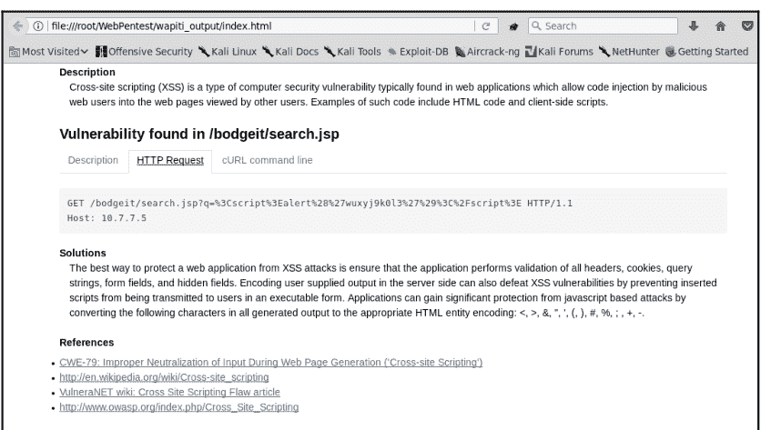

Wapiti 的报告非常详细，并且包含每个发现的描述、触发潜在漏洞的请求、提出的解决方案以及获取更多信息的参考。在前面的屏幕截图中，您可以看到它在 BodgeIt 的搜索页面中发现了 XSS。

## OWASP-ZAP scanner

OWASP-ZAP 的众多功能中，有一个主动漏洞扫描器。在此情况下，主动是指扫描器会主动向服务器发送精心构造的请求，与被动扫描器不同，后者仅在通过代理正常浏览应用程序时分析 Web 服务器发送的请求和响应。

要使用扫描器，您需要右键单击要扫描的站点或目录并选择 Attack | Active Scan...：

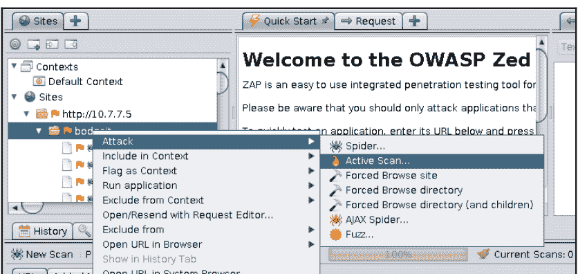

主动扫描器不会对所选目标进行任何爬取或蜘蛛扫描。因此，建议您在设置代理的情况下手动浏览目标站点，或在扫描目录或主机之前先运行蜘蛛。

在 **Active Scan** 对话框中，您可以选择目标、是否递归扫描，以及如果启用高级选项，您可以选择扫描策略、攻击向量、目标技术和其他选项：

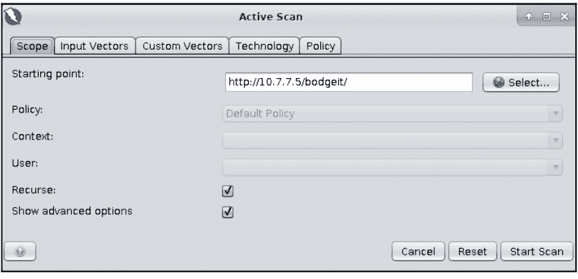

一旦单击 **Start Scan**，**Active Scan** 选项卡将获得焦点，扫描进度和请求日志将显示在其中：

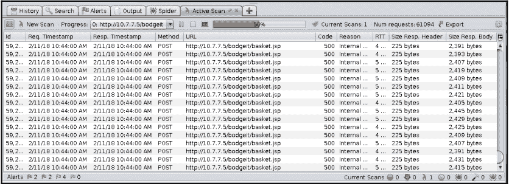

扫描结果将记录在 Alerts 选项卡中：

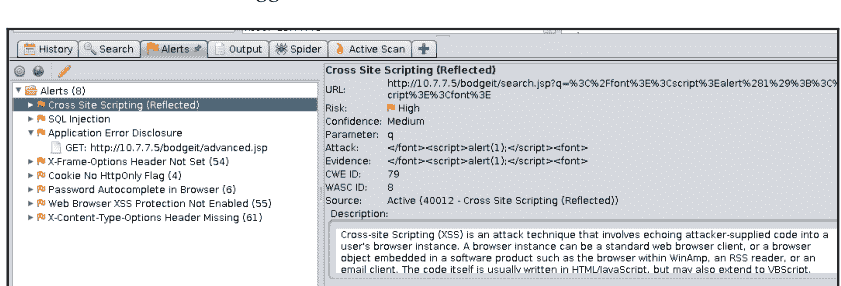

此外，使用主菜单中的 Report，您可以将结果导出为 HTML、XML、Markdown 或 JSON 等多种格式。下面的屏幕截图显示了 HTML 报告的示例：

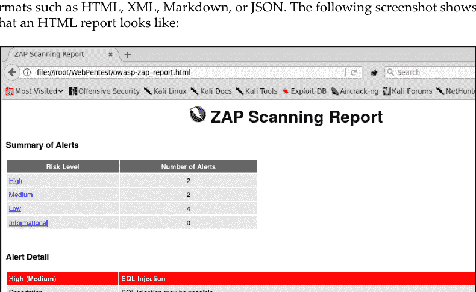

OWASP-ZAP 也按风险等级对扫描结果进行排序，并包含发现问题的详细描述、使用的有效载荷、解决方案建议和参考。


Burp Suite 在其专业版中也具有主动扫描器，可提供非常准确的结果且误报率低。

## Content Management Systems scanners

内容管理系统（CMSs），如 WordPress、Joomla 或 Drupal，是用于在无需编程或只需少量编程的情况下创建网站的框架。它们集成第三方插件以简化登录和会话管理、搜索等任务，甚至包含完整的购物车模块。

因此，CMSs 不仅在其自身代码中存在漏洞，也存在于其包含的插件中。后者不受一致的质量控制，且通常由独立程序员在业余时间制作，按其自己的时间表发布更新和补丁。

因此，我们现在将介绍一些最受欢迎的 CMS 漏洞扫描器。

## WPScan

WPScan 顾名思义，是专注于 WordPress CMS 的漏洞扫描器。它会识别 WordPress 的版本号以及已安装插件的版本号，然后将其与已知漏洞数据库进行匹配，以识别可能的 安全风险。

下面的屏幕截图显示了 WPScan 的基本用法，只需将目标 URL 作为参数添加即可：

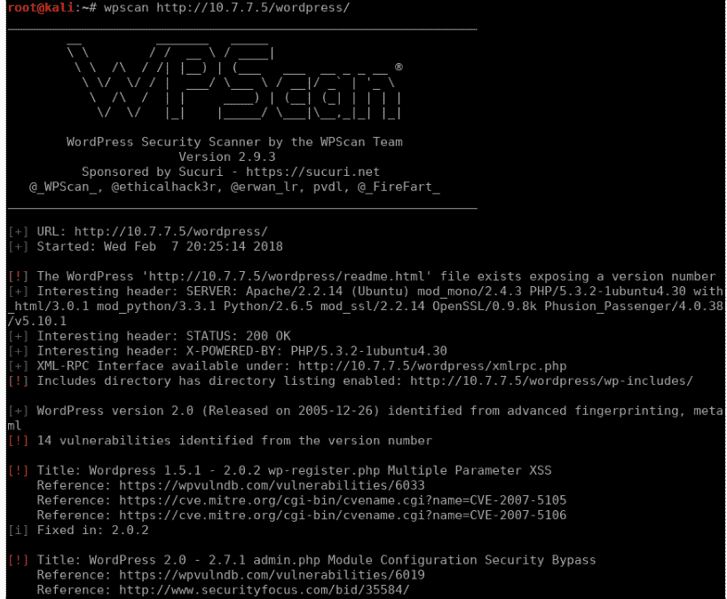

首次运行时，您可能需要使用 `-update` 选项更新数据库。

## JoomScan

JoomScan 是 Kali Linux 中包含的 Joomla 站点漏洞扫描器。要使用它，您只需添加 -u 选项，后跟站点的 URL，如下所示：

```
joomscan -u http://10.7.7.5/joomla
```

JoomScan 首先尝试通过检测 Joomla 版本和插件来指纹识别服务器，如下图所示：

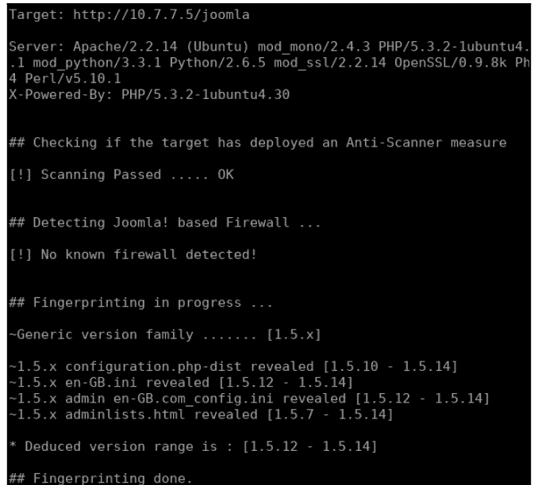

之后，JoomScan 将显示与检测到的配置或已安装插件相关的漏洞：

```
Vulnerabilities Discovered
=======================

# 1
Info -> Generic: htaccess.txt has not been renamed.
Versions Affected: Any
Check: /htaccess.txt
Exploit: Generic defenses implemented in .htaccess are not available, succeed.
Vulnerable? Yes

# 2
Info -> Generic: Unprotected Administrator directory
Versions Affected: Any
Check: /administrator/
Exploit: The default /administrator directory is detected. Attackers counts. Read: http://yehg.net/lab/pr0js/view.php/MULTIPLE%20TRICKY%20W
Vulnerable? Yes

# 3
Info -> Core: Multiple XSS/CSRF Vulnerability
Versions Affected: 1.5.9 <=
Check: /?1.5.9-x
Exploit: A series of XSS and CSRF faults exist in the administrator ap
tor components include com_admin, com_media, com_search. Both com_ad
vulnerabilities, and com_media contains 2 CSRF vulnerabilities.
Vulnerable? No

# 4
Info -> Core: JSession SSI Session Disclosure Vulnerability
```

## CMSmap

CMSmap 未包含在 Kali Linux 中，但可以从其 Git 仓库轻松安装，如下所示：

```
git clone https://github.com/Dionach/CMSmap.git
```


CMSmap 扫描 WordPress、Joomla 或 Drupal 站点的漏洞。它具有自动检测站点所使用 CMS 的能力。它是一个命令行工具，你需要使用 -t 选项来指定目标站点。CMSmap 显示它找到的漏洞，并在前面加上它确定的严重性评级的指示符：[I] 表示信息性，[L] 表示低，[M] 表示中等，[H] 表示高，如以下屏幕截图所示：

```
root@kali:~/CMSmap# ./cmsmap.py -t http://10.7.7.5/wordpress/ --noedb
[-] Date & Time: 11/02/2018 11:41:37
[-] Target: http://10.7.7.5/wordpress
[M] Website Not in HTTPS: http://10.7.7.5/wordpress
[I] Server: Apache/2.2.14 (Ubuntu) mod_mono/2.4.3 PHP/5.3.2-1ubuntu4.30 mod_python/3.3.1 Python/2.6.5 mod_ssl/2.2.14 OpenSSL/0.9.8k Phusion
/V5.10.1
X-Powered-By: PHP/5.3.2-1ubuntu4.30
[L] X-Frame-Options: Not Enforced
Strict-Transport-Security: Not Enforced
[I] X-Content-Security-Policy: Not Enforced
X-Content-Type-Options: Not Enforced
[L] No Robots.txt Found
CMS Detection: Wordpress
[H] Configuration File Found: http://10.7.7.5/wordpress/wp-config
[-] Enumerating Wordpress Usernames via "Feed" ...
[-] Enumerating Wordpress Usernames via "Author" ...
[I] Autocomplete Off Not Found: http://10.7.7.5/wordpress/wp-login.php
[-] Default WordPress Files:
[I] http://10.7.7.5/wordpress/readme.html
[I] http://10.7.7.5/wordpress/license.txt
[I] http://10.7.7.5/wordpress/xmlrpc.php
[I] http://10.7.7.5/wordpress/wp-config-sample.php
[I] http://10.7.7.5/wordpress/wp-includes/js/tinymce/license.txt
[-] Searching Wordpress Plugins ...
akismet
wp-db-backup
```

屏幕截图所示使用的 --noedb 选项可防止 WordPress 在 Exploit Database（https://www.exploit-db.com/）中查找已识别漏洞的利用，因为我们的 Kali Linux 虚拟机未连接到互联网。尝试连接外部服务器将导致错误并延迟获取结果。

## Fuzzing web applications

**Fuzzing** 是一种测试机制，它通过软件实现的常规输入向其发送特制（或随机，取决于 fuzzing 类型）的数据。实现可能是一个 Web 应用程序、厚客户端或在服务器上运行的进程。它是一种黑盒测试技术，以自动方式注入数据。虽然 fuzzing 主要用于安全测试，但也可以用于功能测试。

从前面的定义中，人们可能会认为 fuzzing 与任何漏洞扫描都相同。是的，fuzzing 是漏洞扫描过程的一部分，该过程还可能涉及 Web 应用程序的指纹识别和爬取以及对响应的分析，以确定是否存在漏洞。

有时，我们需要将 fuzzing 部分从扫描过程中分离出来单独执行，这样测试输入的确定和测试结果的分析就由我们而不是扫描器来完成。这样，我们就可以更精细地控制向服务器发送哪些测试值到哪些参数。

## Using the OWASP-ZAP fuzzer

OWASP-ZAP fuzzer 可以从站点地图、代理的历史记录或请求面板运行，通过右键单击你想要 fuzz 的请求并选择 Attack | Fuzz...，如以下屏幕截图所示：

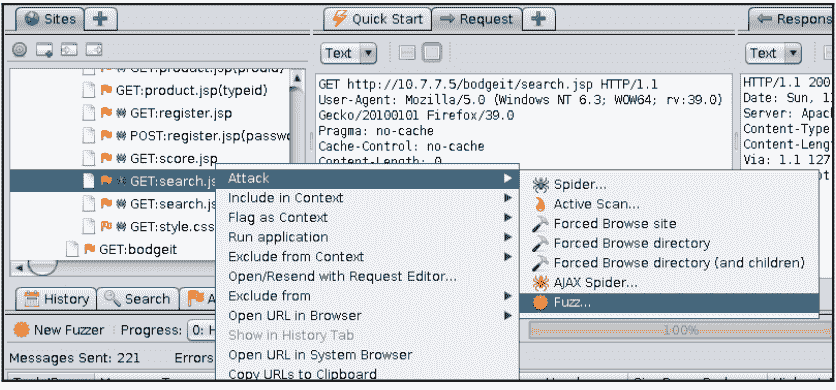

这样做之后，fuzzing 对话框会出现，你可以在其中选择插入点；即请求中你想要尝试不同值以分析服务器响应的部分。在以下示例中，我们正在从 OWASP BWA 易受攻击的虚拟机中选择 BodgeIt's 搜索中的 q 参数的值：

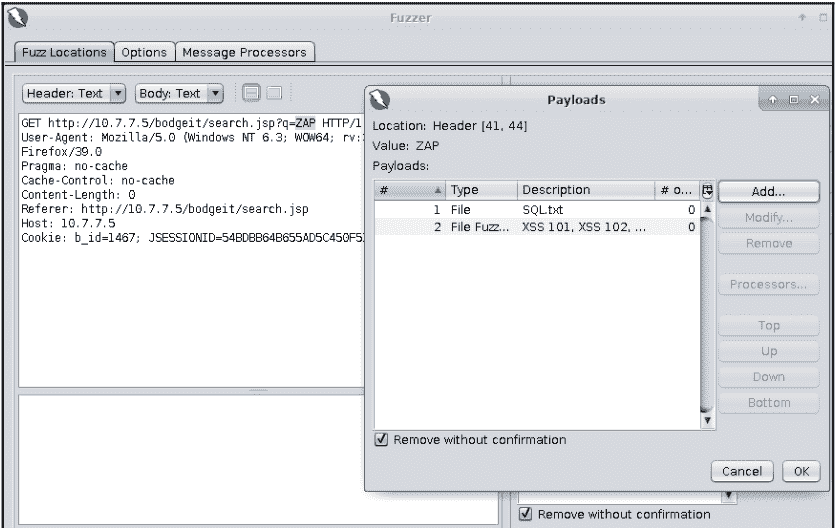

请注意，已经添加了两个负载列表。要做到这一点，选择你想要 fuzz 的文本，在本例中为 q 的值，然后在右侧单击 Add...（在 Fuzz Locations 选项卡中），以使 Payloads 对话框出现。然后在该对话框中单击 Add...。你将从文件 /usr/share/wfuzz/wordlist/injections/SQL.txt 中获取第一个负载列表。

该文件包含 fuzzing 字符串，可帮助识别 SQL 注入漏洞。在负载类型中选择 File，单击 Select...，并浏览到该文件以加载它，如以下屏幕截图所示。然后单击 Add 以将该列表添加到 fuzzer：

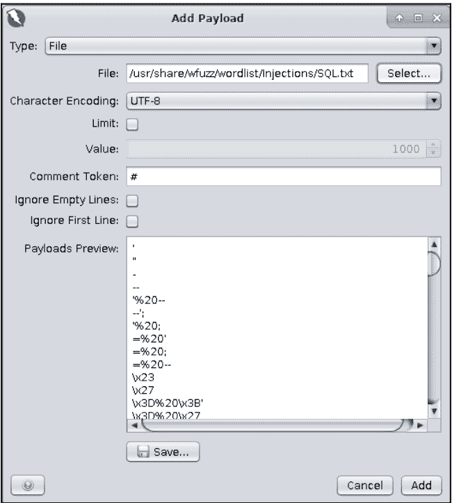

接下来，使用第二个负载来测试 XSS。这次你将使用 File Fuzzers 作为类型。这是一组 OWASP-ZAP 开箱即用的 fuzzing 字符串。从这些 fuzzer 中，选择来自 JbroFuzz | XSS 的一些 XSS 列表：

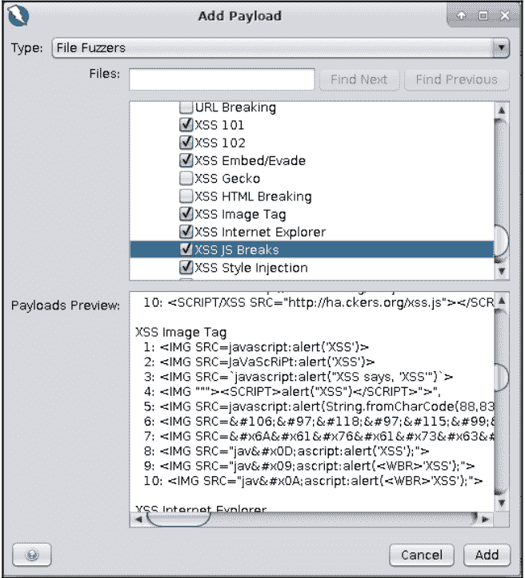

可在 OWASP-ZAP 中使用的 fuzzing 字符串的其他选项如下：

- **Empty/Null**：此选项提交原始值（无更改）
- **Numberzz**：此选项生成一系列数字，允许你定义起始值、结束值和增量
- **Regex**：此选项生成与给定正则表达式匹配的指定数量的字符串
- **Script**：此选项让你可以使用脚本（从 Tools | Options... | Scripts 加载）来生成负载
- **Strings**：此选项显示一个简单的字符串列表，手动提供

一旦选择了所有插入点及其对应的 fuzzing 输入，你就可以通过单击 **Start Fuzzer** 启动 fuzzer。然后 **Fuzzer** 选项卡将出现在底部面板中。

在下一个屏幕截图中，你可以看到 fuzzing 结果。**State** 列显示工具做出的初步诊断，表明此类请求导致可利用漏洞的可能性有多大。请注意示例中的 **Reflected** 这个词。这意味着 fuzzer 发送的字符串已作为响应的一部分由服务器返回。我们知道这是一个 XSS 的字符串指示符：

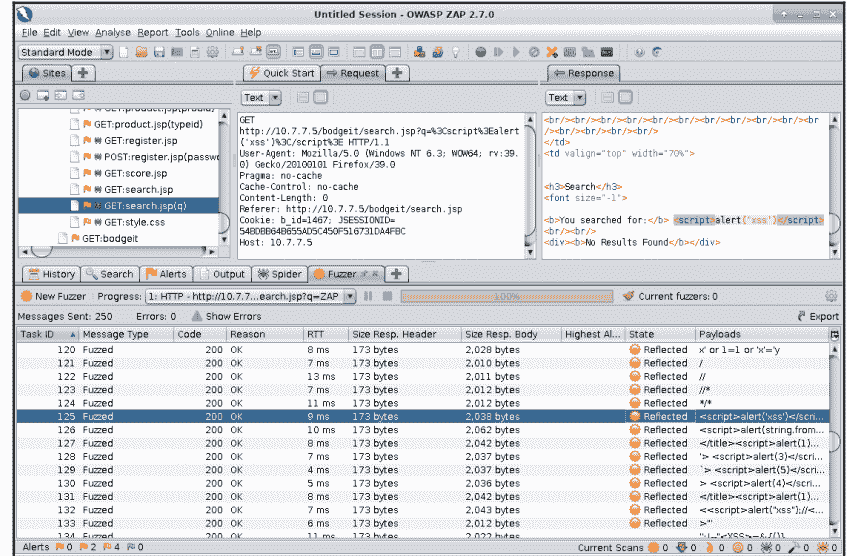

为了进一步探索从 Fuzzer 选项卡中显示的结果中发现可利用漏洞的可能性，你可以选择任何请求及其标头和正文。相应的响应将在中央面板的相关部分中显示。响应将显示可疑字符串高亮显示。这样，你可以一眼看出是否存在漏洞，以及该特定测试用例是否值得进一步深入研究。如果是这样，你可以右键单击请求并选择 Open/Resend with Request Editor 以启动 Request Editor 并操作和重新发送请求。

进一步调查你认为可能导致利用的请求的另一种选择是在浏览器中重放请求，以便你可以查看其行为以及服务器如何响应。要做到这一点，右键单击请求，选择 Open URL In Browser，然后选择你喜欢的浏览器。这将打开浏览器并使其提交所选请求：

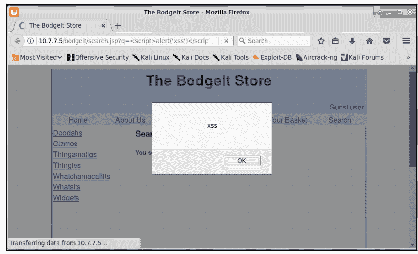

## Burp Intruder

你已经在之前的章节中使用 Intruder 执行了各种任务，并且了解其功能和灵活性。现在我们将使用它来 fuzz BodgeIt 登录页面以查找 SQL 注入漏洞。你需要做的第一件事是从代理历史记录中将一个有效的登录请求发送到 Intruder。这是通过右键单击请求并选择 Send to Intruder 完成的。

进入 Intruder 后，你将清除所有插入点并在用户名值中添加一个，如以下屏幕截图所示：

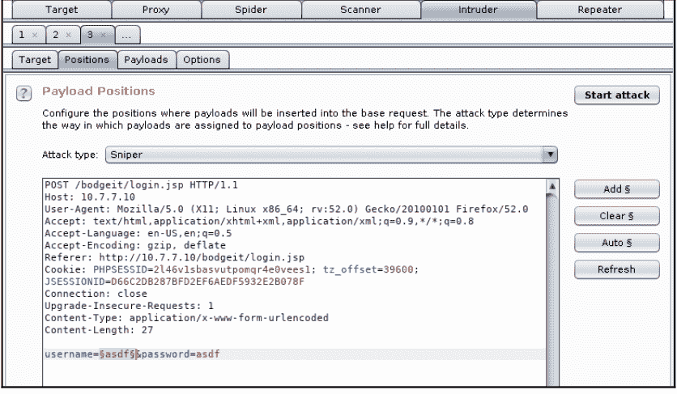

下一步是设置负载。为此，转到 Payloads 选项卡，单击 Load... 加载文件，并转到 /usr/share/wfuzz/wordlist/injections/SQL.txt：

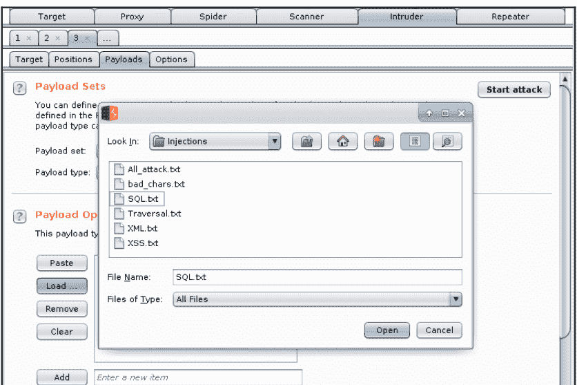

接下来，为了更轻松地识别有趣的请求，你将添加一些匹配规则，以便你可以从攻击对话框中知道何时请求导致错误或包含有趣的词。将以下术语添加到 Options 中的 Grep - Match 部分：

- `error`：添加此项在你想要知道何时输入触发错误时很有用，因为基本的 SQL 注入在更改查询语法时会显示错误消息
- `SQL`：如果错误消息不包含单词 error，你希望知道何时输入触发包含单词 SQL 的响应
- `table`：添加此项当你期望读取包含表名的 SQL 详细错误消息时
- `select`：添加此项以防披露 SQL 语句


前面的术语列表绝不是用于响应匹配的最佳列表。它仅用于演示目的。在实际场景中，首先需要手动分析应用程序实际给出的响应，然后再选择与该上下文和所寻找的漏洞相匹配的术语。以下截图显示了示例匹配列表的外观：

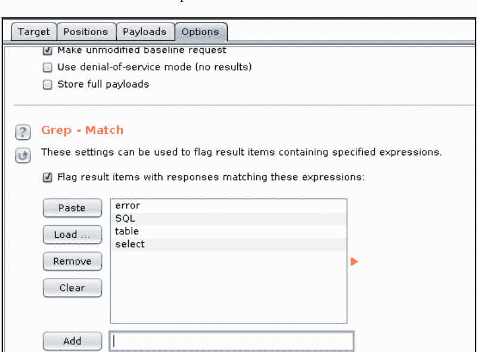

一旦配置了所有攻击参数，您就可以开始攻击了。错误开始匹配并不需要花费太多时间。你可以看到表被每个响应匹配，所以这不是一个好的选择。SQL 和 select 没有匹配，至少在最初的响应中没有。如果你选择其中一个已检查错误的响应，你会看到页面顶部有一条消息 System error.，这似乎是在负载包含单引号时触发的。

这可能是 SQL 注入的指标，值得再深入挖掘一下：

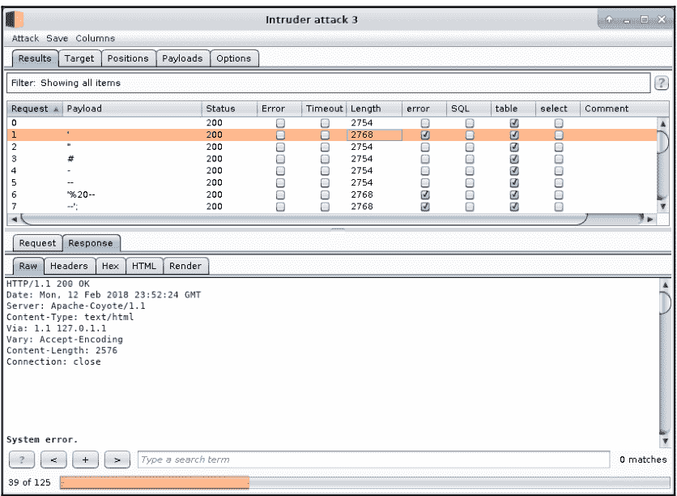

要查看此请求如果在 Burp Suite 的任何组件中的每个请求或响应中从浏览器执行时会如何表现，可以右键单击并选择 **Request in browser**。你可以选择是否想要原始会话（发送请求的会话 cookie）或当前会话（浏览器当前拥有的会话 cookie）：

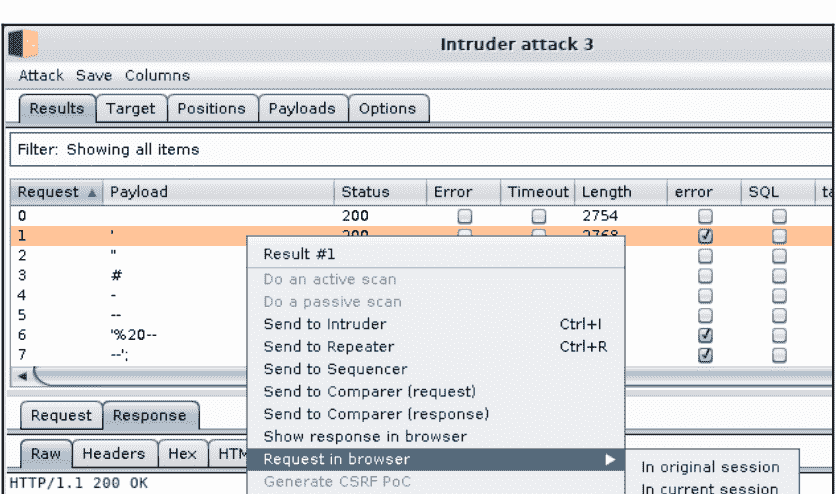

当你从 Burp Suite 向浏览器发送请求时，你会得到一个以 http://burp/repeat/ 开头的 URL，需要将其复制并粘贴到你想要重放请求的浏览器中。Burp Suite 不会像 ZAP 那样启动浏览器：

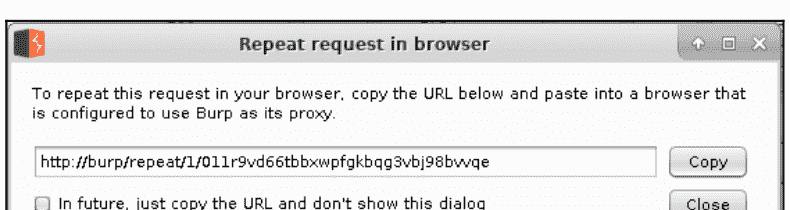

以下截图显示了示例请求在浏览器中的外观。它绝对看起来 System error. 消息不应该在那里，你应该更深入地研究该请求并手动尝试变体以获得 SQL 注入：

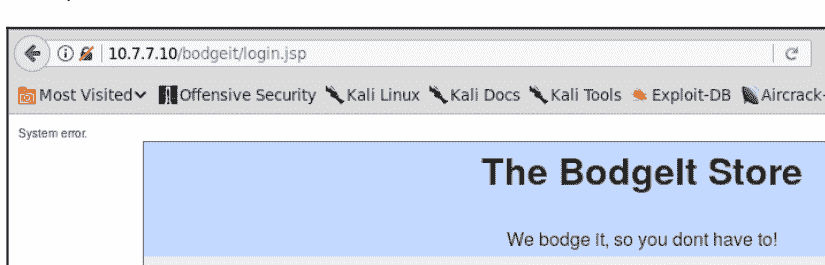

## Post-scanning actions

不幸的是，提供渗透测试服务的公司最终只进行漏洞扫描并在没有手动测试阶段的情况下定制和调整其报告，而不验证扫描器发现的所谓漏洞是否确实是漏洞的情况比应有的更常见。不仅这对客户没有任何价值，因为他们自己就可以下载漏洞扫描器并对其应用程序运行扫描，而且它还损害了公司对安全服务和安全公司的看法，使得提供优质服务的公司更难以有竞争力的价格在市场上推广这些服务。

扫描器生成扫描报告后，你不能仅仅拿着该报告就说你发现了 X 和 Y 漏洞。因为扫描器总是会产生误报（即报告不存在的漏洞）和漏报（例如扫描器遗漏的漏洞），因此必须进行手动测试，以便你能够找到和报告自动化工具未涵盖的漏洞，例如授权问题或业务逻辑绕过或滥用等，同时验证扫描器报告的所有发现是否确实是漏洞。

## 10
### Metasploit Quick Tips for Security Professionals

在本章中，我们将涵盖以下配方：

- Installing Metasploit on Windows
- Installing Linux and macOS
- Installing Metasploit on macOS
- Using Metasploit in Kali Linux
- Setting up a penetration testing lab using VMware
- Setting up SSH connectivity
- Connecting to Kali using SSH
- Configuring Metasploit to use PostgreSQL
- Creating workspaces
- Using the database
- Using the `hosts` command
- Understanding the `services` command

## Introduction

Metasploit 目前是世界上领先的渗透测试工具，也是信息安全和渗透测试领域最大的开源项目之一。它彻底改变了我们执行系统安全测试的方式。Metasploit 如此受欢迎的原因是它可以执行广泛的任务来简化渗透测试工作，使系统更安全。Metasploit 可用于所有流行的操作系统。框架的工作流程对所有操作系统几乎相同。在本书中，我们将主要在 Kali Linux 上工作，因为它预装了 Metasploit Framework 和其他在框架上运行的第三方工具。

让我们快速介绍一下框架及其相关的各种术语：

- **Metasploit Framework**：这是一个由 H. D. Moore 于 2003 年启动的免费开源渗透测试框架，后来被 Rapid7 收购。框架的当前稳定版本使用 Ruby 语言编写。它拥有世界上最大的经过测试的漏洞利用数据库，每年收到超过一百万次下载。它也是迄今为止用 Ruby 构建的最复杂的项目之一。
- **Vulnerability**：这是允许攻击者/渗透测试人员入侵或破坏系统安全的弱点。此弱点可能存在于操作系统、应用程序软件，甚至网络协议中。
- **Exploit**：漏洞利用是一段允许攻击者/测试人员利用易受攻击的系统并破坏其安全的代码。每个漏洞都有其对应的漏洞利用。Metasploit 有超过 1,700 个漏洞利用。
- **Payload**：这是实际执行工作的代码。它在被利用后在系统上运行。它主要用于在攻击机器和受害机器之间建立连接。Metasploit 有超过 500 个有效载荷。
- **Module**：模块是完整系统的微小构建块。每个模块执行特定任务，完整系统通过组合多个模块作为单一单元运行。这种架构的最大优势是，开发人员可以轻松地将新的漏洞利用代码和工具集成到框架中。

Metasploit Framework 具有模块化架构，漏洞利用、payload、编码器等被视为独立的模块：

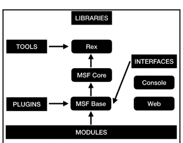

让我们仔细检查架构图。

Metasploit 使用不同的库来确保框架的正常运行。这些库是一组可被框架的不同模块利用的预定义任务、操作和函数。框架最基本的部分是 Ruby 扩展（Rex）库。Rex 提供的一些组件包括包装套接字子系统、协议客户端和服务器的实现、日志子系统、漏洞利用实用程序类以及许多其他有用的类。Rex 本身的设计没有依赖项，除了随默认 Ruby 安装一起提供的依赖项之外。

然后我们有扩展 Rex 的 MSF Core 库。Core 负责实现允许与漏洞利用模块、会话和插件交互所需的所有接口。该核心库由框架基础库扩展，该库旨在为处理框架核心提供更简单的包装例程，以及提供用于处理框架不同方面的实用程序类，例如将模块状态序列化为不同的输出格式。最后，基础库由框架的用户界面（UI）扩展，该界面实现了对框架本身的不同类型的 UI 的支持，例如命令控制台和 Web 界面。

框架提供了两种不同的 UI，即 msfconsole 和 Web 界面。强烈建议查看这两个界面，但在本书中，我们将主要在 msfconsole 界面上工作。这是因为 msfconsole 为框架提供了最佳支持，利用了所有功能。


The msfconsole interface is by far the most talked-about part of the Metasploit Framework, and for good reason, as it is one of the most flexible, character-rich, and well-supported tools within the framework. It actually provides a handy all-in-one interface for every choice and setting attainable in the framework; it’s like a one-stop shop for all of your pen-testing dreams. We can use msfconsole to do anything, including launching an exploit, loading an auxiliary, executing enumeration, producing listeners, or executing mass exploitations in contrast to an entire network.

A web interface is available for you to work with Metasploit Community, Express, and Pro. To launch the web interface, open a web browser and go to https://localhost:3790.

To see the operating systems that are currently supported and the minimum system requirements, please visit https://www.rapid7.com/products/metasploit/system-requirements.

## Installing Metasploit on Windows

Installation of the Metasploit Framework on Windows is simple and requires almost no effort. The framework installer can be downloaded from the Metasploit official website (http://www.metasploit.com/download). In this recipe, we will learn how to configure Metasploit on Windows.

## Getting ready

You will notice that there are four editions of Metasploit available:

- **Pro**: For penetration testers and IT security teams
- **Express**: For IT generalists at SMBs
- **Community**: For small companies and students
- **Framework**: For developers and security researchers

To follow along with this book, it is recommended to download the latest framework edition of Metasploit (https://windows.metasploit.com/metasploitframework-latest.msi), which contains the console and all other relevant dependencies.

## How to do it...

Once you have completed downloading the installer, simply run it and sit back. It will automatically install all the relevant components. Once the installation is complete, you can access the framework through various shortcuts created by the installer:

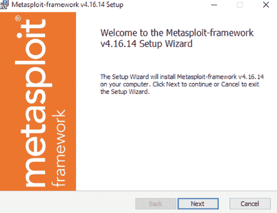

While installing Metasploit on Windows, you should disable the antivirus protection, as it may detect some of the installation files as potential viruses or threats and can block the installation process. Once the installation is complete, make sure that you have white-listed the framework installation directory in your antivirus software, as it will detect the exploits and payloads as malicious.

## Installing Linux and macOS

The quick installation script will import the Rapid7 signing key and set up the package for all supported Linux and macOS systems:

```
curl https://raw.githubusercontent.com/rapid7/metasploit-omnibus/master/config/templates/metasploit-framework-wrappers/msfupdate.erb > msfinstall && chmod 755 msfinstall && ./msfinstall
```

The packages will integrate into the OS's native package management and can either be updated with the msfupdate command or by using your preferred package manager.

## How to do it...

The full installation process is as follows:

```
# curl
https://raw.githubusercontent.com/rapid7/metasploit-omnibus/master/config/templates/metasploit-framework-wrappers/msfupdate.erb > msfinstall && \
> chmod 755 msfinstall && \
> ./msfinstall
  % Total % Received % Xferd Average Speed Time Time Time Current
                             Dload Upload Total Spent Left Speed
100 5394 100 5394 0 0 17618 0 --:--:-- --:--:-- --:--:-- 17627
Updating package cache..OK
Checking for and installing update..
Reading package lists... Done
Building dependency tree
Reading state information... Done
The following NEW packages will be installed:
metasploit-framework
...
Run msfconsole to get started
W: --force-yes is deprecated, use one of the options starting with --allow instead.
# msfconsole
# cowsay++
-----------------
< metasploit >
-----------------
      \    '.__'
       \  (oo)____
          (__)    )\
              ||--|| *
...
msf >
```

## Installing Metasploit on macOS

The latest macOS installer package is available at https://osx.metasploit.com/metasploitframework-latest.pkg.

## How to do it...

Download and launch the installer to install Metasploit Framework with all of its dependencies. Once installed, you can launch `msfconsole` as `/opt/metasploit-framework/bin/msfconsole`:

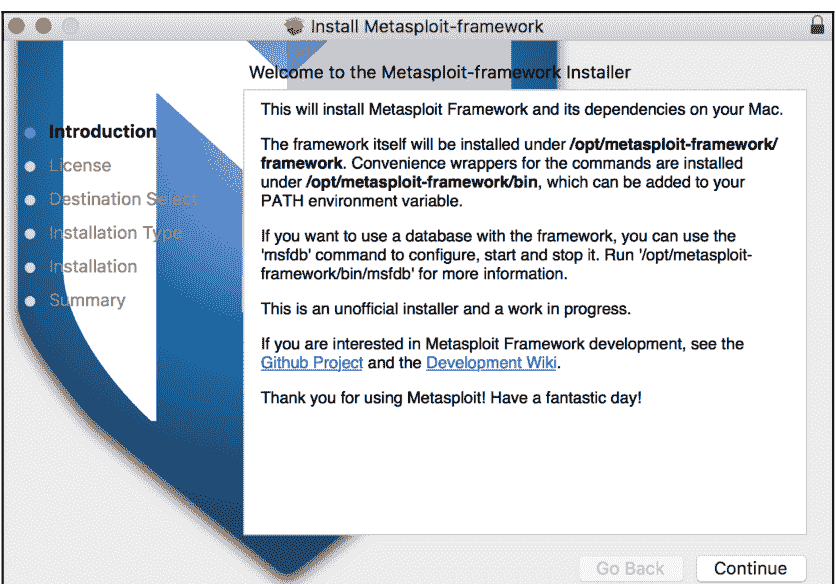

The Metasploit Framework initial setup will help you set up a database and add Metasploit to your local PATH as shown:

```
$ /opt/metasploit-framework/bin/msfconsole

** Welcome to Metasploit Framework Initial Setup **
  Please answer a few questions to get started.

Would you like to add msfconsole and other programs to your default PATH? yes
You may need to start a new terminal or log in again for this to take effect.

Would you like to use and setup a new database (recommended)? yes
Creating database at /Users/user/.msf4/db
Starting database at /Users/user/.msf4/db...success
Creating database users
Creating initial database schema

** Metasploit Framework Initial Setup Complete *
```

## Using Metasploit in Kali Linux

Kali Linux is the most popular operating system for security professionals for two reasons. First, it has all the popular penetration-testing tools preinstalled in it, so it reduces the cost of a separate installation. Secondly, it is a Linux-based operating system, which makes it less prone to virus attacks and provides more stability during penetration testing. It saves you time as you don’t have to install the relevant components and tools, and who knows when you may encounter an unknown error during the installation process.

## Getting ready

Either you can have a separate installation of Kali Linux on your hard disk, or you can also use it over a host on a virtual machine. The installation process is simple and the same as installing any Linux-based operating system.

To set up a Metasploit development environment on Kali Linux or any Debian-based Linux environment, you can use the following commands:

```
sudo apt update
sudo apt -y install autoconf bison build-essential curl git-core libapr1 libaprutil1 libcurl4-openssl-dev libgmp3-dev libpcap-dev libpq-dev libreadline6-dev libsqlite3-dev libssl-dev libsvn1 libtool libxml2 libxml2-dev libxslt-dev libyaml-dev locate ncurses-dev openssl postgresql postgresql-contrib wget xslt zlib1g zlib1g-dev
curl -sSL https://rvm.io/mpapis.asc | gpg --import -
curl -L https://get.rvm.io | bash -s stable
source ~/.rvm/scripts/rvm
cd /opt
sudo git clone https://github.com/rapid7/metasploit-framework.git
sudo chown -R `whoami` /opt/metasploit-framework
cd metasploit-framework
rvm --install $(cat .ruby-version)
gem install bundler
bundle install
```

## How to do it...

You can download Kali Linux ISO images from the official site, https://www.kali.org/downloads/, create a bootable USB drive, or burn the ISO image to a DVD-ROM and use it to install Kali Linux as a separate OS on your hard disk or simply boot the Kali ISO image in Live Mode. Another way is to run Kali Linux inside a virtual machine; for that, you can either use the ISO image to install Kali Linux from scratch or just download a Kali Linux VMware, VirtualBox, or ARM image from the official site.

For this book, we will use a Kali Linux VMware virtual machine:

1. When booting the Kali Linux virtual machine, you will be asked to enter the username and password. The default username for the root user is root and the password is toor.
2. Upon successful login, the easiest way to get the Metasploit Framework up and running is to start Metasploit from the Applications menu.

3. To launch Metasploit from the Applications menu, go to Applications | Exploitation Tools | metasploit framework, as shown in the following screenshot:

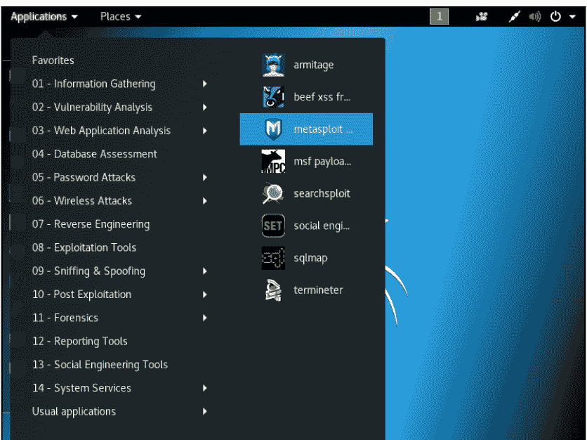

Starting Metasploit Framework from the Applications menu will automatically set up the PostgreSQL database. It will create the database user, the msf and msf_test databases, configure Metasploit to use the database, create the database schema, and start msfconsole by running the following command:

```
service postgresql start && msfdb init && msfconsole.
```

```
Creating database user 'msf'
Enter password for new role:
Enter it again:
Creating databases 'msf' and 'msf_test'
Creating configuration file in /usr/share/metasploit-framework/config/database.yml
```


创建初始数据库架构
# cowsay++
< metasploit >
-------------
    \  '.__'
     \ (oo)____
        (__)   )\ 
            ||--|| *

    =[ metasploit v4.16.8-dev- ]
+ -- --=[ 1683 exploits - 964 auxiliary - 299 post ]
+ -- --=[ 498 payloads - 40 encoders - 10 nops ]
+ -- --=[ Free Metasploit Pro trial: http://r-7.co/trymsp ]

msf >

## 还有更多...

另外，你也可以通过在终端窗口中输入 msfconsole 来启动 Metasploit Framework。

## 升级 Kali Linux

作为一个滚动发行版，升级 Kali Linux 很简单。建议定期升级 Kali Linux，以确保你能获得最新的安全更新。要升级，请使用 apt update 然后 apt upgrade；apt 会查找可以升级而无需删除任何软件包的已安装软件包，这样是最不具侵入性的方式。

对于主要版本升级和重要升级，请使用 apt full-upgrade；这将执行完整升级，并在必要时删除过时的软件包或安装新的依赖项。

## 设置渗透测试实验室

创建渗透测试实验室至关重要，它将允许你在安全环境中练习和测试新的技术和漏洞利用。使用虚拟机作为实验室环境将为你提供可移植性、灵活性和低维护性。你可以同时在多个操作系统上工作，设置复杂的网络场景，并在多个目标上执行渗透测试。因此，让我们快速了解一下如何使用虚拟化设置渗透测试实验室。

### 准备工作

对于你的实验室，你可以使用你选择的 hypervisor；最常见的 hypervisor 是 VirtualBox、VMware Workstation Pro、VMware Fusion Pro（适用于 Mac）、VMware ESXi 和 Microsoft Hyper-V。对于本书中使用的渗透测试实验室，我建议你使用 VirtualBox，因为它是一个开源 hypervisor，并且是构建其中一个虚拟机的要求。


虽然你需要使用 VirtualBox 构建虚拟机，但在构建机器后你可以将其导入到你喜欢的任何 hypervisor。

这是渗透测试实验室的网络图：

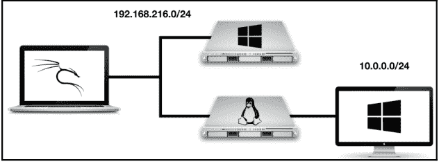

我们将使用四台虚拟机，分别是 Kali Linux、Linux 服务器、Windows 服务器和 Windows 10 客户端。在这个实验室中，我们有一个现代场景，这将允许我们测试和练习最新的技术和漏洞利用。

### 如何操作...

对于 Kali Linux 机器、Linux 服务器和 Windows 10 客户端，设置很简单。我们可以从官方网站 https://www.kali.org/downloads/ 下载 Kali Linux 虚拟机；对于 Linux 服务器，我们将使用 Metasploitable 2 机器，你可以从 SourceForge 下载 https://sourceforge.net/projects/metasploitable/files/Metasploitable2/；对于 Windows 10 客户端，我们可以从 Microsoft Developer 网站 https://developer.microsoft.com/en-us/microsoft-edge/tools/vms/ 下载 90 天试用版。

对于最后一台机器，我们将使用 Metasploitable 3，这是一个我们将构建的 Windows 虚拟机，其中包含许多安全漏洞供我们测试。要构建 Metasploitable 3 机器，我们必须安装 Packer、Vagrant、Vagrant Reload 插件和 VirtualBox。构建脚本和文档以及最新的构建说明可以在官方 GitHub 仓库找到：https://github.com/rapid7/metasploitable3。要自动构建机器，请执行以下步骤：

- 1. 如果使用 Bash，请运行 `build_win2008.sh` 脚本，如果使用 Windows，请运行 `build_win2008.ps1`。
- 2. 成功完成后，运行 `vagrant up`。
- 3. 进程完成后，你应该能够在 VirtualBox 中打开 VM 并使用用户名 `vagrant` 和密码 `vagrant` 登录。

在启动虚拟机之前，有一个重要的配置你必须进行，以便为实验室设置网络通信：

- 1. 选择 Kali Linux 虚拟机并点击 **Settings**。然后，移动到 **Removable Devices**。在 **Network Adapter** 选项中，网络适配器应配置为使用 **Internet Sharing | Share with my Mac**，这将允许虚拟机访问互联网，共享主机机器的 IP 地址，因为它将为虚拟机到网络的流量提供 **Network Address Translation (NAT)**。

2. Metasploitable 3 虚拟机的网络适配器和 Metasploitable 2 虚拟机的第一个网络适配器也应配置为使用 NAT：

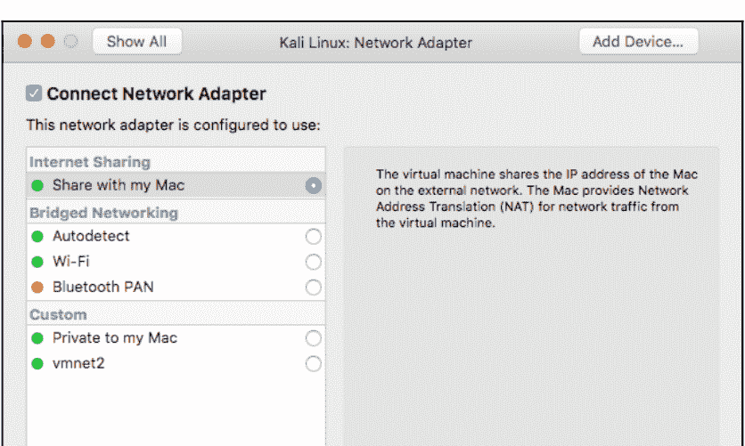

3. 在 VMware Fusion 中，转到 Preferences，选择 Network 选项卡，并创建一个自定义网络。选中通过 DHCP 在此网络上提供地址的框；使用 Subnet IP 为 10.0.0.0 和 Subnet Mask 为 255.255.255.0：

## Network

- Internet Sharing
- Share with my Mac
- Bridged Networking
- Autodetect
- Wi-Fi
- Bluetooth PAN
- Custom
- Private to my Mac
- vmnet2

使用此配置的虚拟机将使用自定义网络连接。

☑ Allow virtual machines on this network to connect to external networks (using NAT)

☐ Enable IPv6
IPv6 Prefix: fd15:4ba5:5a2b:1002::/64

## Port Forwarding

| Host Port | Type | VM IP Address | Description |
|---|---|---|---|

☑ Connect the host Mac to this network
☑ Provide addresses on this network via DHCP

Subnet IP: 10.0.0.0
Subnet Mask: 255.255.255.0

☑ Require authentication to enter promiscuous mode
Click the lock to prevent further changes.

General  Keyboard & Mouse  Display  Default Applications  Network  Feedback

4. 现在你已经创建了自定义网络，选择 Windows 10 虚拟机，点击 Settings，然后进入 Network Adapter 设置。选择 Custom network 并选择我们创建的自定义网络。对 Metasploitable 2 虚拟机的第二个 Network Adapter 重复此过程：

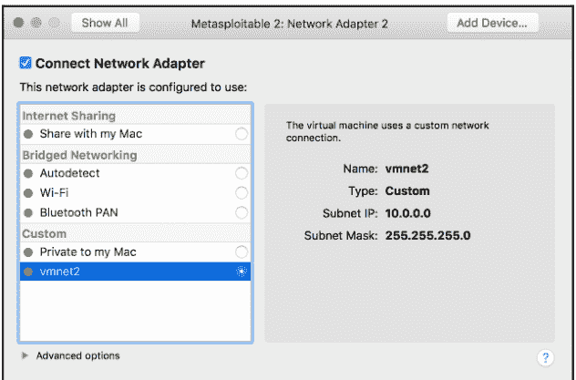

5. 要验证配置，请登录到 Metasploitable 2 机器并使用 ip a 命令。root 用户的默认用户名为 msfadmin，密码为 msfadmin：

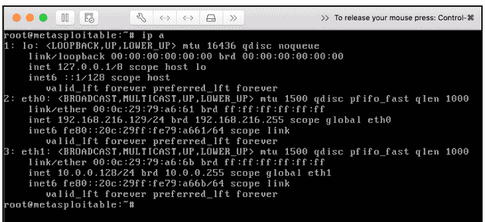

### 它是如何工作的...

通过创建两个 NAT 网络，我们可以使用第一个 NAT 网络模拟面向互联网的服务器，并使用我们创建的自定义网络作为内部机器，从而提供更真实的场景，并让你有机会学习如何进行内部目标的侦察、枢轴和横向移动。

## 设置 SSH 连接

Secure Shell (SSH) 允许你通过不安全的网络安全地连接到远程主机。

### 准备工作

要配置 Kali Linux 机器以进行远程登录，我们将首先更改默认的 root 密码并生成新的 SSH 主机密钥。

### 如何操作...

要更改 root 密码，请按如下方式使用 passwd 命令：

```
root@kali:~# passwd
Enter new UNIX password:
Retype new UNIX password:
passwd: password updated successfully
```

要生成新的 SSH 主机密钥，步骤也相对简单：删除当前的 SSH 主机密钥，使用 dpkg-reconfigure openssh-server 命令重新配置 OpenSSH 服务器，并生成新的 SSH 主机密钥：

```
root@kali:~# rm /etc/ssh/ssh_host_*
root@kali:~# dpkg-reconfigure openssh-server
Creating SSH2 RSA key; this may take some time ...
2048 SHA256:0k/J4YvIGYi eDI6YuOLDXADm5YUdrJSnzBKguuD9WWQ root@kali (RSA)
Creating SSH2 ECDSA key; this may take some time ...
256 SHA256:eYU5TtQVzFYQtjo6l yiVHku6SQWbgkMPMDtW8cgaAJ4 root@kali (ECDSA)
Creating SSH2 ED25519 key; this may take some time ...
256 SHA256:8nj2LMKQ NOLKS9S90sWcBArs1PgpFfD/5h4vNrwI4sA root@kali (ED25519)
```

出于实验室目的，我们将编辑 OpenSSH 服务器配置 `/etc/ssh/sshd_config` 文件以允许 `root` 登录，通过将行 `#PermitRootLogin without-password` 更改为 `PermitRootLogin yes`，如以下示例所示：

```
...
# Authentication:
#LoginGraceTime 2m
PermitRootLogin yes
#StrictModes yes
#MaxAuthTries 6
#MaxSessions 10
...
```

要使 OpenSSH 服务在启动时自动运行，请运行 `systemctl enable ssh` 并通过使用 `systemctl restart ssh` 命令重新启动服务来完成配置，如下所示：

```
root@kali:~# systemctl enable ssh
Synchronizing state of ssh.service with SysV service script with /lib/systemd/systemd-sysv-install.
Executing: /lib/systemd/systemd-sysv-install enable ssh
root@kali:~# systemctl restart ssh
root@kali:~#
```

这对于实验室环境来说是可以的，但在执行渗透测试时，请将 SSH 配置为使用加密密钥登录到 Kali Linux 机器。这比仅使用密码更安全。

## 使用 SSH 连接到 Kali

要连接到 Kali 机器，我们只需要一个 SSH 客户端。大多数 Unix、Linux 和 macOS 操作系统已经安装了 SSH 客户端；然而，如果你使用 Windows 连接到 Kali Linux 机器，你将需要安装一个客户端，例如 PuTTY，它是 Windows 上最受欢迎和免费的 SSH 客户端之一。


## How to do it...

+   1. 要连接到 Kali Linux 虚拟机，你需要知道其 IP 地址。要查找 IP 地址，请登录虚拟机，打开一个终端窗口，并输入 `ip address` 命令，或简写为 `ip a`：

```
root@kali:~# ip a
1: lo: <LOOPBACK,UP,LOWER_UP> mtu 65536 qdisc noqueue state UNKNOWN group default qlen 1000
link/loopback 00:00:00:00:00:00 brd 00:00:00:00:00:00
inet 127.0.0.1/8 scope host lo
valid_lft forever preferred_lft forever
inet6 ::1/128 scope host
valid_lft forever preferred_lft forever
2: eth0: <BROADCAST,MULTICAST,UP,LOWER_UP> mtu 1500 qdisc pfifo_fast state UP group default qlen 1000
link/ether 00:0c:29:b6:03:93 brd ff:ff:ff:ff:ff:ff
inet 192.168.216.5/24 brd 192.168.216.255 scope global eth0
valid_lft forever preferred_lft forever
inet6 fe80::20c:29ff:feb6:393/64 scope link
valid_lft forever preferred_lft forever
```

记下第二个接口的 IP 地址，在此示例中为 192.168.216.5。

+   2. 现在，使用主机操作系统的 SSH 客户端。输入用户名 `root` 后跟 @ 符号和 Kali Linux 虚拟机的 IP 地址 192.168.216.5：

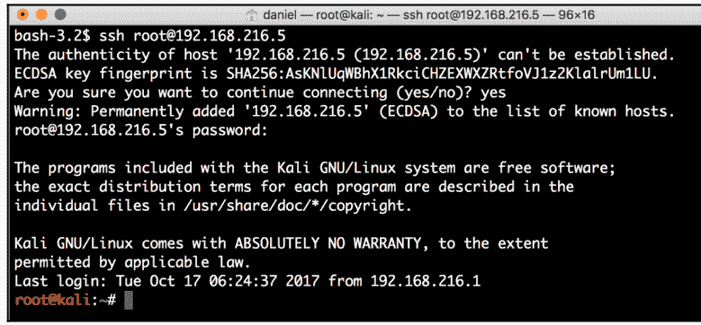

在此 SSH 会话中，我们现在可以使用 SSH 客户端与 Kali Linux 虚拟机进行交互。

启动连接后，你需要验证 SSH 证书。

## Configuring PostgreSQL

Metasploit 的一个重要功能是对 PostgreSQL 的后端数据库支持，你可以使用它来存储渗透测试结果。任何渗透测试都包含大量信息，可能持续数天，因此存储中间结果和发现变得至关重要，例如目标主机数据、系统日志、收集的证据和报告数据。作为一款优秀的渗透测试工具，Metasploit 具有适当的数据库集成，可快速高效地存储结果。在本教程中，我们将处理在 Kali Linux 中安装和配置数据库的过程。

## Getting ready

要配置 PostgreSQL，我们将首先启动服务，然后使用 Metasploit 的 msfdb 命令初始化数据库。

## How to do it...

+   1. 要设置我们的 Metasploit 数据库，我们首先需要使用以下命令启动 PostgreSQL 服务器：

```
root@kali:~# systemctl start postgresql
```

+   2. 然后我们需要使用带 init 选项的 msfdb 命令创建并初始化 msf 数据库：

```
root@kali:~# msfdb init
Creating database user 'msf'
Enter password for new role:
Enter it again:
Creating databases 'msf' and 'msf_test'
Creating configuration file in /usr/share/metasploit-framework/config/database.yml
```

## Creating initial database schema

msfdb 命令允许你管理 Metasploit Framework 数据库，而不仅仅是初始化数据库。要显示所有 msfdb 选项，请按如下方式运行命令：

```
root@kali:~# msfdb
```

## Manage a metasploit framework database

```
msfdb init # initialize the database
msfdb reinit # delete and reinitialize the database
msfdb delete # delete database and stop using it
msfdb start # start the database
msfdb stop # stop the database
```

3. 要修改数据库配置文件，我们可以编辑位于 /usr/share/metasploit-framework/config/database.yml 的 database.yml 文件：

```
root@kali:~# cat /usr/share/metasploit-framework/config/database.yml
development:
  adapter: postgresql
  database: msf
  username: msf
  password: 3HCNhAtdH6F9F2iGa4z3wJVoI7UK1Ot+MG1zuKjYzn4=
  host: localhost
  port: 5432
  pool: 5
  timeout: 5

production:
  adapter: postgresql
  database: msf
  username: msf
  password: 3HCNhAtdH6F9F2iGa4z3wJVoI7UK1Ot+MG1zuKjYzn4=
  host: localhost
  port: 5432
  pool: 5
  timeout: 5

test:
  adapter: postgresql
  database: msf_test
  username: msf
  password: 3HcNhAtdH6F9F2iGa4z3wJVoI7UK1Ot+MG1zuKjYzn4=
  host: localhost
  port: 5432
  pool: 5
  timeout: 5
```

注意已创建的默认用户名、密码和默认数据库。如有必要，你也可以根据自己的喜好更改这些值。

+   4. 现在，让我们启动 msfconsole 界面并使用 db_status 命令确认 Metasploit 已成功连接到数据库：

```
msf > db_status
[*] postgresql connected to msf
```

## There's more...

要手动连接到数据库，你可以使用 db_connect 命令，后跟你想要连接到的凭据、主机和数据库，使用以下语法：

```
db_connect <user:pass>@<host:port>/<database>
```

要测试 db_connect 命令，我们可以使用 database.yml 文件中的用户名、密码、数据库名称和端口号的值：

```
msf > db_disconnect
msf > db_status
[*] postgresql selected, no connection
msf > db_connect
msf:3HcNhAtdH6F9F2iGa4z3wJVoI7UK1Ot+MG1zuKjYzn4=@127.0.0.1/msf
[*] Rebuilding the module cache in the background...
msf > db_status
[*] postgresql connected to msf
```

我们也可以使用 -y 选项和数据库配置文件路径使用 db_connect：

```
msf > db_disconnect
msf > db_status
[*] postgresql selected, no connection
msf > db_connect -y /usr/share/metasploit-framework/config/database.yml
[*] Rebuilding the module cache in the background...
msf > db_status
[*] postgresql connected to msf
```

如果你希望每次启动 msfconsole 时数据库都连接，将数据库配置文件复制到 Metasploit 安装程序在你的主目录中创建的 .msf4 目录中。

## Creating workspaces

Metasploit 中的工作区用于分隔数据集，让你保持井然有序。在开始新的渗透测试之前，最好创建一个新的工作区来组织所有收集的数据，从而避免被之前的测试污染。

## How to do it...

+   1. 连接到数据库时选择的默认工作区，用其名称前的 * 字符表示：
+   
+   ```
+   msf > workspace
+   * default
+   ```
+   2. 要显示 workspace 命令的用法，请使用 -h 选项如下：
+   
+   ```
+   msf > workspace -h
+   Usage:
+       workspace                List workspaces
+       workspace -v             List workspaces verbosely
+       workspace [name]         Switch workspace
+       workspace -a [name] ...  Add workspace(s)
+       workspace -d [name] ...  Delete workspace(s)
+       workspace -D             Delete all workspaces
+       workspace -r <old> <new> Rename workspace
+       workspace -h             Show this help information
+   ```
+   3. 要添加新的工作区，请使用 -a 选项后跟工作区的名称：
+   
+   ```
+   msf > workspace -a book
+   [*] Added workspace: book
+   ```

4. 要列出可用的工作区，只需输入 `workspace` 命令：

```
msf > workspace
  default
* book
```

5. 要删除工作区，请使用 -d 选项后跟工作区的名称：

```
msf > workspace -d book
[*] Deleted workspace: book
[*] Switched workspace: default
```

6. 要更改当前工作区，请使用 `workspace` 命令后跟你想要切换到的工作区名称：

```
msf > workspace book
[*] Workspace: book
```

7. 要重命名工作区，请使用 -r 选项的 `workspace` 命令后跟旧工作区名称和新工作区名称：

```
msf > workspace -r book metasploit
[*] Switched workspace: metasploit
```

## Using the database

配置数据库后，我们就可以开始使用它了。首先，我们将看看如何使用 `db_import` 命令从外部工具导入数据。

## Getting ready

要在 msfconsole 中查看命令的用法并列出当前支持的文件类型，运行 `db_import` 命令：

```
msf > db_import
Usage: db_import <filename> [file2...]

Filenames can be globs like *.xml, or **/*.xml which will search recursively
Currently supported file types include:
  Acunetix
  Amap Log
```


Amap Log -m
Appscan
Burp Session XML
Burp Issue XML
...
Qualys Asset XML
Qualys Scan XML
Retina XML
Spiceworks CSV Export
Wapiti XML

## 如何操作...

- 1. 为了测试 db_import 命令，我们将使用 nmap 命令，这是一个免费的安全扫描器、端口扫描器和网络探索工具，使用 -oX 选项将结果保存到 XML 文件中。以下是扫描 Metasploitable 3 目标机器所使用的语法：
- 2. 要导入扫描报告，可以使用 db_import 命令后跟要导入的报告的路径：

```
nmap -Pn -A -oX report 192.168.216.10
```

```
msf > db_import /root/report
[*] Importing 'Nmap XML' data
[*] Import: Parsing with 'Nokogiri v1.8.0'
[*] Importing host 192.168.216.10
[*] Successfully imported /root/report
```

或者，你可以直接从 msfconsole 运行 db_nmap 命令，结果将保存在当前数据库中。db_nmap 命令的工作方式与常规 nmap 命令相同：

```
msf > db_nmap -Pn -A 192.168.216.129
[*] Nmap: Starting Nmap 7.60 ( https://nmap.org ) at
2017-10-17 05:05 EDT
[*] Nmap: Nmap scan report for 192.168.216.129
[*] Nmap: Host is up (0.00092s latency).
[*] Nmap: Not shown: 977 closed ports
[*] Nmap: PORT STATE SERVICE VERSION
[*] Nmap: 21/tcp open ftp vsftpd 2.3.4
[*] Nmap: |_ftp-anon: Anonymous FTP login allowed (FTP code 230)
```

```
[*] Nmap: | ftp-syst:
[*] Nmap: | STAT:
...
[*] Nmap: |_ System time: 2017-10-04T09:11:38-04:00
[*] Nmap: |_smb2-time: Protocol negotiation failed (SMB2)
[*] Nmap: TRACEROUTE
[*] Nmap: HOP RTT ADDRESS
[*] Nmap: 1 0.92 ms 192.168.216.129
[*] Nmap: OS and Service detection performed. Please report any incorrect results at https://nmap.org/submit/ .
[*] Nmap: Nmap done: 1 IP address (1 host up) scanned in 31.88 seconds
```

## 使用 hosts 命令

现在数据库中已有数据，我们可以开始使用 hosts 命令来显示当前工作区中存储的所有主机：

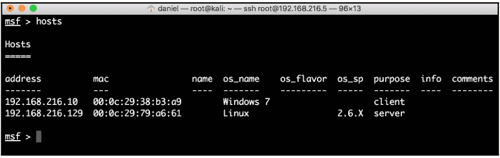

## 如何操作...

- 1. 使用 -h 发出 hosts 命令将显示帮助菜单：
- 

```
msf > hosts -h
Usage: hosts [ options ] [addr1 addr2 ...]

OPTIONS:
-a,--add      Add the hosts instead of searching
-d,--delete   Delete the hosts instead of searching
-c <col1,col2> Only show the given columns (see list below)
```

-h,--help      Show this help information
-u,--up        Only show hosts which are up
-o <file>      Send output to a file in csv format
-O <column>    Order rows by specified column number
-R,--rhosts    Set RHOSTS from the results of the search
-S,--search    Search string to filter by
-i,--info      Change the info of a host
-n,--name      Change the name of a host
-m,--comment   Change the comment of a host
-t,--tag       Add or specify a tag to a range of hosts

Available columns: address, arch, comm, comments, created_at, cred_count, detected_arch, exploit_attempt_count, host_detail_count, info, mac, name, note_count, os_family, os_flavor, os_lang, os_name, os_sp, purpose, scope, service_count, state, updated_at, virtual_host, vuln_count, tags

2. 使用 -c 选项，我们可以选择要显示的列：

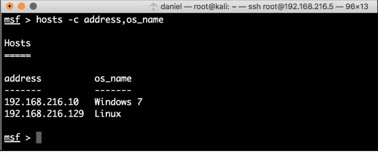

3. 使用 -s 选项，我们可以搜索特定的字符串，例如操作系统名称：

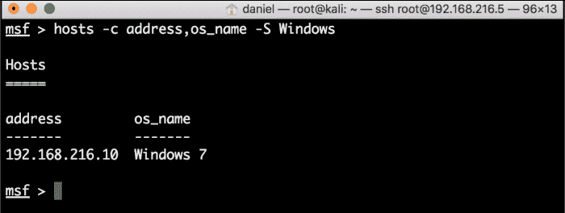

## 理解 services 命令

services 命令允许我们显示主机上运行的服务。要查看 services 命令的帮助，可以使用 -h 选项：

```
msf > services -h
```

```
Usage: services [-h] [-u] [-a] [-r <proto>] [-p <port1,port2>] [-s <name1,name2>] [-o <filename>] [addr1 addr2 ...]
```

- -a,--add          Add the services instead of searching
- -d,--delete        Delete the services instead of searching
- -c <col1,col2>     Only show the given columns
- -h,--help          Show this help information
- -s <name1,name2>   Search for a list of service names
- -p <port1,port2>   Search for a list of ports
- -r <protocol>      Only show [tcp|udp] services
- -u,--up            Only show services which are up
- -o <file>          Send output to a file in csv format
- -O <column>        Order rows by specified column number
- -R,--rhosts        Set RHOSTS from the results of the search
- -S,--search        Search string to filter by

Available columns: created_at, info, name, port, proto, state, updated_at

## 如何操作...

1. 使用没有任何选项的 `search` 命令会显示所有可用的服务：

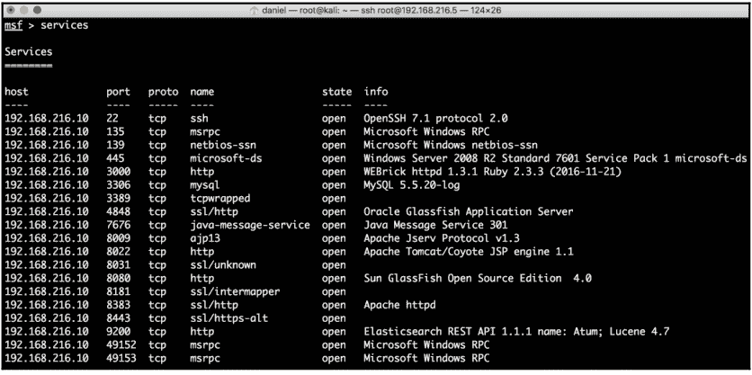

2. `services` 命令允许我们以精细的粒度过滤存储的信息，使我们能够搜索特定的服务名称：

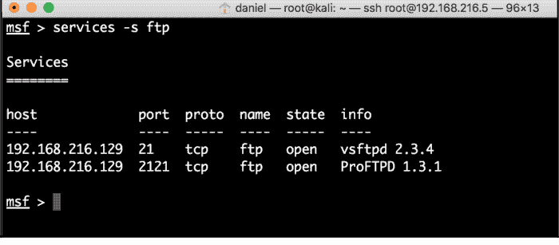

3. 按如下方式搜索端口号：

```
msf > services -p 22

Services
========

host            port  proto  name  state  info
----            ----  -----  ----  -----  ----
192.168.216.10  22    tcp    ssh   open   OpenSSH 7.1 protocol 2.0
192.168.216.129 22    tcp    ssh   open   OpenSSH 4.7p1 Debian 8ubuntu1 protocol 2.0

msf >
```

4. 与 hosts 命令一样，我们可以使用 -s 选项搜索特定字符串：

```
msf > services -S Apache

Services
========

host            port  proto  name    state  info
----            ----  -----  ----    -----  ----
192.168.216.10  8009  tcp    ajp13   open   Apache Jserv Protocol v1.3
192.168.216.10  8022  tcp    http    open   Apache Tomcat/Coyote JSP engine 1.1
192.168.216.10  8383  tcp    ssl/http open  Apache httpd
192.168.216.129 80    tcp    http    open   Apache httpd 2.2.8 (Ubuntu) DAV/2
192.168.216.129 8009  tcp    ajp13   open   Apache Jserv Protocol v1.3
192.168.216.129 8180  tcp    http    open   Apache Tomcat/Coyote JSP engine 1.1

msf >
```

5. 通过组合多个选项，你可以仅搜索特定主机并只显示想要的列：

```
msf > services -c name,port,info -S Apache 192.168.216.10

Services
========

host            name    port    info
----            ----    ----    ----
192.168.216.10  ajp13   8009    Apache Jserv Protocol v1.3
192.168.216.10  http    8022    Apache Tomcat/Coyote JSP engine 1.1
192.168.216.10  ssl/http 8383  Apache httpd

msf >
```

在后面的章节中，我们将介绍剩余的数据库命令，例如 loot、creds、vulns 和 notes。
