## 11
信息收集与扫描

在本章中，我们将介绍以下配方：

- - 使用 Metasploit 进行被动信息收集
- - 使用 Metasploit 进行主动信息收集
- - 端口扫描——Nmap 方式
- - 端口扫描——db_nmap 方式
- - 使用 ARP Sweep 进行主机发现
- - UDP 服务扫描器
- - SMB 扫描和枚举
- - 使用 SSH 版本扫描器检测 SSH 版本
- - FTP 扫描
- - SMTP 枚举
- - SNMP 枚举
- - HTTP 扫描
- - WinRM 扫描和暴力破解
- - 与 Nessus 集成
- - 与 NeXpose 集成
- - 与 OpenVAS 集成

## 引言

信息收集是渗透测试中第一项也是最重要的活动，如果不是最重要的话。这一步是为了尽可能多地了解目标机器的信息。

我们掌握的信息越多，成功利用目标的机会就越好。在信息收集阶段，我们的主要重点是收集有关目标机器的事实，例如 IP 地址、可用服务和开放端口。这些信息在渗透测试过程中发挥着至关重要的作用。为了实现这一目标，到本章结束时，我们将学习某些扫描技术，例如 SMB 扫描、SSH 服务器扫描、FTP 扫描、SNMP 枚举、HTTP 扫描以及 WinRM 扫描和暴力破解。

信息收集、足迹分析和枚举是经常被互换使用的术语。但它们仍然不同。根据 SANS 标准，足迹分析是指获取有关组织的基本信息。这些信息包括正在使用的技术，例如互联网、内联网、远程访问和外联网。除了技术之外，还必须探索安全策略和程序。扫描包括在 IP 地址范围和网络块上执行自动 ping 扫描等基本步骤，以确定各个系统是否存活。枚举涉及对系统进行主动连接和有针对性的查询。黑客枚举的信息类型可以大致分为网络资源和共享、用户和组、应用程序和横幅以及网络块等类别。

信息收集中使用了三种基本技术：

- - **被动信息收集：** 该技术用于在没有物理连接或访问目标的情况下获取有关目标的信息。这意味着我们使用其他来源来获取有关目标的信息，例如使用 whois 查询、Nslookup 等。假设我们的目标是一个在线 Web 应用程序；那么，简单的 whois 查询就可以为我们提供大量有关 Web 应用程序的信息，例如其 IP 地址、其域名和子域名、服务器的位置、托管服务器等。这些信息在渗透测试期间非常有用，因为它可以拓宽我们利用目标的途径。
- - **主动信息收集：** 在这种技术中，建立与目标的逻辑连接以获取信息。这种技术为我们提供了下一级的信息，可以直接补充我们对目标安全的理解。在端口扫描中，目标是最广泛使用的主动扫描技术，我们关注目标上开放的端口和正在运行的可用服务。


- **社会工程学：** 这种信息收集方式与被动信息收集类似，但依赖于人为失误，且信息以打印件、电话对话、错误的电子邮件 ID 等形式泄露出来。利用这种方法的技巧众多，且信息收集的理念截然不同，因此社会工程学本身就是一个独立的类别。例如，黑客会注册拼写错误且听起来相似的域名，并设置邮件服务器来接收此类错误邮件。这类域名被称为 **双胞胎域名；** 即邪恶的孪生体。

社会工程学的受害者被诱骗泄露所需信息，而他们并不知道这些信息将被用于攻击企业网络。例如，企业中的一名员工可能会被骗透露员工识别号码给一个假装成他/她信任的人。虽然该员工号码对员工来说可能似乎没有价值，这使得他更容易一开始就透露信息，但社会工程师可以利用该员工号码结合其他收集到的信息，更接近于找到进入企业网络的方法。

## 使用 Metasploit 进行被动信息收集

在本章中，我们将详细分析各种被动和主动信息收集技术。从开始，我们将分析最常用且最常被忽视的被动信息收集技术，并在后面的配方中，我们将专注于通过端口扫描获取信息。Metasploit 具有多个内置扫描功能，以及一些与之集成的第三方工具，以进一步增强端口扫描过程。我们将分析内置扫描器，以及一些在 Metasploit Framework 上运行的流行第三方扫描器。让我们继续配方并开始获取有关目标的信息。

## 准备工作

我们将以公司域名开始信息收集，获取有关公司的信息，搜索子域名，找到目标，检查蜜罐，收集电子邮件地址，等等。

## 如何操作...

Metasploit Framework 具有多个用于信息收集的模块。在本配方中，你将学习如何使用其中一些模块。然而，我建议你探索框架中所有可用的 auxiliary 模块。

## DNS 记录扫描器和枚举器

DNS 记录扫描器和枚举器 auxiliary 模块可用于通过执行各种 DNS 查询，例如区域传输、反向查找、SRV 记录暴力破解和其他技术，从给定的 DNS 服务器收集有关域的信息。

- 1. 要运行 auxiliary 模块，我们使用 use 命令后跟我们想要使用的模块，在本例中为 auxiliary/gather/enum_dns。然后我们可以使用 info 命令显示有关模块的信息，例如作者、基本选项和描述，如下所示：

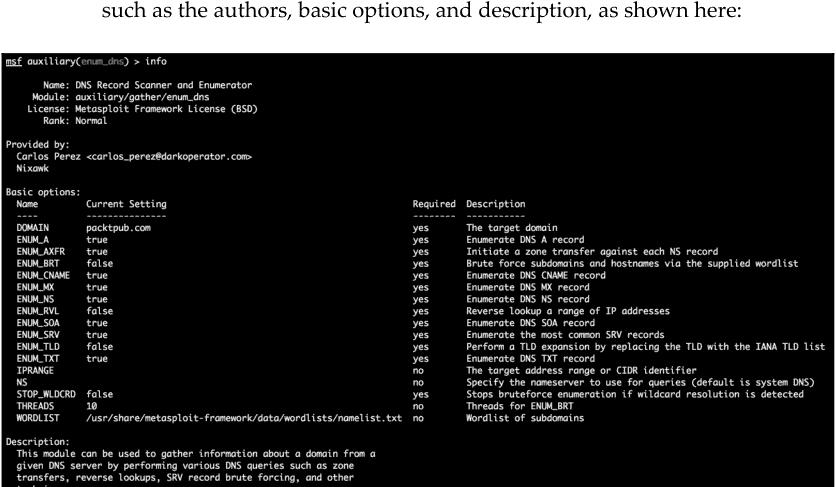

2. 要运行该模块，我们需要设置域名，并为了使其运行得更快，我们将线程数设置为 10：

```
msf > use auxiliary/gather/enum_dns
msf auxiliary(enum_dns) > set DOMAIN packtpub.com
DOMAIN => packtpub.com
msf auxiliary(enum_dns) > set THREADS 10
THREADS => 10
msf auxiliary(enum_dns) > run

...
[+] packtpub.com NS: dns3.easydns.org.
[+] packtpub.com NS: dns2.easydns.net.
[*] Attempting DNS AXFR for packtpub.com from dns1.easydns.com.
W, [2017-10-17T10:04:14.963345 #5091] WARN -- : AXFR query, switching to TCP
...

include:_spf.freshsales.io a:zgateway.zuora.com
include:amazonses.com ~all
[*] querying DNS SRV records for packtpub.com
[*] Auxiliary module execution completed
msf auxiliary(enum_dns) >
```

从输出中可以看出，我们能够从目标域获取多个 DNS 记录。

## 还有更多...

DNS 记录扫描器和枚举器 auxiliary 模块也可以用于主动信息收集，利用其暴力破解功能。通过将 ENUM_BRT 设置为 true，它将通过提供的词表暴力破解子域名和主机名，你可以通过将 WORDLIST 选项设置为词表的路径来自定义该词表。

## CorpWatch 公司名称信息搜索

收集公司信息至关重要，为此我们可以使用 CorpWatch 公司名称信息搜索 auxiliary 模块，auxiliary/gather/corpwatch_lookup_name，它将为我们提供公司的名称、地址、部门和行业。

要运行 auxiliary/gather/corpwatch_lookup_name auxiliary 模块，我们可以使用 Microsoft 作为公司名称并将限制设置为 1 以仅显示第一个结果：

```
msf > use auxiliary/gather/corpwatch_lookup_name
msf auxiliary(corpwatch_lookup_name) > set COMPANY_NAME Microsoft
COMPANY_NAME => Microsoft
msf auxiliary(corpwatch_lookup_name) > set LIMIT 1
LIMIT => 1
msf auxiliary(corpwatch_lookup_name) > run

[*] Company Information
--------------------------------
[*] CorpWatch (cw) ID: cw_4803
[*] Company Name: MICROSOFT CORP
[*] Address: ONE MICROSOFT WAY, REDMOND WA 98052-6399
[*] Sector: Business services
[*] Industry: Services-prepackaged software
[*] Auxiliary module execution completed
msf auxiliary(corpwatch_lookup_name) >
```

## 搜索引擎子域名收集器

收集子域名是找到新目标的好方法，我们可以使用搜索引擎子域名收集器 auxiliary 模块，auxiliary/gather/searchengine_subdomains_collector，从 Yahoo 和 Bing 收集有关域的子域名。

要从目标域收集子域名，我们只需设置目标域。让我们快速对 packtpub.com 进行测试并分析输出：

```
msf > use auxiliary/gather/searchengine_subdomains_collector
msf auxiliary(searchengine_subdomains_collector) > set TARGET packtpub.com
TARGET => packtpub.com
msf auxiliary(searchengine_subdomains_collector) > run

[*] Searching Bing for subdomains from domain:packtpub.com
[*] Searching Yahoo for subdomains from domain:packtpub.com
[+] domain:packtpub.com subdomain: www.packtpub.com
[*] Searching Bing for subdomains from ip:83.166.169.231
[*] Searching Yahoo for subdomains from ip:83.166.169.231
...

[+] domain:packtpub.com subdomain: www1.packtpub.com
[*] Searching Bing for subdomains from ip:83.166.169.231
[*] Searching Yahoo for subdomains from ip:83.166.169.231
```

```
[+] ip:83.166.169.231 subdomain: www.packtpub.com
[+] ip:83.166.169.231 subdomain: www1.packtpub.com
[+] ip:83.166.169.231 subdomain: www2.packtpub.com
[*] Auxiliary module execution completed
```

搜索引擎子域名收集器 auxiliary 模块帮助我们找到了新的目标，例如 www.packtpub.com、cdp.packtpub.com、authorportal.packtpub.com 等等。

现在我们对一些基本模块的功能有了很好的了解，让我们试试大杀器。

## Censys 搜索

Censys 是一个搜索引擎，使研究人员能够询问构成互联网的主机和网络。通过对 IPv4 地址空间进行每日 ZMap 和 ZGrab 扫描，Censys 收集主机和网站的数据，进而维护主机和网站配置的数据库。

使用 Censys 搜索 auxiliary 模块，我们可以使用 Censys REST API 访问通过 Web 界面可访问的相同数据。搜索端点允许使用与主站点相同的搜索语法，对 IPv4、百万网站和证书索引中的当前数据进行搜索。

要使用 Censys 搜索 auxiliary 模块，你首先需要在 https://censys.io/ 网站上创建一个免费账户以获取你的 API ID 和密钥。

要使用 Censys 搜索 auxiliary 模块，我们将把 Censys dork 设置为 packtpub.com，搜索类型设置为 ipv4，然后是你的密钥和 API ID，并输入 run 运行模块：

```
msf > use auxiliary/gather/censys_search
msf auxiliary(censys_search) > set CENSYS_DORK packtpub.com
CENSYS_DORK => packtpub.com
msf auxiliary(censys_search) > set CENSYS_SEARCHTYPE ipv4
CENSYS_SEARCHTYPE => ipv4
msf auxiliary(censys_search) > set CENSYS_SECRET
JIxvPzj0RJkqOqd9cFNRYqNkHzH7E3en
CENSYS_SECRET => JIxvPzj0RJkqOqd9cFNRYqNkHzH7E3en
msf auxiliary(censys_search) > set CENSYS_UID ec421f73-d438-1c48-15b3-5de240bef531
```


CENSYS_UID => ec421f73-d438-1c48-15b3-5de240bef531
msf auxiliary(censys_search) > run
...

[+] 138.68.148.235 - 443/https,22/ssh,80/http
[+] 83.166.169.235 - 80/http
[+] 83.166.169.228 - 80/http
[+] 151.248.166.228 - 443/https,80/http
[+] 151.248.166.228 - 443/https,80/http
[*] Auxiliary module execution completed
msf auxiliary(censys_search) >

## Shodan Search

Shodan is a paid search engine for internet-connected devices. Shodan lets you search for banners, grabs metadata about the device, such as its geographic location, hostname, operating system, and more.


To use the Shodan Search auxiliary module, you first need to create an account on the https://www.shodan.io website to get your API Key.

```
msf > use auxiliary/gather/shodan_search
msf auxiliary(shodan_search) > set QUERY hostname:packtpub.com
QUERY => hostname:packtpub.com
msf auxiliary(shodan_search) > set SHODAN_APIKEY
1d0obpT1S1337sq6yx0gEKblap6yC2ib
SHODAN_APIKEY => 1d0obpT1S1337sq6yx0gEKblap6yC2ib
msf auxiliary(shodan_search) > run
...
```

## Search Results

| IP:Port | City | Country | Hostname |
|------|------|---------|----------|
| 109.234.207.107:25 | Wolverhampton | United Kingdom | imap.packtpub.com |
| 109.234.207.107:443 | Wolverhampton | United Kingdom | imap.packtpub.com |
| 109.234.207.107:587 | Wolverhampton | United Kingdom | imap.packtpub.com |
| 109.234.207.107:80 | Wolverhampton | United Kingdom | imap.packtpub.com |
| 109.234.207.107:993 | Wolverhampton | United Kingdom | imap.packtpub.com |
| 83.166.169.228:80 | Loughborough | United Kingdom | packtpub.com |
| 83.166.169.248:111 | Loughborough | United Kingdom | imap.packtpub.com |
| 83.166.169.248:161 | Loughborough | United Kingdom | imap.packtpub.com |
| 83.166.169.248:443 | Loughborough | United Kingdom | imap.packtpub.com |
| 83.166.169.248:80 | Loughborough | United Kingdom | imap.packtpub.com |
| 83.166.169.248:8080 | Loughborough | United Kingdom | imap.packtpub.com |

[*] Auxiliary module execution completed
msf auxiliary(shodan_search) >

The Shodan Search auxiliary module has revealed further information about the target, such as its IP address, open ports, location, and so on. These passive techniques can reveal some interesting information about the target and can ease our way for penetration testing.

## Shodan Honeyscore Client

Checking whether a server is a honeypot or not is always a good idea. The last thing you want is to waste your time or be blocked because you were trying to attack a honeypot. Using the Shodan Honeyscore Client auxiliary module, you can use Shodan to check whether a server is a honeypot or not. The API returns a score from 0.0 to 1.0, 1.0 being a honeypot:

```
msf > use auxiliary/gather/shodan_honeyscore
msf auxiliary(shodan_honeyscore) > set SHODAN_APIKEY
1d0obpT0SCLAQsq6yxogEKKh1p6yC2ib
SHODAN_APIKEY => 1d0obpT0SCLAQsq6yxogEKKh1p6yC2ib
msf auxiliary(shodan_honeyscore) > set TARGET 83.166.169.248
TARGET => 83.166.169.248
msf auxiliary(shodan_honeyscore) > run

[*] Scanning 83.166.169.248
[-] 83.166.169.248 is not a honeypot
[*] 83.166.169.248 honeyscore: 0.0/1.0
[*] Auxiliary module execution completed
msf auxiliary(shodan_honeyscore) >
```

## Search Engine Domain Email Address Collector

Collecting email addresses is a common part of a penetration test, allows us to understand the customer footprint on the internet, harvester credentials for future brute-force attacks, and phishing campaigns.

To create a list of valid email addresses for the target domain, we can use the Search Engine Domain Email Address Collector auxiliary module:

```
msf > auxiliary/gather/search_email_collector
msf auxiliary(search_email_collector) > set DOMAIN packtpub.com
msf auxiliary(search_email_collector) > set DOMAIN packtpub.com
DOMAIN => packtpub.com
msf auxiliary(search_email_collector) > run
```

```
[*] Harvesting emails ....
[*] Searching Google for email addresses from packtpub.com
[*] Extracting emails from Google search results...
[*] Searching Bing email addresses from packtpub.com
...

[*] Auxiliary module execution completed
msf auxiliary(search_email_collector) >
```

Looking at the output, you can see that the module uses Google, Bing, and Yahoo to search for valid email addresses for the target domain, and was able to locate 20 email addresses for packtpub.com.

## Active information gathering with Metasploit

Scanning is an active information gathering technique in which we will now start dealing with the target directly. Port scanning is an interesting process of information gathering. It involves a deeper search of the target machine, but since active port scanning involves reaching out to the target systems, these activities can be detected by firewalls and intrusion prevention systems.

## How to do it...

There are a variety of port scanners available to us within the Metasploit Framework, allowing us to properly enumerate the target systems. To list all the available portscan modules, you can use the search command, as follows:

## TCP Port Scanner

We can start by doing a basic TCP portscan with the TCP Port Scanner auxiliary module and see what we can find.


Since the TCP Port Scanner auxiliary module does not need administrative privileges on the source machine, it can be extremely useful when pivoting.

To run the TCP Port Scanner auxiliary module, we need to set the RHOSTS to the target range of our lab 192.168.216.0/24 and set the number of concurrent threads to 100 to speed up the scan:

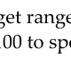

Scanners and most other auxiliary modules use the RHOSTS option instead of RHOST.

```
msf > use auxiliary/scanner/portscan/
msf auxiliary(tcp) > set RHOSTS 192.168.216.0/24
RHOSTS => 192.168.216.0/24
msf auxiliary(tcp) > set THREADS 100
THREADS => 100
msf auxiliary(tcp) > run

[+] 192.168.216.5:      - 192.168.216.5:22      - TCP OPEN
[+] 192.168.216.10:     - 192.168.216.10:22     - TCP OPEN
[+] 192.168.216.10:     - 192.168.216.10:139    - TCP OPEN
```

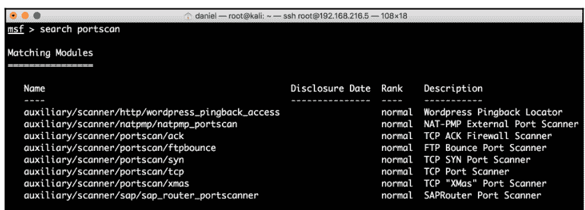

```
[+] 192.168.216.10:  - 192.168.216.10:135  - TCP OPEN
...
[+] 192.168.216.10:  - 192.168.216.10:9300  - TCP OPEN
[*] Scanned 256 of 256 hosts (100% complete)
[*] Auxiliary module execution completed
```

When using Metasploit modules, you can check the available options for that specific module using the show options command and use the show missing command to show the missing values required by the module:

```
msf auxiliary(tcp) > show missing
```

```
Module options (auxiliary/scanner/portscan/tcp):
```

| Name | Current Setting | Required | Description |
| --- | --------------- | -------- | ----------- |
| RHOSTS identifier |  | yes | The target address range or CIDR |

## TCP SYN Port Scanner

The TCP SYN Port Scanner auxiliary module scans TCP services using a raw SYN scan, thus reducing the number of packets, as it never completes the three-way handshake. To run the TCP SYN Port Scanner auxiliary module, we will specify the interface, set the port range to the first 1000 ports, set the RHOSTS to the target range of our lab 192.168.216.0/24, and set the number of concurrent threads to 256 to speed up the scan:

```
msf > use auxiliary/scanner/portscan/syn
msf auxiliary(syn) > set INTERFACE eth0
INTERFACE => eth0
msf auxiliary(syn) > set PORTS 1-1000
PORTS => 1-1000
msf auxiliary(syn) > set THREADS 256
THREADS => 256
msf auxiliary(syn) > run
```

```
[+] TCP OPEN 192.168.216.10:22
[+] TCP OPEN 192.168.216.10:135
[+] TCP OPEN 192.168.216.10:139
[+] TCP OPEN 192.168.216.10:445
[*] Scanned 1 of 1 hosts (100% complete)
[*] Auxiliary module execution completed
msf auxiliary(syn) >
```

On a Unix-like operating system, the number of concurrent threads can be set as high as 256.

## Port scanning—the Nmap way

Nmap is the most powerful and preferred scanner for security professionals. The usage of Nmap varies from novice to an advanced level; we will analyze the various scan techniques in detail.

## Getting ready

You run Nmap directly from msfconsole, as you normally would from the command line. However, if you want to import the results into the Metasploit database, you need to run the Nmap scan using the -oX flag, followed by the desired filename to generate the XML output file, and then issue the db_import command to populate the Metasploit database.

## How to do it...

Starting Nmap from Metasploit is easy:

- 1. Launch msfconsole and type in nmap to display the list of scan options that Nmap provides:
  
      msf > nmap

- 2. The TCP connect [-sT] scan is the most basic and default scan type in Nmap. It follows the three-way handshake process to detect the open ports on the target machine. Let's perform this scan on one of our targets:
  
      msf > nmap -sT 192.168.216.10
      [*] exec: nmap -sT 192.168.216.10
  
      Starting Nmap 7.60 ( https://nmap.org ) at 2017-10-19 08:53 EDT
      Nmap scan report for 192.168.216.10
      Host is up (0.49s latency).
      Not shown: 976 closed ports


PORT STATE SERVICE
22/tcp open ssh
135/tcp open msrpc
139/tcp open netbios-ssn
....
49158/tcp open unknown
49159/tcp open unknown
MAC Address: 00:0C:29:38:B3:A9 (VMware)

Nmap done: 1 IP address (1 host up) scanned in 3.25 seconds

正如我们所见，我们使用了 -sT 参数，表示我们要执行 TCP 连接扫描。TCP 连接扫描基于三次握手过程，因此，此次扫描返回的结果被认为准确。

在使用 Nmap 且未指定端口范围时，Nmap 会扫描每个协议中最常见的 1,000 个端口。

3. SYN 扫描 [-sS] 被认为是一种隐蔽扫描技术，因为它从未在目标和扫描器之间建立完整的连接。因此，它也被称为半开扫描。让我们分析一下对目标进行的 SYN 扫描：

```
msf > nmap -sS 192.168.216.10 -p 22-5000
[*] exec: nmap -sS 192.168.216.10 -p 22-5000

Starting Nmap 7.60 ( https://nmap.org ) at 2017-10-19 09:00 EDT
Nmap scan report for 192.168.216.10
Host is up (0.00063s latency).
Not shown: 4967 closed ports
PORT STATE SERVICE
22/tcp open ssh
135/tcp open msrpc
...
3920/tcp open exasoftport1
4848/tcp open appserv-http
MAC Address: 00:0C:29:38:B3:A9 (VMware)

Nmap done: 1 IP address (1 host up) scanned in 685.27 seconds
msf >
```

-sS 参数将指示 Nmap 对目标机器执行 SYN 扫描。TCP 连接和 SYN 扫描的输出在大多数情况下是相似的，但唯一的区别在于 SYN 扫描更难被防火墙和 **入侵检测系统 (IDS)** 检测到。然而，现代防火墙也足以捕获 SYN 扫描。-p 参数显示我们想要扫描的端口号范围。使用 -p 0-65535，或简写为 -p -，将扫描所有可用端口。

4. UDP 扫描 [-sU] 是识别目标上开放 UDP 端口的扫描技术。向目标机器发送 0 字节的 UDP 数据包，接收到 ICMP 端口不可达消息表明端口已关闭；否则，认为端口是开放的。它可以按以下方式使用：

```
msf > nmap -sU 192.168.216.10
[*] exec: nmap -sU 192.168.216.10

Starting Nmap 7.60 ( https://nmap.org ) at 2017-10-19 09:09 EDT
Nmap scan report for 192.168.216.10
Host is up (0.00064s latency).
Not shown: 994 closed ports
PORT STATE SERVICE
137/udp open netbios-ns
138/udp open|filtered netbios-dgm
500/udp open|filtered isakmp
4500/udp open|filtered nat-t-ike
5353/udp open|filtered zeroconf
5355/udp open|filtered llmnr
MAC Address: 00:0C:29:38:B3:A9 (VMware)

Nmap done: 1 IP address (1 host up) scanned in 319.56 seconds
msf >
```

之前的命令将检查 192.168.56.102 上 UDP 协议最常见的 1,000 个端口是否开放。

## How it works...

我们分析了三种不同类型的 Nmap 扫描，它们在渗透测试期间非常有帮助。Nmap 为扫描目标机器提供了许多不同的模式。在这里，我们将重点关注三种扫描类型，即 TCP 连接扫描、SYN 隐蔽扫描和 UDP 扫描。Nmap 的不同扫描选项也可以组合在一次扫描中，以对目标执行更高级、更复杂的扫描。让我们继续前进并开始扫描过程。

在渗透测试期间，扫描过程可以提供大量有用的结果。由于此处收集的信息将构成渗透测试的基础，因此强烈建议正确了解扫描类型。现在让我们更深入地了解我们刚刚学习的每种扫描技术。

TCP 连接扫描是最基本的扫描技术，其中与正在测试的端口建立了完整的连接。它使用操作系统的网络功能来建立连接。扫描器向目标机器发送 SYN 数据包。如果端口开放，它会向扫描器返回 ACK 消息。扫描器然后向目标发送 ACK 数据包，显示连接成功建立。这称为三次握手过程。连接在打开后立即终止。该技术有其优点，但很容易被防火墙和 IDS 追踪。

SYN 扫描是另一种类型的 TCP 扫描，但它从未与目标建立完整的连接。它不使用操作系统的网络功能；相反，它生成原始 IP 数据包并监控响应。如果端口开放，则目标将以 ACK 消息进行响应。扫描器然后发送重置连接 (RST) 消息并结束连接。因此，它也称为半开扫描。这被认为是一种隐蔽扫描技术，因为它可以避免在某些配置不当的防火墙和 IDS 中触发警报。

UDP 扫描是一种无连接扫描技术；因此，无论数据包是否已被目标接收，都不会向扫描器发送通知。如果端口关闭，则会向扫描器发送 ICMP 端口不可达消息。如果未收到消息，则端口被报告为开放。此方法可能会返回错误结果，因为防火墙可以阻止数据包，因此不会生成响应消息，扫描器将报告端口为开放。

## There's more...

让我们进一步了解 Nmap 扫描，并看看如何将不同类型的扫描组合在一起。

## Operating system and version detection

除了端口扫描之外，Nmap 还提供了一些高级选项。这些选项可以帮助我们获取有关目标的更多信息。其中最广泛使用的选项之一是 **操作系统识别 [-O]**。这可以帮助我们识别目标机器上运行的操作系统。

操作系统检测扫描输出如下所示：

```
msf > nmap -O 192.168.216.129
[*] exec: nmap -O 192.168.216.129

Starting Nmap 7.60 ( https://nmap.org ) at 2017-10-19 09:28 EDT
Nmap scan report for 192.168.216.129
Host is up (0.0012s latency).
Not shown: 977 closed ports
PORT STATE SERVICE
21/tcp open ftp
22/tcp open ssh
23/tcp open telnet
...

Running: Linux 2.6.X
OS CPE: cpe:/o:linux:linux_kernel:2.6
OS details: Linux 2.6.9 - 2.6.33
Network Distance: 1 hop

OS detection performed. Please report any incorrect results at https://nmap.org/submit/ .
Nmap done: 1 IP address (1 host up) scanned in 3.91 seconds
msf >
```

正如我们所见，Nmap 已成功检测到目标机器的操作系统。这可以简化我们根据目标的操作系统寻找合适的漏洞利用的任务。

另一个广泛使用的 Nmap 选项是不同开放端口的 **版本检测 [-sV]**。它可以与我们之前看到的任何扫描类型混合使用，以添加有关目标开放端口上运行的服务版本的信息：

```
msf > nmap -sV 192.168.216.129
[*] exec: nmap -sV 192.168.216.129

Starting Nmap 7.60 ( https://nmap.org ) at 2017-10-19 09:30 EDT
Nmap scan report for 192.168.216.129
Host is up (0.00049s latency).
Not shown: 977 closed ports
PORT STATE SERVICE VERSION
...

irc.Metasploitable.LAN; OSs: Unix, Linux; CPE:
cpe:/o:linux:linux_kernel

Service detection performed. Please report any incorrect results at https://nmap.org/submit/ .
Nmap done: 1 IP address (1 host up) scanned in 13.57 seconds
msf >
```

正如我们所见，我们的扫描输出中添加了一个额外的版本列，报告了目标机器上运行的不同服务的版本。

## Increasing anonymity

有时以匿名方式执行扫描是必不可少的。如果您在不使用安全措施的情况下执行扫描，防火墙和 IDS 日志可能会泄露您的 IP 地址。Nmap 中提供的一项功能称为 **诱饵 (-D)**。

诱饵选项并不能阻止您的 IP 地址被记录在防火墙和 IDS 的日志文件中，但它会使扫描看起来很可怕。它在日志文件中添加了其他流量，从而给人一种印象，即有多个其他攻击者同时扫描该机器。因此，如果您添加两个诱饵 IP 地址，日志文件将显示请求数据包来自三个不同的 IP 地址；一个是您的，另两个是您添加的假地址：

```
msf > nmap -sT 192.168.216.10 -D 192.168.216.13,192.168.216.25
```


这个扫描示例展示了 -D 参数的使用。-D 操作符后的 IP 地址是伪造的 IP 地址，它们会连同原始 IP 地址一起出现在目标机器的网络日志文件中。此过程会让网络管理员感到困惑，并在其脑中产生怀疑，认为这三个 IP 地址都是伪造的或被欺骗的。但添加过多的诱饵地址会影响扫描结果；因此，你应仅使用有限数量的诱饵地址。

## 端口扫描——db_nmap 方式

使用 `db_nmap` 命令，我们可以对目标运行 Nmap 并自动将扫描结果存储到数据库中，而无需使用 `db_import` 命令。

### 准备工作

`db_nmap` 命令是 `msfconsole` 的一部分，因此你只需启动 `msfconsole` 并使用 `db_nmap`，就像在命令行上使用 `nmap` 一样。

### 操作方法...

在第 11 章 *Metasploit 安全专业人士快速技巧* 中，我们已经谈到了 `db_nmap` 的基本用法，现在我们将看看一些更高级的功能。在下面的示例中，你将学习如何使用其中一些功能：

```
msf > db_nmap -Pn -sTV -T4 --open --min-parallelism 64 --version-all
192.168.216.10 -p -
[*] Nmap: Starting Nmap 7.60 ( https://nmap.org ) at 2017-10-20 06:33 EDT
[*] Nmap: Nmap scan report for 192.168.216.10
[*] Nmap: Host is up (0.00044s latency).
[*] Nmap: Not shown: 54809 closed ports, 10678 filtered ports
[*] Nmap: Some closed ports may be reported as filtered due to --defeat-rst-ratelimit
...
[*] Nmap: 50560/tcp open unknown
[*] Nmap: 50561/tcp open unknown
[*] Nmap: Service Info: OSs: Windows, Windows Server 2008 R2 - 2012; Device: remote management; CPE: cpe:/o:microsoft:windows
[*] Nmap: Service detection performed. Please report any incorrect results at https://nmap.org/submit/ .
[*] Nmap: Nmap done: 1 IP address (1 host up) scanned in 522.38 seconds
msf >
```

我们使用 db_nmap 配合 -Pn 选项将所有主机视为在线并跳过主机发现，-sTV 执行 TCP 连接扫描，V 标志对发现的开放端口进行版本扫描，以及 -T4 设置更高的时序模板以使扫描运行更快。--open 选项仅显示开放端口，--min-parallelism 用于指定同时进行的最小并行进程数量，而 --version-all 则尝试每个探测以识别在开放端口上运行的服务的更具体版本。要运行扫描，我们设置目标主机的 IP 地址并使用 -p - 指定我们想要扫描全部 65535 个端口。

## Nmap 脚本引擎

Nmap 脚本引擎 NSE 是 Nmap 最强大和最灵活的功能之一，有效地将 Nmap 变为漏洞扫描器。NSE 几乎有 600 个脚本，分为多个类别，范围从较安全的发现脚本到更具侵入性的脚本，如暴力破解、利用和拒绝服务。你可以在 Kali Linux 的 /usr/share/nmap/scripts 目录中找到 NSE 脚本，或简单地通过 locate 命令搜索通配符 *.nse。

运行 NSE 脚本的基本语法如下：

```
nmap --script <scriptname> <host ip>
```

db_nmap 命令也适用，因此让我们使用 NSE 尝试查找一些 HTTP/HTTPS 漏洞：

```
msf > db_nmap --open -sTV -Pn -p 80,443,8000,8080,8585 --script=http-vhosts,http-userdir-enum,http-apache-negotiation,http-backup-finder,http-config-backup,http-default-accounts,http-methods,http-method-tamper,http-passwd,http-robots.txt,ssl-poodle,ssl-heartbleed,http-webdav-scan,http-iis-webdav-vuln 192.168.216.10
[*] Nmap: Starting Nmap 7.60 ( https://nmap.org ) at 2017-10-20 10:26 EDT
[*] Nmap: Nmap scan report for 192.168.216.10
[*] Nmap: Host is up (0.00068s latency).
[*] Nmap: Not shown: 3 closed ports
[*] Nmap: PORT STATE SERVICE VERSION
[*] Nmap: 8080/tcp open http Oracle GlassFish 4.0 (Servlet 3.1; JSP 2.3; Java 1.8)
[*] Nmap: | http-backup-finder:
...
[*] Nmap: |_127 names had status 200
[*] Nmap: Service detection performed. Please report any incorrect results at https://nmap.org/submit/ .
[*] Nmap: Nmap done: 1 IP address (1 host up) scanned in 293.24 seconds
msf >
```

查看输出，我们可以看到一些潜在有风险的 HTTP 方法，例如 PUT、DELETE 和 TRACE。

## 使用 ARP Sweep 进行主机发现

ARP Sweep 允许我们使用 ARP 请求枚举本地网络中的活动主机，为我们提供一种简单快速的方式来识别可能的攻击目标。

### 准备工作

当你的目标系统位于与攻击机器相同的局域网中时，你可以通过执行 ARP 扫描来枚举系统。

### 操作方法...

- 1. 要在 Metasploit 中使用 ARP 枚举系统，你可以使用 ARP Sweep 本地网络发现辅助模块。你只需在 RHOSTS 中设置目标地址范围，设置并发线程数，然后运行该模块：

```
msf > use auxiliary/scanner/discovery/arp_sweep
msf auxiliary(arp_sweep) > set RHOSTS 192.168.216.0/24
RHOSTS => 192.168.216.0/24
msf auxiliary(arp_sweep) > set THREADS 256
THREADS => 256
msf auxiliary(arp_sweep) > run

[+] 192.168.216.1 appears to be up (VMware, Inc.).
[+] 192.168.216.2 appears to be up (VMware, Inc.).
[+] 192.168.216.10 appears to be up (VMware, Inc.).
[+] 192.168.216.129 appears to be up (VMware, Inc.).
[+] 192.168.216.254 appears to be up (VMware, Inc.).
[*] Scanned 256 of 256 hosts (100% complete)
[*] Auxiliary module execution completed
msf auxiliary(arp_sweep) >
```

- 2. 如果启用，结果将存储在 Metasploit 数据库中。要显示发现的主机，你可以使用 hosts 命令：

```
msf auxiliary(arp_sweep) > hosts

Hosts
=====

address          mac              name os_name os_flavor os_sp
purpose info comments
------- ---- --------          ---- ------- --------- ----
-------- ---- --------
192.168.216.1    00:50:56:c0:00:08
192.168.216.2    00:50:56:e3:fd:60
192.168.216.10   00:0c:29:38:b3:a9
192.168.216.129  00:0c:29:79:a6:61
192.168.216.254  00:50:56:fe:6a:62

msf auxiliary(arp_sweep) >
```

## UDP 服务扫描器

UDP 服务扫描器辅助模块允许我们检测有趣的 UDP 服务。由于 UDP 是无连接协议，因此探测起来比 TCP 更困难。使用 UDP 服务扫描器之类的辅助模块可以帮助你在及时的情况下找到一些容易获取的目标。

### 操作方法...

要运行 UDP 服务扫描器，选择 auxiliary/scanner/discovery/udp_sweep 模块并在 RHOSTS 中设置目标地址范围：

```
msf > use auxiliary/scanner/discovery/udp_sweep
msf auxiliary(udp_sweep) > set RHOSTS 192.168.216.0/24
RHOSTS => 192.168.216.0/24
msf auxiliary(udp_sweep) > run

[*] Sending 13 probes to 192.168.216.0->192.168.216.255 (256 hosts)
[*] Discovered NetBIOS on 192.168.216.1:137 (MACBOOK-PRO:<00>:U
:00:50:56:c0:00:08)
...

[*] Discovered Portmap on 192.168.216.129:111 (100000 v2 TCP(111), 100000 v2 UDP(111), 100024 v1 UDP(52986), 100024 v1 TCP(53621), 100003 v2 UDP(2049), 100003 v3 UDP(2049), 100003 v4 UDP(2049), 100021 v1 UDP(49681), 100021 v3 UDP(49681), 100021 v4 UDP(49681), 100003 v2 TCP(2049), 100003 v3 TCP(2049), 100003 v4 TCP(2049), 100021 v1 TCP(60203), 100021 v3 TCP(60203), 100021 v4 TCP(60203), 100005 v1 UDP(48062), 100005 v1 TCP(34047), 100005 v2 UDP(48062), 100005 v2 TCP(34047), 100005 v3 UDP(48062), 100005 v3 TCP(34047))
[*] Discovered DNS on 192.168.216.129:53 (BIND 9.4.2)
[*] Scanned 256 of 256 hosts (100% complete)
[*] Auxiliary module execution completed
msf auxiliary(udp_sweep) >
```

UDP 服务扫描器模块能够发现我们的目标在 53 端口上运行 BIND DNS。

## SMB 扫描和枚举

多年来，服务器消息块 SMB 协议，即在 Microsoft Windows 中实现的网络文件共享协议，已证明是被滥用最严重的协议之一，允许从共享和用户枚举到远程代码执行。

### 操作方法...

- 1. 使用 SMB 共享枚举辅助模块无需身份验证，允许我们收集一些有价值的信息，例如共享名称和操作系统版本及服务包：
```
msf > use auxiliary/scanner/smb/smb_enumshares
msf auxiliary(smb_enumshares) > set RHOSTS 192.168.216.10,129
RHOSTS => 192.168.216.10,129
msf auxiliary(smb_enumshares) > run
...
[+] 192.168.216.129:139 - IPC$ - (I) IPC Service
(metasploitable server (Samba 3.0.20-Debian))
[+] 192.168.216.129:139 - ADMIN$ - (I) IPC Service
(metasploitable server (Samba 3.0.20-Debian))
[*] Scanned 2 of 2 hosts (100% complete)
[*] Auxiliary module execution completed
msf auxiliary(smb_enumshares) >
```


2. SMB Share Enumeration 辅助模块在执行后渗透时也非常有用。通过提供有效的凭据，我们可以轻松枚举共享并列出文件：

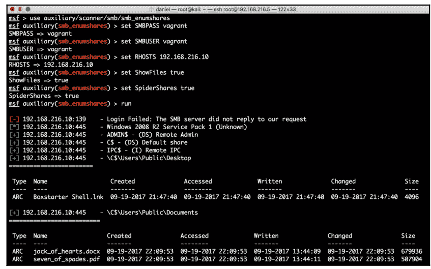

Metasploit 有多个 SMB 扫描辅助模块。接下来我们将查看其中一些最有用的模块。

3. SMB Version Detection 辅助模块会显示每个目标系统的 SMB 版本：

```
msf > use auxiliary/scanner/smb/smb_version
msf auxiliary(smb_version) > set RHOSTS 192.168.216.10
RHOSTS => 192.168.216.10
msf auxiliary(smb_version) > run

[+] 192.168.216.10:445 - Host is running Windows 2008 R2 Standard SP1 (build:7601) (name:VAGRANT-2008R2)
(workgroup:WORKGROUP )
[*] Scanned 1 of 1 hosts (100% complete)
[*] Auxiliary module execution completed
msf auxiliary(smb_version) >
```

4. SMB User Enumeration 辅助模块允许我们通过 SAM RPC 服务确定存在哪些本地用户：

```
msf > use auxiliary/scanner/smb/smb_enumusers
msf auxiliary(smb_enumusers) > set SMBPASS vagrant
SMBPASS => vagrant
msf auxiliary(smb_enumusers) > set SMBUSER vagrant
SMBUSER => vagrant
msf auxiliary(smb_enumusers) > set RHOSTS 192.168.216.10
RHOSTS => 192.168.216.10
msf auxiliary(smb_enumusers) > run

[+] 192.168.216.10:445 - VAGRANT-2008R2 [ Administrator, anakin_skywalker, arto_detoo, ben_kenobi, boba_fett, chewbacca, c_three_pio, darth_vader, greedo, Guest, han_solo, jabba_hutt, jarjar_binks, kylo_ren, lando_calrissian, leia_organa, luke_skywalker, sshd, sshd_server, vagrant ] ( LockoutTries=0 PasswordMin=0 )
[*] Scanned 1 of 1 hosts (100% complete)
[*] Auxiliary module execution completed
msf auxiliary(smb_enumusers) >
```

5. SMB Login Check Scanner 辅助模块将测试一系列机器上的 SMB 登录并报告成功的登录：

```
msf > use auxiliary/scanner/smb/smb_login
msf auxiliary(smb_login) > set RHOSTS 192.168.216.10
RHOSTS => 192.168.216.10
msf auxiliary(smb_login) > set SMBUSER vagrant
SMBUSER => vagrant
msf auxiliary(smb_login) > set PASS_FILE /root/password.lst
PASS_FILE => /root/password.lst
msf auxiliary(smb_login) > run
...

[*] 192.168.216.10:445 - 192.168.216.10:445 - Domain is ignored for user vagrant
[*] Scanned 1 of 1 hosts (100% complete)
[*] Auxiliary module execution completed
msf auxiliary(smb_login) >
```

6. MS17-010 SMB RCE Detection 辅助模块使用信息泄露来确定 MS17-010 是否已修补。具体来说，它连接到 IPC$ 树并尝试在 FID 0 上进行事务。如果返回的状态为 STATUS_INSUFF_SERVER_RESOURCES，则该机器没有 MS17-010 补丁。如果机器缺少 MS17-010 补丁，模块将检查是否存在现有的 DoublePulsar（ring 0 shellcode/恶意软件）感染。该模块在默认服务器配置下不需要有效的 SMB 凭据。它可以以用户 \ 的身份登录并连接到 IPC$：

```
msf > use auxiliary/scanner/smb/smb_ms17_010
msf auxiliary(smb_ms17_010) > set RHOSTS 192.168.216.10
RHOSTS => 192.168.216.10
msf auxiliary(smb_ms17_010) > run

[+] 192.168.216.10:445 - Host is likely VULNERABLE to
MS17-010! (Windows Server 2008 R2 Standard 7601 Service Pack 1)
[*] Scanned 1 of 1 hosts (100% complete)
[*] Auxiliary module execution completed
msf auxiliary(smb_ms17_010) >
```

7. Metasploit 有大量 SMB 辅助模块值得尝试。要列出所有可用的 SMB 模块，可以按 Tab 键显示 auxiliary/scanner/smb/ 下所有可用的模块：

```
msf > use auxiliary/scanner/smb/
...

use auxiliary/scanner/smb/smb_ms17_010
use auxiliary/scanner/smb/smb_uninit_cred
use auxiliary/scanner/smb/smb_version
msf > use auxiliary/scanner/smb/
```

## 使用 SSH Version Scanner 检测 SSH 版本

SSH 是一种广泛使用的应用程序，提供安全的远程登录。它使用强大的加密技术提供身份验证和保密性。在本教程中，我们将检测目标上当前运行的 SSH 版本。通过此 SSH Version Scanner，我们可以确定目标是否配备了任何易受攻击的 SSH 版本，如果是，我们可以继续下一步。

## 准备工作

之前的扫描显示目标系统上 TCP 端口 22 是开放的，因此我们将使用 SSH Version Scanner 辅助模块获取目标系统上运行的 SSH 版本信息。

## 如何操作...

+   1. 要扫描网络上的 SSH 服务器，请使用 `auxiliary/scanner/ssh/ssh_version` 辅助模块，设置 RHOSTS 中的目标地址范围，并将并发线程数设置为 256：

```
msf > use auxiliary/scanner/ssh/ssh_version
msf auxiliary(ssh_version) > set RHOSTS 192.168.216.0/24
RHOSTS => 192.168.216.0/24
msf auxiliary(ssh_version) > set THREADS 256
THREADS => 256
msf auxiliary(ssh_version) > run

...
[*] Scanned 133 of 256 hosts (51% complete)
[*] Scanned 232 of 256 hosts (90% complete)
[*] Scanned 250 of 256 hosts (97% complete)
[*] Scanned 255 of 256 hosts (99% complete)
[*] Scanned 256 of 256 hosts (100% complete)
[*] Auxiliary module execution completed
msf auxiliary(ssh_version) >
```

因此，在我们的扫描中，我们在目标地址范围内发现了一些活动的 SSH 版本。一旦发现 SSH 版本，我们就可以为该特定版本搜索漏洞。

+   2. 要搜索默认或可猜测的凭据，可以使用 SSH Login Check Scanner 辅助模块测试一系列机器上的 SSH 登录并报告成功的登录：

```
msf > use auxiliary/scanner/ssh/ssh_login
msf auxiliary(ssh_login) > set USERNAME user
USERNAME => user
msf auxiliary(ssh_login) > set PASS_FILE /root/password.lst
PASS_FILE => /root/password.lst
msf auxiliary(ssh_login) > set RHOSTS 192.168.216.10,129
RHOSTS => 192.168.216.10,129
msf auxiliary(ssh_login) > set STOP_ON_SUCCESS true
STOP_ON_SUCCESS => true
msf auxiliary(ssh_login) > set THREADS 256
THREADS => 256
msf auxiliary(ssh_login) > run
```

```
[*] Scanned 1 of 2 hosts (50% complete)
[+] 192.168.216.129:22 - Success: 'user:user' 'uid=1001(user) gid=1001(user) groups=1001(user) Linux metasploitable 2.6.24-16-server #1 SMP Thu Apr 10 13:58:00 UTC 2008 i686 GNU/Linux '
[*] Command shell session 1 opened (192.168.216.5:39227 -> 192.168.216.129:22) at 2017-10-21 06:11:14 -0400
[*] Scanned 2 of 2 hosts (100% complete)
[*] Auxiliary module execution completed
msf auxiliary(ssh_login) >
```

查看输出，我们很幸运地在 Metasploitable 2 目标机器上使用凭据 user:user 获得了会话。

+   3. 要与新会话交互，请使用 sessions 命令并带 -i 选项与会话交互并提供会话 ID，在本例中为 1：

```
msf auxiliary(ssh_login) > sessions -i 1
[*] Starting interaction with 1...
```

```
hostname
metasploitable
id
uid=1001(user) gid=1001(user) groups=1001(user)
```

## FTP 扫描

在本教程中，我们将使用 Metasploit 对网络中所有开放的 FTP 服务器进行版本扫描。

## 准备工作

FTP Version Scanner 辅助模块允许我们检测正在运行的 FTP 版本。

## 如何操作...

1. 要扫描网络上的 FTP 服务器，请使用 `auxiliary/scanner/ftp/ftp_version` 辅助模块，设置 RHOSTS 中的目标地址范围，并将并发线程数设置为 256：

```
msf > use auxiliary/scanner/ftp/ftp_version
msf auxiliary(ftp_version) > set RHOSTS 192.168.216.10,129
RHOSTS => 192.168.216.10,129
msf auxiliary(ftp_version) > set THREADS 256
THREADS => 256
msf auxiliary(ftp_version) > run

[+] 192.168.216.129:21 - FTP Banner: '220 (vsFTPd 2.3.4)\x0d\x0a'
[*] Scanned 1 of 2 hosts (50% complete)
[*] Scanned 2 of 2 hosts (100% complete)
[*] Auxiliary module execution completed
msf auxiliary(ftp_version) >
```

2. 扫描结果，如同之前的辅助模块，将存储在 Metasploit 数据库中，可以使用 `services` 命令访问：

```
msf auxiliary(ftp_version) > services

Services
========

host port proto name state info
---- ---- ----- ---- ----- ----
192.168.216.129 21 tcp ftp open 220 (vsFTPd 2.3.4)\x0d\x0a

msf auxiliary(ftp_version) >
```

## SMTP 枚举

简单邮件传输协议（SMTP）服务有两个内部命令允许用户枚举：VRFY（确认有效用户名的名称）和 EXPN（揭示用户别名的实际地址以及电子邮件列表（邮件列表））。


## 准备工作

SMTP 用户枚举实用程序辅助模块，通过实现这些 SMTP 命令，可以揭示有效用户的列表。

## 如何操作...

SMTP 用户枚举实用程序辅助模块，默认情况下，将使用位于 /usr/share/metasploit-framework/data/wordlists/ 的 unix_users.txt 文件，但你可以指定自己的文件。要运行该模块，设置目标地址范围、并发线程数，并输入 run：

```
msf > use auxiliary/scanner/smtp/smtp_enum
msf auxiliary(smtp_enum) > set RHOSTS 192.168.216.129
msf auxiliary(smtp_enum) > set THREADS 256
THREADS => 256
msf auxiliary(smtp_enum) > run

[*] 192.168.216.129:25 - 192.168.216.129:25 Banner: 220 metasploitable.localdomain ESMTP Postfix (Ubuntu)
[+] 192.168.216.129:25 - 192.168.216.129:25 Users found: , backup, bin, daemon, distccd, ftp, games, gnats, irc, libuuid, list, lp, mail, man, news, nobody, postgres, postmaster, proxy, service, sshd, sync, sys, syslog, user, uucp, www-data
[*] Scanned 1 of 1 hosts (100% complete)
[*] Auxiliary module execution completed
msf auxiliary(smtp_enum) >
```

输出揭示了 Metasploitable 2 目标的有效用户列表。

## SNMP 枚举

简单网络管理协议（SNMP）用于在网络设备上远程读取、写入和更新设备配置。SNMP 扫描通常是查找特定系统的大量信息，甚至实际入侵远程设备的良好指标。在本教程中，我们将学习如何使用 SNMP 扫描模块。

## 准备工作

Metasploit 有一个内置的辅助模块专门用于扫描 SNMP 设备。在执行攻击之前，必须先了解它。首先，只读和读写社区字符串在可以从设备本身挖掘或更改的信息类型中起着重要作用。管理信息库（MIB）接口允许我们查询设备并提取信息。


如果处理的是配置了 SNMP 的基于 Windows 的设备，通常使用 RO/RW 社区字符串，我们可以提取补丁级别、正在运行的服务、上次重启时间、系统上的用户名、路由以及各种其他具有黑客价值的方面。

在通过 SNMP 查询时，有 MIB API。此接口允许我们查询设备并提取信息。Metasploit 在其数据库中加载了一份默认 MIB 列表；它们用于根据是否获得访问权限的等级查询设备以获取更多信息。

## 如何操作...

- 1. SNMP 社区登录扫描器辅助模块使用常见的社区名称登录 SNMP 设备：

```
msf > use auxiliary/scanner/snmp/
msf > use auxiliary/scanner/snmp/snmp_login
msf auxiliary(snmp_login) > set RHOSTS 192.168.216.10,129
RHOSTS => 192.168.216.10,129
msf auxiliary(snmp_login) > run

[+] 192.168.216.10:161 - Login Successful: public (Access level: read-only); Proof (sysDescr.0): Hardware: Intel64 Family 6 Model 70 Stepping 1 AT/AT COMPATIBLE - Software: Windows Version 6.1 (Build 7601 Multiproc essor Free)
[*] Scanned 1 of 2 hosts (50% complete)
[*] Scanned 2 of 2 hosts (100% complete)
[*] Auxiliary module execution completed
msf auxiliary(snmp_login) >
```

2. 我们可以使用 SNMP 扫描模块收集大量信息，例如开放端口、服务、主机名、进程和运行时间。为了实现这一点，我们将运行 auxiliary/scanner/snmp/snmp_enum 辅助模块，看看它能为我们提供什么信息：

```
msf > use auxiliary/scanner/snmp/snmp_enum
msf auxiliary(snmp_enum) > set RHOSTS 192.168.216.10
RHOSTS => 192.168.216.10
msf auxiliary(snmp_enum) > run

[+] 192.168.216.10, Connected.

[*] System information:
...

Contact : -
Location : -
Uptime snmp : 14:52:25.92
Uptime system : 00:01:55.31
System date : 2017-10-21 03:36:31.2

[*] User accounts:
...

["Administrator"]
["luke_skywalker"]
["anakin_skywalker"]
["lando_calrissian"]
...
```

## HTTP 扫描

超文本传输协议（HTTP）是一种应用协议，作为万维网数据通信的基础。由于它被众多应用使用，从物联网（IoT）设备到移动应用程序，它是搜索漏洞的绝佳场所。

## 准备工作

HTTP SSL 证书检查器辅助模块将检查指定 Web 服务器的证书，以确保主题和颁发者与提供的模式匹配，并且证书未过期。

HTTP Robots.txt 内容扫描器辅助模块将搜索 `robots.txt` 文件并分析其内容。

如果 `PUT` 方法可以被任何未经身份验证的远程用户使用，任意网页可以插入到 Web 根目录中，可能导致网站被篡改甚至远程代码执行，或者磁盘可以用无意义的数据填满，导致拒绝服务攻击。

Jenkins-CI 枚举 HTTP 辅助模块在无需身份验证的情况下枚举远程 Jenkins-CI 安装，包括主机操作系统和 Jenkins 安装详细信息。

## 如何操作...

- 1. 要运行 HTTP SSL 证书检查器辅助模块，我们需要指定目标主机和目标端口：在此示例中为 `192.168.216.10` 和端口 `8383`：

```
msf > use auxiliary/scanner/http/cert
msf auxiliary(cert) > set RHOSTS 192.168.216.10
RHOSTS => 192.168.216.10
msf auxiliary(cert) > set RPORT 8383
RPORT => 8383
msf auxiliary(cert) > run

[*] 192.168.216.10:8383 - 192.168.216.10 - 'Desktop Central' :
/C=US/ST=CA/L=Pleasanton/O=Zoho
Corporation/OU=ManageEngine/CN=Desktop
Central/emailAddress=support@desktopcentral.com
[*] 192.168.216.10:8383 - 192.168.216.10 - 'Desktop Central' :
'2010-09-08 12:24:44 UTC' - '2020-09-05 12:24:44 UTC'
[*] Scanned 1 of 1 hosts (100% complete)
[*] Auxiliary module execution completed
msf auxiliary(cert) >
```

- 2. 要运行 HTTP Robots.txt 内容扫描器辅助模块，我们将指定查找 `robots.txt` 文件的测试路径和目标 IP 地址：

```
msf > use auxiliary/scanner/http/robots_txt
msf auxiliary(robots_txt) > set PATH /mutillidae
PATH => /mutillidae
msf auxiliary(robots_txt) > set RHOSTS 192.168.216.129
RHOSTS => 192.168.216.129
msf auxiliary(robots_txt) > run
```

```
Disallow: ./owasp-esapi-php/
Disallow: ./documentation/
[*] Scanned 1 of 1 hosts (100% complete)
[*] Auxiliary module execution completed
msf auxiliary(robots_txt) >
```

3. HTTP 可写路径 PUT/DELETE 文件访问辅助模块可以利用配置不当的 Web 服务器通过 PUT 和 DELETE HTTP 请求上传和删除 Web 内容。设置操作为 PUT 或 DELETE。PUT 为默认值。如果未指定文件名，模块将为你生成一个随机的 .txt 文件：

```
msf > use auxiliary/scanner/http/http_put
msf auxiliary(http_put) > set PATH /uploads
PATH => /uploads
msf auxiliary(http_put) > set RHOSTS 192.168.216.10
RHOSTS => 192.168.216.10
msf auxiliary(http_put) > set RPORT 8585
RPORT => 8585
msf auxiliary(http_put) > run

[+] File uploaded:
http://192.168.216.10:8585/uploads/msf_http_put_test.txt
[*] Scanned 1 of 1 hosts (100% complete)
[*] Auxiliary module execution completed
msf auxiliary(http_put) >
```

4. 要运行辅助模块，我们需要指定目标地址或范围、目标端口以及 Jenkins-CI 应用的路径：

```
msf > use auxiliary/scanner/http/jenkins_enum
msf auxiliary(jenkins_enum) > set RHOSTS 192.168.216.10
RHOSTS => 192.168.216.10
msf auxiliary(jenkins_enum) > set RPORT 8484
RPORT => 8484
msf auxiliary(jenkins_enum) > set TARGETURI /
TARGETURI => /
msf auxiliary(jenkins_enum) > run
```

```
[+] http://192.168.216.10:8484/ - /systemInfo does not require authentication (200)
[*] Scanned 1 of 1 hosts (100% complete)
[*] Auxiliary module execution completed
msf auxiliary(jenkins_enum) >
```

查看输出，我们能够枚举 Jenkins 版本、主机操作系统和安装详细信息。

## WinRM 扫描和暴力破解

Windows 远程管理（WinRM）是 Microsoft 对 WS-Management 协议的实现，这是一种基于标准简单对象访问协议（SOAP）的、防火墙友好的协议，允许来自不同厂商的硬件和操作系统相互操作。

## 准备工作

WinRM 身份验证方法检测辅助模块向 HTTP/HTTPS 服务发送请求，以查看它是否为 WinRM 服务。如果是 WinRM 服务，它还会收集支持的身份验证方法。

现在我们知道目标系统已启用 WinRM，我们可以开始扫描，看看是否可以利用 WinRM 并入侵系统。

使用 SMB 登录检查扫描器辅助模块找到的凭据，我们可以测试是否可以使用 WinRM 服务运行 Windows 命令，使用 WinRM 命令运行器辅助模块。

## 如何操作...

- 1. 要使用 WinRM 身份验证方法检测辅助模块，设置 RHOSTS 中的目标地址范围并输入 run：

```
msf > use auxiliary/scanner/winrm/winrm_auth_methods
msf auxiliary(winrm_auth_methods) > set RHOSTS 192.168.216.10
RHOSTS => 192.168.216.10
msf auxiliary(winrm_auth_methods) > run

[+] 192.168.216.10:5985: Negotiate protocol supported
[+] 192.168.216.10:5985: Basic protocol supported
[*] Scanned 1 of 1 hosts (100% complete)
[*] Auxiliary module execution completed
msf auxiliary(winrm_auth_methods) >
```


2. 要运行 WinRM Command Runner 辅助模块，我们需要设置目标 IP 地址、要运行的 Windows 命令、用户名 Administrator 以及密码 vagrant：

```
msf > use auxiliary/scanner/winrm/winrm_cmd
msf auxiliary(winrm_cmd) > set CMD hostname
CMD => hostname
msf auxiliary(winrm_cmd) > set RHOSTS 192.168.216.10
RHOSTS => 192.168.216.10
msf auxiliary(winrm_cmd) > set USERNAME Administrator
USERNAME => Administrator
msf auxiliary(winrm_cmd) > set PASSWORD vagrant
PASSWORD => vagrant
msf auxiliary(winrm_cmd) > run

[+] vagrant-2008R2

[*] Scanned 1 of 1 hosts (100% complete)
[*] Auxiliary module execution completed
msf auxiliary(winrm_cmd) >
```

查看该模块的输出，我们可以看到可以在目标机器上运行远程命令。

## 与 Nessus 集成

到目前为止，我们已经学习了端口扫描的基础知识，以及使用 Nmap 的实际实现。端口扫描已扩展到多种其他工具，进一步增强了扫描和信息收集的过程。在接下来的几个示例中，我们将介绍那些扫描目标以查找可用服务和开放端口，然后尝试确定该特定服务或端口可能存在何种类型漏洞的工具。让我们开始漏洞扫描之旅。

Nessus 是最广泛使用的漏洞扫描器之一。它扫描目标的各种漏洞并生成详细报告。Nessus 是渗透测试中非常有用的工具。您可以使用 Nessus 的 GUI 版本，也可以在 Metasploit 控制台中使用它。在本书中，我们将主要关注使用 Nessus 与 msfconsole。

## 准备工作

首次使用 Nessus 时，您需要注册并从 Nessus 网站获取注册码。要测试 Nessus，您可以使用 **Nessus家庭版**，它允许您扫描个人家庭网络（每个扫描器最多 16 个 IP 地址）。您可以在 https://www.tenable.com/products/nessus-home 下载它。

要在 Kali Linux 上安装 Nessus，在下载页面为您的 32 或 64 位版本选择 Debian 软件包文件（.deb），并使用 `dpkg -i` 命令，后跟 Nessus 软件包文件：

```
root@kali:~# dpkg -i Nessus*.deb
...
Unpacking Nessus Core Components...
essusd (Nessus) 6.11.1 [build M20101] for Linux
Copyright (C) 1998 - 2017 Tenable Network Security, Inc

Processing the Nessus plugins...
[########################################]

All plugins loaded (1sec)

- You can start Nessus by typing /etc/init.d/nessusd start
- Then go to https://kali:8834/ to configure your scanner

Processing triggers for systemd (235-2) ...
root@kali:~#
```

然后，使用以下命令启动 Nessus 服务：

```
root@kali:~# systemctl start nessusd.service
```

然后打开浏览器并访问 https://kali:8834/ 来配置 Nessus。要在 `msfconsole` 中开始使用 Nessus，我们需要加载 Nessus，然后将其与服务器连接以开始渗透测试。

## 如何操作...

- 1. 首先，我们将启动 msfconsole 并加载 nessus 插件：

```
msf > load nessus
[*] Nessus Bridge for Metasploit
[*] Type nessus_help for a command listing
[*] Successfully loaded plugin: Nessus
msf >
```

- 2. 通过运行 nessus_help 命令，我们可以显示所有可用命令：

```
msf > nessus_help

Command          Help Text
--------         --------
Generic          Commands
----------------  ----------------
nessus_connect     Connect to a Nessus server
nessus_logout     Logout from the Nessus server
nessus_login      Login into the connected Nessus server with a different username and password
nessus_save       Save credentials of the logged in user ...

Scan             Commands
----             --------
nessus_scan_list   List of all current Nessus scans
nessus_scan_new   Create a new Nessus Scan
nessus_scan_launch Launch a newly created scan. New scans need to be manually launched through this command
nessus_scan_pause Pause a running Nessus scan
nessus_scan_pause_all Pause all running Nessus scans

...               
Policy           Commands
------           --------
nessus_policy_list List all policies
nessus_policy_del Delete a policy

msf >
```

3. 要连接到 Nessus，请使用 nessus_connect 命令，并提供 Nessus 凭据、主机名、端口（如果未使用默认端口 8834），并验证 SSL 证书：

```
msf > nessus_connect NessusUser:NessusP4ssw0rd@127.0.0.1 ok
[*] Connecting to https://127.0.0.1:8834/ as NessusUser
[*] User NessusUser authenticated successfully.
msf >
```

4. 使用 nessus_policy_list 命令，我们可以列出服务器上的所有策略；在通过 msfconsole 使用 Nessus 之前，您需要连接到 Nessus GUI 并创建策略后才能使用它：

```
msf > nessus_policy_list
Policy ID   Name            Policy UUID
---------   ----            -----------
4           Basic Network Scan 731a8e52-3ea6-a291-ec0a-d2ff0619c19d7bd788d6be818b65

msf >
```

5. 要创建新的 Nessus 扫描，我们使用 nessus_scan_new 命令，后跟要使用的策略的 UUID、扫描名称、描述和目标：

```
msf > nessus_scan_new 731a8e52-3ea6-a291-ec0a-d2ff0619c19d7bd788d6be818b65 Metasploitable3 "Windows Machine" 192.168.216.10
[*] Creating scan from policy number 731a8e52-3ea6-a291-ec0a-d2ff0619c19d7bd788d6be818b65, called Metasploitable3 - Windows Machine and scanning 192.168.216.10
[*] New scan added
[*] Use nessus_scan_launch 6 to launch the scan
Scan ID   Scanner ID   Policy ID   Targets          Owner
-------   ----------   ---------   -------          ------
9         1            8           192.168.216.10   NessusUser

msf >
```

6. `nessus_scan_list` 命令返回有关当前扫描的信息列表：

```
msf > nessus_scan_list
Scan ID   Name            Owner       Started     Status      Folder
-------   ----            -----       --------    ------      ------
9         Metasploitable3 NessusUser              empty       3

msf >
```

7. 从输出中，我们可以看到扫描已创建，但尚未启动。要启动扫描，我们使用 `nessus_scan_launch` 后跟扫描 ID：

```
msf > nessus_scan_launch 9
[+] Scan ID 9 successfully launched. The Scan UUID is f6309e8e-8ff4-2744-a9f3-40fa6b0d737793e6668aadb812c9

msf >
```

8. 通过再次运行 `nessus_scan_list` 命令，我们可以看到扫描正在运行：

```
msf > nessus_scan_list
Scan ID   Name            Owner       Started     Status      Folder
-------   ----            -----       --------    ------      ------
9         Metasploitable3 NessusUser              running     3

msf >
```

9. nessus_scan_details 允许我们获取有关扫描的信息，例如信息、主机、漏洞和历史记录，如以下屏幕截图所示：

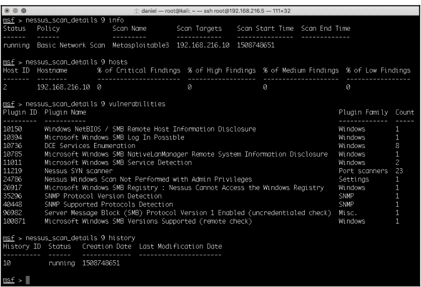

10. 要检查扫描是否已完成，请使用 nessus_scan_details 命令：

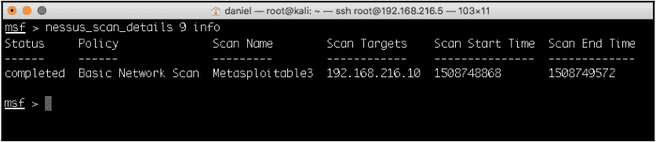

11. 扫描完成后，我们可以使用 `nessus_db_import` 命令将扫描结果导入 Metasploit：

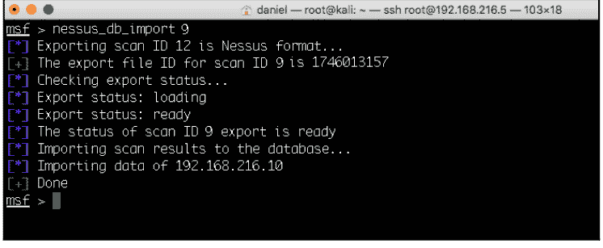

12. 现在我们已将所有数据导入 Metasploit，我们可以使用 `msfconsole` 数据库命令查找服务和漏洞并尝试利用它们：

```
msf > hosts

Hosts
=====

address mac name os_name os_flavor os_sp purpose info comments
------- --- ---- -------- ---------- ----- -------- ---- --------
192.168.216.10 08:00:27:2f:fe:84 192.168.216.10 Windows 2008 SP1 server

msf > services

Services
========

host            port  proto  name        state  info
----            ----  -----  ----        -----  ----
192.168.216.10  22    tcp    ssh         open
192.168.216.10  135   tcp    epmap       open
192.168.216.10  137   udp    netbios-ns  open
192.168.216.10  139   tcp    smb         open
...

[*] Time: 2017-10-23 09:12:50 UTC Vuln: host=192.168.216.10 name=Service Detection refs=NSS-22964
```

[*] 时间: 2017-10-23 09:12:50 UTC 漏洞: host=192.168.216.10 name=Nessus SYN scanner refs=NSS-11219

## 与 NeXpose 集成

在之前的配方中，我们讨论了 Nessus 作为潜在的漏洞扫描器。在本配方中，我们将介绍另一个重要的漏洞扫描器 NeXpose。

NeXpose 是 Rapid7 的一款流行工具，用于执行漏洞扫描并将结果导入 Metasploit 数据库。NeXpose 的使用与 Nessus 类似，但让我们快速了解一下如何开始使用 NeXpose。我将把更深入探索的任务留作你的作业。

### 准备工作

你可以从 http://www.rapid7.com/products/metasploit/metasploit-community-registration.jsp 下载 NeXpose Community。安装 NeXpose 后，你可以从 msfconsole 开始使用它，但首先，我们需要加载插件以连接到 NeXpose 服务器。让我们在命令行中执行以下步骤：

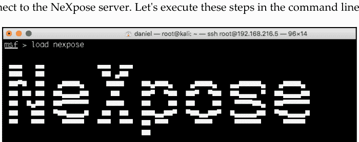

要连接到 NeXpose 服务器，请使用 nexpose_connect 命令，后跟凭据、主机名、端口，并验证 SSL 证书：

```
msf > nexpose_connect NexposeUser:NexposeP4ssw0rd@127.0.0.1:3780 ok
[*] Connecting to Nexpose instance at 127.0.0.1:3780 with username NexposeUser...
msf >
```

### 如何操作...

现在我们已连接到服务器，可以扫描目标并生成报告。NeXpose 支持两种扫描命令。一种是 nexpose_scan，另一种是 nexpose_discover。前者将扫描一系列 IP 地址并导入结果，而后者仅扫描以发现其上运行的主机和服务。

- 1. 让我们使用 NeXpose 对目标执行快速扫描：

```
msf > nexpose_discover 192.168.216.10
[*] Scanning 1 addresses with template aggressive-discovery in sets of 32
[*] Completed the scan of 1 addresses
msf >
```

nexpose_discover 命令启动扫描，但仅执行主机和最小服务发现。

- 2. 要显示 nexpose_scan 命令的帮助，我们可以使用 -h 选项：

```
msf > nexpose_scan -h
Usage: nexpose_scan [options] <Target IP Ranges>

OPTIONS:

    -E <opt> Exclude hosts in the specified range from the scan
    -I <opt> Only scan systems with an address within the specified range
    -P Leave the scan data on the server when it completes (this counts against the maximum licensed IPs)
    -c <opt> Specify credentials to use against these targets (format is type:user:pass)
    -d Scan hosts based on the contents of the existing database
    -h This help menu
    -n <opt> The maximum number of IPs to scan at a time (default is 32)
    ...

msf >
```

- 3. 要扫描我们的目标，我们将使用 `nexpose_scan` 命令，`full-audit` 扫描模板：

```
msf > nexpose_scan -t full-audit 192.168.216.10
[*] Scanning 1 addresses with template full-audit in sets of 32
[*] Completed the scan of 1 addresses
msf >
```

- 4. 要导入扫描结果，我们将使用 `nexpose_site_import` 命令：

```
msf > nexpose_site_import 1
[*] Generating the export data file...
[*] Downloading the export data...
[*] Importing Nexpose data...
msf >
```

将扫描结果导入 Metasploit 后，我们可以使用 `msfconsole` 数据库命令显示找到的主机、服务和漏洞。

## 与 OpenVAS 集成

**开放式漏洞评估系统 (OpenVAS)** 是最广泛使用的开源漏洞扫描和漏洞管理解决方案。

OpenVAS 是作为 Greenbone 安全解决方案的一部分使用和支持的扫描引擎。自 2005 年以来，Greenbone 开发团队为 OpenVAS 的增强做出了重大贡献。

### 如何操作...

- 1. 要在 Kali Linux 上安装 OpenVAS，请使用 `apt install openvas` 命令：

```
root@kali:~# apt-get install openvas
```

- 2. 然后使用 `openvas-setup` 命令设置 OpenVAS，下载最新的规则，创建管理员用户并启动各种服务：

```
root@kali:~# openvas-setup
```

- 3. 设置完成后，OpenVAS 管理器、扫描器和 GSAD 服务应正在监听。要启动 OpenVAS，请使用 openvas-start 命令：

```
root@kali:~# openvas-start
Starting OpenVas Services
root@kali:~#
```

- 4. 在 msfconsole 中使用 OpenVAS 之前，我们需要使用 load 命令加载 OpenVAS 插件：

```
msf > load openvas
[*] Welcome to OpenVAS integration by kost and averagesecurityguy.
[*]
[*] OpenVAS integration requires a database connection. Once the
[*] database is ready, connect to the OpenVAS server using openvas_connect.
[*] For additional commands use openvas_help.
[*]
[*] Successfully loaded plugin: OpenVAS
msf >
```

- 5. 我们可以使用 help 命令显示 msfconsole 内部可用的所有 OpenVAS 命令：

```
msf > help openvas
```

OpenVAS 命令
===============

| 命令 | 描述 |
|---|---|
| openvas_config_list | 快速显示配置列表 |
| openvas_connect | 使用 OMP 连接到 OpenVAS 管理器 |
| openvas_task_start | 按 ID 启动任务 |
| openvas_task_stop | 按 ID 停止任务 |
| openvas_version | 显示 OpenVAS 服务器的版本 |

```
msf >
```

- 6. 要使用 OMP 连接到 OpenVAS 管理器，我们使用 openvas_connect，后跟 OpenVAS 用户名、密码以及 OpenVAS 服务器 IP 地址和端口：

```
msf > openvas_connect admin 596230dc-cfe0-4322-a7b7-025d11a28141 127.0.0.1 9390
[*] Connecting to OpenVAS instance at 127.0.0.1:9390 with username admin...
/usr/share/metasploit-framework/vendor/bundle/ruby/2.3.0/gems/openvas-omp-0.0.4/lib/openvas-omp.rb:201:in `sendreceive': Object#timeout is deprecated, use Timeout.timeout instead.
[+] OpenVAS connection successful
msf >
```

- 7. 连接到 OpenVAS 服务器后，我们需要使用 openvas_target_create 命令指定我们的目标，后跟我们想要赋予目标的名称、目标的 IP 地址以及有关目标的描述或注释：

```
msf > openvas_target_create "Metasploitable3" 192.168.216.10 "Windows Target"
[+] OpenVAS list of targets
```

| ID | 名称 | 主机 | 最大主机数 | 使用中 | 注释 |
|---|---|---|---|---|---|
| 83d3d851-150a-4d1b-80e3-04bb90d034cb | Metasploitable3 | 192.168.216.10 | 1 | 0 | Windows Target |

```
msf >
```

- 8. openvas_config_list 显示可用于扫描目标的配置列表：

```
msf > openvas_config_list
[+] OpenVAS list of configs
```

| ID | 名称 |
|---|---|
| 085569ce-73ed-11df-83c3-002264764cea | empty |
| 2d3f051c-55ba-11e3-bf43-406186ea4fc5 | Host Discovery |
| 698f691e-7489-11df-9d8c-002264764cea | Full and fast ultimate |
| 708f25c4-7489-11df-8094-002264764cea | Full and very deep |
| ... | ... |

```
msf >
```

- 9. 现在，我们需要使用 openvas_task_create 创建一个任务，后跟任务名称、注释、配置 ID 和目标 ID：

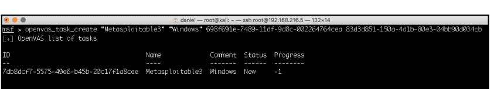

- 10. 要启动任务，我们将使用 openvas_task_start 后跟任务 ID：

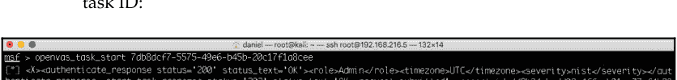

- 11. 要监控进度，我们使用 openvas_task_list 命令：

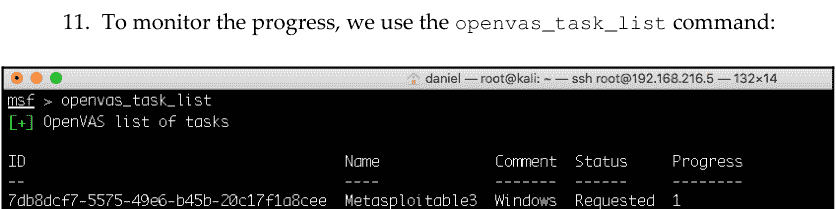

- 12. openvas_format_list 将显示 OpenVAS 支持的报告格式列表：

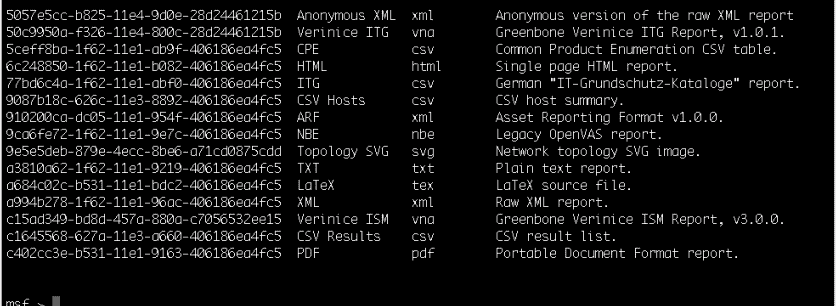

- 13. 要查看任务是否已完成，请使用 openvas_task_list 命令：

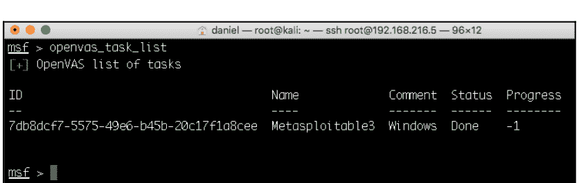

- 14. 扫描完成后，我们可以使用 openvas_report_list 命令列出可用的报告：

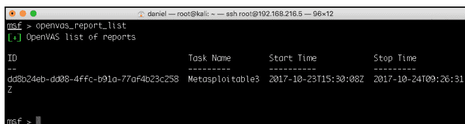

- 15. 并使用 openvas_report_import 命令将报告导入 Metasploit。仅支持导入 NBE（旧版 OpenVAS 报告）和 XML 格式：

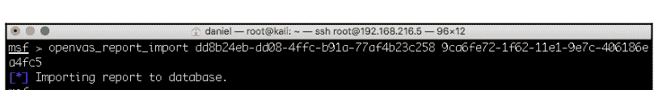

- 16. 将报告导入 Metasploit 后，我们可以使用 msfconsole 数据库 vulns 命令列出找到的漏洞：
