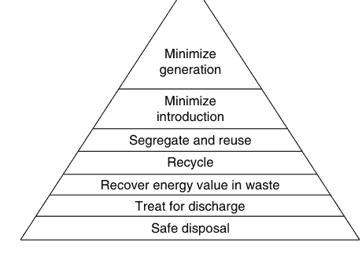
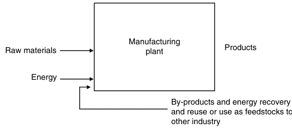
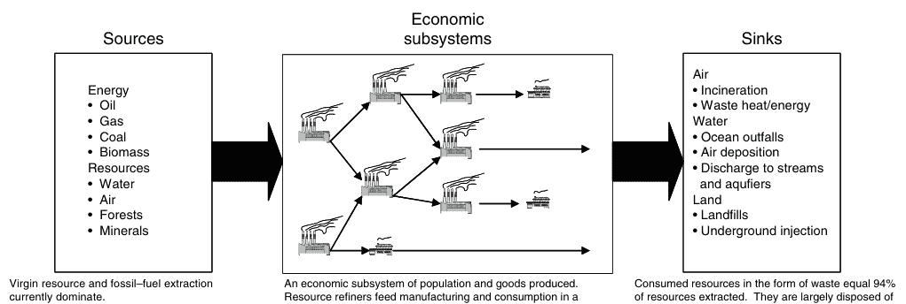
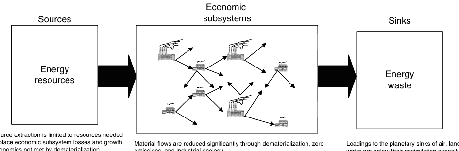
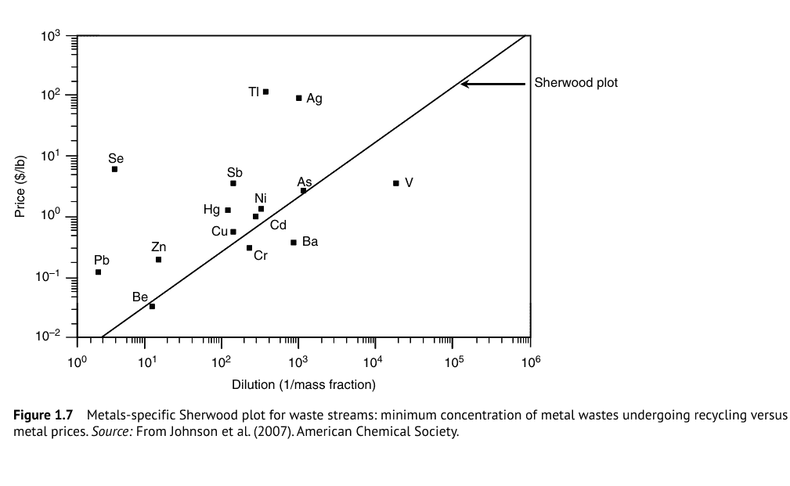
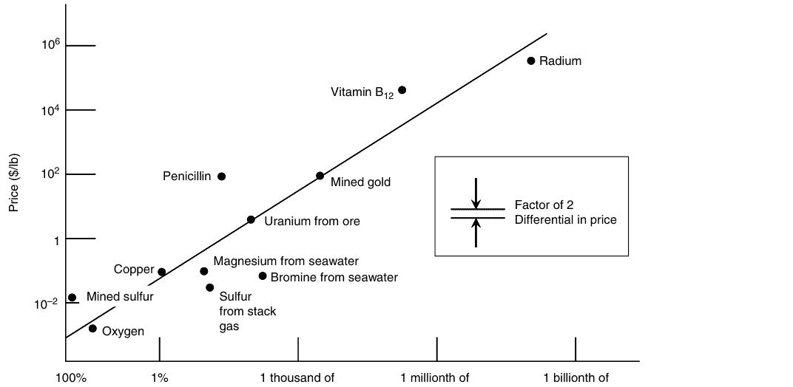

## 1
### 为什么工业环境管理？

#### 1.1 引言

本入门章节阐述了工业环境管理的重要性！环境管理是人类福祉非常重要的一部分，需要深入考虑。制定的设计旨在引导开发过程以利用机会、避免危害、减轻问题，并通过提高适应性和韧性为人们准备不可避免的困难。它是一个关注人类-环境相互作用的过程，并寻求识别：什么是环境上可取的；实现该过程的物理、经济、社会和技术制约是什么；以及最可行的选择是什么。实际上，环境管理并没有简洁的通用定义；然而，它可以简要概括为支持可持续发展；要求多学科和跨学科甚至整体方法；它应整合和调和不同的发展观点，协调科学、工程、技术、社会、政策制定和规划；陈述主动过程；时间尺度和关注点从地方到全球问题；并且在处理受人类影响的世界时，人们强调的是管理而非开发。

在其他观点中，环境管理可以解释为在处理问题时的方法方式，由于需要通过整合生态、政策制定、规划和社会发展来改善环境管理的重要性。其目标包括维持并（如果可能）改善现有资源；预防和克服环境问题；建立限制；创立和培育有效支持环境研究、监测和管理资源的管理机构；发出威胁警告并识别积极变化的机会；（在可能的情况下）改善生活质量；最后，识别有用的新技术或政策。而且，实际上环境管理可细分为多个领域，包括以下内容：

- 环境经济学
- 可持续发展问题
- 环境评估、建模、预测和“手工预测”
- 企业环境管理活动
- 污染识别和控制
- 环境执法和立法
- 环境与发展机构和伦理
- 环境管理体系和质量问题
- 环境规划和管理
- 参与环境管理的利益相关者评估
- 环境感知和教育
- 社区参与
- 自然资源管理
- 环境修复
- 环境政策
- 环境援助和机构建设

总体而言，环境管理者必须确保环境保护与允许人类自由之间取得最佳平衡。那么问题是“如何做到？”基本上，环境管理实施有几个步骤。首先，我们需要确定目标并定义问题，然后确定适当措施，这将继续作为制定计划。接下来实施计划，这将随后进行持续的开发管理。之后监测和评估情况。如果需要调整，就进行调整。然后最后当环境管理的确切模型和标准生成后，将进行持续发展。

环境管理的总体目标是改善人类生活质量。它涉及动员资源和使用政府来管理自然和经济商品与服务的利用。它基于生态学原理。它使用系统分析和冲突解决来在受影响的人群中分配开发活动的成本和收益，并寻求保护开发活动免受自然灾害。冲突识别是环境管理规划中最重要的任务之一，而冲突的解决是“环境友好型发展”构成的基本部分。ISO（国际标准化组织）14000 是一系列与环境管理相关的标准，旨在帮助组织（i）最大限度地减少其运营（流程等）对环境产生的负面影响（即对空气、水或土地造成的不利变化）；（ii）遵守适用的法律法规和其他环境导向要求；以及（iii）在上述方面持续改进。

#### 1.1.1 简述 ISO

ISO 是国际标准化组织。它拥有来自大大小小、工业化、发展中和转型中的 160 个国家标准机构的成员，遍布世界各地所有地区。ISO 拥有超过 18000 项标准组合，为可持续发展的三个维度提供实用工具：经济、环境和社会。

ISO 为企业、政府和整个社会制定的标准对我们生活的世界做出了积极贡献。它们确保了质量、生态、安全、经济、可靠性、兼容性、互操作性、一致性、效率和有效性等重要特性。它们促进贸易，传播知识，分享技术进步和良好的管理实践。ISO 仅开发市场所需标准。这项工作由来自工业、技术和商业部门借调的专家执行，随后他们将其付诸实践。这些专家可能会与具有相关知识的其他人一起工作，例如政府机构、测试实验室、消费者协会和学术界的代表，以及对标准所涉及问题有特定兴趣的非政府或其他利益相关组织。以国际标准之名出版的 ISO 标准代表了所涉技术或良好实践的最新技术状态的国际共识。

#### 1.1.2 ISO 与环境

ISO 采用多方面的方法来满足来自企业、工业、政府当局和非政府组织以及消费者的所有利益相关者在环境领域的需要。

- 1) ISO 制定标准帮助组织采取主动方法管理环境问题：ISO 14000 系列环境管理标准可应用于任何类型的组织，无论是公共部门还是私营部门——从公司到行政机构再到公用事业。
- 2) ISO 借助温室气体核算、核查和排放交易以及产品碳足迹测量标准，帮助应对气候变化挑战。
- 3) ISO 制定标准文件以促进商业与环境目标的融合，通过鼓励在产品设计中纳入环境因素。
- 4) ISO 提供广泛的采样和测试方法标准组合，以应对具体的环境挑战。它已制定约 570 项国际标准，用于监测空气、水和土壤质量、噪声、辐射以及危险品运输控制等方面的质量。

它们在许多国家也作为环境法规的技术基础。

#### 1.1.3 益处

ISO 14001 主要开发用于帮助公司建立更好的管理控制框架，从而可减少其环境影响。除了绩效改进外，组织采用 ISO 标准后还能获得多项经济效益，包括更高的立法和法规遵从性（Sheldon 1997）。通过最大限度地降低监管和环境责任罚款的风险并提高组织的效率（Delmas 2009），效益可包括减少浪费、资源消耗和运营成本。其次，作为一项国际公认的标准，在全球多个地点运营的企业可以利用其对 ISO 14001 的符合性，从而消除多重注册或认证的需求（Hutchens 2010）。第三，过去十年中消费者推动公司采用更好的内部控制，使得将 ISO 14001 纳入其中成为企业长期生存能力的明智做法。这可以为他们提供相对于未采用该标准的公司竞争优势。

采用标准（Potoski and Prakash 2005）。这反过来可以对公司的资产价值产生积极影响（Van der Veldt 1997）。它可以改善公众对企业的认知，使其在国际市场上处于更有利的地位（Potoski and Prakash 2005; Sheldon 1997）。使用 ISO 14001 可以向客户和潜在员工展示一种创新且具有前瞻性的做法。它可以增加企业获取新客户和业务合作伙伴的机会。在某些市场中，它有可能降低公共责任保险费用。它有助于减少注册企业之间的贸易壁垒（Van der Veldt 1997）。在基础设施更新的公私合作伙伴关系招标中，越来越重视纳入 ISO 14001 认证。在加拿大高速公路项目中，已显示出在环境质量和纳税人利益方面的价值证据。

ISO 14001 不仅涉及组织的流程的环境方面，还涉及其产品和服务。因此，ISO/TC 207 已开发出额外的工具来协助解决此类问题。生命周期评估（LCA）是一种用于识别和评估产品和服务从“摇篮到坟墓”的环境影响的工具：从资源投入的提取到产品或其废物的最终处置。ISO 14040 标准提供了关于 LCA 研究原则和实施的指南，为组织提供有关如何减少其产品和服务整体环境影响的信息。ISO 14064 第 1、2 和 3 部分是国际温室气体（GHG）核算和核查标准，为组织和温室气体减排项目的倡导者提供了一套明确且可核查的要求。

## 1.2 环境管理在工业中的应用

如今，许多行业和公司已认识到适当环境管理的重要性，并已从传统的末端治理解决方案转向将环境管理整合到行业的整体管理流程中。推动此类变化的几个主要驱动力是严格的立法；对员工更好工作环境的需求；客户需求；公司形象；以及来自所有利益相关者的日益增长的压力，涉及环境、经济和社会责任。环境考虑不再被视为临时性问题，而已成为行业日常现实的一部分。尽管如此，仍缺乏整体方法，使环境管理成为整体管理体系的自然组成部分。虽然环境部门忙于为外部目的生成报告和请愿书，但高层管理并未利用组织内部已有的专业知识。主要目标是关注各种环境工具和方法的应用，以便从被动的监管方法转向主动的环境决策；获得高层管理对环境信息系统的充分支持；并优先考虑环境问题并加快实施。最终，将环境责任与环境系统整合并分配所需资源，将导致环境战略的实施，并可促进环境绩效的改善和行业长期盈利能力的提高。

### 1.2.1 环境挑战

我们对环境可持续性和环境管理问题的浓厚兴趣可以直接追溯到这样的认识：随着世界人口不断增长并消耗自然资源，人类面临着威胁发达地区及其他地区生活质量乃至生命本身的短缺。在试图寻找这些问题的解决方案时，我们创造了不断增长的制造商品、化学品、药品的库存，表面上是为了改善生活质量，事实上却导致了我们环境的污染。“污染预防”这一环境流行语自 1990 年代以来一直存在，其涵盖了设计不产生废物的工艺以及仅排放无害化合物（如纯水）的工厂。

零缺陷和零效应（ZDZE）与污染预防不同之处在于，它将原材料转化为“无缺陷”的制造产品或具有价值的资源，以及“零效应”对健康和环境没有不良影响。在本书中，“零效应”、“零排放”或“零排放”的含义是互补的，所有术语都可互换使用（Das 2005）。在 ZDZE 范式内，资源开采、精炼或商品生产的目标与采矿、钢铁、造纸、石油、能源、汽车、石油化工、制药、化肥、农业和化学工业处理原材料的方式大体相同。有时将废物或副产品转化为对另一行业有价值的资源，比实施污染预防技术更有效——即工业生态学（另见第 9 章）。

在本書中，我们将重点关注最佳管理实践、最佳可用的工业制造工艺、技术和技术，这些工艺将原材料处理成无缺陷产品，以及具有实现工厂和行业层面污染预防最高标准最佳潜力的创新和新兴工艺，从而实现无缺陷和零效应（NDZE）——工业环境管理的共同目标。为了通过工艺污染预防（P3）和盈利性污染预防（P3）实现 NDZE，行业必须使用能够足够高效地部署材料和能源以中和和控制废物流中污染物的工艺。最终目标是去除废物流中的污染物并将其转化为产品或供其他工艺使用的原料。逻辑上，P3 指的是工业制造工艺，通过该工艺高效利用材料和能源以实现具有“无缺陷”的最终产品，同时减少或消除在源头产生污染物或废物，即“零排放或零效应”。主要目标是教育工程学生，使他们成为当前和未来一代工程师，他们将学习和实践可持续工程，并将成为工业环境管理所需的地球看护者，成为我们冠军的守护者。

## 1.3 废物作为污染

废物被定义为制造过程中不需要的副产品或受损、有缺陷或多余的材料。最常见的是，在其当前状态下，它被认为没有价值或被认为没有价值。它在释放到环境中时可能有害或有毒，也可能无害。污染是对环境的任何废物释放（即任何常规或意外排放、废水、泄漏、排放或处置到空气、土地或水体）从而污染或破坏环境。

## 1.4 污染预防的定义

在本書中，我们将污染预防定义为相当宽泛的任何防止有害物质释放到环境中的行动。该定义表现为污染预防层级，以安全处置形式为金字塔底部，以源头最小化废物产生为顶峰（图 1.1）。

相比之下，美国环境保护署（USEPA）（1992）对污染预防的定义仅承认源头削减和节约，这仅涵盖层级中的上两个层级——最小化产生和最小化引入。USEPA 将图 1.1 的七级层级描述为“环境管理选项”。另一方面，欧洲共同体在其污染预防定义中包含了整个层级。污染预防层级中的层级大致描述如下。

图 1.1 污染预防层级。

- 最小化产生：将化学反应步骤中不可销售副产品的形成和所有化学和物理分离步骤中废物成分（如焦油、细粉等）降至最低。
- 最小化引入：尽可能减少未反应通过系统或转化为废物的工艺材料。这意味着最小化引入对制造最终产品并非必需成分的材料。例如，工厂设计人员可以决定不使用水作为溶剂，而使用其中一种反应物、中间体或产品来发挥相同功能，或者他们可以添加空气作为氧源、热沉、稀释剂或输送气体，而不是大量氮气。
- 分离和再利用：避免将废物流合并在一起而不考虑对毒性或处理成本的影响。可能有意义将低体积、高毒性的废水流与高体积、低毒性的废水流分开。在源头检查每个废物流，并确定任何可能在工艺中再利用或转化为有价值的副产品的废物流。
- 回收：许多制造设施，尤其是化工厂，都有被视为工艺一部分的内部回收流。此外，还需要外部回收诸如聚酯薄膜和瓶子、Tyvek 信封、纸张和废溶剂等材料。

## 1.4 废物管理层级

- 回收废物中的能量价值：作为最后的手段，已耗竭的有机液体、含有挥发性有机化合物（VOCs）的气态物流以及氢气可以被燃烧以回收其燃料价值。通常，制造原始化合物所需的能量和资源价值远大于通过燃烧废物流回收其燃料价值所得到的价值（另见附录G）。
- 处理后排放：在任何废物流排放到环境中之前，应采取 measures 降低其毒性、浊度、全球变暖潜能、病原体含量等。示例包括但不限于：生物废水处理、碳吸附、过滤和化学氧化。
- 安全处置：使废物流完全无害，使其不对环境产生不利影响。在本书中，我们将此定义为废物成分完全转化为二氧化碳、水和无毒矿物质。一个例子是对污水处理厂出水在私有湿地中进行后处理。所谓的“安全填埋场”除非废物被花岗岩完全封装，否则不属于此类别。

## 1.4.1 资源效率

资源效率反映了对当前全球经济增长和发展模式的认知，即现有的制造、生产和消费模式无法维持可持续发展。在全球范围内，我们为了生产商品而提取的资源超过了地球的再生能力。资源效率是指从最终原材料提取到最终使用和处置，减少这些商品生产和消费对环境的影响。这一资源效率过程可以解决可持续性问题（参见第10章）。

在本书中，我们将重点关注工业污染预防层级的上部三个选项；即，回收废物中的能量价值、处理后排放以及安排安全处置。然而，为了改善这一底线，企业应首先处理上部三个层级：即最小化产生、最小化引入以及分离和再利用。这里存在着减少需处理废物量的真正机会。废物流的体积反过来对处理成本和适用性有强烈影响。因此，诸如膜工艺等在水、溶剂和溶质回收方面具有高度灵活分离技术的有用技术，或在空气中冷凝VOCs，在大体积流量下不具备经济性。焦点已从末端处理解决方案转向工业制造过程更根本性的结构变化。

## 1.5 ZDZE范式

无缺陷和零影响，或非常接近的目标，是P3的终极目标，而工艺本身是实现它的工具途径。因此，工业应被重新组织成“集群”，其中每个工业过程的废物或副产物与其他行业的输入需求完全匹配；集成工艺只生产洁净产品，完美匹配给定规格，且没有任何形式的废物。如第8章1.5节所述，这一解决方案正在世界各地分散的区域应用，从瑞典等现代工业国家到孟加拉国等发展中国家。

传统上，污染控制技术处理“废物”，直到其足够无害，可以排放到环境中。这是通过稀释、销毁、分离或浓缩实现的。在ZDZE范式内，许多这些工艺仍将应用，但如前所述，目标将是资源提取、精炼或大宗商品生产，而不仅仅是将废物从场所移除。工程公司需要开发转换技术，创造“设计废物”以满足其他行业的输入规格。

## 1.6 零排放工业

虽然零影响或零排放（ZD）制造有几个实用定义，但零排放系统通常被理解为不排放任何废物来自加工和制造场所的系统。在这样的制造工厂（见图1.2），产生并离开工厂的废物量为绝对最小，“理想情况下为零”。工厂唯一的输入是制造可销售产品所需的原材料和能量。唯一的输出是可销售产品和作为另一工厂原料的副产物。制造过程中产生的废物（空气、水或固体形式）或副产物通过各种技术回收（Das 2005）。

从废物流中回收的材料和能量要么在工厂内再利用，要么作为原料卖给另一家工厂。在实践中和理论上，都可以通过将所有废物回收为可制造成消费品的材料，使某些工业设施几乎完全与环境隔离。一个这样的设施例子是燃煤发电厂。电子束-氨转换单元向废气中添加氨，然后进行电子辐照，产生硝酸铵和硫酸铵，作为原料卖给肥料制造。细节在第9.2.3节中给出。

图1.2 “零”废物制造工厂。

零排放的概念受零缺陷（全面质量管理）、零库存（准时制）和零事故（工作场所安全）商业项目的启发，虽然其驱动力是改进商业绩效，但环境效益也是显著的。

零排放的基本前提是将一个行业的废物转化为另一个行业的物料输入。零排放系统的应用和发展将是行业的责任，特别是制造商和咨询工程公司。在某种程度上，向零排放的转变已经随着污染预防、废物最小化和环境设计而发生。虽然这些系统需要进一步改进，但采用这些系统的行业已经看到了好处。

但重要的是要理解，即使经过所有合理的污染预防努力，某些制造工艺本质上会产生废物。因此，在某些情况下，使用转换技术可能比污染预防计划更合适：许多工业废物可以被处理，使其成为另一个行业或多个相连行业组成的工业集群中的可用物料输入。

## 1.7 可持续性、工业生态学和零排放（排放）

零排放或零排放的概念是可持续发展的关键，但其本身是工业生态学的一个子集（另见第9.2节）（见图1.3）。

可持续性可以定义如下：“可持续发展”是在保护环境和保护对未来发展至关重要的自然资源基础的同时，满足人类对自然资源、工业产品、能源、食品、交通、住房和有效废物管理的需求的挑战；以及“满足当代人的需求，又不损害后代满足其自身需求的能力的发展”（世界环境与发展委员会 1987）。可持续性是一个值得追求的愿景，但本质上模棱两可，不可避免地以带有价值观的术语表达，受不同意识形态解释的影响。因此，虽然这一概念提供了有用的方向，但几乎不可能付诸实施。单独来看，它既不能指导技术开发，也不能指导政策制定。

工业生态学是“一种设计工业产品和工艺的方法，通过产品竞争力和环境相互作用的双重视角来评估这些活动”。该领域在过去10年中主要是在学术界发展的，成为“人类可以有意和理性地接近并维持理想承载力的手段”（Graedel 和 Allenby 1995）。它可以被视为工业系统的可持续性科学——对工业和经济系统及其与基本自然系统的联系进行跨学科研究（另见第9.2节）。

尽管仍在发展中，工业生态学可以提供理论科学基础，基于此可以理解当前做法并进行理性改进。它包括涉及能源供应和使用、新材料、新技术、基础科学、经济学、法律、管理和社会科学的研究。它涵盖并发工程、环境设计（DFE）、去物质化、污染预防、废物转换、废物交换、废物最小化和回收，以零排放作为重要子集。工业生态学可以是一个政策工具，但它既不是政策也不是规划系统。

零排放的目标是重组制造，使没有废物。“零排放”因此是在制造/服务层面应用的“工业生态学”，实际上这两个术语经常互换使用。注意重点是在制造层面，而不是公司或行业层面：虽然“公司”和

## 1.8 为什么零排放对可持续性至关重要

要理解为什么零排放是可持续性的关键组成部分，必须认识到可持续性的一个原则是对资源的高效、明智利用，特别是在限制资源开采的数量和类型以及随之而来的污染负荷方面。为了理解这些关联，可以设想一个由三部分组成的循环：源、系统和汇。

- 源包括矿物、水、表土和化石燃料等原材料。在这个星球上，这些资源有限，但拥有巨大的外部储量。
- 系统是我们操纵能量将源材料转化为成品的能力。经济和工业系统只受想象力的限制。
- 汇是全球的垃圾箱。最终的长期汇是深海海沟；短期汇是大气、河流、湿地和土地等生物系统。汇处理废物的能力有限；大多数在短短几年内就会显示出污染物负荷的不利影响。

在这个三部分模型中，限制性最强的组成部分是汇。目前，资源枯竭很少成为资源替代的驱动力；相反，变革是由战胜竞争的工艺创新或外部强加的监管干预所驱动的。但鉴于汇的局限性，改造工业系统的压力将越来越多地来自减少环境汇负荷的需求。

为了实现可持续性，必须通过多种方式保护地球环境。例如，规划者必须致力于最小化或消除对气候的人为改变、酸化的净增加、表土的流失和化石水的抽取；此外，必须保护生物多样性，并阻止有毒金属和其他不可生物降解的有毒物质在土壤或沉积物中积累。零排放技术试图通过减少资源开采和汇负荷来实现这些目标。目标是经济子系统中的闭环，使人类活动不可避免产生的废物不会逸出而污染环境。

零排放倡导者、零排放研究机构创始人兼前主任冈特·鲍利（Gunter Pauli）还指出，在消除废物的努力中，零排放“无非是持续削减成本的驱动力”。废物是一种低效形式，“一个经济体系如果产生废物，就不能被认为是高效的，或最终具有竞争力的”（Pauli 1996）。

零排放（Zero Discharge 或 Zero Emissions）摒弃了线性的“从摇篮到坟墓”的材料使用概念（图 1.5），并拥抱了循环的“从摇篮到摇篮”愿景（图 1.6），其中废物成为增值投入，并成为其他生产循环的原材料。这就是自然系统处理废物的方式，而且根据鲍利的说法，这也是实现可持续性的唯一途径。

与此同时，生物汇的容量并没有增加。现有工业将继续运营并产生废物——其中一些废物，正如后面将讨论的，所含可回收材料的浓度高于原生材料。在此期间，将需要技术来管理和转化当今的废物，使其成为可用的原料。化学工艺设计工程师和咨询公司将通过技术开发、系统集成和设施运营，提供重点服务以满足这一需求。

图 1.5 线性（从摇篮到坟墓）材料使用模式下源、系统和汇的相互关系。

图 1.6 循环（零排放）材料使用模式下源、系统和汇的相互关系。

## 1.9 工艺工程师和工程公司的新角色

随着工业向零排放（Zero Emissions 或 Zero Discharge）范式迈进，化学工艺与产品设计工程师、环境工程师和咨询工程公司可以发挥关键作用，尤其是那些传统定位是处理废物使其无害且可排放的公司。这些工程师在二十一世纪的角色是将一个过程的流出物转化为另一个过程的原材料。新角色不仅仅是促进废物交换；而是包括以下新任务：

- 评估经济中的物质流以及原材料、水和能源的使用
- 设计包含更广泛的物质流和制造过程信息的数据库
- 与设计公司合作，了解产生废物的行业的生产过程
- 设计转化过程
- 为转化后的废物寻找买家
- 设计物料输送系统，将废物输送到将其用作原料的行业
- 识别产业集群，并理解如何将不同行业融入一个成功的产业集群
- 设计生态工业园区，并协商在商业上稳健且有利可图的安排，同时建立在良好的个人关系基础上；自愿进行，且与监管机构密切合作

这对工程公司意味着需要更广泛的工程技能和服务。可以看到，咨询工程公司将发现，实现零排放需要具备工程课程或专业工程师考试中未曾涵盖的专业知识。

零排放工程师不仅需要在环境设计、并行工程和工业工程方面受过良好训练，还需要能够在工厂的传统边界之外进行思考和设计，以产业集群的方式进行工作。

上述许多技能和服务将适用于农业产业集群的发展，如迷你案例研究 1.1 中描述的纳米比亚案例。

### 迷你案例研究 1.1 从啤酒到蘑菇：关注原材料的生产力

在非洲沙漠中的楚梅布镇，纳米比亚人将在1997年1月开业的一家啤酒厂实施零排放技术。啤酒的三种主要投入——谷物、水和能源——在一个发展中国家是稀缺商品。酿造只利用了谷物中8–10%的营养物质，每生产1升啤酒消耗10升水，并且通常需要进口煤炭，这是一种昂贵且污染严重的能源。麦糟中的木质纤维素成分占其体积的70–80%，牛无法消化，但很容易被蘑菇的酶分解。需要4吨麦糟才能生产1吨蘑菇，蘑菇是一种潜在利润丰厚的出口经济作物，因为大多数南部非洲国家目前进口蘑菇。麦糟中的蛋白质含量高达26%，被蚯蚓利用，蚯蚓又被喂给鸡和猪。在消化器中处理这些动物的废物可以提供酿造所需的所有蒸汽能源。啤酒厂废水的营养物质含量高，但对作物来说碱性太强。然而，它可用于培养螺旋藻，螺旋藻的蛋白质含量可高达70%。啤酒厂的余热可为温室或啤酒厂供暖。这些相互关联的产业将形成一个最优产业集群，以提高啤酒厂原材料的生产力，同时生产出具有高营养价值的人类食品。

## 1.10 零排放（零排放）方法

在过去几年中，*零排放社区*和工业的成员们开发出了一套五步法，用于实施零排放。Pauli 的 *Breakthroughs*（1996）提供了一种更为全面的方法，其范围远远超出了制造现场。此处提供的摘要强调了在制造层面采用 ZD 方法的使用和影响。

### 1.10.1 分析通量

实现 *Zero Discharge* 和/或 *Zero Emissions* 的第一步是对行业进行深入审查，以判断是否可能实现总通量。这意味着确定所有物料投入是否都能在最终产品中找到——如果没有废物，所有投入都必须进入产品。水泥制造是少数可以实现这种情况的行业之一。然而在案例研究 1.1 中，只有极少量的谷物营养物质最终进入啤酒。

如果通量不是全部，下一步是确定所制造的产品是否可以轻松地重新整合到生态系统中，而无需额外支付加工、能源或运输成本。然而，由于这种情况很少可能，大多数行业无法单方面实现零排放。

工艺和产品设计工程师可能首先通过与传统客户会面、分析每个客户的通量，并寻找客户内部专家可能未发现的污染预防和废物最小化机会来找到机会。分析将包括评估目前生产的产品和服务、所使用的工艺和材料以及环境问题的管理，包括能源效率，并明确排放的全部范围。

### 1.10.2 清单输入和输出

一旦初步分析确定总通量是不可能的，并且会产生废物，下一步就是评估行业的投入和产出，并对所有产出物（“废物”）进行清单。像图 1.2、1.5 和 1.6 那样的系统输入和输出图随后被用来汇编公司资源和需求的基本概况。根据这些信息，设计工程师和工艺专家可以尝试修改制造工艺，使其成为 *Zero Emissions* 系统。

提取原材料并对其进行加工会带来巨大的环境负担。对产品工业代谢（即其投入、材料使用和生命周期预期）的分析将有助于确定环境影响最小的路径。某些材料选择将产生更好的通量或副产品，更适合用作另一个行业的投入。

可能需要额外的审计和清单来确定按投入浪费百分比计算的制造效率，量化按材料类型填埋的废物量，核算回收收集的材料量，并确定废热排放的主要排放量以及废水排放的地点和数量。对这些产出的分析可能揭示重复使用这些产出的最有效方法，并有助于确定哪些行业可以用废物作为原材料。例如，在纳米比亚啤酒厂，酿造剩余物、过剩热量和废水都可用于生产食品。

### 1.10.3 建立工业集群

在无法单方面实现 *Zero Emissions* 的行业中，可能有必要建立工业集群。投入产出分析直接导向开发可以相互使用产出的行业集群。开发有效的集群要求高管超越单一行业，并在看似无关的潜在合作伙伴之间建立创新联系。然而公司不愿实施此类变革。除了担心反垄断法规和需要依赖单一供应商供应的需求外，还有担心放弃废物流成分信息会让竞争对手推断出专有秘密。

同样关键的是客户潜在合作伙伴的地理位置，因为运输是优化废物交换和转换技术使用的关键因素。在寻找工业集群合作伙伴时，最明显的联系将是获取其他工业部门的工业投入数据，并确定客户的废物流是否可以作为某种转换形式的材料投入到另一个部门。寻找候选工业集群的第二个地方是废物交换的历史记录。这些物质流动将证明被某个行业丢弃的材料是否具有另一个行业所期望的体积和质量。

购买工艺废物的行业正在接收可能达不到购买者规格的非原生材料等级。这为材料混合提供了机会。例如，塑料可以回收制成类似木材的产品，但此类回收产品的等级并不总是可接受的作为直接投入。如果受污染的废物流体积不足，则混合原生塑料可以将质量和体积提高到制造规格。

一旦确定了潜在合作伙伴，就应设计和开发工业集群。Kalundborg（Grann 1994）是包括重工业的集群的绝佳范例，而 Tsumeb 的集群主要围绕食品生产和加工。世界其他地方，工业集群尚未开发。

印度和中国是工业化国家，拥有充足且廉价的煤炭供应，但将其燃烧发电会产生 CO₂、SOₓ 和 NOₓ。因此，工业化国家的持续发展关键在于开发将能源、农业和污水处理联系起来的工业集群，这是零排放社区的基本格式。开发此类集群最有效的激励是经济性，而且与传统的 SOₓ 和 NOₓ 处理不同，电子束/氨转换这些污染物的系统具有 10–15 年的财务回报。第 9.2.3 节更详细地介绍了该技术。

### 1.10.4 开发转换技术

工业集群最简单的联系是通过简单的直接废物交换。下一个最简单的方法是开发中间工艺，将一个行业的当前废物流转换为可用形式并转移给购买行业。现在我们简要考虑转换技术作为关键功能，如在美国造纸回收行业为实现零排放而遇到的问题所说明的（另见第 7 章和第 9 章）。

纸张回收本质上是“绿色”的。但当前用于脱墨纸张的工艺只能去除 70–80% 的墨粒，使回收纸呈现难看的灰色。废物是墨水、短纤维、涂层化学品和纸张填料的有毒混合物，在处置前需要初级和次级处理。脱墨既低效又昂贵，且生产的产品价格往往更高、质量更低。

在 ZD 行业的倡导下，正在开发一种转换技术，可实现 100% 去除墨水并产生 3 种可行产出。回收的墨水可用于印刷或制造铅笔（复印机墨水已如此使用）。长纤维可再次制成纸张或用于纸板。剩余的短纤维和残留物的泥状混合物可干燥后用作建筑墙体内部的隔音材料或天花板瓷砖。污泥可用于制造减震包装，如蛋托或瓦楞纸板替代品。

围绕纸张回收建立的工业集群因此包括回收墨水、制造新纸张以及制造建筑和包装材料。加拿大、拉脱维亚和意大利已测试了这种转换技术，即蒸汽爆破系统。然而，许多城市、州和国家政府要求在报纸中使用回收纸，在这些法规生效的地方，生产出比报纸所需等级更好的纸张的系统不太可能被实施。

### 1.10.5 设计废物

所谓的“设计废物”可以直接作为另一个部门的直接原料，或如果通过转换技术适当处理，则作为加工原料。例如，如果啤酒行业在瓶子清洗工艺中使用基于糖的清洁剂而不是腐蚀性清洁剂，排放水可以直接作为鱼塘的直接进料，而无需任何转换。其他解决方案仍需要安装协助，以调整或适应客户工艺中的物料流动，使其废物输出处于可接受的形式。

建立工业集群可能涉及在设施上游工作，修改其生产工艺，以便以可接受的“设计”形式生产废物以供转换。或者，也许在下游，与购买行业合作，帮助其修改工艺，使其能够接受转换后的废物。

这意味着相关工程顾问必须熟悉供应商向生产商提供的产品和材料，以及设计废物购买者所需的材料。所有各方必须能够访问有关每种最终产品可接受杂质水平的特定信息的数据库。例如，生产基础材料投入（如塑料、油、润滑剂和纸张）的公司处理量大，某些制造工艺可以容忍杂质。这些公司已在其自身精炼工艺方面积累了经验，也可能了解其客户的制造要求，但其专业知识可能不延伸到生产商废物流中存在的特定杂质。数据库可以提供完成连接所需的信息。

### 1.10.6 重新设计监管政策

经验丰富的专业人士可能已经意识到政府政策如何无意中阻碍废物再利用的创造力。这些政策也可能阻碍形成

产品的背景，包括管理其运输、预期用途、可回收性和处置过程对环境产生影响的技术，以及生产中所用原材料开采对环境造成的后果。

因此，所有材料的最终归宿都是消散、被废弃，或回收再利用。由于从环境中开采的材料中有94%转化为废弃物，目前的回收水平显然不足。从废弃物中回收材料将减少资源开采的范围（但不会减缓材料在经济系统中的流动速度）。铝和铅是当前被大量回收的两种资源，但证据表明，还有更多资源有可能从废弃物中被回收。

舍伍德图是一种可以直观比较自然界中材料浓度与其商品成本的图表。图1.7中的示例图表明，商品的价格取决于其在开采和提炼之前在自然界中的浓度。图1.8是类似的图表，显示金属价格（2004年）与商业矿石中金属稀释（浓度）的函数关系；该关系说明了一个概念：一种材料在原生矿石中越稀散，将其提纯为商品材料的成本就越高（Johnson等，2007）。

舍伍德图共同展示了材料的回收潜力。图1.7中绘制在线以上的元素应大力回收，因为它们以相对较高的浓度存在于个别副产品中。铅、锌、铜、镍、汞、砷、银、硒、锑和铊从废弃物中回收比从自然界中开采更经济。广泛的废弃物交易可以显著减少需要处置的材料数量，因为资源开采使用的是废弃物而非原始原料（Allen和Behmannesh，1994）。

## 1.11.2 去物质化

工业生态学范式的关键组成部分之一是去物质化。去物质化意味着用更少的材料制造出与前辈产品功能相同的产品。有时这意味着更小或更轻的产品，但其他方面还可以包括延长产品的使用寿命或提高其效率。净效果是减少整体资源开采。因此，去物质化是提高耐用品中有用材料占比、减少作为废弃残留物比例的一种方式。

然而，去物质化在实现零排放方面存在局限。我们可能还需要考虑再物质化——即那些最终形态未必更轻，但其生产、使用以及后续转化或可回收性符合零排放范式的产品。这一点可以从回收旧款汽车比新款汽车更容易、更有益中看出来。尽管如此，经济学家和工程师指出，仅以环境保护为优化目标意味着在安全性、效率、耐用性、便利性、吸引力和价格方面会有所损失。

**图1.8** 舍伍德图，显示材料的销售价格与其在分离基质中的稀释程度之间的相关性。

## 1.11.3 投资回收

在向零排放过渡期间，另一个早期需求将是企业填补“分解者生态位”，这是雷蒙德·科特于1995年在渥太华的达尔豪斯大学提出的一种专门回收形式。正如分解者生物将死亡的动物和植物物质转化为可供其他动植物作为食物的形式一样，分解者生态位企业将通过把原本无用的废弃物加工成可用原料，或拆解设备并销售可重复使用的组件和材料，来“消耗”这些废弃物。

分解者的工作也可以视为投资回收。根据科特的说法，投资回收是采取系统方法来终结废弃物，是一种传统服务，“一种集成的业务流程，用于识别、重新部署、回收或重新销售正常业务过程中产生的非生产性资产。”这些资产包括闲置、过时、未使用或无法运行的设备、机械或设施；多余原材料、运营库存和耗材；建筑垃圾；待拆除设施中的设备和固定装置；不合格、不符合规格或停产的产品；以及工艺废弃物（Cote 1995, 2003）。

投资回收的目标是制定策略和程序，从公司或社区的所有剩余资产中重新获取最高价值。它旨在降低运营和处置成本，防止资产作为废弃物处置，并为再分配副产品寻找市场以增加经济价值。投资回收公司的运营模式之一是将自身职能整合到生态工业园区的综合战略中。专门从事这项工作的公司收费方式为固定聘用费加上一定比例的节省费用和/或收入（如果有激励措施的话）。

## 1.11.4 新技术与新材料

在过渡阶段，如果通过最少的工程设计就能使现有产业相互兼容，并且材料转移大多以更基础的商品形式而非“设计废弃物”形式进行，那么这些现有产业就可以被认定为集群的潜在成员。一旦零排放理念被纳入设计蓝图层面，就可以规划设施在集群中协同工作，使每个企业的副产品满足集群内其他行业的原料规格要求。这将需要在材料和方法上同时进行创新。

### 1.11.4.1 新的、低毒性化学品和材料

新材料的例子包括生物聚合物、纤维增强复合材料、高性能陶瓷和高强度混凝土。为了满足基本的环境要求，新材料将是可生物降解、无污染、可回收或可转化的；由可再生资源制成；在生产和使用中能耗低；并提供更坚固、更耐用、重量和体积更小的最终产品。

## 迷你案例研究1.2 戴姆勒克莱斯勒位于墨西哥的零排放废水处理厂

戴姆勒克莱斯勒位于墨西哥托卢卡的生产综合体，是克莱斯勒PT漫步者的产地，不仅因其畅销产品而备受关注，还因其先进的零排放废水处理厂而受到瞩目。托卢卡位于墨西哥城以北37英里处，多年来因城市扩张、区域干旱和工业活动增加而饱受水资源短缺日益加剧之苦。该市是墨西哥饮料、纺织和汽车的主要生产地之一，也是食品加工中心。

戴姆勒克莱斯勒作为墨西哥最大的制造商之一，深知世界自然资源日益增长的压力，一直在寻求减少运营浪费、降低成本和提高流程效率的方法。进入墨西哥后，这家汽车制造商开始研究该地区快速下降的地下水位，希望尽可能减少对这一宝贵资源的压力，同时使其运营符合联邦政府的水质标准。

1999年，该公司找到了解决方案。它将投资1700万美元建造自己的废水处理厂，处理该设施四个独立工厂（发动机、变速箱、冲压和装配）产生的卫生废水和制造工艺废水。为了使这座废水处理厂真正达到先进水平，将安装一套全面的零液体排放系统。通过使用零排放系统，托卢卡综合体将避免进一步消耗当地含水层，这套环保且成本效益高的系统不会排放工艺废水，而是将其回收利用，在整个设施中循环使用。据预测，实施零排放解决方案并回用废水可以延长设施的运行寿命，而不会中断生产或导致昂贵的改造。

### 1.11.4.2 改进工艺

顾问可以通过实施实时监控和消除产品生命周期中资源利用的低效环节，帮助管理者降低成本并创造新价值。这些低效环节包括材料和能源资源利用不充分、工艺控制不佳、产品缺陷、废物储存成本、废弃包装、因污染或低能效而转嫁给消费者的成本，以及最终通过处置和消散性使用造成的资源损失。资源生产率低下还会带来废物处置成本和监管处罚成本。能源密集度较低、劳动密集度较高的方法在环境和社会上更具可持续性。

## 1.11.5 新思维

由于材料和工艺的变化，工程专业人员必须扩展其设计参数的视野。需要为设施和制造工艺设计更大、更集成的方案。这正是“环境设计”的用武之地：环境设计审视产品的生命周期，不仅考虑其主要用途，还考虑其生产、组装、测试、维护和回收对环境的影响。例如，在设计生态工业园区时，制造工艺将与物料流和能量流相连接。因此，设计周期和总体成本会更高。

然而，投资回报期将大大缩短（见第7.3节和7.3.1节）。

### 1.11.5.1 系统设计

戴姆勒克莱斯勒运行了两种零液体排放系统。第一种使用反渗透技术产生总溶解固体浓缩液，将其送入大型蒸发器，最终进入泻湖或太阳能蒸发池。该系统用于低海拔的干燥干旱地区，常见于墨西哥北部汽车设施的废水处理厂中。另一种系统用于托卢卡工厂，通过微滤去除反渗透浓缩液中的硬度离子和二氧化硅，然后将水送入另一个反渗透单元进一步浓缩。随后，水被返回并与来自第一段的水混合，而浓缩液则被送入蒸发器或结晶器，将总溶解固体干燥成粉末，从而无需处理液体。

实际上，安装零液体排放系统的工厂可以预期回收近100%原本会作为废水排放到环境中的水。在托卢卡工厂，废水处理厂回收了95%或更多的工艺用水，回收率高达每天23.75万加仑。事实上，托卢卡工厂的零液体排放装置是两个独立的系统：一个是卫生水系统，对综合体卫生间、淋浴间、食堂和其他生活区域的废水进行生物处理；另一个是制造工艺水系统，对来自装配厂混合有重金属和油漆的废水进行化学处理。后者还处理

尤其是对于专门从事再加工的企业。各式材料加工设备（如粉碎、筛分、分选、净化、分离和包装设备）的生产商将找到新的市场。然而，在某些情况下，转化过程将由中介公司处理，这些公司会通过机械、化学或生物方式改变废物，以满足客户的规格要求。

- 开发新技术、新工艺和新材料。许多污染控制公司将开始与上游大宗商品生产商（如石油、化工和矿业公司）合作，并学习它们的精炼技术。
- 支持基于零排放经济的组织变革以及技术和信息需求。这主要将是那些提供信息和组织系统技能的企业所面临的商业机会。
- 将技术和方法整合到创新的新系统中。随着零排放的扩展，来自不同领域的专业人士将相互联系，从彼此的技能和经验中获益。
- 开发生态工业园的基础设施。需要设备来在工厂和社区之间输送材料、水或热量的流动。专门从事城市设计和基础设施系统的土木工程公司应该在提供集成系统设计方面找到巨大机遇。

## 1.11.6.2 提供投资回报

投资回报率（ROI）是一个简单的经济指标，可以快速衡量一项投资何时能够收回成本。从投资开始到实现投资回报的时间称为回收期。传统上，污染控制技术不被视为能够产生投资回报的投资，通常以满足监管指南的最低可用成本来衡量（另见第7章）。然而，如果像ZD理念那样将废物视为材料，整个图景就会改变。有人开玩笑说，给工厂生产的所有材料起一个产品名称并设立广告预算，然后停产任何卖不掉的“产品”。

历史上，工程师的报酬一直基于项目总成本。激励机制需要转向减少材料和能源流量的设计。基于能效的报酬正在一些项目中实施，并且取得了成功，因为能效可以用单一单位（节省的能量焦耳数）来衡量。虽然材料流量不容易用单一单位量化，但废物回收系统可以提供极佳的投资回报，如迷你案例研究1.3所示。

## 迷你案例研究1.3 从棕榈油提取中回收废物产生高投资回报

从农业工业中回收废物是零排放极具前景的一个方面。该项目专注于从马来西亚的黄金希望种植园——世界上最大的油棕种植园——回收所有固体、液体、气体和热废物。在Meta Epsi（一家对油棕种植园有重大兴趣的大型工程集团）的承诺下，全面利用油棕生物质的试点项目于1996年夏季启动。

试点项目采用蒸汽爆破法将生物质转化为可回收纤维，目标是再利用黄金希望公司过去花钱处理的废弃种子、果串、树叶和树干。生产1吨商业可用纤维的成本为50马来西亚林吉特（M$50），售价约为M$350。由纤维制成的产品包括中密度纤维板、汽车座椅填料和医用床上用品。仅其中一座用于处理废纤维的工厂就产生了约1250万林吉特（约300万美元）的税前利润（马来西亚林吉特约合0.24美元）。

## 1.12 约束与挑战

零排放的实施面临约束和挑战，也伴随着新的机遇。例如，耗散性材料的使用带来了设计挑战：如果不再使用溶剂和絮凝剂，用什么替代？化学品制造商需要与设计工程师合作，以了解分离技术的约束，因此制造任何无排放的材料都很困难，但与化学品打交道尤其具有挑战性，因为需要开发无毒且可生物降解的材料。两种可能的解决方案是生物性的。

- 生物聚合物是农产化学（chemurgy）的产物，农产化学是应用化学的一个分支，研究有机原料的工业利用，尤其是农业产业的有机原料。这些物质是在生物系统中形成的复杂分子，可以替代目前用作粘合剂、吸收剂、润滑剂、土壤调理剂、化妆品、药物递送载体和纺织耗散剂的毒性耗散性材料。替代有毒材料和替代耗散性材料的机械工艺是同一原理的两个方面。
- 酶是天然催化剂，可以加速化学反应而自身不被消耗。它们在温和条件下效果最佳，因此使用它们所需能量比许多合成化学品少三分之一；矛盾的是，对能量的较低需求在一个仍然以较低费率奖励大规模能源使用的系统中可能成为障碍。酶在旨在减少或消除耗散性损失的系统中特别有用。

还需要一个环境技术分类体系，以明确快速发展的通用工艺的机会，用于解决诸如处理来自各种工艺的大量受污染水以及在空气中的氧化等反复出现的问题。化学工程及相关专业应该能够在这些领域取得快速进展。

许多从事投资回收或“分解者生态位”的行业很难与用原生材料生产产品的大型设施竞争。然而，最近，资源开采和加工商的规模经济以及廉价能源供应几乎已在世界各地实现。例如，规模经济使得化学公司能够以其他制造商和个人消费者都能承受的价格生产塑料。

## 1.12.1 工业环境管理中的挑战

我们需要教育和培训当前一代的工程师、管理者、企业主和政策制定者，使他们具备成为环境管理的最佳守护者以及展示ZDZE运营的主要行业精益制造专家所需的技能和知识。工程师一直面临设计约束。历史上，这些约束是物理定律、材料可用性和能源。现代工程师仍然面临物理定律的限制，但获得了更多的能源和各种各样的材料。现代社会增加了设计参数，包括安全性、耐久性、便利性、法规合规性、美观性和价格。

真正的工程师不将法规视为障碍，而是将其视为像效率和耐久性一样的设计约束。目标一直是在给定的约束下（无论是自然规律还是社会规律）设计出最优方案。不幸的是，现代社会的行为给自然带来了过度的负担。自然在吸收过量污染物和压力的同时，仍提供可接受水质、清洁空气、食物和生物多样性等关键服务的能力是有限的。

产业生态学是西方社会应对可持续发展挑战的回应。制造商面临的挑战是实现零排放。

他们又将这一指令传递给他们的工程师。对工程师来说，技术的进步意味着在设计方面拥有越来越多的自由度。知识的集合以及我们对材料和能源的利用正是这些自由的来源。安全是社会以社会公益的名义施加的第一个人为设计约束。工程师们响应了这一挑战。现在社会认识到有必要施加零排放这一设计参数。工程师们将迎接这一挑战，并将其视为如同物理定律一样理所当然。

## 1.12.2 工程职业道德规范

职业道德规范陈述了工程师作为职业成员、由专业学会所代表的道德责任。因为这些规范表达了职业对道德的集体承诺，所以它们极其重要，不仅强调工程师的责任，也强调行使这些责任的自由。

职业道德规范至少发挥八项基本作用：服务和保护公众、提供指导、提供激励、建立共同标准、支持负责任的专业人士、促进教育、威慑不当行为，以及增强职业形象（另见附录J）。

## 1.13 本书结构

### 1.13.1 本书内容

第1章：本章阐述为什么工业环境管理很重要！环境管理是人类福祉非常关键的部分，需要深入考虑。系统性设计旨在引导发展过程，以利用机会、避开危害、缓解问题，并通过提高适应性和韧性为人们应对不可避免的困难做好准备。它是一个涉及人类与环境相互作用的进程，旨在识别：环境上理想的是什么；实现这一进程的物理、经济、社会和技术约束是什么；以及最可行的选项有哪些。事实上，环境管理不可能有一个简洁的普遍定义；但可以简要概括为：支持可持续发展；要求多学科、跨学科甚至整体性方法；应整合和协调不同的发展观点，协调科学、工程、技术、社会、政策制定和规划；陈述主动过程；时间尺度和关注事项

范围从地方到全球问题；并且在处理受人类影响的世界时，更强调管护而非开发。

在其他观点中，环境管理可以解释为在处理问题时的方法方式，这是由于需要通过整合生态、政策制定、规划和社会发展来改善环境管护的重要性。其目标包括维持并（如果可能）改善现有资源；预防和克服环境问题；建立限制；创立并培育有效支持环境研究、监测和管理资源的管理机构；预警威胁并识别积极变化的机会；（在可能的情况下）改善生活质量；最后，识别有用的新技术或政策。

## 第2章

本章的目的是介绍世界环境问题的起源，并概述污染在各国和各大洲现行环境法律和法规背后的历史。

所有学科的工程师都从事必须遵守其职业行为和道德规范的职业。所有工程师都应了解的一套重要规则是环境法规，即美国国会和其他国家政府制定的法律。

环境法，也称为环境和自然资源法，是描述人类活动对自然环境影响的条约、法规、普通法和习惯法网络的统称。核心环境法制度涉及环境污染。与之相关但不同的监管制度，现在在很大程度上受环境法律原则的影响，侧重于特定自然资源的管控，例如森林、矿物或渔业。其他领域，如环境影响评估，可能不完全符合上述任何一类，但却是环境法的重要组成部分。

## 第3章

本章概述了工业废水来源、废水特性、废水处理、再利用和排放、空气污染的工业来源、清单、空气污染控制、固体废物和危险废物特性、处理和管理。

工业废物是由工业活动产生的废物，包括在制造过程中变得无法使用的任何材料，例如工厂、工业、磨坊和采矿作业。大规模制造自工业革命开始就已存在。工业废物的一些例子包括（但不限于）化学溶剂、油漆、砂纸、纸制品、工业副产品、金属、塑料和放射性废物。

有毒废物、化学废物、工业固体废物和市政固体废物是工业废物的分类。污水处理厂可以处理一些工业废物，即由常规污染物如生化需氧量、COD、悬浮固体和总悬浮固体组成的废物。含有有毒污染物的工业废物需要专门的处理系统。

## 第4章

本章描述并处理了选择最佳污染物修复控制技术、管理废物、监测、采样工业水、空气以及固体和危险材料、采样收集方式、通过政府机构批准的各种分析、物理-化学方法进行样品分析、所需质量控制和质量保证、正确进行的实验室审计、测试、监测、许可、记录保存、报告以及遵守地方、州和联邦政府关于排放废水、排放空气污染物以及安全处置固体和危险材料的合规要求等各个重要方面。

## 第5章

本章讨论风险评估，即一种有组织的流程，用于描述和估计化学物质释放到空气、水和土地中暴露所导致的不良健康和环境影响的可能性。风险评估也是一种系统性的分析方法，用于确定不良影响发生的概率。风险评估方法的一种常见应用是评估化学物质释放到环境中对人类健康和生态的影响。从环境监测或建模中收集的信息被纳入工人活动和暴露形式的模型中；关于不良影响可能性的结论被形成。因此，风险评估是做出具有环境和公共卫生后果的决策的重要工具，以及拟议行动的经济、社会、技术和政治后果。本章讨论了对人类健康的风险评估以及生态风险，并简要讨论生态风险管理。此外，一个主要部分专门讨论工业和制造过程安全、联邦和州职业安全法律和法规以及职业健康管理。

## 第6章

本章描述了工业活动产生的废物，包括在制造过程中变得无法使用的材料，例如工厂、工业、磨坊和采矿作业。这种浪费自工业革命开始就已存在。工业废物和来源的一些例子有化学品及相关产品、溶剂、颜料、污泥、金属、灰烬、油漆、家具及固定装置、纸及相关产品、塑料、橡胶、皮革、纺织品、石油炼制及相关行业、电子设备及组件、工业副产品、金属、放射性废物、各种制造业，以及清单还在继续。有害或有毒废物、化学废物、工业固体废物和市政固体废物也是工业废物的分类。

仅在美国，每年产生的工业废物就超过120亿吨。这大致相当于美国每人、每名妇女和每名儿童超过40吨废物。这些数字的巨大规模令人担忧，促使我们识别废物的特性、产生废物的各种工业作业、废物管理的方式，以及工业污染预防政策和策略。本章的第一部分专门讨论污染预防层级。接下来概述了如何应用生命周期评估工具来选择最佳可行技术，以在产品制造过程的各个阶段最大限度地减少废物。最后，回顾了几个关于工业竞争性流程和产品应用生命周期评估工具的案例研究；从而也展示了最佳可行技术的选择，以示范层级污染预防和环境绩效策略。

## 第7章

经济在污染预防中的作用至关重要，甚至与识别工艺技术变化、新兴技术、零缺陷技术、生物基工程化学品、产品、可再生能源来源技术以及相关成本的能力一样重要。本章展示了一些可用于评估实施污染预防技术的成本并进行成本比较以评估各种作业成本效益的方法。介绍了最佳可行控制技术的概念，我们分析了生产生物基产品的成本和效益。所讨论的主题说明，生物基新开发可以带来可持续的经济进步和更健康的地球。

可持续发展是创造一种商业环境，在这种环境中，使用更少的能源和材料、产生零或更少废物和污染的更好商品和服务得以生产。自然步骤和系统是思考如何在可持续循环中生产、消费和生活的模型：自然产生很少或没有废物，依靠来自太阳的免费和丰富的能源，并使用可再生资源。在本章中，我们关注一个将环境、社会和经济利益整合到有效的化学及相关商业战略中的框架。

## 第8章

在本章中，我们的主要重点是各种产品的精益制造，同时应用技术和方法以实现产品零缺陷，并显著消除制造过程中对环境的废物和排放。

产品、流程和服务的质量已成为当今大多数行业和企业的主要决策因素。无论消费者是个体、公司、军事国防项目还是零售商店，消费者在做出购买决策时；他或她很可能会认为质量与成本和进度同等重要。因此，质量改进已成为行业和企业的重大关注点。

质量意味着在环境意识制造中适用于使用且零缺陷或零影响。例如，你或我可能会购买汽车，我们期望其无制造缺陷并能提供可靠且经济的交通；零售商购买成品，期望其包装妥当，便于储存和展示；制造商购买原材料，期望能够无返工或废料地加工。换句话说，所有消费者都期望他们购买的产品和服务符合其要求。这些要求定义了适用性。

质量或适用性是通过设计质量和符合性质量的相互作用来确定的。环境和其他方面的设计质量由不同等级或性能、可靠性、服务性和功能水平定义，这些是深思熟虑的工程和环境管理决策的结果。通过符合性质量，我们指的是系统性地减少变异并消除缺陷，直到每个单元、批次和产品在物理和化学特性上完全相同（零缺陷和零影响）。

## 第9章

美国工业危险废物产生的速率约为每年7.5亿吨。一旦这些材料被指定为危险，其管理、处理、储存和处置的成本就会急剧增加。本章描述了一些已成功运行的特定工业废物最小化工艺和技术，并提供了其他方法，包括工业生态、生态工业园区、制造过程强化和整合。在制造过程中产生的废物（在空气中、水中或作为固体）或副产品被回收。从废物流中回收的材料和能源要么在工厂内重复使用，要么作为原料出售给另一家工厂。在实践中，也在理论上，可以将一些工业设施几乎完全与环境隔离，通过将所有废物循环再利用为可制造为消费品的材料。这样的设施的一个例子是燃煤发电厂。电子束-氨转化装置向排放气体中添加氨，然后进行辐照

电子方式进行，生产硝酸铵和硫酸铵并作为肥料制造的原料出售；通过吸附增强了烟气中汞的回收，汞回收完全。这些两个过程的细节将在第 9.2 节和第 9.4 节的案例研究中给出。此外，还提出了两个独立的案例研究，突出了有利可图的“废物能源”回收，即发电和供热，以及将造纸过程的副产品黑液气化制化学品和能源。

我们的目标是改造工业流程，使服务和制成品能够在无废物的情况下生产。但必须理解的是，即使在采取了所有合理的污染预防措施之后，一些制造过程本质上也会产生废物。因此，在某些情况下，采用转换技术可能比污染预防计划更合适：许多工业废物可以加工，使其成为另一行业或由多个相互连接的行业组成的工业集群的一部分的可用材料投入——作为“工业生态”运动的一部分。

*第 10 章：* 工程师通过为材料设计生产系统，在全球可持续制造和发展中发挥着重要作用：矿物、化学品、能源、水、电力生产和分配、交通、建筑物及其他结构，以及消费品。这些设计对环境、经济和社会效益的影响范围从地方到全球不等，时间尺度从几分钟到几十年不等。工程师在创建设计时，不仅在多个使用和可持续性指数尺度上评估其设计，还将设计嵌入复杂系统中。

交通运输领域提供了工程师在其中创建设计的多个系统层面的例证。工程师设计的可见产品中最突出的是汽车。工程师设计发动机，对化石燃料动力发动机的设计改进可以提高燃油效率并减少燃烧燃料相关的排放的环境影响，同时降低车辆的运营成本。发动机的尺寸、功率和燃油效率必须与车辆的重量相平衡。汽车使用的材料和燃料嵌入在复杂的燃料和材料供应系统中。开发在汽车使用寿命结束时回收汽车材料的系统可能会改善全球材料流动的环境和经济绩效。使用替代动力源，例如电力或生物燃料会影响燃料流动，进而可能影响水等全球材料流动。最后，减少个人交通需求的城市设计可以极大地减少交通系统的环境影响，并将改变社会结构。

在本章中，*可持续设计* 非常强调并奠定了基础。可持续工程是对过程和产品的设计、商业化和使用，这些过程和产品在可行且经济的同时最大限度地减少源头污染的产生以及对人类健康和环境的风险。该学科体现了这样一个概念：保护人类健康和环境的决策在“过程或产品的设计和开发阶段”早期应用时可以产生最大的影响和成本效益。可持续工程将现有的工程学科和实践转变为促进可持续性的学科和实践。该新学科结合了技术和经济上可行的产品、流程和系统的开发与实施，这些产品、流程和系统在促进人类福祉的同时保护人类健康并提高生物圈保护作为工程解决方案标准的地位。为了充分实施可持续绿色工程解决方案，工程师使用本章所述的众多原则和工具。

## 问题

- 1.1 说明为什么工业环境管理是人类福祉和可持续发展的重要组成部分？
- 1.2 将废物定义为污染。
- 1.3 解释污染预防与废物最小化之间的区别。
- 1.4 1990 年《污染预防法》的关键点是什么？
- 1.5 定义可持续性。解释为什么制造中“零排放和零废物”的概念是可持续性的关键？
- 1.6 为了满足世界对 (a) 清洁空气、(b) 清洁水和 (c) 可耕地的需求，必须满足哪些基本环境挑战？
- 1.7 使用零废物、零缺陷和零效应，以及零排放，(a) 需要开发哪些转换技术？ [提示：查看图 1.7 和 1.8。] (b) 在操纵利润率时，投资管理的观点是什么？ (c) 必须满足哪些限制和挑战才能满足监管要求？

## 1.8

本章介绍了十五个环境管理领域。请回答以下问题：(a) 选择七个密切合作的领域并解释其共同点，八个剩余领域共同具有的共同点是什么。 (b) 各组之间如何实现共识方法？ (c) 哪个环境管理领域需要全球支持人类健康？

## 1.9

ISO 是否支持工业环境管理系统，如果支持，如何支持？

## 1.10

环境意识制造战略的关键要素是什么？

## 1.11

作为化学过程和产品设计工程师，以及建筑、工业和环境工程师，当行业向零排放或零排放范式转变时，您如何发挥关键作用。

## 参考文献

Allen, D.T. and Behmanish, N. (1994). Wastes as raw materials. In: The Greening of Ecosystems (eds. B. Allenby and D. Richards). Washington, DC: National Academy Press.

Allen, D.T. and Rosselot, K.S. (1997). Pollution Prevention for Chemical Processes, 19–32. New York, NY, Chapter 2: Wiley.

Allen, D.T. and Shonnard, D.R. (2012). Sustainable Engineering: Concepts, Design, and Case Studies. Upper Saddle River, NJ: Prentice Hall.

Allenby, B.R. and Richards, D.J. (1994). The Greening of Industrial Ecosystems. Washington, DC: National Academy Press.

Ayres, R.U., Ayres, L.W., and Ayres, L. (1996). Industrial Ecology: Towards Closing the Materials Cycle. Cheltenham, UK: Edward Elgar.

Cote, R.P. (1995). Supporting pillars for industrial ecosystems. Journal of Cleaner Production 5 (1–2): 67–74.

Cote, R.P. (2003). A Primer on Industrial Ecosystems: A Strategy for Sustainable Industrial Development, 1–34. Halifax, NS: Eco-Efficiency Center, School for Resources and Environmental Studies, Dalhousie University.

Das, T.K. (2005). Toward Zero Discharge: Innovative Methodology and Technologies for Process Pollution Prevention. Hoboken, NJ: Wiley.

Delmas, M. (2009). Erratum to “Stakeholders and Competitive Advantage: The Case of ISO 14001”. Production and Operations Management. 13 (4): 398.

Graedel, T.E. and Allenby, B.R. (1995). Industrial Ecology. Englewood Cliffs, NJ: Prentice Hall.

Grann, H. (1994). The industrial Symbiosis at Kalundborg, Denmark. Paper presented at the National Academy of Engineering’s Conference on Industrial Ecology, Irvine, CA (9–13 May 1994).

Herman, R. (1989). Technology and Environment. Washington, DC: National Academy Press.

Hutchens, S. (2010). Using ISO 9001 or ISO 14001 to gain a competitive advantages. Intertake. www.intertek-sc.com (accessed 21 September 2019).

Johnson, J., Harper, E.M., Lifset, R., and Graedel, T.E. (2007). Dining at the periodic table: metals concentrations as they relate to recycling. Environmental Science and Technology 41: 1759–1765.

Pauli, G. (1996). Breakthroughs. Haslemere, Surrey: Epsilon Press.

Potoski, M. and Prakash, A. (2005). Green clubs and voluntary governance: ISO 14001 and firms’ regulatory compliance. American Journal of Political Science 49 (2): 235.

Sheldon, C. (1997). ISO 14001 and Beyond: Environmental Management Systems in the Real World. New York: Prentice Hall.

USEPA (1992). Facility Pollution Prevention Guide, EPA/600/R-92/088. Washington, DC: USEPA, Office of Research and Development.

Van der Veldt, D. (1997). Case studies of ISO 14001: a new business guide for global environmental protection. Environmental Quality Management 7 (1): 1–19.

World Commission on Environment and Development (1987). Our Common Future. Oxford University Press, Oxford, UK.

Zacerkowny, O. (2002). Not a drop leaves the plant. Pollution Engineering 34: 19–22.

