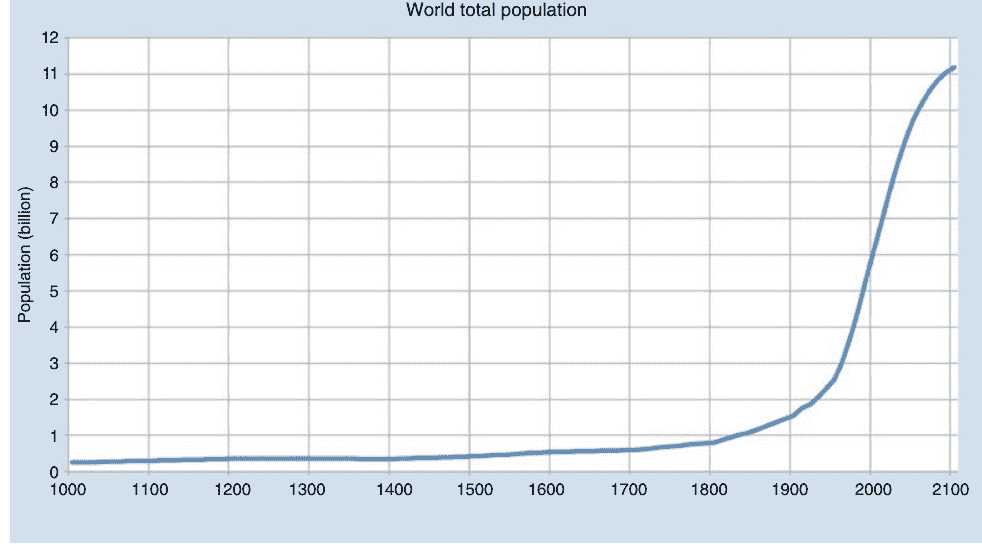
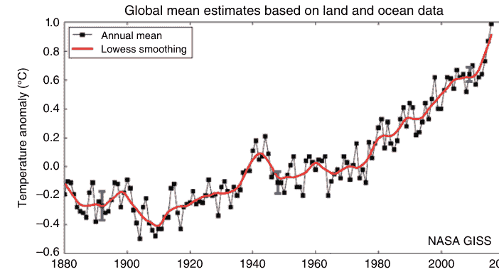
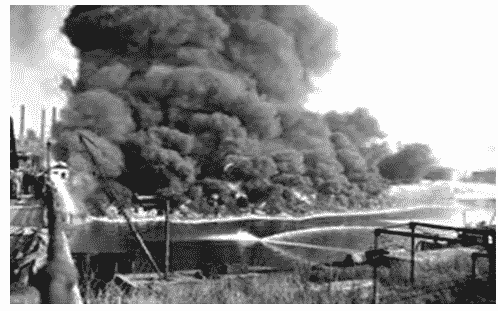
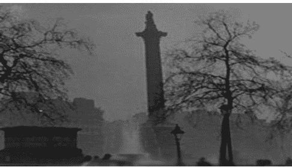
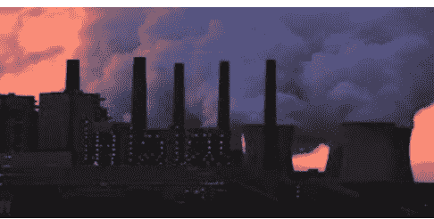
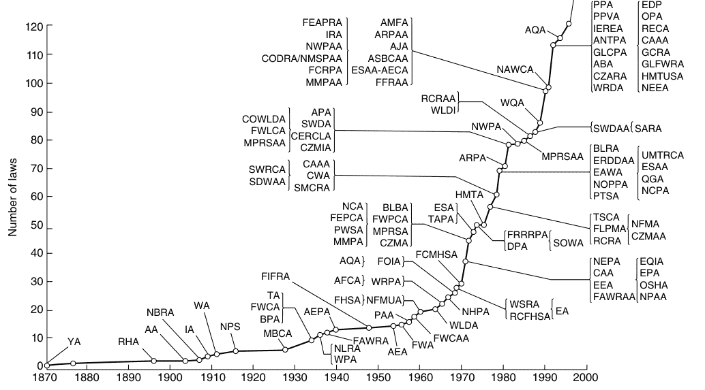
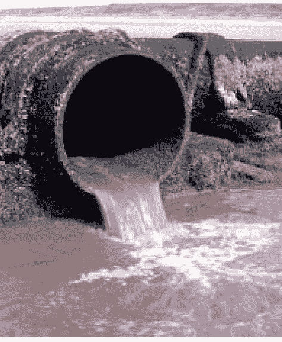
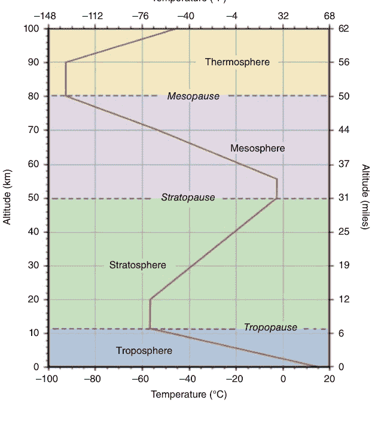
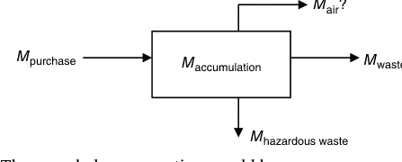

## 2 全球环境问题的起源

### 国际环境法规

## 2.1 引言

所有学科领域的工程师都在从事一份必须遵守规范其行为准则的职业。所有工程师都应了解的一个重要规则集是环境法规，这些法规是由美国国会和世界各国政府制定的法律。

环境法，也称为环境与自然资源法，是一个集体术语，用于描述涉及条约、成文法、法规、普通法和习惯法的网络，这些法律旨在解决人类活动对自然环境的影响。核心环境法律制度主要针对环境污染。一套相关但不同的监管制度如今深受环境法律原则的影响，它们侧重于特定自然资源的管理，例如森林、矿产或渔业。其他领域，如环境影响评估，可能无法整齐地归入上述任一类别，但它们仍然是环境法的重要组成部分。

本章的目标是概述当前各国和各大洲环境法律法规背后的历史以及环境污染情况。本章中展示的许多材料取自各种来源，包括以下内容：《美国法典》（USC）；《联邦法规》（CFR）；美国环境保护署（USEPA）；联合国环境规划署（UNEP）；国际环境法中心；Sullivan 和 Adams（1997）编著的《环境法手册》；Stander 和 Theodore（2008）编著的《环境监管计算手册》；Upadhyay（2012）编著的《环境法》；Divan 和 Rosencranz（2002）编著的《印度环境与政策法：案例、材料与法规》；Craig 选编的《环境法规精选》，由 West Academic Publishing Co. 出版（2016）；Lynch（1995）；Google；以及维基百科。这些来源中的大多数都可以通过网络找到。

环境法的出现是由于应对工业革命前、期间和后期与环境相关的严重问题。为了应对环境问题，法律旨在保护并促进环境。它的设计目的是预防、控制和监管环境污染。

环境保护及其保存是当今所有人的关切。世界许多地区的当前环境状况清楚地表明，地球上的活动是相互关联的。如今社会与自然的互动如此广泛，环境议题已膨胀至影响全人类的规模。环境破坏和污染已严重威胁人类生命、健康和生活。因此，全球范围内都加强了环境保护的力度。如果要确保当代和后代的生活质量，必须使他们免于环境灾害。自然以动植物形式给予人类的礼物必须保持其自然形态。世界生态系统的适当平衡已迫在眉睫。解决这一问题的唯一途径是可持续发展。环境法的目的是保护并保存我们的水、空气、地球和大气免受污染。但仅靠法律无法解决污染问题。必须提高对问题的认识，并需要持续的努力来管理它。

可以通过注意到以下事实来阐明这一情况：随着科学技术和世界人口的不断增长，人类环境发生了巨大变化。这些变化打破了生态规律，改变了人类生活与环境之间的平衡。在这种情况下，有必要通过旨在应对不断变化的条件和价值观的新法律来规范人类行为和社会交易。

因此，为了面对此类系统的众多挑战，发展出了一个新的法律分支，即环境法。

环境保护的需求是一个重大问题，并位居人们优先事项的高位。此外，从待解决问题的规模以及解决它们所需的措施来看，环境问题也是重大议题。一些主要问题，例如，包括人口增长（图 2.1）、全球变暖（图 2.2）、臭氧层 depletion、酸雨、有毒废物和森林砍伐。

长期的全球人口增长很难预测。联合国和美国人口普查局都给出了不同的估计——根据联合国的数据，2015 年末世界人口达到约 73.1 亿（联合国秘书处 2015）。图 2.1 显示了一种趋势：自 19 世纪中叶以来，人类人口一直在迅速增长，这与自然环境平衡的退化同步发生。

在过去二十年里，至少在美国，人口增长还伴随着人口从农村向城市地区转移的趋势（Wallach 2005），这使水资源需求集中在某些区域，并对来自工业和人类污染物的淡水供应造成了压力（Water 2011）。城市化导致过度拥挤和日益恶化的卫生居住条件，尤其是在发展中国家，进而使越来越多的人暴露于疾病之中。世界人口中约 79% 居住在发展中国家的，这些国家缺乏卫生的水和污水处理系统，导致因受污染的水源和传播疾病昆虫数量的增加而引发疾病和死亡（Powell 2009）。

图 2.2 显示了近年来全球平均温度异常值（陆地和海洋合计）的行为。正如在图 2.2 中所见，大部分变暖发生在两个时期——从 1910 年到 1940 年以及从 1980 年至今。月平均全球地表温度异常值的折线图，基准期为 1951–1980 年。黑线仅显示气象站数据；圆圈代表陆海温度指数，如 Hansen 等人（2010）所述。陆海温度指数使用海表温度。

这些问题是全球性问题，需要适当的全球应对措施。从问题范围和议题来看，环境保护是一个重大问题，例如空气污染的、水污染、安全饮用水、农药、噪声污染、废物处置、放射性物质和废物，以及森林和野生动植物的保护。这份清单详尽无遗。此外，从理解待解决特定问题所需的知识技能来看，环境领域的议题也是重大议题。因此，可以说环境问题范围“从当地的街角到平流层”。由此可见，人类面临着压倒性的环境问题。法律被援引以保护人类和我们的生态系统，通过解决环境问题，因为它们直接打击我们与生物圈的密切联系，而生物圈是覆盖在地球上的一个薄薄的生命外壳——只有约五英里厚——像苹果的表皮一样包裹着地球。

环境保护的范围覆盖全球，并不局限于孤立的区域或国家。环境污染问题是全球性的，关系到所有国家，无论其规模、发展水平或意识形态如何。尽管世界在政治上被划分为国家单位，但海洋世界是一个相互关联的整体，吹过各国的风也在吹拂着其他地方。环境是一个遍及全世界的普遍现象。如果在世界任何地方进行核试验，辐射沉降物可能会随风被带到世界任何其他地方，而某个遥远能源星球上不负责的放射性废物排放，其对邻近国家产生的不利影响可能比一场全面战争的威胁还要大。



图 2.1 100 年间的全球人口增长。来源：联合国，经济和社会事务部，人口司（2017）。



**图 2.2** 工业化以来 100 年间的地球升温。*来源：http://data.giss.nasa.gov/gistemp.graphs.*

### 2.1.1 环境历史

环境历史是研究人类随时间与自然世界相互关系的学科。与其他历史学科相比，它强调自然在影响人类事务中的积极作用。环境历史学家研究人类如何塑造其环境，又如何被环境所塑造。

环境历史在美国 20 世纪 60 年代和 70 年代的环境运动中兴起，其许多推动力至今仍源于当前的全球环境关切（Chakrabarti 2006）。该领域建立在保护主义议题之上，但范围已扩大到包括更普遍的社会史和科学史，并可能涉及城市、人口或可持续发展。由于所有历史都发生在自然世界中，环境历史倾向于关注特定的时间尺度、地理区域或关键主题。它也是一个强烈的多学科主题，广泛借鉴人文学科和自然科学。

环境历史的主题内容可分为三个主要组成部分（Chakrabarti 2007）。第一，自然界本身及其随时间的变化，包括人类对地球陆地、水、大气圈和生物圈产生的物理影响。第二类，人类如何利用自然，包括人口增长、更有效的技术以及生产和消费模式变化带来的环境后果。其他关键主题包括新石器时代革命中从游牧狩猎采集社区向定居农业的过渡、殖民扩张和定居的影响，以及工业和技术革命的环境和人类后果（Cronon 1995）。最后，环境历史学家研究人们如何思考自然——态度、信仰和价值观如何影响与自然的互动，特别是以神话、宗教和科学的形式。

## 2.2 环境问题的起源

自第一人发现火以来，环境问题就一直困扰着人类。最早的人类似乎居住在热带的各种地点内，并且


## 2.3.1 自然原因

干旱、洪水、海啸、气旋、飓风、龙卷风、山洪、地震、火山熔岩以及流行病是导致环境污染的主要自然原因/因素。由于这些是自然造成的事件，人类无法控制它们，因此被称为自然原因。

## 2.3.2 人为原因

主要有四大人为原因：

- 1) 人口增长
- 2) 贫困
- 3) 城市化
- 4) 工业化

## 2.3.3 人口增长

“地球是有限的，世界人口也是有限的。” 每一个新生儿都会消耗大量的自然和非自然产品，而这些产品最终也是在利用自然资源后提供的。因此，每一次出生都会增加对自然资源的需求。但事实是，有限的世界只能养活有限的人口。换句话说，随着人口的增长，自然资源会减少。根据世界人口统计网站对联合国最新估计的整理，截至2019年8月，当前世界人口为77.3亿。本世纪世界人口几乎增长了六倍（图2.1）。仅印度就占世界陆地面积的约17%人口。城市人口的增长速度非常快。这表明对燃料、食物、无污染的清洁水和空气、居住空间以及健康条件的需求不断增加。城市地区人口的增加造成了土地、大气和水污染以及不卫生的状况，这些因素累积起来严重影响了生活质量。一些大城市因其周边的污染工业而被评为拥堵城市。城市人口的持续增长提高了各个地区的人口密度，这也给人们带来了各种社会、身体和心理问题。这些人口高度密集的地区还导致了森林砍伐和植被覆盖的消失，植被覆盖仅占总面积的11%，而必需的比例为33%。人口增长还会导致贫困，而贫困也是污染的原因之一。

## 2.3.4 贫困

贫困对人口增长和环境污染都有同等贡献。贫困被定义为

个人或家庭无法达到最低生活标准的能力（世界卫生与环境委员会1992年）。贫困人口通常预期寿命低、婴儿死亡率高、残疾发生率高。不卫生、不洁净和健康状况差都是由于贫困造成的。贫困人口的贫困伴随着其生存基本手段——环境及其生命支持的自然资源——土地、森林、水和空气的同步且系统性的侵蚀。贫困降低了人们以可持续方式利用资源的能力，这也加剧了欠发达和发展中国家对环境的压力。如今，人们已经恰当地观察到，贫困人口与贫困与环境之间存在联系（《我们共同的未来》1987年）。

## 2.3.5 城市化

快速且无计划的城市化也导致了环境污染和人类环境的退化。这是发展中国家贫困人口从小城镇和乡村无休止地向城市中心迁移以及人口快速增长的直接结果。煤炭和木材在集中区域的燃烧使城市成为污染的主要来源。在许多欠发达和发展中国家的城市中，环境因素在城市化思考中被给予了太少的考虑。然而，随着城市化进程的加剧，它们是极其重要的需要考虑的因素。许多欠发达和发展中国家城市的水污染和烟雾污染水平已经很高。

## 2.4 美国工业化和城市化

19世纪早期，一股惊人的新力量在欧洲积聚。法国人创造了“工业革命”一词，用作技术与现代伟大政治革命之间亲和力的隐喻。很快传到美国，工业革命扫除了美国成为农业社会的任何设想。蒸汽机、铁路、机械脱粒机以及数百种其他巧妙的器物，它们增强了人类改造自然世界并加以利用的能力，很快将在全国各地嘶鸣、叮当作响和咆哮。新机器迅速加速了对国家农场、森林和矿山原材料消耗的增加。

### 2.4.1 微型案例研究

工业化和城市化作为工业革命的结果，早在19世纪末和20世纪初之前就已经开始，但由于技术创新、社会变革以及一个日益倾向于将经济增长置于其他任何关切之上的政治体系，在这一时期得到了极大的加速。在1880年之前，工业化依赖于规定的劳动分工——将大多数工作分解成更小的任务，并让同一批人无限期地重复一项任务。1880年之后，工业化更多地依赖于机械化——用机器取代人力——以增加生产并最大化利润。现代电网的发展始于1880年代初，促进了此类技术进步。亨利·福特的装配线和20世纪之交后大规模生产的兴起只会加强这种效应。结果，美国的总制造业产出在1929年比1859年大28倍。考虑到同期人口的增长，这一数字仍增长了七倍（Wright 1941）。

美国的城市可以追溯到殖民时期之初，但新工业工厂倾向于位于城市或城市附近，这意味着城市在19世纪后期比以往任何时候都增长得更快。这种趋势在纽约等大城市中最为明显，纽约在1850年至1900年间从约五十万人扩张到约350万人，费城在同一时期从略多于10万居民增加到超过120万人。在19世纪后期最后半个世纪，芝加哥被证明是世界上增长最快的城市。总体而言，1850年有15.3%的美国人居住在城市。到1900年，这一比例增加到39.7，并继续增长。1920年人口普查显示，首次有更多美国人居住在城市而不是乡村（Rees 2013）。

并非全国每个城市都像最大城市那样快速发展。由于工业增长性质的差异，城市化存在重要的区域差异。东北部最大的城市是制造业大国，拥有从建造铁路机车的巨型工厂到人们公寓内生产纺织品的小作坊的一切。东北部还出现了专注于特定产业的小城市，例如纽约州罗切斯特，专门生产男装、靴子和鞋子。继承了19世纪早期的制造业传统，马萨诸塞州的新贝德福德和福尔里弗因其棉纺织厂而增长。其他城市，如新泽西州的伊丽莎白，则随着其邻近大城市的扩张而作为副产品增长。美国中西部最大的城市芝加哥，因在西部边疆的自然资源向东作为制成品运输之前对其进行加工而闻名。谷物和木材——芝加哥早期增长的关键产业——依赖芝加哥进行营销和储存。随着冷藏铁路车的完善，肉类加工成为如此庞大的产业，以至于美国人吃的大部分肉类都在该市南部的牲畜市场加工。（这一活动在20世纪之交后会再次分散到沃斯堡和堪萨斯城等其他城市。）美国工业心脏地带的其他小城市将围绕其他制造业追求而发展，如杨斯敦的钢铁，以及俄亥俄州代顿的机床和收银机（Warner 1995）。

南方自内战前就落后于全国其他地区。因此，许多倡导该地区外部投资的人在战后扩大了活动。他们取得了一些成功。虽然南方在19世纪后期和20世纪初的工业化（因此城市化）速度加快，但仍未完全赶上全国其他地区。例如，阿拉巴马州伯明翰于1871年成立，在1880年代随着两条铁路首次将该市与该地区的矿产资源连接起来而繁荣，成为铁和钢铁制造中心。卡罗来纳州“上区”棉纺厂的增长始于1870年代。20世纪之交后，该地区因廉价的非工会劳动力而成为纺织工业的重要活动中心。

将这一时期与城市和工业历史上的早期时期区分开来的，是这是美国历史上第一次城市成为美国生活中心的时期。城市是大多数新工厂建立的地方。移民潮定居在城市，因为那是工业工厂的就业机会所在。城市也是工业化影响最明显的地方，尤其是财富不平等加剧。也就是说，城市的问题成为美国的问题。

### 2.4.2 电网和交通改善

后期工业化比以前进展更快的一个原因就是动力来源的改善。早期的工业革命依赖蒸汽机和水力。最早的发动机体积庞大、价格高昂，任何人都买不起


……但最大的企业除外。对于小型企业来说，水轮是一个可行的选择，但它们无法像后来的动力源那样完成大量的工作。在 1869 年到 1929 年之间，美国的总可用马力从 230 万单位增加到 4300 万单位。在工厂中，这一增长的最大部分来自于电力使用的巨大增加（Wright 1941）。

尽管工厂在整个十九世纪都变得更大、更高效，但在 1880 年之后，它们变得特别大，因为驱动它们所需的动力变得 cheaper、更清洁，获取起来也更加方便。从 1870 年代末开始，托马斯·爱迪生将他庞大的实验室的关注点转向利用电力创造负担得起的廉价电灯。这一成就不仅依赖于创建高效、廉价的白炽灯泡，还依赖于创建为其供电的电气系统——从发电机、电线到开关，一应俱全。由于这些事物中没有先例可循，爱迪生电力公司及其许多相关子公司（后来被归类于通用电气旗下）必须制造几乎一切东西才能使电网运行。“既然资本是胆小的，我将筹集并提供它，”爱迪生向他的一位投资者解释道。“问题在于是工厂还是死亡！”（Jonnes 2004）。其他公司很快也紧随其后，因为建立最终为几乎所有事物提供动力的中央电站和电网显然利润丰厚。

象征着资本对爱迪生努力的重要性，第一个成功通电的家庭属于银行家 J. P. 摩根，时间是 1882 年。尽管遭遇挫折，他对电灯的体验鼓励他在爱迪生的事业中进一步投资。爱迪生在同一年晚些时候在纽约市建立了第一个中央发电站。爱迪生布线的曼哈顿第一个区域是那些他试图说服投资于他的企业的金融机构操作员以及两家会宣传他成就的主要报纸的住宅和工作场所聚集的社区。到 1902 年，美国有 2250 个电力发电站。到 1920 年，这个数字增长到略低于 4000 个。电力从大城市传播到小城市，并最终在 1920 年代扩展到农村地区（Cowan 1985; Cowan and Hersch 2017）。

这种增长需要在爱迪生最初的电气系统愿景之外进行重大改进。可靠的电网对其最初出现城市的产生了诸多影响，范围从空气中减少煤炭烟雾到各种电器产生的新声音——从有轨电车到弧光灯。早期的弧光灯非常明亮，人们认为它们可以通过曝光实施这些罪行的人来阻止犯罪和恶习。在小城市，获得电灯是现代化的标志，这意味着未来的增长。城市工作场所的现代灯光通过减轻眼睛的疲劳使办公室工作更轻松。随着电力公司的进入，广受憎恶的城市煤气公司失去了相当大的经济权力。由于人们更喜欢电灯而非煤气灯，随着电网的扩展和成本的下降，它变得越来越流行。电灯甚至改变了人们在房屋内部的生活方式。例如，孩子们现在可以被信任自己上床睡觉，因为不再存在以前在黑暗中上床所需的明火带来的火灾风险。

然而，不断壮大的电网制造了新的城市危险。悬挂在地面上的高压电线与其他来自电话、电报——甚至股票报价机——的电线一起，构成了新的城市“电线威胁”。许多电线在恶劣天气中掉落。它们对电力公司员工和行人都构成了危险。“架空系统是健康和生命的常备威胁，”一份医学期刊在 1888 年报道（Freeberg 2014）。1889 年，由过热电线引起的火灾点燃了一栋装满干货的建筑，并烧毁了波士顿市中心的大部分区域。

高品质、负担得起的照明最显著的影响是工厂 24 小时全天候运营的普遍做法——这使得它们在没有任何生产技术改进的情况下变得更具生产力。取代恶臭的煤气灯也使工厂的味道对在那里工作的工人变得更好。随着电网变得更加可靠，电动机逐渐开始取代蒸汽机作为制造业的动力来源。使用小型电动机作为动力源使工厂不必靠近水源来为锅炉供水，这也使工厂可以建得更小。

在 1880 年到 1900 年之间，工厂倾向于采用电灯照明，但仍在使用较早的动力源进行操作。工厂操作的电力在 1900 年到 1930 年之间迅速普及。这两项发展（加上大量移民工人的供给）共同促成了城市的工业化。各类工业设施的电气化在二十世纪的前二十年间迅速推进。企业比城市更快地接通电力，因为它们能够最充分利用起初相对昂贵的服务。

由于工厂集中在城市内或附近，给它们布线比给远离电力发电站的农场甚至小城市布线要便宜得多。在这个后期时期建造的新工厂中的许多出现在城市界限之外，这是另一个新的发展。电气化使经理能够自动执行以前由手工劳动完成的工作，从而消除低效，加强对生产过程的控制，并提高整体生产力。新设备如时间打卡机，甚至如流水线这样的新生产模式也依赖于电力。

廉价且现成的电力的出现对这一时期美国城市的物理布局产生了特别重要的影响。弗兰克·斯普拉格，一位曾为托马斯·爱迪生工作的电气工程师，于 1888 年为弗吉尼亚州里士满设计了第一个有轨电车系统。这类系统取代了马车，使人们能够比平时走得更远、更快。这引发了一股郊区化的浪潮，一批新城镇出现在美国城市的边缘，富裕和中产阶级人群可以搬去那里以逃避现代城市生活的困难，但仍然足够接近以享受其许多优势。

新的郊区居民通常通过新的有轨电车上下班。电气设备制造商西屋电气是通过架空线供电的车辆的主要制造商之一。与马匹相比，有轨电车的优势在于不会留下粪便或在街上死亡。有轨电车在周末比在工作日更受欢迎，因为工人阶级利用低票价探索新的社区或参观像康尼岛这样的游乐园，这些公园通常建在这些线路的终点。

正如雇主和城市规划者依赖有轨电车来移动人员一样，制造商在 1880 年之后越来越依赖铁路来运输他们的成品。内战后，铁路里程大幅增长，连接城市并导致新工厂在便于获取生产商品所需资源的地方增长。最终，大众化分销是受益于所有这些生产力提升的先决条件。出于所有这些原因，将工业化和城市化的原因和结果分开在实践中几乎是不可能的。

在整个十九世纪，工厂通常必须建在附近航运港口或铁路站点，因为这是将工厂产品运往世界各地市场的最简单方式。随着十九世纪后期更多铁路轨道的建造，在城市中心之外设立工厂变得更加容易。有轨电车帮助填满了原本工厂可能会占据的城市中心空置空间。它们使人们更容易住在离工作地更远的地方，同时仍能通勤到市中心，从而使其他类型的企业能够落户在那里。一个例子是大型城市百货商店，这是一种先于 1880 年出现的现象，但在那之后发展壮大。像费城的旺姆克百货或芝加哥的马歇菲尔兹百货这样的商店批量购买工业化的产品，并以折扣价格出售给可能很难通过其他方式获得这些产品的工人。

尽管零售百货公司可以占据整条街区，且只有几层楼高，但其他企业在建得更高、更窄的建筑物中租用空间。到 1880 年代末，曾经用铁建造的结构开始用结构钢——一种新的、更强的钢材——建造。这种做法始于芝加哥，由建筑师路易斯·沙利文推崇，他在那里设计了第一栋摩天大楼。摩天大楼，沙利文写道，“必须每一寸都是高大且 soaring 的事物，从下到上以其纯粹的狂喜上升，它是一个统一的体，没有一条不一致的线条”（Alexiou 2013）。这种设计需要一个结构钢骨架，其他物质如砖或花岗岩可以悬挂在其上。即便如此，这样的摩天大楼必须逐渐变细；否则，顶层的重量可能会使整个结构坍塌。

为摩天大楼制造结构钢需要与制造贝塞麦钢（主要用于铁轨）所需完全不同的生产方法。数量和速度是生产贝塞麦钢的主要要求。结构钢需要更精心制作的产品。结构钢的需求鼓励像安德鲁·卡内基这样的钢铁制造商重新设计整个工厂，最著名的是用平炉法取代旧的贝塞麦转炉。这种新的炼钢方法不仅生产质量更高的钢，而且需要更少的高技能工人。这促使卡内基的公司于 1892 年在宾夕法尼亚州霍姆斯特德对其工会员工实施锁厂，以便通过雇佣廉价的替代工人来节省资金。

使摩天大楼成为可能的另一项创新是电力电梯。伊莱沙·格雷夫斯·奥的斯在 1857 年设计了第一台可靠的电梯。借助电力，几秒钟内上升 60 层成为可能。在电梯之前，商业建筑低楼层的租赁空间价格更高，因为人们不想走楼梯到达顶层。有了电梯，愿意支付溢价的租户为了获得更好的窗外视野。没有电梯，没有人会费心建造高于五层的建筑（Misa 1999, 2016）。

摩天大楼的建筑本身是工业时代劳动和材料分配协调的一个极佳例子。钢骨架意味着建筑较高的无装饰部分可以在建筑底部不可避免的复杂装饰边缘完工前进行处理。这节省了

### 2.4.3 结构钢与摩天大楼


既节省时间又节省金钱。当纽约拥挤到没有空间存放原材料时，这些材料的到位会被精心安排，它们会被直接从平板卡车上卸下，放置在新建筑顶部附近的精确位置。大约在二十世纪之交，一座大型摩天大楼最快只需一年即可建成。建筑建造得越快，业主就能越快收取租金并开始收回建设成本。

摩天大楼的巨大好处在于能将经济活动压缩到更小的区域。1897年，一位纽约人解释说：“摩天大楼将大量原本会彼此相隔甚远的活动汇聚到一座单一建筑中。每座建筑几乎都是一座完整的城市，其围墙内通常设有银行和保险公司、邮局和电报局、商业交易所、餐厅、俱乐部会所和商店。”这些微型城市同样拥有众多零售网点，人们可以在那里购买工业化制造的产品（Rees 2013）。这些地点之间较短的距离加快了经济活动的节奏，从而促进了进一步的经济增长。然而，大型项目（如与纽约中央火车站建设相关的众多摩天大楼）消除或至少遮蔽了城市工业区。

由于无需缴纳联邦所得税，19世纪90年代，美国各地的工业巨头在纽约第五大道沿线建造豪华宅邸，以展示巨额财富。到20世纪20年代，曼哈顿的土地价值因可能用于建造摩天大楼而迅速增长，以至于第二代工业家族出售了他们的宅邸，因为他们不再愿意为其支付巨额房产税。被称为“范德比尔特巷”的街区——以在同一地区建造宅邸的轮船与铁路先驱的子女命名——被摩天大楼和高端零售商场取代。

摩天大楼生产的基本原理——建得快、建得大，并塞满人——也推动了建造者生产其他类型城市住宅的方式。改革者雅各布·里斯在其1890年的经典著作*另一半人怎样生活*中写道：“今天，[纽约市]四分之三的人口住在廉租公寓里，而19世纪人口向城市迁移的趋势正把越来越多的民众塞进这些公寓”（Riis 1914）。这一时期最著名的廉租公寓设计是约五六层高的哑铃式公寓。它们源于一场设计竞赛，但通常拥挤不堪，对居住者弊大于利。四户人家可能共住一层，只有两个卫生间。这种设计旨在让光线和空气进入中央庭院（这就是从上方看呈哑铃形的原因），但背靠背、一间紧挨一间地堆叠后，这两项目标都未能实现。尽管这种设计被广泛复制，纽约市实际上在1901年禁止新建筑采用此设计——但旧建筑依然存在。

公寓楼使人们更容易聚集到城市小区域，从而住得离工作地点更近。富人可以购买空间并与邻居隔开，而那些负担不起郊区生活的中产阶级则失去了城市化加速前所拥有的空间。为了应对这些不平等趋势，纽约人提出了合作公寓的理念，即许多人共同购买一栋建筑并自行管理。一旦曼哈顿的房地产贵得除了拥有巨额财富的人之外谁都买不起，豪华公寓便成为豪宅的替代品。

### 2.4.4 流水线

人们住得离中央商务区越远，就越需要高效的交通。有轨电车在一定程度上有所帮助，但以市中心社区为中心的客运线路留下大片区域，如果居民有自己的出行方式，这些区域便可容纳不断增长的劳动人口的住房。1908年，亨利·福特宣称：“我要为大众造一辆车。它的价格会低到任何一个有优厚薪水的人都买得起”（Watts 2005）。这辆车就是T型车，它彻底改变了汽车制造业和美国的景观。它也彻底改变了美国生产的整个概念。福特并不担心他的车有没有市场。他会把车造得极其便宜，让几乎每个美国人都买得起，从而为自己创造市场。

福特能够在大规模生产中同时保证质量和低价，靠的是流水线。这一概念突破在很大程度上归功于上世纪肉类加工行业首创的“分解流水线”。正如单具动物胴体挂在钩子上沿生产线移动时被各有专长的工人拆解，福特在高原公园的新工厂也这样安排，让拥有高度专业化分工的工人能比以往快得多地组装汽车。流水线将工作移向工人，而不是迫使工人移向工作，从而节省了宝贵的时间和精力。它还将劳动分工的概念推向了逻辑极限，使得工人在一个更大的装配过程中日复一日只执行一项功能。这些原则几乎适用于所有产品的制造，正是这一点使它们意义重大。

20世纪20年代采用福特原则的是家用电器制造商，如冰箱和收音机制造商。例如，通用电气为其Monitor Top冰箱建造了一条价值1800万美元的流水线，并在1927年推出后仅4年就售出了100万台冰箱（Cowan 1985）。

即使是像家具制造这样以手工艺为主导的行业，也开始依赖大规模生产，使其产品更普及。从农场搬到城市的人们迫切需要家具来布置他们的新城市住宅，但在像密歇根州大急流城这样的工业城镇，他们买不起工匠制作的家具。基于时尚样式、以最少雕刻和覆面层制成的新型大规模生产家具在全国各地找到了市场。同样有帮助的是，1902年在弗吉尼亚州成立的巴塞特等公司，像福特一样，阻止其工人组建工会。缺乏组织的劳动力使工业家更容易在生产过程中实施变革，而不会遭到员工的抵制。

1927年从T型车换到A型车的转变，暴露了工业化大规模生产的局限。A型车极其昂贵，福特不得不关闭其主要工厂数月，以重新调整生产线来生产新车型。尽管新车起初销路不错，但随着大萧条加深，销量急剧下滑。1932年，百货业巨头爱德华·法林写道：“大规模生产并不仅仅是扩大生产规模。它是在清楚认识到生产增加要求购买增加的基础上进行的大规模生产”（Hounshell 1984）。当人们几乎没有钱购买工业化产品时，大规模购买变得困难。大萧条期间，城市建设也急剧放缓。由于城市是工业化的焦点，当生产萎缩时，城市居民遭受的冲击格外严重。当然，当美国陷入大萧条的经济低迷时，城市和工业增长都急剧下降。

### 2.5 重要的技术发展

工业革命的开始与少数几项创新密切相关，这些创新始于十八世纪下半叶（Bond 等 2003）。到19世纪30年代，以下重要技术取得了进步：

- **纺织业** – 以蒸汽或水力驱动的机械化棉纺使单个工人的产量提高到原来的500倍。动力织布机使单个工人的产量提高到原来的40倍以上（Ayres 1989）。轧棉机使去除棉籽的生产率提高到原来的50倍（Wickham 1916）。毛纺和亚麻的纺纱与织布生产率也有大幅提高，但不如棉纺业显著（Beckert 2014；Landes 1969）。
- **蒸汽动力** – 蒸汽机的效率提高到燃料消耗仅为原来的五分之一至十分之一。固定式蒸汽机改造为旋转运动后，适合工业使用（Landes 1969）。高压发动机具有很高的功率重量比，适合交通运输。1800年后，蒸汽动力迅速扩张。
- **炼铁** – 用焦炭替代木炭大大降低了生铁和熟铁生产的燃料成本（Landes 1969）。使用焦炭还使高炉可以更大，从而形成规模经济（Landes 1969；Rosen 2012）。铸铁鼓风缸于1760年首次使用，后来改进为双作用式，使高炉温度更高。搅拌炼铁法生产结构级铁的成本低于精炼锻炉（Landes 1969）。轧机比锤打熟铁快15倍。在随后的几十年里，热风大大提高了炼铁的燃料效率。
- **机床的发明** – 首批机床被发明出来，包括螺纹车床、汽缸镗床和铣床（Hounshell 1984）。

十九世纪即将结束时，三位非常特殊的人物登上了美国国家舞台。吉福德·平肖、约翰·缪尔和西奥多·罗斯福写下了美国现代环境史的第一页，这反过来又在二十世纪初催生了现代环境运动。然而，在二十世纪上半叶，污染和环境退化是美国大部分地区的普遍现象，诸如“金钱的气味”“美妙干净的煤烟”“上帝保佑它”“它是我们的命脉”“当地活动和进取心的指标”等说法都被用来描述空气污染。

就在此时，人力和畜力被电力、内燃机和核反应堆取代。与此同时，工业正以惊人的速度消耗自然资源。所有这些变化在第二次世界大战后开始以危险的速度升级。不久之后，在1962年夏末，一位名叫蕾切尔·卡森的海洋生物学家——畅销的海洋生命类书籍《寂静的春天》的作者——打开了……


向世界揭示了攻击环境的危险（Carson 1962）。也许正是从那时起，美国开始认真呼吁改革对自然的破坏以及针对这些问题的环境法限制。这一切始于1970年环保署的诞生。有关美国环境运动早期历史和美国技术的更多文献，感兴趣的读者可参考菲利普·沙贝科夫所著的《A Fierce Green Fire》（1993）一书。这本杰出的著作，以及庞廷的《A Green History of the World》（1991），和露丝·科万所著的《A Social History of American Technology》（1985），是任何从事或对环境感兴趣的人的“必读”之作。

工业是现代社会经济发展的轴心——被誉为增长和发展的不可或缺的动力。另一方面，它已被确定为环境退化和污染的主要来源。因此，发展而不破坏、环境可持续性和可持续发展是我们时代的迫切需要。我们面临的问题是如何在不断提高的生活水平带来的好处与物理环境恶化以及生活质量下降所付出的成本之间取得平衡。过去，污染空气、水和土地的危险并未得到充分认识，但现在毫无疑问，这是一个令人极度担忧的问题。

日本著名的水俣病（1956年）、弗利克斯伯勒（1974年）、爱河运河（1978年）、三里岛事故（1979年）、博帕尔气体悲剧（1984年）、切尔诺贝利核反应堆事故（1986年）以及2008年田纳西河谷管理局金斯顿燃煤电厂有毒煤灰泄漏到埃莫里河事件提醒我们，工业化不仅对人类，而且对动物、水生生物和植被覆盖构成了严重威胁。一方面，工业化帮助我们提高了生活水平和质量，但另一方面它也恶化了我们的环境。因此，污染物在环境中的迁移转化通过人类活动，例如酸雨、烟雾、全球变暖、海洋酸化、野火、癌症，是工业化直接导致的最糟糕的污染形式。

工业以以下方式破坏环境并造成污染：

- a) 工业使用自然资源，因为它破坏了自然并影响了自然环境。小麦、大米、大麦、玉米、棉花、树木、胶合板、橡胶、甘蔗、铁、煤、石油、天然气等都是食品加工、包装、造纸、服装和其他成品的自然资源。因此，工业需求的增加导致了对自然资源的过度开采和压力。
- b) 工业的残渣和副产品有无处理地排入水、空气和土地，污染水、空气和土地，影响空气质量、水生生物和地下水。
- c) 工业使用的化石燃料如煤、煤油、柴油和核能以烟雾、烟灰、细颗粒物、烟雾、臭氧和放射性废物的形式污染空气。
- d) 噪音也是工业的主要副产品，会对人类健康造成噪音污染。
- e) 工业废物，特别是危险废物和放射性废物，已成为一个重大的环境污染问题。

## 2.6 工业灾难

### 2.6.1 博帕尔：世界上最严重的工业悲剧

三十三年前，1984年12月2日晚，印度博帕尔联合碳化物农药厂发生事故，释放出至少30吨名为甲基异氰酸酯（MIC）的高毒气体，以及其他多种有毒气体。农药厂周围是贫民窟，导致当晚有超过60万人暴露在致命的云雾中。这些气体保持在低处，导致受害者喉咙和眼睛灼烧、恶心，并造成许多死亡。死亡人数估计从低至3,800人到高至16,000人不等，但政府目前的数字指的是估计有15,000人在此后多年中死亡。有毒物质仍然残留，30年后，许多暴露于气体的人所生育的孩子身体和精神残疾。几十年来，幸存者一直在为清理现场而斗争，但他们表示，当密歇根州的陶氏化学公司于2001年收购联合碳化物后，清理工作放缓了。人权组织表示，数千吨危险废物仍埋在地下，政府也承认该地区受到了污染。然而，并没有长期流行病学研究能够有力证明出生缺陷与饮用受污染的水直接相关。

### 2.6.1.1 当晚发生了什么！

由于缺乏环境法规、执行和合规、维护和操作安全，博帕尔发生的灾难发生地工厂于1977年开始生产“卡巴ryl”。卡巴ryl主要用作杀虫剂。起初，产量为2500吨/年。这不是问题，因为工厂的设计产量为5000吨。20世纪80年代初，卡巴ryl销售不佳。因此，工厂的所有者开始削减成本。这包括雇佣更少的人、减少维护频率以及使用低等级钢材制成的零件。关闭工厂也在考虑之中。灾难发生时，由于市场上供过于求，工厂没有生产。

灾难发生是因为水进入了含有MIC的罐中。这引发了化学反应，导致大量二氧化碳等物质积聚。由此产生的反应使罐内温度升高至超过200°C（392°F）。压力超过了罐体所能承受的压力。罐上有控制压力的阀门。这些阀门在紧急情况下被触发，从而降低了压力。因此，大量有毒气体被释放到环境中。管道生锈了。铁管道中的锈使反应更快。罐内的所有内容物在大约两个小时内全部释放。水进入罐子是由于一系列事件。罐子维护不良。当进行清洁工作时，水可能进入罐子。来自印度博帕尔联合碳化物公司的MIC气体泄漏推动了环境法的发展以及赔偿数量原则的发展（Union Carbide v. Union of India 1989）。

### 2.6.1.2 泰姬陵酸雨袭击

历史纪念碑泰姬陵在阿格拉因酸性气体而变黄，这些气体来自铸造厂、燃煤电厂、化工和危险工业以及炼油厂排放的硫氧化物（SOₓ）。这些工业排放的二氧化硫与大气中的氧气在潮湿和阳光存在下结合，形成了被称为“酸雨”的硫酸，影响了泰姬陵的大理石（Mehta 1987）。

### 2.6.1.3 恒河和亚穆纳河

使圣河恒河和南部的金奈河水变毒的工业被发现是鞣革厂（Mehta 1988；Vellore Citizen 1996）。在恒河污染案中，鞣革厂将未经处理的废水排入河流，在靠近坎普尔的地方，恒河水被发现高度有毒。在另一案件中，泰米尔纳德邦的帕拉尔河因鞣革厂排放用于皮革处理的化学品而严重污染，导致饮用水不可用。最近，印度最高法院下令关闭工业或将其从德里邦领土迁移，因为其未经处理的废水和污泥污染了圣河亚穆纳河（Hindustan Times 2000；Times of India 2000）。

### 2.6.1.4 弗利克斯伯勒

1974年6月1日星期六，弗利克斯伯勒的Nypro（英国）工厂被一次大爆炸严重损坏。28名工人死亡，另外36人受伤。人们认识到，如果事故发生在工作日，伤亡人数会更多，因为主办公楼当时无人占用。场外后果导致53人受伤报告。周边地区的财产在不同程度上受损。

化工厂设计用于生产7万吨/年己内酰胺，即尼龙生产所需的原料。该工艺使用环己烷作为原料，并在六个催化反应器系列中在空气存在下将其氧化为环己醇。在工艺条件下，环己烷在混合减压后立即汽化，形成可燃环己烷蒸气与空气混合的云。发现反应器5在系列中使用20英寸管道的连接处不锈钢结构上有一个小裂缝，尽管反应器通常使用28英寸管道连接。临时管道部分未得到适当支撑，并在加压时破裂，释放出估计30吨环己烷形成大云。未知点火源导致云爆炸，夷平了整个工厂设施。随后的火灾在工厂燃烧了超过10天。事故本可以通过遵循适当的安全设计和操作程序来预防，包括减少现场可燃液体的库存（CCPS 1993；Crowl and Louver 1990）。

### 2.6.1.5 爱河运河悲剧

简单地说，爱河运河是美国历史上最骇人听闻的环境悲剧之一。但这并不是最令人不安的事实。更糟糕的是，它不能被视为孤立事件。它可能再次发生——在美国任何地方——除非我们迅速采取行动防止它发生。

爱河运河原本本应是一个梦想社区的讽刺是残酷的。这一愿景属于该块土地以其命名的那个人——威廉·T·洛夫。洛夫认为，通过在尼亚加拉河上下游之间挖掘一条短运河，可以廉价发电，为他理想的城市的工业和家庭提供动力。

但尽管得到大量支持，洛夫的项目无法承受经济波动和尼古拉·特斯拉发现如何通过交流电经济地长距离传输电力的双重打击。到1910年，梦想破灭了。纪念洛夫希望的只剩下运河开工时留下的部分沟渠。在


20世纪20年代，一个真正的噩梦的种子就此埋下。这条运河被变成了一个市政和工业化学垃圾倾倒场。

当然，如果选址得当、管理良好并受到监管，垃圾填埋场可以作为处置危险废物的一种环境可接受方法。拉夫运河（Love Canal）将永远作为一个历史性的反面教材，展示着这种运营方式绝不能这样做。1953年，该物业的拥有者和运营者胡克化学公司（Hooker Chemical Company）用泥土覆盖了运河，并以一美元的价格将其卖给了市政府。这是一笔糟糕的交易。20世纪50年代末，该地点上建起了约100户住宅和一所学校。也许它不是威廉·T·拉夫（William T. Love）理想中的城市，但它是一个稳固的工人阶级社区。1978年8月1日，《纽约时报》头版报道的导语写道：“尼亚加拉瀑布，纽约州——在胡克化学公司停止使用这里的拉夫运河作为工业垃圾倾倒场二十五年后，82种不同的化合物（其中11种为疑似致癌物质）正通过土壤向上渗透，其桶装容器正在腐烂并将内容物泄漏到运河岸边如今现有的100户住宅和一所公共学校的后院及地下室中”。

在一篇为1978年2月《环境保护局期刊》（EPA Journal）撰写的文章中，我写道，关于一般的化学垃圾倾倒场，“尽管其中一些填埋场已经关闭，但它们可能仍像定时炸弹一样。”仅仅几个月后，拉夫运河事件就爆发了。触发这次爆发的是创纪录的降雨量。随后不久，泄漏开始发生。

腐蚀性的废物处置桶可以看到冲破后院的地面。树木和花园变黑并死亡。一个完整的游泳池从其地基中被顶起，漂浮在一小片化学物质的“海洋”上。居民向我指出了有毒物质的水坑。其中一些水坑在他们的院子里，一些在地下室里，还有其他的在学校操场上。到处都是淡淡的、令人窒息的气味。孩子们玩耍回来后，手上和脸上都有灼伤。

然后是出生缺陷。纽约州卫生部门正在对令人不安的高流产率以及迄今在该地区发现的五例出生缺陷病例进行调查。一名患有出生缺陷儿童的父亲说：“我听到媒体说这里*只有*五例出生缺陷病例，”他告诉我。“当你回到你在环境保护局（EPA）的同事那里时，请不要使用*‘只有’*五例这个短语。人们必须意识到这是一个很小的社区。这里的五例出生缺陷病例是令人恐惧的。”

拉夫运河地区有相当大比例的人正在被密切监测，因为检测到白细胞计数升高，这是白血病的可能前兆。当拉夫运河的居民最终从他们的家和社区撤离时，孕妇和婴儿被故意作为第一批被带出的人。

“我们知道他们向运河里倾倒化学品并将其覆盖，”一位长期居住在运河地区的妇女说，“但我们没想到这些化学品会侵入我们的家。我们非常担心孙辈及其后代。”这位女士四个孙辈中有两个患有出生缺陷。这些孩子出生并成长在拉夫运河社区。孙女出生时耳聋，患有腭裂，多一排牙齿，并有轻微的发育迟缓。孙子出生时患有眼部缺陷。

在渗入拉夫运河土壤并进入家庭的混合废物中，最普遍的一种化学物质之一是苯——一种已知的人类致癌物质，并且检测到了高浓度。但居民们更简单地描述了情况。“我到处都是这种病，”另一位居住在拉夫运河的男士说。他的女儿也患有先天缺陷。

8月7日，纽约州长休·凯里（Hugh Carey）向运河居民宣布，州政府将购买受化学品影响的住宅。在同一天，卡特总统批准了针对拉夫运河地区的紧急财政援助（这是首次为除“自然”灾害以外的事情批准的紧急资金），美国参议院批准了一项“国会意向”修正案，表示应提供联邦援助以缓解已发生的严重化学灾难。

到月底，98个家庭已经撤离。另外46个家庭找到了临时住所。不久之后，所有家庭都将被迁出污染最严重的地区——共有221个家庭已经搬迁或同意搬迁。州方数据显示，已提出超过200份房屋购买要约，总金额近700万美元。

现在正启动一项计划，实施技术程序，以完成这项看似不可能完成的拉夫运河地区解毒工作。该计划要求建造沟渠系统以从运河中排出化学品。这是一个困难的程序，我们祈祷它能取得一定程度的成功。对于本案中地方政府、州政府和联邦政府之间高度的合作，以及国会和总统迅速行动使资金可用的做法，我深感满意。

但故事并没有真正结束于此。恰恰相反。我们怀疑全美国有数百个化学垃圾倾倒场。与拉夫运河不同，很少有倾倒场位置如此接近人类居住区。但毫无疑问，这些旧的倾倒场中许多都是引信正在燃烧的定时炸弹——其内容物正在缓慢泄漏。下一个受害者可能是水源，或敏感的湿地。

各种有毒物质在我们的环境中存在得越来越普遍——这是一个事实，卡特总统称其为“现代时代最阴森的发现之一”。

美国目前的化学品销售额超过令人难以置信的每年1120亿美元，流通的化学物质多达7万种。现在，拉夫运河可以被加入一个不断增长的涉及有毒物质的环境灾难列表中，范围从遭受神经疾病和癌症困扰的工业工人，到在哺乳期母亲乳汁中发现有毒物质。

通过其管理的国家环境计划，环境保护局正试图编织一系列国会法案来应对有毒物质问题。《清洁空气和水法》、《安全饮用水法》、《农药法》、《资源保护与回收法》、《有毒物质控制法》——每一项都是不可或缺的环节。

根据《资源保护与回收法》，环境保护局正提供拨款给各州，以帮助它们建立计划，确保安全处理和处置危险废物。作为此类计划的指导，我们正在努力确保各州的工业废物处置场清单包含对这些场所潜在危险来源的全面评估。

此外，美国环境保护局（USEPA）最近提出了一个系统，以确保每年在美国产生的3500多万吨危险废物（包括大多数化学废物）得到安全处置。危险废物将从产生源头到最终处置进行控制，目前导致对健康和环境造成严重威胁的危险做法将不再被允许。

虽然我们正采取这些积极措施确保危险废物得到安全管理，但关于先前处置废物引发的事故的责任问题仍然存在。这是一个缺失的环节。但毫无疑问，这个问题在未来会得到有效解决。关于责任的缺失环节，如果检测到与健康相关的危险，我们作为一个民族愿意花费多少来纠正局面？我们愿意接受多少风险？谁将为此买单？我们面临的一个主要问题是，这些场所的所有权往往在多年间发生转移，使得在事故情况下确定责任变得困难。目前没有可靠的机制来确定这种责任。

我们有能力实施智能且有效的控制措施，以显著减少此类环境风险。不幸的是，一场悲剧现在迫使我们决定我们为消除未来的“拉夫运河”所要达到的总体承诺水平。也不忘，没有任何人比拉夫运河的居民付出过更沉重的代价。

## 2.6.1.6 田纳西河流域管理局金斯敦燃煤电厂有毒粉煤灰泥浆泄漏事故

2008年12月22日，田纳西河流域管理局（TVA）位于田纳西州哈里曼的金斯敦电厂发生Retention池（沉淀池）堤坝坍塌，释放出一混合物，包括水和粉煤灰，导致12户住宅被淹，溢入附近的沃茨巴尔湖（Watts Bar Lake），污染了埃默里河（Emory River），并导致了一起火车事故。官员表示，4至6英尺厚的材料从池泄漏，覆盖了估计400英亩的相邻土地。一列向电厂运送煤炭的火车因无法在到达被洪水淹没的轨道前停下而卡住（White 2008）。数百条死鱼顺流而下，漂浮在电厂下游。水质检测显示铅和铊水平升高（Knoxville News Sentinel 2008a, b）。

最初，TVA估计有170万立方码的废料突破了储存设施。公司官员表示，该池中总共含有约260万立方码的泥浆。然而，该公司于12月26日修订了其估计值，当时发布了一项航空调查，显示540万立方码（10.9亿加仑）的粉煤灰从储存设施中释放出来（Knoxville News Sentinel 2008a）。几天后，估计泄漏量增加到超过10亿加仑（CNN 2008）。泄漏规模比TVA声称在事故前池中所含的数量大，这一差异TVA无法解释（New York Times 2008）。TVA的泄漏规模是阿拉斯加埃克森瓦尔迪兹号（Exxon Valdez）溢油事故的100倍，后者泄漏了1090万加仑的原油（Encyclopedia of the Earth 2018），预计清理工作需要数周时间，耗资数千万美元（Knoxville News Sentinel 2008c）。根据TVA的说法，10天内共6英寸的降雨量和12华氏度的气温是导致土质堤坝失效的因素（Valley Precipitation 2008）。

40英亩的池子用于容纳燃煤电厂产生的灰烬（White 2008）。事故中释放的水和灰烬充满了有毒物质。每年煤炭制备过程产生的废料包含估计13吨汞、3236吨砷、189吨铍、251吨镉、2754吨镍和1098吨硒（Associated Press 2008; Valley Precipitation 2008）。

## 2.6.1.7 库雅荷加河大火

库雅荷加河位于美国东北俄亥俄州，流入伊利湖。这条河之所以出名，是因为它污染如此严重，以至于在1969年“着火”了（图2.3）。这一灾难点燃了环境革命的火焰。就在那天，1969年6月22日，当驶过的火车火花点燃浸透油污的碎片时，库雅荷加河在克利夫兰附近燃烧起来




图 2.3 凯霍加河起火。

漂浮在水面上。到 1969 年，凯霍加河的情况在美国并非孤例。流入马里兰州巴尔的摩的一条河流于 1906 年 6 月 8 日发生火灾（CPD 1926）。在费城，施基尔河在 1950 年代燃烧（Kernan 1958）。纽约州北部的布法罗河在 1960 年代燃烧（UPI 1984）。密歇根州迪尔伯恩的红河反复燃烧（US 1974）。

那么，为什么凯霍加河大火是美国水污染控制史上的一个开创性事件？因为它成为了联邦政府在水污染控制中角色转变的催化剂。尽管联邦政府拥有控制水污染的有力工具，例如 1899 年的《河流与港口法》和 1965 年的《水质法》，但各州和城市仍只能自顾不暇。燃烧的凯霍加河成为了美国日益严峻的环境问题的象征，并引发了广泛的改革，包括《清洁水法》（CWA）（1972 年）的通过以及联邦和州环境保护机构的建立。

但这一事件本身并未完全配得上其名声。它不是凯霍加河的第一场火灾，甚至也不是最严重的一场，在此之前该河至少已经燃烧过十几次。而且，在 1969 年大火发生时，工业倾倒问题已经在改善。事实是，1969 年凯霍加河大火并非象征国家河流状况可能变得多么糟糕，而是象征它们曾经多么糟糕。1969 年的大火不是美国工业河流第一次起火，而是最后一次。这一事件推动了美国环保运动的发展（Adler 2003）。

## 2.6.1.8 伦敦大烟雾

1952 年大烟雾是一场严重的空气污染事件，影响了英国首都伦敦，发生在 1952 年 12 月初。一段寒冷天气，结合反气旋和无风条件，将空气中的



图 2.4 展示低能见度的纳尔逊塔。



图 2.5 伦敦巴特斯海煤炭电厂的污染源。

污染物——主要来自煤炭的使用——收集在一起，在城市上方形成了一层厚厚的烟雾。它从 1952 年 12 月 5 日星期五持续到 12 月 9 日星期二，随后在天气变化时迅速消散。

它通过降低能见度甚至侵入室内区域造成了重大干扰，比过去经历过的烟雾事件（被称为“豌豆汤”）要严重得多。然而，随后几周内的政府医疗报告估计，截至 12 月 8 日，有 4000 人直接死于烟雾，另有 100,000 人因烟雾对人体呼吸道的影响而生病。最近的研究表明，总死亡人数要高得多，约为 12,000 人（见图 2.4 和图 2.5）（《1952 年大烟雾》 2014）。

当时的首相温斯顿·丘吉尔坚决认为烟雾会过去，只是简单地将其视为一次“天气事件”。自 13 世纪以来，伦敦一直遭受空气质量恶化的困扰（Brimblecombe 1976），并在 17 世纪恶化（The Observer 2002），但大烟雾被认为是英国历史上最严重的空气污染事件，并且在环境影响研究、政府监管以及公众对空气质量与健康关系认知的方面具有最重要的意义（Bell et al. 2004; The Observer 2002）。它导致了一系列实践和法规的改变，包括 1956 年《清洁空气法》。

## 2.7 环境法

环境法，又称环境和自然资源法，是一个集体术语，描述了旨在处理人类活动对自然环境影响的条约、法令、法规、普通法和习惯法的网络。核心环境法制度旨在应对环境污染。一个相关但不同的监管制度集，现在受到环境法律原则的强烈影响，专注于特定自然资源的管理，如森林、矿产或渔业。其他领域，如环境影响评估，可能无法整齐地归入其中任何一类，但仍是环境法的重要组成部分。

在东欧、前苏联的许多地区，以及亚洲、非洲和南美洲的发展中国家，污染状况至今仍然存在。全球和区域环境问题越来越多地成为国际法的主题。ISO 是国际标准化组织的缩写。它是一个成立于 1947 年的全球性项目，旨在促进国际制造、贸易和通信标准的开发。ISO 成员包括 100 多个国家。

### 2.7.1 环境法的历史

在历史上，旨在自觉保护环境（为了其自身或人类的享受）的法律立法早期例子随处可见。在普通法中，主要保护体现在妨害法中，但这只允许在对土地造成损害时提出私人诉讼要求损害赔偿或禁令。因此，猪圈散发的气味（Aldred’s Case 1610）、倾倒垃圾的严格责任（R v. Stephens 1866）或水坝爆炸造成的损害（Rylands v. Fletcher, 1868）。然而，私人执法受到了限制，并被认为远远不足以应对主要的环境威胁，特别是对公共资源的威胁。在 1858 年“大恶臭”期间，污水倾倒进泰晤士河，在夏季的高温下气味难闻至极，议会不得不疏散。讽刺的是，1848 年《大都会下水道委员会法》允许大都会下水道委员会封闭城市周围的污水坑，试图进行“清理”，但这只是导致人们污染河流。在 19 天内，议会通过了一项进一步的法律，以建造伦敦污水处理系统。伦敦还遭受了严重的空气污染，这在 1952 年的“大烟雾”中达到了顶峰，进而引发了其自身的立法回应：1956 年《清洁空气法》。基本监管结构是为家庭和企业（特别是燃煤）设定排放限值，并由检查机构执行合规。

尽管有早期的类似物，“环境法”作为一个独立且独特的法律体系的概念是 20 世纪的发展（Lazarus 2006）。认识到自然环境是脆弱的，需要特殊的法律保护，将这些认识转化为法律结构，将这些结构发展为更广泛的“环境法”体系，以及环境法对自然资源法的强烈影响，直到 1960 年代左右才出现。当时，众多影响因素——包括对生物圈统一性和脆弱性的认识日益增强；对工业活动对自然资源和人类健康影响的公众关注增加；监管国家力量的增强；以及更广泛地，环境主义作为一种政治运动的兴起和成功——汇聚在一起，在相对较短的时间内产生了一大堆新的法律。虽然环境法的现代历史充满了持续的争议，但到 20 世纪末，环境法已经确立为世界上所有发达国家、许多发展中国家以及国际法更大项目的一部分。

## 2.8 污染控制法律

### 2.8.1 空气质量法

工业空气污染，现由空气质量法监管：

空气质量法管理空气污染物向大气中的排放。空气质量法的一个专门子集管理建筑物内部的空气质量。空气质量法通常专门设计通过限制或消除空气污染物浓度来保护人类健康。其他倡议旨在解决更广泛的生态问题，例如限制影响臭氧层的化学品，以及解决酸雨或气候变化的排放交易计划。监管工作包括识别和分类空气污染物，设定可接受的排放限值，并规定必要或适当的缓解技术。

### 2.8.2 水质法

典型的雨水排放口，受水质法管辖：

水质法管理污染物向水资源的排放，包括地表水、地下水和储存的饮用水。一些水质法，例如


饮用水法规可能仅参考人类健康而设计。许多其他法规，包括对水资源化学、物理、放射性和生物特性改变的限值，也可能反映了更广泛保护水生生态系统的努力。监管工作可能包括识别和分类水污染物、规定水资源中可接受的污染物浓度，以及限制来自排污源的污染物排放。监管领域包括污水处理和处置、工业和农业废水管理，以及建筑工地和城市环境地表径流的控制。

## 2.8.3 废物管理法

依据废物管理法运营的市政填埋场：

废物管理法规范各类废物的运输、处理、储存和处置，包括城市固体废物、危险废物、核废物等多种类型。废物法律通常旨在最小化或消除废物以可能造成生态或生物伤害的方式不受控制地扩散到环境中，并包括旨在减少废物产生、促进或强制废物回收的法律。监管工作包括识别和分类废物类型，并强制规定运输、处理、储存和处置实践。

## 2.8.4 污染物清理法

受环境清理法管辖的溢油应急响应：

环境清理法规范从环境介质（如土壤、沉积物、地表水或地下水）中去除污染或污染物的行为。与污染控制法不同，清理法旨在应对环境污染的事后处理，因此通常不仅需要定义必要的响应行动，还要明确负责实施（或支付）此类行动的责任方。监管要求可能包括关于应急响应、责任分配、场地评估、补救调查、可行性研究、补救行动、补救后监测和场地再利用的规则。

## 2.8.5 化学品安全法

化学品安全法规范人类活动中的化学品使用，特别是现代工业应用中的人造化学品。与面向媒介的环境法律（如空气或水质法律）相比，化学品控制法律旨在管理（潜在的）污染物本身。监管工作包括禁止消费品中的特定化学成分（如塑料瓶中的双酚A）和监管农药。

## 2.8.6 水资源法

依据水资源法运行的灌溉沟渠：

水资源法规范水资源的所有权和使用，包括地表水和地下水。监管领域可能包括水资源保护、使用限制和所有权制度。

## 2.8.7 矿产资源法

矿产资源法涵盖几个基本主题，包括矿产资源的所有权以及谁可以开采它们。采矿还受到有关矿工健康和安全以及采矿环境影响的各类法规的影响。

## 2.8.8 森林资源法

受林业法监管的木材作业：

林业法规范指定森林土地上的活动，最常见的是关于森林管理和木材采伐。附属法律可能规范林地收购和规定焚烧行为。森林管理法通常采用管理政策，例如多种用途和可持续产量，用以管理公共森林资源。政府机构通常负责规划和实施公共林地上的林业法律，并可能参与森林清查、规划、保护以及木材销售的监督。更广泛的倡议可能旨在减缓或逆转森林砍伐。

## 2.8.9 野生动植物保护法

野生动物法律规范人类活动对野生动物的潜在影响，无论是直接对个体或种群的影响，还是通过栖息地退化产生的间接影响。类似的法律可能也适用于保护植物物种。此类法律可能完全是为了保护生物多样性而制定，或者作为保护因其他原因被认为重要的物种的手段。监管工作可能包括设立特殊保护地位、禁止杀害、伤害或干扰受保护物种、诱导和支持物种恢复的努力、建立野生动物保护区以支持保护，以及禁止贩运物种或动物部位以打击偷猎。

## 2.8.10 渔业和狩猎法

渔业和狩猎法规范追逐、捕获或杀死某些鱼类和野生动物（猎物）的权利。此类法律可能限制捕鱼或狩猎的日期、每人捕获的动物数量、捕获的物种，或使用的武器或渔具。此类法律可能旨在平衡保存和捕获的双重需求，并管理环境和鱼类及野生动物的种群。狩猎法可以提供法律框架来收取许可证费用和其他资金，这些资金用于资助保护工作，以及获取用于野生动物管理实践的捕获信息。

## 2.8.11 原则

环境法的发展是对影响整个世界的问题的新兴意识和关注的回应。虽然法律是零散地并出于多种原因发展的，但已经做出了一些努力来识别环境法整体的关键概念和指导原则（UNEP 1992）。下面讨论的原则并非详尽无遗，也未被普遍认可或接受。尽管如此，它们代表了理解世界各地环境法的重要原则。

## 2.9 资源可持续性

### 2.9.1 环境影响评价

环境影响评价是对计划、政策、规划或实际项目在决定推进拟议行动之前对其环境后果（包括正面和负面）的评估。在此背景下，当应用于个人或公司的实际项目时，通常使用术语“环境影响评价”；而“战略环境评价”则适用于最常由国家组织提出的政策、计划和规划（Eccleston 2017）。环境评价可能受有关公众参与和决策记录的行政程序规则管辖，并可能受到司法审查。

### 2.9.2 可持续发展

联合国环境规划署（UNEP 1986, 1992, 2001, 2006, 2013）将可持续发展定义为“既满足当代人的需求，又不损害后代人满足其自身需求能力的发展”，可持续发展可以与“整合”概念（发展不能与可持续性孤立地考虑）和“相互依存”概念（社会和经济发展与环境保护相互依存）一起考虑。规定环境影响评价并要求或鼓励发展最大限度地减少环境影响的法规可依据这一原则进行评估。

现代可持续发展概念是1972年联合国人类环境会议（斯德哥尔摩会议）的讨论主题，也是1983年世界环境与发展委员会（WCED，或称布伦特兰委员会）的驱动力。1992年，第一次联合国地球峰会产生了《里约宣言》，其中第3条原则写道：“发展权必须得到实现，以公平满足当代和后代的发展与环境需求。”自那时起，可持续发展一直是国际环境讨论的核心概念，包括在可持续发展世界首脑会议（2002年地球峰会）和联合国可持续发展大会（2012年地球峰会）上。

### 2.9.3 公平

更多信息：代际公平
UNEP将其定义为包括代际公平——“后代人享有公平水平的共同遗产的权利”——和代内公平——“当代所有人公平获取当代对地球自然资源权益的权利”。环境公平认为当代人有义务考虑活动的长期影响，并采取行动维持全球环境和资源基础以供后代使用。污染控制和资源管理法律可依据这一原则进行评估。

### 2.9.4 跨界责任

在国际法背景下定义为保护本国环境并防止对邻国环境造成损害的义务，UNEP视国际层面的跨界责任为主权国家权利的一种潜在限制。旨在限制对人类健康和环境施加外部性的法律可依据这一原则进行评估。

### 2.9.5 公众参与和透明度

被认定为“负责任的政府……工业企业”和一般组织的必要条件，公众参与和透明度是


由联合国环境规划署提出，要求“有效保护人类持有和表达意见以及寻求、接收和传播思想的权利……有权获取政府和工业机构持有的关于自然资源可持续利用和环境保护的经济和社会政策的适当、可理解和及时的信息，而不对申请人施加不当的财务负担，并对隐私和商业保密给予充分保护”，以及“有效的司法和行政程序”。这些原则体现在环境保护署、要求公布和获取相关环境数据的法律以及行政程序中。

## 2.9.6 谨慎原则

环境法中最常见也最具争议的原则之一，《里约宣言》对谨慎原则的表述如下：

为了保护环境，各国应根据其能力广泛应用预防性方法。当存在严重或不可逆转损害的威胁时，缺乏充分的科学确定性不应作为推迟采取具有成本效益的措施以防止环境退化的理由。

该原则可能在任何关于环境监管必要性的辩论中发挥作用。

## 2.9.7 预防

预防的概念……或许更可被视为一个总体目标，它催生了多种法律机制，包括对环境损害的事先评估、设定运营条件和违反条件后果的许可或授权，以及战略和政策的制定。排放限值和其他产品或工艺标准、最佳可行技术的应用以及类似技术都可以被视为预防概念的应用。

## 2.10 污染者付费原则

污染者付费原则代表的理念是“经济活动的环境成本，包括防止潜在损害的成本，应内部化，而不应强加于整个社会。”所有与环境修复和遵守污染控制法规的成本责任相关的问题都涉及这一原则。

## 2.11 理论/环境法辩论

环境法是持续争议的源泉。关于环境监管的必要性、公平性和成本的辩论仍在继续，以及关于采用法规还是市场解决方案来实现甚至已达成一致的目标是否恰当的争论。

科学不确定性的指控助长了关于温室气体监管的持续辩论，也是关于是否禁止特定农药的辩论中的主要因素。在科学已得到充分证实的情况下，经常发现企业故意隐瞒或歪曲事实，或制造混乱（Oreskes and Conway 2010）。

受监管行业以成本为由反对环境监管的情况非常普遍（Pizer and Kopp 2003）。对环境问题进行成本效益分析存在困难。很难量化健康生态系统、清洁空气或物种多样性等环境价值。许多环保人士对经济与生态对立的回应可由地球日创始人、前参议员盖洛德·尼尔森概括：“经济是环境的完全子公司，而不是相反”（Nelson et al. 2002）。此外，许多人认为环境问题具有伦理或道德维度，这将超越财务成本。即便如此，仍有一些努力正在进行，以系统地承认环境成本和资产，并在经济上对其进行适当核算。

虽然受影响的行业在反对监管时引发争议，但也有许多环保人士和公益团体认为现行法规不足，并倡导更强有力的保护（Hiss 2014；Stein and Beckel 2004）。环境法会议——例如在俄勒冈州尤金举行的年度公共利益环境法会议——通常具有这一重点，同时也将环境法与阶级、种族和其他问题联系起来。

另一个辩论是环境法在多大程度上对所有受监管方公平。例如，研究人员 Preston Teeter 和 Jorgen Sandberg 强调，较小的组织往往会因环境法规而承担不成比例的更大成本，这最终可能为新企业创造额外的进入壁垒，从而扼杀竞争和创新（Teeter and Sandberg 2017）。

### 2.11.1 环境影响声明和 NEPA 流程

根据美国环境法，环境影响声明（EIS）是《国家环境政策法》（NEPA）要求对某些

“显著影响人类环境质量”的行动（NEPA 1969）提交的文件。EIS 是决策工具。它描述了拟议行动的正面和负面环境影响，通常还列出一个或多个可替代的行动方案，可在 EIS 中描述的行动之外选择。美国多个州政府要求对某些行动提交类似 EIS 的文件给州政府。

### 2.11.2 NEPA 的目的

NEPA 的目的是通过向联邦机构领导人和公众提供“关于重大环境影响的详细资料”来促进联邦机构的知情决策（Robertson v. Methow Valley Citizens Council 1989）。NEPA 是第一部创建全面方法来同时评估潜在和现有环境风险的立法。它还鼓励参与环境决策的所有行为者之间的沟通与合作，包括政府官员、私营企业和公民（Fellman 2013）。

特别是，EIS 充当执行机制，确保联邦政府遵守 NEPA 中概述的目标和政策。EIS 应在机构开始规划开发或收到开发提案后尽快及时编制。该声明应采用跨学科方法，以便准确评估拟议开发的物理和社会影响（EIS 2010）。在许多情况下，即使行动并非由联邦机构专门发起，也可能被视为受 NEPA EIS 要求约束。这些因素可能包括获得联邦资金、联邦许可或授权，或受联邦控制的行动（Eccleston 2008）。

EIS 通常有四个部分（Eccleston 2014）：

- 1) 包括拟议行动目的和需求声明的介绍。
- 2) 受影响环境的描述。
- 3) 拟议行动的替代方案范围。替代方案被认为是 EIS 的“核心”。
- 对每种可能替代方案的环境影响进行分析。本节涵盖以下主题：
  - 对受威胁或濒危物种的影响
  - 空气和水质影响
  - 对历史和文化遗址的影响，特别是对土著人民具有重要意义的遗址。
  - 对当地社区的社会和经济影响，通常包括对可用住房存量、经济对企业的影响、财产价值、美学和受影响区域内的噪音等属性的考虑。
  - 对每个替代方案的成本分析，包括减轻预期影响的成本，以确定拟议行动是否是对纳税人资金的审慎使用。

## 2.12 国际法

众所周知，联合国人类环境斯德哥尔摩会议是国际舞台上保护日益恶化环境的里程碑。该会议强调人类改造其周围环境的能力必须得到明智利用。错误和不明智的使用可能对人类和人类环境造成无法估量的危害。会议建议发展中国家必须努力平衡其优先事项与遏制人口增长的需要。此外，会议确定了各国应采取并制定环境保护法律的领域和原则。这些原则已被纳入《斯德哥尔摩宣言》（British Institute of International and Comparative Environmental Law 1992；Caldwell 1996；Koivurova 2014；Muralikrishna and Manickam 2017）。在此过程中，存在环境法的国家和国际维度。

全球和区域环境问题越来越多地成为国际法的主题。关于环境问题的辩论涉及国际法的核心原则，并已成为众多国际协定和宣言的主题（见附录 B）。

习惯国际法是国际环境法的重要渊源。这些是国家作为惯例遵循的规范和规则，其普遍性足以约束世界各国。当一项原则成为习惯法时并不明确，许多国家提出了不愿受约束的论点。与环境相关的习惯国际法示例包括有义务及时警告其他国家关于可能使另一国或多国暴露于其中的环境性质事件和环境损害，以及《斯德哥尔摩宣言》第 21 条原则。

众多具有法律约束力的国际协定涵盖了广泛的问题领域，从陆地、海洋和大气污染到野生动物和生物多样性保护。国际环境协定通常是多边（有时是双边）条约（又称公约、协定、议定书等）。议定书是基于主要条约制定的附属协定。它们存在于国际法的许多领域，但

议定书在环境领域尤其有用，可通过它们定期纳入最新的科学知识。它们也使各国能够就一个框架达成协议，而如果每个细节都要事先商定，这一框架将引发争议。国际环境法中最广为人知的议定书是《京都议定书》，其源自《联合国气候变化框架公约》。

虽然提议、争论、商定并最终通过现有国际协定的机构因协定而异，但某些会议尤为重要，包括1972年联合国人类环境会议、1983年世界环境与发展委员会、1992年联合国环境与发展会议以及2002年可持续发展世界首脑会议。多边环境协定有时会设立一个负责执行该协定的国际组织、机构或机关。主要例子有《濒危野生动植物种国际贸易公约》（CITES）和国际自然保护联盟。

国际环境法还包括国际法院和法庭的判决意见。虽然数量不多且权限有限，但这些裁决在法律评论者中分量很重，对国际环境法的发展也相当有影响。国际裁决中最大的挑战之一是确定对环境损害的充分赔偿（Hardman Reis 2011）。这些法院包括国际法院（ICJ）、国际海洋法法庭、欧洲法院、欧洲人权法院以及其他区域条约法庭。

## 2.12.1 非洲

据国际环境合规与执法网络称，非洲的主要环境问题是“干旱和洪水、空气污染、森林砍伐、生物多样性丧失、淡水供应、土壤和植被退化以及普遍贫困。”美国环境保护局（USEPA）则关注“日益严重的城市和工业污染、水质、电子废物以及炊事炉灶产生的室内空气污染。”他们希望在污染的影响污染非洲环境乃至全球环境之前，就污染问题提供足够的援助。通过这样做，他们打算“保护人类健康，特别是儿童和穷人等弱势群体”（EPA 2012）。为了实现这些目标，美国环保局的项目侧重于加强执行环境法律的能力以及公众对这些法律的遵守。其他项目则致力于制定更强有力的环境法律、法规和标准。

## 2.12.2 亚洲

亚洲环境合规与执法网络（ACECN）是16个亚洲国家之间的一项协议，致力于加强亚洲在环境法方面的合作。这些国家包括柬埔寨、中国、印度尼西亚、印度、马尔代夫、日本、韩国、马来西亚、尼泊尔、菲律宾、巴基斯坦、新加坡、斯里兰卡、泰国、越南和老挝人民民主共和国（ACECN 2018）。

## 2.12.3 欧洲联盟

欧盟就环境问题发布在整个欧盟都有效的次级立法（所谓条例），以及许多必须由28个成员国（国家）转化为国家法律的指令。例如关于执行《濒危野生动植物种国际贸易公约》的（EC）第338/97号条例，以及Natura 2000网络——自然和生物多样性政策的核心，由《鸟类指令》（79/409/EEC，后改为2009/147/EC）和《栖息地指令》（92/43/EEC）构成，该网络由遍布欧洲的多个特别保护区（SAC，与《栖息地指令》相关）和特殊保护区域（SPA，与《鸟类指令》相关）组成。

欧盟立法由《欧盟运作条约》第249条管辖。共同欧盟立法的议题如下：

- 气候变化
- 空气污染
- 水保护与管理
- 废物管理
- 土壤保护
- 自然、物种和生物多样性的保护
- 噪声污染
- 与第三国（非欧盟成员国）的环境合作
- 民事保护

## 2.12.4 中东

美国环境保护局正在与中东国家合作，以改善“环境治理、水污染和水安全、清洁燃料和车辆、公众参与以及污染防治。”

## 2.12.5 大洋洲

大洋洲区域的主要环境问题担忧是“非法排放空气和水污染物、非法采伐/木材贸易、非法运输危险废物，包括电子废物和待拆除的船只，以及机构结构不足/缺乏执法能力。”太平洋区域环境方案秘书处（SPREP）是一个国际组织，成员包括澳大利亚、库克群岛、斐济、法国、基里巴斯、马绍尔群岛、瑙鲁、新西兰、纽埃、帕劳、巴布亚新几内亚、萨摩亚、所罗门群岛、汤加、图瓦卢、美国和瓦努阿图。设立SPREP是为了协助改善和保护环境，并确保子孙后代实现可持续发展（SPREP未注明日期；Taylor等人，2013年）。

## 2.12.6 澳大利亚

1999年《环境保护与生物多样性保护法》是澳大利亚政府环境立法的核心。它建立了“保护和管理国家和国际重要的植物、动物、生态群落和遗产地的法律框架”（EPBC 1999）。它还把重点放在保护世界遗产地、国家遗产地、国际重要湿地、国家受威胁物种和生态群落、迁徙物种、联邦海洋区域、大堡礁海洋公园以及核活动周围的环境上（EPBC 1999）。联邦诉塔斯马尼亚案（1983），又称“塔斯马尼亚水坝案”，是澳大利亚环境法中最具影响力的案件（Commonwealth v Tasmania 1983）。

## 2.12.7 巴西

巴西政府于1992年成立了环境部，以制定更好的环境保护战略、可持续地利用自然资源并执行公共环境政策。环境部对涉及环境、水资源、保护以及涉及亚马孙的环境项目的政策拥有管辖权。

## 2.12.8 加拿大

《环境部法》在加拿大政府中设立了环境部以及环境部长一职。其职责包括“保护和改善自然环境的质责，包括水、空气和土壤质量；可再生资源，包括候鸟和其他非家养动植物；水；气象学”（Department of the Environment Act 1985/2009）。《加拿大环境保护法》是加拿大环境立法的主要部分，于2000年3月31日实施。该法着眼于“通过预防污染和保护环境与人类健康来促进可持续发展。”其他主要联邦法规包括《加拿大环境评估法》和《物种风险法》。当省和联邦立法发生冲突时，联邦立法优先；尽管如此，各省可以制定自己的立法，例如安大略省的《环境权利法案》和《清洁水法》（1985年）。

## 2.12.9 中国

据美国环境保护局称，“中国近年来以极大的决心制定、实施和执行健全的环境法律框架。中国官员在有效实施法律、明确国家和省级政府的作用以及加强其法律体系的运作方面面临严峻挑战”（EPA Collaboration with China 2017）。爆炸性的经济和工业增长导致了严重的环境退化，中国目前正在制定更严格的法律控制措施（McElwee 2011）。中国社会与自然环境的和谐被视为一项日益重要的政策优先事项（NRDC 2014; Pettit 2014; Stern 2013; Wang 2013）。

## 2.12.10 厄瓜多尔

随着2008年《宪法》的颁布，厄瓜多尔成为世界上第一个将自然权利写入法律的国家。《宪法》，特别是第10条和第71至74条，承认生态系统存在和繁荣的不可剥夺权利，赋予人们代表生态系统请愿的权利，并要求政府纠正侵犯这些权利的行为。这种权利方法是对传统环境监管体系的突破，传统体系将自然视为财产，并使环境退化合法化并加以管理，而不是加以预防（CELDF 2017）。

厄瓜多尔宪法中关于自然权利的条款是对政治、经济和社会现象综合作用的回应。厄瓜多尔与石油工业的侵害历史，最著名的是针对雪佛龙的集体诉讼，以及基于开采的经济和新自由主义改革未能带来经济


繁荣给该地区带来了新左翼政权的当选，由拉斐尔·科雷亚总统领导，并引发了对新的发展方式的需求。与这一需求相呼应，“Buen Vivir”，即美好生活——关注社会、环境和精神财富而非物质财富——的原则在公民中变得流行，并被纳入新宪法（Gudynas 2011）。

原住民群体的影响，“Buen Vivir”概念即源于此，在宪法理想的形成中也发挥了作用，促进了自然权利作为其文化和“Buen Vivir”概念化的基本原则的纳入（Becker 2011）。

### 2.12.11 埃及

《环境保护法》概述了埃及政府的责任，即“准备与环境管理相关的草案立法和法令，在国家和国际上收集有关环境状况的数据，准备有关环境状况的定期报告和研究，制定国家计划及其项目，为新的和城市地区准备环境概况，并设定用于规划其发展的标准，以及准备一份提交给总统的年度环境状况报告”（Ministry of Environment Egyptian Environmental Affairs 2009）。

### 2.12.12 德国

自1994年11月15日起，环境保护已被确立为德国基本法第20a条规定的国家目标。环境保护及其目标因此获得了宪法地位。所有国家机构——尤其是立法机构——必须“也铭记[其]对子孙后代的责任”并保护环境（Seider 2010）：

- 自然保护与环境护理法（Gesetz über Naturschutz und Landschaftspflege – Bundesnaturschutzgesetz – BNatSchG）
- 因空气污染、噪音等造成的环境损害保护法（Gesetz zum Schutz vor schädlichen Umweltauswirkungen durch Luftverunreinigungen, Geräusche, Erschütterungen und ähnliche Vorgänge – Bundes-Immissionsschutzgesetz – BImSchG）
- 饮用水质量条例（Trinkwasserverordnung – TrinkwV）
- 土壤保护条例（Bundesbodenschutzgesetz – BBodSchG）
- 废物管理条例（Kreislaufwirtschaftsgesetz – KrwG）
- 水资源利用条例（Wasserhaushaltsgesetz – WHG）

#### 2.12.12.1 在德国开展业务的环境规则：法律要求

联邦和州层面的环境法通常由各州实施。环境事务的最高国家机构是联邦环境、自然保护和核安全部。16个州也有各自的环境部。

联邦环境部和各州环境部汇编其职权范围内的所有法令和法规。它分为以下领域：一般环境保护；废物管理；化学品法；可再生能源/气候保护；水资源保护；排放保护；核安全/放射性防护；自然和景观保护；化学品法（危险物质保护法）；化学品禁止条例；危险物质条例；以及化学品处罚条例。

### 2.12.13 印度

在印度，环境法由《环境保护法》（EPA, India），1986年（《环境法》1986年；Upadhyay 2012）管辖。该法由中央污染控制委员会（CPCB）和众多州污染控制委员会（SPCBs）执行。除此之外，还有专门为保护水、空气、野生动物等而制定的单独立法。此类立法包括以下内容：

- 《水（防止和控制污染）法》，1974年
- 《水（防止和控制污染）附加税法》，1977年
- 《森林（保护）法》，1980年
- 《空气（防止和控制污染）法》，1981年
- 《空气（防止和控制污染）（联邦领地）规则》，1983年
- 《生物多样性法》，2002年和《野生动物保护法》，1972年
- 《电池（管理与处理）规则》，2001年
- 《再生塑料、塑料制造和使用规则》，1999年
- 根据2010年《国家绿色法庭法》设立的国家绿色法庭对涉及实质性环境问题的所有环境案件以及受《水（防止和控制污染）法》1974年涵盖的法案拥有管辖权。
- 《水（防止和控制污染）附加税规则》，1978年
- 《恒河行动计划》，1986年
- 《森林（保护）法》，1980年
- 《公共责任保险法》，1991年和《生物多样性法》，2002年。《印度野生动物保护法》1972年所涵盖的法案不属于国家绿色法庭的管辖范围。上诉可以向印度最高法院提出（《印度野生动物保护法》1972年）
- 《控制危险废物越境转移及其处置的巴塞尔公约》，1989年及其议定书
- 《危险废物（管理和处理）修正规则》，2003年（Malik and Malik 2015）

自20世纪70年代以来，该国已发展出一个广泛的环境立法网络。环境森林部（MOEF）和污染控制委员会（即CPCB和SPCBs）共同构成了该部门的监管和行政核心。

还制定了政策框架以补充立法规定。环境森林部于1992年出台了《污染防治政策声明》和《国家保护战略与环境与发展政策声明》，以开发和促进保护和改善环境的举措。环境行动计划（EAP）于1993年制定，旨在改善环境服务并将环境考虑纳入发展计划。

政府还采取了其他措施来保护和保存环境。已经形成了多个部门特定政策，这些政策在相关章节中有详细讨论。这仅试图突出保护环境的立法举措。

## 2.13 印度环境保护的法律和监管框架

### 2.13.1 引言

多年来，随着环境意识的传播，人们对环境质量与经济增长之间存在权衡的传统看法发生了变化，人们开始相信两者必然是互补的。当前对环境的关注并非新事物——环境考虑一直是印度文化不可分割的一部分。对自然资源保护和可持续利用的需求已在超过3000年的印度经典文献中表达，并在宪法、立法、政策框架以及国家的国际承诺中得到体现。

早在印度1947年独立之前，就已存在若干环境立法，但建立完善框架的真正动力是在联合国人类环境会议（斯德哥尔摩，1972年）之后才出现。在该宣言的影响下，1972年在科学技术部内设立了国家环境政策和规划委员会。该委员会后来于1985年发展成为环境和森林部（MOEF），今天是印度监管和确保环境保护的最高行政机构。斯德哥尔摩会议后，1976年通过第42次修正案对环境问题给予了宪法授权，将其纳入国家政策指导原则和基本权利与义务。

### 2.13.2 印度环境保护立法

#### 2.13.2.1 水

饮用水等水质标准由印度医学研究理事会制定。这些标准与世界卫生组织标准非常相似。工业废水的排放受印度标准规范的监管，最近还为沿海水域海洋排放口制定了水质标准。除了一般标准外，还为钢铁、铝、造纸浆、石油炼厂、石化以及火力发电厂等行业的废水排放制定了某些特定标准。控制水污染的立法列于下文：

- **《水（防止和控制污染）法》，1974年**

  该法代表了印度首次全面处理环境问题的尝试。该法禁止向水体排放超过给定标准的污染物，并对不合规行为规定了处罚。该法于1988年修订，以与1986年的美国环保署规定密切一致。它设立了CPCB，制定防止和控制水污染的标准。在州一级，SPCBs在CPCB和州政府的指导下运作。

- **《水（防止和控制污染）附加税法》，1977年**

  该法规定对工业和地方当局消耗的水征收和收取附加税。


其目的是增加中央和州委员会在防止和控制水污染方面的资源。在该法案之后，*《水污染防治费规则》* 于1978年制定，用于为每位用水消费者必须安装的计量器的种类和位置定义标准和指示。

### 2.13.2.2 空气

-   *《空气（防止和控制污染）法》，1981年*

为应对与空气污染相关的问题，根据1981年法案制定了环境空气质量标准。该法案为控制和遏制空气污染提供了手段。该法案通过禁止使用污染性燃料和物质以及规范产生空气污染的设备来打击空气污染。根据该法案，在污染控制区域建立或运营任何工业厂房均需获得州委员会的同意。委员会还须在空气污染控制区域测试空气、检查污染控制设备和制造工艺。

国家环境空气质量标准（NAAQS）针对主要污染物，于1994年4月由中央污染控制委员会（CPCB）发布。这些标准被视为在有足够安全裕度的情况下保护公众健康、植被和财产所需的空气质量水平（CPCB 1995，转引自 Gupta 1999）。NAAQS为工业、居住、农村和其他敏感区域规定了具体标准。针对钢铁厂、水泥厂、化肥厂、炼油厂和铝工业等行业也制定了行业特定的排放标准。印度规定的环境质量标准与许多发达和发展中国家现行标准相似。

为使中央和州污染委员会能够应对严重紧急情况，《空气（防止和控制污染）修正法，1987年》得以颁布。委员会被授权采取立即措施应对此类紧急情况，并从违法者处追回所产生的费用。强调了在未履行规定条件时取消同意权的权力，这也在《空气法修正案》中得到强调。

*《空气（防止和控制污染）规则》* 于1982年制定，规定了委员会会议的召开程序、主席的权力、决策、法定人数、会议记录的设定方式等。它们还规定了寻求专家协助的方式和目的以及向其支付的费用。

与上述法案相辅相成的是1982年的*《原子能法》*，该法旨在处理放射性废物。1988年，《机动车法》得以颁布，以规范机动车辆交通，同时确保危险废物的适当包装、标签和运输。1986年《USEPA》下也已通知了与车辆污染有关的各个方面。1990年发布了大规模排放标准，该标准于1996年变得更加严格。2000年这些标准再次修订，并且首次为车辆所有者、制造商和执法机构规定了各自的义务。此外，最高法院于1999年4月29日为德里市发布了相当严格的欧Ⅰ和欧Ⅱ排放规范。该通知要求汽车制造商分别于1999年5月和2000年4月起，对在德里销售的新非商业车辆符合欧Ⅰ和欧Ⅱ规范。

### 2.13.2.3 森林和野生动物

-   *《野生动物（保护）法》，1972年，1991年修正案*

《野生动物保护法》（WPA）1972年为列出的动植物物种提供保护，并建立了生态重要受保护区域网络。WPA授权中央和州政府将任何区域宣布为野生动物保护区、国家公园或封闭区域。在这些受保护区域内进行任何工业活动均被全面禁止。它规定了负责执行该法的机构；规范野生动物狩猎；保护指定植物、保护区、国家公园和封闭区域；限制野生动物或动物制品的贸易或商业；以及其他杂项事项。该法禁止狩猎动物，除非经授权官员许可，当动物对人类生命或财产构成危险，或因残疾或疾病而无法恢复时除外（WWF-India，1999）。1991年修正法案使对狩猎的近乎全面禁止变得更加有效。

*《森林（保护）法》，1980年*

该法旨在保护和保育森林。该法限制了州在森林除保护和将林地用于非林业目的方面的权力（非林业目的一词包括为种植经济作物、种植园作物、园艺或除再造林以外的任何目的而清理任何林地）。

### 2.13.3 一般

#### 2.13.3.1 环境（保护）法，1986年（USEPA）

该法是一项伞形立法，旨在为根据《水（防止和控制）法》1974年和《空气（防止和控制）法》1981年设立的中央和州当局的协调提供框架。

根据该法，中央政府有权采取必要措施保护和改善环境质量，通过设定排放和排放标准、规范工业选址、管理危险废物以及保护公众健康和福祉。

中央政府不时根据USEPA发布通知，以保护生态敏感区域，或就USEPA下的事项发布指南。

根据该法发布的一些通知如下：

-   多恩山谷通知（1989年），禁止在多恩山谷设立每日煤炭/燃料消耗超过24百万吨/天的工业。
-   海岸管制区通知（1991年），规范沿海岸线进行的活动。根据该通知，在CRZ倾倒灰渣或任何其他废物均被禁止。火电厂（仅用于运输原材料的前沿设施、冷却水取水设施以及排放处理废水/冷却水的出水口）需要获得环境森林部（MOEF）的许可。
-   达努塔鲁卡通知（1991年），根据该通知，达努塔鲁卡地区已被宣布为生态脆弱地区，禁止在其附近设立发电厂。
-   勒万达河口通知（1989年），禁止根据通知中规定的规则在勒万达河口周围地带设立工业。

环境影响评价开发项目通知（1994年，并于1997年修订）。根据该通知：

-   附表I所列的所有项目均需获得环境森林部的环境许可。
-   新工业政策中属于非许可类别的项目也需获得环境森林部的许可。
-   所有开发项目，无论是否属于附表I，如果位于脆弱地区，必须获得环境森林部的许可。
-   投资超过₹500百万的工业项目必须获得环境森林部的许可，并进一步要求从工业部获得意向书（LOI），以及如果选址涉及林地，则需从州污染控制委员会（SPCB）和州林业部门获得无异议证书（NOC）。一旦获得NOC，意向书将由州当局转换为工业许可证。
-   该通知还规定了新建电厂的设立和运营程序要求。

根据该通知，对场地特定项目（如坑口火电厂和河谷项目）需要两阶段许可。第一阶段给予场地许可，第二阶段给予最终环境许可。对本通知所涵盖的项目已强制要求进行公众听证会。这是提供透明度并让当地社区发挥更大作用的重要一步。

-   灰分含量通知（1997年），要求从2001年6月起使用灰分含量不超过34%的洗选煤。这适用于所有位于坑口1000公里以外以及位于城市或敏感区域的任何火电厂，无论其与坑口的距离如何，但坑口电厂除外。
-   泰姬陵梯形区通知（1998年），规定在泰姬陵梯形区污染（防止和控制）局划定的泰姬陵梯形区地理范围内不得设立任何发电厂。

粉煤灰处置通知（1999年），其主要目的是保护表土、保护环境以及防止从褐煤电厂排放的粉煤灰的倾倒和处置。该通知的主要特点是，距煤或褐煤电厂50公里半径范围内，任何人不得在不将至少25%的灰与土壤按重量比混合的情况下制造粘土砖或瓦。对于火电厂，粉煤灰的利用方式如下：

-   每座煤或褐煤电厂应自上述通知发布之日起至少十年内，无偿提供灰用于制造灰基产品，如水泥、混凝土块、砖、板或其他材料，或用于道路、堤岸、水坝、堤防或其他建设活动。
-   每座受环境许可条件约束的煤或褐煤火电厂，该条件规定提交粉煤灰充分利用行动计划，应在本通知发布之日起九年内，根据该计划逐步淘汰粉煤灰的土地倾倒和处置。

为保护环境、自然和健康，与基因技术和微生物有关的《有害微生物/基因工程生物或细胞的制造、使用、进口、出口和储存规则》于1989年引入，根据1986年《环境保护法》。1991年，政府进一步决定为环境友好产品设立国家标签计划，称为


“ECOMARK。”该计划试图为制造商和进口商提供激励，以减少对环境的负面影响，奖励企业的真正举措，并改善环境质量和可用资源的持续性。除上述尝试外，关于《1999年再生塑料制造和使用规则》的通知也被纳入1986年《环境（保护）法》之下。

## 2.13.3.2 《1986年环境（保护）规则》

这些规则规定了设定环境污染物排放或排放标准的程序。规则规定了中央政府的参数，在此框架下，它可以发布禁止和限制不同地区工业选址和运营的命令。规则规定了取样、送达通知、提交样品进行分析和实验室报告的程序。实验室的功能也在规则下描述，同时还包括相关分析人员的资格。

## 2.13.3.3 《1997年国家环境上诉法庭法》

该法规定设立国家环境上诉法庭，以就根据1986年《环境保护法》在某些保障措施下不得进行或允许进行的任何工业运营或工艺或工业、运营或工艺类别的区域限制提出上诉。

除此之外，还制定了若干专门针对煤炭行业的法案。这种尝试的首次尝试可追溯至1952年《矿山法》，该法促进了煤矿的健康和安全标准。后来《1974年煤矿（保护与开发）法》出台，用于在采矿作业中保护煤炭。为了保护和开发石油和天然气资源，1959年制定了类似的立法。

## 2.13.4 危险废物

有若干立法直接或间接处理危险废物。相关立法包括1948年《工厂法》、1991年《公共责任保险法》、1995年《国家环境法庭法》，以及1986年《环境保护法》下的一些通知。下面对其中每一项作简要说明。

根据1986年《环境（保护）法》，环境森林部已发布了若干通知来解决危险废物管理问题。其中包括以下内容：

- 《1989年危险废物（管理与处置）规则》，该规则为危险化学品的制造、储存和进口以及危险废物的管理提供了指南。
- 《1998年生物医学废物（管理与处置）规则》沿相似思路制定，用于感染性废物的妥善处置、分类、运输等。
- 《2000年市政废物（管理与处置）规则》，其目的是使市政当局能够以科学的方式处置城市固体废物。
- 《2000年危险废物（管理与处置）修正规则》，最近发布的一项通知，旨在为该国危险废物的进口和出口提供指导。

## 2.13.4.1 1948年《工厂法》及其1987年修正案

1948年《工厂法》是一项独立后法规，明确表现出对环境的关注。1948年法的首要目标一直是确保工人在工厂的工作条件以及就业福利方面的福利。在确保工人安全和健康的同时，该法有助于环境保护。该法包含涉及危险工艺的29类工业的全面清单，危险工艺被定义为除非采取特别护理，否则其中使用的原材料或中间产品或成品、副产品、废物或废物流就会

- 对从事该工作的人员的健康造成实质性损害
- 导致一般环境的污染

## 2.13.4.2 《1991年公共责任保险法》（PLIA）

该法涵盖涉及危险物质的事故以及这些事故的保险覆盖范围。当事故导致死亡或伤害时，该法使所有者有义务提供法案附表中规定的救济。PLIA于1992年进行了修正，授权中央政府设立环境救济基金，用于支付救济款。

## 2.13.4.3 《1995年国家环境法庭法》

该法对因处理任何危险物质而发生的任何事故造成的损害规定了严格责任，并为设立国家环境法庭以有效、迅速地处理因此类事故而产生的案件提供了依据，目的是为人员、财产和环境的损害提供救济和赔偿，并处理与其相关或附带的其他事项。

## 2.13.5 环境问题的国际协定

印度是若干多边环境协定（MEA）和公约的签署国。下面概述了一些主要MEA以及印度在这些协定下的义务。本问题在第2章第2.9.4节中讨论。

## 2.13.5.1 《1973年濒危野生动植物种国际贸易公约》（CITES）

CITES的目的是控制或防止濒危物种或其衍生产品的国际商业贸易。CITES并不寻求直接保护濒危物种或限制破坏其栖息地的开发实践。相反，它寻求通过关闭国际市场来减少偷猎濒危物种和破坏其栖息地的经济激励。印度于1976年成为CITES缔约方。所有野生动植物的国际贸易以及CITES所涵盖的物种均通过《1972年野生动物（保护）法》、印度政府的进出口政策以及1962年《海关法》的规定联合监管（Bajaj 1996）。

## 2.13.5.2 《关于消耗臭氧层物质的蒙特利尔议定书》（《维也纳保护臭氧层公约》议定书），1987年

《关于消耗臭氧层物质的蒙特利尔议定书》于1989年生效。该议定书为减少一系列消耗臭氧层物质（ODS）的消费和生产设定了目标。在一项重大创新中，议定书承认并非所有国家都应同等对待。该协定承认某些国家对臭氧层破坏的贡献大于其他国家。它还承认，国家减少当前排放的义务应反映其技术和财务能力。由于这一点，该协定对对臭氧层破坏贡献最大的国家设定了更严格的标准和加速淘汰时间表（Divan and Rosencranz 2002）。

印度于1992年9月加入蒙特利尔议定书及其伦敦修正案。环境森林部已设立臭氧细胞和蒙特利尔议定书指导委员会，以促进印度国家方案的实施，到2010年淘汰ODS生产。

为履行印度在蒙特利尔议定书下的承诺，印度政府还采取了某些政策决定：

- 为多边基金资助的ODS淘汰项目所需货物完全免征关税。该优惠也已扩展到采用非ODS技术的新的投资。
- 商业银行被禁止为使用ODS技术的投资提供融资或再融资。

印度政府公报于2000年7月19日通知了关于ODS淘汰监管的规则，即《2000年消耗臭氧层物质（监管与控制）规则》。它们是在1986年《环境（保护）法》下发布的。这些规则由环境森林部在与行业和相关政府部门协商后起草。

## 2.13.5.3 《1989年关于危险废物越境转移的巴塞尔公约》

巴塞尔公约于1992年生效，具有三个主要目标：

- 1）减少危险废物的越境转移
- 2）尽量减少此类废物的产生
- 3）禁止将其运往缺乏以环境无害方式处置危险废物能力的国家

印度于1992年巴塞尔公约生效后不久批准了该公约。印度《1989年危险废物管理规则法》包含了巴塞尔公约有关危险废物进口和出口的通知、非法贩运和责任的一些规定。

## 2.13.5.4 《1992年联合国气候变化框架公约》（UNFCCC）

UNFCCC的主要目标是将温室气体（GHG）排放稳定在防止危险的人为干预全球气候的水平。公约采纳了共同但有区别的责任原则，该原则指导了监管结构的采用。

印度于1992年6月签署了该协定，并于1993年11月批准。根据公约，减少/限制要求仅适用于发达国家。发展中国家唯一的报告义务与温室气体清单的编制有关。印度已启动其第一份国家通报（基准年1994年）的编制，其中包括温室气体源汇清单、气候变化潜在脆弱性、适应措施以及该国为应对气候变化而采取的其他措施。关于UNFCCC和《京都议定书》的进一步细节在第5章中提供。


## 2.13.5.5 《1992年生物多样性公约》

《生物多样性公约》（CBD）是一项具有法律约束力的框架性条约，迄今已被180个国家批准。该公约有三个主要重点领域：生物多样性保护、生物资源的可持续利用以及由此产生的利益的公平分享。

《生物多样性公约》于1993年生效。公约涉及许多生物多样性问题，包括栖息地保护、知识产权、生物安全和土著人民权利。

印度在公约下的举措详见第2.13.2.3节。其中包括颁布1972年《野生动物保护法》，并于1991年修订，以及参与《濒危野生动植物种国际贸易公约》等多个国际公约。

## 2.13.5.6 《联合国防治荒漠化公约》，1994年

1992年联合国环境与发展大会（UNCED）的代表建议成立一个政府间谈判委员会，以制定一项国际公约，防治遭受严重干旱和/或荒漠化的国家的荒漠化。联合国大会于1992年成立了这样一个委员会，后来协助制定了1994年的《防治荒漠化公约》。

该公约的独特之处在于它认可并采用了国际环境合作的自下而上方法。根据公约条款，与控制和缓解荒漠化及其影响有关的活动应与当地土地使用者和非政府组织的需要和参与密切相关。南亚地区七个国家是该公约的签署国，该公约旨在通过国家、区域和次区域行动计划来解决荒漠化问题。区域行动计划为亚洲地区设有六个专题项目网络（TPNs），每个网络均由一个国家任务经理领导。印度主办农林复合经营和土壤保护网络。详情请参阅第2.12.13节。

## 2.13.5.7 《国际热带木材协定》和国际热带木材组织（ITTO），1983年、1994年

国际热带木材组织由《国际热带木材协定》（ITTA）1983年设立，于1985年生效，1987年开始运作。ITTO促进有关国际热带木材贸易和利用以及其资源基础可持续管理的问题的讨论、协商和国际合作。对ITTA（1983年）的继任协定于1994年谈判，并于1997年1月1日生效。该组织有57个成员国。印度于1996年批准了ITTA。

## 2.13.6 对印度环境保护法律和监管框架的评估

从上述讨论可以看出环境立法网络的广度，但法律的执行一直令人担忧。常被引用的一个原因是环境制度盛行的命令与控制性质。加上这一点的是法律的“全有或全无”做法的盛行；它们不考虑违规程度。罚款按固定标准征收，而且没有降低排放量低于规定水平的激励措施。

最近的一些举措解决了这些问题。印度政府在里约会议之前于1992年出台了《污染防治政策声明》，宣布将考虑采用市场化方法控制污染。它指出，将研究经济手段，以鼓励从治标转向预防措施，将污染成本内部化并节约资源，特别是水资源。1995年，环境森林部（MOEF）成立了一个工作组来评估基于市场的工具，该工作组强烈主张将其用于工业污染防治。各种经济激励措施已被用来补充命令与控制政策。折旧津贴、免征消费税或关税以及为采用清洁技术安排优惠贷款就是此类激励措施的例子。另一个明显方面是重点从污染的末端治理转向源头治理。遥感和地理信息系统在自然资源管理和环境保护中的作用也随着时间的推移而变得越来越重要。印度在利用遥感进行自然资源管理以及在政策规划和管理层面整合环境与发展方面取得了值得称赞的进展。

一个重要的最新发展是司法积极主义在环境立法执行中的兴起。这反映在与环境相关的公众诉讼案件的增长，这些案件促使法院采取了关闭污染工厂等重大措施。

《21世纪议程》强调需要在政策、规划和决策过程的各个阶段整合环境问题，包括使用有效的法律和监管框架、经济手段和其他激励措施。这些原则在里约会议之前就已成为指导本国环境保护的基础，并将得到加强，借鉴印度及其他国家的经验。

为协调与各邦政府应对这些环境挑战，中央政府已确定并重点关注17个高度污染的行业和24个环境问题区域。化学和工程行业位居政府名单之首，因为它们是空气、水和废物污染的主要贡献者。这些行业包括综合钢铁厂、有色冶金单位、制药和石油化工综合体、化肥和农药厂、火电厂、纺织、造纸、制革厂和氯碱装置。

## 2.13.7 新兴环境挑战

印度由快速工业增长和城市化推动的经济发展正在造成具有地方、区域和全球意义的严重环境问题。森林砍伐、土壤侵蚀、水污染和土地退化持续恶化，阻碍了印度农村的经济发展，而印度繁荣大都市的快速工业化和城市化正在考验市政服务的极限并造成严重的环境问题。

印度政府已建立环境法律和制度体系，以在印度发展议程的总体框架和国际原则与规范内应对这些挑战。最近，政府提出了国家环境政策，为各级政府机构在监管改革、环境保护和立法制定方面的行动提供了指导。

印度有超过20个城市人口超过100万，其中包括新德里、孟买、钦奈和加尔各答等城市，是世界上污染最严重的城市之一。假设经济持续自由化和城市化加剧，如果不采取预防措施，对环境和健康的损害可能巨大。因此，挑战在于保持空气、水和土地的质量并保护环境，同时调和环境、社会和经济的迫切需求。

### 2.13.7.1 日本

《基本环境法》是日本环境政策的基本结构，取代了《环境污染对策基本法》和《自然保护法》。更新后的法律旨在解决“全球环境问题、日常生活造成的城市污染、城市地区可进入自然环境的丧失以及森林和农田环境保护能力的下降”（日本政府和环境省1967年）。

印度主要城市的空气质量数据显示，大气污染物环境水平超过世界卫生组织和印度标准，特别是颗粒物。全国空气污染负荷中，机动车辆来源占64%，火电厂占16%，工业占13%，生活部门占7%。随着印度寻求满足其不断增长的经济的能源需求，化石燃料使用增长带来的环境影响只能恶化。据估计，印度商业能源总需求的96%以上由化石燃料满足，其中煤炭占60%，石油产品占剩余的36%。

《基本环境法》遵循的三个基本环境原则是“环境的恩惠应由当代人享有并传给后代，应创造一个人类活动环境负荷最小化的可持续社会，日本应通过国际合作积极为全球环境保护做出贡献”。从这些原则出发，日本政府制定了诸如“政策制定的环境考量、制定描述长期环境政策方向的基本环境计划、开发项目的环境影响评估、鼓励减少环境负荷活动的经济措施、改善社会基础设施如污水系统、交通设施等、促进企业、公民和非政府组织的环保活动、环境教育和信息提供、促进科学技术”等政策（日本政府、环境省1967年）。

印度的河流和溪流遭受主要来自工业过程和市政活动产生的废物造成的高水平污染。未经处理的污水和非工业废物造成的污染是工业废水的四倍。虽然估计75%的废水产生于市政来源，但大型和中型工厂的工业废物占总污染负荷的50%以上。在主要城市，收集的总废物不到5%，其中不到25%得到处理。


## 2.13.7.2 新西兰

环境部和议会环境专员办公室由1986年《环境法》设立。这些机构负责就所有环境立法领域向部长提供建议。新西兰环境立法的共同主题是对自然和物理资源、渔业和森林进行可持续管理。《资源管理法》1991年是主要的环境立法，概述了政府管理“环境，包括空气、水、土壤、生物多样性、沿海环境、噪音、细分以及一般土地利用规划”的战略（新西兰政府，《环境法》1986；Wells 1984）。

## 2.13.7.3 俄罗斯

俄罗斯联邦自然资源和环境部对“自然资源保护，包括地下资源、水体、指定保护区内的森林、野生动物及其栖息地、狩猎领域、水文气象及相关领域、环境监测和污染控制，包括辐射监测和控制，以及公共环境政策制定和实施及法定监管职能”进行监管（俄罗斯联邦自然资源和环境部 1986）。

## 2.13.7.4 南非

南非环境法描述了南非与保护和保护南非环境所引发的社会、经济、哲学和法理学问题相关的法律规则。南非环境法涵盖自然资源保护和利用，以及土地利用规划和开发。执行问题也被考虑在内，同时还考虑了国际层面，这已塑造了南非环境法的许多方向。该国宪法的作用，对于理解环境法的适用至关重要，也被审视。《国家环境管理法》为环境法提供了基础框架（南非国家环境管理法 1998）。

## 2.13.7.5 英国

英国环境法涉及英国环境保护。环境法日益成为欧洲和国际问题，因为空气和水污染以及人为气候变化存在跨境问题。

## 历史

在普通法中，主要保护来自妨害法，但这仅允许在土地受损时提起私人损害赔偿或禁令诉讼。因此，猪圈散发的气味（Aldred’s Case 1610）、倾倒垃圾的严格责任（R v. Stephens 1866），或水坝爆炸造成的损害（Rylands v. Fletcher 1898）。然而，私人执行是有限的，被发现完全不足以应对重大的环境威胁，特别是对共同资源的威胁。

- 1306年，爱德华一世短暂禁止伦敦燃煤。
- 约翰·埃夫林，《Fumifugium》（1661）主张燃烧芳香木材代替矿物煤，他认为这会减少咳嗽。
- 《格雷厄姆学院民谣》（1661）描述烟雾“扼住我们的肺和精神，毁坏我们的悬挂物，并腐蚀我们的铁。”
- 1800年，伦敦燃烧了100万吨煤，整个英国为1500万吨。
- 《烟雾滋扰取缔（大都会）法》1853年。
- 约翰·斯诺于1854年发现索霍广街的水泵导致616人死于霍乱，因为它被一处泄漏粪便细菌的老式粪坑污染。疾病的细菌学说开始取代自黑死病以来一直存在的瘴气说。

在1858年的“大臭”期间，污水排入泰晤士河的倾倒在夏季炎热中变得如此恶臭，以至于议会不得不撤离。具有讽刺意味的是，《1848年大都会下水道委员会法》曾允许大都会下水道委员会关闭城里的粪坑以“清理”，但这只是导致人们污染河流。19天内，议会通过了另一项法案以建设伦敦下水道系统。

- 《碱法》1863年和《碱法》1874年，1906年修订
- WS Jevons，《煤炭问题；关于国家进步和我们煤矿可能枯竭的调查》（1865）
- 《地面狩猎法》1880年，《夜间偷猎法》1828年，《狩猎法》1831年，狩猎保护
- 詹姆斯·约翰斯顿（社会主义政治家），烟雾取缔联盟主席，1911年国际会议

伦敦还遭受了可怕的空气污染，这最终导致了1952年的“大烟雾”，进而引发了其自身的立法回应：《1956年清洁空气法》。基本监管结构是为家庭和企业（特别是燃煤）设定排放限值，同时检查机构负责执行

《国家环境政策法》（NEPA）、《清洁空气法》、《清洁水法》、《CERCLA》（超级基金）和《资源保护与回收法》（或另选《联邦杀虫剂、杀菌剂和杀鼠剂法》）——并且可能与自然资源法课程一起开设。更小的研讨会可能针对更集中的主题开设。一些美国法学院还提供环境法的LLM或JSD专业。此外，几所法学院设有专注于环境法的法律诊所，为学生提供在涉及实际客户的现实世界纠纷中学习环境法的机会（Babich 2004）。《美国新闻与世界报道》一直将佛蒙特法学院、刘易斯与克拉克法学院和佩斯大学法学院评为美国前三名环境法项目，其中刘易斯与克拉克和佛蒙特经常轮换第一名。

许多美国法学院设有学生出版的法学期刊。耶鲁、哈佛、斯坦福、哥伦比亚、纽约大学和刘易斯与克拉克法学院的环境法评论通常是最常被引用的此类出版物（http://lawlib.wlu.edu/LJ）。

国际环境律师通常在美国机构接受专门培训，获得LLM学位，此前已获得第一个法学学位——通常在他们获得第一个法学学位的国家之外。

## 2.14.10 越南

越南目前正与美国环保署合作进行戴奥辛修复和技术援助，以降低甲烷排放。2002年3月，美国和越南签署了《关于橙剂/戴奥辛对人类健康和环境影响研究的美国-越南谅解备忘录》（越南环境管理局，自然资源和环境部 2002）。

## 2.15 ISO 9000 和 14000

ISO，即国际标准化组织，是一个于1947年成立的全球性项目，旨在促进国际制造、贸易和通信标准的制定。最初的重点是代表所有工业化国家的机构。ISO成员包括100多个国家。美国国家标准学会（ANSI）是ISO在美国的对应机构和代表。ISO在制定标准之前基本上会征求政府、行业和其他利益相关方的意见。ISO制定的所有标准都是自愿的；因此，没有法律要求强制各国采用它们。然而，各国和各行业通常会将ISO标准作为开展和维持业务的要求采用。

ISO在除电气和电子工程相关领域外的所有行业制定标准。这些领域的标准由总部位于日内瓦的国际电工委员会制定，该委员会成员来自多个国家，包括美国。

ISO的目的和目标是通过“创造公平竞争环境”来改善国际贸易的气候。概念是，通过鼓励全球统一做法，贸易壁垒将被减少。如果任何其他国家的公司管理流程相同，则国际贸易将变得更简单。

## 2.15.1 绿色会计实践和其他质量制造和业务管理范式

熟悉各种质量工业管理范式的读者可能会注意到，绿色会计和资本预算实践通常与改进制造和业务管理的总体战略相兼容。这些各种战略往往共同作用，形成一种质量改进的总体哲学；习惯于跟踪和改进劳动力和资本生产率的公司和行业现在才意识到，对能源和其他资源做同样的事情对他们也有好处。在质量管理中，许多公司寻求通过ISO或国家层面的类似组织对其管理体系进行外部认证。最近，ISO已为管理实践制定了标准。

ISO 9000 规定了如何建立和运营高效质量保证系统的指南，涵盖企业及其程序的大多数方面，并规定此类程序必须记录在质量保证手册中（ISO 9000 2018a）。系统如何实施、管理以及定期审查以确保合规和持续有效也必须有明确的记录。任何ISO 9000批准公司的客户都应确信他们是从一个对其整个业务实行严格控制的组织购买的，最终产品将与声明的规格一致。ISO 9000是公认的质量系统或保证的业务管理标准，认证现在相当普遍。要获得认证，公司和企业必须证明其已具备所需的质量管理体系（QMS），另见第8.1节。

ISO 14000还制定了环境管理标准。ISO环境管理标准与ISO 9000质量管理标准相似，只是它们侧重于环境


审计计划必须包含以下 10 项内容：

- 1) 明确的审计范围和审计目标。这包括开展审计的原因、所需的信息以及对审计结果的预期。
- 2) 规定审计地点、设施、审计日期以及执行审计所需的天数。
- 3) 识别高优先级事项，以及该设施和/或组织的 EMS（环境管理体系）。
- 4) 识别将参与审计过程的关键人员。
- 5) 识别用于确定 EMS 各个要素符合性的标准和程序（ISO 14001）。
- 6) 识别审计团队成员，包括他们的专业技能、经验和审计背景。
- 7) 规定首次会议和末次会议的时间。
- 8) 规定审计过程中的保密要求。
- 9) 规定审计报告格式、语言、分发要求以及最终报告发布的预期日期。
- 10) 识别与进入设施各部分进行检查相关的安全及其他问题，以及进行有效、高效审计所需的其他设备。

## 示例 2.1 请阅读以下关于 ISO 14000 系列标准的八条陈述。请仔细论证你的答案，判断其为“真”（T）或“假”（F）。

- 1) ISO 14000 标准基于一个基本假设，即更好的环境管理将带来更好的环境绩效、提高的效率和更高的投资回报率。这些标准并未明确指出如何实现这些目标，也未规定某个行业必须达到的环境绩效标准。
- 2) ISO 14000 标准是由国际标准化组织（ISO）制定的监管标准。
- 3) ISO 14000 标准是由市场驱动的，因此基于市场各方利益的自愿参与。
- 4) 采纳 ISO 14000 是一次性的承诺。不过，公司需要每年更新证书。
- 5) ISO 14000 标准的一个主要驱动力是 EPA 需要取代过时的监管系统。
- 6) 审计员具有五年“适当的工作经验”，其最低学历要求是高中毕业文凭或同等学历。
- 7) 公司只能通过第三方注册来证明其合规性。
- 8) 单一 ISO 证书可以涵盖单个公司内的多个场所或设施，或场所或设施的部分区域。

### 解答

- 1) 真。ISO 14000 标准是过程标准，而非绩效标准。它们没有规定公司必须达到何种环境绩效。它们提供了一个实现环境目标的体系构件。因此，这些标准将引导公司通过更好地执行组织运营的环境方面来降低成本。
- 2) 假。ISO 14000 标准是由 ISO 第 207 技术委员会（TC 207）制定的国际自愿性标准。
- 3) 真。ISO 14000 标准是由市场驱动的，因此基于市场各方利益的自愿参与。
- 4) 假。采纳 ISO 14000 标准是一个持续的承诺。最高管理层必须制定公司的环境政策，并对持续改进、污染预防以及符合认证要求做出承诺；证书通常有效期为三年。这可能因认证机构而异。认证机构必须至少每年进行一次监督审核，并在三年后进行完整审核。
- 5) 假。USEPA 一直在积极参与标准的制定过程。目前没有迹象表明会采用 ISO 14000 标准作为可能的监管要求。ISO 14000 系列标准的驱动力主要来自私营部门。
- 6) 真。环境管理体系审计员的一般资格准则包括教育和工作经验。审计员应至少完成中等教育或同等学历，并拥有五年适当的工作经验；或者拥有大学学位，并拥有两年适当的工作经验。
- 7) 假。公司可以通过自我声明或第三方注册来证明其合规性。
- 8) 真。在 ISO 14000 认证下，单一证书可以涵盖公司的特定场所、特定设施、多个设施或场所或设施的部分区域。例如，如果这些场所同时依据相同标准接受审核，一份 ISO 14001 证书可能涵盖公司在四个不同州的一个不同场所，以及第五个州的一个场所的部分区域。

## 示例 2.2

在一个制浆和造纸厂设施中进行了第三方审计。你是被指派验证既定书面程序并因此验证设施环境管理体系有效性的审计员之一。你正在采访的人员之一是该设施的环境经理。你要求经理确认她有权查阅所有适用于该工厂的法规和法律。经理示意你跟随她到隔壁房间的一个图书馆。她在图书馆停下来，自豪地指向四个摆满环境法律文本的书柜。

你印象深刻，但继续向环境经理提出另一个问题。“你能向我展示你在设施内评估合规性时使用的程序吗？”经理立即回答说，她不需要合规性评估程序，因为她熟悉在出现合规性问题时需要查阅哪些文件。请就上述情况讨论符合性与不符合性。

### 解答

这是一个重大的不符合项，因为该设施缺乏评估其是否符合适用法规的程序。ISO 14001 标准第 4.2.2 节规定：“该组织应建立并保持程序，以识别并获取与其活动、产品或服务的环境方面直接相关的法律和其他要求。”因此，该设施不符合第 4.2 节和第 4.2.2 条的规定。

开具不符合项并不意味着该设施不能获得认证。然而，由于这是一个重大的不符合项，该设施必须采取纠正措施，并表明该程序已到位且有效，以符合 ISO 14001 标准。在所有这些措施到位后，该设施可以要求注册机构重新考虑其认证。

## 2.16 美国当前环境监管发展：从末端治理法律法规到污染预防

### 2.16.1 引言

1970 年是美国现代环境政策的奠基之年。《国家环境政策法》（NEPA）于 1970 年 1 月 1 日通过。NEPA 并非基于具体的立法；相反，它以一般方式提及了环境和生活质量问题。

由 NEPA 设立的总统环境质量委员会（CEQ），是被授权执行立法的机构之一。1970 年 4 月 22 日，首个地球日到来，成千上万的示威者聚集在全国各地。NEPA 和地球日是关于环境问题的漫长且看似无休止辩论的开始。

当时的美国政府不仅致力于通过更广泛的环境立法，还致力于实施这些法律。白宫行政重组委员会在 1970 年的重组计划中提议成立一个独立的单一机构，独立于 CEQ。该计划由尼克松总统于 1970 年 7 月 9 日提交国会，新的 USEPA（美国环境保护署）于 1970 年 12 月 2 日开始运作。EPA 正式诞生了。

在许多方面，EPA 的职能非常广泛。EPA 负责保护国家的空气、水和土地。EPA 与各州和地方政府合作，制定和实施综合环境项目。诸如《清洁空气法》（CAA）、《清洁水法》（CWA）、《安全饮用水法》（SDWA）、《资源保护与回收法》（RCRA）、《有毒物质控制法》（TSCA）、《综合环境响应、补偿与责任法》（CERCLA – 超级基金）、《职业安全与健康法》（OSHA）和《污染预防法》（PPA）等主要联邦法律，都要求 50 个州和地方政府在实施细节中参与。

## 2.17 温室气体

USEPA 决定在《清洁空气法》（CAA）下将温室气体作为空气污染物进行监管。已发生三个主要发展（USEPA 2011）。首先，在 *Massachusetts v. EPA*（马萨诸塞州诉 EPA）的最高法院案件中，法院以 5 比 4 的投票结果裁定，EPA 拥有法定权力在 CAA 下将 CO₂ 和其他温室气体作为空气污染物进行监管（康奈尔大学 2007）。其次，2009 年 9 月 22 日，EPA 署长签署了《温室气体强制报告最终规则》。根据该规则，大型排放源和供应商被要求报告温室气体排放量（2009a; 2009b）。该规则的意图是为未来关于气候变化减缓的政策决策收集准确数据。第三，2009 年 12 月，EPA 认定温室气体危害人类健康与福利，针对的对象包括（CO₂）、甲烷（CH₄）、氧化亚氮（N₂O）、氢氟碳化物（HFCs）、全氟化碳（PFCs）和六氟化硫（SF₆）。这一危害认定是 EPA 制定温室气体排放标准的前提条件。




图2.6 美国联邦环境法律及修正案的累计增长情况。资料来源：改编自 Allen 和 Shonnard（2002）以及 Sullivan 和 Adams（1997）。

美国约有20部主要的联邦成文法、数百部州和地方条例、数千项联邦和州规章，以及更多的联邦和州法院判例和行政决定等涉及环境问题。这些共同构成了环境法领域，而该领域在过去30多年中增长显著，如图2.6所示（Allen 和 Shonnard 2002）。

所有工程师，尤其是化学、土木、环境、机械、冶金、采矿和核工程等领域的工程师，都应熟悉环境法律法规，因为它们影响到各自领域中许多工艺的运作和职业责任。环境规章和环境法中的普通法体系要求受影响实体采取行动。例如，《清洁空气法》（CAA，一部环境法规）要求通过烟囱（点源）向空气流域排放污染物的设施申请防止显著恶化（PSD）许可证；《清洁水法》（CWA）则要求通过管道或排放口（点源）向通航水域排放污染物的设施申请国家污染物排放消除系统许可证。在许多公司，工程师负责申请并获得这些许可证。由司法判决形成的普通法也鼓励工程师在履行职业职责时采取负责任的行为，因为环境法律法规并未涵盖所有可能的环境侵害行为。工程师需要意识到违反环境法律法规可能导致的潜在法律责任，以保护公司和自身免受法律诉讼和行政诉讼。

## 2.17.1 九部重要的联邦环境法规

本节介绍了所有工程师，尤其是化学工程师应当了解的九部联邦环境法规中的一些关键条款。这些法律共同对化学品从创造和生产到使用和处置的整个生命周期进行监管。

这九部法律如下：

- 1) 《有毒物质控制法》（TSCA），1976年（对化学物质的测试和必要使用限制进行监管）
- 2) 《联邦杀虫剂、杀菌剂和杀鼠剂法》（FIFRA），1972年（农药的制造和使用）

## 表2.1（续）

| 环境法规 | 颁布日期 | 背景 | 关键条款 |
|---|---|---|---|
| 《清洁水法》（CWA） | 1972 | CWA 是第一个旨在减少污染物排入全国水道的综合性联邦计划（“零排放”目标）。CWA 的另一个目标是使水体适合游泳、钓鱼和其他形式的娱乐活动（“可游泳”目标）。该法被认为相当成功，因为自颁布以来，全国水道的水质已得到显著改善。 | CWA 设立了国家污染物排放消除系统许可证计划，要求任何点源污染获得许可证。许可证要么包含废水排放限值，要么要求安装特定的污染物处理设施。许可证持有者必须监测排放、收集数据，并记录其废水的污染物水平。向下水道排放废水的工业源必须采用最佳可行控制技术，以符合 EPA 的预处理标准。 |
| 《资源保护和回收法》（RCRA） | 1976 | 颁布 RCRA 旨在对非危险废物和危险废物的产生、运输和土地处置进行“从摇篮到坟墓”的监管，鼓励回收利用，并促进基于固体废物材料的替代能源的开发。 | 废物产生者必须保留所产生危险废物数量以及废物送往处理、储存或处置地点的记录，并每两年向 EPA 提交这些数据。运输者和处置设施也必须遵守类似的记录保存和环境监测要求。 |
| 清理、应急规划与污染预防 综合环境响应、赔偿和责任法（CERCLA） | 1980 | CERCLA 启动了识别和清理废弃场地、工业综合体及联邦设施中失控危险废物处置场地的进程。EPA 负责制定污染最严重场地的清单，即国家优先清单（NPL）。该法后经1986年《超级基金修正与再授权法》（SARA）修订。 | 场地列入 NPL 后，EPA 会确定潜在责任方（PRP），并通知其可能承担的 CERCLA 责任；该责任是严格、连带且溯及既往的。PRP 包括：（i）现任或（ii）前任危险废物处置设施所有者，（iii）危险废物产生者，以及（iv）危险废物运输者。 |
| 《应急规划和社区知情权法》（EPCRA） | 1986 | SARA 第三章包含一项单独立法，即《应急规划和社区知情权法》（EPCRA）。EPCRA 的主要目标有两个：（i）要求各州设立地方应急单位，制定应对化学品泄漏紧急情况的计划；（ii）要求 EPA 汇编制造设施向空气、水和土壤排放的有毒化学品清单。 | 设施必须与州和地方实体合作制定应急响应计划，以应对意外泄漏。受影响的设施必须每年向 EPA 报告上一年现场有毒物质的最大数量、所使用的处理和处置方法，以及向环境排放或转移到场外进行处理和/或处置的数量。 |
| 《污染预防法》（PPA） | 1990 | 该法将污染预防确立为国家的主要污染管理战略，重点是源头削减。设立了一个污染预防信息交换中心，其目标是汇编源头削减信息并向公众提供。 | PPA 唯一的强制性条款要求，根据 SARA 第三章须提交 R 表的设施所有者或运营者，向 EPA 报告该设施上一年度所开展的源头削减和回收利用情况。 |
| 《清洁水法》第303(d)条：最大日负荷总量（TMDL）（2000） | 2000 | 要求各州制定受污染或受威胁水体的优先清单，并确定水体在仍能满足水质标准的前提下可接受的最大污染物量（TMDL）。 | TMDL 是以下各项的总和：（i）点源（工业和市政）的单独废物负荷分配（WLA），（ii）非点源的负荷分配，（iii）自然背景水平，以及（iv）安全边际（USEPA 2000）。 |

资料来源：来自 https://www.epa.gov/sites/production/…/ch3-green-engineering-textbook_508.pdf 和 USEPA（2000）。

## 示例（选择题）

示例2.3 EPA 未针对以下哪种污染物颁布国家环境空气质量标准（NAAQS）？

- A 二氧化氮（NO₂）
- B 二氧化硫（SO₂）
- C 汞
- D 臭氧

示例2.4 制定一级 NAAQS 的目的是

- A 保护儿童免受有毒空气污染物的影响
- B 保护公共福利，包括防止能见度降低、对动物、农作物、植被和建筑物的损害
- C 保护公众健康，包括哮喘患者、儿童和老人等“敏感”人群的健康
- D B 和 C

示例2.5 根据《资源保护和回收法》（RCRA），一种废物被判定为具有特征毒性，如果

- A 废物中含有浓度超过阈值的特定化合物
- B 废物中的化学物质被确定具有生物累积性、毒性和环境持久性
- C 废物浸出液中含有浓度超过阈值的特定化合物
- D 接触该废物会对实验动物造成不良健康影响

### 解答

特定化合物以超过阈值的浓度浸出，决定该废物是否因毒性而属于 RCRA 特征危险废物。

示例2.6 根据超级基金法规，公司可能对受污染场地修复的所有相关费用承担责任。

- A 只有当该公司在该场地非法处置废物时
- B 只有当该公司对场地污染负有全部责任时
- C 只有当该公司在该场地非法处置废物并且对场地污染负有全部责任时
- D 如果该公司在该场地合法处置废物，并且其处置的废物仅占该场地处置废物总量的一小部分

### 解答

超级基金法规的严格责任和连带责任条款意味着，公司可能需承担与该场地相关的全部清理费用，即使其活动合法且仅造成该场地污染的一小部分。

示例2.7 ISO 14000 指的是一套自愿性标准，包括

- A 工人安全标准
- B 监测和采样的具体技术
- C 环境管理体系标准
- D 场地修复完成后允许的污染物浓度

### 解答

ISO 14000 包括环境管理体系标准。

示例2.8 一家零件制造商使用溶剂脱脂机清洗零件。脱脂机中使用的溶剂疑似致癌物。制造商通过过滤脏溶剂并将其返回脱脂机，减少了其处置的溶剂量。这种污染预防策略被称为

- A 源头削减
- B 工艺内循环利用
- C 工艺外循环利用
- D 末端处理

### 解答

源头削减将减少所用溶剂的数量；在本例中，并未采取任何措施来消除或减少溶剂的使用。工艺外循环利用的一个例子是将溶剂送往场外回收。末端处理则是在处置前对溶剂进行处理以降低其毒性。在本例中，溶剂经过滤后返回产生脏溶剂的同一台设备，因此属于工艺内循环利用。

示例2.9 混合废物是指这样的废物：

- A 含有受《原子能法》（AEA）管制的放射性废物和受《资源保护和回收法》（RCRA）管制的危险废物
- B 同时包含固体和液体
- C 包含受 RCRA 管制的非危险废物和危险废物
- D 含有城市固体废物和受 RCRA 管制的危险废物

### 解答

混合废物的定义是：既含有受 AEA 管制的放射性物质，又含有受 RCRA 管制的危险废物成分的废物混合物。


## 问题

- 2.1 就您选择的一个国家的水法政策撰写一篇短文。
- 2.2 就非洲某个国家的水法政策撰写一篇短文。
- 2.3 就欧洲某个国家的水法政策撰写一篇短文。
- 2.4 就亚洲某个国家的水法政策撰写一篇短文。
- 2.5 为“环境管理”提供术语和定义。
  - 污染预防
  - 源头削减
  - 过程中回收、原地回收与异地回收
  - 废物处理
  - 处置
  - 直接排放
- 2.6 联邦环境法规分析。
- 2.7 1972年《联邦杀虫剂、杀菌剂和杀鼠剂法》（FIFRA）。
- 2.8 执法
- 2.9 1970年《职业安全与健康法》（OSH Act）。
- 2.10 1970年《清洁空气法》（CAA）。
- 2.11 1972年《清洁水法》（CWA）。
- 2.12 1976年《资源保护与回收法》（RCRA）。
- 2.13 1980年《综合环境反应、赔偿与责任法》（CERCLA）。
- 2.14 《紧急规划与社区知情权法》（EPCRA）。
- 2.15 1990年《污染预防法》。
- 2.16 美国最高法院关于《清洁空气法》和温室气体的判决。
- 2.17 超级基金场地调查——请访问EPA超级基金网站。
- 2.18 TSCA的投产前通知——请访问EPA网站。
- 2.19 FIFRA下的工人保护标准。
- 2.20 绿色就业与职业安全问题。
- 2.21 《清洁空气法》的各类计划。
- 2.22 《清洁水法》的国家污染物排放消除系统。
- 2.23 RCRA的国家危险废物双年度报告。
- 2.24 “质量改进”：为环境管理体系（EMS）以及与产品QMS和工业废物减量化相关的环境政策定义ISO 14000。

## 参考文献

Adler, J.H. (2003). 库亚霍加河寓言：重构环境保护史. *福特汉姆环境法杂志*, 凯斯西储大学 14: 95–98, 103–104.

AECEN（亚洲环境合规与执法网络）(2018). https://aric.adb.org/initiative/asian-environmental-compliance-and-enforcement-network (2018年1月5日访问).

*奥尔德雷德案* (1610). Co Rep 57b; (1610) 77 ER 816.

Alexiou, A.S. (2013). *熨斗大厦：纽约地标与随之兴起的无与伦比的城市.* 纽约，NY：Thomas Dunne出版社.

Allen, D.T. and Shonnard, D.R. (2002). *绿色工程：化学过程的环境友好设计.* Upper Saddle River, NJ: Prentice-Hall.

美联社 (2008). 团体：田纳西州灰烬泄漏事件需要更严厉的警告，2008年12月28日.

Ayres, R. (1989). 技术变革与长波. *IIASA报告*, IIASA, 卢森堡，奥地利, RR-89-001.

Babich, A. (2004). 非政治诊所. 法学院，杜兰大学，教师笔记.

Bajaj, R. (1996). *濒危野生动植物种国际贸易公约（CITES）与印度的野生动物贸易.* 印度新德里：环境法中心.

Becker, M. (2011). 科雷亚、原住民运动与厄瓜多尔新宪法起草. 拉丁美洲视角 38 (1): 47–62.

Beckert, S. (2014). 棉花帝国：一部全球史. 纽约：Vintage Books分部，企鹅兰登书屋.

Bell, M.L., Davis, D.L., and Fletcher, T. (2004). 1952年伦敦烟雾事件死亡率的回顾性评估：流感与污染的作用. 环境健康展望 112 (1): 6–8.

Bond, E., Gingerich, S., Antonsen, O. A., Purcell, L, and Macklem, E. (2003). 工业革命——创新. Industrialrevolution.sea.ca. (2011年1月30日访问).

Brimblecombe, P. (1976). 中世纪英格兰对空气污染的态度与应对. 空气污染控制协会杂志 26 (10): 941–945.

英国国际与比较环境法学会 (1992). 英国国际环境法与比较环境法文献. 剑桥大学出版社.

Caldwell, L.K. (1996). 国际环境政策：从二十世纪到二十一世纪，第3版. 北卡罗来纳州达勒姆和伦敦：杜克大学出版社.

《加拿大水法》，R.S.C. (1985). (2018年1月5日访问).

Carson, R. (1962). 寂静的春天. 波士顿，马萨诸塞州：Houghton-Mifflin公司. https://laws-lois.justice.gc.ca/eng/acts/c-11/page-1.html

化工过程安全中心（CCPS）(1993). 过程安全工程设计指南. 纽约，NY：美国化学工程师学会.

Chakrabarti, R. (ed.) (2006). 环境史重要吗：生计与科学. 印度加尔各答：Readers Service.

Chakrabarti, R. (ed.) (2007). 定位环境史. 新德里：Manohar.

Chandler, A.D. (1977). 看得见的手：美国企业中的管理革命. 剑桥，马萨诸塞州：哈佛大学出版社.

《清洁水法》（CWA）(1972). 1972年联邦水污染控制法修正案. 美国环保署.

CNN (2008). 田纳西州污泥泄漏估计增至10亿加仑，2008年12月26日.

联邦诉塔斯马尼亚水坝案 (1983). 塔斯马尼亚水坝案. http://www.envlaw.com.au/tasmanian-dam-case (2018年1月5日访问).

社区环境法律辩护基金（CELDF）。(2017). 社区权利. http://www.celdf.org-community-rights (2018年1月6日访问).

康奈尔大学法学院法律信息研究所 (2007). 美国最高法院，马萨诸塞州等诉环境保护局等案. http://www.law.cornell.edu/supct/pdf/05-1120PZO (2018年1月4日访问).

Cowan, R.S. (1985). 美国技术社会史，第1版. 纽约，NY：牛津大学出版社.

Cowan, R.S. and Hersch, M. (2017). 美国技术社会史，第2版. 纽约，NY：牛津大学出版社.

CPD (1926). 河面大火在巴尔的摩下方蔓延，《克利夫兰实话报》，1926年6月9日.

Craig, R. (2016). 环境法法规选编. 圣保罗，明尼苏达州：West学术出版社.

Cronon, W. (ed.) (1995). 非寻常之地：迈向重构自然. 纽约，NY：W.W. Norton.

Crowl, D.A. and Louver, J.F. (1990). 化工过程安全：基础与应用. 新泽西州恩格尔伍德克利夫：Prentice Hall PTR.

环境部门法 (1985/2009). 加拿大政府. 2018年1月5日检索.

Divan, S. and Rosencranz, A. (2002). 印度的环境法律与政策：案例、资料与法规，第2版. 印度新德里：牛津大学出版社.

Eccleston, C.H. (2008). NEPA与环境规划：从业者的工具、技术与方法. 佛罗里达州博卡拉顿：CRC出版社.

Eccleston, C.H. (2014). 环境影响报告书手册：管理与编制环境影响报告. 佛罗里达州博卡拉顿：CRC出版社.

Eccleston, C.H. (2017). 环境影响评价：最佳专业实践指南. 佛罗里达州博卡拉顿：CRC出版社.

地球百科全书 (2018). https://www.google.com/search?q=encyclopedia+of+the+earth+2018&source=uni v&tb m=shop&tbo=u&sa=X&ved=0ahUKEwiq2bO85qzk AhUO7J4KHeFOB8eQsxgILg&biw=1366&bih=651 (2018年1月4日访问).

1999年《环境保护与生物多样性保护法》（EPBC）(1999). 澳大利亚政府，环境与能源部. http://www.environment.gov.au/epbc (2018年1月5日访问).

环境影响报告 (2010). 第1502部分，美国环境质量委员会.

美国环保署 (2012). 非洲国际项目.

美国环保署 (2017). 与中国合作. https://www.epa.gov/international-cooperation/epa-collaboration-china (2018年1月5日访问).

Fellerman, J. (2013), 环境影响评价，地球百科全书.

Freeberg, E. (2014). 爱迪生时代：电灯与现代美国的发明，第1版. 纽约：企鹅图书.

Goudie, A. (1981). 人类的影响：人在环境变化中的作用. 剑桥，马萨诸塞州：麻省理工学院出版社.

日本政府环境省 (1967). 环境基本法. https://www.env.gov.jp/en/laws/policy.html (2018年1月6日访问).


Rees, J. (2013). *工业化与美国生活的转型：简要介绍*, 1e. London, New York: Routledge.
Riis, J.A. (1914). *另一半的生活*. Dover Publications.
Rio Declaration, UNESCO (1992). 环境与发展里约宣言，联合国，巴西里约热内卢，1992年6月3日至14日。
*Robertson v. Methow Valley Citizens Council* (1989). 490 U.S. 332, 349.
Rosen, W. (2012). *世界上最强大的思想：蒸汽、工业与发明的故事*, 149. University of Chicago Press ISBN: 978-0-226-72634-2.
*Rylands v Fletcher* (1898). UKHL 1. *Zachary’s Laws of England*, vol. 78. “Rylands v Fletcher 规则” 第148段（第5版）
Scenic Hudson, Inc. (1963). Scenic Hudson 收藏：关于 Storm King 案的记录，1963–1981。Archives and Special Collections, Marist College, Poughkeepsie, NY.
Secretariat of the Pacific Regional Environmental Program (SPREP) (2012). 第15届努美阿公约会议在阿皮亚召开。www.sprep.org（访问日期 2018年1月5日）。
Seider, S. (2010). *德国环境宪法：基本法之书*. Government Institutes, Inc.
Shabecoff, P.A. (1993). *一团炽热的绿色火焰：美国环境运动*. HarperCollins Canada.
South Africa National Environmental Management Act (1998). https://www.gov.za/national-environmental-management-act（访问日期 2018年1月6日）。
Stander, L. and Theodore, L. (2008). *环境法规计算手册*. Hoboken, NJ: Wiley.
Stein, J. and Beckel, M. (2004). 环境非营利组织指南。*Mother Jones*，三月/四月刊。
Stern, R.E. (2013). *中国环境诉讼：政治矛盾的研究*. Cambridge University Press.
Sullivan, T.F.P. and Adams, T.L. (1997). *环境法手册*. Rockville, MD: Government Institutes.
Superfund Regulations (2017). 美国环境保护署，2017年1月19日。
Taylor, P., Stroud, L., and Peteru, C. (2013). *多边环境协定谈判员手册：太平洋地区*. Samoa/New Zealand: Secretariat of the Pacific Regional Environment Program/New Zealand Centre for Environmental Law, University of Auckland.
Teeter, P. and Sandberg, J. (2017). 约束还是促进绿色能力发展？政策不确定性如何影响组织对灵活环境法规的响应。*British Journal of Management* 28 (4): 649–665。
The Environment (Protection) Act (1986). http://www.envifor.nic.in/legis/wildlife（访问日期 2018年1月6日）。
The Great Smog of 1952 (2014). Metoffice.gov.uk. 已从原文存档。（访问日期 2014年10月12日）。

The Indian Wildlife Protection Act (1972). www.envifor.nic.in（访问日期 2018年1月6日）。
The Observer (2002). *大雾已成历史，但恶劣空气仍在致命*，2002年11月24日。
Times of India (2000). 最高法院对德里污染单位下令关闭，12月8日，第1页。
US (1974). 美国诉 Ashland Oil and Transport Co. 案，504 F.2d 1317, 1326（第六巡回法院）。
US Bureau of Land management (2018). 关于我们。www.blm.gov（访问日期 2018年1月8日）。
*Union Carbide vs. Union of India* (1989).
United Nations, Department of Economic and Social Affairs, Population Division (2017). *世界人口展望：2017年修订版*. http://eas.un.org/unpd/wpp（访问日期 2018年1月22日）。
UNEP (1992). 国际环境法培训手册：新兴原则和概念。国际环境法。源自1972年斯德哥尔摩会议、1992年里约宣言以及更近期的发展。
United Nations Secretariat (2015). *世界人口项目：联合国秘书处经济和社会事务部人口司*。（2015年访问）。
United States (1972). 《清洁水法》，第505节，33 U.S.C.
Upadhyay, J.J.R. (2012). *环境法*, 3e. Allahabad, India: Central Law Agency.
UPI (1984). 报告称水污染取得显著进展。*New York Times*，1984年2月12日。
US Fish & Wildlife Service (2018). www.fws.gov（访问日期 2018年1月8日）。
US Forest Service (2018). https://www.fs.fed.us/about-agency（访问日期 2018年1月8日）。
US National Park Service (2018). *关于我们*. Washington, DC. https://www.nps.gov/state/dc/index.htm（访问日期 2018年1月8日）。
USEPA (2000). *总最大日负荷（TMDL）*，EPA 841-F-00-009. Washington, DC: USEPA.
USEPA (2009a). 最终温室气体强制报告规则。http://www.epa.gov/climatechange/emissions/ghgrulemaking.html（访问日期 2018年1月17日）。
USEPA (2009b). 根据《清洁空气法》对温室气体的危害和导致或促成发现。http://www.epa.gov/climatechange/endangerment.html（访问日期 2018年1月17日）。
USEPA (2011). *温室气体的PSD和Title V许可指南*. Research Triangle Park, NC: Office of Air Quality Planning and Standards.
USEPA (2017a). 法律和法规。
USEPA (2017b). 按主题划分的监管信息。
USEPA (2018). 美国各州和领地的健康与环境机构。https://www.epa.gov/home/health-and-environmental-agencies-us-states-and-territories（访问日期 2018年1月8日）。
Valley Precipitation (2008). TVA 网站（访问日期 2008年12月28日）。
Vellore Citizen (1996). Vellore Citizens' Welfare Forum vs. Union of India, 5 SCC 647.
Vietnam Environment Administration (2002). 自然资源与环境部。
Wallach, B. (2005). *理解文化景观*. New York: Guilford.
Wang, A. (2013). 寻求可持续合法性：中国环境法与官僚。*Harvard Environmental Law Review* 37: 365.
Warner, S.B. (1995). *城市荒野：美国城市史*. Berkeley: University of California Press.
Water (2011). Climate Institute. Web.（访问日期 2011年11月3日）。
Watts, S. (2005). *人民大亨：亨利·福特与美国世纪*. New York: Random House.
Wells, N.E. (1984). *新西兰环境法指南*. Wellington Brooker & Friend Ltd.

White, C. (2008) 堤坝破裂，洪水淹没12户人家，流入 Watts Bar 湖，*Knoxville News Sentinel*，2008年12月22日。
Wickham, R.J. (1916). *英美工具制造商*. New Haven, CT: Yale University Press, LCCN 16011753. 由 McGraw-Hill, New York and London 于1926年再版（LCCN 27-24075）；并由 Lindsay Publications, Inc., Bradley, IL 再版。
World Health Organization (WHO) Commission on Health and Environment (1992). 我们的星球，我们的健康。世卫组织委员会报告，日内瓦。
Wright, C.W. (1941). *美国经济史*, 1e, 1941. New York: McGraw Hill.
UNEP (2001) UNEP Manual, 12–19.
UNEP (1986) 《环境（保护）法》，UNEP Manual, 20–23.
UNEP (2006). 国际环境法培训手册，UNEP Manual, 24–28.
UNEP (2013). UNEP Manual, 58.
UNEP (1992). 联合国人类环境会议宣言，UNEP Manual, 58, 里约宣言原则16。

本章概述了工业废水来源、废水特性、废水处理、再利用和排放、工业空气污染源、清单、空气污染控制、固体废物和危险废物特性、处理和管理。

工业废物是由工业活动产生的废物，包括在制造过程中变得无用的任何材料，例如工厂、工业、磨坊和采矿作业的产品。它自工业革命开始以来就已存在（Pink 2006）。工业废物的一些例子有化学溶剂、油漆、砂纸、纸制品、工业副产品、金属、塑料和放射性废物。

有毒废物、化学废物、工业固体废物和市政固体废物是工业废物的分类。污水处理厂可以处理一些工业废物，即由常规污染物如生化需氧量（BOD）、化学需氧量（COD）、悬浮固体（SS）和总悬浮固体（TSS）组成的废物。含有有毒污染物的工业废物需要专门的处理系统（美国法典，清洁水法，第402(p)节 33 U.S. Code §1342(p) 1999）。

## 3.2 废水来源

### 3.2.1 点源

点源水污染是指污染物从单一、可识别的来源，如管道或沟渠进入水体的情况。此类来源的例子包括工厂、污水处理厂或公共所有处理设施（POTWs）或城市雨水排水口的排放。美国《清洁水法》（CWA）为监管执法目的定义了点源（美国法典《清洁水法》第502(14)节 33 U.S.C. §1362(14) 1999）。CWA 对点源的定义于1987年进行了修订

以包括市政雨水 sewer 系统，以及工业雨水，例如来自建筑工地的雨水。

### 3.2.2 非点源

非点源（NPS）污染是指不源于单一离散来源的弥散污染。NPS 污染通常是来自大面积累积的小量污染物的累积效应。常见例子是从施肥的农业用地渗漏出的氮化合物（Moss 2008）。农业用地或森林上“片流”产生的雨水中的营养物质径流也被引为 NPS 污染的例子。

从停车场、道路和高速公路冲刷下来的受污染雨水，即城市径流，有时被归入 NPS 污染的范畴。然而，由于这种径流通常被导入雨水排水系统并通过管道排放到当地地表水，因此成为点源。

逸散排放也是 NPS 污染，因为气体或蒸气的排放发生在加压设备因泄漏和其他非预期或不规则的气体释放而发生，主要是工业活动。除了丢失商品的经济成本外，逸散排放还会导致空气污染和气候变化。

## 3.3 废水特性

在1940年之前，大多数市政废水来自生活来源。1940年后，随着美国工业发展显著增长，越来越多的工业废水被排放并继续排放到市政收集系统。工业活动产生的重金属和合成有机污染物的数量有所增加；每年新增约10000种有机化合物。这些化合物中的许多现在都出现在废水中。


随着制造业的技术变革，排放的化合物以及由此产生的废水特性也在发生变化。工业过程中产生的许多化合物通过常规废水处理工艺处理起来既困难又昂贵。因此，有效的工业预处理成为整体水质管理计划的重要组成部分。执行工业预处理计划是一项艰巨的任务；一些受管制的污染物仍然会逃逸到市政污水收集系统中，必须进行处理。未来，以污染预防为目标，工业排放方应尽一切努力，在任何新的化合物获准使用之前，评估其可能进入废水流的潜在环境影响。如果一种化合物无法用现有技术有效处理，就不应使用。

工业废水在流量和污染物浓度方面差异很大。因此，不可能为其组分设定固定值。一般来说，工业废水可能含有悬浮固体、胶体固体和溶解固体（矿物性和有机性）。此外，它们可能过度酸性或碱性，并可能含有高浓度或低浓度的有色物质。这些废水可能含有惰性、有机或有毒物质，以及可能的病原菌。只要这些废水对处理效率没有不利影响，或对下水道系统没有不良影响，就可以排放到下水道系统中。在排放到市政系统之前，可能需要对废水进行预处理（见第3.5.2节），或者当废水直接排入地表水或地下水时，则需要进行完全处理。

下文给出的物理和化学特性描述适用于大多数废水，包括工业废水和市政废水。

### 3.3.1 物理特性

废水的主要物理特性包括固体含量、颜色、气味和温度。

### 3.3.2 总悬浮固体

废水中的总固体由不溶性固体（即总悬浮固体）和溶解在水中的可溶性化合物组成。悬浮固体含量通过干燥并称量样品过滤后残留的固体来确定。当此残留物被点燃时，挥发性固体被烧尽。挥发性固体被认为是有机物，尽管有些有机物不会燃烧，有些无机盐在高温下会分解。有机物主要包括蛋白质、碳水化合物和脂肪。普通废水中40%至65%的固体是悬浮的。可沉降固体以毫克/升（mg/L）表示，是指通过沉淀去除的固体。通常，废水中约60%的悬浮固体是可沉降的（Crites 和 Tchobanoglous，1998）。固体也可以按另一种方式分类：在高温（600°C）下挥发的固体和不能挥发的固体。前者称为挥发性固体，后者称为固定固体。通常，挥发性固体是有机物。

### 3.3.3 颜色

颜色是一种定性特征，可用于评估废水的一般状况。颜色为浅棕色的废水龄期不足六小时，而浅灰色至中灰色则是已经发生一定程度的分解或在收集系统中停留了一段时间的废水的特征。最后，如果颜色为深灰色或黑色，则废水通常是腐化的，表示在厌氧条件下经历了大量细菌分解。废水变黑通常是由于各种硫化物的形成，特别是硫化亚铁。这是厌氧条件下产生的硫化氢与可能存在二价金属（如铁）结合的结果。颜色通过与标准进行比较来测量。

### 3.3.4 气味

随着公众对污水处理设施的正常运行越来越关注，气味的测定变得越来越重要。新鲜废水的气味通常不难闻，但当废水在非好氧条件下被生物分解时，会释放出各种有气味的化合物。某些工业废水产生的不同难闻气味见表3.1。

### 3.3.5 温度

由于加入了温暖的市政用水，废水的温度通常高于供水温度。温度测量很重要，因为大多数污水处理方案都包含依赖温度的生物过程。废水的温度随季节和地理位置而变化。在寒冷地区，温度变化范围约为7至18°C，而在温暖地区，温度变化范围为13至24°C（Crites 和 Tchobanoglous，1998）。

表3.1 某些工业产生的难闻气味

| 工业类型 | 气味来源 |
|---|---|
| 水泥厂、石灰窑 | 二丁胺、硫醇、二丁基硫醚、硫化氢、二氧化硫 |
| 食品工业 | 乙酸、乙醛 |
| 食品工业（鱼类） | 丁胺、硫醇、二甲基硫醚、胺类 |
| 制药工业 | 发酵副产物 |
| 纸浆和造纸工业（硫酸盐法） | 总还原硫化合物（TRS）：（硫化氢、硫醇、甲基二硫、二甲基二硫）、二氧化硫 |
| 橡胶工业 | 硫化物、硫醇 |
| 纺织工业ᵃ | 苯硫酚、酚类化合物 |
| 番茄罐头厂 | 乙酸、乙醛、苯硫酚 |

来源：引自Eckenfelder（2000）。
ᵃ Yohe和Rich（1995）。

## 3.4 化学特性

### 3.4.1 无机化学物质

主要的化学测试包括游离氨、无机氮（以硝酸盐、亚硝酸盐形式）、有机磷和无机磷。氮和磷很重要，因为这两种营养元素是水生植物生长的原因。还进行其他测试，如氯化物、硫酸盐、pH值和碱度，以评估处理后的废水回用的适宜性，并控制各种处理工艺（Rouessac 和 Rouessac，2007）。

微量元素（包括一些重金属）不是常规测定的，但微量元素可能是废水生物处理的一个因素。所有生物体都需要不同量的某些微量元素（如铁、铜、锌和钴）才能正常生长。重金属也会产生毒性效应；因此，在评估处理后的出水或污泥的进一步利用时，重金属含量的测定尤为重要。许多金属也被归类为优先污染物，如砷、镉、铬、汞等。

对硫化氢、氧气、甲烷和二氧化碳等气体的测量有助于系统运行。需要测定硫化氢的存在，不仅因为它是一种有臭味且剧毒的气体，还因为它会影响位于平缓坡度上的长下水道的维护，因为它会造成腐蚀。测量溶解氧是为了监测和控制好氧生物处理过程。甲烷和二氧化碳的测量与厌氧消化器的运行有关。

### 3.4.2 有机化学物质

多年来，已经开发了许多不同的测试方法来确定废水中的有机含量。通常，这些测试可分为两类：一类用于测量大于约1 mg/L的有机物总浓度，另一类用于测量10⁻¹²–10⁻³ mg/L范围内的痕量浓度。目前常用的测量废水中有机物总量（>1 mg/L）的实验室方法包括：（i）生化需氧量（BOD），（ii）化学需氧量（COD），以及（iii）总有机碳（TOC）。10⁻¹²–10⁻³ mg/L范围内的痕量有机物通过仪器方法测定，包括气相质谱法和色谱法。测定特定有机化合物是为了评估优先污染物的存在（Metcalf & Eddy，2003）。BOD、COD和TOC测试是有机含量的总体度量，因此不能反映废水对各种生物处理技术的响应。

### 3.4.3 挥发性有机化合物

挥发性有机化合物（VOCs），如苯、甲苯、二甲苯、三氯乙烷、二氯甲烷和三氯乙烯（TCE），是工业化和商业化地区常见的土壤污染物。这些污染物的一个更常见来源是泄漏的地下储罐。不当弃置的溶剂以及现行严格法规出台之前建造的填埋场也是土壤VOCs的重要来源。许多有机物质被归类为优先污染物，如多氯联苯（PCBs）、多环芳烃、乙醛、甲醛、1,3-丁二烯、1,2-二氯乙烷、二氯甲烷、六氯苯等。表3.2列出了工业废水中典型的无机和有机物质。

### 3.4.4 重金属排放

一些工业会排放重金属。可以看出，在所有重金属中，铬是使用最广泛且从不同来源排放到环境中的重金属。如图3.1所示，许多进入水生态系统的污染物（如汞、铅、农药和除草剂）对生物体具有很高的毒性。它们会降低繁殖成功率，妨碍正常的生长发育，甚至导致死亡。


## 表 3.2 工业排放物中存在的物质。

| 物质 | 存在于来自以下行业的废水中 |
|---|---|
| 乙酸 | 乙酸盐粘胶纤维、甜菜根加工 |
| 酸类 | 化工制造、采矿、纺织制造 |
| 碱类 | 棉和草料蒸煮、羊毛洗涤 |
| 氨 | 煤气、焦炭及化工制造 |
| 砷 | 木材处理、镀锌工艺 |
| 苯 | 水力压裂 |
| 镉 | 电镀 |
| 铬 | 电镀、铬鞣、铝阳极氧化 |
| 柠檬酸 | 软饮料和柑橘水果加工 |
| 铜 | 铜电镀、铜酸洗 |
| 氰化物 | 煤气制造、电镀、金属清洗 |
| 脂肪、油脂 | 羊毛洗涤、洗衣房、纺织工业 |
| 氟化物 | 烟气洗涤、玻璃蚀刻 |
| 甲醛 | 合成树脂和青霉素制造 |
| 游离氯 | 洗衣房、造纸厂、纺织漂白 |
| 烃类 | 石化和橡胶工厂 |
| 游离氯 | 洗衣房、造纸厂、纺织漂白 |
| 硫醇 | 石油精炼、纸浆 |
| 镍 | 电镀 |
| 硝基化合物 | 炸药和化工厂 |
| 有机酸 | 蒸馏厂和发酵厂 |
| 酚类 | 煤气和焦炭制造、化工厂 |
| 淀粉 | 食品加工业、纺织工业 |
| 糖类 | 乳品厂、酿酒厂、甜业 |
| 硫化物 | 纺织工业、制革厂、煤气制造、压裂 |
| 亚硫酸盐 | 纸浆加工、粘胶薄膜制造 |
| 单宁酸 | 鞣制、锯木厂 |
| 酒石酸 | 染色、葡萄酒、皮革、化工制造 |
| 甲苯、挥发性有机化合物 (VOC) | 水力压裂 |

来源：Bond 和 Straub (1974)。

然而，铬并非对生物体最危险的金属。**镉、铅和汞**的毒性要大得多。这些金属对硫具有极强的亲和力，通过与酶中的硫基团形成键而破坏酶的活性。蛋白质的羧基（−CO₂H）和氨基（−NH₂）基团也会被重金属化学结合。镉、铜、铅和汞离子会结合到细胞膜上，阻碍细胞壁内的运输过程。重金属还可能使磷酸生物化合物沉淀或催化其分解。



图 3.1 未经处理的工业废水排入河流。

## 3.4.5 一些令人担忧的无机污染物

氰根离子（CN⁻）可能是废水中各种无机物质中最重要的。氰化物是一种致命的有毒物质，在水中以 HCN 的形式存在，HCN 是一种弱酸。氰根离子对许多金属离子具有强亲和力，例如与铁（II）形成毒性相对较弱的亚铁氰化物 Fe(CN)₆⁴⁻。易挥发的 HCN 毒性极强，曾在美国用于毒气室处决。氰化物在工业中应用广泛，特别用于金属清洗和电镀。它也是煤气厂和焦炉煤气及焦油洗涤器的主要排放污染物之一。氰化物在矿物加工操作中也有广泛应用。

氨是含氮有机废物分解的初级产物，它的存在通常指示此类废物的存在。氨是某些地下水来源的正常成分，有时也会添加到饮用水中，以去除游离氯的异味和气味。由于铵离子（NH₄⁺）的 pKₐ（酸电离常数的负对数）为 9.26，水中大部分氨以 NH₄⁺ 而非 NH₃ 的形式存在。

硫化氢（H₂S）是含硫有机物厌氧分解的产物。它也是由微生物厌氧还原硫酸盐产生的，并作为气体污染物从地热水中释放出来。化工厂、造纸厂、纺织厂和制革厂的废水中也可能含有 H₂S。亚硝酸根离子（NO₂⁻）作为氮的中间氧化态存在于水中。在一些工业过程中添加亚硝酸盐以抑制腐蚀；在饮用水中，其含量极少超过 0.1 mg/l。亚硫酸根离子（SO₃²⁻）存在于一些工业废水中。硫酸钠常作为除氧剂添加到锅炉给水：

2SO₃²⁻ + O₂ → 2SO₄²⁻

## 3.4.6 一些令人担忧的有机污染物

工业源排放物含有各种各样的污染物，包括有机污染物。初级和二级污水处理工艺可以去除其中的一些污染物，特别是耗氧物质、油脂和固体。其他物质，如难降解有机物（有机氯、硝基化合物等）、盐和重金属，则无法被有效去除。肥皂、洗涤剂及相关化学品是有机污染物的潜在来源。目前归因于洗涤剂的大部分环境问题并非主要由表面活性剂引起，表面活性剂主要是改善水的润湿性能。在环境污染物中，引发最大担忧的是作为助调剂添加到复合钙中的聚磷酸盐。

生物难降解有机物是生物降解性差的物质，其中显著的是芳香族或氯化烃类（如苯、莰醇、溴苯、氯仿、樟脑、二硝基甲苯、硝基苯、苯乙烯等）。许多这些化合物也已在饮用水中被发现。被这些化合物污染的水必须使用物理和化学方法进行处理，包括汽提、溶剂萃取、臭氧氧化和活性炭吸附。

多氯联苯（PCB 化合物）于 1966 年首次被发现作为环境污染物，在全球范围的水体、沉积物以及鸟类和鱼类组织中均有发现。它们是通过在联苯芳香结构上取代 1 到 10 个 Cl 原子制成的。这种取代可以产生 209 种不同的化合物（Rouessac 和 Rouessac 2007）。

## 3.4.7 热污染

自科学界和监管机构正式认识到向受纳水体中排放大量热量具有造成生态危害的潜力以来，已经过去相当长的时间了。真正显著的热负荷来自于数量不断增加的蒸汽发电站以及同等规模的核反应堆的冷凝器冷却水排放。目前，大量电厂所需的冷却水比同等规模的化石燃料电厂多约 50%（针对给定的温升）。热污染的程度取决于热效率，而热效率由排入冷却系统的热量决定。从热力学角度看，为了获得最大的效果并实现最佳的热效率，应在尽可能高的温度下输入热量，并在尽可能低的温度下排出热量。目前传统热电站公认的最大运行条件约为 500°C 和 24MPa，对应的热耗率为 2.5 kWh，其中 1.0 kWh 用于发电，1.5 kWh 被浪费。已有电厂设计为 680°C 和 34MPa；然而，冶金问题使得运行条件保持在较低水平。

核电站在 250 到 300°C 的温度和最高 7MPa 的压力下运行，导致热耗率约为 3.1 kWh。因此，对于核电站，1.0 kWh 可用于有效生产，而 2.1 kWh 被浪费。大多数蒸汽发电站以变化的负荷因子运行，因此加热排放随时间表现出巨大差异。因此，生物不仅受到温度升高或降低的影响，还受到突然或“冲击性”温度变化的影响。温度升高会导致受纳水体自净能力的显著降低，并导致不良藻类的生长（Krenkel 和 Novotny 1980）。向受纳水体中加入加热的水可被视为等同于加入污水或其他有机废物，因为这两种污染物都可能减少受纳水体的氧气资源。此外，受纳水体中的温度升高可能导致不良的藻类水华（Hauser 2018; USEPA 2018）。

## 3.5 工业废水的变化

### 3.5.1 污染负荷和浓度

在大多数行业中，废水排放源自以下用水：

- 1) 卫生废水（来自洗涤、饮用等）
- 2) 冷却（将多余热量排放到环境中）
- 3) 工艺废水（包括用于制造和清洗产品的水，以及用于移除和运输废物和副产物的水）
- 4) 清洗（包括清洗和维护工业区产生的废水）


除电力工业排放的大量冷却水外，城市地区的废水产生量在工业源和市政源之间大致均分。因此，工业用水会显著影响受纳水体的水质。工业来源的废水负荷水平随监管机构强制执行的水质目标的不同而显著变化。

通过许多可能的厂内改造、工艺调整和节水措施，可以显著减少工业废水负荷。最近废水减量的高达90%是由工业界采用诸如循环利用、操作改进、废水回用或更高效运行等方法实现的。通常，若不采取节水措施，工业废水的处理费用远高于厂内改造和剩余废水处理的总成本。工业废水排放通常变化很大，水量和水质的变化由槽液排放、操作启动与停机、工作时间分布等因素引起。在就某行业造成的污染影响得出结论之前，通常需要进行长期详细的调查。由于行业种类和污染物水平差异很大，我们只能呈现特征的一个概貌。不同工业废水排放中常规污染物（BOD5、COD、TSS）和pH的典型浓度值见表3.3。非常规污染物的类似抽样见表3.4。

### 3.5.2 工业预处理

工业废水可能含有常规污水处理无法去除的污染物。此外，与生产周期相关的工业废水流量变化可能会扰乱生物处理单元（如活性污泥法）的种群动态。因此，工业废水可能对市政系统构成严重危害，因为收集和处理系统并非为输送或处理这些废水而设计。

受到严格监管的工业废水在排入下水道之前，通常至少要在工厂内进行预处理（若非完全处理），以降低污染物负荷。通过使用经证明的处理技术和促进回收利用的制造实践，工业界可以在废水排放前去除或消除污染物。这种做法称为工业废水处理或预处理。

预处理计划是美国环保署（USEPA）国家污染物排放消除系统（NPDES）计划的一个组成部分。它是联邦、州和地方环境监管机构为保护水质而建立的合作努力。类似于USEPA授权州、部落和领地政府执行NPDES许可证计划，对排放到地表水的行为执行许可、行政和执法任务（NPDES计划），EPA和经授权的NPDES州预处理计划批准地方政府对排放到市政公有处理厂（POTW）的行为执行许可、行政和执法任务。处理厂（按《清洁水法》（CWA）第212条定义）由州或市政当局拥有（按CWA第502(4)条定义）。该定义包括用于储存、处理、循环利用和回收液态性质的市政污水或工业废物的任何装置或系统。它还包括下水道、管道或其他输送设施，但前提是它们将废水输送到POTW处理厂。

国家预处理计划确定了适用于排入POTW的非生活废水来源的具体排放标准和规定。通过在工业界减少或消除废物（“源头削减”），更少的有毒污染物被排放到POTW并接受其处理，这对POTW和工业用户都有好处。该计划的监督由POTW、州或EPA负责。控制管理机构颁发向POTW排放工业废水的许可证。许可证包含受控污染物的数值限值以及采样、流量测量、实验室测试和报告的要求。

### 表3.3 工业废水常规污染物的相对浓度

| 废物类型 | BOD5 (mg/l) | COD (mg/l) | TSS (mg/l) | pH |
|---|---|---|---|---|
| **服装** | | | | |
| 棉 | 200–1000 | 400–1800 | 200 | 8–12 |
| 羊毛洗涤 | 2000–5000 | 2000–5000ᵃ | 3 000–30 000 | 9–11 |
| 羊毛复合 | 1 | — | 100 | 9–10 |
| 制革 | 1000–2000 | 2000–4000 | 2 000–3 000 | 11–12 |
| 洗衣 | 1600 | 2700 | 250–500 | 8–9 |
| **食品** | | | | |
| 啤酒酿造 | 850 | 1700 | 90 | 4–8 |
| 酿酒厂 | 7 | 10 | 低 | — |
| 乳制品 | 600–1000 | — | 200–400 | <7 |
| **农业** | | | | |
| 柑橘 | 2000 | — | 7 000 | 酸性 |
| 豌豆 | 570 | — | 130 | <7 |
| 屠宰场 | 1500–2500 | — | 400–1 000 | 7–8 |
| 马铃薯加工 | 2000 | 3500 | 2 500 | 11–13 |
| 甜菜 | 450–2000 | 600–3000 | 800–1 500 | 7–8 |
| 农场 | 1000–2000 | — | 1 500–3 000 | 7.5–8.5 |
| 家禽 | 500–800 | 600–1050 | 450–800 | 6.5–9 |
| **工业** | | | | |
| 纸浆；亚硫酸盐 | 1400–1700 | — | 可变 | |
| 纸浆；硫酸盐法 | 100–350 | 170–600 | 75–300 | 7–9.5 |
| 纸板 | 100–450 | 300–1400 | 40–100 | |
| 草板 | 950 | — | 1 350 | |
| 焦炉 | 780 | 1650ᵃ | 70 | 7–11 |
| 炼油厂 | 100–500 | 150–800 | 130–600 | 2–6 |

ᵃ COD以KMnO₄计，mg O₂/l。

### 表3.4 工业废水非常规污染物浓度示例

| 行业 | 污染物 | 浓度（mg/l） |
|:---|:---|:---|
| 焦炭副产品（钢铁厂） | 氨（以N计） | 200 |
| | 有机氮（以N计） | 100 |
| | 苯酚 | 2000 |
| 金属电镀 | 铬（VI） | 3~550 |
| 尼龙聚合物 | COD | 23 000 |
| | TOC | 8800 |
| 合成纺织 | COD | 3 300 |
| | 氮 | 40 |
| 肉类加工和包装 | COD | 2100 |
| | 氮 | 150 |
| | 磷 | 16 |
| | 油脂 | 500 |
| | 温度 | 28 °C |
| 胶合板厂胶水废料 | COD | 2000 |
| | 苯酚 | 200~2000 |
| | 磷（以PO₄计） | 9~15 |
| 氯酚制造 | 氯化物 | 27 000 |
| | 苯酚 | 140 |

## 3.6 工业废水流变量

### 3.6.1 稀溶液

连续制造过程的排放通常是相容的、有时是非常规污染物的稀溶液。它们可以被排放到行业的预处理系统，或不经任何预处理直接排放到POTW。电镀槽漂洗、生鲜食品清洗和原油脱水等制造过程都是可能直接排放到POTW生活污水管道的污染物稀溶液的示例。如果制造过程中出现问题，可能的结果是废水水质发生变化；可能含有更多污染物。来自公用事业服务的一些废水流，如冷却塔和锅炉排污，是连续性的，代表稀溶液的排放。

另一种低强度废水是来自化学品处理和储存区域的雨水径流。可能洒落在工业场地上的产品在暴雨或春季解冻时被冲刷掉。污染物浓度通常太低，排入下水道前无需预处理，但超过了排入地表水的排放标准。虽然暴雨径流的强度可能较低，但除正常流量外还必须处理的体积，进入预处理系统或POTW，可能会造成水力容量问题。过量的流量可以分流到储存水库或水池中，然后逐渐排放到预处理系统。

目前，大量注意力集中在清理受泄漏地下储罐污染的地下水源上。此类清理项目通常涉及大量废物，可能含有高浓度的溶剂、燃料、重金属和农药。由于公众对地下水清理项目的关注，几乎总是需要对受污染的水进行预处理，其结果通常是“优质”的工业废水。

### 3.6.2 浓溶液

通常，浓溶液是分批产生的，产生频率通常不是每天，而是每周、每月、每年甚至更长时间。这些溶液是在同一制造过程中无法再生或回用的工艺化学品或产品。诸如废弃电镀液、酸、碱、静态带出液和废品等浓溶液，其污染物浓度可能比POTW的排放限值高数百或数千倍，或者如果一次性排放，可能高于预处理系统能充分处理的水平。必须花时间检查和理解每个制造过程，然后识别这些浓溶液，并采取必要措施防止对处理设施造成损害。

有些废物可能被POTW视为浓溶液，但行业并不这样认为。例如，用于零件酸洗的10%硫酸溶液，与该行业用于配制酸洗液的98%或50%原液相比，被视为“稀”溶液。当该溶液报废或不能再用作酸洗液时，需要进行适当的处理和处置。从工业制造商的角度来看，该溶液已经报废，不再浓缩。然而，从废水处理的角度来看，该溶液是浓缩的，因为与正常的pH 1.0–4.0和重金属浓度低于100 mg/l（TWT 1999）相比，它含有高浓度的酸（pH < 1.0）和重金属（1000 mg/l）。浓溶液的另一个来源是设备清洗产生的废水。虽然工艺化学槽中的物料量按行业标准可能被视为稀溶液，但在制造设备清洗期间排放时，它形成浓废水流。清洗废水流在第一次清洗罐、管道或泵时含有高浓度的产品。这种浓缩废物的排放之后是连续的漂洗，漂洗液中的污染物越来越少。如果清洗流量浓度不均化，清洗周期可能会在工业废物处理系统（IWTS）中造成问题。溅到地面的工艺化学品，如果不能被围堵，可能直接流入地面排水沟和预处理系统或下水道系统。对预处理系统和POTW的不利影响与任何其他浓溶液相同。这就是为什么化学品围堵区域不得有排水沟。

## 3.7 污染物浓度与质量

要确定工业废水中污染物的浓度和质量对行业预处理系统、POTW收集、处理和处置系统以及行业排放采样的影响，需要了解其浓度和质量。废水中的物质浓度通常以毫克/升表示，是单位体积质量的度量。物质的质量通常以磅或千克表示，是重量度量。质量排放速率是单位时间重量的度量，通常以磅/天或千克/天表示。许多电镀和所有金属精整分类标准以浓度表示，而大多数其他分类标准则以质量排放速率标准表示。排放速率标准认识到，随着产量和水量的增加，污染物质量也会增加。这种方法可防止稀释污染物以满足浓度限值。通过了解废水中污染物的浓度和废水体积，可以计算物质的质量排放速率。

污染物浓度和质量对POTW收集、处理和处置系统的影响，通常与其对IWTS的影响相同。然而，POTW系统任何部分的水力问题都可能导致污染物未经处理就穿过POTW，即使污染物质量没有变化。如果日质量负荷相同，但瞬时质量排放速率变化很大，POTW的收集系统可能无法均衡高浓度溶液的冲击负荷。结果可能干扰处理系统，导致违反出水或污泥处置限值，或两者兼有。

### 3.7.1 产生和排放频率

对于行业预处理系统的运行以及POTW的收集、处理和处置系统而言，重要的是工业废物的产生频率


## 3.7.2 运行时间与排水时间

通常情况下，运行时间也是向工业废水系统（IWTS）的排水时间。因此，运营人员通常可以预期在运行时间内接收到用于处理的流量。如果生产是恒定的，排水量和化学成分也将保持恒定。以下描述了几种常见情况，在这些情况下，工业废水必须在正常生产时间之外进行处理：

- 1. “湿法”工艺运行一个班次，但“干法”工艺运行两个班次。干法工艺可能需要公用设施，例如压缩空气或锅炉，每种设施都有废水排放。
- 2. 在拥有较长收集系统的行业中，生产和废水流向系统可能会停止，但 IWTS 可能会继续运行和排水，直到收集系统中的废水被处理完。
- 3. 泄漏、意外排放或流向 IWTS 的风雨洪水流可能导致 IWTS 在正常生产时间之外运行。
- 4. 食品加工厂运行一个或两个班次，产生少量废水，但大部分设备清洗操作发生在非生产班次。清洗过程产生了大部分的废水体积。
- 5. IWTS 在 IWTS 的起始处或制造系统的末端设有调节池（均化池）。由于程序设置为将水泵送至下一个单元工艺直到达到低液位，调节池向 IWTS 其余部分的排水可能在生产停止后继续。

废水的均化（调节）是影响向 IWTS 和下水道实际废水排放时间的重要因素。为了向 IWTS 输送相对恒定的流量和污染物浓度，可以使用大型废水收集池、调节池或储罐。如上所述，这些均化装置还可能延长排水时间，超出制造设施的实际运行时间。工业废水流量的均化对市政污水处理厂（POTW）也可能有益。通过延长工业排水时间，由于工业流量率降低，POTW 收集系统的可用水力容量实际上增加了。由于生活废水流量的正常昼夜变化（峰值流量通常出现在上午 8:00 至下午 6:00 之间），如果允许大量工业废水在短时间内排放到下水道中，可能会超过下水道的液压容量。因此，工业部门可能需要仅在夜间进行排水。然后，对这种排放的采样将移至夜间时段。

## 3.7.3 排水量的变化

具有每日、每周或季节性制造周期的工业部门将表现出废水生成的变化。工业社区各个细分领域的商业周期将影响生产；因此，也会影响废水的生成。食品加工业提供了排水量和排水质量在每日、每周和季节上变化的良好例子。例如，一家加工柑橘皮制作果胶的企业取决于果皮何时到达工厂。这可能意味着每周三天到六天。随着季节的推进，果皮类型从橙子变为柠檬，糖分含量发生变化，从而产生略有不同的废水类型。柑橘季结束后，工厂完全关闭。在某些行业中，废水量的变化反映了业务性质或特定业务细分的商业周期。在一家生产印制电路板的小型工厂中，典型情况是 30 天的周转，销售、订购和开发发生在月初。在生产测试板时生产缓慢，但一旦电路板开发完成，生产就会以快节奏进行，以便在月底最后一周发货。印制电路板行业受到市场下行和上行周期的影响。该行业的主要污染物是铜，因此，排放到工业污水系统中的铜量根据市场和生产周期波动。

工业废水质量的变化也可能由市场力量或环境顾虑引起，要求生产不同类型的产品。例如，在金属表面处理行业中，公司正在从使用镉电镀金属（一种环境危害更大且排水限制更严格的物质）转向使用锌电镀部件。了解行业、制造工艺和市场力量是工业废水处理厂运营人员预测工业排水变化所需的宝贵工具。

## 3.7.4 连续排放和间歇排放

制造设施的排放通常反映设施所使用的制造过程类型。连续工艺倾向于以连续方式产生废水，且体积和质量相对恒定。批次工艺或每个班次、每天或每周发生一次的活动倾向于产生间歇性排放。此外，作为一个一般经验法则，制造工艺规模越大，发生连续排放的可能性越大。具有连续排放的制造工艺例子包括部件或食品的冲洗或清洗、原油加工（在井口或炼油厂）、空气或烟气洗涤、造纸和皮革鞣制。间歇性废水排放的特征是两次排放之间存在时间间隔的废水排放。

这些通常发生在制造工艺的开始或结束，或在设备清洗、泄漏、废液置换或不合格产品处置期间。间歇性排放往往比正常排放的废水更浓、体积更小。对于工业预处理设施而言，间歇性排放和废水生成的变化决定了系统的设计容量。

## 3.7.5 工业废水

尽管生活废水的性质相对恒定，但工业废水的极端多样性要求对每种行业进行单独调查，通常涉及使用特定的处理工艺。因此，深入了解生产流程和系统组织至关重要。

需要考虑四种类型的工业废水：

- 1) *一般制造废水*：大多数工艺都会产生由于水与气体、液体或固体接触而产生的污染废水。废水要么是连续的，要么是间歇的。它们甚至可能一年中只在几个月内产生（例如农业和食品行业中的运动，甜菜糖生产为两个月）。通常，如果生产规律，污染流量是已知的。然而，对于从事特定运动（如合成化学、制药及相关化学工业）的行业，由于废水始终在变化，分析起来更为困难。
- 2) *特定废水*：某些废水可能会分离出来，要么是为了进行特定处理后回收，要么是为了储存在储罐中，准备好以加权流量重新注入处理线，例如酸洗和电镀槽液，或废烧碱。
- 3) *一般服务废水*：这些废水可能包括废水（如食堂废水）、用于加热水（锅炉排污、失效树脂再生剂）等。
- 4) *间歇废水*：这些不可忽略；它们可能来自处理或储存期间的产品意外泄漏、地板冲洗水以及被污染的水，其中雨水也可能导致水力过载。

为了正确设计工业废水处理厂，必须仔细确定以下参数（IWT 1999）：

- 1) 生产类型、产能和周期，使用的原材料
- 2) 工业工厂使用的补充水的组成
- 3) 分离废水和/或循环利用的可能性
- 4) 每种类型废水的日排放量
- 5) 平均和最大每小时流量（持续时间、频率，按类型）
- 6) 每种废物及考虑中的特定行业产生的特定污染类型的平均和最大污染流量（频率和持续时间），因为它可能会严重干扰处理设施的某些部分的工作（胶水、焦油、纤维、油、沙子等）

在淀粉工业中，淀粉从木薯和土豆的块茎中提取。使用湿法工艺从富含淀粉的谷物（小麦、大米、玉米）中提取淀粉。该工艺的一般污染如表 3.5 所示。废水的性质取决于在共同清洗后对原材料使用何种特定处理。

废水通常呈酸性，这是由于乳酸发酵或白砂糖制造中的亚硫酸化工艺（pH 4–5）。当使用湿法技术提取淀粉时，污染来自水的蒸发，由挥发性有机酸组成。来自葡萄糖车间的蛋白质含量高且溶解度特别高的污染也是可能的。土豆加工的一般废物如表 3.6 所示。

## 3.7.6 废水质量指标：选定的污染参数

### 3.7.6.1 固体物质

废水中的固体物质可以是溶解的、悬浮的或沉降的。总溶解固体或 TDS（有时称为可滤残渣）测量为残渣的质量

表 3.5 淀粉生产的湿法工艺一般污染情况。

| 原材料 | 水量 (m³/T) | BOD₅ (kg/T) |
|---|---|---|
| 玉米淀粉 | 2–4 | 5–12 |
| 大米淀粉 | 8–12 | 5–10 |
| 小麦淀粉（重力分离） | 10–12 | 40–60 |


可降解污染物的需氧量加上不可降解可氧化污染物的需氧量。

## 3.7.6.5 氮

氮是植物和动物生长的重要营养元素。大气氮的生物可利用性低于以氨和硝酸盐形式溶解的氮。溶解态氮的可用性可能导致藻类大量繁殖。氨和有机态氮通常以总凯氏氮的形式测定，而无机态氮的分析可用于更准确地估算总氮含量。

## 3.7.6.6 磷酸盐

磷酸盐通过非点源和点源进入水体。非点源污染是指来自分散源的水污染。非点源污染可与点源污染形成对比，点源污染是在单一地点向水体排放。磷酸盐的非点源包括岩石和矿物的自然分解、雨水径流、农业径流、侵蚀和沉积、大气沉降以及动物/野生动物的直接输入，而点源可能包括污水处理厂和许可的工业排放。总体而言，非点源污染通常明显高于点源污染。因此，健全管理的关键在于限制点源和非点源磷酸盐的输入。水体中磷酸盐的高浓度是污染的迹象，并且在很大程度上导致富营养化。

## 3.7.6.7 废水中污染物浓度与负荷

废水处理单元的负荷通常以每日起的 BOD 或 TSS 磅数或每日起的固体磅数以及每日起的流量数量表示。浓度与流量参数之间的关系基于以下换算系数：1.0 mg/l，即按重量计 1.0 百万分之一 ppm，等于 8.34 或 62.4 lb/百万加仑 MG，因为 1 加仑水重 8.34 lb。

## mg/l (ppm) 换算为 lb/MG

```
Conversion of mg/l (ppm) to lb/MG
lb/MG = mg/l | g/10^3 mg | lb/453.6 g | 3.7851 US gal | 10^6 gal/MG
= 3.785×10^6 / 10^3 ×453.6 MG = 8.34 / MG (3.1)
or lb/day = ppm (mg/l) ×8.34 × (MG/day) (MGD)
```

Pounds of A per day = Concentration of A (mg / l) × Q (MGD) × 8.34 from Eq.(3.1)

or

```
Pounds of A = Concentration of A (mg / l) × Q (million ft³) × 62.4 (3.2)
```

where
A = BOD, TSS, or other constituents (mg/l)
Q = volume of wastewater (MG or million ft³)
8.34 = (lb/MG)/(mg/l)
62.4 = (lb/million ft³)/(mg/l)

## Example 3.1 You recorded 4.0 ppm of TSS in an industrial wastewater flowing into Wisconsin River at a rate of 25 million gallons per day (MGD). Find out how many pounds (lb) of TSS are entering into Wisconsin River per day.

## Solution

```
lb / day = 8.34 × ppm × MGD
= 8.34 × 4.0 × 25 = 834 lb / day
```

## Example 3.2 Industrial wastewaters have a total flow of 2 930 000 gpd, BOD of 21 600 lb/day, and suspended solids of 13 400 lb/day. Calculate the BOD and SS concentrations.

## Solution

From the relationship in Eq. (3.1),

```
BOD concentration = (21 600 lb / day) / (2.93 MGD × 8.34)
= 880 mg / l
SS concentration = (13 400 lb / day) / (2.93 MGD × 8.34)
= 550 mg / l
```

## 3.8 工业废水处理

## 3.8.1 工业废水的变化

工业运营产生的废水成分因行业的功能和活动而差异很大（表 3.3 和 3.4）。从这些例子可以看出，BOD 和 TSS 的日平均浓度可能存在显著差异。高短期负荷问题最常发生在小型处理厂，这些处理厂处理“冲击负荷”的储备能力有限。如果工业废水要排入收集系统在 POTW 中处理，

则有必要充分表征废水以确定组分浓度和质量负荷的范围。这种表征也是为了确定在废水被允许排入 POTW 收集系统之前是否需要预处理。如果需要预处理，则预处理设施的出水也必须进行表征。此外，任何拟议的未来工艺变更也应进行评估，以确定它们可能对排放的废水产生的影响。

## 3.8.2 预处理计划目的

USEPA 国家预处理计划的目的是保护 POTW 和环境免受“冲击负荷”标准污染物或危险或有毒废物排入 POTW 系统时可能发生的负面影响。这主要通过规范排放有毒废物或异常强常规废物的非生活污水 POTW 用户来实现。联邦水污染控制法，即《清洁水法》，于 1972 年通过，旨在维持和改善环境水体的质量。其目标是消除向可航行水域引入污染物并实现可垂钓和可游泳的水质。NPDES 及其许可计划为向水环境直接排放的点源制定要求。国家预处理计划是 NPDES 的一个组成部分，要求间接工业和商业废水排放者，或向 POTW 排放废水的排放者获得许可，规定在排放到 POTW 系统之前通过预处理或其他控制措施应达到的排放水质。因此，《清洁水法》赋予 EPA 制定和执行向 POTW 设施排放工业废水的预处理标准的权力。

### 3.8.2.1 预处理具体目标

- 1) 防止向 POTW 引入会干扰 POTW 运行的污染物，包括干扰其市政污泥的使用或处置。
- 2) 防止向 POTW 引入会通过处理设施进入受纳水体或导致处理设施紊乱的污染物。
- 3) 保护污泥质量并提高市政和工业废水循环再用的可能性。
- 4) 减少通过收集系统和 POTW 排放有毒污染物造成的健康和环境风险。

## 3.8.3 牙科废水预处理管理

牙科诊所产生各种废物，需要正确预处理或管理以保护我们的健康和环境。本指南解释了最佳管理实践 BMP，有助于牙医遵守环境法规并防止污染。请注意，本指导仅适用于接入 POTW 的牙科诊所。操作废物绝不能排入化粪系统或 POTW，即使安装了汞合金分离器也不行。

牙科汞合金废物是 POTW 接收汞的重要来源，而它们无法处理废水中的汞，因此会污染天然水体和施用固体所在的土地。如需更多信息，请参阅美国牙科协会的牙科汞合金 BMP。

2016 年 12 月 15 日，EPA 管理员签署了与牙科分类标准相关的最终规则，并将该规则提交联邦公报出版。用于合规目的的规则官方版本已在联邦公报出版物中公布。出版规则可在 https://www.epa.gov/eg/dental-effluent-guidelines-documents 找到。

## 3.9 空气质量

术语环境空气、环境空气污染、环境水平、环境浓度、环境空气监测、环境空气质量等在空气污染术语中经常出现。其目的是将风的输送和扩散造成的室外空气污染，即环境空气污染，与室内由相同物质造成的空气污染区分开来。

工厂建筑内部的空气可能因工业过程向作业室空气释放污染物而受到污染。这是职业病的主要原因。防止和控制此类污染是工业卫生的实践的一部分。为了防止工人接触此类污染，工业卫生专家使用工业通风系统，将受污染的空气从作业室中移除并排放到工厂建筑外部的环境空气中，有时在排放前会进行去除污染物的处理。

家庭、办公室或公共建筑内部的空气备受关注，被称为室内空气污染或室内空气质量。这些内部空间可能受到以下来源的污染：燃料燃烧的烹饪或空间加热炉灶、烤箱或炉具，其燃烧产物排放到房间；从油墨、油漆、粘合剂、清洁剂或其他产品中蒸发的溶剂；以及从


建筑材料；以及室内其他污染源。如果这些源中的某些存在于建筑物内部，室内空气污染水平可能高于室外空气。然而，如果这些源都不在建筑物内部，则由于建筑物内部表面——墙壁、地板、天花板、家具和固定装置——具有吸附或反应气态污染物以及吸引并保留颗粒污染物的能力，从而部分地从居住者呼吸的空气中去除这些污染物，因此预计室内的污染水平将低于室外环境浓度。即使门窗敞开，这种吸附和保留作用也会发生，但如果门窗关闭，室内外浓度之间的差异会更大，在这种情况下，空气只能通过缝隙和墙壁的渗透进入建筑物。

在许多建筑物和其他封闭空间中使用和产生的许多材料以及粉尘对其居住者具有致敏性。不吸烟的居住者会暴露在吸烟者产生的烟草及其相关气态和颗粒排放中。这种情况在室内比在室外空气中更为普遍。已制定了许多条例来限制或禁止在公共场所和工作场所吸烟。人们曾尝试通过使用紫外线（UV）灯或化学品对空气进行消毒，以保护教室居住者免受感染和传染病的侵害。由于疾病传播实际上发生在室外和未受保护的房间，这些尝试均告失败。当然，在保持医院手术室无菌状态以及制药厂和类似工厂的生产操作方面，已有成熟的技术。

## 3.9.1  大气

在中尺度上（图 3.2），随着高度变化，温度变化，密度也随之变化。一般来说，当我们从对流层向上经过平流层和中间层到达电离层时，空气变得越来越不稠密。在电离层的上部，与对流层相比，气体分子非常稀疏。

电离层和中间层引起了航天科学家的兴趣，因为航天器在往返月球或行星的途中必须穿越这些区域，并且卫星也在地球轨道的这些区域运行。由于这些区域对无线电通信的影响，通信科学家也对它们感兴趣；而大气污染科学家主要对其感兴趣，是因为它们吸收和散射太阳能量，这会影响到达平流层和对流层的太阳能量和宇宙射线的数量及光谱分布。



温度 (°F)

**图 3.2**  大气层区域

平流层引起了航空科学家的兴趣，因为飞机在此飞行；引起了通信科学家的兴趣，因为涉及无线电和电视通信；并引起了大气污染科学家的兴趣，因为污染物的全球传输，特别是地上核试验的碎片和火山喷发物就发生在这个区域，并且太阳能量的吸收和散射也发生在此处。该区域的下部包含平流层臭氧层，它吸收有害的紫外线太阳辐射。全球变化科学家对氯氟烃和其他在地球表面或由高空飞机释放的气体长期积累对该层造成改变所感兴趣。

对流层是我们居住的区域，也是本书的主要关注点。

## 3.9.2 无污染空气

无污染对流层空气的气体成分见表 3.7。无污染空气是一个概念，即如果地球上没有人类及其活动，空气的成分会是什么。我们将永远无法知道无污染空气的精确成分，因为当我们拥有手段和愿望来确定其成分时，人类已经污染空气数千年了。现在，即使在海上最偏远的地点、极地、沙漠和山区，空气最好被描述为稀释的污染空气。它非常接近无污染空气，但因其含有扩散且老化的人为污染残留物而与之不同。

真实的大气不仅仅是干燥的永久气体混合物。它包含其他成分——水和有机液体的蒸气以及悬浮的颗粒物质。在其凝结温度之上，蒸气分子在空气中的行为与永久气体分子一样。空气中的主要蒸气是水蒸气。当其凝结温度之下且空气饱和时，水会从蒸气变为液体。由于这种现象在空气中表现为雾或薄雾，并在暴露于空气的窗户和其他冷表面表现为凝结的液态水，因此我们都熟悉它。空气中水蒸气的数量从几乎完全干燥到过饱和变化很大，即重量百分比在 0 到 4% 之间。表 3.7 中的气体成分以体积百万分率表示 – ppm (vol)（当浓度简单表示为 ppm 时）。

## 3.9.3 移动源和排放清单

通常，移动源指交通，但诸如施工、设备、汽油动力割草机和汽油动力工具等源也包含在该类别中。因此，移动源由许多不同类型的车辆组成，这些车辆使用不同循环的发动机，使用多种产品作为燃料，并排放不同数量的简单和复杂污染物。汽油动力车辆的排放来自许多来源。随着当今大多数汽车使用无铅汽油，铅排放不再是一个主要关注点。

排放清单是给定时间段内进入空气的所有来源的污染物数量列表。该区域的边界是固定的。排放清单对管制机构以及规划和分区机构都非常有用。它们可以指出主要来源，控制这些来源可以大幅减少该区域的污染。它们可以与适当的数学模型结合使用，以确定达到环境空气质量标准所需总体控制程度。如果所选区域足够小，它们还可以用于指示采样网络的类型以及各个采样站的位置。例如，如果一个区域使用非常少量的含硫燃料，在该区域建立广泛的 SO₂ 监测网络将不是公共资金的最佳使用方式。排放清单可用于宣传和政治目的：“如果天然气无法满足我们区域的需求，我们将不得不燃烧更多的高硫燃料，SO₂ 排放每年将增加 8 吨。”

制定排放清单所使用的方法确实存在一些误差，但另外两种选择既昂贵又存在其自身的误差。第一种选择是连续监测该区域内的每个主要来源。第二种方法是在许多点连续监测环境空气中的污染物，并应用适当的扩散方程来计算排放量。在实践中，信息量最大的系统是所有三种方法的有机结合，并加以知识性地应用。

1990 年《美国清洁空气法修正案》(CAAA) 加强了对未达标地区计划和许可的排放清单要求。修正案规定：

> **清单** – 此类计划条款应包括一个全面、准确、最新的清单，列出该区域所有相关污染物来源的实际排放量，包括局长认为必要的定期修订，以确保满足本部分的要求。

> **识别和量化** – 此类计划条款应明确识别和量化（如有）任何此类污染物或污染物，这些污染物将因在每个此类区域建设或运营新的或改造的主要固定源而允许排放。计划应向局长证明，为此目的量化的排放将与实现合理进一步进展相一致，并且不会干扰在适用的达标日期前达到适用的国家环境空气质量标准。

## 3.9.4 清单技术

要为某区域制定排放清单，必须：(i) 列出该区域的源类型，如炉子、汽车和家庭壁炉；(ii) 确定每个列出的源排放的空气污染物类型，如颗粒物和 SO₂；(iii) 查阅文献以找到每种关注污染物的有效排放因子（例如，“露天燃烧废木材或锯末的颗粒物排放量为每吨消耗残渣 10 公斤”）；(iv) 通过实际计数或某种估计技术，确定该区域中特定源的数量和规模（钢铁冶炼炉的数量可以计数，但家庭壁炉的数量可能必须估算）；以及 (v) 将 (iii) 和 (iv) 中的相应数字相乘以获得总排放量，然后求和类似的排放以获得该区域的总数。

一个典型示例将说明该程序。假设我们要确定在一个人口 50,000 人的小城市中，供暖季节期间每天由燃油炉排放的一氧化碳量：

- 来源是城市边界区域内的燃油炉。
- 关注的污染物是一氧化碳。
- 一氧化碳的排放因子以不同方式列出（每 1000 升燃油 240 克，每燃烧器每天 50 克，废气中体积百分比 1½% 等）。对于此示例，使用每 1000 升燃油 240 克。

从当地经销商协会获得的燃油销售数字，平均每天为 40,000 升。

$$ \frac{240 \text{ gm } CO}{1000 \text{ L}} = \frac{40000 \text{ L}}{\text{day}} = 10 \text{ kg CO / day} $$

## 3.9.5 数据缩减和汇编

最终的排放清单可以在计算机上编制。这将使信息存储在磁带或磁盘上，从而能够在新数据或新来源出现时快速且经济地进行更新。可以编写计算机程序，以便轻松地进行修改。有时会发生重大变化，清单必须完全更改。想象一下，当天然气首次在一个以前使用油和煤进行加热的商业住宅区可用时，将会发生的变化。

为了确定排放数据以及燃料变化将产生的影响，有必要使用从一种燃料到另一种燃料的适当热转换系数。表 3.2 列出了常用燃料的这些系数。

如果安装了控制设备，该区域的排放量将发生重大变化。这可以在排放清单中显示，以说明其对社区的影响。

通过保持排放清单的最新状态，并至少每年更新一次，以应对燃料使用变化、工业和人口变化以及增加控制设备，可以获得该区域的现实记录。

**表 3.7** 无污染空气的气体成分（干基）。

| | ppm (vol) | μg/m³ |
|:--|:--|:--|
| 氮气 | 780 000 | 8.95 × 10^8 |
| 氧气 | 209 400 | 2.74 × 10^8 |
| 水 | — | |
| 氩气 | 9 300 | 1.52 × 10^7 |
| 二氧化碳 | 315 | 5.67 × 10^5 |
| 氖气 | 18 | 1.49 × 10^4 |
| 氦气 | 5.2 | 8.50 × 10^2 |
| 甲烷 | 1.0–1.2 | 6.56–7.87 × 10^2 |
| 氪气 | 1.0 | 3.43 × 10^3 |
| 一氧化二氮 | 0.5 | 9.00 × 10^2 |
| 氢气 | 0.5 | 4.13 × 10^1 |
| 氙气 | 0.08 | 4.29 × 10^2 |
| 有机蒸气 | 0.02 | — |

## 3.9.6 主要空气排放源

### 3.9.6.1 美国清洁空气法及修正案

《清洁空气法》(CAA) 定义了美国的空气污染削减和控制的国家政策。它制定了保护健康和自然资源的目标，并阐明了联邦、州和地方政府在实现这些目标方面被期望做出的努力。CAA 最初于 1955 年作为《空气污染控制法》颁布，多年来经历了几次修订，以满足国家空气质量不断变化的需求和状况。尽管国会的意图是通过修订每五年重新授权和更新所有主要的联邦立法


schedule, disagreements over policies related to the control of acidic deposition contributed to an eight-year hiatus in amending the CAA. In 1990, major agreements on clean air amendments were reached by members of Congress and the president. The 1990 CAAA represented a significant political achievement. Major new or expanded authorities included changes in the timeframes for the achievement of air-quality standards in non-attainment areas, the regulation of emissions from motor vehicles, regulation of hazardous air pollutants (HAPs), acidic deposition control, stratospheric O$_3$ protection, permitting requirements, and enforcement.

## 3.9.7 1990 Clean Air Act Amendments

On 15 November 1990, the President signed the amendments to the CAA, referred to as the 1990 CAAA. Embodied in these amendments were several progressive and creative new themes deemed appropriate for effectively achieving the air quality goals and for reforming the air quality control regulatory process (USEPA 1990). Specifically, the amendments:

- 1) Encouraged the use of market-based principles and other innovative approaches similar to performance-based standards and emission banking and trading.
- 2) Promoted the use of clean low-sulfur coal and natural gas, as well as innovative technologies to clean high-sulfur coal through the acid rain program.
- 3) Reduced energy waste and created enough of a market for clean fuels derived from grain and natural gas to cut dependency on oil imports by over million barrels per day.
- 4) Promoted energy conservation through an acid rain program that gave utilities flexibility to obtain needed emission reductions through programs that encouraged customers to conserve energy.

## 3.9.8 Introduction to Air Pollution Control and Estimating Air Emission Rates

Air pollution control has become an essential part of operations for many industries particularly the chemical process industries. In developed countries, air quality problems are attributable to the by-products of combustion processes used in the private and public transportation sectors of the economy, as well.

Frequently, however, planners fail to acknowledge that control systems themselves are industrial processes that consume energy and can emit significant amounts of pollutants into the atmosphere. Regulators have tended to pursue the control of each target pollutant independently with little consideration of secondary pollutants.

In the United States, for example, regulation of air pollution started with the largest sources because they had the most potential for immediate environmental improvement and because the major corporations responsible for these sources could reasonably be asked to assimilate the costs of added prevention. The next regulatory phase saw a progressive tightening of standards and application of limits to more and smaller sources, with priority pollutants targeted as separate and distinct entities to be controlled.

### 3.9.8.1 Air Emission Estimates

It is critical for a facility to make realistic estimates of the emissions it produces, which will help in determining compliance, predicting potential public exposure and health impacts and designing effective air pollution control equipment or strategies (Karell 2017).

### 3.9.8.2 Emission Factors

Valid emission factors for each source of pollution are the key to the emission inventory. It is not uncommon to find emission factors differing by 50%, depending on the researcher, variables at the time of emission measurement, etc. Since it is possible to reduce the estimating errors in the inventory to ±10% by proper statistical sampling techniques, an emission factor error of 50% can be overwhelming. It must also be realized that an uncontrolled source will emit at least 10 times the amount of pollutants released from one operating properly with air pollution control equipment installed.

Actual emission data are available from many handbooks, government publications, and literature searches of appropriate research papers and journals. It is always wise to verify the data, if possible, as to the validity of the source and the reasonableness of the final number. Some emission factors, which have been in use for years, were only rough estimates proposed by someone years ago to establish the order of magnitude of the particular source.

Emission factors must be also critically examined to determine the tests from which they were obtained. For example, carbon monoxide from an automobile will vary with the load, engine speed, displacement, ambient temperature, coolant temperature, ignition timing, carburetor adjustment, engine condition, etc. However, in order to evaluate the overall emission of carbon monoxide to an area, we must settle on an average value that we can multiply by the number of cars, or kilometers driven per year, to determine the total carbon monoxide released to the area.

Published emission factors are available in the literature for many process situations and types of equipment. These are often calculated and published by the USEPA and other agencies, equipment vendors, and trade associations. Many of these emission factors are published in normalized terms, such as pounds of contaminant per 1000 gal of certain fuel combusted, pounds per kilowatt of electricity produced, etc. Manufacturers often provide an emission factor as a guarantee, which enables the user to estimate the emissions from the equipment and obtain a permit for the unit.

Compilation of air pollutant emissions factors (AP-42) (Table C.1) and emission inventories have long been fundamental tools for air quality management (USEPA 1995). Emission estimates are important for developing emission control strategies, determining applicability of permitting and control programs, ascertaining the effects of sources and appropriate mitigation strategies, plus a number of other related applications by an array of users including federal, state, local agencies, consultants, and industry. Data from source-specific emission tests or continuous emission monitors are usually preferred for estimating a source’s emissions because those data provide the best representation of the tested source’s emissions. However, test data from individual sources are not always available and, even then, they may not reflect the variability of actual emissions over time. Thus, emission factors are frequently the best or only method available for estimating emissions, in spite of their limitations.

The passage of the Clean Air Act Amendments of 1990 (CAAA) and the Emergency Planning and Community Right-to-Know Act (EPCRA) of 1986 has increased the need for both criteria and HAP emission factors and inventories. The Emission Factor and Inventory Group (EFIG), in the USEPA’s Office of Air Quality Planning and Standards, develops and maintains emission estimating tools to support the many activities mentioned above. The AP-42 series is the principal means by which EFIG can document its emission factors. These factors are cited in numerous other EPA publications and electronic data bases, but without the process details and supporting reference material provided in AP-42.

### 3.9.8.3 What Is an AP-42 Emission Factor?

An emission factor is a representative value that attempts to relate the quantity of a pollutant released to the atmosphere with an activity associated with the release of that pollutant. These factors are usually expressed as the weight of pollutant divided by a unit weight, volume, distance, or duration of the activity emitting the pollutant (e.g. kilograms of particulate emitted per megagram of coal burned). Such factors facilitate estimation of emissions from various sources of air pollution. In most cases, these factors are simply averages of all available data of acceptable quality and are generally assumed to be representative of long-term averages for all facilities in the source category (i.e. a population average).

The general equation for emission estimation is

```
E = A × EF × (1 − ER / 100)  (3.3)
```

where
E = emissions,
A = activity rate,
EF = emission factor, and
ER = overall emission reduction efficiency, %.
ER is further defined as the product of the control device destruction or removal efficiency and the capture efficiency of the control system. When estimating emissions for a long time period (e.g. one year) both the device and the capture efficiency terms should account for upset periods as well as routine operations.

### 3.9.8.4 AP-42 by Chapters: Emission Factors for Quantifications

AP-42, Compilation of Air Pollutant Emission Factors, has been published since 1972 as the primary compilation of EPA’s emission factor information. It contains emission factors and process information for more than 200 air pollution source categories. A source category is a specific industry sector or group of similar emitting sources. The emission factors have been developed and compiled from source test data, material balance studies, and engineering estimates. The fourth edition of AP-42 was published in 1995 (USEPA 1985a). Since then EPA has published supplements and updates to the 15 chapters available in Volume I, Stationary Point and Area Sources. Use the AP-42 Chapter webpage links to access the document by chapter (Table C.2).

Emission factor ratings in AP-42 (discussed below) provide indications of the robustness, or appropriateness of

### Example 3.3 Use of Emission Factors

A electrical power-generating station with four electrical generating units burned 1.0 million T of coal, 22 000 000 gal of No. 6 fuel oil, and 600 million ft³ natural gas to generate electricity during 1990. Use emission factors given in the table below to estimate the releases of arsenic and mercury from the stack at the power plant.

| Pollutant | Coal emission factor (lb/T) | Oil emission factor (lb/10³ gal) | Natural gas emission factor (lb/10⁶ ft³) |
|---|---|---|---|
| Arsenic | 4.10×10⁻⁴ | 1.32×10⁻⁴ | 2.30×10⁻⁴ |
| Cadmium | 5.10×10⁻⁵ | 3.98×10⁻⁴ | 2.52×10⁻⁴ |
| Chromium | 2.60×10⁻⁴ | 8.45×10⁻⁴ | 1.10×10⁻⁴ |
| Lead | 4.20×10⁻⁴ | 1.51×10⁻³ | 2.71×10⁻⁴ |
| Mercury | 8.30×10⁻⁵ | 1.13×10⁻⁴ | 7.15×10⁻⁴ |
| Nickel | 2.80×10⁻⁴ | 8.45×10⁻² | 3.61×10⁻³ |

> Source: From USEPA, Office of Air Quality Planning and Standards (1998).


## Solution

*砷：*

(1 000 000 T)(4.10 × 10⁻⁴ lb/T) + (22 000 × 10³ gal)(1.32 × 10⁻⁴ lb/10³ gal) + (600 × 10⁶ ft³)(2.30 × 10⁻⁴ lb/10⁶ ft³)

= **413 lb** (approximately).

*汞：*

(1 000 000 T)(8.30 × 10⁻⁵ lb/T) + (22 000 × 10³ gal)(1.13 × 10⁻⁴ lb/10³ gal) + (600 × 10⁶ ft³)(7.15 × 10⁻⁴ lb/10⁶ ft³)

= **861 lb** (approximately).

用于估算源活动平均排放量的排放因子。通常，数据不足以表明温度和反应物浓度等各种工艺参数的影响。然而，在某些情况下，例如估算石油储罐排放时，本文件包含经验公式（或排放模型），将排放与罐直径、液体温度和风速等变量联系起来。考虑此类变量影响的排放因子公式，比不考虑这些参数的因子更能产生现实的估计。

AP-42 中排放信息的完整性和详细程度取决于来自已发表参考文献的可用信息。某些工艺的排放比其他工艺记录得更好。例如，生产一种物质可能列出多个排放因子：生产过程中的每个步骤（如中和、干燥、蒸馏和其他操作）各有一个因子。然而，由于信息较少，另一种物质的生产设施排放可能只给出一个排放因子，尽管排放可能在多个中间步骤中产生。生产某种物质的排放因子可能不止一个，因为可能存在不同的生产工艺或使用不同的控制设备。因此，有必要不仅查看特定应用的排放因子，还要观察正文和表格脚注中的细节。

USEPA 没有提供某种污染物或工艺的排放因子，并不意味着该机构认为该源不排放该污染物或该源不应被纳入清单，而只是 USEPA 没有足够的数据提供任何建议。

排放因子可能适用于多种情况，例如为区域性清单编制源特定排放估算。这些清单有多种用途，包括环境扩散建模和分析、控制策略制定，以及在合规调查中筛选源。排放因子的使用在某些许可申请中也可能是合适的，例如适用性判定和设定运营许可费用。

AP-42 中的排放因子既不是 USEPA 推荐的排放限值（例如最佳可行控制技术或 BACT 或最高可实现控制技术或 MACT 或最低可实现排放率或 LAER），也不是标准（例如有害空气污染物国家排放标准或 NESHAP 或新源性能标准或 NSPS）。USEPA 不建议将这些因子用作源特定许可限值和/或作为排放法规合规性判定。排放因子本质上代表排放率范围的平均值，大约一半的受关注源的排放率高于排放因子，另一半低于该因子。因此，使用 AP-42 排放因子作为许可限值会导致一半的源处于不合规状态。

此外，对于某些源，排放因子可能针对已安装空气污染控制设备的设施给出。被指出受控制技术影响的因子不一定反映最佳可行或最先进的控制水平，而只是反映在信息发布时有数据可用的（典型）控制水平。源在新建时以及被认为正常运行时通常会被更频繁地测试，而这两种情况都可能使结果产生偏差。

如前所述，源特定测试或连续排放监测仪可以比排放因子更好地确定现有源的实际污染物贡献。即使如此，结果也仅适用于测试或监测时的条件。为了提供更长期（例如每年或典型日）排放的最佳估计，这些条件应代表源的常规运行。

物料平衡方法也可以为特定源提供可靠的平均排放估算。对于某些源，物料平衡可能比排放测试更能准确估算排放。一般而言，物料平衡适用于大量物料损失到大气中的情况（例如燃料中的硫，或无控制涂装工艺中的溶剂损失）。相比之下，当物料在工艺中被消耗或化学结合，或大气损失仅占总工艺通量的很小一部分时，物料平衡可能不合适。顾名思义，要使这种排放估算可信，需要核算进入和离开工艺的所有物料。

如果无法获得具有代表性的源特定数据，则设备供应商提供的排放信息，特别是排放性能保证或类似设备的实际测试数据，是许可决策比 AP-42 排放因子更好的信息来源。如果此类信息不可用，使用排放因子可能作为最后的手段。无论何时使用因子，都应意识到其在准确代表特定设施方面的局限性，并在此类情况下使用排放因子的风险应与进一步测试或分析的成本进行权衡。

标准空气污染物（CAC）或标准污染物是一组导致烟雾、酸雨和其他健康危害的空气污染物。CAC 通常由工业、采矿、交通、电力生产和农业等众多源排放。在大多数情况下，它们是化石燃料燃烧或工业过程的产物（表 3.8）。

### 3.9.8.5 标准空气污染物

标准污染物这一术语源于用于制定这些污染物国家环境空气质量标准（NAAQS）的健康标准（USEPA 2009b）。NAAQS 由 EPA 制定，以保护公众健康和福祉。

已为六种标准空气污染物制定了 NAAQS——五种原级（即直接排放）和一种次级污染物（因为它是在下层大气中由原级污染物化学反应形成）。

# 表 3.8 标准空气污染物。

| EPA 标准空气污染物 |  |  |
|---|---|---|
| **污染物** | **来源** | **健康和环境影响** |
| **臭氧（O₃）地面** | 机动车辆、电力公用事业、工厂、垃圾填埋场、工业溶剂，以及加油站、园林设备等各种小型来源。 | 引起咳嗽、胸闷、喘息，并可引起和损伤肺组织。加重哮喘并可能导致哮喘。刺激呼吸系统，降低肺功能，使呼吸更加困难。加重慢性肺病并可能导致永久性肺损伤。可能降低农作物产量并损害森林和其他植被。 |
| **一氧化碳（CO）** | 机动车辆（美国 CO 的主要来源）、小型发动机、一些工业过程、锅炉和焚化炉。高浓度可出现在停车场、通风不良的隧道或交通高峰时段的交通路口等封闭空间。 | 损害血液输送氧气到重要组织的能力，影响心血管、肺部和神经系统。症状包括头晕、头痛、恶心、疲劳、记忆力和视觉受损以及肌肉控制下降。 |
| **二氧化氮（NO₂）** | 机动车辆、电力公用事业、工业锅炉和非道路设备。 | 刺激肺部，可能导致肺损伤并降低对流感等呼吸道感染的抵抗力。可能通过区域传输和沉降对陆地和水生生态系统产生不利影响。 |
| **颗粒物（PM）** | 直接由风吹尘土、破碎和研磨作业、未铺装道路和建筑、燃料燃烧（机动车辆、发电厂、工业设施）、木炉和农业（耕作、焚烧田地）形成。也可能在大气中由 SO₂ 和 NOx 等气体形成。 | 引起眼睛、鼻子和喉咙刺激，肺功能下降，加重哮喘，慢性支气管炎发展，不规则心跳，非致命性心脏病发作，以及患有心脏或肺病的人过早死亡。充当有毒金属的载体，损害人造材料，是美国许多地区能见度降低的主要原因。 |
| **二氧化硫（SO₂）** | 燃烧含硫燃料（主要是石油和煤炭）在工业、机构、公用事业和住宅炉灶和锅炉中形成。其他来源包括石油炼厂、冶炼厂、造纸厂和化工厂。 | 可能导致呼吸问题、呼吸道疾病、肺部防御改变、现有心血管疾病加重以及肺部永久性损伤。形成酸性气溶胶和硫酸，与湖泊和溪流酸化、建筑物和纪念碑腐蚀加速以及能见度降低有关。 |
| **铅** | 土壤、灰尘、油漆等，使用含铅燃料的交通来源、煤炭燃烧、冶炼厂、汽车电池厂以及焚烧含铅产品的垃圾。 | 较高水平可导致大脑和其他神经系统损伤，并对肾功能、血液化学和消化产生不利影响，如果摄入或直接吸入。儿童即使在低剂量下也因累积效应而有特殊风险。铅还可通过沉积到叶片上而危害野生动物，而叶片是食草动物的食物来源。 |


五种一次标准污染物为直径小于10 μm的颗粒物和直径小于2.5 μm的颗粒物（PM₁₀和PM₂.₅）、二氧化硫（SO₂）、二氧化氮（NO₂）、一氧化碳（CO）和颗粒态铅（Pb）；第六种标准污染物——臭氧（O₃）——则是一种二次污染物。在这六种污染物中，前四种在美国（以及其他大型工业化国家）的年排放量以数百万吨计，有时被称为*主要*一次污染物。另一类污染物——VOCs——虽然不是标准污染物，但因其排放量巨大（包括人为源和生物源），并在形成地面臭氧的大气反应中具有重要作用，因此被公认为主要的一次污染物。

## 3.9.8.6 标准污染物的国家环境空气质量标准（NAAQS）

空气污染会导致多种不良健康影响。美国环保局（EPA）已针对六种最常见的空气污染物制定了国家环境空气质量标准（NAAQS）：一氧化碳、铅、地面臭氧、颗粒物、二氧化氮和二氧化硫，这些污染物被称为“标准”空气污染物（或简称“标准污染物”）。环境空气中这些污染物的存在通常源于众多不同且分布广泛的排放源。一级标准旨在保护公众健康。EPA还制定二级标准，以保护公众福利免受标准污染物的不利影响，包括防止能见度受损，以及防止对动物、农作物、植被或建筑物造成损害（表3.9）。

**表3.9** 标准污染物的国家环境空气质量标准。

| 污染物 | 一级标准 | 二级标准 | 法规允许值 |
|---|---|---|---|
| 臭氧（O₃） | 8小时平均浓度0.075 ppm | 与一级标准相同 | 年度第四高日最大浓度的三年平均值低于或等于标准。 |
| 一氧化碳（CO） | 8小时平均浓度9 ppm（10 mg/m³）<br><br>1小时平均浓度35 ppm（40 mg/m³） | 不适用<br><br>不适用 | 每年不得超过一次<br><br>每年不得超过一次 |
| 二氧化氮（NO₂） | 1小时平均浓度0.100 ppm<br><br>年平均算术均值0.053 ppm | 与一级标准相同<br><br>与一级标准相同 | 第98百分位浓度的三年平均值低于或等于标准<br><br>年平均算术均值0.053 ppm |
| 颗粒物（PM₁₀） | 24小时平均浓度150 μg/m³ | 与一级标准相同 | 三年期间平均每年不得超过一次。 |
| 颗粒物（PM₂.₅） | 24小时平均浓度35 μg/m³<br><br>年平均算术均值：15 μg/m³ | 与一级标准相同<br><br>与一级标准相同 | 第98百分位浓度的三年平均值低于或等于标准<br><br>三年平均值低于或等于标准 |
| 二氧化硫（SO₂） | 24小时平均浓度0.14 ppm | 三小时浓度0.5 ppm | 0.03 ppm的年平均算术均值。每年不得超过一次（二级标准） |
| 铅 | 滚动三个月平均0.15 μg/m³ | 与一级标准相同 | 不得超过。 |

*资料来源：* USEPA（2009b）。

按照《清洁空气法》（CAA）的要求（USEPA 2010a），EPA定期对与标准空气污染物暴露相关的健康与福利效应的科学文献进行全面审查（USEPA 2006a, b, 2008a, 2009a, b, 2010b）。所得的评估结果构成了监管决策的基础，以决定是否保留或修订规定环境空气中各污染物允许浓度的NAAQS（USEPA 2009b）。

一级标准设定的水平旨在保护公众健康，包括易感人群的健康，并留有足够的安全余量。在选择安全余量时，EPA会考虑以下因素：证据的优势和局限性及相关不确定性、健康效应的性质和严重程度、易感人群的规模，以及是否已确定在低于该阈值时不会产生健康影响的可辨识阈值。总体而言，对于标准空气污染物，没有证据表明存在可辨识的阈值（USEPA 2006a, b, 2008a, 2009a, b, 2010b）。

二级标准旨在保护公众免受已知或预期的不良影响。其实施时间表由州和地方政府确定。一级和二级标准都必须与空气质量标准表（表3.9）一致。此外，标准还必须防止空气质量区域内任何部分的环境空气质量持续恶化。然而，区域内新的工业和商业运营不可能实现零污染，而区域内的经济增长也不可能不推动区域内现有排放源减少污染物排放。为了避免环境空气质量与预期经济增长之间的这一明显冲突，1974年8月下旬提出了相关法规，以防止在空气质量已优于联邦标准要求的地区出现严重恶化。各州将在EPA审查后实施三类分区（USEPA 1975）。任何地区的环境空气质量都不得违反联邦一级和二级标准。分类如下：

- 一类区：几乎不允许当前空气质量发生变化的区域（例如国家公园、国家纪念区和国家遗产区）。
- 二类区：允许适度变化，但需要严格空气质量约束的区域（例如居民区）。
- 三类区：允许大量工业增长，且污染物浓度增加至联邦标准被视为无关紧要的区域（例如指定的工业综合体）。

## 3.9.8.7 有害空气污染物

根据《清洁空气法》（CAA），EPA必须对有害空气污染物（HAPs）的排放进行管控。在1990年CAA中，确定了189种可能受监管的HAPs，如表C.2所示。工业和生活垃圾焚烧炉、工业锅炉和工艺加热炉以及其他燃烧源被怀疑排放大量多种此类HAPs。一些HAPs是废物和/或燃料的组分，另一些则在燃烧过程中形成。

## 3.9.8.8 有害空气污染物国家排放标准

针对HAPs的点源排放，已另行设立一类标准，称为有害空气污染物国家排放标准（NESHAPs）。这些标准适用于那些没有环境空气质量标准（AAQSs）、但可能导致严重不可逆疾病或使人丧失能力的可逆性疾病增加的污染物。迄今为止，EPA仅针对少数污染源颁布了NESHAPs，但自1990年《清洁空气法》修正案以来，这一领域的行动大幅增加。NESHAPs对污染源和控制方法类型的规定非常具体。表3.10简要汇总了这些标准。

**表3.10** 有害空气污染物国家排放标准（NESHAPs）摘要。

| 项目 | 说明 |
|---|---|
| 1. 铍 | 所有点源的排放量限制为每24小时10克铍。若经EPA批准，源所有者/运营者可以替代该要求，改为满足30天周期内平均0.01 µg/m³的环境空气质量标准。对于使用含铍推进剂的火箭发动机试验，另行规定了标准。 |
| 2. 汞 | 汞矿石加工设施和汞电解氯碱厂的汞排放量每24小时不得超过2300克。污泥焚烧炉或干燥器的排放量每24小时不得超过3200克。 |
| 3. 氯乙烯 | 标准针对二氯乙烷厂、氯乙烯厂和PVC厂中的特定设备和工艺列出。通常，任何废气中氯乙烯的标准为10 ppm。 |
| 4. 苯 | 该标准非常具体，主要适用于处理苯的工厂及厂内设备。标准旨在防止或尽量减少苯向大气中的泄漏。 |
| 5. 石棉 | 标准适用于石棉加工厂、使用商业石棉的11种制造作业、含石棉设施的拆除和翻新以及其他工艺。基本要求是任何废气排放不得含有可见排放物。 |

*资料来源：* 改编自40 CFR 61（《美国联邦法规》）。

## 3.9.8.9 逸散排放

逸散排放是指来自加压设备的气体或蒸气因泄漏和其他意外或不规则释放而产生的排放，主要来自工业活动。除了造成物料损失的经济成本外，逸散排放还会加剧空气污染和气候变化。2000年加拿大石油和天然气上游活动温室气体排放的详细清单估计，逸散性设备泄漏的全球变暖潜能相当于释放1700万公吨。


二氧化碳，或占该行业排放的全部温室气体的12%（Clearstone Engineering 1994）。天然气排放、放空、意外泄漏和储存损失额外占38%。

逸散排放还带来其他风险和危害。来自炼油厂和化工厂的苯等VOCs排放对工人和当地社区构成长期健康风险。在大量易燃液体和气体处于加压状态的情况下，泄漏还会增加火灾和爆炸的风险。

加压工艺设备中的泄漏通常发生在阀门、管道连接、机械密封或任何可能泄漏的其他设备（例如泵、法兰）处。逸散排放也发生在蒸发源处，例如废水处理池和储罐。由于大型工业设施潜在泄漏源数量巨大，且某些泄漏难以检测和修复，逸散排放可能占总排放量的很大比例。尽管泄漏气体的数量可能很小，但具有严重健康或环境影响的气体仍可能造成重大问题。

为尽量减少和控制工艺中的泄漏，设施运营商会进行定期的泄漏检测与修复活动。使用气体检测仪对工艺设备进行常规检查，可用于识别泄漏并估算泄漏速率，以便决定适当的纠正措施。对设备进行适当的常规维护可降低泄漏的可能性。

一座炼油厂或大型石化设施可能拥有数千件此类设备，使得测量每个来源的排放变得不切实际。由于在现场或设施中检测和量化实际逸散排放存在技术困难和成本，且排放流量具有可变性和间歇性，因此基于标准排放因子进行的自下而上估算通常用于年度报告目的。

正在开发的新技术可能会彻底改变逸散排放的检测和监测。其中一种技术称为差分吸收激光雷达（DIAL），可用于远程测量距设施数百米范围内大气中碳氢化合物的浓度剖面。DIAL已在欧洲用于炼油厂调查超过15年。2005年进行的一项试点研究使用DIAL发现，炼油厂的实际排放量比使用排放因子方法之前报告的排放量高出15倍。逸散排放相当于炼油厂吞吐量的0.17%（Chambers et al. 2008）。

## 3.9.8.10 逸散排放估算方法

美国环保署已建立了一系列逸散排放估算方法（USEPA 1988, 1995）。

方法在所需时间和费用上各不相同，正如预期的那样，耗时且成本高的方法会得出更准确的排放估算。估算逸散排放最不准确且成本最低的方法是统计所有潜在的泄漏源并应用平均“排放因子”，根据公式：

```
E = m_{voc} x f_av
```

其中 *E* 是部件的VOC排放速率，*m_{voc}* 是部件所服务的流中VOC的质量分数，*f_{av}* 是平均排放因子。

便携式气体泄漏成像相机也是一种新技术，可用于改善泄漏检测与修复，从而减少逸散排放。相机使用红外成像技术产生视频图像，其中从泄漏源逸出的不可见气体可以轻松识别。合成有机化学制造工业（SOCMI）逸散排放的平均排放因子，包括石油炼制和天然气厂，见表3.11。

## 示例3.4 使用排放因子估算逸散排放

对丙烯醛制造设施中设备的部件计数发现，有1400个阀门、3048个法兰和其他连接件、27台泵、20个安全阀、21条敞开端管线和20个取样连接（Berglund et al. 1989）。使用表3.11中的平均SOCMI排放因子，确定丙烯醛的逸散排放量为每年磅数。假设工艺流体几乎完全由VOC组成，且设备含有87%的质量。其中168个阀门为气体服务；所有其他阀门和泵均为轻质液体服务。

## 解答

对于气体服务的阀门，估算的丙烯醛排放量为

```
[(0.87) lb acrolein/lb VOC)(1400 – 168)(0.00597 kg VOC/h valve)(2.2046 lb/kg)(24 h/day)(365 day/year)] = **16 850 lb/year** for all valves in gas service.
```

```
[(0.87) lb acrolein/lb VOC)(1400 – 168)(0.00403 kg VOC/h valve)(2.2046 lb/kg)(24 h/day)(365 day/year)] = **83 400 lb/year** for all valves in light liquid service.
```

将这些值相加得到阀门的丙烯醛总估算排放量，约为 **100 250 lb acrolein/year**。

对于轻质液体服务的法兰、泵、安全阀、敞开端管线和取样连接的结果也进行了类似计算，并在表3.12中列出。

## 表3.11 SOCMIa设施的平均逸散排放因子 – 炼油厂和天然气厂。

| Equipment | Service | SOCMIa | Refineryb | Gas plantc |
|---|---|---|---|---|
| Valves | Hydrocarbon gas | 0.005 97 | 0.027 | — |
|  | Light liquid | 0.004 03 | 0.011 | — |
|  | Heavy liquid | 0.000 23 | 0.000 2 | — |
|  | Hydrogen gas | — | 0.008 3 | — |
|  | All | — | — | 0.020 |
| Pump seals | Light liquidd | 0.019 9 | 0.11 | — |
|  | Heavy liquid | 0.008 62 | 0.021 | — |
|  | Liquidd | — | — | 0.063 |
| Compressor seals | Hydrocarbon gas | 0.228 | 0.63 | — |
|  | Hydrogen gas | — | 0.050 | — |
|  | All | — | — | 0.204 |
| Pressure-relief valves | Hydrocarbon gas | 0.104 | 0.16 | — |
|  | Liquid | 0.0070e | 0.0070e | — |
|  | All | — | — | 0.188 |
| Flanges and other Connectors | All | 0.001 83 | 0.000 25 | 0.001 1 |
| Open-ended lines | All | 0.001 7 | 0.002 | 0.022 |
| Sampling connections | All | 0.015 | — | — |

Source: Adapted from Allen and Rosselot (1997).

aSOCMI: Synthetic Organic Chemical Manufacturing Industry.

bUSEPA (1985a) except as noted.

cUSEPA (1993) except noted.

dThis factor can be used to estimate the leak rate from agitator seals.

eUSEPA (1985b).

## 表3.12 使用平均排放因子估算的丙烯醛排放量。

| Equipment type | Emissions (lb/ year) | Percent of emissions by equipment type |
|---|---|---|
| Valves | 100 250 | 47.52 |
| Flanges | 93 717 | 44.42 |
| Pumps | 9 027 | 4.28 |
| Pressure-relief valves | 2 352 | 1.11 |
| Open-ended lines | 600 | 0.28 |
| Sampling connections | 5 040 | 2.38 |
| Total | 211 000 | 100 |

## 3.10 理想气体定律和气体中浓度测量

在正常条件下，干燥的大气空气大约含有78.08%的氮气、20.94%的氧气、0.93%的氩气、0.04%的二氧化碳以及痕量的其他气体。对于气体，百分比通常表示为体积百分比。对于理想气体（大气空气近似为理想气体），体积百分比与摩尔百分比相同。回想一下，理想气体是满足理想气体定律的气体

```
PV = nRT (3.5)
```

其中
P = 绝对压力
V = 体积
n = 摩尔数
R = 理想气体定律常数
T = 绝对温度

所有项的单位必须一致。常见的一组单位是P以atm计，V以升计，n以gmol计，T以开尔文计。对于这组单位，R的值为0.082061-atm/gmol-K。

理想气体定律对空气污染工程师非常重要，因为它易于理解且在正常温度和压力下相当准确。理想气体定律也可以写成

```
ρV = M / M.W. RT (3.6)
```

其中
M = 样品质量
M.W. = 气体的分子量

方程（3.5）和（3.6）可以重新排列以给出理想气体的质量密度为
ρ = M / V = M.W. / RT (3.7)

使用前面提到的单位集，以及分子量单位为克每摩尔，密度ρ的单位为克每升。

请注意，表3.9中列出的NAAQ标准以ppm或微克每立方米（µg/m³）为单位。这些是空气污染工作中常见的浓度测量单位，对于气体污染物而言，它们通过理想气体定律相互关联，如本节后面所示。首先，让我们简要回顾ppm的含义。浓度测量ppm只是污染物在气体混合物中的摩尔分数或体积分数乘以1 000 000的因子；即，
ppm = Volume of pollutant gas / Total volume of gas mixture (10⁶) (3.8)

请注意，式（3.8）中的分母是气体的总体积，而不仅仅是空气的体积。结果在低浓度下相似，但并不完全相同，如以下示例问题所示。

## 示例3.5 （a）恰好500.0 ml一氧化碳（CO）与999 500 ml空气混合。计算所得CO浓度为ppm。

## 解答

使用式（3.8），
500 ml / (999500 ml + 500 ml) (10⁶) = 500.0 ppm

(b) 恰好500.0 ml CO与1.000 m³（1 000 000 ml）空气混合。计算所得CO浓度为ppm。

## 解答

500 / (1000000 + 500) (10⁶) = 499.75 ppm

对于工程目的，示例3.4中的结果可能被认为相同，但在从几个百分点向上（2.0% = 20 000 ppm）的浓度范围内，对定义的误解会导致显著错误的答案。

回想一下，空气污染工作中常用的两种浓度测量是ppm和µg/m³。通过使用理想气体定律，将ppm转换为µg/m³相对简单。然而，必须指定温度和压力，因为气体在空气污染工作中可能占据不同的体积；参考条件通常选为25 °C和1.0 atm。

首先求解理想气体定律得到污染物的体积，然后求解总体积并关联这两个体积，我们得到体积分数为
Vₚ / Vₜ = nₚ RT / P / nₜ RT / P (3.9)

其中下标p和t分别表示污染气体和总体气体。认识到nₚ仅为Mₚ / M.W.ₚ，式（3.9）可重新排列为
Mₚ = nₜ Vₚ / Vₜ M.W.ₚ (3.10)

或，代入nₜ，
Mₚ = P Vₜ / RT Vₚ / Vₜ M.W.ₚ (3.11)

污染物的质量浓度为
Mₚ / Vₜ = P Vₜ / RT Vₚ / Vₜ M.W.ₚ (3.12)

当P = 1.0 atm，T = 298 K（25 °C），R = 0.08206 l-atm/gmol-K时，则P/RT的值为0.0409 gmol/l，即在所述条件下理想气体摩尔体积的倒数。

式（3.12）给出的质量浓度单位为g/l，这对于报告空气中污染物浓度来说不是最方便的单位。为了获得更常见的µg/m³单位，式（3.12）左侧必须乘以10⁹的因子（10³ l/m³和10⁶ µg/g的乘积）
1.0 g/l × 10⁶ µg/g × 10³ l/m³ = 10⁹ µg/m³

此外，为了将ppm代入式（3.12）作为体积分数，必须除以（10）⁶的因子，因为ppm在数值上比体积分数大一百万倍。净效果是将式（3.12）右侧乘以1000的因子。因此，以我们期望的形式，式（3.12）变为
在25°C时，C_mass（µg/m³）= 1000 C_ppm MW_p / 24.45


请记住，在空气污染工作中，通常将标准温度定义为25°C（298K）。此时，理想气体每摩尔体积在T = 0°C（273K）和P = 1 atm下的值为22.4L/mol。

因此，最终版本为

```
$$ C_{\mathrm{mass}} \left( \mu \mathrm{g} / \mathrm{m}^{3} \right)=40.9 C_{\mathrm{ppm}} \mathrm{MW}_{\mathrm{P}} \text{at } 25^{\circ} \mathrm{C}\left(298 \mathrm{~K}\right) \quad \text{(3.13)} $$
```

其中 $ C_{\mathrm{mass}} $ = 质量浓度（μg/m³），$ C_{\mathrm{ppm}} $ = 体积浓度（ppm）。

**例 3.6** (a) 臭氧（8小时平均时间）的国家空气质量标准（AAAQS）是多少，以μg/m³表示？ (b) 在一个工业区观察到二氧化硫的平均日浓度为410 μg/m³，条件为25°C和1 atm。二氧化硫的24小时平均浓度以ppm表示是多少？

# 解答

+   (a) 臭氧标准为0.075 ppm。使用公式(3.13)，

```
$$ C_{\mathrm{mass}}=\left(40.9\right)\left(0.075\right)\left(48.0\right)=147 \mu \mathrm{g} / \mathrm{m}^{3} \text{at } 25^{\circ} \mathrm{C} . $$
```

+   (b) 二氧化硫的分子量为64.0。重新排列公式(3.13)以求解二氧化硫的ppm浓度，我们得到

```
$$ \mathrm{SO}_{2} \mathrm{ppm}=\frac{410}{\left(40.9\right)\left(64.0\right)}=0.157 \mathrm{ppm} $$
```

该二氧化硫浓度高于基于24小时平均值（见表3.9）的国家空气质量标准（NAAAQ）一级标准0.14 ppm。

**例 3.7** 发现在24小时期间内大气中灰尘（颗粒物，PM-10）的最大浓度为每干燥标准立方英尺0.000128英两（gr/dscf）。等效的μg/m³浓度是多少？

# 解答

根据表A.1，1 lb = 7000 gr = 454.4 g，且1 ft³ = 0.028 33 m³。因此，1 gr/ft³ 等于2.29 g/m³。于是，

```
$$ \begin{aligned} & \text { Concentration }=0.000128 \mathrm{gr} / \mathrm{ft}^{3} \\ & \times\left(2.29 \mathrm{~g} / \mathrm{m}^{3}\right)\left(1 \mathrm{gr} / \mathrm{ft}^{3}\right)\left(10^{6} \mu \mathrm{g} / \mathrm{g}\right)=293 \mu \mathrm{g} / \mathrm{m}^{3} . \end{aligned} $$
```

该值相对较高，超过了基于24小时平均值（见表3.9）的国家环境空气质量标准（NAAAQ）24小时环境标准150 μg/m³。

## 3.11 理想气体定律的其他应用

如第3.10节所述，理想气体定律对空气污染工程师至关重要。遵守联邦和州法律不仅要求适当的环境工程设计及污染控制设备的运行，还需要仔细分析并准确测量特定污染物和环境质量参数。在设计过程及其他类型的计算中，完全理解理想气体定律的工程师可以用较少的时间实现更高的准确性。在本节中，通过示例问题，我们将回顾理想气体定律的各种用途。

排放采样是另一个领域，理解理想气体定律以及用于测量气体流量的设备在此非常重要。许多性能不佳的系统并非设计实践不佳的结果，而是采样技术欠佳所致。

气体采样的一些重要考虑因素包括设备校准、泄漏、样品处理（凝结、吸附）、工艺操作波动以及工艺流体的代表性采样。我们将在下面的示例中探讨其中一些考虑因素。

当公式(3.5)首次提出时，给出了针对特定单位组的一个常用R值。根据所选的P、T、V和n的单位，R有许多不同的数值。表C.3列出了R的几种可能值，并在例3.8中展示了其中一个值的推导过程。

**例 3.8** 已知理想气体在273.15K和1.000 atm下的摩尔体积为22.4136 L/gmol，计算R在mm Hg-ft³/lbmol-R单位下的值。

# 解答

```
$$\begin{gathered} R=\frac{P V}{n T}=\left(\frac{V}{n}\right) \frac{P}{T} \\ R=\frac{22.4136 l \quad 1.000 \mathrm{atm} \quad 1 \mathrm{ft}^{3} \quad 453.6 \mathrm{gml}}{\mathrm{gmol} \quad 273.15 \mathrm{~K} \times 28.3161 \quad 11 \mathrm{lbmol}} \\ \times \frac{760.0 \mathrm{mmHg}}{1.000 \mathrm{~K} \times 1.800 \mathrm{R}^{2}} \\ \times \frac{1.000 \mathrm{atm}}{760.0 \mathrm{mmHg}} \times \frac{1.800 \mathrm{R}^{2}}{1.800 \mathrm{R}^{2}} \\ =555.0 \mathrm{mmHg}-\mathrm{ft}^{3} / \mathrm{lbmol}-\mathrm{R} \end{gathered}$$
```

在此示例问题中，使用了比工程计算中通常使用更多的小数位。工程师通常满足于仅三或四位有效数字。事实上，来自现场测量的数据往往只精确到两位有效数字。在具备口袋计算器和个人电脑的时代，获得八位小数位的数值答案已成为常规，理解我们所处理数字的重要性变得至关重要。当需要且合理的高精度和高精密度时，应使用较多的小数位。然而，在许多设计问题中，方程由经验关系式修正，必须视为近似值。

理想气体混合物的加权平均分子量是使用摩尔分数或体积分数（而非质量分数）作为加权因子计算的。这在下面的示例问题中有所说明。

# 例 3.9 干燥空气可被视为78.0%氮气（分子量 = 28.0），21.0%氧气（分子量 = 32.0）和1.0%氩气（分子量 = 40.0）。计算空气的平均分子量。

# 解答

```
M.W._avg = 0.78(28) + 0.21(32) + 0.01(40) = 28.96
```

理想气体混合物的密度是纯组分密度的摩尔平均值。密度也可以通过在公式(3.8)中使用气体混合物的摩尔平均分子量来计算，如下一个例子所示。注意，气体密度取决于压力和温度。

# 例 3.10 计算空气在标准条件（T = 25°C 且 P = 1 atm）下的密度。

# 解答

```
ρ_N₂ = (1.00)(28.0) / [(0.08206)(298)] = 1.145 g/l
ρ_O₂ = (1.00)(32.0) / [(0.08206)(298)] = 1.309 g/l
ρ_Air = (1.00)(40.0) / [(0.08206)(298)] = 1.636 g/l
ρ_Air = 0.78(1.145) + 0.21(1.309) + 0.01(1.636) = 1.184 g/l
```

或者，

```
ρ_Air = (1.00)(28.96) / [(0.08206)(298)] = 1.184 g/l
```

## 3.12 气体流量测量

在特定温度和压力下，固定摩尔数的气体占据特定体积。如果改变这些固定摩尔数的压力和温度，则新的体积可以轻松计算。公式(3.5)可以写成如下形式：

```
PV/T = nR  (3.14)
```

由于在这种情况下n是常数，将公式(3.14)应用于两组条件得到

```
P_old V_old / T_old = P_new V_new / T_new  (3.15)
```

或

```
V_new = V_old P_old / P_new = T_new / T_old  (3.16)
```

只要考虑范围内的摩尔数保持恒定，公式(3.16)可以应用于静态系统或流动系统。

# 例 3.11 正在从烟囱中抽取干燥气体样品流。烟囱气体温度为200°C，压力为730 mmHg。流体流经加热的过滤器、一组冷却的冲击瓶、一个小气泵，然后通过流量计。测定流量为20°C和790 mmHg下30.0 L/min。(a) 计算通过过滤器的实际体积流量（在T = 200°C且P = 730 mmHg下）。(b) 如果在30分钟内过滤器上收集到1.42 mg固体颗粒，计算烟囱气体中颗粒的浓度（以µg/m³为单位）。

# 解答

(a) Q_filter = (30.0)(790/730)(473/293) = 52.4 L/min

(b) 采样气体的总体积（在烟囱条件下）：52.4 L/min × 1m³/1000L × 30 min = 1.57 m³
C_part. = 1.42 mg / 1.57 m³ × 10 µg / 1 mg = 904 µg / m³

在前面的示例问题中，如果在流出流量计的气体中测得例如500 ppm的NO₂，我们可以声明烟囱中的浓度也是500 ppm。原因是ppm是相对浓度的度量，随着气体样品总体积的变化，NO₂的体积也会相应变化。


相对体积的 NO₂（相对于总量）不会改变。然而，如果从烟气取样流中移除了一些在烟囱中呈气态的物质的摩尔数（例如在吸收瓶中冷凝的水），我们必须考虑在两个位置（吸收瓶上游与下游）的相对气体浓度变化。这在以下示例问题中显示。

在其他氧气水平下的浓度，使用以下方程（式 3.16）：

```
Conc[3% O₂] = Conc[m% O₂] [ (20.9 − 3.0) / (20.9 − m% O₂) ] (3.18)
```

其中 m% O₂ 为非标准氧气浓度。要计算 15% O₂ 下的浓度，将 15.0 代入式 (3.18) 中的 3.0。

## 3.13 标准温度和压力下的流量

在已知流体的实际温度和压力的情况下，可以确定标准温度和压力（STP）下的流量。使用 EPA 的标准条件 20°C（68°F），STP 下的流量为：

```
Flow at STP = (Dry gas flow) ( Pₘ / 14.7 psi ) ( 528°R / Tₘ ) (3.17)
```

其中 Pₘ 为 psi 单位的测量压力，Tₘ 为 °R 单位的测量温度（°R = 460 + °F）。

## 3.14 从 SCFM 到 ACFM 的气体流量转换

例 3.12 对于一台锅炉，完全燃烧甲烷需要 200 lb-mol/h 的 STP 空气。烟囱条件下 800°F、1 atm 时的实际每分钟流量是多少。

# 解

```
200 lb-mol/h of air = 200 × 392 = 78 400 ft³/h = 78 400 / 60 = 1 306.7 ft³/min (SCFM) (1 lb-mol of air at STP = 392 ft³)
```

```
ACFM at 800°F = (1306.7) ( (460 + 800) / (460 + 77) ) = 3066 ACFM of air (answer)
```

## 3.15 百分比 O₂ 的校正

为了参照燃烧源排放，通常需要对百分比 O₂ 进行校正。对于锅炉，比较在 3% 氧气下进行，与锅炉燃烧器接近化学计量条件一致。对于燃烧涡轮，比较在 15% 氧气下进行，与燃烧涡轮中过量空气流量较大一致。为了校正

## 3.16 锅炉烟气浓度通常校正至 3% 氧气

例 3.13 烟气中颗粒物测得为 0.045 gr/干标准立方英尺（dscf），烟气氧气浓度为体积比 7%。3% 氧气下的颗粒物浓度是多少？

# 解

```
Conc₃% = Concₓ% [ (20.7% − 3%) / (20.7% − X%) ] = 0.045 grains/dscf [ (20.7% − 3%) / (20.7% − X%) ] = 0.045 grains/dscf [ 17.7% / 13.7% ] Conc₃% = 0.058 grains/dscf at 3% O₂
```

## 3.17 空气-燃料比和化学计量比

在碳氢燃料的燃烧中，准确计算空气-燃料质量比（AFR）非常重要。然后，化学计量比（SR）可定义为实际 AFR 除以化学计量 AFR，如以下方程所示：

```
SR = (A / F)ₐcₜᵤₐₗ / (A / F)ₛₜₒᵢcₕ (3.19)
```

碳氢化合物的完全燃烧产生 CO₂，这是快速燃烧的理想方面，尽管 CO₂ 也是全球变暖的因素。以下方程显示了反应：

```
CₓHᵧ + (4x + y)/4 O₂ → x CO₂ + y/2 H₂O (3.20)
```

从实际角度来看，不考虑 CO₂ 对全球变暖的灾难性影响，式 (3.7) 是理想的反应。该反应释放了碳氢化合物的全部反应热。

燃烧研究经常使用过量空气百分比、SR 和当量比等术语。过量空气百分比是实际使用的空气质量与理论值之差除以理论值乘以 100。SR 是理论燃料/空气质量比与实际燃料/空气质量比之比。当量比是 SR 的倒数。空气为 21% O₂ 和 79% N₂。

# 例 3.14 一座固废发电厂燃烧由 C₅₀H₁₀₀O₄₀N 表示的固体废物。该厂每天燃烧 100T 固体废物，产生 20T/天残渣，含碳 5%。(a) 如果固体废物在空气不足条件下燃烧，每天产生多少 CO？(b) 如果固体废物在 20% 过量空气下燃烧，每天产生多少 CO₂？(c) 化学计量比和当量比是多少？假设燃料氮转化为 NO。

# 解

(a) 由于 H₂O 中 H 与 O 的比例为 2 : 1，根据 C₅₀H₁₀₀O₄₀N 的式子，固体废物中 H₂O 的 H 为 2(40) = 80。因此，固体废物中碳氢化合物部分的 H 为 100 – 80 = 20。故 CₓHᵧ = C₅₀H₂₀。

C₅₀H₂₀ + 30O₂ → 50CO + 10H₂O

氧的氧化态从 0 变为 −2，涉及总共 30(2)(2) = 120 mol 电子。因此，参考物种数 = 120 mol 电子。

固体废物中 C 的重量分数 = 50C / C₅₀H₁₀₀O₄₀N = 50(12) / [50(12)+100(1.008)+40(16)+14] = 600 / 1354.8 = 0.44

燃烧为气体的碳 = 100(0.44) – 20(0.05) = 43T/天（即 C₅₀H₂₀ 中 C₅₀ 的燃烧为气体的碳）。

C₅₀H₂₀ 中 C₅₀ 的当量重量 = C₅₀ / 120 = 50(12) / 120 = 5.0 T / T-当量。

因此，

吨 CO / 天 = 43/5.0 [50(CO)/120] = 43/5.0 [50(12+16)/120] = 100.3（答案）

(b) C₅₀H₂₀ + 55O₂ → 50CO₂ + 10H₂O
参考物种 = 55(2)(2) = 220 mol 电子

C₅₀H₂₀ 中 C₅₀ 的当量重量 = C50 / 220 = 50(12) / 220 = 2.73 T / T-当量。

吨 CO₂ / 天 = 43/2.73 [50(CO₂)/220] = 43/2.83 [50(12+32)/220] = 157.51（答案）

(c) C₅₀H₁₀₀O₄₀N + 111/2 (=55.5)O₂ → 50CO₂ + 50H₂O + NO₂

化学计量燃料/空气比 = C₅₀H₁₀₀O₄₀N / [55.5O₂ + (79/21)(55.5)N₂] = 1354.8 / [55.5(32)+(79/21)(55.5)(28)] = 1354.8 / 7622 = 0.18

实际燃料/空气比 = 1354.8 / [7622(1.2)] = 0.15

化学计量比 = 0.18 / 0.15 = 1.2（答案）

当量比 = 1 / 化学计量比 = 1 / 1.2 = 0.83（答案）

## 3.18 物料平衡和能量平衡

物料平衡，也称为质量平衡和能量平衡，是将质量和能量守恒应用于物理系统分析的应用。工艺和设备选择与尺寸确定需要对每个单元进出所有物料和能量流量的完整了解。通过核算进入和离开系统的物料和/或能量，可以识别出可能在没有这种技术的情况下未知或难以测量的质量和/或流量。分析系统中使用的精确守恒定律取决于问题的背景，但都围绕质量和能量守恒，即物质或能量不能自发地被破坏或创造（Haugen et al. 1954; Himmelblau 1998）。

引用的质量平衡的一般形式是进入系统的质量必须通过质量守恒，要么离开系统，要么在系统中积累。

积累 = 输入 − 输出 + 净生成  (3.21)

对于稳态操作，所有操作参数与时间无关，式 (3.21) 变为

0 = 输入 − 输出 + 净生成  (3.22)

因此，质量平衡在工程和环境分析中被广泛使用。例如，质量平衡理论用于设计化学反应器，分析生产化学品的替代工艺，以及模拟污染物扩散和其他物理系统的过程。在大多数情况下，式 (3.21) 描述了为稳态操作设计的污染控制设备周围的物料和能量平衡。焚烧炉、直燃式干燥机和吸附器设计中由于热量产生和/或单元内污染物积累而遇到的例外情况。

在环境监测中，术语预算计算用于描述用于评估监测数据（比较输入和输出等）的质量平衡方程。在生物学中，代谢组织的动态能量预算理论明确使用了质量和能量平衡。

执行物料和能量平衡计算时，以下步骤有帮助：

- 1) 绘制工艺草图
- 2) 识别并标记所有进入和流出的流
- 3) 在草图上标记所有相关数据
- 4) 在涉及平衡的工艺部分周围画一条虚线包络
- 5) 选择合适的计算基准。

# 例 3.15 HAPs 的物料平衡问题

一家制造公司在首次审核中收集了以下数据。估算该公司 VOCs 的年空气排放量为 kg。

采购部门记录
材料 | 采购数量（桶）
二氯甲烷（CH₂Cl₂） | 228
三氯乙烯（C₂HCl₃） | 505

废水处理厂进水
材料 | 平均浓度（mg/l）
CH₂Cl₂ | 4.04
C₂HCl₃ | 3.25
（废水处理厂平均进水流量为 0.076 m³/s）

危险废物清单
材料 | 桶数 | 浓度
CH₂Cl₂ | 228 | 25
C₂HCl₃ | 505 | 80

年末未使用桶数
CH₂Cl₂ | 8
C₂HCl₃ | 13

# 解



物料平衡方程为

M_purchase = M_air + M_ww + M_ww + M_accom

求解该方程得到 M_air，即估计的 VOC 排放量。

首先，我们计算购买的质量。以下给出每种化合物的密度。

# 购买质量

M(CH₂Cl₂) = (228 barrels / year)(0.12 m³ / barrel)(1326 kg / m³) = 36 279.36 kg / year
M(C₂HCl₃) = (505 barrel / year)(0.12 m³ / barrel)(1476 kg / m³) = 89 445.60 kg / year

现在我们计算废水处理厂接收到的质量（注意 mg/l = g/m³）。

M(CH₂Cl₂) = (4.04 g / m³)(0.076 m³ / s)(86400)(365)(10⁻³) = 9 682.81 kg / year
M(C₂HCl₃) = (3.25)(0.076)(86400)(365)(10⁻³) = 7 789.39 kg / year


州监管机构允许贵设施每年向空气中排放 200 kg 三氯乙烯。使用物料平衡，证明该工厂满足此监管标准。

## 解决方案

一年期间的废物输入：
$(10\,000\,000 \text{ L}) (130 \text{ mg/L}) (1 \text{ kg} / 1\,000\,000 \text{ mg})$
$+ (5\,000\,000 \text{ L}) (210 \text{ mg/L}) (1 \text{ kg} / 1\,000\,000 \text{ mg})$
$+ (5\,000\,000 \text{ L}) (200 \text{ mg/L}) (1 \text{ kg} / 1\,000\,000 \text{ mg}) = 3350 \text{ kg}$

一年期间的废物输出：
$(2200 \text{ L}) (900 \text{ g/L}) (1 \text{ kg} / 1000 \text{ g})$
$+ (1400 \text{ L}) (900 \text{ g/L}) (1 \text{ kg} / 1000 \text{ g}) = 3240 \text{ kg}$

因此，挥发性损失 $= 3350 - 3240 = 110 \text{ kg}$（一年期间）

**答案：** 由于挥发性损失小于 200 kg/年，该工厂满足监管标准。

## 例 3.18 一座 600 MW 燃煤电厂的整体热效率为 38%。它燃烧的煤的热值为 12 000 Btu/lb，灰分含量为 5%，硫含量为 3.0%，CO₂ 排放因子为 220 lb/百万 Btu。计算排放到环境中的热量（Btu/s）、煤进料速率（T/天）、为满足 0.15 lb SO₂/百万 Btu 热输入的排放标准所需的二氧化硫控制程度（%）以及 CO₂ 排放速率（MT/天）。

已知：
- 净功率输出 = 600 MW
- 热效率 = 0.38
- 煤热值 = 12 000 Btu/lb
- 煤灰分含量 = 0.05
- 煤硫含量 = 0.03
- CO₂ 排放因子 = 220 lb/10⁶ Btu

## 解决方案

计算热排放（Btu/s）
净功率输出 = 5.687 × 10⁵ Btu/s
Heat_out = Power_in / Net_power_output = 9.279 × 10⁵ Btu/s

计算煤进料（T/天）
Coal_feed_rate = Power_in / Coal_heating_value = 5.388 × 10³ T/day

计算 SO₂ 去除要求：
$S + O_2 \rightleftharpoons SO_2$
$SO_2 \text{ standard} = 0.15 \text{ lb}/10^6 \text{ Btu}$

$SO_2 \text{ from coal} = \text{Coal sulfur content} \times 64 \text{ lb} / 32 \text{ lb} = 0.06 \text{ lb/lb}$
$SO_2 \text{ standard units} = SO_2 \text{ from coal} / \text{Coal heating value} = 5 \text{ lb}/10^6 \text{ Btu}$

$SO_2 \text{ removal percentage} = (SO_2 \text{ standard units} - SO_2 \text{ standard}) / SO_2 \text{ standard units}$
$SO_2 \text{ removal percentage} = (SO_2 \text{ standard units} - SO_2 \text{ standard}) / SO_2 \text{ standard units} = 97\%$

计算 CO₂ 排放速率（MT/天）
$CO_2 \text{ emissions} = \text{CO}_2 \text{ emission factor} \times \text{Coal heating value} \times \text{Coal feed rate}$
一公吨 = 1 MT = 1000 kg
$CO_2 \text{ Emission} = 1.29 \times 10^4 \text{ MT/day}$（答案）

## 3.19 美国废物

作为一个国家，美国官方产生的废物比世界上任何其他国家都多，美国每年产生的工业废物超过 12 亿吨。美国的“废物流”来自美国经济中的制造业、零售业和商业贸易。这相当于全国每个男人、女人和儿童超过 40 吨的废物。这些数字的巨大规模令人担忧，并促使我们确定废物的特性、产生废物的工业运营以及废物管理的方式。

废物可能在联邦政府或各州的立法和法规中被不同地定义。联邦法规第 40 篇关于环境保护的内容在第 60.111b、61.341、191.12 和 704.83 节中至少包含四种不同的废物定义。定义可能广泛适用于固体、液体和气态形式，或可能特定于一种或由毒性或放射性等阈值特性识别的子集。丢弃、排放或处置（与销售相对）通常是被认定为废物的要求，尽管储存或回收的材料可能包含在某些定义中，并且这些定义可能会减少回收选择（King 1995）。

### 3.19.1 工业废物管理方法

在本节中，我们将重点关注最佳可用的工业流程、技术和技术，这些流程、技术和技术将废物流，包括固体和危险废物，作为处理对象，以及具有更好潜力实现工厂层面污染预防最高标准的创新和新兴流程，从而实现零效应和零缺陷（ZED）。要通过“过程污染预防”（P3）实现 ZED，工业必须使用能够足够高效地部署材料和能源以中和废物流中污染物的流程。最终目标是从废物流中去除污染物并将其转化为产品或供其他流程使用的原料。逻辑上，P3 指的是工业流程，通过这些流程，材料和能源被有效利用以实现最终产品，同时减少或消除污染物或废物在源头的产生。

工业废物是工业活动产生的废物，包括在制造过程中变得无用的任何材料，例如工厂、工业、磨坊、采矿作业以及热电厂和核电厂。工业废物的一些例子是化学溶剂、颜料、污泥、金属、灰烬、油漆、砂纸、纸制品、工业副产品、金属和放射性废物。

有毒废物、化学废物、工业固体废物和市政固体废物（即 POTWs 的初级和次级污泥）是工业废物的指定。污水处理厂可以处理一些工业废物，即由常规污染物如 BOD、COD 和 TSS 组成的废物。含有有毒污染物的工业废物需要专门的处理系统。

### 3.19.2 废物作为污染

废物被定义为制造过程的 unwanted by-product 或损坏、缺陷或多余的材料。在其当前状态下，它通常被认为或被认为没有价值。它可能对环境有害或有毒，也可能无害。污染是任何向环境释放废物（即任何常规或意外排放、废水、泄漏、排放或处置到空气、土地或水）的行为，从而污染或破坏环境。

2010 年，美国人产生了约 2.7 亿吨市政固体废物（MSW），比 2000 年增加 16%，比 1980 年增加 53%（USEPA 2012）。因此，MSW 的管理继续成为美国和其他高度工业化国家在 21 世纪面临的重要挑战。固体废物管理在发达世界和正在发展世界中都至关重要，在那里，关于不浪费任何东西（回收和再利用）的古老传统通常会遵循 ZED 概念的重要性及其影响。

### 3.19.3 为什么要回收？

每吨从处置中转移的固体废物，无论是再利用、回收、在废物能源（WtE）计划中转化还是堆肥，都是少一吨需要处置的固体废物。要了解再利用、回收和堆肥固体废物的价值，只需考虑接受该材料所需的处置空间量即可。通过实施环境友好的废物管理战略（以及资源管理战略），人口可以减少对焚化炉和垃圾填埋场的依赖。当回收材料替代原生塑料、金属矿石、矿物、玻璃、纸张和树木时，对扩大化工、采矿和林业行业的压力就会减小。向工业供应回收材料比从矿山和森林中提取原生资源更可取，不仅因为它可以保护稀缺的自然资源，而且因为它可以减少危险的空气和水污染物，例如温室气体排放并节约能源。

节约能源是回收的重要环境效益，因为发电通常需要化石燃料消耗并导致污染空气和水排放。从回收材料制造纸张、塑料、玻璃和金属所需的能源通常少于从原生材料生产它们所需的能源。此外，回收材料的收集、加工和运输通常比原生材料在工业使用前必须经历的提取、精炼、运输和加工步骤使用更少的能源。

众所周知，工业过程和运输中使用的大量能源来自化石燃料燃烧。回收有助于遏制全球气候变化的危险，通过减少工业使用的能源量，从而减少温室气体排放。

### 3.19.4 化学废物

化学废物是由有害化学品制成的废物（大多由大型工厂生产）。化学废物可能受英国 COSHH 等法规，或美国的 CWA 和资源保护与回收法（RCRA）的管制。在美国，环保署和职业安全健康管理局（OSHA），以及州和地方法规也管制化学品使用和处置（Hallam 2010）。化学废物可能被归类为危险废物，也可能不被归类。化学危险废物是显示“危险特性”或被具体“列出”名称为危险废物的固体、液体或气态材料（有关 HAIPs，请参阅附录 C.1）。化学废物可能具有四种特性以被视为危险。这些是易燃性、腐蚀性、反应性和毒性。这


危险废物的类型必须根据其特性、成分和危害进行分类，以便安全地处理和管理（宾夕法尼亚大学，2016）。化学废物是一个广义术语，涵盖多种类型的材料。请查阅材料安全数据表、产品数据表或标签，以获取成分列表。这些来源应说明该化学废物是否属于需要特殊处置的废物（宾夕法尼亚大学，2016）。

## 3.19.5 电子废弃物

电子废弃物在美国已成为一个日益严重的问题。每年，超过320万公吨的电子废弃物被填埋在美国的垃圾填埋场。这些电子废弃物中很大一部分是计算机、显示器和电视机。美国每年处置超过1亿台计算机、显示器和电视机（Weidenhamer 和 Clement, 2007）。尽管美国的电子废弃物数量巨大，但美国环保署发现，2009年美国所有电子废弃物中大约只有25%被回收利用。美国垃圾填埋场中约70%的金属来自电子设备。所有这些电子废弃物的处置对环境和全球经济都有不利影响。

电子废弃物已成为影响美国环境稳定性的严重问题。多年来，政府越来越深入地介入这一问题。正如美国环保署RCRA办公室2009年报告所述，电子产品在购买和使用后会被分为两类。其中一类电子产品被收集回收，另一类则被处置。此后，被处置的产品主要进入垃圾填埋场，而被收集回收的电子产品则要么被翻新、再利用，要么用作材料（Stephenson, 2008）。《废物危机》一书的作者汉斯·塔梅马吉谈到了废物对环境的负面影响。美国近20%的废物被焚烧，其余则被填埋（Tammemagi, 1999）。这使得美国约80%的废物被填埋。在这80%的废物中，大部分主要是电子废物。

## 3.20 危险废物

危险废物是指对公众健康或环境构成重大或潜在威胁的废物（见表C2中的“a”、“b”、“c”、“d”）。在美国，危险废物的处理、储存和处置受《资源保护与回收法》（RCRA）的监管。危险废物在RCRA下的《联邦法规》第40篇第261部分中定义，分为两大类：特性废物和列表废物。

- 1) 特性危险废物是指已知或经测试表现出以下四种危险特性中的一种或多种的材料：
- a) 易燃性
- b) 反应性
- c) 腐蚀性
- d) 毒性
- 2) 列表危险废物是指监管机构特别列为危险废物的材料，这些废物来自非特定来源、特定来源或废弃的化学产品（Shibamoto 等，2007）。

RCRA的要求适用于美国所有产生危险废物的公司，以及储存或处置危险废物的公司。许多类型的企业都会产生危险废物。干洗店、汽车修理店、医院、灭虫公司和照片冲印中心都可能产生危险废物。一些危险废物产生者是较大的公司，如化学品制造商、电镀公司和炼油厂。

这些废物可能以不同的物理状态存在，如气态、液态或固态。危险废物是一种特殊类型的废物，因为它不能像我们日常生活中的其他副产品那样通过普通方式处置。根据废物的物理状态，可能需要处理和固化过程。

在全球范围内，联合国环境规划署估计，每年全球产生的危险废物超过4亿吨，其中大部分来自工业化国家。其中约1%被跨界运输，且大部分转移发生在经济合作与发展组织（OECD）成员国之间。工业化国家将危险废物运往发展中国家处置的原因之一，是国内处置危险废物的成本不断上升（Orloff 和 Henry, 2003）。

### 3.20.1 美国的危险废物

根据RCRA，处理、储存或处置危险废物的美国设施必须获得相应许可。危险废物的产生者和运输者必须满足处理、管理和跟踪废物的特定要求。通过RCRA，国会指示美国环保署制定管理危险废物的法规。在这一授权下，美国环保署为危险废物管理的各个方面制定了严格要求，包括危险废物的处理、储存和处置。除这些联邦要求外，各州还可以制定范围比联邦法规更广的更严格要求。此外，RCRA允许各州制定至少与RCRA同样严格的监管计划，经美国环保署审查后，各州可以接管实施RCRA要求的责任。大多数州利用这一权力，实施自己的危险废物计划，这些计划至少与联邦计划同样严格，在某些情况下甚至更为严格。

### 3.20.2 危险废物测绘系统

美国政府提供了多种工具，用于将危险废物映射到特定地点。这些工具还允许用户查看其他信息。

- 1) TOXMAP 是美国国家医学图书馆（NLM）专业信息服务部开发的地理信息系统，利用美国地图帮助用户直观地探索美国环保署的“有毒物质释放清单”和“超级基金基础研究计划”的数据。这是一项由美国联邦政府资助的资源。TOXMAP的化学和环境健康信息来自NLM的毒理学数据网络和PubMed，以及其他权威来源。
- 2) 美国环保署的“你所在的地方”（Chaudhary 和 Rachana, 2006）允许用户从地图上选择一个区域，查找该区域超级基金场地的信息。

### 3.20.3 通用废物

通用废物是危险废物中的一个特殊类别，（在美国）它们：

- • 相对于其他危险废物，通常构成较低的威胁，这些危险废物普遍存在，且由大量产生者以非常大的数量产生。

一些最常见的“通用废物”包括荧光灯泡、某些特种电池（如含锂或含铅电池）、阴极射线管和含汞设备。

通用废物受监管要求相对宽松。少量产生通用废物的产生者可能被归类为“有条件豁免的小量产生者”，从而免除其部分有关危险废物处理和储存的监管要求。通用废物仍必须在地区或县级填埋设施中进行妥善处置。

### 3.20.4 危险废物的最终处置

历史上，一些危险废物被处置在普通垃圾填埋场中。这导致大量有害物质渗入地下。这些化学品最终进入自然水文系统。现在许多垃圾填埋场要求采取防止地下水污染的措施。例如，必须沿填埋场地基安装屏障，以容纳处置废物中可能残留的有害物质。目前，危险废物通常必须经过稳定化和固化处理才能进入垃圾填埋场，并且必须经过不同的处理以使其稳定化和处置。大多数易燃材料可以回收用作工业燃料。一些含有有害成分的材料可以回收利用，例如铅酸电池。

### 3.20.5 回收利用

一些危险废物可以回收制成新产品。例如铅酸电池或电子电路板。当重金属和这些类型的灰烬经过适当处理时，它们可以与其他污染物结合，将其转化为更易于处置的固体，或者可以用作路面填充材料。此类处理降低了有害化学物质（如粉煤灰和底灰）的威胁程度，同时也回收了安全产品。

### 3.20.6 波特兰水泥

另一种常用的处理方法是基于水泥的固化和稳定化。之所以使用水泥，是因为它可以通过改善物理特性并降低污染物的毒性和迁移性来处理多种危险废物。所生产的水泥根据其强度和成分分为五个不同的等级。将污泥转化为水泥的过程可能包括添加pH调节剂、磷酸盐或硫试剂，以减少沉降或固化时间、增加抗压强度或降低污染物的浸出能力。

## 3.21 焚烧、销毁与废物转化为能源

危险废物可能被“销毁”。例如，通过在高温下焚烧，易燃废物有时可以当作能源来燃烧。例如，许多水泥窑焚烧危险废物，如废油或溶剂。如今，焚烧处理不仅减少了危险废物的数量，还能从


该过程中释放的气体。已知这种特定的废物处理方式会释放由副产品或其他材料燃烧产生的有毒气体，这些气体可能会对环境影响。然而，当前技术已经开发了更高效的焚烧炉机组，可将这些排放物控制在极低水平，使得这种处理方式被视为一种更有利的选择。根据废物的特性，焚烧炉有不同的类型。贫氧空气焚烧是处理危险废物时使用的另一种方法。与普通焚烧一样，燃烧过程会发生，但控制允许进入的氧气量对于减少有害副产品的产生至关重要。贫氧空气焚烧在空气污染方面优于传统焚烧炉。通过采用这项技术，可以控制废物的燃烧速率，从而减少过程中产生的空气污染物（参见第7.13.1.1节和7.13.3节关于废物转能的案例研究）。

## 3.22 危险废物填埋场（隔离、封锁等）

危险废物可能会被隔离在危险废物填埋场或永久处置设施中。“就危险废物而言，填埋场被定义为危险废物被放置在陆地上的处置设施或设施的一部分，且不属于堆置、土地处理设施、地表浸出塘、地下注射井、盐丘构造、盐床构造、地下矿井、洞穴或纠正性措施管理单元”（第40卷联邦法规第260.10节）。

### 3.22.1 热解

某些类型的危险废物可以通过在超高温度电弧中进行热解来消除，在惰性条件下进行以避免燃烧。在某些情况下，例如销毁浓缩有机废物类型（包括多氯联苯、农药和其他持久性有机污染物），这种处理方法可能比高温焚烧更受青睐（RCRA，USEPA，第40卷联邦法规第261节）。

## 3.23 放射性废物

放射性废物是含有放射性物质的废物。放射性废物通常是核能发电的副产品，也是核裂变或核技术应用（如研究和医疗）的产物。

放射性废物对任何形式的生命和环境都构成危害，因此受政府机构监管，以保护人类健康和环境。

放射性随时间自然衰减；因此，放射性废物必须在适当的处置设施中隔离和限制，直到不再构成威胁。放射性废物必须储存的时间取决于废物类型和放射性同位素。目前管理放射性废物的方法包括：对短寿命废物进行隔离和储存，对低中低等级的一些废物进行近地表处置，以及对高放射性废物进行深埋或分区/嬗变。

大多数发达国家的放射性废物数量和管理方法的摘要会定期呈现和审查，作为国际原子能机构（IAEA）关于乏燃料管理安全和放射性废物管理安全的联合公约的一部分（IAEA 2007）。

### 3.23.1 来源

放射性废物来自多种来源。在拥有核电厂、核武器或核燃料处理厂的国家，大部分废物源自核燃料循环和核武器再处理。其他来源包括医疗和工业废物，以及天然放射性物质（NORM），后者可能因煤、石油、天然气和某些矿物的加工或消耗而浓缩，如下所述。

### 3.23.2 核燃料循环

#### 3.23.2.1 前端

核燃料循环前端的废物通常是来自铀提取的α辐射废物。它通常含有镭及其衰变产物。

来自采矿的二氧化铀（UO2）浓缩物的放射性比建筑中使用的铀高大约一千倍。它从黄饼（U3O8）中提纯，然后转化为六氟化铀气体（UF6）。作为气体，它经过浓缩以将U-235含量从0.7%增加到约4.4%的低浓缩铀（LEU）。随后，它被转化为硬质陶瓷氧化物（UO2），以便组装为反应堆燃料组件（Cochran 1999）。

浓缩的主要副产品是贫铀（DU），主要是U-238同位素，U-235含量约为0.3%。它以UF6或U3O8形式储存。一些贫铀因其极高的密度而在应用中很有价值，例如用于反坦克炮弹，甚至有一次用于帆船龙骨（IHS Jane’s 360）。它还用于制造混合氧化物燃料的钚，以及稀释或降级武器库存中高浓缩铀，后者现在正被重新定向为反应堆燃料。

#### 3.23.2.2 后端

核燃料循环的后端，主要是乏燃料棒，含有发射β和γ辐射的裂变产物，以及发射α粒子的锕系元素，如铀-234（半衰期245,000年）、镎-237（214.4万年）、钚-238（87.7年）和镅-241（432年），甚至有时还包含一些中子发射源，如锎（Cf-251的半衰期为898年）。这些同位素是在核反应堆中形成的。

区分制造燃料的铀加工和乏燃料的再处理是很重要的。乏燃料含有高度放射性的裂变产物（参见第3.25.2节）。其中许多是中子吸收剂，在此背景下称为中子毒物。这些毒物最终积累到一定水平，吸收了如此多的中子，即使完全取出控制棒，链式反应也会停止。此时，尽管仍存在相当数量的铀-235和钚，反应堆中的燃料必须用新燃料替换。在美国，这种乏燃料通常被“储存”，而在俄罗斯、英国、法国、日本和印度等其他国家，燃料经过再处理以去除裂变产物，然后燃料可以重新利用，从而降低成本，减少健康风险，节省时间，总体更加安全（TENORM法规 2012）。从燃料中去除的裂变产物是高水平废物的浓缩形式，该过程中使用的化学品也是如此。虽然这些国家进行单重钚循环的燃料再处理，但印度是唯一已知计划进行多重钚回收方案的国家。

#### 3.23.2.3 核工业

工业源废物可能包含α、β、中子或γ发射源。γ发射源用于X射线照相，而中子发射源用于各种应用，如油井测井（Nuclear Logging 2009）。

美国橡树岭国家实验室（ORNL）预测，1937年至2040年期间，全球燃烧估计6,370亿吨煤所释放的铀和钍放射性同位素累计达290万吨。

含有天然放射性的物质被称为NORM。在人类加工过程中，如果暴露或浓缩了这种天然放射性（例如，采矿将煤带到地表或燃烧以产生浓缩的灰），它就变成了技术增强型NORM（TENORM）（USEPA，2006年6月6日c）。这种废物中的很大一部分是铀和钍衰变链中发射α粒子的物质。人体内的主要辐射源是钾-40（⁴⁰K），体内通常含有17毫克，每日摄入量0.4毫克（自然界中的放射性，爱达荷州立大学）。大多数岩石由于其成分具有低水平的放射性。根据地点不同，每年通常为1至13毫西弗，来自天然放射性同位素的平均辐射暴露量全球为每人每年2.0毫西弗（UNSCEAR 2008）。这构成了典型总剂量的绝大部分（其他来源的平均年暴露量为：医疗检查0.6毫西弗，按整个人口平均计算；宇宙射线0.4毫西弗；过去大气核试验遗留0.005毫西弗；职业暴露0.005毫西弗；切尔诺贝利灾难0.002毫西弗；核燃料循环0.0002毫西弗）（UNSCEAR 2008）。TENORM的监管不像核反应堆废物那样严格，尽管这些材料的放射学风险没有显著差异（TENORM法规，2012年8月1日）。

## 3.24 煤炭

煤炭含有少量的放射性铀、钡、钍和钾，但对于纯煤来说，这些元素的浓度显著低于地壳中的平均浓度。周围的岩层，如果是页岩或泥岩，通常含量略高于平均值，这也可能反映在“脏”煤的灰分含量中（Gabbard 1993；铀的宇宙起源 2006）。更活跃的灰分矿物之所以在粉煤灰中浓缩，正是因为它们燃烧不良（Gabbard 1993）。粉煤灰的放射性大约与黑色页岩相同，低于磷矿，但这更令人担忧，因为少量的粉煤灰最终会进入大气，其中可以被吸入（美国地质调查局 1997）。根据美国NCRP报告，来自1000-MWe发电厂的公众暴露量为燃煤电厂每年490人雷姆，因此是核电厂（每年4.8人雷姆）的100倍。（从采矿到废物处置的完整核燃料循环的暴露量为每年136人雷姆；煤炭从采矿到废物处置的相应值为“可能未知”）（Gabbard 1993）。

## 3.24.1 石油和天然气

石油和天然气行业的残留物通常含有镭及其衰变产物。来自油井的硫酸盐结垢...


废物容器表面测得的辐射剂量率的依据。CH TRUW（低热放性超钚废物）的表面剂量率不超过 200 mrem/h (2 mSv/h)，而 RH TRUW（高热放性超钚废物）的表面剂量率为 200 mrem/h (2 mSv/h) 或更高。CH TRUW 不具备高放废物（HLW）极高的放射性或其高热产生率，但 RH TRUW 可以具有极高的放射性，表面剂量率最高可达 1,000,000 mrem/h (10,000 mSv/h)。美国目前将军事设施产生的 TRUW 处置在新墨西哥州深层盐矿层中的废物隔离示范厂（Waste Isolation Pilot Plant）（Biello 2011）。

## 3.26 核废物管理

核废物管理中特别令人担忧的是两种长寿裂变产物：Tc-99（半衰期 22 万年）和 I-129（半衰期 1570 万年），它们在反应堆燃料棒耗尽几千年后主导着乏燃料的放射性。乏燃料中最棘手的超钚元素是 Np-237（半衰期 200 万年）和 Pu-239（半衰期 2.4 万年）（核退役局 2014）。核废物需要精细的处理和管理，以成功将其与生物圈的相互作用隔绝。这通常需要进行处理，随后实施长期管理策略，涉及废物的储存、处置或将其转化为非毒性形式（Vandenbosch 和 Vandenbosch 2007）。世界各地的政府正在考虑一系列废物管理和处置方案，尽管在长期废物管理解决方案方面进展有限（Ojovan 和 Lee 2014）。

在二十世纪下半叶，几个核国家研究了几种放射性废物的处置方法（Brown 2004），如下所示：

- 1) “长期陆上储存”，未实施
- 2) “外层空间处置”（例如，在太阳内部），未实施——因为目前成本太高
- 3) “深孔处置”，未实施
- 4) “岩石熔化”，未实施
- 5) “俯冲带处置”，未实施
- 6) “海洋处置”，由苏联、英国（世界核协会 2011）、瑞士、美国、比利时、法国、荷兰、日本、瑞典、俄罗斯、德国、意大利和韩国实施（1954–1993）。根据国际协议，这种做法不再被允许。
- 7) “海底以下处置”，未实施，根据国际协议不被允许
- 8) “冰盖处置”，在南极条约中被拒绝
- 9) “直接注入”，由苏联和美国实施。

在美国，随着未完成的尤卡山贮库（Yucca Mountain Repository）工作的终止，废物管理政策彻底瓦解（《独立报》伦敦版 1997）。目前，有 70 个核电站站点储存乏燃料。奥巴马总统任命了一个蓝丝带委员会（Blue Ribbon Commission）来研究未来针对此类及后续废物的选项。深层地质贮库似乎更受青睐（《独立报》伦敦版 1997）。

### 3.26.1 初步处理

### 3.26.1.1 玻璃化

放射性废物的长期储存要求将废物稳定化，使其在长时期内既不反应也不降解。理论上，实现这一目标的一种方式可能是通过玻璃化（蓝丝带委员会 2012）。目前，在塞拉菲尔德（Sellafield），高放废物（PUREX 第一循环母液）与糖混合，然后进行煅烧。煅烧涉及将废物通过一个加热的旋转管。煅烧的目的是蒸发废物中的水分，并使裂变产物脱硝，以助玻璃产物的稳定性。

生成的“煅烧料”被连续送入感应加热炉中，炉内还有破碎的玻璃（国家研究委员会 1996）。产生的玻璃是一种新物质，当玻璃凝固时，废物产物结合在玻璃基质中。作为熔融物，该产品被分批倒入不锈钢圆柱形容器（“圆柱罐”）中。冷却时，流体凝固（“玻璃化”）为玻璃。成型后，玻璃对水具有极高的耐受性（汉福德高放废物实验室规模玻璃化和浸出...模型验证 2009）。

圆柱罐填满后，焊接一个密封件到圆柱罐顶部。然后清洗圆柱罐。经过外部污染检查后，钢制圆柱罐通常储存在地下贮库中。在这种形式下，预计废物产物将被固定数千年（Ojovan 等人 2006）。

圆柱罐内的玻璃通常是一种黑色光泽物质。在英国，所有这些工作均使用热室系统完成。加入糖是为了控制钌的化学性质，并阻止含有放射性钌同位素的挥发性 RuO₄ 的形成。在西方，玻璃通常是硼硅酸盐玻璃（类似于 Pyrex），而在前苏联集团，通常使用磷酸盐玻璃（核能署，巴黎 1994）。玻璃中裂变产物的量必须有限制，因为某些元素（钯，其他铂族金属，以及碲）倾向于形成金属相，从而与玻璃分离。整体玻璃化使用电极熔化土壤和废物，然后将其埋入地下

(Ojovan 和 Lee 2010)。德国有一座玻璃化厂正在运行；该厂正在处理一座小型示范再处理厂产生的废物，该厂随后已关闭（太平洋西北国家实验室，PNNL-15198，2005年7月）。

排放。例如，可以使用氢氧化铁絮体从水溶液中去除放射性金属（Hensing 和 Schultz 1995）。在放射性同位素被吸附到氢氧化铁上之后，产生的污泥可以放入金属桶中，然后与水泥混合形成固体废物形式（Brünglinghaus，废物处理 2013）。为了使这些形式具有更好的长期性能（机械稳定性），它们可以由粉煤灰或高炉炉渣与普通水泥的混合物制成，而不是普通混凝土（由普通水泥、砾石和沙子制成）。

### 3.26.1.2 离子交换

在核工业中，常见的是通过离子交换或其他手段处理中等活度废物，以将放射性浓缩到小体积中。经过处理后，放射性较低的大部分废物通常

## 习题

3.1 某工业水流的悬浮颗粒浓度测定为 27.6 mg/l。请将该值转换为 μg/l、g/l、lb/ft³ 和 lb/gal 单位。

3.2 一种受生物污染的乳制品废水在排入附近湖泊前需要用氯进行消毒。给定接触时间为 30 分钟，需要对致病生物体实现 99.99% 的杀灭率。为了执行两步氧化还原和完全消毒，氯剂量分别保持在 3.0 和 0.5 mg/l。计算每天消毒 100,000 加仑/天所需的氯重量（磅）。

3.3 聚合物以 0.5 lb/gal 的浓度供应给工业废水处理预处理厂。聚合物进料泵输送流量为 0.1 gpm，过滤器进水流量为 3000 gpm。计算施加到过滤器水中的聚合物剂量（mg/l）。

3.4 根据下表给出的废物成分和浓度，确定中和废物所需的熟石灰 [Ca(OH)₂] 数量（kg/天）。估算中和后的 TDS。请以便克每升（mg/l）为单位报告答案。

| 成分 | 浓度 (mg/l) | 流量 (L/min) |
|---|---|---|
| HCl | 100 | 5 |

3.5 根据下表给出的废物成分和浓度，确定中和废物所需的硫酸 [H₂SO₄] 数量（kg/天）。估算中和后的 TDS。请以便克每升（mg/l）为单位报告答案。

| 成分 | 浓度 (mg/l) | 流量 (L/min) |
|---|---|---|
| NaOH | 250 | 20 |

3.6 危险废物填埋场附近空气样品中 TCE 的浓度为 34 ppm，环境空气温度为 31 °C，大气压为 0.94 atm。TCE 的浓度是多少 mg/m³？

3.7 为了评估空气剥离塔的性能并确定是否违反有毒空气排放标准，在空气剥离塔上方采集了一个空气样品。采集时的温度为 18 °C，大气压为 740 mm Hg。样品中的浓度为：苯 4.8 mg/m³，氯乙烯 1.7 mg/m³，二氯甲烷 2.0 mg/m³。使用以下公式计算 ppm 浓度：C_ppm = C(RT/PM)×10⁶，其中 C 是样品的 mg/m³ 浓度，R = 8.21−10⁻⁵ (m³·atm/mol·K)，M 是气体的分子量，T 是绝对温度（K）。

3.8 液态明矾通常以 5.4 lb 明矾/gal 的浓度提供。在工业废水预处理应用中，明矾进料泵输送 88 ml/min，过滤器进水流量为 3000 gpm。计算施加到过滤器水中的明矾剂量。

3.9 在工业废水中实施高级处理（添加氯化铁 FeCl₃ 和聚合物），初级处理去除了 30–45% 的 BOD。根据以下提供的数据，计算进水 BOD 负荷（磅/天）、曝气池中的 BOD 负荷及去除率，以及年度化学品成本：


Flow, Q = 50 MGD  
Influent BOD = 175 mg/l  
FeCl₃ = 20 mg/l at 0.012/lb  
Polymer = 0.2 mg/l at $1.70/lb

### 3.10 Determine the time, in hours, required for the concentration of toluene in a wastewater treatment process to be reduced to one-half of its initial value. Assume the first-order reaction rate constant for toluene is 0.07/h.

Calculate the time for the toluene to be reduced to 99% of its initial value. Also calculate the time for 99.99% of the toluene to react.

### 3.11 In a pretreatment, industrial wastewater is coagulated with a dosage of 30 mg/l of aluminum sulfate as alum and an equivalent dosage of lime to neutralize the hydrogen ions produced in the hydrolysis of aluminum. Calculate (a) how many pounds of alum are needed per MG of processed water treated? (b) How many pounds of Al(OH)₃ sludge are produced per MG of water treated?

### 3.12 A tannery uses a filter press to dewater its raw sludge. The dewatered sludge contains 120 mg of total chromium/kg of sludge. The filter press has a surface area 150 ft² with a filtration rate of 10 gal/h·ft². Assume that it is 100% efficient in separating solids. Estimate the amount of total chromium disposed per year from this plant if the plant operates 16 h/day, and 7 day/week, 50 week/year. The following information is available.

Before dewatering:

Water content of raw sludge = 95%; solid content of raw sludge = 5%

After dewatering:

Water content = 52%; solid content = 48%.

## References

Allen, D. and Rosselot, K. (1997). Pollution Prevention for Chemical Processes. Hoboken, NJ: Wiley.

Arthur, C. (1997). Ministers admit nuclear waste was dumped in sea. *The Independent London* (1 July).

Bateson, T. and Schwartz, J. (2008). Children’s response to air pollutants. *Journal of Toxicology and Environmental Health* 71 (3): 238–243.

Berglund, R., Wood, D., and Covin, T. (1989). Fugitive Emissions from the Acrolein Production Industry. Paper presented at the Air and Waste Management Association International Specialty Conference: SARA Title III, Section 313, Industry Experience in Estimating Chemical Releases.

Biello, D. (2011). Presidential Commission Seeks Volunteers to Store U.S. Nuclear Waste. *Scientific American* (29 July). https://www.scientificamerican.com/article (accessed 21 September 2019).

Blue Ribbon Commission (2012). America’s Nuclear Future: Executive Summary.

Bond, R.G. and Straub, C.P. (1974). Wastewater, Treatment and Disposal. Cleveland, OH: CRC Press.

Brown, P. (2004) Shoot it at the Sun. Send it to Earth’s Core. What to do with Nuclear Waste? *The Guardian* (14 April).

Brünglinghaus, M. (2013). Waste Processing. *Euroneuclear.org*.

Chambers, A., Wootton, T., Moncrieff, J., and McCready, P. (2008). Direct measurement of fugitive emissions of hydrocarbons from a refinery. *Journal of the Air and Waste Management Association* 58 (8): 1047–1056.

Chaudhary, R. and Rachana, M. (2006). Factors affecting hazardous waste solidification/stabilization: A review. *Journal of Hazardous Materials* B137: 267–276.

Clearstone Engineering (1994). A National Inventory of Greenhouse Gas (GHG), Criteria Air Contaminant (CAC) and Hydrogen Sulphide (H2S) Emissions by the Upstream Oil and Gas. Industry, Volume 1, Overview of the GHG Emissions Inventory. Canadian Association of Petroleum Producers.

Cochran, R. (1999). The Nuclear Fuel Cycle: Analysis and Management, 52–57. La Grange Park, IL: American Nuclear Society.

Cosmic Origins of Uranium (2006). Continuous plutonium recycling in India: improvements in reprocessing technology. uic.com.au.

Crites, R.W. and Tchobanoglous, G. (1998). Small and Decentralized Wastewater Management Systems. New York, NY: WCB/McGraw-Hill.

Eckenfelder, W.W. (2000). Industrial Water Pollution Control, 3e. New York: McGraw-Hill.

Findlay, T. (2010). Nuclear Energy to 2030 and Its Implications for Safety, Security and Nonproliferation: Overview. Nuclear Energy Futures Project.

Gabbard, A. (1993). Coal combustion. *ORNL Review* 26: 3–4.

Geere, D. (2010) Where Do You Put 250,000 tonnes of Nuclear Waste? (Wired UK). Wired.co.uk. *Global Defence News and Defence Headlines – IHS Jane’s 360*.

Hallam, B. (2010). Techniques for efficient hazardous chemicals handling and disposal. Pollution Equipment News (April/May 2010), p. 13.

Haugen, O.A., Watson, K.M., and Ragatz, R.A. (1954). Chemical Process Principles – Part I: Materials and Energy Balances, 2e. New York: Wiley.

Hauser, C. (2018). Algal Bloom in Lake Superior Raises Worries on Climate Change and Tourisms. The New York Times (29 August).

Hensing, I. and Schultz, W. (1995). Economic Comparison of Nuclear Fuel Cycle Options. Cologne: Energiewirtschaftlichen Instituts.

Himmelblau, D.M. (1998). Basic Principles and Calculations in Chemical Engineering, 2e. Upper Saddle River, NJ: Prentice Hall.

Humber, Y. (2015). Japan’s 17,000 Tons of Nuclear Waste in Search of a Home, Bloomberg. Idaho State University. Radioactivity in Nature.

Industrial Waste Treatment (IWT) (1999). V1&V2. California State University, USA. http://www.owp.csus.edu/courses/wastewater/industrial-waste-treatment-vol-i.php (accessed 21 September 2019).

International Atomic Energy Agency (IAEA). (2007). The Joint Convention.

Janicki, M. (2013). Iron boxes for ILW transport and storage. Nuclear Engineering International 58 (711): 47–48.

Kampa, M. and Castanas, E. (2008). Human health effects of air pollution. Environmental Pollution 151 (2): 362–367.

Karell, M. (2017). Estimating air emission rates. Chemical Engineering Progress 113 (7): 59–65.

King, J. (1995). The Environmental Dictionary, 745. New York: Wiley.

Krenkel, P.A. and Novotny, V. (1980). Water Quality Management. Cambridge, MA: Academic Press.

Chapman, C.C., Buell, J.L., Slate, S.C. et al. (2009). Laboratory-scale vitrification and leaching of Hanford high-level waste for the purpose of simulant and glass property models validation.

Latza, U., Gerdes, S., and Baur, X. (2008). Effects of nitrogen dioxide on human health: systematic review of experimental and epidemiological studies conducted between 2002 and 2006. International Journal of Hygiene and Environmental Health 212 (3): 271–287.

Metcalf & Eddy (2003). Wastewater Engineering: Treatment and Reuse, 4e. New York: McGraw Hill.

Moss, B. (2008). Water pollution by agriculture. Philosophical Transactions of the Royal Society B: Biological Sciences 363: 659–666.

Myths and Realities of Radioactive Waste. (2017).

National Research Council (1996). Nuclear Wastes: Technologies for Separation and Transmutation. Washington DC: National Academy Press.

Nuclear Decommissioning Authority (2014). Progress on Approaches to Management of Separated Plutonium. Cumbria: Nuclear Decommissioning Authority.

Nuclear Logging (2009). https://petrowiki.org/Nuclear_logging (accessed 21 September 2009).

OECD Nuclear Energy Agency (1994). The Economics of the Nuclear Fuel Cycle. Paris: OECD Nuclear Energy Agency.

Ojovan, M. and Lee, W. (2010). Glassy wasteforms for nuclear waste immobilization. Metallurgical and Materials Transactions, A 42 (4): 837.

Ojovan, M. and Lee, W. (2014). An Introduction to Nuclear Waste Immobilization. Amsterdam: Elsevier.

Ojovan, M., Lee, W., Hand, R., and Ojovan, N. (2006). Corrosion of nuclear waste glasses in non-saturated conditions: time-temperature behavior.

Orloff, K. and Henry, F. (2003). An international perspective on hazardous waste practices. International Journal of Hygiene and Environmental Health 206 (4–5): 291–302.

Pacific Northwest National Laboratory (2005). Waste Form Release Calculations for the 2005 Integrated Disposal Facility Performance Assessment, PNNL-15198. Richland: Pacific Northwest National Laboratory.

Pink, D.H. (2006). Investing in Tomorrow’s Liquid Gold, Yahoo, Archived from the Original on 23 April 2006.

Regulation of TENORM (2012). Recycling spent nuclear fuel: the Ultimate Solution for the US. Archived from the original on 28 November 2012, “Regulation of TENORM”. Tenorm.com.

Rogner, H. (2010). Nuclear power and stable development. Journal of International Affairs 64: 149.

Rouessac, F. and Rouessac, A. (2007). Chemical Analysis: Modern Instrumentation Methods and Techniques, 2e. Hoboken, NJ: Wiley.

Salvi, S. (2007). Health effects of ambient air pollution in children. Pediatric Respiratory Reviews 8 (4): 275–280.

Shibamoto, T., Yasuhara, A., and Katami, T. (2007). Dioxin formation from waste incineration. Reviews of Environmental Contamination and Toxicology 190: 1–41.

Stephenson, J. (2008). Electronic Waste: EPA Needs to Better Control Harmful U. S. Exports Through Stronger Enforcement and More Comprehensive Regulations. DIANE Publishing. Survey & Identification of NORM Contaminated Equipment. enprotec-inc.com.

Tammemagi, H.Y. (1999). The Waste Crisis. Oxford University Press.

Title 40 of the Code of Federal Regulations (CFR) (2018).

USEPA (1975). Technical Support Document: EPA Regulations for Preventing the Significant Deterioration of Air Quality. Research Triangle Park, NC: Office of Air Quality Planning and Standards, Publication EPA-450/2-75-001.

US Geological Survey (1997). Radioactive Elements in Coal and Fly Ash: Abundance, Forms, and Environmental


《Significance》, 事实清单 FS-163-1997。弗吉尼亚州雷斯顿：美国内政部，美国地质调查局。
联合国原子辐射影响科学委员会 (2008)。电离辐射的来源与效应。UNSCEAR。
美国法典，清洁水法，第402(p)节 33 U.S.C. §1342(p) (1999)。
美国法典，清洁水法，第502(14)节 33 U.S.C. §1362(14) (1999)。
宾夕法尼亚大学 (2016)。实验室化学废物管理指南。宾夕法尼亚大学环境与辐射安全部。
USEPA (1985a)。AP-42：空气污染排放因子汇编，第一卷：固定点和面源，第4版，含补充材料A-D。北卡罗来纳州研究三角园：空气质量规划与标准办公室，出版物 AP-42, 1985。
USEPA (1985b)。炼油厂和合成燃料VOC排放数据评估模型，第一卷。北卡罗来纳州研究三角园：空气质量规划与标准办公室出版物 EPA-600/7-85-022a, 1985。
USEPA (1988)。用于生成VOC和VHAP设备泄漏单位特定排放估算的协议。北卡罗来纳州研究三角园：空气质量规划与标准办公室，出版物 EPA-450/3-88-010, 1988。
USEPA (1990)。1990年清洁空气法修正案摘要材料。华盛顿特区：USEPA，空气与辐射办公室。
USEPA (1993)。设备泄漏排放估算协议。北卡罗来纳州研究三角园：空气质量规划与标准办公室，出版物，可通过NTIS获取，编号 PB 229219, 1993年6月。
USEPA (1995)。设备泄漏排放估算协议。北卡罗来纳州研究三角园：空气质量规划与标准办公室，出版物 EPA-450/R-95-017 (1995)。
USEPA (1998)。电力公用事业蒸汽发电机组有害空气污染物排放研究：给国会的最终报告。华盛顿特区：空气质量规划与标准办公室 453/R-8-004。
USEPA (2006a)。臭氧及相关光化学氧化物的空气质量准则（最终报告）。华盛顿特区：USEPA，国家环境评估中心 EPA。EPA/600/R-05/004aF-cF。http://cfpub.epa.gov/ncea/isa/recordisplay.cfm?deid=149923 (访问日期：2018年7月28日)。
USEPA (2006b)。铅的空气质量准则（最终报告）。华盛顿特区：USEPA，国家环境评估中心 EPA/600/R-05/144aF-bF。http://cfpub.epa.gov/ncea/isa/recordisplay.cfm?deid=158823 (访问日期：2018年7月28日)。
USEPA (2006c)。TENORM来源辐射防护。epa.gov。
USEPA (2008a)。氮氧化物综合科学评估：健康标准（最终报告）。华盛顿特区：国家环境评估中心 EPA/600/R-08/071。
USEPA (2008b)。硫氧化物综合科学评估：健康标准（最终报告）。华盛顿特区：USEPA，国家环境评估中心 EPA/600/R-08/047F。http://cfpub.epa.gov/ncea/isa/recordisplay.cfm?deid=198843 (访问日期：2018年7月29日)。
USEPA (2009a)。颗粒物综合科学评估（最终报告）。华盛顿特区：USEPA，国家环境评估中心 EPA/600/R-08/139F。http://cfpub.epa.gov/ncea/CFM/recordisplay.cfm?deid=216546 (访问日期：2018年7月29日)。
USEPA. 2009b. 国家环境空气质量标准 (NAAQS)。http://www.epa.gov/ttn/naaqs (访问日期：2018年7月29日)。
USEPA (2010a)。清洁空气法。USEPA，空气与辐射办公室。http://www.epa.gov/air/caa (访问日期：2018年7月30日)。
USEPA (2010b)。一氧化碳综合科学评估（最终报告）。华盛顿特区：USEPA，国家环境评估中心 EPA/600/R-09/019F。http://cfpub.epa.gov/ncea/cfm/recordisplay.cfm?deid=218686 (访问日期：2018年7月30日)。
USEPA (2012)。美国城市固体废物产生、回收与处置：2012年事实与数据，EPA/530/R-012/001。华盛顿特区：固体废物与应急响应办公室。
USEPA, (2018)。“有害藻华：营养物污染物”，USEPA。https://www.epa.gov/nutrientpollution/harmful-algal-blooms (访问日期：2018年9月29日)。
USNRC (2017)。放射性废物背景介绍。www.nrc.gov (访问日期：2019年9月21日)。
Vandenbosch, R. 和 Vandenbosch, S. (2007)。核废物僵局。盐湖城：犹他大学出版社。
Weidenhamer, J. 和 Clement, M. (2007)。含铅电子废物是铅污染珠宝的可能来源材料。Chemosphere 69 (7): 1111–1115。
Wigle, D., Arbuckle, T., Walker, M. 等 (2007)。环境危害：对儿童健康影响的证据。Toxicology and Environmental Health Part B: Critical Reviews 10 (1–2): 3–39。
世界核协会 (2011)。储存与处置选项。https://www.world-nuclear.org/information-library/nuclear-fuel-cycle/nuclear-wastes/storage-and-disposal-of-radioactive-waste.aspx (访问日期：2019年9月21日)。
世界核协会 (2015)。放射性废物管理。《资源保护与回收法》。USEPA。
Yohe, T.M. 和 Rich, J.E. (1995)。今天的纺织厂建设，明天的规划，工业废水，水环境联合会，30–35。

## 4