## 工业废水、空气污染以及固体废物与危险废物

监测、许可、样品采集与分析、质量控制/质量保证、遵守州法规及联邦标准

### 4.1 引言

本章描述并探讨了选择最佳污染物修复控制技术、废物管理、监测、工业水、空气、固体废物及危险材料的采样与分析、样品采集方式、由政府机构批准的多种分析、物理化学方法对样品进行分析、质量控制 (QC) 和质量保证 (QA)、实验室审计、测试、监测、许可、记录保存、报告，以及遵守地方、州和联邦政府关于排放废水、排放空气污染物和安全处置固体废物及危险材料的规定。

### 4.2 工业过程水

在工业过程中，过程水质量的控制可能对产品最终质量至关重要。水常用作试剂的载体，必须持续监测试剂在产品中的损失，以确保以正确的比率进行补充。所测量的参数具体取决于正在使用的工艺以及可能作为副产品产生的任何预期污染物。这可能包括在无机化学工艺中，由于机器油污污染而出现的非预期有机化学品。监测从工业场所排放的废水质量是控制和减少环境污染的关键因素。在此类应用中，监测系统分析过程中产生的所有可能污染物，特别是那些对环境可能有特别不利影响 的污染物，如氰化物以及许多有机物质（如农药）(USEPA 1973)。在核工业中，分析

集中在特定的同位素或感兴趣元素上。如果核工业向有饮用水取水点的河流排放废水，那些可能有害或具有长半衰期的放射性同位素，例如氚，将成为常规监测套件的一部分。

取决于工业类型，过程水的特性，包括物理、化学和生物特性，在操作期间可能会因故障、溢出、地面冲洗、换班及其他原因而发生变化。由于废水潜在的可变性，与市政进水和水质的采样和分析相比，过程水的采样频率、样品类型（例如瞬时抓取或连续采样）、采集位置、采样和分析通常需要更仔细地关注细节。

采样和分析的目的是记录峰值负荷浓度、峰值负荷持续时间或全天内的变化发生情况。

### 4.3 水质分析中的常见元素、基团和化学物质

表4.1列出了水和废水技术中常见元素名称及其符号、原子量、常见价态和当量。某些原子组合在许多不同的分子中作为单元共同作用；这些被称为基团，具有特定的名称，例如羟基 (OH⁻)。最常见的离子形式基团列于表4.2中。基团本身不是化合物，但它们与其他元素结合形成化合物。表4.3给出了水和废水化学中常见无机化合物的数据。所有化合物的正确名称、公式、分子量和当量均包括在


## 表4.1 常见元素的基本信息

| 名称 | 符号 | 原子量 | 常见化合价 | 当量^a |
|---|---|---|---|---|
| 铝 | Al | 27.0 | 3+ | 9.0 |
| 砷 | As | 74.9 | 3+ | 25.0 |
| 钡 | Ba | 137.3 | 2+ | 68.7 |
| 硼 | B | 10.8 | 3+ | 3.6 |
| 溴 | Br | 79.9 | 1- | 79.9 |
| 镉 | Cd | 112.4 | 2+ | 56.2 |
| 钙 | Ca | 40.1 | 2+ | 20.0 |
| 碳 | C | 12.0 | 4+ | 3.0 |
| 氯 | Cl | 35.5 | 1- | 35.5 |
| 铬 | Cr | 52.0 | 3+；6+ | 17.3 |
| 铜 | Cu | 63.5 | 2+ | 31.8 |
| 氟 | F | 19.0 | 1- | 19.0 |
| 氢 | H | 1.0 | 1+ | 1.0 |
| 碘 | I | 126.9 | 1- | 126.9 |
| 铁 | Fe | 55.8 | 2+；3+ | 27.5 |
| 铅 | Pb | 207.2 | 2+ | 103.6 |
| 镁 | Mg | 24.3 | 2+ | 12.2 |
| 锰 | Mn | 54.9 | 2+；4+；7+ | 27.5 |
| 汞 | Hg | 200.6 | 1+；2+ | 100.3 |
| 镍 | Ni | 58.7 | 2+ | 29.4 |
| 氮 | N | 14.0 | 3-；5- |  |
| 氧 | O | 16.0 | 2- | 8.0 |
| 磷 | P | 31.0 | 5+ | 6.0 |
| 钾 | K | 39.1 | 1+ | 39.1 |
| 硒 | Se | 79.0 | 6+ | 13.1 |
| 硅 | Si | 28.1 | 4+ | 6.5 |
| 银 | Ag | 107.9 | 1+ | 107.9 |
| 钠 | Na | 23.0 | 1+ | 23.0 |
| 硫 | S | 32.1 | 2- | 16.0 |

^a 当量（化合量）等于原子量除以化合价。

## 表4.2 工艺用水中常见的根

| 名称 | 化学式 | 分子量 | 电荷 | 当量 |
|---|---|---|---|---|
| 铵根 | NH<sub>4</sub><sup>+</sup> | 18.0 | 1+ | 18.0 |
| 氢氧根 | OH<sup>-</sup> | 17.0 | 1- | 17.0 |
| 碳酸氢根 | HCO<sub>3</sub><sup>-</sup> | 61.0 | 1- | 61.0 |
| 碳酸根 | CO<sub>3</sub><sup>2-</sup> | 60.0 | 2- | 30.0 |
| 正磷酸根 | PO<sub>4</sub><sup>3-</sup> | 95.0 | 3- | 31.7 |
| 磷酸氢根 | HPO<sub>4</sub><sup>2-</sup> | 96.0 | 2- | 48.0 |
| 磷酸二氢根 | H<sub>2</sub>PO<sub>4</sub><sup>-</sup> | 97.0 | 1- | 97.0 |
| 硫酸氢根 | HSO<sub>4</sub><sup>-</sup> | 97.0 | 1- | 97.0 |
| 硫酸根 | SO<sub>4</sub><sup>2-</sup> | 96.0 | 2- | 48.0 |
| 亚硫酸氢根 | HSO<sub>3</sub><sup>-</sup> | 81.0 | 1- | 81.0 |
| 亚硫酸根 | SO<sub>3</sub><sup>2-</sup> | 80.0 | 2- | 40.0 |
| 亚硝酸根 | NO<sub>2</sub><sup>-</sup> | 46.0 | 1- | 46.0 |
| 硝酸根 | NO<sub>3</sub><sup>-</sup> | 62.0 | 1- | 62.0 |
| 次氯酸根 | OCl<sup>-</sup> | 51.5 | 1- | 51.5 |

## 解

表4.3中的化学式为Fe<sub>2</sub>(SO<sub>4</sub>)<sub>3</sub>。使用表4.1中的原子量：

- Fe：2 × 55.8 = 111.6
- S：3 × 32.1 = 96.3
- O：3 × (4 × 16.0) = 192.0
- 分子量 = 399.9 或 400 g

三价铁（铁的氧化物）原子的化合价为3+，因此含有两个三价铁原子的化合物总电荷为6+。（三个硫酸根的总电荷为6-。）

当量 = （分子量）/（电荷）
= 400 / 6 = 66.7 g/当量（表4.3）

## 示例4.1 计算硫酸铁的分子量和当量

所列化学品中，俗名（例如硫酸铝的俗名明矾）放在括号内。对于用于水处理的化学品，仅给出一种常见用途；许多化学品还有其他未列出的应用。表中提供了处理过程中涉及的化合物及某些组合（如Ca(HCO<sub>3</sub>)<sub>2</sub>）的当量。

## 4.4 检查和取样的目的与目标

作为*国家污染物排放消除系统*（NPDES）许可证持有者，每个拥有经批准的预处理方案的工业设施，无论是否与公有处理厂（POTW）合作，都必须实施其合规监测方案，该方案应当：(i) 满足《通用预处理条例》的要求和意图；(ii) 在确定是否符合类别标准、地方限值和排放禁令方面有效且及时；(iii) 提供满足向POTW、州和/或美国环保署报告要求所需的代表性数据；(iv) 提供在POTW、州或联邦政府采取执法行动时可在法庭上采纳的采样数据。

具体而言，工业设施合规监测方案的目标如下：

- 评估工业用户合规情况
  - 核实工业用户自我监测数据的完整性、准确性和代表性，以及是否使用了所要求的采样和分析技术。
  - 核实适用以生产量为基础的类别工业用户的生产量/流量，以验证准确的等效浓度许可限值。
  - 确定是否符合所有适用要求，如工业用户许可条件和下水道使用条例的规定。
  - 评估最佳管理实践（BMPs）和污染防治措施。
  - 评估工业用户的标准操作规程（SOPs）、化学废物处理程序、预防性维护计划、工艺/预处理设备和一般内务管理。
  - 确定工业用户是否已纠正先前检查中发现的问题。
  - 支持针对不合规工业用户的过去和未来执法行动，包括确保工业用户遵守先前执法行动所施加的义务。
  - 评估溢出和骤变排放的可能性，并评估骤变排放控制措施的有效性。
  - 评估工业用户危险废物管理和处置实践的充分性。
  - 考虑其他法规或条例的潜在合规问题[例如《职业安全与健康管理局》（OSHA）法规、《资源保护和回收法》（RCRA）等]。

- 制定和修订工业用户许可要求
  - 确认适用于该设施的适当类别标准。
  - 确认最新许可申请（或调查表）中有关工业用户运营信息的准确性。具体而言，确保所用原材料和化学品、生产、处理、处置实践以及所有废物流均被准确记录在申请（或调查表）中。
  - 评估工业用户对POTW进水、处理工艺、污泥和出水的影响（包括出水对水质的影响）。
  - 评估工业用户自我监测方案和许可的充分性，并酌情支持许可修订。
  - 确认综合工艺说明和废水流量示意图与工业用户当前运营情况相符（即两者是否有任何未报告的变更？）。
  - 评估并记录污染防治（也称为P2）活动和机会（源头削减、环境管理体系（EMS）、BMPs、水/能源回用/节约、现场回收等）。
  - 为制定工业用户的采样要求（高于联邦最低要求）提供依据。
  - 评估工业用户对其预处理系统的运行和维护（O&M）活动的充分性。

- 维持强有力的地方预处理方案
  - 评估修订地方限值的必要性。
  - 向受监管群体告知预处理要求。
  - 维护每个受监管工业用户的最新数据。
  - 生成POTW在向审批机构提交的年度报告中可使用的数据。
  - 与工业用户建立并保持良好的工作关系。
  - 在现场保持存在感，使工业用户认识到POTW对其监管监督职责的严肃态度。

工业用户采样和检查是POTW预处理合规与执法方案的基石。检查人员的到访有助于确立POTW作为监督受监管行业行为的负责任公共机构的角色。如果检查人员不在现场，违反联邦、州或地方法律的工业工艺/做法可能会危及POTW、环境和公众健康。检查人员可能是POTW中唯一定期访问工业用户设施的人。此外，知晓可能随时进行突击检查，会促使工业工厂管理人员保持运营合规。

### 4.4.1 分析方法

拥有经批准的预处理方案的POTW，可自行决定（依据其地方条例和法规的授权）要求其间接排放者在进行分析时达到特定的最低水平，或要求使用特定的分析方法。

## 表4.3 工艺用水中无机化学品常见用途的基本信息

| 名称 | 化学式 | 常见用途 | 分子量 | 当量 |
|---|---|---|---|---|
| 活性炭 | C | 味道和气味控制 | 12.0 | N.A.^a |
| 硫酸铝（明矾） | Al<sub>2</sub>(SO<sub>4</sub>)<sub>3</sub>·14.3 H<sub>2</sub>O | 混凝 | 600 | 100 |
| 氢氧化铝 | Al<sub>2</sub>(OH)<sub>3</sub> | （某种组合） | 78.0 | 26.0 |
| 氨 | NH<sub>3</sub> | 氯胺消毒 | 17.0 | N.A. |
| 氟硅酸铵 | (NH<sub>4</sub>)<sub>2</sub>SiF<sub>6</sub> | 氟化 | 178 | N.A. |
| 硫酸铵 | (NH<sub>4</sub>)<sub>2</sub>SO<sub>4</sub> | 混凝 | 132 | 66.1 |
| 碳酸氢钙 | Ca(HCO<sub>3</sub>)<sub>2</sub> | （某种组合） | 162 | 81.0 |
| 碳酸钙 | CaCO<sub>3</sub> | 腐蚀控制 | 100 | 50.0 |
| 氟化钙 | CaF<sub>2</sub> | 氟化 | 78.1 | N.A. |
| 氢氧化钙 | Ca(OH)<sub>2</sub> | 软化 | 74.1 | 37.0 |
| 次氯酸钙 | Ca(OCl)<sub>2</sub>·2H<sub>2</sub>O | 消毒 | 179 | N.A. |
| 氧化钙（石灰） | CaO | 软化 | 56.1 | 28.0 |
| 二氧化碳 | CO<sub>2</sub> | 再碳酸化 | 44.0 | 22.0 |
| 氯气 | Cl<sub>2</sub> | 消毒 | 71.0 | N.A. |
| 二氧化氯 | ClO<sub>2</sub> | 味道和气味控制 | 67.0 | N.A. |
| 硫酸铜 | CuSO<sub>4</sub> | 藻类控制 | 160 | 79.8 |
| 氯化铁 | FeCl<sub>3</sub> | 混凝 | 162 | 54.1 |
| 氢氧化铁 | Fe(OH)<sub>3</sub> | （某种组合） | 107 | 35.6 |
| 硫酸铁 | Fe<sub>2</sub>(SO<sub>4</sub>)<sub>3</sub> | 混凝 | 400 | 66.7 |
| 硫酸亚铁 | FeSO<sub>4</sub>·7H<sub>2</sub>O | 混凝 | 278 | 139 |
| 氟硅酸 | H<sub>2</sub>SiF<sub>6</sub> | 氟化 | 144 | N.A. |
| 盐酸 | HCl | N.A. | 36.5 | 36.5 |
| 氢氧化镁 | Mg(OH)<sub>2</sub> | 除氟 | 58.3 | 29.2 |
| 氧气 | O<sub>2</sub> | 曝气 | 32.0 | 16.0 |
| 臭氧 | O<sub>3</sub> | 消毒 | 48.0 | N.A. |
| 高锰酸钾 | KMnO<sub>4</sub> | 氧化 | 158 | N.A. |
| 铝酸钠 | NaAlO<sub>2</sub> | 混凝 | 82.0 | N.A. |
| 碳酸氢钠 | NaHCO<sub>3</sub> | pH调节 | 84.0 | 84.0 |
| 氯化钠 | NaCl | 离子交换再生 | 58.5 | 29.25 |
| 氟化钠 | NaF | 氟化 | 42.0 | 42.0 |
| 六偏磷酸钠 | (NaPO<sub>3</sub>)<sub>n</sub> | 腐蚀控制 | 42.0 | N.A. |
| 氢氧化钠 | NaOH | pH调节 | 40.0 | 40.0 |
| 次氯酸钠 | NaOCl | 消毒 | 74.5 | 74.5 |
| 硅酸钠 | Na<sub>2</sub>SiO<sub>3</sub> | 助凝 | 122.1 | N.A. |
| 氟硅酸钠 | Na<sub>2</sub>SiF<sub>6</sub> | 氟化 | 184 | N.A. |
| 硫代硫酸钠 | Na<sub>2</sub>S<sub>2</sub>O<sub>3</sub> | 脱氯 | 158 | N.A. |
| 二氧化硫 | SO<sub>2</sub> | 脱氯 | 64.1 | N.A. |
| 硫酸 | H<sub>2</sub>SO<sub>4</sub> | pH调节 | 98.1 | 49.0 |
| 水 | H<sub>2</sub>O | N.A. | 18.1 | N.A. |

来源：改编自Hammer和Hammer（2012）。

^a N.A.，不适用。


以使 POTW（地方污水处理设施）能够更好地表征贡献给其系统的污染物。当州或 EPA（美国环境保护署）是预处理管制机构时，针对间接排放者的具体分析方法要求可以在其签发的管制机制中予以规定。一般预处理计划要求见 40 CFR 第 136 部分和 40 CFR 403.12(g)(5)，规定样品必须使用 40 CFR 第 136 部分中列出的获批方法进行测定（CFR, Part 60, Appendix A Method 9 2017）（CFR, Part 60, Appendix A Method 22 2019）。用于分析废水样品的获批分析方法可在 40 CFR 第 136 部分中查阅（http://www.ecfr.gov/cgi-bin）。EPA 水资源办公室的分析方法网站是（https://www.epa.gov/cwa-methods）。工业界、POTW 以及实验室分析人员应查阅 40 CFR 第 136 部分的现行法规，因为分析方法可能会更新和/或删除（USEPA 1983）。表 4.4 展示了水样品中相应污染物选定分析方法。

## 4.4.2 州废物排放许可

在美国，向州内水域（包括地表水和地下水）排放经过处理的废水需要州废物排放许可。任何将固体废物或液体废物排入由市政当局或公共机构运营的下水道系统的工业或商业运营商也需要州废物排放许可，这些系统随后向州内水域排放（以美国华盛顿州为例）。该许可是根据修订的华盛顿州法典（RCW）第 90.48 章（水污染控制）发布的。州废物排放许可的最长有效期为五年。如果州在收到完整的州废物排放许可申请后 60 天内未采取行动，申请者可临时获得临时州废物排放许可。临时州废物排放许可有效期限为五年，或直至州发出正式废物排放许可为止。临时州废物排放许可授权按照许可申请中所请求的排放进行。受临时州废物排放许可覆盖的设施必须在临时许可到期前至少 60 天重新申请。

## 4.4.3 NPDES 废水排放许可

向美国水域（地表水）排放废水需要 NPDES 许可。该许可由州根据《清洁水法》（CWA 1972）的授权发布。由于美国水域同时也是州内水域，NPDES 许可实际上是 NPDES/州废物排放的合并许可，依据双重（州和联邦）权限发布。NPDES 许可通常最长有效期为五年。《清洁水法》最重要的修订是 NPDES 许可计划。技术型排放限值，支持通过管道或输送设施排放污染物的工厂（另见第 4.9.3 节；表 4.6）。

### 表 4.4 实验室分析方法。

| 参数 | 方法 |
|---|---|
| **一般化学** | |
| 浊度 | EPA 1983 修订版: 180.1 |
| 电导率 | EPA 1983 修订版: 120.1 |
| 碱度 | EPA 1983 修订版: 310.1 |
| 硬度 | EPA 1983 修订版: 130.1 |
| 氟化物 | EPA 1983 修订版: 340.3 |
| 氟化物（土壤） | EPA 1983 修订版: 340.3 |
| **固体** | |
| TS | EPA 1983 修订版: 160.3 |
| TSS | EPA 1983 修订版: 160.2 |
| TNVSS | EPA 1983 修订版: 160.3 |
| TSS | EPA 1983 修订版: 160.2 |
| TN VSS | EPA 1983 修订版: 160.2 |
| % 固体 | APHA, 1989: 2540G |
| % 挥发性固体 | EPA 1983 修订版: 160.4 |
| **需氧量参数** | |
| BOD$_5$ | EPA 1983 修订版: 405.1 |
| COD | EPA 1983 修订版: 410.1 |
| TOC（水） | EPA 1983 修订版: 415.1 |
| TOC（土壤/沉积物） | EPA 1983 修订版: 405.1 |
| **营养物质** | |
| NH$_3$-N | EPA 1983 修订版: 350.1 |
| NO$_2$ + NO$_3$-N | EPA 1983 修订版: 353.2 |
| P – 总磷 | EPA 1983 修订版: 365.3 |
| **有机物** | |
| VOC（水） | EPA 1986 修订版: 8260 |
| VOC（土壤/沉积物） | EPA 1986 修订版: 8240 |
| BNAs（水） | EPA 1986 修订版: 8270 |
| BNAs（土壤/沉积物） | EPA 1986 修订版: 8270 |
| 二噁英/呋喃（水） | EPA 1986 修订版: 8290 |
| 农药/PCB（水） | EPA 1986 修订版: 8080 |
| 农药（土壤/沉积物） | EPA 1986 修订版: 8080 |
| PAH（水） | EPA 1986 修订版: 8310 |
| **金属** | |
| PP 金属（水） | EPA 1986 修订版: 200 - 299 |
| PP 金属（土壤/沉积物） | EPA 1986 修订版: 200 - 299 |
| 铝 – ICP | EPA 1986 修订版: 220.7 |
| **其他** | |
| 油和油脂（水） | EPA 1983 修订版: 413.1 |
| 油和油脂（土壤/沉积物） | EPA 1983 修订版: 413.1 |
| 氰化物（总） | EPA 1983 修订版: 335.2 |
| 氰化物（工作场所 & 废弃物） | APHA, 1989: 4500 -CNI |
| 氰化物（工作场所 & 废弃物 土壤/沉积物） | APHA, 1989: 4500 -CNI |
| 粪大肠菌群 MF | APHA, 1989: 9222D |

### 表 4.4（续）

| 参数 | 方法 |
|---|---|
| **生物试验** | |
| 虹鳟，鲑形目（急性 100%） | Ecology, 1981 |
| *Daphnia magna*（急性） | EPA, 1985 |
| *Ceriodaphnia*（慢性） | EPA, 1989: 1002 |
| *Fathead Minnow*（慢性） | EPA, 1989: 1000 |
| *Hyal*（急性） | Nebeker, 1984 |
| Microtox（急性） | Beckman, 1982 |
| **现场分析** | |
| pH | APHA, 1985: 423 |
| 温度 | APHA, 1985: 212 |
| 氯残留 | APHA, 1985: 408E |
| **方法参考文献** | |

- APHA–AWWA-WPCF, 1989, *Standard Methods for the Examination of Water and Wastewater*（水和废水标准检验方法）, 第 17 版。
- Beckman Instruments, Inc., 1982. *Microtox System Operating Manual*（Microtox 系统操作手册）。
- Ecology, 1981. *Static Acute Fish Toxicity Test*（静态急性鱼类毒性试验）, WDOE 80-12, 1981 年 7 月修订。
- EPA, 1983, Revised 1983. *Methods for Chemical Analysis of Water and Wastes*（水和废物化学分析方法）, EPA-600/4-79-020 (Rev. March, 1983)。
- EPA, 1985. *Methods for Measuring the Acute Toxicity of Effluents to Freshwater and Marine Organisms*（测定 effluent 对淡水及海洋生物急性毒性的方法）, EPA/600/4-85/013。
- EPA, 1986: SW846. *Test Methods for Evaluating Solid Waste Physical/Chemical Methods*（固体废物物理/化学评估试验方法）, SW-846, 第 3 版, 1986 年 11 月。
- EPA, 1989. *Short-term Methods for Estimating the Chronic Toxicity of Effluents and Receiving Waters to Freshwater Organisms*（短期估算 effluent 及受纳水体对淡水生物慢性毒性的方法）, second ed. EPA/600/4-89/100。
- Nebeker, et. al. 1984. “Biological Methods for Determining Toxicity of Contaminated Freshwater Sediments to Invertebrates.”（确定受污染淡水沉积物对无脊椎动物毒性的生物方法。） *Environmental Toxicology and Chemistry*（环境毒理学与化学）, Vol. 3, 617–630。

## 4.4.4 一般废水排放许可

*一般许可*是为某一类别的排放者而非单个设施制定的废水排放许可。一般许可可依据联邦（实际上是合并的 NPDES/州）或仅州权限发布。《一般废物排放许可计划规则》第 173-226 WAC 章在其目的声明中阐明了其意图：“依据本章签发的许可旨在满足联邦《水污染控制法》第 307 和 402(b) 条款（33 U.S.C. § 1251）以及州水污染控制法（第 90.48 RCW 章）对排放许可的要求。”一般许可通常有效期为五年。符合该许可覆盖资格的设施申请覆盖后，将在许可剩余有效期内受到保护。被许可人必须在到期前至少 180 天重新申请许可覆盖。

### 4.4.4.1 废水流量

由于收集和处理设施的水力设计均受废水流量波动的影响，必须根据现有记录仔细分析流量特性。在只有收集系统中流量数据的情况下，必须认识到，由于流量的特性，进入处理厂的流量可能与收集系统中的流量略有不同。

### 4.4.4.2 质量保证

必须实现极低的检出限和定量限，以减少分析变异性以及低于分析检出限的样品数量。为帮助减少样品变异，样品收集和分析期间的质量保证（QA）程序应包括仔细关注美国环境保护署（USEPA 1995a）确定的主要要素，包括样品容器和过滤单元的特殊清洁程序、直接采集到预清洁样品容器中的瞬时样品、使用实验室清洁过滤单元进行现场过滤、现场和实验室空白样、标准参考物质以及现场和实验室平行样。任何研究的 QA 程序及结果均应在单个项目计划和报告中加以记录。

## 4.5 采样与 QA/QC 计划

为确保 POTW 采样的质量，POTW 应制定一项总体计划，概述其进行采样以满足预处理计划要求的所有程序。此处，该计划被称为采样与质量保证计划，或简称为*该计划*。许多 POTW 拥有一项涵盖此处建议信息的计划，但称呼不同，例如 SOP（标准操作程序）。无论其名称如何，重要的是 POTW 必须对 QA/QC、样品设备维护、样品收集、样品记录、样品运输、保管链（COC）程序以及


安全。本计划应由所有检查和/或采样人员使用，以确保样本采集具有一致性，数据质量高，并在必要时可作为法庭证据。该计划应确保采集具有代表性的样本；遵守40 CFR第136部分的样本采集和保存程序；维持样本完整性；在采样过程中遵循安全操作规范；并执行质量保证/质量控制（QA/QC）程序。检查人员应在任何采样前联系实验室，讨论采样计划和QA/QC程序，分配实验室时间，并获取样本识别编号以及现场和运输空白样。

采样和质量保证计划应是检查人员和采样人员的指南或参考。根据对采样和质量保证计划的审查，检查人员或采样人员应针对每个工业用户定制具体的采样行动计划。一般而言，采样和质量保证计划应列出采样团队的所有准备和采样操作。POTW计划中的并非所有项目都适用于所有工业用户的采样事件。在某些情况下，由于工业用户设施不可控的情况，检查人员和采样人员可能需要偏离计划中规定的程序。如果检查人员认为设施状况需要此类变更，检查人员有权偏离计划。然而，只要可能，应遵循计划中的各项要素以保持一致性。如果现场出现导致无法或物理上不可能执行程序的情况，检查人员应记录任何偏离计划的行为及其原因。

## 4.5.1 QA/QC 程序

QA/QC程序是维持测量、记录和数据解释中特定质量水平所必需的工具。POTW为确保工业用户和POTW采样以及工业用户自我监测数据质量良好而使用的QA/QC程序，应在《采样和质量保证计划》中加以规定（Keith 1991）。QA是用于预防错误并确保测量数据质量的计划功能，而QC是执行《QA计划》中所述程序的过程。计划中的QA活动应是通用的，而QC活动则是具体的。QA计划应通过使用既定程序来控制数据质量，以满足计划要求。QC计划旨在确保持续执行测量过程所需的程序，以达到规定的性能标准（例如通过仪器校准和分析参考未知样）。描述校准计划的时间表属于QA，而实际的校准程序属于QC。

POTW生成或使用的数据必须具有已知、可辩护且可验证的质量。这包括通过工业设施自我监测生成的数据。因此，工业用户也应制定QA/QC程序，以确保其作为定期合规报告一部分提交的数据的有效性。所有检查及因检查而获得的数据都有可能被用于执法程序，并应被视为可能被法庭接受的潜在证据。

为了产生可在执法行动中接受的证据，在现场（采样期间）和实验室中都需要QA和QC程序（Keith 1991）。现场使用的QA/QC程序与实验室使用的程序是分开的，但两者对于获得可靠数据都至关重要。本节讨论了实验室和现场的QA/QC。QA/QC程序用于获取既精确（两个或多个样本之间的接近程度）又准确（样本分析结果与应获得的真实值之间的接近程度）的数据。通过遵循QA/QC程序，POTW对报告的分析数据有效性的信心增加。

## 4.5.2 采样QA程序

针对采样设备和现场测量程序的QA计划对于确保最高质量的数据是必要的。检查人员应认识到在样本采集中实施QA的重要性，以最小化诸如不恰当的采样方法、样本保存不良以及混合和测试过程中缺乏充分混合等常见错误。再次强调，这些活动的每一项都应是POTW《采样和质量保证计划》的一部分，以便所有POTW采样人员都熟悉正确的采样程序。QA检查将帮助检查人员判断样本采集技术是否足以满足数据的预期用途。除了第4.5.1节中讨论的一般计划组成部分外，POTW的《采样和质量保证计划》还应包含这些现场QA要素，采样技术人员应理解并应用它们：

- 每种受管制污染物所需的分析方法；特殊的样本处理程序；以及所有必需分析方法的精确度、准确度和检测限值。

框架、从安装在现场的两组现场设备中采集平行样本，或从现场的一台设备中采集平行瞬间样本。平行样本检查分析精确度，并评估样本分样的“代表性”。

### 4.5.3.3 分割样本

这些样本被分成两个容器，供不同的实验室进行分析。这些样本提供了识别工业用户（或其承包实验室）分析技术和程序差异的极佳手段。当从单个复合样品瓶填充分割样本时，充分摇匀复合样本，装满样本容器的一半，然后再次摇匀复合样本，装满许可持有人容器的一半。对为特定参数或感兴趣的地点采集的每个样本重复此程序。有时，样本在工业用户和POTW之间分割，两者都将其分割的样本发送到不同的实验室进行分析。请注意，由于污染物的性质，油和油脂样本无法分割。

## 4.5.4 实验室QA/QC

实验室QA/QC程序通过仪器校准和控制样本的处理，确保分析和结果的正确性与代表性。实验室发现的精确度指的是结果的可重复性。在实验室QC计划中，样本使用相同的方法和条件集独立分析（多次）。精确度通过比较测量值来估算。准确度指的是观测值与已知或实际值之间的差异程度。方法的准确度可通过分析添加了已知量参考标准的样本来确定。

实验室QA/QC程序可能相当复杂。通常，分析方法会指定校准、干扰检查（例如电感耦合等离子体质谱分析）、控制样本、加标（包括标准加入法）、空白污染物水平和仪器调谐的QA/QC要求。准确度通常通过分析空白样、标准样、空白加标样、实验室控制样本和加标样来确定。精确度通过比较有机分析中的平行结果或平行加标结果来确定。如需了解有关实验室QA/QC的更多信息，POTW应联系其QA经理或认可机构。

内部或承包实验室用于分析工业用户样本的方法必须是EPA根据40 CFR第136部分批准的方法，因此被法庭接受为分析和检测水和废水最可靠和准确的方法。虽然一些现场测试套件可作为当前状况的指示器（因此，可用于过程控制考虑），但它们不适合用于旨在验证或确定合规性的采样。如果使用非EPA批准的方法进行分析，数据将不被视为证明不合规的证据。在选择承包实验室时，POTW应在适用的情况下查阅其所在州认可的实验室标准，或获取并审查该实验室QA/QC计划的副本。如需了解有关实验室考量的更多信息，POTW应参阅EPA的《POTW预处理计划开发指南手册》（USEPA 1983, 1985a）。

进行样本分析的实验室应使用以下控制措施作为其QA/QC计划的一部分：

- 前处理/试剂空白 – 一种由试剂组成（不含目标分析物或样本基质）的样本，在适当的点引入分析程序，并经过所有后续步骤，以确定试剂和/或分析步骤对观测值中任何错误的贡献。

- 质量控制样本 – 这是一种未受污染的样本基质，其中添加了来自独立于校准标准的来源的已知量分析物。使用此样本建立实验室内部或特定分析员的精确度和偏差，或评估测量系统全部或部分性能。

- 基质加标（MS）和基质加标平行样（MSD） – 两个环境样本分样，在实验室中添加了已知量的感兴趣分析物和替代物（如适用）。MS/MSD制备和分析方式与现场样本完全相同。其目的是量化由样本基质引起的任何额外偏差和不精确度。必须单独测定样本基质中分析物的本底浓度，并将MS/MSD中的测量值减去本底浓度。
  - 使用MS来验证分析程序的准确性。
  - MSD是MS样本的平行样。它衡量分析精确度，以相对百分差表示。

- 实验室平行样 – 这是接收实验室后随后分成两份或更多份的样本。每份单独且以相同方式制备和分析。实验室平行样结果用于检查实验室精确度。


## 4.5.5 采样位置

采样准备工作的第一步是确认采样位置是否适当。工业用户许可证必须规定用于合规性采样的采样位置 [40 CFR 403.8(f)(1)(iii)(B)(4)]（CFR，§52.21(aa)(2)(v)，1980）。采样点应设置在除所监测工业用户工艺排放外没有其他排放的位置。该采样位置必须能够代表设施的实际排放情况。具有代表性的采样位置，是指能够获取与所排放的大体积废水具有尽可能相同组成、且能够反映设施正常运行日排放特征的样品的位置。便利性、可达性和安全性都是重要考虑因素，但其优先级低于样品的代表性。最具代表性的样品应从水流湍流充分、混合均匀且固体沉降可能性最小的废水深度处采集。样品采集深度应为废水流深度的40%–60%。为避免污染，检查员应注意从水流中心采集样品，并使采样装置或容器的开口朝向上游。对于宽阔的渠道或流路，可能需要进行染料测试，以确定最具代表性的采样位置。如果染料测试无法得出明确结论，则可能需要通过横截面采样收集多个样品。

检查员应使用工业用户许可证中规定的采样位置。如果许可证规定的采样位置不足以采集具有代表性的样品，检查员应确定替代位置。该决定应依据检查员对工厂本身、生产工艺和排放口的了解。如果许可证中描述的采样位置与检查员认为最具代表性的位置存在冲突，则应在两个位置分别采样。应对冲突原因进行充分记录，以便由POTW在后续解决。如有必要，应修订许可证或其他控制机制，以反映更具代表性的采样位置。除非标准规定了不同的采样位置，否则CWA联邦分类标准适用于工艺末端（或存在处理工艺时的处理末端）（例如，在40 CFR第433部分金属精加工中，氰化物的采样位置应位于氰化物破坏系统之后、与其他水流稀释之前）。如果工艺排放在处理前与不受监管的废水流或稀释水混合，则必须采用CWA（USEPA 1985b）（40 CFR 403.6）。在这种情况下，POTW将在工业用户许可证或其他控制机制中指定采样点的位置（管道末端、工艺末端，或两者）。POTW必须确保工业用户采样点的任何变更不会使用户以稀释替代充分处理，从而达到适用标准的合规要求。如果经处理的受监管工艺废水流在处理前与受监管工艺产生的其他废水混合，工业用户可以监测分隔的工艺废水流或混合废水流，以确定是否符合适用的预处理标准。

## 4.5.6 样品类型

样品有两种基本类型：瞬时样品和混合样品。必须清楚了解工业用户将采用的采样类型，并应在设施的《采样与质量保证计划》中予以说明。设施必须建立采集瞬时样品和/或混合样品的具体程序，这一点非常重要。根据40 CFR 403.12(g)(3)，pH值、氰化物、总酚、油和油脂、硫化物以及挥发性有机化合物必须使用瞬时样品。对于所有其他污染物，必须通过流量比例混合采样技术获取24小时混合样品，除非规程中规定使用时间比例混合采样或瞬时采样。如果规程建议使用时间比例混合采样或瞬时采样，则样品必须能够代表排放情况，并且允许采用替代采样方式的决定必须记录在该设施的档案或任何控制机制中。

工业用户许可证或控制机制必须规定每个受监管参数所对应的正确样品类型；为确定合规性，检查员必须采集规定类型的样品。对于工业用户许可证或控制机制中规定的样品类型所存在的任何问题，都应予以记录。如有必要，可能需要修订或修改许可证或其他控制机制。

### 4.5.6.1 瞬时样品

瞬时样品是指在不超过15分钟的时间内采集的单个样品。瞬时样品通常采用人工方式采集，样品体积取决于需要进行的分析数量。采样人员必须确保采集的样品体积足以完成所有必要的分析程序，包括QA/QC。瞬时样品反映的是采样时刻的状况，并不一定代表其他时间的状况。在以下情况下，适合采用瞬时采样方法：

- 40 CFR 403.12(g)(3)要求pH值、温度、氰化物、总酚、油和油脂、硫化物、挥发性有机化合物、微生物测试以及余氯使用瞬时样品。
- 当排放不是连续进行时（即排放时间不超过1小时的批次排放），并且仅限于该批次持续搅拌或充分混合、且可以合理假定污染物均匀分散的情况。
- 对某设施进行采样时，如果能够在先前的瞬时样品与混合样品数据之间建立统计关系。
- 对排放物进行筛查，以确定某项参数是否存在时（注意：这仅适用于样品充分混合并能够代表排放的情况）。
- 当排放期间废物状况相对稳定时（即充分混合且均匀）。与复杂的采样活动相比，瞬时样品能够以简单、准确的方式确定废物特征。
- 当工业设施、POTW或州采用基于瞬时样品的瞬时地方限值时。
- 瞬时样品有助于表征工业用户废水流量和水质的波动或极端情况（即污染物浓度或负荷的变化），因此有助于识别冲击负荷。

有关何时适合使用瞬时样品确定合规性的更多指南，请参阅EPA备忘录《使用瞬时样品检测违反预处理标准的行为》，网址为 http://www.epa.gov/npdes/pubs/pretreatment_memo_grabsamplesdetectviolations.pdf。

### 4.5.6.2 混合样品

混合样品是指在一段时间内采集的样品，可以通过连续采样或混合离散样品获得。混合样品代表混合期间废水流的平均特征。在以下情况下采集混合样品：

- 需要获得混合期间的平均污染物浓度
- 计算单位时间的质量负荷
- 废水特征变化较大

混合样品采集的主要方法是时间混合和流量比例混合。许可证可能会规定应使用哪种类型的混合样品。

混合样品可以通过人工混合多个瞬时样品采集，也可以使用自动采样设备采集。检查员在选择混合方法、采样设备和质量保证程序时，应考虑废水流量、参数浓度以及经EPA批准的方法的变化情况（图4.1）。以下将介绍混合采样方法；这些方法均依赖于连续或定期采样。

时间比例混合采样：由以恒定时间间隔采集的、体积恒定的离散样品等分部分组成。当被采样水流的流量相对恒定时（即流量随时间变化不超过平均流量的10%），该方法能够提供具有代表性的样品。

流量比例混合采样：采集流量比例混合样品有两种方法。

第一种方法中，样品采集间隔时间恒定，每个样品的体积与该时刻的流量成比例（即样品体积随流量变化而变化）。人工混合采样时，首选采用这种方法。该方法要求在运行日内采集离散样品，然后进行人工混合。采用该方法时，必须在整个采样期间持续记录准确的流量数据（ISCO 2001）。

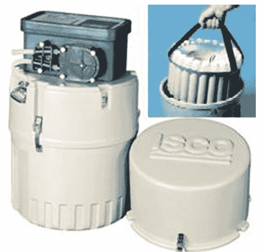

图4.1 ISCO自动可编程混合采样器。


## 4.5.6 复合采样方法（根据上下文推断，表 4.5）

### 表 4.5 复合采样方法的优缺点。

| Method | Advantages | Disadvantages | Comments |
|---|---|---|---|
| *Time-proportional composite*<br>Constant sample volume, constant time interval between samples. | Minimal instrumentation and manual effort. Requires no flow measurement. | May lack representativeness especially for highly variable flows. | Widely used in both automatic samplers and manual handling. |
| *Flow-proportional composite*<br>- Constant sample volume, time interval between samples proportional to stream flow. | Minimal manual effort. | Requires accurate flow measurement reading equipment. | Widely used in automatic as well as manual sampling. |
| - Constant time interval between samples, sample volume proportional to total stream flow at time of sampling. | Minimal instrumentation. | Samples must be manually composited. Discrete samples must be taken. Chance of collecting samples that are too small or too large for a given composite volume. | Used in automatic samplers and widely used as manual method. |

第二种流量比例采样方法涉及对每单位废流量的废流收集恒定样品体积（例如，每 5000 加仑流量收集 200 毫升样品），采样时间间隔与流量的倒数成比例。当使用自动采样器采集复合样品时，这是首选方法。该方法基于在排放一定量的废水后采集样品。该方法在流量测量准确时可提供所有废流的代表性样品。复合样品应在工作日内采集。如果设施 24 小时/天运行并排放，则复合样品应作为 24 小时复合样品采集（流量比例或时间复合）。如果设施 24 小时/天运行但仅排放 6 小时废水，则应采集 6 小时复合样品。一般而言，只要限值是日、周或月平均值，复合样品应采集以评估对分类标准的合规性和地方限值，除上述必须通过抓样采集的参数外。

如果在法规中明确了采样方案，则复合时间段的持续时间和等分采集频率由州许可证编写者确定。无论是手工采集还是自动设备采集，样品采集的时间范围都应在 NPDES 许可证中规定。构成复合样品的单个等分数量也应规定。

表 4.5 列出了每种复合采样方法的优缺点。可以采用手动或自动采样技术。如果样品手动复合，应尽量减少样品操作，以降低污染的可能性。检查员必须使用许可证或其他控制机制中规定的采样方法，而该方法又必须反映 40 CFR 403.12(g)(3) 的要求（CWA 1972）。

复合样品不合适的案例很多。某些参数如 pH、残余氯、温度、氰化物、挥发性有机物、微生物测试、油脂和总酚的样品不应复合。它们也不推荐用于采样批次或间歇过程。在这些情况下，需要抓样来确定排放水质的波动。对于生物测定，除非已知排放物在特定时间毒性最大，否则使用复合样品。一些有毒化学物质寿命短，迅速降解，即使在冷藏或其他形式的保存下，经过长时间复合后也不会以最有毒的形式存在。在这些情况下，要求对生物测定进行抓样。在缺乏

## 4.5.7 连续监测

连续监测是少数参数的另一种选择，例如 pH、温度、溶解氧（DO）、电导率和 TOC。可靠性、准确性和成本因参数而异。连续监测可能很昂贵，因此连续监测通常只适用于排放最显著且排放水波动的排放者。排放水中这些参数变化的环境意义应与可用连续监测设备的成本进行比较。关于 pH 限值的法规允许在排放物被连续监测时出现一段时间的超标（40 CFR 401.17）。在允许 pH 超标的情况下，需要连续监测或通过抓样进行劳动密集型的定期监测。

## 4.5.8 样品保存和保存时间

保存技术确保样品在采集时仍代表废流。由于采集样品中的大多数污染物在某种程度上不稳定，这种不稳定性要求样品立即分析或保存或固定，以最大限度地减少污染物浓度或特性在采集时间和分析时间之间的变化。由于通常不可能立即分析，大多数样品无论分析时间如何都会被保存。这种保存必须在采集样品后尽快进行。这意味着保存必须在现场进行（CWA 1972 40 CFR 136.3）。用于保存样品的最常见程序包括冰镇、冷藏、pH 调整和化学固定。当使用化学固定时，化学保存剂必须在样品转移到实验室之前添加。同样，冷藏应在采集样品后立即提供。对于许多样品，如果未适当使用保存，细菌会迅速降解某些污染物成分（例如酚类和磷）。其他成分如氰化物和硫化物可能会挥发，或在六价铬的情况下反应形成不同的化学物质。每个参数的适当保存和保存时间对于监测计划的完整性至关重要。然而，在采集 24 小时复合样品时可能会遇到问题。由于样品在复合过程中可能变质，因此有必要在复合过程中保存或稳定样品，并在将样品运送到实验室之前保存总体样品。保存技术因要测量的污染物参数而异；因此，检查员必须熟悉 40 CFR 第 136 部分的保存技术，以确保样品的正确处理和运输。重要的是要验证一种参数的保存技术不会影响同一样品中另一种参数的分析结果。如果存在这种可能性，则应采集两个独立样品并分别保存。样品保存应在复合过程中进行，通常通过冷藏至小于或等于 6°C（或冰镇）进行保存，如要求（CWA 1972 40 CFR 136.3）。冷藏是最广泛使用的保存技术，因为它对样品组成没有不利影响，也不会干扰任何分析方法。冷藏抑制生物活性并减少溶解气体和有机物质的挥发。该技术用于现场样品采集开始时和样品运输期间，并持续到实验室分析样品为止。样品温度应由检查员验证并记录。如果分析结果将用于执法行动，则这一点尤其重要。

除了保存技术外，40 CFR 第 136 部分还规定了最大保存时间。所列时间是样品采集和分析之间允许的最大时间，样品才被视为有效。某些参数从样品采集到提取/制备的时间和从提取/制备到分析的时间有单独的保存时间。复合废水样品在最后一个等分采集时成为样品。抓样保存时间从样品采集时开始。此时，保存时间限制开始。保存方法和保存时间清单在 40 CFR 136.3（CWA 1972）中提供。检查员应查阅 40 CFR 第 136 部分以获取最新和最详细的规范。这些样品保存程序和保存时间由 EPA 选择，因为它们减缓了样品降解并通过尽可能延长保存时间来最大限度地减少监测成本。

## 4.5.9 样品文件记录

文件记录是任何预处理计划不可或缺的一部分。通过文件记录和记录保存，确保了在现场（例如 pH 和流量）和实验室（即化学分析）中采集的样品和获得的数据的有效性。所有记录的信息必须完整准确。未能按照既定程序维护记录和文件可能会导致这些文件在法庭上被视为不可采纳的证据。所有包含数据的现场记录必须由检查员在采集时签署，包括所有 COC 表格。

## 4.5.10 一般文件记录程序

由于许多采样报告可能用于执法程序，检查员必须对所有样品采集和数据处理保持精确记录。工业设施或 POTW 的采样和质量保证计划应规定以下信息必须记录在现场记录中：

- Unique sample or log number: All samples should be assigned a unique identification number. If there is a serial number on the transportation case, the inspector should add this number to their field records.
- Date and time of sample collection: The date and time of sample collection must be recorded. In the case of composite samples, the sequence of times and aliquot size should be noted.


## 4.5.11 COC 程序

- 样品来源（设施名称和地址）：应记录被采样设施的名称和地址，以及对取样具体地点的叙述性描述和/或示意图。
- 取样人员姓名：应标明取样人员的姓名。对于混合样品，应包括安装采样器的人员的姓名和取回样品的人员的姓名。
- 样品类型：每个样品应标明其为瞬时样或混合样。如果样品为混合样，应注明单个样品的体积和频率。
- 保存方法：应记录添加到样品中的任何防腐剂（包括用量），包括防腐剂用量和保存方法（例如冷藏）。
- 所需分析：应指定样品应分析的所有参数。
- 现场分析：现场测量必须在分析完成后立即记录。应在现场进行并记录的分析示例包括：pH、温度、DO、余氯和亚硫酸盐。现场分析应与任何其他样品一样对待（即取样员必须记录样品日期、样品类型、取样员姓名、COC 等）。
- 流量：如果在取样时测量流量，应记录流量测量值。如果样品用于确定合规性，则必须测量流量。
- 生产率：应包括所生产产品的信息和生产率，因为许多排放限值是基于生产率的。
- 样品运输的日期、时间及文件记录：应记录运输方式（例如空运或铁路）以及运输单据或提单号码。
- 备注：此项指与样品或取样点相关的所有相关信息。此类备注包括样品点的状况、样品的观察特征、可能影响样品的环境条件以及取样过程中遇到的问题。

设施/POTW 检查员在进行现场取样时应记录上述每一项，但工业用户在进行其要求的自行监测时也应保留此信息。此信息应可在设施/POTW 进行现场检查或取样访问时供其审查。

一旦获得适当的样品并正确记录样品采集方法，就应制作该样品占有情况的书面记录。“COC”是指对特定样品或一组样品发生的占有变更的 documented 账户（见第 4.5.11 节中“保管”的定义）。为确保记录所有必要信息，POTW 应制定 COC 表格。

COC 程序是监测工业用户的重要方面，这些程序应纳入 POTW 的采样和质量保证计划。COC 记录允许准确逐步重现样品路径，从其来源到实验室的最终分析。每个样品都必须附带一份由链中从原始取样员到参与分析样品的最后人员的每位人员正确签署并移交的 COC 表格。由于无法预测哪些违规行为需要采取法律行动，应假定所有从取样中产生的数据都将在法庭上使用。如果案件最终进入审判，必须确立数据的完整性。只有当 POTW 人员能够证明样品已得到适当采集、保存和分析，并且未被篡改或 mishandled 时，取样结果才可在法庭上被采纳。

应在 COC 表格中说明的信息包括以下内容：

- 取样人员的姓名
- 样品识别号码
- 样品位置
- 样品采集日期和时间
- 待分析参数
- 使用的容器类型
- 保存方法
- 采集的样品类型（即瞬时样、混合样）针对每种待分析污染物
- 在现场进行的任何分析的结果（例如 pH 和温度）
- 在现场和实验室处理样品的所有人员的姓名、签名、日期和时间

注：实验室通常有单独的 COC 程序，因此现场使用的 COC 可能在样品到达实验室时结束。

POTW 使用的 COC 表格示例见第 D.1 节。所有处理样品的人员都应收到一份显示样品从现场到实验室路径的 COC 表格副本。所有样品运输必须附带 COC 记录，而这些表格的副本应由发起人保留。此外，所有与运输相关的收据都应保留。承运人通常不会为样品签字；因此，必须使用封条来验证运输过程中未发生篡改。

在转移样品占有期间，受让人必须在 COC 记录上签字并记录日期和时间。一般来说，每个样品都要进行保管转移，尽管如果需要，样品可以作为一组进行转移。每个接管保管的人员必须填写 COC 记录的相应部分。最后，负责许可和/或合规与执行的 POTW 人员或团体应收到已完成的 COC 表格副本。

如果分析数据要在执法程序中使用，COC 记录至关重要，因为它们允许在没有制作记录的人员作证的情况下将此类数据作为证据引入。因此，必须确保所有 COC 记录完整且准确。为保持样品的完整性，COC 记录必须显示样品已得到适当采集、保存和分析，并且在运输过程中未被篡改。COC 记录还显示样品已按照方法要求接收和分析。因此，工业用户处采集的所有合规样品都应遵循 COC 程序。

## 4.5.12 样品识别和标签

每个样品必须准确、完整地识别。在采集样品时，应将防水、带胶标签或能够承受现场条件的防水标签附在样品容器上。该标签和/或标签对于防止样品误识别是必要的，因为它为实验室提供了分析所需的相关信息，例如取样员姓名、样品识别号码、样品采集日期和时间、样品采集地点、所用防腐剂、样品类型（瞬时样或混合样）以及待分析参数的识别。因此，样品识别是 COC 的重要组成部分。样品标签应作为 COC 流程的一部分使用，因为它们可以在样品运送到实验室后取下并放入该样品的证据文件中，而标签通常会随样品一起丢弃。标签随后可在执法程序中作为证据使用。样品识别程序应纳入设施/POTW 的采样和质量保证计划。

应使用样品封条或冷藏箱封条（即放置在装有类似样品的冷藏箱周围的封条）来保护样品从采集到在实验室打开期间的完整性。封条应包含采集员姓名、样品采集日期和时间以及样品识别号码。封条上的信息必须与标签和标签上的信息相同。此外，封条必须附着在必须破坏才能打开样品容器或冷藏箱的位置。应注意确保样品封条和标签线的胶水不会污染样品，特别是含有挥发性有机物和金属的样品。

## 4.5.13 样品包装和运输

在样品正确贴标签后，应将其连同 COC 表格、相关现场记录和分析请求表一起放入运输箱中。玻璃瓶应用泡沫橡胶、塑料气泡膜或其他材料包裹，以防止运输过程中破裂。包装可以用胶带固定在瓶子周围。样品应放置在冰或合成冰替代品中，以确保整个运输过程中样品温度保持在 6°C 或以下。冰应放置在双层包裹的防水袋中，以确保水不会从运输箱中滴出。金属或重型塑料箱是良好的样品运输箱。冰箱两端缠绕的丝带可确保其在运输过程中不会打开。取样记录应放置在防水袋、信封或气密样品瓶中，并贴在运输容器内盖或其他适当位置的内部，以防止篡改或保管中断。运输容器还应密封以防止篡改。样品包装和运输注意事项应包含在 POTW 的采样和质量保证计划中（见第 4.5.13 节）。

大多数样品不需要任何特殊运输预防措施，除谨慎包装以防止破损和/或泄漏外。如果样品通过普通承运人运输或通过美国邮寄，则必须遵守美国交通部《危险废物材料法规》（49 CFR 第 171–177 部分）（CFR，第 40 篇，第 51 部分，1977 年）（CWA 1972）。危险废物材料的空运也可能受国际航空运输协会（IATA）要求的约束。在运输样品之前，检查员应了解并遵循任何特殊运输要求。对 IATA 规则定义的危险物质适用特殊的包装和运输规则。典型的废水样品通常不被视为危险材料。


## 4.6 全废水毒性测试

### 4.6.1 引言

对于部分选定的工业废水处理厂（WWTP），其 NPDES 许可证要求进行全废水生物测试。全废水毒性（WET），也称为生物监测，是指直接通过毒性测试测定废水样品的毒性，以评估所有污染物的总毒性效应。WET 测试之所以必要，是因为美国环境保护署（EPA）不可能为废水排放中可能存在的每一种有毒污染物制定水质标准。试图测量每一种可能的化学物质将耗费巨大。WET 测试也是评估排放物中所有污染物毒性相互作用的唯一方法。该方法之所以称为“全废水毒性”，是为了区别于逐一测量废水中多种有毒化学物质的浓度，并与相应的水质标准（如果有的话）进行逐项比较的做法。由于 WET 测试常常能发现未知毒物产生的影响，因此在这些相关毒物被识别之前，无法降低毒性效应。

### 4.6.2 WET 测试

生物测定方法是将选定的水生生物（取决于淡水或盐水生物）置于受控的生物测定实验室环境中，暴露于工艺废水。在静态短期测试中，将废水和未受污染的水（对照组）分别放入容器中，向两个容器中均加入测试生物，然后在受控的实验室环境中监测毒性效应。目的是估算安全水平或无可见不良影响水平，该水平应能保证受纳水体中水生生物的正常繁殖。测试容器为硼硅酸盐玻璃或一次性聚苯乙烯材质，容量为 250 至 1000 毫升，具体取决于测试生物的大小。测试期间，溶解氧浓度应接近饱和，温度保持在 25 °C，并定期检查 pH 值。废水为 24 小时混合样，通过筛网过滤以去除悬浮固体（SS）。在废水制备过程中，应限制曝气，以防挥发性有机化合物损失。常见的淡水测试生物包括彩虹鳟（*Oncorhynchus mykiss*）、黑头呆鱼（*Pimephales promelas*）、蚤状溞（*Ceriodaphnia dubia*）、蚤状溞虾和绿藻（*Selenastrum capricornutum*）。常见的海洋盐水物种包括红藻 *Champia parvula*、糠虾 *Mysidopsis bahia*、内陆银汉鱼 *Menidia beryllina* 以及羊头鲦鱼 *Cyprinodon variegatus*。美国有些州已开发出针对本地物种的培养和测试方法。

测试结果以 24 小时暴露后的死亡率表示。存活率降低 25% 被定义为具有生物学意义的阈值，表明受纳水体可能受损。受纳水体的受损程度和废水毒性与实际水体中废水的稀释程度相关。因此，更为确定的毒性测试是设置一系列稀释度递减的实验室容器，例如 100%、50%、25%、12.5% 和 6.25%（几何级数）。该范围可能涵盖与 10 年重现期 7 日平均低流量（记为 7Q10）相对应的废水流量。河流或溪流中的 7Q10 流量是制定地表水标准所设定的最大允许污染物浓度的基础。稀释水取自排放口上方受纳溪流边缘，或混合区边缘（见第 4.8.1 节）。

生物测定测试可采用 24 小时急性毒性测试，或持续监测最长 7 天的慢性毒性测试。根据测试结果，确定稀释测试样品中废水的无可见效应浓度（NOEC）。该值应与废水浓度进行比较，废水浓度应低于 NOEC，并留有一定的安全边际（MOS）。

工业废水的预处理对于控制有毒物质至关重要。由于许多有害物质是杀生物剂，降低其在原废水中的浓度对于有效的生物处理至关重要。如果毒性证据不那么明显，它们在原废水和处理厂出水中的存在可能会被忽视。典型的有毒污染物清单包括 13 种优先控制污染物金属、氰化物、15 种多环芳烃、13 种芳香族化合物、10 种酚类、21 种脂肪族化合物、6 种邻苯二甲酸酯、2 种含氮化合物、2 种含氧化合物以及农药。

### 4.6.3 毒性测试及毒性测试结果评价

生态毒性测试根据持续时间（短期、中期和/或长期）、测试溶液的添加方式（静态、再循环、换水或流水式）以及（为满足拟议污染物排放消除系统的许可证要求、确定混合区等）进行分类。详细的当代测试协议已在监管文献中总结（USEPA 1985b, c, 1988, 1989）。

许多术语用于表达毒性测试结果。急性毒性是指毒性严重到足以快速产生反应（通常是在 48 或 96 小时内观察到的反应）。“急性”并不一定意味着死亡。在海洋生物研究中，LC50 是指导致测试种群 50% 死亡的稀释水中废水浓度；EC50 是指对测试种群 50% 产生可测量负面效应的废水浓度。NOAEL（无可见急性效应水平）定义为导致死亡率不超过 10% 的最高测试废水浓度。

慢性毒性是指持续或延续相对较长时间（通常为目标生物寿命的 1/10 或更长）的毒性影响。慢性效应可能包括死亡、生长减缓或繁殖能力下降。NOEC 是根据慢性测试结果，未观察到任何效应的最高实测连续废水或毒物浓度。LOEC（最低可见效应浓度）定义为产生任何效应的最低观察浓度。LOEC 通过方差分析技术确定。

毒性数据采用 Stephan（1977）制定的程序进行分析。LC50 值通过 Spearman–Kärber 法、移动平均法、二项式法和概率单位法进行分析确定。如图 4.1 所示，也可使用图形法获得估计的 LC50 值。通常，LC50 值基于 48 小时和 96 小时暴露的存活率计算。方差分析和 Duncan 多重比较通常用于比较慢性测试结果。示例 4.2 展示了急性毒性测试结果的简单比较。

#### 示例 4.2 毒性数据分析

使用以下假设数据，以体积百分比确定 48 小时和 96 小时的 LC50 值。

| 废水浓度（体积百分比） | 测试动物数量 | 测试动物死亡数量ᵃ |  |
|---|---|---|---|
|  |  | 48 小时 | 96 小时 |
| 40 | 20 | 17 (85) | 20 (100) |
| 20 | 20 | 12 (60) | 20 (100) |
| 10 | 20 | 6 (30) | 14 (70) |
| 5 | 20 | 0 (0) | 7 (35) |
| 3 | 20 | 0 (0) | 4 (20) |
ᵃ括号内为百分比值。

#### 解答

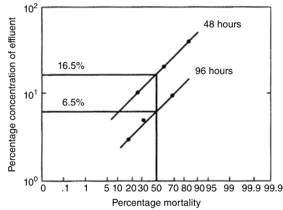

- 1) 将废水浓度（体积百分比，对数刻度）对测试动物存活率（百分比，概率刻度）作图，如图所示。
- 2) 用目测法拟合数据点，重点考虑死亡率在 16% 至 84% 之间的点。
- 3) 找出导致 50% 死亡率的废水浓度。

估计的 LC50 值分别为：48 小时为 16.5 体积百分比，96 小时为 6.5 体积百分比。

评注：通过图形法获得的 LC50 估计值通常与正式概率单位分析（Stephan 1977）获得的值相当接近。需要注意的是，图形分析无法获得置信限（APHA 1989）。

### 4.6.4 毒性单位

毒性单位（TU）方法已被广泛接受，用于利用毒性测试结果。联邦和州的标准和/或准则已经或正在基于毒性单位制定。在毒性单位方法中（USEPA 1985b, c），为保护水生生物确定了 TU 浓度。

急性毒性单位（TUa）是在急性暴露期结束时引起急性效应的废水稀释度的倒数。

```
TUₐ = 100 / LC₅₀  (4.1)
```


毒性单位慢性（TUc）是导致慢性暴露期结束时对试验生物无不可接受影响的废水稀释倍数的倒数：

```
TUc = 100 / NOEC  (4.2)
```

其中，与前文相同，NOEC 为无观察到效应浓度。

过去，急性与慢性比值（ACR）由方程 ACR = LC50/NOEC 确定。慢性数据是通过从急性数据外推确定的。急性与慢性比值在不同物种和不同有毒物质之间变化极大。采用全废水方法可防止实施过于严格或过于宽松的要求。

## 4.6.5 毒性试验结果的应用

水质标准通过包含毒性物质允许的量级（数量）、持续时间（河流水体中浓度平均的时间段）以及频率（在不产生不可接受的受纳水体生态群落影响的情况下标准可被超出的次数）来确保指定用途的保护。现代水质标准旨在通过使用标准最大浓度（CMC）防止短期（急性）效应，并通过使用标准持续浓度（CCC）防止长期（慢性）效应。这些标准通常在混合后适用。典型水质标准包含浓度限值、平均期和重现频率。CMC 通常为四日平均浓度，平均而言不得超过每三年一次，CCC 通常为一小时平均浓度，平均而言不得超过每三年一次。

## 4.6.6 对急性毒性的保护

为防止急性毒性，CMC 必须不超过 0.3 TUa，按所进行试验中最敏感结果测定。

```
CMC = TUa / CID ≤ 0.3 TUa  (4.3)
```

其中 CID 为临界初始稀释度。在海洋排放中，CID 定义为在排放附近区域在“最不利”环境条件下实现的稀释度，其中废水羽流的混合和稀释由排放的初始动量和浮力决定。在河流排放中，通常将混合区边界处实现的稀释度作为 CID。根据大量 96 小时废水毒性试验的结果发现，0.3 的系数可解释 91% 的观察到的 LC50 与 LC1 比值（LC1 等于稀释水中导致试验种群 1% 死亡的废水浓度）。因此，为急性保护，CMC 不应超过基于所试验最敏感物种的 0.3 TUa。急性标准因此等于近似 LC1 的 CMC。

## 4.6.7 对慢性毒性的保护

为防止在初始混合区或排放影响区之外发生慢性效应，CCC 必须不超过 1.0 TUc，基于至少三种物种试验中最敏感者获得的结果。

```
CCC = TUc / CID ≤ 1.0 Tuc  (4.4)
```

符合性基于将毒性标准（TUa 和 TUc 均以毒性单位表示）在临界初始稀释后的废水中进行比较，以确定是否满足 EPA 推荐的标准。这些标准的应用在示例 4.3 中说明。

## 示例 4.3 毒性试验结果的应用

向海洋受纳水体排放的经处理废水实现了 225:1 的临界初始稀释度。使用三种海洋物种对 WWTP 废水进行了毒性试验。以下急性与慢性毒性试验结果表明，根据 LC50，C. parvula 表现出最敏感物种急性终点（2.59% 废水），并且根据 NOEC，也表现出最敏感物种慢性终点（1.0%）。使用给定的毒性数据，确定 CMC 和 CCC 标准的符合性。

| Results of acute toxicity tests |
| Species | Exposure (hours) | Control survival (%) | Percent effluent |  |
|  |  |  | LC50 | NOAEL |
| Mysidopsis bahia | 96 | 100 | 18.66 | 10.0 |
| Cyprinodon variegates | 96 | 100 | >100 | 50.0 |
| Champia parvula | 48/168 | 100 | 2.59 | 12.25 |

**Results of chronic toxicity tests**

| Species | Exposure (days) | Control survival (%) | Percent effluent: NOEC | Percent effluent: LOEC |
|---|---:|---:|---:|---:|
| *Mysidopsis bahia* | 7 | 82 | 6.0 | 10.0 |
| *Cyprinodon variegates* | 7 | 98.8 | 15.0 | >15.0 |
| *Champia parvula* | 7 | 100 | 1.0 | 2.25 |

## Solution

- 1. Check compliance with the CMC criterion.
  - a) Based on data for the most sensitive species tested, we use Eq. (4.1) to find the number of acute toxic units:
  
  \(\mathrm{TU_a} = \frac{100}{\mathrm{LC}_{50}} = \frac{100}{2.59} = 38.6\) units
  
  - b) For acute protection, the criterion maximum concentration must not exceed 0.3 TUₐ, as shown in Eq. (4.3). Following an initial dilution of 225, the CMC is:
  
  \(\mathrm{CMC} = \frac{\mathrm{TU_a}}{\mathrm{CID}} \leq 0.3\mathrm{TU_a}\)
  
  \(\frac{38.6}{225} \leq 0.3(38.6)\)
  
  \(0.17 \leq 11.58\)
  
  - c) The CMC (0.17) is considerably less than the value of 0.3 TUₐ (11.58) required for compliance with the CMC criterion.
  
- 2. Check compliance with the CCC criterion.
  - a) Based on data for the most sensitive species tested, we use Eq. (4.2) to find the number of chronic toxic units:
  
  \(\mathrm{TU_c} = \frac{100}{\mathrm{NOEC}} = \frac{100}{1.0} = 100\) units
  
  - b) For chronic protection, the criterion continuous concentration must not exceed 1.0 toxic unit as shown in Eq. (4.4). Following an initial dilution of 225, the CCC is:
  
  \(\mathrm{CCC} = \frac{\mathrm{TU_c}}{\mathrm{CID}} \leq 1.0\mathrm{TU_c}\)
  
  \(\frac{100}{225} \leq 1.0(100)\)
  
  \(0.44 \leq 100\)

The CCC (0.44) is considerably less than the value of 1.0TU₍c₎ (100) required for compliance with the CCC criterion.

采用全废水毒性测试具有诸多优势。在此方法中，有毒物质的生物可利用性得以测定，任何协同相互作用的影响也被考虑在内。由于确定了废水排放物所有组分的总体毒性，因此可以通过限制单一参数——废水毒性来限制毒性效应。由于当代受纳水体管理策略基于特定场地的水质标准，毒性测试便于将废水毒性与旨在保护代表性敏感物种并允许建立保护水生环境的排放限值的特定场地水质标准进行比较。

## 4.7 流量测量

工业用户许可中的污染物限值通常以向工业设施或 POTW 的质量负荷表示（例如，常规污染物、有机物、金属、微生物等的分类标准）。为确定质量负荷，需要获取并记录准确的流量数据。本节简要描述用于测量流量的设备类型和程序。在无法使用以下各节所述的流量测量设备的情况下，设施可能需要依赖设施用水消耗记录。然而，当需要确定质量负荷以评估符合性时，设施应能够在采样期间直接评估设施的流量。

### 4.7.1 开渠流

开渠流是指在未充满液体的管道中发生的流动，是预处理计划监管的工业用户排放点最常见的流动类型。未充满且无压力的半满管道也归类为开渠。开渠流使用初级和次级设备进行测量（如下面所述）。

#### 4.7.1.1 Primary Devices

初级设备是校准过的液压结构，安装在渠道中，以便通过在特定点相对于初级设备的液位深度测量来获得流量测量。堰和量槽是初级设备的例子。


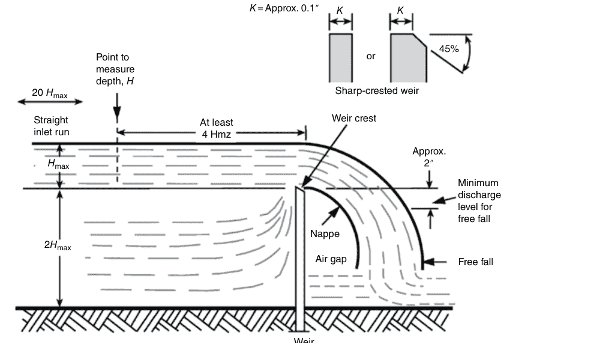

# 图 4.2 尖堰的水力和术语

最常见的堰类型是由一块带有锐利堰顶的薄竖直板组成，它被放置在溪流、渠道或部分充满水的管道中。图 4.2 展示了一个尖堰的轮廓，并标出了相应的术语。图 4.3 展示了四种常见类型的堰（矩形、梯形、尖堰和 V 形缺口或三角形堰）。堰顶是堰的上边缘，水必须上升到此处才能越过该结构。从堰顶到水面的垂直距离被称为“堰上水头”。为了确定流量，检查员必须测量水力水头。堰上的流速与堰顶上方的水高（水力水头）直接相关。为了测量水力水头，测量装置放置在堰的上游，距离至少为水头的四倍。为了近似水头，检查员可以在堰板上进行测量。然而，这个数值只能提供流量的粗略估计。

假设上游流速可忽略不计，基本未校正的堰公式为

```
Q = C_w (2/3) b sqrt(g) H^(3/2)   (4.5)
```

其中 $C_w$ 是堰系数，$b$ 是宽度，$H$ 是堰高。

# 例题 4.4 水流以 3 加仑/秒的流量流过宽顶堰，当堰上水头为 0.5 英尺时。确定当水头增加到 0.8 英尺时的预期流量。假设两种情况下堰系数保持不变。

# 解答

根据公式 (4.5)，$Q = 3 \text{ ft}^3/\text{s}$，$H = 0.5 \text{ ft}$

```
3 ft³/s = C_w b (32.2 ft/s²)^(1/2) (2/3) (0.5)^(3/2)
```

因此，$C_w b = 2.24 \text{ ft}$；于是，当 $H = 0.8 \text{ ft}$ 时，

```
Q = 2.24 ft (32.2)^(1/2) (2/3) (0.8 ft)^(3/2) = 6.07 ft³/s (答案)
```

巴歇尔槽（flume）是一个人工渠道，构建后使废水流经其中。废流的流速与巴歇尔槽中水的深度成正比，并通过测量水头来计算。巴歇尔槽由三部分组成：(i) 收缩的上游段；(ii) 喉部或收缩段；以及 (iii) 扩散或下降的下游段。巴歇尔槽的两种主要类型是 Parshall 槽和 Palmer-Bowlus 槽。

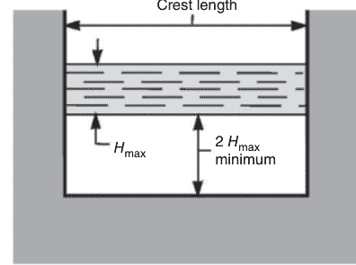

矩形堰（无末端收缩）

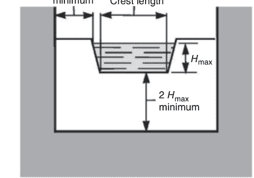

梯形（Cipolletti）尖堰

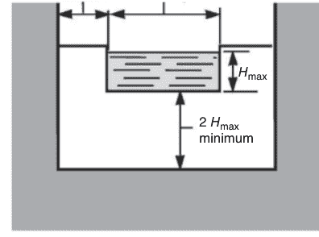

矩形堰（有末端收缩）

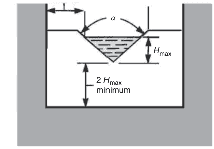

V 形缺口（三角形）尖堰

# 图 4.3 四种常见类型的尖堰

图 4.4 展示了 Parshall 槽的草图，并识别了其不同部分。在 Parshall 槽中，收缩段的底部水平高于喉部和扩散段的底部。巴歇尔槽的工作原理是：当水流通过渠道中的收缩部分时，会产生一个与流量成正比的水力水头。巴歇尔槽适用于测量明渠废流，因为它们具有自清洁能力。沙子和悬浮固体（SS）不太可能影响装置的操作（Benefield and Judkins 1984）。

在自由流动（未淹没）条件下，Parshall 槽是一个临界深度流量计，它在稳定高度 $h$ 和流量 $Q$ 之间建立数学关系。对于巴歇尔槽喉部宽度 ($w$) 至少为 1 英尺 (0.305 m) 但小于 8 英尺 (2.44 m) 的情况，流量可以使用以下方程计算：

$Q = 4 W H^{1.522} W^{0.026}$
(4.6)

其中
$Q$ = 流量 (加仑/秒)
$W$ = 喉部宽度 (英尺)
$H$ = 上游水头 (英尺)

# 例题 4.5 Parshall 槽喉部宽度为 2.0 英尺，在最大自由流动水头 2.5 英尺时，计算出的污水流量是多少？

解答
使用公式 (4.6)，

$Q = 4 \times 2 \times 2.5^{1.522}(2)^{0.026}$
$Q = 4 \times 2.0 \times 2.5^{1.5496}$
$= 33.093 \text{ cfs} = 21.39 \text{ MGD}$ (答案)

# 图 4.4 Parshall 槽的平面图和横截面

# 图 4.5 自由流动 Palmer-Bowlus 槽

Palmer-Bowlus 槽，可能有不收缩的喉部，其喉部段底部是水平的，并放置在管道中，长度约为管道直径。喉部中台阶上方的水深与流量速率有关。水头应在喉部上游距离 $(d/2)$ 处测量，其中 $(d)$ 是槽的宽度。台阶的高度通常未知，直到查阅制造商的数据，并且在人工测量时很难确定上游点台阶上方的水高。每个 Palmer-Bowlus 槽的尺寸都不同。因此，必须查阅制造商的数据以建立水头与流量速率之间的关系。图 4.5 包含一个自由流动 Palmer-Bowlus 槽的草图。

图 4.6 (a) 文丘里流量计的构造和术语。(b) 皮托管。

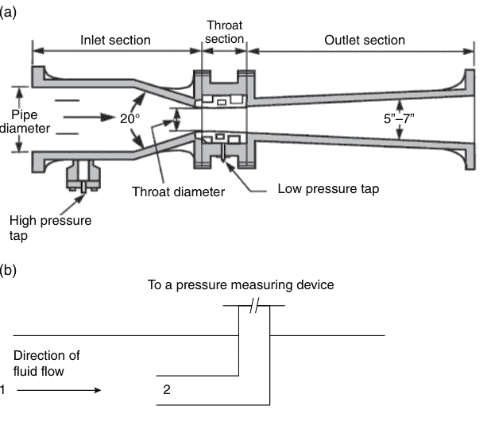

# 4.7.1.2 二次设备

二次设备与一次设备配合使用，以确定通过测量点的实际流量。通常，二次设备测量一次设备中水的深度，并使用既定的数学公式将深度测量转换为相应的流量。二次设备的输出通常传输给记录仪和/或总计器，为操作员提供瞬时和历史流量数据。输出也可传输给采样系统以方便按比例采样。二次设备可以分为两大类：

+   1) 非记录型，带有直接读数（例如水位尺）或从固定点间接读数（例如链条、线重或浮子）
+   2) 记录型，带有数字或图形记录仪（例如井中浮子、流中浮子、气泡式、电学或声学）。

插入导管中。明渠流量测量设备的例子包括文丘里流量计和电磁流量计。

文丘里流量计是测量明渠流量最精确的一次设备之一。它基本上是一段管道，由带有收缩段的入口、喉部和扩散出口段组成，如图 4.6a 所示。在水流经过入口收缩部分时，流速增加，导致静压降低。入口管与喉部之间的压差与流量成正比。

文丘里流量计中的流量可以使用以下方程计算：

```
Q = Ca$_2$ [2g (P$_1$ - P$_2$)/ρ]$^{1/2}$    (4.7)
```

# 4.7.2 明渠流量

明渠流量通常出现在污水处理厂的处理单元之间以及提升站之后，液体和/或污泥在此处加压泵送。它也在淹没式出水口遇到。明渠中的流量通常通过插入导管中的计量装置来测量。

+   其中
+   $Q$ = 流量 (加仑/秒)
+   $C$ = 流量系数，通常在 0.90–0.98 范围内
+   $A_2$ = 喉部截面积 (平方英尺)
+   $g$ = 重力加速度 (英尺/秒²)
+   $P_1 – P_2$ = 差压 (磅/平方英尺)
+   $ρ$ = 水的比重 (磅/立方英尺)

例题 4.6 当测得的压差为 160 英寸水柱时，喉部直径为 0.063 英寸的文丘里流量计的计算水流是多少？假设 $C = 0.95$ 且水温为 50°F。

# **解答**

代入公式 (4.7)，我们得到

$$Q = 0.95 \times \frac{\pi}{4} \left(\frac{5.063 \text{ in.}}{\frac{12 \text{ in.}}{\text{ft}}}\right)^2 \left(2 \times \frac{32.2 \text{ ft}}{\text{s}^2} \times \frac{160 \text{ in.}}{\left(\frac{62.4 \text{ lb}}{\text{ft}^3}\right) \frac{12.0 \text{ in.}}{\text{ft}}}\right)^{0.5}$$

$$= 0.492 \text{ cfs} = 221 \text{ gpm}$$

# **4.7.3 皮托管**

皮托管或皮托探针（也称为冲击管或驻点管）只是一个中空的管子，沿流体流动方向纵向放置，允许流体以接近流速进入管的一端（图 4.6b）。它是一种压力测量仪器，用于测量流体流速，并应用于亚音速和超音速场合。皮托管广泛用于确定飞机的空速、船的航速，以及在某些工业应用中测量烟囱中液体、空气和气体的流速。皮托管用于测量流动流中给定点的局部流速，而不是管道或导管中的平均流速。

伯努利方程可用于预测驻点的静压。由于皮托管内流体的速度为零，如果已知静压和驻点压力，则可以计算上游速度。

$$\frac{P_1}{\rho} + \frac{v_1^2}{2} = \frac{P_2}{\rho} \quad (4.8)$$

$$V_1 = \sqrt{\frac{2(P_2 - P_1)}{\rho}} \quad (SI) \quad (4.9)$$

$$V_1 = \sqrt{\frac{2g_c(P_1 - P_s)}{\rho}} \quad (US) \quad (4.10)$$

实际上，摩擦和加热都会发生，并且流体可能是可压缩的。这些误差通过一个名为冲击系数 $C_i$ 的校正因子进行修正，该因子应用于推导出的速度。$C_i$ 通常非常接近 1.00（例如 0.99 或 0.995）。

$$V_{actual} = C_i V_{indicated}$$

**例题 4.7** 在管道中流动的空气（0.075 lbm/ft³; 1.2 kg/m³）的静压由下所示的精密仪表测得为 10.00 psig (68.95 kPa)。皮托管液位计指示 20.6 英寸 (0.52 m) 的水银。损失可忽略不计。管道中空气的速度是多少？

# **SI 单位制解答**

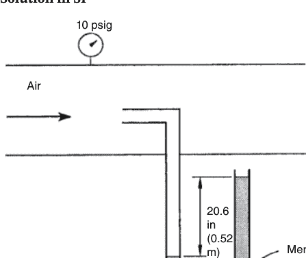

水银的密度为 13 600 kg/m³。冲击压力为

$$P_i = \rho g h = \left(13600 \frac{\text{kg}}{\text{m}^3}\right) \left(9.81 \frac{\text{m}}{\text{s}^2}\right) \left(\frac{0.52 \text{ m}}{\frac{1000 \text{ Pa}}{\text{kPa}}}\right) = 69.38 \text{kPa}$$

根据公式 (4.9)，速度为

$$V = \sqrt{\frac{2(P_i - P_s)}{\rho_{air}}} = \sqrt{\frac{2(69.38 - 68.95 \text{kPa})}{1.2 \text{ kg/m}^3} \left(\frac{1000 \text{ Pa}}{\text{kPa}}\right)}; \text{ 其中 } \rho_{air} = 1.2 \text{ kg/m}^3$$

$$= 26.8 \text{m/s}$$

(传统美国单位制解答)

皮托管测量冲击（驻点）压力。对于水银，每英寸的压力当量为 0.491 psig/in。因此，$p_i = (20.6 \text{ in.}) \left(\frac{0.491 \text{ psi}}{\text{in.}}\right) = 10.11 \text{ psig}$。

由于冲击压力是静压和动能（速度）压力之和，动能压力为 $p_v = p_i - p_s = 10.11 - 10.00 = 0.11 \text{ psig}$，使用公式 (4.10)，我们得到，


$$
V=\sqrt{\frac{2 g_{e} \left(p_{i}-p_{s}\right)}{\rho_{\text {air }}}}
$$

$$
V=\left[2\left(\frac{32.2 \frac{\mathrm{ft}}{\mathrm{s}^{2}}}{}\right)\left(\frac{0.11 \frac{\mathrm{lb}}{\mathrm{s}^{2}}}{0.075 \frac{\mathrm{lb}}{\mathrm{ft}^{3}}}\right)\left(\frac{144 \frac{\mathrm{in}^{2}}{\mathrm{ft}^{2}}}{1}\right)\right]^{1 / 2}
$$

其中空气密度 = 0.075 lb/ft³

因此，V=116.6 ft/s = 117 ft/s（答案）。

## 4.7.4 电磁流量计

电磁流量计的工作原理基于这样一个事实：当导体垂直于磁场运动时所产生的感应电压与导体穿过该场时的速度成正比。在电磁流量计的情况下，导体是待测量的水流，而磁场则由一组电磁线圈产生。典型的电磁流量计如图4.7所示。

## 4.8 符合水质标准的位置

## 4.8.1 混合区

本节讨论工业污水处理厂废水排入河流和河口的情况。水质标准允许对否则会超过水生生物水质标准的排放使用混合区。混合区是水质标准可能被超过的区域，但超标程度和时间足够小，不会干扰有益用途。混合区是对大多数污染物浓度及其影响在排放后由于稀释而迅速减弱这一现象的监管认可（Adams 1982）。它们以限制生物通过排放羽流时的暴露持续时间的方式建立，以尽量减少每次排放的风险。慢性保护的水质标准必须在该区的边界及以外得到满足。也可以授权一个更小的区域，在该区域内急性标准可能被超过。该区域必须足够小，以限制暴露时间，从而不引起急性死亡或干扰水生生物在水体中的通过。混合区对于溶解氧分析并不重要，因为BOD耗氧相对于混合区内的旅行时间来说很慢。相对于其他限制，例如有毒化学物质，混合区的特性很重要。显然，使废水与环境水流迅速混合以降低毒性是可取的。

混合区的大小不仅取决于废水特性，还取决于河流流量。通常，较低的河流流量会实现较低的废水稀释度，从而产生更大的混合区。因此，需要对流量记录进行分析，以确定低流量期的大小、持续时间和频率。美国现行的法规通常规定用于混合区分析的低流量的持续时间和频率，例如7Q10。

对于较浅的河流深度，在排放点附近很短的距离内即可达到垂直混合状态。混合区分析可以通过将排放模拟为延伸整个河流深度的平面源来进行。对于管道排放，源的宽度可假定等于河流深度。有限的河宽限制了羽流的横向扩散。有限的河宽可通过相对于河岸引入镜像源来考虑，如图4.8所示。

海洋和大型湖泊，如五大湖，提供了广泛的同化能力，并被许多工业和社区用于废水处置。废水通常通过铺设在海底或埋设的管道，或通过隧道输送到近海排放点。海洋或深湖中的排放可以通过单口或多口排放结构进行。海洋中废水羽流的构型如图4.9所示。在第一个区域，称为“初始混合区”或“排放近场”，废水形成浮力羽流，在水柱中迅速上升。该羽流夹带大量环境水，从而稀释废水（Muellenhoff et al. 1985）。

与《清洁水法》零排放目标一致的点源污染控制的一个中间目标是

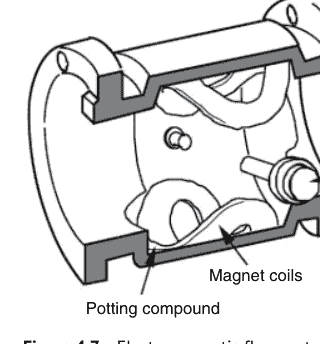

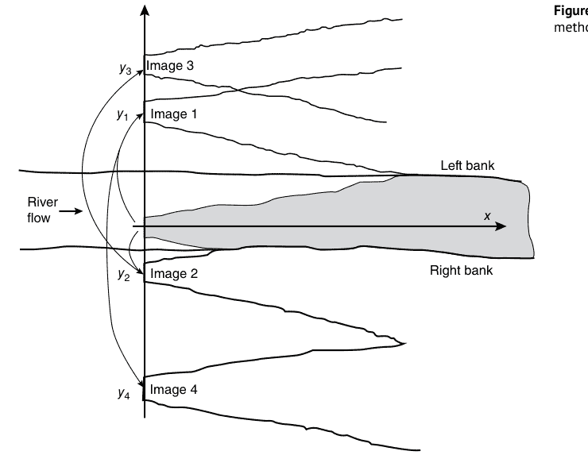

图4.8 浅溪中采用镜像法进行混合区分析。

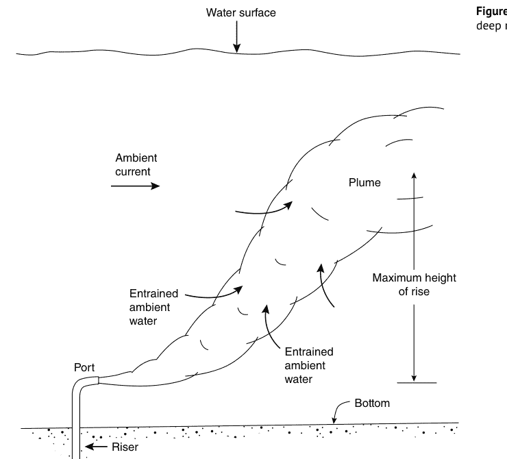

图4.9 深水受纳水体中的废水排放羽流。

消除对混合区的需要。水质标准并不禁止许可编写者在岸边排放时授予混合区，但岸边区域是重要的生物区域。许可编写者应确保在岸线上授予混合区不会导致法规中规定的生物效应。在某些情况下，这可能需要许可持有者进行证明。

## 4.8.2 Streeter–Phelps方程和河流中的DO Sag曲线

Streeter–Phelps方程确定了溶解氧浓度与生物需氧量随时间变化的关系（Streeter and Phelps 1925）。河流中DO的浓度是河流总体健康状况的指标。所有河流都具有一定的自净能力。只要需氧废水的排放量在自净能力范围内，DO水平就会保持较高，并能发现多样化的植物和动物群落，包括游钓鱼类。随着废物量的增加，自净能力可能被超过，导致植物和动物生命产生有害变化。河流失去自我清洁的能力，DO水平下降。当DO降至约4–5 mg/l以下时，大多数游钓鱼类将被驱逐。如果DO进一步降至或低于2 mg/l（临界点）（图4.10），鱼类和其他动物将被杀死或驱逐，并产生极其恶劣的条件。水在厌氧条件下（即无氧）分解有机废物和死动物生命时变得恶臭。

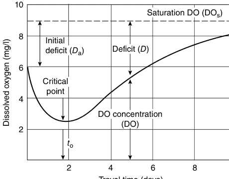

图4.10 由Streeter–Phelps方程推导出的DO Sag曲线。

河流水质管理的主要工具之一是增加河流吸收废物负荷的能力（也在第4.8.1节中讨论，河流TMDL和WLA）。这是通过确定废水排放下游DO浓度的剖面来实现的。该剖面称为DO Sag曲线（图4.10），因为随着需氧物质被氧化，DO浓度下降，然后在下游随着来自大气和光合作用过程的氧气补充而再次上升。

## 4.8.3 河流中废水的混合：质量平衡法

当两条溪流或河流汇合或废水排入溪流时，假设稳态条件和瞬时混合，可以确定混合后的BOD和DO（Jolánkai 1997）。两条溪流被视为彼此的稀释；因此，初始BOD和DO将为

```
L_a = (L_w Q_w + L_r Q_r) / (Q_w + Q_r)   (4.11)
```

和

```
DO = (DO_w Q_w + DO_r Q_r) / (Q_w + Q_r)   (4.12)
```

其中

- L_a 是混合后终极BOD的初始浓度，g/m³（mg/l）
- L_w 是废水的终极BOD g/m³（mg/l）
- L_r 是河流的终极BOD，g/m³（mg/l）
- DO_w 是废水中的溶解氧含量 g/m³（mg/l）
- DO_r 是河流中的溶解氧含量 g/m³
- Q_w 是废水流量 m³/s
- Q_r 是河流流量 m³/s

例4.8 华盛顿州泽拉镇的一家食品加工厂向附近的萨蒙溪排放17 300 m³/天的处理废水。处理废水的BOD₅为12 mg/l，萨蒙溪的流量为0.43 m³/s。废水的DO为1.0 mg/l，萨蒙溪中的DO为6.5 mg/l。计算完全混合后的DO。


# 解决方案

混合后的溶解氧由公式 (4.12) 给出。要使用该公式，我们必须将废水流量转换为兼容的单位，即每秒立方米。

$$Q_w=\frac{17300\ \mathrm{m^3/day}}{86400\ \mathrm{s/day}}=0.20\ \mathrm{m^3/s}$$

溶解氧 = $$\left[\frac{(0.20\ \mathrm{m^3/s})(1.0\ \mathrm{mg/L})+(0.43\ \mathrm{m^3/s})(6.5\ \mathrm{mg/L})}{0.20\ \mathrm{m^3/s}+0.43\ \mathrm{m^3/s}}\right] =4.75\ \mathrm{mg/L}\ \text{or}\ 4.75\ \mathrm{ppm}$$

## 4.9 水质建模

水质建模涉及使用数学模拟技术预测水污染。一个典型水质模型由代表决定水体中污染物位置和动量的物理机制的公式集合组成。模型可用于水文系统的各个组成部分，如地表径流；也存在针对水文输运的流域范围模型，以及海洋和河口应用。分析这些现象时经常使用有限差分方法，并且几乎总是需要大型复杂的计算机模型（USEPA 1985d；CORMIX 1996；第 D.2 节）。

### 4.9.1 公式及相关常数

水质由以下一个或多个公式建模：

- 平流归趋与输运公式
- 弥散归趋与输运公式
- Streeter–Phelps 公式
- 表面热预算公式
- 溶解氧饱和公式
- 复氧公式
- 碳质需氧公式
- 氮质生化需氧量公式
- 沉积物需氧量公式
- 光合作用与呼吸作用公式
- pH 与碱度公式
- 营养物公式（肥料）
- 藻类公式
- 浮游动物公式
- 大肠杆菌群公式（例如 *Escherichia coli*）

### 4.9.2 WWTP BOD、SS 和粪大肠菌群去除效率：满足水质标准

初级、次级以及有时三级处理的首要目标是去除常规污染物，包括有机物和病原体（例如 BOD、COD、SS、粪大肠菌群），以满足水质标准和 NPDES 许可要求（CWA 1972；Davis and Masten 2014；USEPA 1995b, 2010a）。初级处理通常可去除原废水中 60% 的 SS 和 35% 的 BOD₅。次级处理的主要目标是去除逃脱初级处理的溶解性 BOD₅ 并提供额外的 SS 去除。次级处理通过图 4.11 所示的生物过程实现，该图是造纸厂工艺 WWTP 的示意图（Das 1991, 1993）。WWTP 包括来自漂白厂两侧并接受初级澄清的出水。一个与初级沉淀池相连的调节池并不常用。然而，在发生泄漏（例如黑液）时，溢流可保留在调节池中约六小时，基于工厂的总废水流量。

初级澄清后，营养物（氨和磷酸）被添加到初级出水中。高纯度氧气活性污泥次级处理，在商品名为 UNOX® 下进行，随后进行次级澄清。来自五个次级沉淀池的溢流被收集在集水井中，出水通过长 310 英尺的扩散段在水下排放管处以 65 MGD 的速率排放到哥伦比亚河（图 4.11）。

该 WWTP 次级处理提供了在接收水体若有足够同化废水能力时本会发生的相同生物反应。次级处理工艺旨在加速这些自然过程，以便在相对较短的时间内实现可降解有机污染物的分解。尽管次级处理可去除超过 85% 的 BOD₅ 和 SS，但它不会显著去除氮、磷或重金属，也不会完全去除病原性细菌和病毒。NPDES 许可通常要求出水至少去除 85% 的 BOD₅ 和 SS，粪大肠菌群计数为 100 ml 出水中 200 MPN，并通过对选定淡水（例如鳟鱼或鲑鱼、斑马鱼）和海洋咸水物种（例如糠虾、*Champia parvula*、沙 dollar、*Echinarchnius parma*）的标准生物测定测试。

在次级处理水平不足的情况下，会对次级出水施加额外的处理工艺。这些三级处理工艺可能涉及废水的化学处理和过滤。其中一些三级处理工艺可去除高达 99% 的 BOD5、SS、总磷、细菌和 95% 的氮。这些工艺可生产出晶莹剔透、无色、无味的出水，可用于土地施用和其他有益再利用。

从废水中去除的大多数杂质并不会简单消失。一些有机化合物被分解为二氧化碳和水。大多数杂质以固体即污泥的形式从废水中去除。由于从水中去除的大多数杂质都存在于污泥中，因此必须仔细进行污泥处理和处置以实现污染控制（也在第 4.9.2 节中讨论）。

## 图 4.11 造纸厂废水处理厂总体流程图（Das 1991）。

### 4.9.3 NPDES 点源废水排放许可

NPDES 许可计划由 CWA 授权（CWA 第 402 条，33 U.S.C. 1342）。在 1970 年代和 1980 年代初发放的初始许可主要针对 POTW 和工业废水——通常是“工艺”废水和适用的冷却水。向美国水域（地表水）排放废水需要 NPDES 许可。该许可由 USEPA（1972）委托授权的州签发。由于美国水域也是州水域，NPDES 许可实际上是根据双重授权签发的 NPDES/州废水排放许可。NPDES 许可最长签发五年。工业、商业或生活废水中含有的常规污染物为 BOD、SS、粪大肠菌群、pH、温度、游离和残留氯、油脂和溶解氧。有毒污染物包括合成有机化学品和重金属。非常规污染物是任何不属于常规或有毒类别的额外物质，例如氨氮、硝酸盐-亚硝酸盐和总磷。

排放废水的 NPDES 许可包含以下适用于所有许可的标准条件、特定场地的排放限值、合规监测和报告要求（见第 4.4.4 节），以及为排放控制所需的特定场地条件。标准条件描述了许可的法律方面及其可撤销性。它们还描述了许可持有人的职责和义务；例如，许可持有人需要报告变更情况、允许合规检查并重新申请许可续期。最后，许可持有人会被告知可能因许可违规而被处以的处罚。所施加的排放限值基于技术基础和水质基础标准（USEPA 1995b, 2010a；Hammer and Hammer 2012；第 D.3 节）。废水污泥的管理也由 NPDES 许可中的条件控制。EPA 负责实施和执行 NPDES 计划；然而，各州有权在 USEPA 监督下执行这些职能。工业 NPDES 许可对标准污染物的限制示例见表 4.6。

NPDES 是一个自我监测计划，其中处理厂所有者需要负责合规监测并报告废水和污泥处理的性能，包括任何许可条件的违规。排放限制和监测规定指定了用于采样、流量测量、实验室测试和记录保存的程序。运行和维护需要报告处理系统故障、未处理废水的旁路以及工艺扰动。额外的报告要求包括任何排放变化、未合规通知和合规时间表。对未合规的执法是通过行政命令处以货币处罚。对于严重违规，可采取司法行动作为民事或刑事诉讼（Hammer and Hammer 2012）。有关 NPDES 许可的更多常见问题及其答案见第 D.3 节。

| 排放参数 | NPDES 许可每日限值 |  | 30 天平均浓度 | 7 天平均浓度 | 最大值 | 平均值 |
|---|---|---|---|---|---|---|
| BOD₅ | 28 000 lb | 20 000 lb |  |  | 40 mg/l | 35 mg/l |
|  |  |  | 30 mg/l | 45 mg/l |  |  |
| TSS | 46 000 lb | 32 000 lb |  |  | 50 mg/l | 45 mg/l |
|  |  |  | 30 mg/l | 45 mg/l |  |  |
| 流量 |  |  |  |  |  | 60 MGD |
| pH |  |  |  |  |  | 6.0–9.0 始终 |
| 虹鳟 | 100% 出水中 80% 存活率 |  |  |  |  |  |
| 生物测定 | 96 小时期间 65% 出水 |  |  |  |  |  |
| 粪大肠菌群/ % 克雷伯氏菌 | 20 000 (#/100/ml) | 5 000 (#/100/ml) |  |  |  |  |
|  | N/A | 98% |  |  |  |  |

来源：引自 Das（1991）。

注：典型许可每五年续期一次。本表仅列出定量限值。整个许可长达 26 页。BOD₅，五天生化需氧量；MGD，每天百万加仑；N/A，不适用；pH，氢离子浓度 g/mol 的负对数 10；TSS，总悬浮固体。

例 4.9 一个流量为 6.0MGD 的活性污泥延时曝气 WWTP，BOD 为 320 mg/l，SS 为 280 mg/l，总磷为 7.35mg/l，保持出水与 19 mg/l BOD、20 mg/l SS 和 1.25 mg/l 总磷相同。计算以下内容：

- 1) BOD 负荷
- 2) 厂内 BOD 和 SS 去除率
- 3) 每天去除的 BOD 和 SS 磅数
- 4) 总沉淀 SS 和磷污泥 lb/天
- 5) 如果 NPDES 许可条件要求 BOD 去除率 85%，该厂是否合规？

解决方案

1) BOD 负荷 = 320 $\frac{mg}{l}$ $\times$ 6.0MGD $\times$ 8.34 = 16012 $\frac{lb}{day}$

2) BOD 去除率 = ($\frac{(320–19)}{320}$) $\times$ 100 = 94%
SS 去除率 = ($\frac{(280–20)}{280}$) $\times$ 100 = 93%


3) 磅/天 BOD 去除量 = (320−19) mg/l × 6 MGD × 8.34 (lb·1 / MG·mg) = 15062 lb/day

磅/天 SS 去除量 = (280−20) mg/l ×6.0 MGD ×8.34 (lb·1 / MG·mg) = 13010 lb

4) = [(280 − 20) + (7.35 − 1.25)] × 6.0 MGD × 8.34 (lb·1 / MG·mg) = 13316 lb/day

5) 是的，BOD 去除率为 94%，因此该工厂远远超过了 NPDES 许可证条件规定的 85% 去除率要求。

## 4.10 NPDES 许可示例（炼油厂和铝冶炼厂的示例见 D.1 节）

### 4.10.1 最大日负荷总量（TMDL）规则

根据《清洁水法》（CWA），美国各州需要识别那些未达到特定水质标准或未达到指定有益用途的地表水（USEPA 1991a）。在20世纪90年代，根据质量标准或有利用途，发现全国很大比例的水体受损。在很大程度上，

这些水域不适合钓鱼、游泳或饮用。主要原因是来自工业和市政的过量沉积物、SS、营养物质（磷和氮）以及人类病原体。其他原因包括低溶解氧、有毒金属、农药、pH、颜色、藻类和栖息地改变。过量污染物的来源既有点源也有非点源。

最大日负荷总量（TMDL）是指一个水体能够接收并仍能维持该州设定的水质标准的最大污染物量。因此，必须为所有受损水体建立每种关注污染物的 TMDL。TMDL 将包括每个点源污染（如污水处理厂排放）的废负荷分配（WLA），以及每个非点源的负荷分配，还包括安全余量（MOS），如式（4.13）和图4.12所示。

ΣWLA + ΣLA + MOS = TMDL (4.13)

TMDL 可以用质量单位表示，如磅/天、毒性单位，或其他度量，如削减百分比。TMDL 的概念如图4.12所示，其中2 mg/l 的氨氮水质标准和30 MGD的河流流量得出 TMDL 为500 lb/day。在给定农业径流非点源负荷分配为75 lb/day 和 MOS 为50 lb/day 的情况下，污水处理厂的 WLA 确定为375 lb/day，这将写入污水处理厂的运营许可证。污水处理厂的排放许可证将按不超过该 WLA 的要求制定。

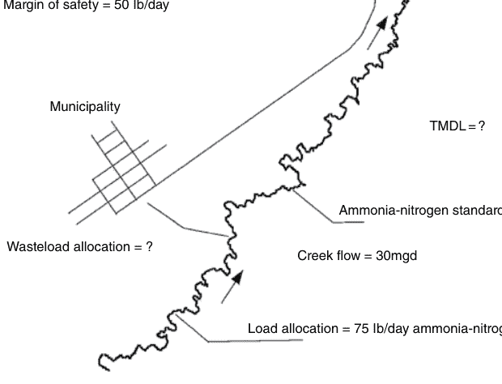

图4.12 最大日负荷总量（TMDL）——一个贡献性组成部分。（a）来源：改编自 Viessman 等，2009。

**示例4.10 TMDL 计算**

```
TMDL = ((2 mg / l) × 30 MGD × 8.34 × (lb / mg) × (1 / MGD)) = 500 lb/day
```

（其中，mg = 毫克；MG = 百万加仑）重新整理式（4.13）可得：
WLA = TMDL − LA − MOS = 500 − 75 − 50 = 375 lb/day（答案）

## 4.11 空气污染概况

空气污染交织在我们现代生活的方方面面。作为我们建设城市方式的副产品，空气污染是我们生产商品、交通出行以及产生能源以供暖和照亮我们居住、工作和娱乐城市的剩余废物。所有空气污染物的主要原因是燃烧，而燃烧是我们文明的重要组成部分。当发生完全或理论燃烧时，燃料中的氢和碳与空气中的氧气结合，产生热量、光、二氧化碳和水蒸气。然而，燃料中的杂质、不佳的燃料-空气比或过高或过低的燃烧温度会导致一氧化碳、二氧化硫、氮氧化物、飞灰和未燃烧碳氢化合物等副产物的形成——所有这些都是空气污染物。

空气污染在微观、中观和宏观尺度上都是公共卫生关注的问题（4.11节）。工业源和移动源导致中尺度空气污染，并污染我们室外周围的空气。宏观（或全球）影响包括环境空气污染物长距离输送。宏观影响的例子包括酸雨、臭氧和粉尘或颗粒物（PM）污染。空气污染的全球影响源于可能改变上层大气层的源，例如良好臭氧层的消耗和全球变暖。尽管微观和宏观影响也令人担忧，但我们的重点主要集中在我们生活所在的对流层中的中尺度空气污染。

1970年《清洁空气法》（CAA）要求美国环保署调查并描述固定源和/或移动源排放的任何可能对人类健康和环境产生不利影响的空气污染物的环境影响。美国环保署利用这些研究制定了国家环境空气质量标准（NAAQS）。NAAQS 为六种标准空气污染物而制定——其中五种为主要污染物（意指直接排放）和一种次要污染物（因为它是由主要污染物在对流层下部通过化学反应形成的）。

这些标准针对环境空气，即通常包围我们的室外空气。美国环保署将表3.9中列出的污染物称为标准污染物，因为这些标准是基于健康标准制定的。主要标准旨在以“充分的安全余量（MOS）”保护人类健康。次要标准旨在防止环境和财产损害。在环境空气质量与预期经济增长发生冲突时，1974年8月提出了法规，以防止在空气质量已经优于联邦标准要求的地区发生严重恶化。一项阈值分类生效，其目标是任何情况下一个地区的环境空气质量都不得违反联邦主要和次要标准。分类如下：

- **I 类区**：几乎不允许改变当前空气质量的区域（例如国家公园和受保护的荒野地区）
- **II 类区**：允许适度改变，但需要严格空气质量约束的区域（例如住宅区）
- **III 类区**：允许实质性工业发展，并且污染物浓度增加到达到联邦标准将不显著的区域

1987年，美国环保署修订了 NAAQS，用空气动力学直径小于或等于10µm的总悬浮颗粒物替代了碳氢化合物（或VOCs）的标准。该标准被称为 PM10 标准。1997年增加了新的 PM2.5 标准。图4.13有助于您直观了解微米的大小。请注意，一根头发的平均直径约为80 µm。

### 4.11.1 原因、来源和影响

在本节中，我们将简要讨论一些主要污染物及其原因、来源和影响。原因与来源的区别在于：原因是根本性的，而来源是位置性的；也就是说，原因解释了污染物为什么或如何形成，而来源则识别什么类型的工艺、行业或设备排放特定污染物。

标准空气污染物，或称标准污染物，是一类导致烟雾、酸雨和其他健康危害的空气污染物。这些污染物通常来自工业、化学品、采矿、交通、发电、炼油厂、冶炼厂、制药、农业等众多来源。在大多数情况下，它们是化石燃料燃烧或工业过程的产物。表3.8 中已讨论并列出了这些污染物的来源及其对公众健康和环境的影响。

五种主要标准污染物是 *直径小于* 10 *μm 的颗粒物和直径小于 2.5μm 的颗粒物*（PM-10 和 PM-2.5）、*二氧化硫 (SO₂)、二氧化氮 (NO₂)、一氧化碳 (CO) 和颗粒态铅 (Pb)；* 次要标准污染物是 *臭氧 (O₃)。* 在这六种污染物中，前四种在美国（和其他大型工业化国家）的年排放量以数百万吨计，有时被称为 *主要* 一次污染物。另一类污染物——挥发性有机化合物（VOCs）——虽然不是标准污染物，但因其排放量大（包括人为源和生物源）以及在对流层臭氧形成的大气反应中的重要性，而被认为是一种重要的主要一次污染物。

表4.7列出了2006年和2016年美国五种主要一次污染物的主要来源（包括工业源、固定源和移动源）的排放率数据。从表4.7中我们可以看到，汽车、卡车、公共汽车、摩托艇、草坪和花园设备、工程车辆和其他来源的排放量分别约占美国所有 NOₓ 排放量的61%和 VOC 排放量的42%，以及所有 CO 排放量的80%以上。在国际上，随着人口持续增长，特别是在亚洲和南美，移动源污染的重要性增长速度甚至快于工业污染。因此，移动源的空气污染逐年加剧。在世界各国，机动车约占空气污染总排放量的10%–60%。这里我们重点关注固定源的空气排放及其对所有主要一次污染物的工业规模最佳可用控制技术（BACT）（另见6.7.1节）。

### 4.11.2 空气毒物：有毒空气污染物

修正案第三章涉及空气毒物。有毒空气污染物（TAPs）或空气毒物，也称为危险空气污染物（HAPs），是已知会对人类健康产生不利影响（如癌症）的空气传播污染物。目前，CAA 的 HAPs 或 TAPs 清单上识别出约189种化学物质（表C.2）（USEPA 1998）。空气毒物的例子包括重金属汞和铬，以及有机化学品，如苯、己烷、全氯乙烯（perc）、1,3-丁二烯、二噁英和多环芳烃。HAPs 受《国家危险空气污染物排放标准》（NESHAP）计划监管，并被确定为多种疾病的致病因素。例如，砷、石棉、苯、焦炉排放物和放射性核素可能导致癌症。修正案第三章要求美国环保署

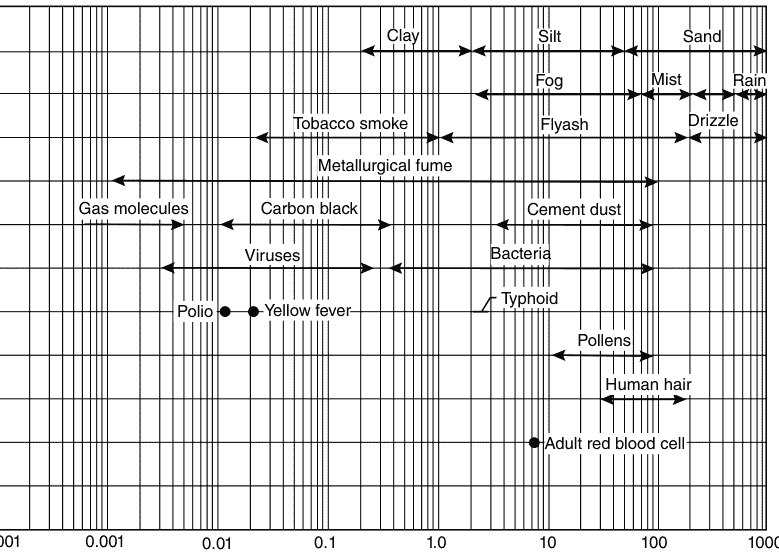

图4.13 微小颗粒物的相对尺寸（以微米为单位）。


## 表 4.7 美国常规污染物排放量，2006 年和 2016 年（百万吨/年）

| 来源类别 | CO 2006 | CO 2016 | NOₓ 2006 | NOₓ 2016 | VOCs 2006 | VOCs 2016 | PM₁₀ 2006 | PM₁₀ 2016 | SO₂ 2006 | SO₂ 2016 |
|---|---|---|---|---|---|---|---|---|---|---|
| **工业过程** | | | | | | | | | | |
| 化学品和石油 | 0.52 | 1.09 | 0.44 | 0.87 | 1.14 | 3.30 | 0.06 | 0.06 | 0.41 | 0.22 |
| 金属加工 | 0.83 | 0.61 | 0.07 | 0.07 | 0.05 | 0.03 | 0.08 | 0.06 | 0.18 | 0.11 |
| 其他 | 0.58 | 0.62 | 0.48 | 0.34 | 5.72 | 3.98 | 1.10 | 0.85 | 0.33 | 0.18 |
| *小计* | *1.93* | *2.32* | *0.85* | *1.28* | *6.91* | *7.31* | *1.24* | *0.97* | *0.92* | *0.51* |
| **废物处置** | 1.50 | 2.16 | 0.13 | 0.11 | 0.32 | 0.20 | 0.27 | 0.31 | 0.03 | 0.04 |
| **固定源** | | | | | | | | | | |
| **燃料燃烧** | | | | | | | | | | |
| 发电厂 | 0.63 | 0.72 | 3.59 | 1.05 | 0.05 | 0.04 | 0.56 | 0.23 | 9.55 | 1.19 |
| 工业炉 | 1.07 | 0.96 | 1.68 | 1.19 | 0.12 | 0.11 | 0.30 | 0.33 | 1.51 | 0.66 |
| 商用、住宅、其他 | 3.14 | 2.45 | 0.68 | 0.53 | 0.53 | 0.38 | 0.44 | 0.37 | 0.49 | 0.13 |
| *小计* | *4.84* | *4.13* | *5.95* | *2.77* | *0.70* | *0.53* | *1.30* | *0.93* | *11.55* | *1.98* |
| **移动源** | | | | | | | | | | |
| 公路车辆 | 40.05 | 17.87 | 7.99 | 3.61 | 3.46 | 1.77 | 0.38 | 0.29 | 0.11 | 0.02 |
| 非公路车辆 | 20.37 | 12.99 | 3.90 | 2.42 | 2.75 | 1.58 | 0.28 | 1.60 | 0.40 | 0.03ᵃ |
| *移动源小计* | *60.42* | *30.86* | *11.89* | *6.03* | *6.21* | *3.35* | *0.66* | *0.45* | *0.51* | *0.05* |
| 区域源和杂项 | 17.11 | 19.62 | 0.27 | 0.29 | 3.76 | 4.49 | 17.94 | 21.80 | 0.13 | 0.15 |
| **所有来源总计** | **85.80** | **59.09** | **19.09** | **10.48** | **17.90** | **15.88** | **21.41** | **24.46** | **13.14** | **2.73** |

来源：根据 USEPA 清洁空气排放清单和排放因子信息中心的数据汇编，U.S. EPA http://www.epa.gov/ttn/chief/trends/index.html。杂项 CO 几乎全部来自火灾；杂项 PM-10 几乎全部来自铺装和未铺装道路、建筑工地和农业来源产生的逸散性粉尘。

ᵃ 非公路包括船只、飞机、火车、建筑设备、园林和园艺设备等。

列出排放一种或多种空气有毒物质的来源类别并公布对这些类别进行监管的时间表。

《清洁空气法》将 HAPs 的主要来源定义为具有排放潜在量的固定源，该潜在量为名单上任一种 HAP 为 10 T/Y 或任何组合 HAP 为 25 T/Y。示例包括化学品综合体和石油炼油厂。《清洁空气法》为 HAPs 规定了非常高的污染控制技术水平，即 MACT（最大可行控制技术）。小型区域源，如干洗店，排放的 HAP 吨位较低，但总体上它们是 HAPs 的重要来源。可以通过工作实践的改变，例如材料替代和其他污染预防策略来实现排放减少。

HAPs 通过典型的吸入或摄入途径影响人类健康。HAPs 可在鱼类组织中积累，污染物浓度会沿着食物链向人类累积。许多这些持久性和生物累积性化学物质是已知的或疑似致癌物。汞已特别成为监管的重点，因为它在煤炭燃烧过程中释放。因此，它是少数在环境中广泛存在的 HAPs 之一。特别令人担忧的是，儿童在产前接触甲基汞（USEPA 1997, 2004a）。

第四章涉及酸沉降，要求全国 SO₂ 排放量从 1980 年水平减少 1000 万 T/Y，主要来自发电厂。它促进节能和洁净煤技术，并利用创新的基于市场的 SO₂ 减排体系，其中公用事业的 SO₂ 排放配额可以买卖。此外，USEPA 必须制定公用事业锅炉的 NOₓ 新源性能标准（NSPS）修订版。

第五章建立了新的联邦运营许可计划，由各州管理。各州有三年时间在 EPA 批准下实施许可计划，到 1998 年所有州均已遵守。许可费将用于支付该计划的费用。许可计划必须至少包括适用于每个来源的全部《清洁空气法》要求、合规时间表以及监测和报告要求。

## 4.12 显著恶化预防（PSD）许可程序

### 4.12.1 引言

显著恶化预防（PSD）计划于 1977 年 8 月 7 日建立，此后美国国会大幅修订了联邦《清洁空气法》，并概述了详细的 PSD 计划。联邦 PSD 计划载于联邦《清洁空气法》第 C 部分（第 160 条至第 169B 条）。PSD 计划的制定是为了防止美国大型工业空气污染源对“达标区”造成重大的环境影响。达标区是指空气质量符合 EPA 规定的标准（也称为 NAAQS）的美国地区。在 PSD 计划制定之前，大型工业设施的建设项目在许可时主要目标是不使问题地区的空气污染恶化，如果可能的话加以改善。国会认识到，这需要扩展以确保那些拥有清洁健康空气的地区保持现状，并且工业活动不会对受保护的（例如 I 类、荒野）地区造成重大影响。

### 4.12.2 PSD 计划目标

- 经济增长与保护清洁空气资源相协调。
- 保护公众免受空气污染的不利影响。
- 保护和改善国家公园和荒野地区的空气质量。

PSD 计划并不完全阻止来源增加排放。事实上，要使项目受 PSD 审查，需在采用控制设备后排放量有显著增加。相反，PSD 计划旨在（USEPA 1990）

- 防止环境空气质量显著恶化
- 确保符合所有 NAAQS
- 保护公众健康和福祉免受即使在低于 NAAQS 的空气污染水平下可能发生的任何不利影响
- 保护、保护和改善分类的 I 类地区的空气质量（包括国家公园、国家荒野地区、国家纪念碑、国家海滨和具有特殊国家或区域自然、娱乐、风景或历史价值的其他地区）
- 确保经济增长以与保护现有清洁空气资源一致的方式进行，并防止任何新的不达标地区的形成
- 确保对任何适用 PSD 许可要求的地区增加空气污染的任何决定，只有在对该决定的一切后果进行仔细评估，并在决策过程中为知情公众参与提供充分程序机会后才作出

PSD 计划通过审查 PSD 申请以确保应用 BACT 的要求，并符合 NAAQS、适用的 PSD 增量浓度，以及评估能见度影响、能源和环境影响、土壤和植被影响以及增长影响，从而保护当地空气质量并保护具有特殊价值的地区。该计划包括公众参与决策过程的机会。

PSD 规章适用于新的“主要固定源”和“主要改动”。固定源包括属于同一工业分组、位于毗邻或相邻物业上并受共同控制的所有排放活动。“主要改动”是指对主要固定源的物理改变或运行方法改变，该改变将导致任何受管制污染物的同期净排放量显著增加。在确定拟议增加是否会导致显著净增加时，必须执行若干详细的计算。

只有当主要来源或改动的预期或现有位置已被 EPA 正式指定为任何存在 NAAQS 的污染物的“达标”或“未分类”时，才会触发 PSD 审查。相反，非达标新源审查（NNSR）适用于位于不符合 NAAQS 的地区的新主要来源或现有来源的主要改动。NNSR 要求根据非达标地区进行定制。所有非达标 NSR 计划都必须要求

- 安装最低可实现排放率（LAER）
- 排放抵消
- 公众参与机会

整个建设前许可计划，包括 PSD 和 NNSR 许可计划，均称为新源审查（NSR）计划。PSD 审查和 NNSR 均按污染物进行。例如，设施可能排放多种空气污染物；然而，根据每种污染物的排放量大小，可能只有一种或少数几种受 PSD 许可要求约束。由于 EPA 未为温室气体（GHG）制定 NAAQS，因此 NNSR 计划不适用于温室气体。


# 表 4.8 燃煤发电厂 Title V/PSD 许可证排放限值及相关的锅炉监测和报告要求。

| 参数 | 限值及平均周期（不得超过）^a | 监测和报告 |
|---|---|---|
| NOx | 0.21 lb/MMBtu（30个锅炉运行日滚动平均值，两台机组合计） | 主要合规性通过按照 40 CFR 75（酸雨计划）运行针对 NOx 和 SO2 以及按照 40 CFR 63 子章 UUUUU 运行针对 Hg 的连续排放监测系统（CEMS）来确定。对于 Hg，也可以使用吸附剂陷阱监测系统。参考测试方法：NOx：EPA 方法 7E；SO2：EPA 方法 6 或 6C；Hg：EPA 方法 30B。每小时数据必须按季度报告给 EPA 和被委托的大气质量机构。 |
| SO2 | 10,000 T/Y | |
| SO2 | 在 7% O2 条件下为 250 ppmvd（1小时平均值） | |
| SO2 | 1350 lb/h（两台机组合计，1小时平均值） | |
| Hg | 1.2 lb/TBtu（30个锅炉运行日滚动平均值） | |
| CO | 200 ppm（两台机组平均，年度平均值） | 主要合规性通过按照 40 CFR 60，性能规范 4 运行连续排放监测系统（CEMS）来确定。参考测试方法：EPA 方法 10。摘要结果必须按季度报告。 |
| PM（可滤除） | 校正至 7% O2 为 0.010 gr/dscf（1小时平均值）；0.030 lb/MMBtu（或 0.30 lb/MWh）（30个锅炉运行日平均值） | EPA 方法 5 是主要的参考测试方法。每个运行季度需要进行测试，由三次 1 小时测试运行组成。额外的合规保障监测包括连续监测湿洗涤器上游管道中的不透明度，以确保排放的不透明度保持在与合规性相关的水平以下。 |

来源：西南清洁空气机构（Southwest Clean Air Agency），位于华盛顿州温哥华。
典型的许可证每五年更新一次。此表仅概述定量限值。整个许可证长达 128 页。
dscf：干标准立方英尺；gr：格令；ppm：百万分比；ppmvd：干体积百万分比；TBtu：万亿英热单位。
a 所有偏离许可证要求的情况必须在发现偏离的那个月结束后 30 天内报告。对 人体健康或安全构成潜在威胁的偏离必须尽快报告，但最迟不得晚于发现偏离后 12 小时。

表 4.8 列出了一座 1400 MW 燃煤发电厂的 Title V/PSD 许可证排放限值及相关的锅炉监测和报告要求。这只是相关排放限值的简要摘要。还有许多额外的细节和要求。此外，燃煤发电厂有许多不同的方面，且许多因素导致不同电厂受到不同的排放限值约束——表 4.8 中的限值对于该设施（Lamoreaux，个人通讯）而言具有一定的独特性。

这些类别记录在《联邦法规》（Code of Federal Regulations）中（例如 40 CFR Part 60），包括排放限值、性能标准、许可程序、测试和监测要求、记录保存以及报告。美国大多数州在其州法中通过引用采用联邦排放限值和标准。如果希望如此，各州可以制定比联邦标准更严格的标准，但不得制定较为宽松的标准。

各州已建立自己的空气污染许可和合规计划。一旦州计划获得 USEPA 的批准，该州即被授权确保其边界内的清洁和健康空气。许可过程是各州追踪和执法其法规的工具。州法规为各种污染物设定了特定的排放限值，任何源在未取得许可证之前不得排放超过这些限值的污染物。任何未能获得适当许可证的来源将

## 4.13 整体许可过程

治理空气污染的联邦法律旨在保护环境空气质量和公众健康。USEPA 依据这些法律的授权，制定限制各种来源允许排放量的联邦法规。各种工业的具体法规

将面临巨额罚款。州许可计划的目的之一是允许该州追踪主要空气污染源。许可证提供了一种手段，以确保来源使用适当的技术来控制污染，并通过常规测试、监测、记录保存和报告来证明对排放标准的持续合规。

### 4.13.1 谁需要 PSD 许可证？

有 28 个特定的行业或工业过程，如果它们排放或有可能排放至少 100 T/Y 的任何由联邦《清洁空气法》（CAA）规定的受管制污染物，则必须满足 PSD 计划的要求。这些行业和过程列在表 4.9 中。对于所有其他行业和工业过程，如果它们排放或有可能排放至少 250 T/Y 的任何受管制污染物，则适用 PSD 计划。最常用于触发全场 PSD 适用性的受管制污染物包括颗粒物（PM）、一氧化碳（CO）、二氧化硫（SO₂）、挥发性有机化合物（VOCs）、氮氧化物（NOₓ）和温室气体（GHGs）。其他相对常见的受管制污染物包括氟化物、硫酸雾（H₂SO₄）、硫化氢（H₂S）和总还原硫化合物。

对于现有主要固定源的修改，如果主要固定源的物理变化或操作方法的改变导致该源的显著排放增加和显著净排放增加，则触发 PSD 审查。PSD 计划制定了具体的适用标准，用于确定该修改是否导致该源的显著排放增加和显著净排放增加。PSD 适用标准在第 4.12、4.13 节和附录 D.4 中详细讨论。

特殊情况：当设施在项目前低于上述水平，但项目本身超过 100 或 250 T/Y 水平时。示例 1：一座 80 T/Y SO₂ 设施进行 50 T/Y 的 SO₂ 扩建，此时不需要获得 PSD 许可证。示例 2：同一设施进行 120 T/Y 的扩建，则需要获得 PSD 许可证。

### 4.13.2 PSD 计划对申请人有什么要求？

为获得 PSD 许可证，申请人必须（USEPA 1990）执行以下操作：

- 1) 全面确定项目的范围，以及哪些设备是新增的、修改过的，或上游和下游设备使用量增加的。
- 2) 对新增或修改的设备应用 BACT。BACT 的确定要考虑能源、环境和经济影响，以确定拟议源或修改所能实现的最大削减程度。BACT 的确定结果不得导致未能满足 40 CFR 第 60、61 和 63 部分下任何适用性能标准的排放限制。使用量增加的设备和设备不 subject 于 BACT 审查。PSD BACT 仅适用于触发 PSD 的污染物。其他污染物可由次要许可机构评估。

# 表 4.9 28 个主要源类别列表（阈值为 100 T/Y）。

- 1. 热输入量超过 250 MBtu/h 的化石燃料燃煤蒸汽电力厂
- 2. 煤炭洗选厂（带热干燥器）
- 3. 硫酸盐法纸浆厂
- 4. 波特兰水泥厂
- 5. 初级锌冶炼厂
- 6. 钢铁厂
- 7. 初级铝土矿还原厂（带热干燥器）
- 8. 初级铜冶炼厂
- 9. 每日能接收超过 250 T 垃圾的市政焚烧炉
- 10. 氢氟酸厂
- 11. 硫酸厂
- 12. 硝酸厂
- 13. 石油炼油厂
- 14. 石灰厂
- 15. 磷矿石加工厂
- 16. 焦炉电池
- 17. 硫回收厂
- 18. 炭黑厂（炉法工艺）
- 19. 初级铅冶炼厂
- 20. 燃料转化厂
- 21. 烧结厂
- 22. 次级金属生产厂
- 23. 化学品处理厂（不包括通过自然发酵生产乙醇的乙醇生产设施，此类设施包含在 NAICS 代码 325193 或 312140 中）
- 24. 总热输入量超过每小时 2.5 亿英热单位的化石燃料锅炉（或其组合）
- 25. 总储存能力超过 300,000 桶的石油储存和转运装置
- 26. 钒钛磁铁矿（Taconite）矿石加工厂
- 27. 玻璃纤维加工厂
- 28. 木炭生产厂

在确定拟议源或修改所能实现的最大削减程度时。BACT 的确定结果不得导致未能满足 40 CFR 第 60、61 和 63 部分下任何适用性能标准的排放限制。使用量增加的设备和设备不 subject 于 BACT 审查。PSD BACT 仅适用于触发 PSD 的污染物。其他污染物可由次要许可机构评估。

- 3) 进行环境空气质量分析。每个 PSD 新源或现有源的修改都必须


进行空气质量分析，以证明其新增污染物排放不会违反适用的 NAAQS 或适用的 PSD 增量。年利用率影响增加的设备将纳入长期空气质量分析。

空气质量影响分析（AQIA）首先对每种污染物进行初步建模，以确定申请人是否可以免于详细分析和施工前监测。如果某一污染物在给定平均时段内的预计环境浓度增加低于 PSD *显著影响水平*（SILs）和*显著监测浓度*（SMCs），则无需对该污染物进行进一步的环境影响分析。对于那些平均时段内影响超过 SIL 的污染物，则进行完整影响分析（考虑其他消耗增量的源），以证明符合 PSD 增量和 NAAQS。建模的基准年份应为最近两年的排放量。

*联邦土地管理者*（FLMs）关于评估重大项目对一类区域影响的指南是 FLMs 的*空气质量价值*工作组（FLAG）第一阶段报告（修订版）（国家公园管理局 2010）。FLAG 工作重点关注空气污染物——主要是 PM、二氧化氮、二氧化硫、硝酸盐、硫酸盐和臭氧——如何影响国家公园管理局、美国鱼类和野生动物管理局以及美国农业部林务局管理的区域中的健康和状态资源。FLAG 子组集中在四个关键领域：（i）能见度；（ii）湿沉降和干沉降对水生和陆地的影响；（iii）臭氧对陆地的影响；（iv）流程和政策问题。

- 1）*分析对土壤、植被和能见度的影响。*申请人必须分析其拟议的排放增量是否会损害能见度、影响土壤或植被。申请人不仅需要考察源排放对这些资源的直接影响，还必须考虑与拟议排放或改造相关的商业、住宅、工业及其他增长所带来的影响。

- 2）*不得对一个一类区域产生不利影响。*如果州机构收到可能影响一类区域的 PSD 许可申请，州环境监管机构将通知*联邦土地管理者*（FLM）和负责直接管理这些土地的联邦官员。这些官员负责保护一类区域中与空气质量相关的价值，并与州机构协商，以确定是否有任何拟议项目会对一类区域产生不利影响。

如果 FLM 证明拟议源或改造的排放将损害与空气质量相关的价值，即使排放水平不会导致违反 NAAQS 或允许的空气质量增量，FLM 仍可建议审查机构拒绝发放许可证。如果州环境监管机构确定所有要求均已满足，则仍可颁发许可证。

- 3）*进行充分的公众参与。*在州对 PSD 申请采取最终行动之前，需要满足具体的公众通知要求，包括《州环境政策法案》和公众评议期。

## 4.14 最佳可用控制技术

### 4.14.1 引言

BACT 定义为：

> 一种排放限制……基于对每种污染物的最大减排程度……考虑能源、环境和经济影响及其他成本……通过应用生产工艺或可用方法、系统和工艺……

本节回顾该定义中的重要要素，并描述为拟议的新源或现有源的改造满足 BACT 要求所必须采用的方法。

NSR 和其他空气质量许可证要求新建或改造的源采用 BACT 建设。由于新建或改造的源需要满足 BACT 要求，这为控制技术开发者提供了巨大的激励，以证明其产品比竞争产品更好或以更低成本提供最大程度的污染物减排。如果一项新技术在考虑能源、环境和经济影响及其他成本后，能够比现有设备更大幅度地减少排放，则 BACT 要求采用该技术。这种持续迫使空气污染排放源采用改进技术的要求被称为*技术强制*。

BACT 旨在包括末端控制措施，如洗涤器或袋式除尘器；工艺变更，如从有机溶剂改为水性涂料；以及操作措施，如检查和维护阀门和法兰以减少逸散性排放。其意图是确保没有其他可行技术能够实现更低的排放。

然而，该定义也规定，对某一源的 BACT 评估应在逐案基础上进行，并考虑该源的特征和限制。定义要求评估针对所考虑源的特定能源、环境和经济影响及其他成本。如果一项污染控制技术应用于特定源时这些影响过大，则该技术在该案例中不被视为 BACT。在另一种情况下，不同条件可能导致不同结论。

在以下各节中，将提供几个与 BACT 类似但适用于特殊情况的术语的附加定义。接下来讨论拟议项目 BACT 确定所采用的策略。然后描述确定 BACT 的“自上而下”方法。这是大多数许可机构所要求的方法。最后，给出若干确定 BACT 的示例。

### 4.14.2 控制技术要求定义

除 BACT 外，在空气质量许可中还会遇到若干其他技术要求术语。它们在概念上都与 BACT 类似——它们定义了适用于不同源类型、不同污染物和/或不同达标状态的排放限值。它们以类似方式确定，在某些情况下可能更为严格。下文讨论其中几个：

- 有多种不同的控制技术要求
  - RACT——合理可用控制技术
  - BACT——最佳可用控制技术
  - MACT——最大可实现控制技术
  - LAER——最低可实现排放率
  - GACT——通用可用控制技术
- 其他包括 T-BACT、BARCT、RACM 和 BACM。

#### 4.14.2.1 合理可用控制技术

RACT 是在州实施计划（SIP）要求非达标区现有源减少排放以实现达标时使用的术语。通常，RACT 以禁止性规则的形式实施，适用于州或地区的非达标区。例如，对设计能力大于 50,000 Btu/h 的锅炉的 NOx 排放进行限制。RACT 规则要求所有大于该规模的锅炉的 NOx 排放低于 0.5 lb/MMBtu 热输入，并且现有锅炉须在规则颁布之日起三年内达标。RACT 要求从未比 BACT 更严格，且通常更宽松，因为它们必须改造现有设备。由于 RACT 适用于现有源，因此新源无需满足这一要求。然而，当新源希望从退役现有源获得抵消量时，这可能会成为一个问题。

#### 4.14.2.2 最佳可用改造控制技术

最佳可用改造控制技术（BARCT）是一个加州术语，指针对不符合加州环境空气质量标准的现有源的改造控制措施。它在《加州清洁空气法》中有定义。RACT 和 BARCT 很难区分。两者都适用于现有源。两者都仅适用于非达标区。对于特定源类型，BARCT 有时比 RACT 更严格。加州空气资源委员会定期发布技术备忘录，确定特定源类型的 BARCT。与 RACT 一样，BARCT 通过加州 34 个空气污染控制区内的禁止性规则实施。

#### 4.14.2.3 最大可实现控制技术

MACT 是 1990 年《清洁空气法修正案》（CAAA）要求对有害空气污染物排放源实施的控制水平。该法案中的定义是：

> ……管理者在考虑实现此类减排的成本以及任何非空气质量健康和环境及能源需求后，确定对于适用此类排放标准的类别或子类别中的新建或现有源而言，受[该法第112条]约束的有害空气污染物排放所能实现的最大削减程度（包括在可实现的情况下禁止排放）……

MACT 法规针对 HAP 的主要排放源，因为 HAP 是不完全燃烧源的副产物。主要源定义为任何每年排放任何一种 HAP 超过 10 吨或所有 HAP 合计超过 25 吨的设施。因此，所有大型工业锅炉、工艺炉和固定式内燃机都是潜在的主要源。除钢铁厂或石化设施等主要源外，干洗店、加油站和印刷厂等小型面源在美国也受到管制。MACT 可包括工艺变更、材料替代或空气污染控制设备。MACT 在其定义上与 LAER 有所不同，因为它并不打算忽视经济方面的考虑。


## 4.14.2.4 LAER

LAER 是未达标污染物源必须采用的控制技术。如果一个地区臭氧未达标，则对排放臭氧前体物——氮氧化物（NOx）和挥发性有机化合物（VOCs）——的新建或改建源，将要求采用 LAER。LAER 定义如下：

- 对任何源而言，其排放速率应反映：
- a) 任何州实施计划中对此类或该类源所规定的最严格排放限制，除非拟建源的业主或运营者证明该等限制无法达到；或
- b) 此类或该类源在实践中达到的最严格排放限制，以两者中更严格者为准。

LAER 的严格性在于它没有 BACT 定义中那样的可通融情形。虽然仍有“除非拟建源的业主或运营者证明此类限制无法实现”的规定，但该规定仅适用于实施计划中确定的控制措施，且任何“在实践中实现”的控制措施都必须采用。这一措辞的后果是，经济可行性不被考虑，拟建源必须安装已在“实践中实现”的最严格控制措施。在实际应用中，对于“实践”发生在美国境外时是否算“在实践中实现”，一直存在一些争议（USEPA 1995c）。

EPA 根据州实施计划（SIP）指南，使用 LAER 来判断新建或改建的主要固定源的排放是否可接受。当新建固定源位于未达标空气质量区域时，必须采用 LAER 标准。它是严于最佳可用控制技术（BACT）和合理可用控制技术（RACT）标准的最严格空气污染标准，无论该控制技术的成本如何。

## 4.14.2.5 一般可用控制技术（GACT）

GACT 与 MACT 一样，都是针对有害空气污染物控制的术语。GACT 是适用于非主要有害空气污染物源的控制技术标准。由于这些源排放的有害空气污染物量较小，GACT 可能不如 MACT 严格，不过对于某些已颁布 MACT 标准的有害空气污染物源类别，GACT 标准与之相同。

## 4.14.2.6 毒性最佳可用控制技术（T-BACT）

毒性最佳可用控制技术（T-BACT）一词由加利福尼亚州南海岸空气质量管理局（SCAQMD）首创，用于确定适合控制有毒空气污染物的技术。该术语被加利福尼亚州其他几个地区采用，适用于这些辖区内新建的有毒空气污染物源，这些源因排放而导致的估算健康风险超过阈值，即每 100 000 人中出现 1 例由这些排放导致的癌症。在实践中，T-BACT 控制技术几乎在所有情况下都与 PM 和 VOC 的控制技术相同，因此该术语并未广泛使用。关于有毒空气污染物和健康风险的更完整讨论，请参阅 SCAQMD（1995）和 CAPCOA（1993）。

## 4.14.2.7 合理可用控制措施与最佳可用控制措施

合理可用控制措施（RACM）和最佳可用控制措施（BACM）是 EPA 制定的控制措施指南，旨在纳入州实施计划（SIP）。虽然这些术语可适用于任何污染物，但最常用于 PM10 源。RACM 和 BACM 分别针对中度和严重 PM10 未达标区域。RACM 和 BACM 技术指南是根据1990年《清洁空气法修正案》（CAAA）第190条的要求，针对三类主要 PM10 源制定的：城市逸散性粉尘、住宅木材燃烧，以及有计划的林业和农业烧除。制定这些措施是为了用作禁止性规则，类似于实施 RACT 的规则，旨在减少 PM10 排放，以使这些 PM10 未达标区域达标。被认定为 RACM 和 BACM 的措施几乎肯定会列入备选技术清单，作为 PM 源可能采用的 BACT 加以考虑。

## 4.14.3 BACT 选择策略

大多数辖区要求所有新建或改建源均采用 BACT。法规除了定义该术语外，很少具体说明如何确定 BACT。4.14.4 节描述了 EPA 为正式确定 BACT 而制定的“自上而下”方法。该“自上而下”过程全面、有序且完整。然而，实施过程可能代价高昂，并可能导致申请人被要求采用其不想要的技术。这种两难境地有时可以避免。

在大多数情况下，申请人和许可机构会就所许可源的最严格技术达成一致。如果申请人决定使用该控制技术，则无需进行“自上而下”的 BACT 过程；在许可过程早期接受这一最严格技术，可以大大加快其他审批步骤。

在其他情况下，可通过与许可机构事先达成协议，限制“自上而下”过程中审查的技术数量。可以通过引用在类似环境中对类似工艺已完成的 BACT 分析，并让机构认可这些分析适用，来限制数量。

在 BACT 方案中，可以总结项目描述、陈述假设，并确定将作为 BACT 分析一部分考虑的技术。该文件可以明确划定 BACT 分析的边界，避免在后续过程中出现意外。通常以技术可行性作为纳入技术的依据，不可行的技术可在分析“正式”开始前排除。提交 BACT 方案后，通常只需一个电话即可就分析边界达成一致。

在很多情况下，BACT 分析中只考虑少数（往往只有两种）技术，此时许可机构可能接受正式程度远低于“自上而下”方法的分析。简洁通常使分析更易理解，并让人有机会清晰阐述要点，而不必使用不必要的套话。

## 4.14.4 自上而下的 BACT 分析

1987 年，EPA 发布了一份备忘录，描述了如何采用“自上而下”方法确定特定源的 BACT 构成。该备忘录随后在 1996 年以法规条文的形式得到落实。“自上而下”方法的基本准则是：在审查何种控制技术构成 BACT 时，应从最严格的技术——即减排量最大的技术——开始。申请人若想否决这一最严格技术，必须证明其不可行。不可行的依据可以是技术不可行，或能源、环境、经济或其他成本影响不可接受。分析开始时的假设是，最严格的技术可行且应采用，除非有相反证明。对严格程度依次降低的技术逐一证伪其可行性的过程会持续进行，直到找到一种可行的控制技术，该技术随即成为该特定源的 BACT。以下小节将描述“自上而下”BACT 分析所要求的步骤。

## 4.14.5 识别技术

“自上而下”过程的第一步是识别将在分析中考虑的控制技术。从历史上看，围绕这一问题曾发生过激烈争论，主要涉及监管机构提议列入“自上而下”清单的技术是否可获得。在解决这一问题时，BACT 条款中关于纳入“加州空气污染控制官员组织认定技术上可行的任何其他排放控制技术……”的规定，可能会引起人们提议考虑许多尚未商业化的不同技术（CAPCOA 1993）。

SCAQMD 使用的可获得性标准包含其他地方所用标准的大部分要素。SCAQMD 清单包括以下各项：

- 1) 该技术可在商业上获得。
- 2) 该技术可靠。在类似现场条件下已有至少 12 个月的性能验证记录。
- 3) 该技术有效，已通过源测试或其他性能文件得到证明。
- 4) 该技术已在实践中实现，或技术上可行且具有成本效益。

已针对不同设备或工艺编制了控制技术清单。也可以获得控制技术的描述资料。这些参考文献所含信息非常相似，足以提供大多数辖区在“自上而下”分析中必须考虑的备选技术清单，并且会定期更新。其中一些清单将视为 LAER 的技术作为所列最严格技术收录。将 LAER 纳入清单的逻辑在于，它是最严格的技术，申请人必须证明其不适用，才能在“自上而下”过程中将其排除。

能降低排放的工艺变更也可被视为 BACT。在某些情况下，工艺变更（例如从溶剂型涂料改为水性涂料）可大幅降低排放并减少危险废物产生。

在筛选“自上而下”清单上的技术时，存在很大的判断空间，不同州或地区的机构行使这种判断的方式各不相同。在最初的“自上而下”清单中纳入对特定源而言几乎没有或根本没有技术可行性的技术，会增加为在该过程中排除该技术而必须完成的工作量。

就控制技术而言，available（可获得）一词指的是商业可获得性。你能购买到这项技术吗？它是否已在商业环境中得到验证？商业环境意味着该技术必须是商业过程的一部分，而不是研究工作、中试试验或示范项目。


country 被认为在美国“可用”。通常没有关于外国“商业技术”的良好信息可用来确定使用是否在商业环境中进行，并且没有由技术供应商补贴或如果该技术被采用为美国的 BACT 而可向使用者提供补偿的协议。通常，如果在其他国家有若干个“看似商业”的应用，则在将该技术纳入 BACT 列表的目的上，会做出商业可用的假设。然而，上述所引用的 BACT 技术列表的参考中，并未包含外国的使用情况。

## 4.14.6 确定技术可行性

所识别的每项技术必须对拟许可的源具有技术可行性。该技术必须在拟许可的源的特定情况下使用。例如，减少燃烧涡轮机 NOₓ 的技术是向燃烧室注入水。然而，对于位于偏远、干旱地区且无水可用的天然气管道压缩站而言，水注入不被认为具有技术可行性。另一个例子是使用浮顶有机液体储罐。该技术在大多数地区被认为具有技术可行性，但在北坡等极寒、冰冻环境中，浮顶罐的滑动密封往往会冻结在原位，阻止顶盖移动。因此，在北极地区，浮顶罐被认为在技术上不可行。

在某些情况下，可以与机构事先协商，排除在最近类似分析中已被证明不可行的技术。此类协议应始终以书面形式确认，以确保不会因后续申请而发出缺陷通知。

关于某项技术对特定应用是否在技术上不可行，或是否只是被认为成本过高，可能存在一些不确定性。如果问题是成本，则需要在“自上而下”流程后期的成本评估中加以解决。

对于大多数技术不可行的论点，可以设想一种昂贵的方法使其可行。例如，对于 NOₓ 控制用水注入的情况，可以进行钻探取水，在一定深度可能找到水。获取水的成本会极高但可行！BACT 分析中应采用的策略是提出技术不可行的限制。然后估计成本所需的额外工作就不需要了——该技术被排除在列表之外。如果技术不可行的论点被驳回，则需要进行额外分析以证明该技术成本过高或该技术可被定义为 BACT。请注意，在需要 LAER 的申请中，成本论点不可用，因此提出技术不可行可能是唯一的选择。

## 4.14.7 排序技术可行的替代方案

一旦制定出“短名单”技术可行的控制替代方案，就根据其减少拟建源排放的有效性，从最有效到最不有效进行排序。通常，通过以多种方式表达控制水平，例如控制百分比和排气流中污染物的浓度，可以提供更清晰的说明。衡量控制有效性的最有用通用指标是使用所识别控制技术后源的年总排放量。技术按“自上而下”方式列出，从技术可行的最有效技术开始。

该短名单应提交给许可机构，并在继续 BACT 分析之前达成一致。一旦机构与申请人就技术列表达成一致，“自上而下”流程的剩余步骤将一次针对一项技术进行，从“顶部”或最有效的技术开始。后续步骤的目的是确定是否有理由拒绝将该“顶部”技术应用于拟许可的工艺或设备。

## 4.14.8 评估技术影响

“自上而下”流程的下一步是确定使用该顶层技术是否会产生能源、环境或成本影响，从而使其不可行。

### 4.14.8.1 能源影响

能源影响包括控制技术消耗的能源，或如果许可的是能源生产工艺，则能源产量的减少。一个能源影响的例子是需要向低温烟气中添加热量以提高其温度，使其达到可用于 NOₓ 控制的选择性催化还原系统的工作温度，该系统最低运行温度约为 600 °F（315 °C）。尚未公布能源影响的定量阈值，因此对顶层技术的能源影响拒绝是酌情决定的。许多年前，曾对减少电力公用事业发电厂 CO₂ 排放的可能技术进行过分析。当时，减少 CO₂ 的唯一工艺是高压胺洗涤器。该替代方案的分析表明，为了从发电厂排气中洗脱 CO₂，需要的能量超过发电厂生产的能量。此类技术可基于能源影响而被淘汰。

### 4.14.8.2 环境影响

如果拟议控制技术的使用导致其他环境影响，则该技术可能因其他环境影响而被拒绝。例如，该技术的使用可能导致产生危险废物、产生除被控制污染物以外的其他空气污染物、在水资源供应不足的地区过度用水、产生大量固体废物或难以处置的固体废物，甚至如果控制技术安装的占地面积超出当前受扰区域，则可能破坏关键栖息地。

### 4.14.8.3 成本效益

控制技术的成本效益以每吨去除污染物的美元数衡量。首先计算污染物去除率（吨/年）。该速率是安装控制前的排放与控制后的速率之差。然后确定技术的年成本（US$/年）。成本效益是技术年成本与污染物去除速率之比（美元/吨）。控制效率和污染物去除速率在第 3.7.6.7 节和第 7.11 节中讨论。

## 4.14.9 全厂适用性限制

全厂适用性限制（PAL）是一种自愿限制，基于全厂实际排放，按污染物具体确定（也称为实际排放 PAL）。PAL 是以 12 个月滚动为基础，以 T/Y 表示的对主要固定源污染物的排放限制。PAL 在实际操作中可执行，并根据 40 CFR §52.21(aa)(1) 至 (15)（40 CFR）全源建立。

拥有 PAL 的设施被允许对设施或单个排放单元进行更改，导致源或单个单元的污染物排放增加，只要其全厂实际排放不超过 PAL 限值。作为这种灵活性的回报，设施必须监测 PAL 下所有排放单元的排放，并遵守记录保存、监测和报告要求。PAL 必须包含在监管州颁发的许可证中。对没有 PAL 的空气污染物，重大 NSR 适用性规定继续适用。PAL 流程在美国的使用很少。

## 4.15 大气扩散建模

大气扩散建模是对空气污染物在大气环境中扩散的数学模拟。它使用包含求解污染物扩散控制数学方程算法的计算机程序进行。扩散模型用于估算工业厂、车辆交通或意外化学释放等源排放的下风向环境空气污染物或毒物浓度。它们也可用于在特定情景下预测未来浓度（即排放源变化）。因此，它们是空气质量政策制定中使用的主要模型类型。它们对在大范围内扩散并可能在大气中反应的污染物最有用。对于具有非常高的时空变异性（即源距离衰减非常陡峭，如黑碳）的污染物以及流行病学研究，也使用统计土地利用回归模型。

扩散模型对负责保护和管理环境空气质量的政府机构非常重要。模型通常用于确定现有或拟建的新工业设施是否或将符合美国和其他国家的 NAAQS。模型还有助于设计减少有害空气污染物排放的有效控制策略。在 20 世纪 60 年代末，美国环保署空气污染控制办公室启动了研究项目，这将导致为城市和交通规划者使用模型的发展（Fensterstock et al. 1971）。

空气扩散模型也由公共安全响应人员和应急管理人员用于意外化学释放的应急规划。模型用于确定危险或有毒物质意外释放的后果。意外释放可能由涉及危险材料（如化学品或放射性核素）的火灾、泄漏或爆炸引起。使用最坏情况意外释放源项和气象条件进行扩散建模的结果，可以提供受影响区域位置、环境浓度的估计，并可用于确定在发生释放时适当的保护措施。适当的保护措施可能包括疏散或就地避难，以保护下风向方向的人员。


在工业设施中，此类后果评估或应急规划根据《清洁空气法》（CAA）第40篇《联邦法规汇编》第68部分的规定是必需的。

扩散模型因用于开发模型的数学方法而有所不同，但所有模型都需要输入数据，可能包括以下内容：

- 气象条件，例如风速和风向、大气湍流的量（用所谓的“稳定度等级”表征）、环境空气温度、可能存在的上层逆温层的底部高度、云量和太阳辐射
- 源项（排放或事故释放源项中有毒物质的浓度或数量）和材料的温度
- 排放或释放参数，例如源位置和高度、源类型（即火灾、池或排气烟囱）和出口速度、出口温度以及质量流量或释放速率
- 源位置和受体位置（例如附近的住宅、学校、商业区和医院）的地形高程
- 排放气体羽流路径上任何障碍物（例如建筑物或其他结构）的<|message|>位置、高度和宽度、地表粗糙度，或使用更通用的参数“乡村”或“城市”地形

许多现代先进的扩散建模程序包括用于输入气象和其他数据的预处理器模块，许多还包括用于绘制输出数据和/或在地图上绘制空气污染物影响区域的后处理器模块。受影响区域的图还可能包括显示从最小到高浓度的区域的等值线，从而定义健康风险最高的区域。等值线图有助于确定公众和应急人员的保护措施。

大气扩散模型也称为大气扩散模型、空气扩散模型、空气质量模型和空气污染扩散模型。

## 4.15.1 大气层

讨论地球大气层的层是理解空气污染物在大气中扩散位置所必需的。最靠近地球表面的层称为对流层。它从海平面延伸到约18 km的高度，包含整体大气质量的约80%。平流层是下一层，从18 km延伸到约50 km。第三层是中间层，从50 km延伸到约80 km。

80 km以上还有其他层，但对于大气扩散建模而言并不重要。在中尺度上，图2.2显示了大气中随高度变化的温度而变化的四个区域，因此密度也会变化。

对流层的最低部分称为大气边界层（ABL）或行星边界层，从地球表面延伸到约1.5–2.0 km的高度。大气边界层的空气温度随高度增加而降低，直到达到所谓的逆温层（温度随高度增加而增加）为止，该逆温层限制了大气边界层。对流层的上部（即逆温层以上）称为自由对流层，延伸至对流层的18 km高度。

ABL对于排放、输送和扩散空气污染物而言是最重要的。ABL中地球表面与逆温层底部之间的部分称为混合层。几乎所有排放到环境大气中的空气污染物都在混合层内输送和扩散。部分排放物穿透逆温层并进入ABL上方的自由对流层。

总之，从地面向上，地球大气层的层为由逆温层封顶的混合层组成的ABL、自由对流层、平流层、中间层及其他。许多大气扩散模型被称为边界层模型，因为它们主要模拟ABL内的空气污染物扩散。为了避免混淆，被称为中尺度模型 的模型具有水平延伸至数百公里的扩散建模能力。这并不意味着它们模拟中间层的扩散。

### 示例 4.11 一台500-MW燃煤电厂正在燃烧热值为12 000 Btu/lb的煤。煤中含有2.0%的硫和150 ppb的水银。电厂的热效率为38%，空气/燃料比为14 : 1（质量基准）。计算 (a) 煤燃烧速率（lb/h），(b) 烟气流量（scfm），(c) 为满足1.4 lb/MWh（按总发电量计）的标准所需的SO₂去除效率，以及 (d) 为满足0.015 lb/GWh（按总能量输出计）的汞标准所需的整体汞捕获百分比。

已知：热值 = 12 000 Btu/lb
煤含量：2.0% S，150 ppb Hg
ηthermal = 38%
A/F = 14 : 1（质量基准）

## 4.16 扩散模型：室内浓度

Solution

- a) 煤燃烧速率
- 能量输入：$E_0 = \frac{500\mathrm{MW}}{0.38} = 1316\mathrm{MW}$
- $E_0 = \left(\frac{3.412 \times 10^6 \mathrm{Btu}}{\mathrm{MW}} \frac{1}{\mathrm{h}}\right)(1316 \mathrm{MW}) = 4.49 \times 10^9 \frac{\mathrm{Btu}}{\mathrm{h}}$
- 煤输入 = $\frac{4.49 \times 10^9 \frac{\mathrm{Btu}}{\mathrm{h}}}{12000 \frac{\mathrm{Btu}}{\mathrm{lb}}} = 374123 \frac{\mathrm{lb}}{\mathrm{h}}$

- b) 烟气流量：
- A/F = 14:1，因此烟气质量流量为煤进料速率的15倍
- $\mathcal{Q}_{\mathrm{FG}} = \left(374123\frac{\mathrm{lb}}{\mathrm{h}}\right) \times (14+1) = 5\,611\,845 \frac{\mathrm{lb}}{\mathrm{h}}$
- $\mathcal{Q}_{\mathrm{FG}} = 5\,611\,845 \frac{\mathrm{lb}}{\mathrm{h}} \times \left(\frac{1\mathrm{ft}^3}{0.075\mathrm{lb}}\right) \times \left(\frac{1\mathrm{h}}{60\mathrm{min}}\right)$
- = 1 247 000 scfm

- c) $\mathrm{SO}_2$ 去除效率
- 燃料中的硫：$\left(374123\frac{\mathrm{lb}}{\mathrm{h}}\right) \times 0.02 = 7482 \mathrm{lb} \frac{\mathrm{S}}{\mathrm{h}}$
- $\mathrm{S}+\mathrm{O}_2 \rightarrow \mathrm{SO}_2$
- $\left(\frac{7\,482\mathrm{lb}\mathrm{S}}{\mathrm{h}}\right) \times \left(\frac{1\mathrm{bmol}\mathrm{S}}{32\mathrm{lb}}\right) \times \left(\frac{1\mathrm{bmol}\mathrm{SO}_2}{1\mathrm{bmol}\mathrm{S}}\right) \times \left(\frac{64\mathrm{lb}}{1\mathrm{bmol}\mathrm{SO}_2}\right)$
- $= \frac{14\,965\mathrm{lb}\mathrm{SO}_2}{\mathrm{h}}$
- $\frac{14\,965\mathrm{lb}\mathrm{SO}_2}{\mathrm{h}} \frac{1}{500\mathrm{MW}} = \frac{\mathrm{SO}_2}{\mathrm{MWh}}$
- $\frac{\left[(29.9-1.4)\mathrm{lb}\mathrm{SO}_2}{\mathrm{MWh}}\right] \times 100}$
- $\frac{(29.9\mathrm{lb}\mathrm{SO}_2}{\mathrm{MWh}})$
- = 95.3% 硫去除效率

- d) 整体汞捕获百分比
- $m_{\mathrm{Hg}} = \frac{\left(374123\mathrm{lb}\mathrm{coal}}{\mathrm{h}}\right) \times (150\mathrm{ppb}\mathrm{Hg})}{10^9} = \frac{0.0561\mathrm{lb}\mathrm{Hg}}{\mathrm{h}}$

总能量输出：

$\left(\frac{500\mathrm{MW}}{\mathrm{h}}\right) \times \left(\frac{1\mathrm{GWh}}{1000\mathrm{MWh}}\right) = \frac{0.50\mathrm{GWh}}{\mathrm{h}}$

未控制的汞排放：

$\begin{array}{c}\frac{0.0561\mathrm{lb}\mathrm{Hg}}{\mathrm{h}}\\\\=\frac{0.0561\mathrm{lb}\mathrm{Hg}}{0.500\mathrm{GWh}}\end{array}=\frac{0.1122\mathrm{lb}}{\mathrm{GWh}}$

汞捕获百分比：

$\left[\frac{0.1122\mathrm{lb}\quad 0.015\mathrm{lb}}{\mathrm{GWh}\quad\mathrm{GWh}}\right]$ $\frac{0.1122\mathrm{lb}}{\mathrm{GWh}}$ $\times 100 = 86.66\%$

### 4.16 扩散模型：室内浓度

工作场所空气中污染物的扩散导致污染物从高浓度区域向低浓度区域的净迁移。污染物的扩散得到通风系统驱动的平流传质的帮助。这两种影响的结合导致污染物从其源头向周围房间迁移。

质量平衡模型假定工作区域内化学污染物的浓度是均匀的。扩散模型具有显著优势；它们描述了污染物浓度随距源距离的变化。浓度梯度由以下方程描述，当平流仅在 *x* 方向发生且扩散在各方向相等时：

```
u dC/dx = D/r^2 d/dr [r dc/dr]    (4.14)
```

- *u* 是 *x* 方向的空气速度（长度/时间）
- *C* 是空气污染物的浓度（质量/长度）
- *D* 是扩散系数（长度$^2$/时间）
- *x* 是距源的下风向距离（长度）
- *r* 是从源到采样点的距离（长度）


对于排放到无限空间中的源，该方程已求解出浓度如下：

$$C=\frac{G}{4\pi D r}\exp\left[-\frac{u}{2D}(r-x)\right]\qquad\qquad\qquad\quad(4.15)$$

式中，G 为源的污染物排放速率（质量/时间）。

扩散系数（D）可由采样点的测量值推导，也可根据文献中的现有值进行估算。在室内工业环境中，扩散系数的测量值范围为 0.05 至 11.5 m²/min，其中 0.2 m²/min 为典型值。

### 示例 4.12

氟利昂以 0.74 g/min 的速率从敞开式蒸汽脱脂槽中释放。若空气流速为 0.79 m/min，试估算脱脂槽下风向 3 m 处工人吸入空气中的浓度。

### 解

由于工人在脱脂槽的下风向，在扩散-对流方程（式 4.15）中 x = r，因此

$$C=\frac{0.74\ \mathrm{g/min}}{(4)(3.1416)(0.2\ \mathrm{m^2/min})(3\ \mathrm{m})}=0.1\ \mathrm{g/m^3}$$

分子扩散理论严格适用于蒸气和气体；然而，空气动力学直径小于 10 μm 的颗粒物（PM）在工作场所空气中的分布方式与此类似。对于小颗粒物，使用扩散模型来描述粉尘和烟气的分布是合理的。

## 4.16.1 高斯扩散模型

高斯扩散模型最常用于描述有毒空气污染物随距源距离增加而稀释的特征。该模型与实验数据具有良好的一致性，并且在其最简单的形式下计算简便。对于在完全反射的地面上方高度 H 处、沿烟羽中心线的连续点源（源强为 Q）排放所产生的平均浓度 C，可由下式给出：

$$C=Q\left(\pi U \sigma_y \sigma_z\right)^{-1}\exp\left(-0.5H^{2}\sigma_z^{-2}\right)\qquad\qquad\quad(4.16)$$

式中：

- C 是有毒空气污染物的浓度（μg/m³）
- Q 是源释放速率（μg/s）
- U 是烟囱高度处的平均风速（m/s）
- H 是排放点在地面以上的有效高度（m）
- y 是垂直于风向方向的距离（m）
- z 是观测点的高度（m）
- \(\sigma_y\) 和 \(\sigma_z\) 分别为烟羽浓度在垂直于风向和垂直于地面方向上的标准差（m）。

已发表的 \(\sigma_y\) 和 \(\sigma_z\) 值基于多种大气条件下速度波动的实验室和现场测量结果。大气稳定度用于表示大气中的混合程度，通常分为稳定、中性和不稳定三类。稳定大气的特征是温度随距地表距离的增加而升高，垂直混合减弱；夜间大气条件通常视为稳定。随着太阳加热地表，较暖且密度较低的空气在地表附近积聚，预计大气混合将更加剧烈；最终，重力会将暖空气与上方的较冷空气置换。白天的大气条件通常表示为中性或不稳定。

标准差之积已用如下形式的方程表示：

$$\sigma_y\sigma_z = a x^b\qquad\qquad\qquad\qquad(4.17)$$

式中：

- a 和 b 是常数（无量纲）
- x 是距源的下风向距离（长度）

Kumar（1998，1999）进行了回归分析，得出了城市和乡村环境以及中性和稳定大气条件下常数 a 和 b 的表达式。当排放点附近区域存在许多障碍物时，适合采用城市环境；障碍物包括建筑物和树木。当排放点附近区域没有建筑物，且地形一般平坦无障碍时，适合采用乡村环境。表 4.10 列出了当距源距离以米为单位时的回归结果。

**表 4.10 扩散系数的回归方程。**

| 条件 | 回归方程 |
| --- | --- |
| a. 乡村排放，中性大气，x < 500 m | \(\sigma_y\sigma_z = 0.01082 x^{1.78}\) |
| b. 乡村排放，中性大气，x > 500 m | \(\sigma_y\sigma_z = 0.04487 x^{1.56}\) |
| c. 乡村排放，稳定大气，x < 2000 m | \(\sigma_y\sigma_z = 0.0049 x^{1.66}\) |
| d. 乡村排放，稳定大气，x > 2000 m | \(\sigma_y\sigma_z = 0.01901 x^{1.46}\) |
| e. 城市排放，中性大气，x < 500 m | \(\sigma_y\sigma_z = 0.0224 x^{2}\) |
| f. 城市排放，中性大气，x > 500 m | \(\sigma_y\sigma_z = 0.394 x^{1.54}\) |
| g. 城市排放，稳定大气，x < 500 m | \(\sigma_y\sigma_z = 0.008 x^{2}\) |
| h. 城市排放，稳定大气，x > 500 m | \(\sigma_y\sigma_z = 0.34 x^{1.37}\) |

### 示例 4.13

硫化氢以 0.025 kg/s 的速率从乡村地区的低架排气口释放。计算在白天风速为 4 m/s 时和夜间风速为 2.5 m/s 时，位于排气口下风向 300 m 处的工厂边界处的浓度。(a) 如果硫化氢的关注浓度为 42 mg/m³，工厂边界处是否会超过该浓度？(b) 对于居住在所述设施下风向 300 m 处的人，如果其静息时吸入环境空气的速率为 0.9 m³/h，估算其在（i）白天和（ii）夜间接触硫化氢的量。

### 解

a) 将地面以上高度设为零，即可使用式（4.16）计算地面浓度。白天和夜间条件下适用的扩散系数相关式分别由表 4.10 中的第（a）项和第（c）项给出。对于白天条件：

$$C = \frac{0.025\ \mathrm{kg/s}}{\pi(0.01082)(300\ \mathrm{m})^{1.78}(4\ \mathrm{m/s})} = 7.17\times10^{-6}\ \mathrm{kg/m^3} = 7.17\ \mathrm{mg/m^3}$$

对于夜间条件：

$$C = \frac{0.025\ \mathrm{kg/s}}{\pi(0.0049)(300\ \mathrm{m})^{1.66}(2.5\ \mathrm{m/s})} = 5.02\times10^{-5}\ \mathrm{kg/m^3} = 50.2\ \mathrm{mg/m^3}$$

硫化氢浓度在白天条件下低于关注浓度，但在大气混合较弱的夜间超过了关注浓度。

b) 对于白天条件，(7.17 mg/m³)(0.9 m³/h) = 6.45 mg/h。对于夜间条件，(50.2 mg/m³)(0.9 m³/h) = 45.2 mg/h。

## 4.16.2 建模协议

建模协议的制定是作为法规许可分析一部分而进行的扩散建模分析的第一步。建模协议描述了建模将如何开展。通常需要向监管机构提交建模协议，以便在实施建模之前获得机构对建模的批准。建模协议包含以下要素：

- 扩散模型的选择
- 建模方法和假设
- 源输入的选择和准备
- 气象数据的选择和处理
- 环境污染物浓度的依据
- 受体网格的建立

## 4.16.3 扩散模型的选择

空气质量影响分析（AQIA）使用高斯扩散模型进行——这类模型采用高斯扩散的基本假设。此类模型有多种，不同的模型适用于不同的源类型和地形。

模型选择的主要参考是 EPA 的《空气质量模型指南》。该指南列出了由 EPA 开发和验证、被认为可可靠用于许可审批的模型。其中，指南中包含的两个模型最为常用，它们是：

- AERSCREEN
- AERMOD

### 4.16.3.1 AERSCREEN

AERSCREEN 不是编写一个在精细模型更新时也需要更新的独立筛选模型，而是 AERMOD 及相关辅助程序的交互式包装器，用户通过响应程序提示来提供输入。这些响应用于为 AERMOD 和针对当前问题所需的其他程序编写输入文件。

AERSCREEN 是基于 AERMOD 的推荐筛选模型。该模型可针对单一源估算“最坏情况”下的一小时浓度，无需逐时气象数据，并且还包含用于估算“最坏情况”下 3 小时、8 小时、24 小时和年平均浓度的换算系数。AERSCREEN 旨在产生等于或大于 AERMOD 在完整的气象和地形数据下估算结果的浓度值，但保守程度因应用而异。


- AERMET 用户指南 (USEPA 2019b)
- AERSCREEN 用户指南 (USEPA 2016b)
- AERSURFACE 用户指南 (USEPA 2008)
- 《固定源空气质量影响估算筛选程序》 (USEPA 1992)

## 4.16.3.2 AERMOD

AERMOD 大气扩散建模系统是一个集成系统，包括三个模块 (Prater and Midgley 2008; Turner 1994; USEPA 2004b)：

+   1) 一种稳态扩散模型，设计用于短距离（最远 50 公里）固定工业源空气污染物排放的扩散。
+   2) 一个气象数据预处理器（AERMET），可接受地表气象数据、高空探空数据，以及可选的现场仪器塔数据。然后计算扩散模型所需的参数，如大气湍流特征、混合高度、摩擦速度、Monin–Obukhov 长度和地表热通量。
+   3) 一个地形预处理器（AERMAP），其主要目的是在地形特征与空气污染羽流行为之间建立物理关系。它为每个受体位置生成位置和高度数据。它还提供信息，使扩散模型能够模拟空气流经山丘或绕过山丘流动的效果。

AERMOD 还包括 PRIME（羽流抬升模型增强）(Turner 1994; USEPA 2004b)，这是一种用于模拟污染羽流流经附近建筑物时产生的下洗效应的算法。

## 4.16.4 CALPUFF

CALPUFF 是一个先进的集成拉格朗日烟团建模系统，用于模拟大气污染扩散 (Code of Federal Register, 40 CFD)。该模型已被 USEPA 在其《空气质量模型指南》中采纳为评估污染物长距离传输及其对联邦 I 类区域影响的首选模型，并在涉及复杂气象条件的特定近场应用中逐案使用 (Scire et al. 1990; Turner 1994)。

集成建模系统由三个主要组件和一组预处理和后处理程序组成。建模系统的主要组件是 CALMET（诊断性三维气象模型）、CALPUFF（空气质量扩散模型）和 CALPOST（后处理包）。这些程序 each 都有图形用户界面。除这些组件外，还有许多其他处理器可用于以多种标准格式准备地理物理（土地利用和地形）数据、气象数据（地表、高空、降水和浮标数据），以及与诸如宾夕法尼亚州立大学/NCAR 中尺度模型（MM5）、国家环境预报中心 Eta 模型和 RAMS 气象模型等其他模型的接口。

CALPUFF 模型旨在模拟浮力、烟团或连续点源和面源污染的扩散，以及浮力连续线源的扩散。该模型还包括处理污染羽流路径附近建筑物下洗效应的算法 (Turner 1994)。

更多见解在第 D.5 节关于扩散建模中给出，了解如何预测从单个高架源或具有多个排放点的复杂工业综合体排放到大气中的污染物的时间平均浓度。

## 4.16.5 达标区和未达标区

各州划分为空气质量控制区（AQRs）。空气质量等于或优于 NAAQS 中列出的主要标准的 AQR 称为达标区。而未达到主要标准的区域称为未达标区。图 4.14 显示了美国所有未达标县，包括阿拉斯加和关岛的六种 NAAQS 污染物。

## 4.17 国家实施计划

《清洁空气法》要求各州制定个性化的 SIP，概述其实现 NAAQS 的计划。SIP 是由州、领地或地方空气区用来减少未达到 NAAQS 区域空气污染的法规和文件集合。

### 4.17.1 SIP 必须满足哪些国家标准？

EPA 已为六种“标准”空气污染物制定了 NAAQS——这些是广泛存在的常见污染物，已知对人类健康有害：

+   1) 一氧化碳污染
+   2) 铅空气污染
+   3) 氮氧化物污染
+   4) 臭氧污染
+   5) PM 污染
+   6) 二氧化硫污染

《清洁空气法》确定了各州必须作为其 SIP 的一部分提交给 EPA 的具体要求，以实现和维持 NAAQS。SIP 为每个州实施、维持和执行 NAAQS 提供了计划。

### 被指定为“未达标”的县

适用于《清洁空气法》国家环境空气质量标准（NAAQS） *

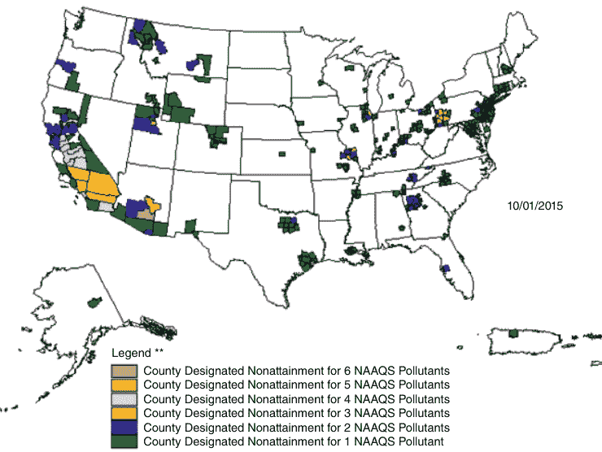

图例 **
6 种 NAAQS 污染物未达标指定县
5 种 NAAQS 污染物未达标指定县
4 种 NAAQS 污染物未达标指定县
3 种 NAAQS 污染物未达标指定县
2 种 NAAQS 污染物未达标指定县
1 种 NAAQS 污染物未达标指定县

关岛- Piti 和 Tanguisson 县被指定为 SO2 NAAQS 未达标

* 国家环境空气质量标准（NAAQS）是针对一氧化碳、铅（1978 年和 2008 年）、二氧化氮、8 小时臭氧（2008 年）、颗粒物（PM-10 和 PM-2.5（1997 年、2006 年和 2012 年））和二氧化硫（1971 年和 2010 年）的健康标准。

** 计数中包括针对 NAAQS 和修订 NAAQS 污染物的指定县。已撤销的 1 小时（1979 年）和 8 小时臭氧（1997 年）被排除。部分县，即县的一部分被指定为未达标而另一部分为达标，在地图上显示为完整县。

图 4.14 美国 NAAQS 污染物的未达标县。

### 4.17.2 SIP 包含什么内容？

典型 SIP 的内容分为三类：

+   1) 州采用的控制措施，包括法规或源特定要求（如命令和同意令）
+   2) 州提交的“非监管”组成部分（见下例）
+   3) EPA 为满足《清洁空气法》第 110 条或第 D 部分的强制性要求而颁布的额外要求

与 SIP 相关的 EPA 批准的文件和材料示例包括但不限于以下内容：

+   - SIP 叙述
+   - PM 计划
+   - 一氧化碳计划
+   - 臭氧计划
+   - 维持计划

+   - 车辆检查和维护（I/M）SIP
+   - 排放清单
+   - 监测网络
+   - 为证明法律授权而提交的州法规
+   - 第 D 部分未达标区计划
+   - 达标证明
+   - 交通控制措施（TCMs）
+   - 承诺措施
+   - 应急措施
+   - 非监管和非 TCM 控制措施
+   - 15% 进展率计划
+   - 紧急事件计划
+   -  visibility 计划

### 4.17.3 谁负责执行 SIP？

SIP 通常由州执行。然而，EPA 有权对联邦批准的 SIP 的违规者采取执法行动。

如果 SIP 已由州批准但尚未由 EPA 批准，则在 EPA 批准之前仅可由州执行，而不可在联邦层面执行。

公众还可以根据《清洁空气法》提起公民诉讼，以解决 SIP 违规问题。

## 4.18 合规

### 4.18.1 合规要求

一旦源获得空气质量许可证，保持遵守许可证中包含的所有许可条件就很重要。联邦 PSD 许可程序和 Title V 程序要求每个 PSD 许可证、Title V 许可证规定适用于许可源的法规。此外，PSD 许可证还规定了如何确定每项适用法规的合规性。确定合规性的方法和 EPA 合规保障监测计划在下面讨论。

#### 4.18.1.1 确定合规性的方法

PSD 许可证和 Title V 许可证申请必须确定适用于该设施和任何排放单元的要求以及如何确定对这些适用要求的合规性。证明合规性的要素包括合规监测、记录保存和报告。

#### 4.18.1.2 空气排放速率的直接测量

直接测量的基础是 EPA 在 40 CFR 第 60 部分附录 A 中公布的一组程序（Title 40 – 环境保护；Part 60 – 新固定源性能标准以及截至 1991 年 7 月 1 日修订的所有测试方法）。表 4.11 介绍了 EPA 用于直接测量固定源空气排放速率的方法以及在附录 A 中提出的程序组，包括气体污染物、特定金属和 VOC 的测量。这些方法包含执行程序的精确标准、QA/QC 步骤，并规定记录哪些数据。不严格按照程序执行会严重危及结果的完整性并危及其批准。收集烟囱样品进行分析的一般程序可在方法 1–5 中找到，作为设置测试列车的指南。任何测试的完整性都取决于确保采样列车是一个密闭系统，且外部（清洁）空气泄漏最少，这会稀释废气样品中污染物的浓度。

**表 4.11** USEPA 用于直接测量空气排放的方法以及 EPA 在 40 CFR 第 60 部分附录 A 中公布的程序组。

| 方法，固定源 | 程序和关注污染物 |
| :--- | :--- |
| 1 | 固定源的采样和速度遍历 |
| 2 | 烟囱气体速度和体积流量测定（S 型皮托管） |
| 4 | 烟囱气体中水分含量的测定 |
| 5 | 固定源 PM 排放的测定 |
| 6 | 二氧化硫 |
| 7 | 氮氧化物 |
| 8 | 硫酸和二氧化硫 |
| 9 |  opacity 监测 |
| 10 | 一氧化碳 |
| 11 | 石油炼油厂烟气流中的硫化氢含量 |
| 12 | 铅 |
| 13 | 氟化物 |
| 15 | 硫化氢；硫化羰；二硫化碳 |
| 16, 16A | 含硫还原化合物 |
| 18, 24, 25 | VOCs |
| 201, 202 | PM$_{10}$<sup>a</sup> |

<sup>a</sup>直径为 $10 \mu m$ 或更小的 PM。

方法 1 包含采样口和遍历点的选择指南，以对废气进行可接受的代表性采样。关键问题是随时间均匀收集样品。它包含确定是否存在旋流或旋转流动的程序。方法 2 包含测量废气速度和体积流量的程序。

图 4.15 是典型采样列车的示意图（此特定设置用于测量 PM 排放）。方法 5 包含测量来自两个来源的 PM 的指南：可过滤 PM 和冷凝 PM（后者在过滤器下游的冲击器中冷凝）。通常，两处测量的 PM 必须合并。针对特定情况的特定源类型（即木材加热器、沥青工业等）存在其他方法 5 程序。方法 201 和 202 是应考虑用于冷凝超细 PM 的测试 (Cooper and Alley 2011; Karel 2017)。


**图 4.15** 测量 PM 排放的工艺流程。来源：改编自 USEPA (1991b)。

## 例 4.14 排放标准符合性检查

作为一名咨询工程师，你受聘修改用于除去飞灰的现有控制装置。排放标准已更改为基于总颗粒数。确定该装置是否能满足 \(10^{5.7}\) particles/acf 的排放标准。装置数据如下：

- 平均颗粒尺寸，\(d_p = 10\ \mu m\)，假设恒定
- 颗粒比重 = 2.3
- 入口负荷，\(IL = 3.0\ \text{gr/ft}^3\)
- 效率（质量基准），\(E = 99.5\% = 0.995\)

### 解

出口负荷（OL）由下式给出

\[
OL = (1.0 - E)(IL)
    = (1.0 - 0.995)(3.0\ \text{gr/ft}^3)
    = 0.015\ \text{gr/ft}^3
\]

假设基准为 \(1.0\ \text{ft}^3\)。

颗粒质量：

\[
M = \rho_p V_p = \rho_p \frac{\pi d_p^3}{6}
\]

\[
= (7000\ \text{gr/lb})
\left[
\frac{\pi}{6}
\left(10\ \mu m \times 0.328\times10^{-5}\ \frac{\text{ft}}{\mu m}\right)^3
(2.3)(62.4\ \text{lb/ft}^3)
\right]
= 1.881\times10^{-8}\ \text{gr/particle}
\]

颗粒数：

\[
\frac{0.015\ \text{gr/ft}^3}{1.881\times10^{-8}\ \text{gr/particle}}
= 8.0\times10^5\ \text{particles/ft}^3
\]

允许的颗粒数/ft³：

\[
10^{5.7} = 5.01\times10^5\ \text{particles/ft}^3
\]

由于

\[
5.01\times10^5\ \text{particles/ft}^3 < 8.0\times10^5\ \text{particles/ft}^3
\]

因此，该装置将无法满足颗粒物排放标准。

## 例 4.15

正在从烟囱中抽取干气样。烟囱气体温度为 200 °C，压力为 730 mm Hg。气流通过加热过滤器、一组冷却冲击器、小型空气泵，然后通过流量计，如图 4.15 所示。流量测定为 30.0 L/min，条件为 20 °C 和 790 mm Hg。

1. 计算通过过滤器的实际体积流量（在 T = 200 °C 和 P = 730 mm Hg 时）。
2. 如果在 30 分钟内在过滤器上收集到 1.32 mg 的固体颗粒，则计算烟囱气体中颗粒物的浓度（以 μg/m³ 计）。

### 解

1. \[
Q_{\text{filter}} = (30.0)\left(\frac{790}{730}\right)\left(\frac{473}{293}\right) = 52.41\ \text{L/min}
\]

2. 在烟囱条件下采样气体的总体积：

\[
52.41\ \frac{\text{L}}{\text{min}} \times \frac{1\ \text{m}^3}{1000\ \text{L}} \times 30\ \text{min} = 1.572\ \text{m}^3
\]

\[
C_{\text{particulate}} = \frac{1.32\ \text{mg}}{1.572\ \text{m}^3} \times \frac{10^3\ \mu g}{1\ \text{mg}}
= 841\ \mu g/\text{m}^3
\]

## 例 4.16

一座烟囱（T = 550 °F 和 P = 750 mm Hg）使用 EPA 方法 5 进行采样（见图 4.15）。通过干气表的总气体体积为 2.785 m³（在 T = 60 °F 和 P = 800 mm Hg 时）。收集的 PM 质量为 1.50 g。此外，在冲击器中收集了 72.0 g 的 H₂O。

a) 计算烟囱中 PM 的浓度（μg/m³），条件为烟囱条件。  
b) 烟囱气体以平均速度 20 m/s 排出，烟囱内径为 5 m。PM 的排放速率是多少 kg/day？  
c) PM 浓度为 μg/dscm 时是多少？

已知：

\[
T_{\text{stack}} = 550^\circ\text{F} = 560.85\ \text{K} \qquad
P_{\text{stack}} = 750\ \text{mm Hg} = 0.987\ \text{atm}
\]

\[
T_{\text{DG}} = 60^\circ\text{F} = 288.71\ \text{K} \qquad
P_{\text{DG}} = 800\ \text{mm Hg} = 1.053\ \text{atm}
\]

\[
\text{Vol}_{\text{DG}} = 2.785\ \text{m}^3 = 2785\ \text{L} \qquad
m_{\text{PM}} = 1.50\ \text{g}
\]

\[
m_{\text{H}_2\text{O}} = 72.0\ \text{g} \qquad
V_{\text{exit}} = 20\ \text{m/s}
\]

\[
D_{\text{stack}} = 5.0\ \text{m}
\]

### 解

**部分 (a)**

使用理想气体定律（式 3.5）计算干气摩尔数：

\[
R = 0.08206\ \frac{\text{atm}\cdot\text{L}}{\text{gmol}\cdot\text{K}}
\]

\[
n_{\text{DG}} = \frac{P_{\text{DG}}\text{Vol}_{\text{DG}}}{RT_{\text{DG}}}
= \frac{(1.053\ \text{atm})(2785\ \text{L})}{
0.08206\ \frac{\text{atm}\cdot\text{L}}{\text{gmol}\cdot\text{K}}(288.71\ \text{K})
}
= 123.8\ \text{gmol}
\]

计算水的摩尔数：

\[
\text{MW}_{\text{H}_2\text{O}} = 18\ \frac{\text{g}}{\text{gmol}}
\]

\[
n_{\text{H}_2\text{O}} = \frac{m_{\text{H}_2\text{O}}}{\text{MW}_{\text{H}_2\text{O}}}
= \frac{72.0\ \text{g}}{18\ \frac{\text{g}}{\text{gmol}}}
= 4.0\ \text{gmol}
\]

\[
V_{\text{stack}} = \frac{n_{\text{DG}}RT_{\text{stack}}}{P_{\text{stack}}}
\]

\[
= \frac{(123.8\ \text{gmol})
(0.08206\ \frac{\text{atm}\cdot\text{L}}{\text{gmol}\cdot\text{K}})
(560.85\ \text{K})}{0.987\ \text{atm}}
= 5770\ \text{L} = 5.77\ \text{m}^3
\]

计算烟囱条件下 PM 的浓度：

\[
C_{\text{PM}} = \frac{M_{\text{PM}}}{V_{\text{stack}}}
= \frac{1.50\ \text{g}}{5.77\ \text{m}^3}
\left(\frac{10^6\ \mu g}{1\ \text{g}}\right)
\]

\[
C_{\text{PM}} = 2.6\times10^5\ \mu g/\text{m}^3
\]

**部分 (b)**

计算流量然后 PM 的排放速率。

\[
A_{\text{stack}} = \frac{\pi(D_{\text{stack}})^2}{4}
= \frac{\pi(5.0\ \text{m})^2}{4}
= 19.63\ \text{m}^2
\]

\[
Q_{\text{stack}} = A_{\text{stack}}V_{\text{exit}}
= (19.63\ \text{m}^2)\left(20\ \frac{\text{m}}{\text{s}}\right)
= 392.6\ \frac{\text{m}^3}{\text{s}}
\]

\[
\text{Rate}_{\text{PM}} = Q_{\text{stack}}C_{\text{PM}}
\]

\[
= \left(392.6\ \frac{\text{m}^3}{\text{s}}\right)
\left(2.6\times10^5\ \frac{\mu g}{\text{m}^3}\right)
\left(\frac{1\ \text{kg}}{10^9\ \mu g}\right)
\left(\frac{3600\ \text{s}}{1\ \text{h}}\right)
\left(\frac{24\ \text{h}}{1\ \text{day}}\right)
\]

\[
\text{Rate}_{\text{PM}} = 8820\ \frac{\text{kg}}{\text{day}}
\]

**部分 (c)**

使用式 (3.5) 将体积调整至标准温度压力条件。

\[
P_{\text{standard}} = 1\ \text{atm}
\]

\[
T_{\text{standard}} = 298.15\ \text{K}
\]

\[
\text{Vol}_{\text{STP}} = \text{Vol}_{\text{DG}}
\left(\frac{P_{\text{DG}}}{P_{\text{standard}}}\right)
\left(\frac{T_{\text{standard}}}{T_{\text{DG}}}\right)
\]

\[
= 2.785\ \text{m}^3
\left(\frac{1.053\ \text{atm}}{1\ \text{atm}}\right)
\left(\frac{298.15\ \text{K}}{288.71\ \text{K}}\right)
= 3.028\ \text{m}^3
\]

计算 PM 浓度：

\[
C_{\text{PM}} = \frac{m_{\text{PM}}}{\text{Vol}_{\text{STP}}}
= \left(\frac{1.50\ \text{g}}{3.028\ \text{m}^3}\right)
\left(\frac{10^6\ \mu g}{1\ \text{g}}\right)
\]

\[
C_{\text{PM}} = 4.95\times10^5\ \mu g/\text{m}^3
\]

## 4.18.1.3 监测

监测可以包括从连续排放监测（CEM）到记录收到的投诉等一切内容。监测可能相当昂贵。即使用于监测的设备并不昂贵，也必须满足监测频率要求，而进行监测需要占用人员资源，对于大型设施而言，这可能相当可观。

最近开发的一种最有前景的排放监测技术称为参数排放监测系统（PEMS）。PEMS 使用多变量计算机代码，将排放源上的参数监测器的数据与便携式租赁 CEM 系统的测量结果相关联。在初始安装期间，所有可用参数监测器的信息都提供给计算机。PEMS 代码随后评估哪些参数是独立的并识别这些参数。长期监测随后仅限于独立参数。PEMS 代码随后将参数变化与排放变化相关联——在 PEMS 预测排放与 CEM 数据进行比较的测试之后，CEM 系统被移除，PEMS 提供排放估计。由于燃料流量和温度等参数监测器通常比 CEM 监测器更可靠，因此 PEMS 的可用性通常高于 CEM 系统。运行成本也更低，因为不需要每日校准和其他 CEM 维护要求。

## 4.18.1.4 不透明度监测

几乎所有 Title V 许可证都必须解决不透明度合规问题。不透明度限制既存在于机构禁止性规则中，也存在于 NSPS 中，并存在于单个设备条件中。可以考虑以下几种不透明度测量水平：

- 连续不透明度监测系统（COMS）
- EPA 方法 9 不透明度监测
- EPA 方法 22 不透明度监测
- 投诉报告和响应

a) **连续不透明度监测系统。** COMS 是安装在烟囱或排气口顶部的光学监测器，通过测量光束穿过烟囱气体的衰减来工作。它们提供连续的不透明度读数并以电子方式记录。尽管可靠，但它们需要定期清洁光学元件，以确保读数反映的是气体不透明度而不是外部污染。此外，它们通常无法区分 PM 和水蒸气。水蒸气引起的不透明度不被视为违规，因此该设备限制可能很重要。区分 PM 不透明度和水蒸气的一种技术是在烟囱中安装不透明度监测器于任何水分的冷凝温度以上的点。

b) **EPA 方法 9 不透明度监测。** EPA 方法 9 监测是由合格观察员或“烟雾阅读员”对点源排放进行目视监测。认证是由机构或商业学校提供的课程和考试，并且为了保持认证，人员必须每六个月重新认证一次。监测包括 24 次每次 15 秒的观测，并将排放的不透明度与标准灰度进行比较。如果 24 次测量的平均不透明度超过标准，则视为违规。

要将方法 9 用作合规证明，设施必须有合格的“烟雾阅读员”可用，并且必须在许可证条件规定的间隔内进行读数。通常会认证两名员工，以便在其中一名认证人员不可用时仍可进行读数。一家利用方法 9 来证明不透明度合规的水泥窑在员工中拥有 18 名认证烟雾阅读员，以确保在窑 24 小时运行期间任何时间都可进行读数。尽管如此，认证读数只能在白天且无降水时进行（40 CFR 第 60 部分）。

只有 COMS 和方法 9 观测才能用于量化不透明度以与指定标准进行比较。下面描述的额外方法属于定性方法。


- **c) EPA方法22不透明度监测。** EPA方法22也是一种目视观察方法，但不需要经过认证的烟尘读数员。方法22建议观察者熟悉方法9中的技术，但仅要求观察者在观察期间记录可见排放不透明度被观察到的时间百分比。观察期必须至少持续六分钟。可见不透明度必须持续适用法规规定的时间段，才能构成显著事件，并且要求对这些事件进行记录、响应和报告（40 CFR Part 60, USEPA 1992）。方法9的替代方法还可使用激光雷达（LIDAR 1980）。

- **d) 投诉报告与响应。** 最简单的不透明度监测方法是承诺记录设施收到的任何不透明度投诉，并通过纠正措施回应这些投诉以消除观察到的可见不透明度。还必须保留所采取纠正措施的文件记录。投诉和纠正措施的记录随后作为定期报告的一部分提供给机构。

一种常用的不透明度检查方法是方法22与投诉记录和响应的结合。工厂经理或其他工作人员定期在工厂周围巡视，查看是否有可见排放。对于连续运营的工厂，一位工厂经理每天到达工厂时进行此检查。

## 4.18.1.5 记录保存

记录保存必须用于提供已实施监测的文件证明。对于物料平衡合规演示，记录所使用物料及其组成是演示的核心。对于使用替代参数或活动数据结合排放因子来证明合规的方法，必须保留活动记录，例如燃料使用量或运行时间。

建设和Title V许可的标准条件之一是，许可机构工作人员或其代表有权在“任何合理时间”且无需事先通知的情况下进入设施场所，检查监测方法和证明合规的记录。

记录不一定是纸质副本。磁性或其他电子记录也可以接受，只要能够显示并接受审计。在某些情况下，机构要求数据可以从机构办公室以电子方式获取，以便随时核实合规情况。尽管这一要求不常见，但完全符合当前监测和数据传输系统的技术水平。

良好的记录保存纪律对于证明符合Title V许可至关重要。在记录日志中使用“同上”标记或复印记录页表明记录保存纪律不佳，通常也是记录错误的指标。电子记录保存的一个优点是重复记录可以复制，然后进行适当修改以更新输入内容。

由不熟悉操作的人员定期检查记录，可以快速发现只有设备操作员或记录人员才能理解的条目。记录（包括记录人员的签名或缩写）必须能让其他人理解。

## 4.18.1.6 报告

对于Title V许可持有人，必须定期报告合规监测结果。Title V许可要求每六个月或每年报告一次。报告是公共记录，如果报告显示不合规，可能导致执法行动。

## 4.18.1.7 良好行为条款

对于Title V许可中包含的任何合规监测，应考虑设置良好行为条款。此类条款已包含在NSPS中。它们规定：初始阶段应频繁进行定期监测；如果未监测到不合规，则降低监测频率。可包含几个降低等级，如果在降低频率后的任何监测中观察到不合规，监测将恢复到更频繁的间隔并重新开始该过程。这一良好行为条款激励设施保持合规，从而限制定期监测的费用。

## 4.19 CAA执法条款

根据《清洁空气法》（CAA），EPA有多种执法选择，包括：

- 发布行政罚款令
- 发布要求合规或禁止的命令
- 向法院提起民事诉讼
- 请求总检察长提起刑事诉讼

以下分别讨论这些选项。个别州可能对违反州法规有类似规定，并且对于联邦法规授权州执行的条款，州的规定至少应与联邦法规同样严格。

### 根据《清洁空气法》可评估民事罚款

- 现场传票：每天不超过5 000美元，最高不超过25 000美元
- 民事罚款：每次违规每天最高25 000美元
- EPA可给予举报人最高10 000美元的奖励
- 可评估追偿律师费和专家证人费

### 4.19.1 行政罚款令

对违反CAA任何条款（包括违反许可条件）的行为，可进行行政罚款评估。检查员可签发现场传票。这些传票罚款为每天5 000美元，累计最高可达25 000美元。收到现场传票的个人可在合理时间内要求听证；他们将有机会提供证据进行辩护。

民事罚款每次违规每天最高可评估25 000美元。行政罚款类别还包括EPA可向举报违规的个人提供的最高10 000美元举报人奖励。收到行政罚款的个人可在30天内对评估提出上诉，或在额外的30天窗口期内向联邦地区法院对最终裁决提出上诉。EPA局长有权和解、修改或对罚款附加条件。

收到行政罚款的个人应及时联系监管机构，以澄清有关违规的任何疑问，说明从轻情节，表明已被指出的不合规行为已经纠正，并协商减少罚款。机构会考虑从轻情节，最终罚款通常很少保持原金额那么高。

### 4.19.2 发布要求合规或禁止的命令

发布命令是对违规行为更正式、更严重的回应。它通常用于必须解决特定问题，且存在损害人类健康或对环境造成严重或不可逆转损害的可能性时。处理命令需要进行听证，之后可评估民事或刑事处罚。

### 4.19.3 向法院提起民事诉讼

民事诉讼执法比上述行政行为更严重，且可能昂贵得多。法规中有规定，在民事诉讼期间可从被告处追偿律师费和专家证人费。根据1990年《清洁空气法修正案》（CAAA）第七章，公民诉讼可作为民事诉讼提起。此类诉讼可基于指出当前不合规情况的Title V许可申请，即使申请中包含合规计划。但如果该不合规行为已被裁定，且合规计划是法院已批准的同意法令的一部分，则不能对当前不合规行为提起公民诉讼。

### 4.19.4 请求总检察长提起刑事诉讼

联邦法律以及许多州法律中的规定都对组织和个人规定了刑事制裁。通常，刑事诉讼保留用于公然、故意的违法行为。包括：虚假陈述或不合规的监测或记录保存可判处2年监禁；过失危害可判处1年；明知可能导致死亡或严重人身伤害的行为可判处最高15年监禁并处罚款最高1 000 000美元。

### 《清洁空气法》还规定了包括监禁在内的刑事执法

- 虚假陈述、不合规的监测和记录保存：两年
- 过失危害：一年
- 明知危害，包括明知释放有害空气污染物（HAP）或极危险物质（EHS）导致迫在眉睫的危险：十五年
- 明知违反SIP、NSPS、NESHAP、Title V或第114条要求：五年
- 个人罚款约250 000美元，组织罚款约500 000美元

### 4.19.5 紧急情况作为抗辩理由

如果发生本应被视为违规的污染物释放，可以辩称这是紧急情况。为此，紧急情况定义为：排放源控制范围之外的任何突发的、合理不可预见的事件，需要立即采取纠正措施以恢复正常运行，并导致超出基于技术的排放限值。

如果违规是由设备设计不当、缺乏预防性维护、粗心或操作不当或操作员错误引起的，则不被视为


紧急情况。紧急情况可作为抗辩理由，前提是有经适当签署的操作日志或其他证据表明发生了紧急情况且原因可被识别，设施在当时正处于正常运行状态，且许可方已采取一切合理措施以将超标排放降至最低。

要使用此抗辩，必须在两个工作日内向许可机构提供通知，其中包含对紧急情况的描述以及为减轻排放和执行纠正措施所采取的步骤。如果将排放降至允许水平唯一的办法是停止或减少工厂活动，而未采取此措施，则不能使用紧急情况抗辩。也就是说，如果你不关停，你就承担责任。

与其它合规问题一样，良好的记录保存对于在使用紧急情况抗辩时免于被起诉至关重要。必须有记录表明工厂一直处于正常运行状态，并且已努力停止或减少超额排放。

## 4.19.6 第114条：事实调查

EPA有权在预期起诉前从来源处获取信息。如果某来源收到EPA援引第114条的信函，应将其视为至少与美国国税局审计一样严重。EPA可能会就排放以及公司环境管理结构提出问题或寻求信息。EPA可要求提供记录、监测、采样或合规认证。EPA在出示证件时有权进入存放记录的公司场所。

| 第114条是预期起诉的事实调查 |
|------------------------------------------------------------|
| • EPA可要求提供记录、监测、采样或合规认证。 |
| • 收到第114条信函相当于IRS审计。 |
| • 可能会就排放以及环境管理组织方式提出问题。 |
| • 对第114条的回复应及时、准确，且仅限于所问问题。 |

通常，信函是由EPA获得的证据所引发，表明发生了超额排放。这可能包括作为EPCRA 313表格R报告的一部分报告的环境释放、报纸报道，或收到州排放限值豁免通知。

对第114条信函的回复应及时、准确，且仅限于所问问题。律师应参与准备或审阅回复，并在与机构工作人员的任何后续会议中参与。

## 4.19.7 检查协议

检查是许可机构工作人员的标准活动，设施应预期会定期接受检查。一些非常大的设施，例如石油炼油厂，由监管机构指派全职检查员，且该人员每天都在设施内。其他设施的检查频率较低。对于任何设施，制定检查协议都是值得的。

检查协议应确定检查员到访时应由谁响应，适当的响应方式，以及检查员的权利以及公司的权利。

机构工作人员或其授权代表有权进入设施。接待员或门卫应被告知在检查员出示证件并要求进入时应联系谁。环境部门的一名成员应迎接检查员，并在检查未被预期且为常规检查的情况下，将检查员带至会议室进行检查前会议。询问检查员想要查看什么内容是适当的。虽然公司不能阻止进入，但访问工厂某些区域通常需要安全措施，且根据工厂安全规则，通常需要规划此类访问。检查员应被要求使用员工和其他访客所需的所有安全设备，在某些情况下，在参观工厂前需要进行安全简报。

一旦要访问的区域或所需信息被确定，检查员应被迅速且直接护送至该区域。检查员在无人陪同下参观设施既可能构成安全隐患，也可能存在提供误导性信息的风险。在检查员要求停靠原始请求未涵盖的另一区域的情况下，在进行另一次初步访谈之前可以禁止此类停靠，因为该请求未在原始访谈中涵盖。

如果检查员使用录音机或任何测试仪器，公司也应记录相同信息并测试同一位置。在某些情况下，录制检查视频可能是适当的。

检查结束时应举行离场会议。应询问检查员获得了哪些信息，并请求提供任何信息的副本。

大多数公司与定期访问其工厂的空气质量检查员建立了良好的工作关系，重要的是用于应对检查的程序不应具有敌意或不必要地阻碍。然而，检查员在与某设施工作一段时间后，常常会认为自己对设施运行的了解与工厂操作员一样。由于这种情况几乎从未发生，因此即使对于经验丰富的检查员，也需要陪同和操作说明。

## 4.19.8 连续排放监测

替代一次性测量的做法是使用CEM（也称为CEM系统）对污染物进行连续测量。CEM具有与烟囱测试（第4.19.8节和第4.19.9节）许多相同的属性。探头插入烟囱，样品在进入分析仪进行浓度测定前进行适当处理。数据采集系统（DAS）计算、存储和整理数据。通常，CEM以固定间隔取样，结果可按需平均（Karell 2017）。

连续排放监测系统（CEMS）历史上曾被用作监测烟气中氧气、一氧化碳和二氧化碳的工具，以为工业环境中的燃烧控制提供信息（Stultz and Kitto 2005）。目前，它们被用作遵守空气排放标准的一种手段，例如USEPA酸雨计划（CFR，标题40，第72部分，附录A 2011），或其他联邦排放计划，或州许可排放标准。

标准CEM系统由采样探头、过滤器、采样管线（脐带）、气体调节系统、校准气体系统以及一系列反映所监测参数的气体分析仪组成。典型的监测排放物包括：二氧化硫、氮氧化物、一氧化碳、二氧化碳、氯化氢、空气颗粒物、汞、挥发性有机化合物和氧气。CEM系统还可以测量气流、烟气不透明度和湿度。

在美国，EPA要求数据采集和处理系统收集和报告数据。SO₂排放必须以每小时磅为单位测量，使用SO₂污染物浓度监测仪和体积流量监测仪。对于NOₓ，需要NOₓ污染物浓度监测仪和稀释气体监测仪来确定排放速率（lb/MBtu）。不透明度也必须监测。NOₓ测量不是当前要求，但如果进行监测，应使用CO₂或氧气监测仪加流量监测仪。在监测这些排放时，系统必须连续运行，并且必须能够至少每15分钟采样、分析和记录数据，然后按小时平均（USEPA 2009a）。

### 4.19.8.1 运行

通过泵经采样探头将少量烟气抽取到CEM系统。燃烧化石燃料的设施通常使用稀释抽取探头，将样品与清洁干燥空气按通常在50:1至200:1之间、通常为100:1的比例稀释。稀释的原因是纯烟气可能很热、很湿，并且对某些污染物而言具有粘性。稀释至适当比例后，样品通过采样管线（通常称为脐带）输送至歧管，各分析仪可从中抽取样品。气体分析仪采用各种技术来准确测量浓度。一些常用技术包括：红外和紫外吸收、化学发光、荧光、气相色谱、火焰离子化检测器、质谱仪和β射线吸收。分析后，气体从分析仪排出至所有分析仪的公共歧管，然后排至室外。DAS接收每个分析仪的信号输出以收集和记录排放数据（PNM 2018）。

在工业源和低排放率的公用事业源中使用的另一种采样提取方法通常称为“热干”抽取法或“直接”CEMS。样品不经稀释，而是沿加热的采样管线在高温下输送至样品调节单元。样品经过滤去除颗粒物，并通常用冷却器干燥以去除水分。调节后，样品进入采样歧管并使用上述相同方法进行测量。此方法的一个优点是能够测量样品中氧气的百分比，这在排放校正的法规计算中通常是必需的。由于稀释会将清洁干燥空气与样品混合，稀释系统无法测量氧气百分比（PNM 2018）。

## 4.19.9 空气排放速率的QA和QC

EPA为确保CEM用于合规目的的准确性而规定了QA/QC程序。必须在法规要求指定的间隔内进行校准和零漂移评估，例如运行已知浓度的化合物样品并在同一时间运行CEM与另一台最近校准的CEM的“相对准确性”测试（相对准确性）。

直接测量涉及在工艺运行期间从排气或烟囱收集代表性气体样品，对气体样品进行预热以去除可能干扰测试的任何成分，并进行化学分析以测量感兴趣成分的浓度。同时测量排气流速可将浓度转换为


排放率（通常以磅/小时为单位）。每一步都伴随有质量保证（QA）和/或质量控制（QC）程序。

系统的准确性通过多种方式得以验证。内部QA检查通过每日向采样探头引入已知浓度的气体来完成。EPA还允许使用连续排放监测校准系统，这些系统通过稀释气体来生成校准标准（USEPA 1993）。分析仪的读数必须精确到一定百分比。百分比精度可能有所不同，但大多在2.5%至5%之间。在受酸雨计划影响的发电厂中，系统的年度（或两年一次）认证必须由独立公司执行。该公司将临时安装一套独立的CEM系统，与工厂的CEMS并行收集排放数据。这种测试被称为相对准确度测试审计（RATA）。

在美国，设备的定期评估必须记录并报告（USEPA 2009a）。这包括每日校准误差测试、流量监测仪的每日干扰测试，以及半年（或年度）RATA和偏差测试（USEPA 2018a）。CEMS设备价格昂贵，并非所有设施都能负担得起。在这种情况下，设施可能会在排放点安装不符合EPA标准的分析设备。每年一次，为了设备评估，移动式CEMS公司会使用合规设备测量排放。然后将结果与不合规的分析仪系统进行比较（Nova Gas 2018）。

## 4.19.10 执行烟囱测试

执行烟囱测试可能非常复杂。许多事情可能出错或导致结果误差。因此，几乎所有的机构都要求排放报告为至少三次成功运行的平均值，每次运行包括足够的样品收集（例如通过等速采样）和成功的泄漏测试。每次运行通常持续一小时。然而，对于浓度较低的污染物（例如痕量金属），需要更长的采样时间以收集足够的样品进行测量。

由于测试方法的复杂性，大多数监管机构要求制定一份正式的书面协议，并在测试开始前获得批准。这些协议通常由测试公司编写，应列出测试方法，详细描述方法和采样设备，并提供必要的计算，例如遍历点的数量和位置。

协议获得批准后，设施和测试公司应与监管机构确定一个双方都同意的日期。将测试与工厂运营协调至关重要，以确保相关设备在烟囱测试期间按预期运行，并且任何偏离标准操作条件的情况都会被记录。

现场工作完成后，必须向监管机构提交一份烟囱测试报告，该报告总结方法学，呈现结果，并包含原始数据。结果通常以基于实测排气流量的浓度或质量排放率形式提供。通常定义一个下限，低于该限值时污染物无法被测量（Karell 2017; USEPA 2009b）。

## 示例4.17 标准体积的计算

大多数大气采样技术使用采样系统，含有目标污染物的空气进入系统并穿过样品收集装置。收集到的污染物重量与通过排气和系统抽取的空气体积进行比较，从而计算出污染物的浓度。浓度通常表示为校正到EPA标准条件下的浓度，即298 K（25°C）和760 mmHg（1 atm）。

用于将样品体积（V_s）校正为EPA标准体积（V_std）的方程基于查尔斯定律。

```
V_STD = V_s (P_atm / P_std) (T_std / T_atm) (4.18)
```

其中
V_std = 气体的校正体积；V_s = 气体的采样体积
T_std = EPA标准温度；T_atm = 样品标准温度
P_std = EPA标准压力；P_atm = 样品标准压力

如果从平均温度为80°F、压力为14.3 psia的排气空气中采样了10 ft³的空气，请确定校正后的样品体积。

### 解决方案

将环境温度和压力转换为适当的单位。
T(K) = (F - 32)/1.8 + 273 = (80 - 32)/1.8 + 273 = 300 K
P(atm) = P_s (1atm / 14.7 psi) = 14.3 psi (1atm / 14.7) = 0.97 atm

使用公式(4.15)计算校正后的体积。

```
V_std = V_s (P_atm / P_std) (T_std / T_atm) = 10 ft³ (0.97 atm / 1 atm) (273 K / 300 K) = 8.83 ft³
```

## 示例4.18 烟囱流速

某设施的废气流量为$1500 \mathrm{scfm}$。所有气体通过一个小烟囱排出，烟囱入口面积为$2.3 \mathrm{ft}^2$。废气温度为$350^\circ\mathrm{F}$。气体通过烟囱入口的速度是多少（$\mathrm{ft} / \mathrm{s}$）？假设标准条件为$70^\circ\mathrm{F}$和1 atm。忽略烟囱内的压降。

### 解决方案

首先注意，温度必须转换为绝对温标。因此，

```
$$\begin{aligned} & T_x=350+460=810^\circ\mathrm{R} \\ & T_s=70+460=530^\circ\mathrm{R} \end{aligned}$$
```

且

```
$$\begin{aligned} Q_a &= Q\left(\frac{T_x}{T_s}\right) \\ &=1500\left(\frac{810}{530}\right)=2292 \mathrm{acfm} \end{aligned}$$
```

现在可以计算平均速度：

```
$$\begin{aligned} V &= \frac{Q_a}{A} \\ &= \frac{2292 \mathrm{acfm}}{\left(2.3 \mathrm{ft}^2\right)\left(60 \mathrm{seconds}\right)}=16.61 \mathrm{ft} / \mathrm{s} \end{aligned}$$
```

## 4.20 工业固体废物及其管理

处理。要看到再利用、回收和堆肥固体废物的价值，只需考虑容纳这些材料所需的处理空间。

通过实施环境友好的废物管理策略（以及资源管理策略），一个群体可以减少对焚烧炉和填埋场的依赖。当回收材料替代原生塑料、金属矿石、矿物、玻璃和木材时，扩大化工、采矿和林业的压力就会减小。向工业供应回收材料比从矿山和森林中提取原生资源更为可取，这不仅因为它保护了稀缺的自然资源，还因为它减少了危险的空气和水污染物，如温室气体排放，并节省了能源。

节约能源是回收利用的重要环境效益之一，因为产生能源通常需要消耗化石燃料，并导致污染空气和水的排放。用回收材料制造纸张、塑料、玻璃和金属所需的能源通常少于用原生材料生产所需的能源。此外，回收材料的收集、加工和运输通常比原生材料在工业使用前必须经历的提取、精炼、运输和加工步骤消耗更少的能源。

众所周知，工业过程和运输中使用的大量能源来自化石燃料的燃烧。回收利用通过减少工业使用的能源量，从而减少温室气体排放，有助于遏制全球气候变化的危险。

### 4.20.1 固体废物处理：关于回收利用的一些观点

2010年，美国人产生了约2.5亿吨城市固体废物（MSW）（回收前），比2000年增长约8%，比1990年增长17%，比1980年增长36%（USEPA 2002a, 2014）。因此，MSW的管理仍然是21世纪美国和其他高度工业化国家面临的重要挑战。固体废物管理在发展中国家也至关重要，在这些地方，古老的“零浪费”传统常常被遵循，而很少考虑零排放概念的意义和影响。

### 4.20.2 为什么要回收？

每吨从处置中转移出来的固体废物，无论是再利用、回收、在废物转化为能源计划中转换，还是堆肥，都意味着需要处理的固体废物减少一吨。

### 4.20.3 什么是回收利用

回收利用是一种工业过程，利用机械、化学和/或生物方法将废弃产品中的材料重新利用或转化为可再次使用的回收物、原料或能源。回收利用不仅仅是一种废物管理策略；它也是减少工业生产环境影响的重要策略。

回收利用的目标是闭合材料在制造、营销、消费和处置各阶段流动的循环。在闭环回收中，一组指定的操作在连续的每个循环中重复，操作根据所回收废料的类型而变化。因此，回收利用不同于再利用，再利用是指在性能没有任何变化的情况下，对在使用寿命结束时被回收的废弃产品进行进一步使用。


废弃物回收主要有三种方式：

1. *机械回收*，可分为 *初级回收*，即在厂内对清洁的单一等级生产边角料进行加工，制成与原产品质量相当的产品，以及 *次级（消费后）回收*，即对来自各种来源的丢弃废物进行再加工，制成质量较差（针对塑料和纸张）或与原产品质量相当（针对铝、玻璃和金属）的再生产品。
2. *三级或化学或原料回收工艺*，例如堆肥可降解废物，将混合塑料转化为液体或气体形式的单体或低分子量低聚物，以及将混合塑料碎片用作炼钢的还原剂。
3. *四级回收工艺*，例如带能量回收的废物焚烧，其中可燃市政或农业废物的部分能量含量被回收并加以利用，例如产生蒸汽（Brophy et al. 1997; Frisch et al. 1999; Mader 1997; Van Beukering 1999; Walker 1995）。

由于回收是一种工业过程，其成功程度高度取决于经济、技术、社会和政治因素，而这些因素在不同国家之间差异很大（Bell 1998; Haque 1998）。然而，废物的机械回收历史悠久，在发达国家和发展中国家都很流行（Gandy 1994; Haque 1998; Shah 2000）。

## 4.20.4 美国和英国回收概况简述

对丢弃产品的初级回收，特别是塑料废料的回收，其历史几乎与从原生材料工业化生产产品的历史一样久远（Saba and Pearson 1995）。事实上，纽约市和伦敦的废物管理体系会例行收集来自街道清洁企业、商业场所、垃圾场和垃圾转运站的可重复使用物品（主要是纸张、布料、玻璃瓶和金属）进行次级回收。美国第一座垃圾分拣厂于1898年在纽约开业，20世纪20年代初，伦敦拥有了一座配备长传送带的示范分拣厂，可从中取出可回收材料（Gandy 1994）。

第二次世界大战后，超越废物经济价值进行思考的规划者意识到，回收可以减少废物流的体积，而将不可燃的玻璃和金属分离可以提高焚烧厂的运行效率。

在今天的美国，大多数地区回收约20–30%的垃圾，接近、达到或超过数十年前设定的全国回收目标。在英国，商业和工业产生的废物比生活垃圾更容易回收，这种差异反映了前者废物纯度更高的水平。该国回收工业废物25%，生活废物5%（Haque 1998）。中央政府已设定修订后的目标，即到2010年实现市政废物45%的回收利用，其中包括30%的回收和堆肥（DETR 1999）。

两国废物收集和分离方案包括为家庭提供户外回收容器、使用战略性布置的瓶罐回收箱，以及在中央物料回收设施进行分拣。罐装、纸制品、玻璃、铅酸电池、汽车和纺织品已有成熟的回收渠道。相比之下，丢弃的塑料产品和包装——废物流中日益增加的组成部分——在回收方面存在诸多问题。识别、分离和回收不同类型塑料所带来的技术困难和高成本，再加上再生料缺乏市场，进一步加剧了问题。

## 4.20.5 当今的回收

在美国和英国，今天推动回收的压力主要来自环境关切以及旨在降低原材料和生产成本的工业政策，即最小化能源和材料消耗。进一步支持回收活动的是对填埋和焚烧——固体废物常规处置方式——所带来的环境污染的担忧。

因此，在许多发达国家，消费后废物的回收正通过新立法以及自20世纪70年代以来实施的经济激励措施而得到积极鼓励。德国要求零售商回收其包装的法律导致了大量可回收材料的供应。事实上，该倡议的成功造成了盈余，压低了欧洲回收材料的价格，从而阻碍了其他地方的回收工作。德国的经验或许曾被美国环保署前任局长预见，他称回收“是一个好主意，但已经走得太远”（Bickerstaffe 1997）。

与发达国家不同，人均废物产生量在工业化程度较低的国家要少得多，但某些材料的回收率却接近100%。回收于20世纪20年代引入发展中国家，但直到20世纪50年代末才大规模开展（Nahar 1990; Ratra 1994）。从一开始，这些废物回收系统就由经济 necessity 驱动，因为穷人通过拾荒废弃的玻璃、塑料、纸张、金属和其他材料谋生，然后通过非正式系统将其出售，供在设施各异的场所进行回收。

## 4.20.6 回收作为可持续生产力和增长的途径

尽管大规模的回收计划和污染预防工作正在进行中，但正如一开始所指出的，需要处置的废物数量仍在增加。我们以远快于自然补充的速度使用自然资源。在我们使用从地球提取的资源后，我们将其丢弃，往往以更有害的形式丢弃到我们依赖的环境中，以提供呼吸的空气、饮用的水和种植食物的土壤。对这种做法的担忧一再被提出，并且众所周知。

与废物相关且同样令人担忧的是社区安全问题，其影响更为广泛。公众越来越意识到有多少吨危险和非危险材料通过公路、铁路和海上运输。鉴于事故风险，尤其是涉及危险废物时，运输物质的体积持续增长，担忧与日俱增。

可持续生产和增长的计划旨在引领通向一个未来，即社会需求所需材料和有毒物质很少，材料被重复使用或回收，而不是被焚烧、掩埋或倾倒。这种转变将随着我们重新设计工艺、消费者和企业行为、重复使用更多材料以及改进技术而发生。各层级的工业、企业和政府需要利用成功的项目并投资于基础设施和活动以实现这些目标。

有趣的是，回收的经济性与回收者的经济发展水平成反比，更一般地说，回收倾向也与他们的社会经济地位成反比。在发达国家，塑料废物再加工设施在已知条件下运行，生产出已知质量的产品。然而，在发展中国家，塑料废物通常在未记录的条件下被多次回收，并暴露于外来污染物的累积影响之下。这种不受控制的重复加工对材料质量的有害影响不难想象。因此，据建议，塑料可行的最大回收次数上限会因不同国家的社会经济条件而异。

## 4.20.7 资源保护和回收法

《资源保护和回收法》（RCRA）于1976年颁布，是美国规范固体废物和危险废物处置的主要联邦法律（RCRA 1976）。

### 4.20.7.1 历史和目标

国会颁布RCRA是为了应对国家面临的不断增长的市政和工业废物问题。RCRA修订了1965年的《固体废物处置法》。它设定了国家目标

- 保护人类健康和自然环境免受废物处置潜在危害
- 节约能源和自然资源
- 通过源头减量和回收减少废物产生量
- 以环境友好方式管理废物（USEPA 2010b）

它现在最广为人知的是根据RCRA颁布的法规，设定了美国危险废物处理、贮存和处置（TSD）的标准。

### 4.20.7.2 RCRA实施

美国环保署已发布废物管理法规，其编入《联邦法规汇编》第40篇第239至282部分（USEPA 2011a）。有关危险废物管理的法规从第260部分开始（USEPA 2011b）。如以下所述，大多数州已颁布至少与联邦法规一样严格的法律并制定了法规。此外，RCRA法案授权各州通过其自己的危险废物计划（以及州法律）执行联邦法律的许多职能，前提是这些计划已获得环保署批准。

### 4.20.7.3 危险废物的识别和表征

要将一种材料归类为危险废物，它首先必须被视为废物，并且至少满足以下其中一项标准：

1) 它表现出危险废物的任何特性。
2) 它已被命名为危险废物并在环保署法规中列出（表 C.2）。
3) 它是含有列出的危险废物和非危险固体废物的混合物。
4) 它是含有列出的或具有特征的危险废物和特殊核材料的混合物。
5) 它是从列出的危险废物的TSD中产生的废物残留物（即“源自”废物）。


## 4.20.7.4 特征

特征性废物是指表现出可测量的特性，表明该废物构成的威胁足以作为危险废物进行管制的废物。美国环保署（USEPA）决定，危险废物的特征应可通过使用标准化测试方法或应用对废物特性的一般知识来检测。根据这些标准，EPA 确定了四种危险废物特征：易燃性、腐蚀性、反应性和毒性。

1) 易燃性 – 易燃废物易于燃烧或可燃，在运输、储存或处置过程中可能引发火灾。示例包括油漆废物、某些脱脂剂或其他溶剂。描述易燃性特征的法规见 40 CFR 261.21。具有以下任何特性的废物被视为由废物代码 D001 识别的危险废物：

- 除水溶液外的液体，含酒精量小于 24%，且闪点低于 60°C（140°F）。
- 在正常条件下能够自发且持续燃烧的非液体。
- 根据美国交通部法规定义的易燃压缩气体。
- 根据美国交通部法规定义的氧化剂。

2) 腐蚀性 – 腐蚀性废物可能与其它废物危险反应，溶解金属或其他材料，或灼伤皮肤。示例包括废锈蚀清除剂、废酸或碱性清洁液以及废电池酸。描述腐蚀性特征的法规见 40 CFR 261.22。具有以下任一特性的废物被视为由废物代码 D002 识别的危险废物。

- pH 值小于或等于 2 或大于或等于 12.5 的水性物质。
- 在 55°C（130°F）温度下腐蚀钢的速率大于 0.25 in./year 的液体。

3) 反应性 – 反应性废物不稳定，在与水或其他物质接触时会发生快速或剧烈的化学反应。示例包括氰化物电镀废物、废漂白剂和其他废氧化剂。反应性特征在 40 CFR 261.23 的法规中有所描述。具有以下任何特性的废物被视为由废物代码 D003 识别的危险废物。

- 通常不稳定且剧烈反应而不发生爆炸。
- 与水剧烈反应（即引起突然闪火伴随飞溅）。
- 与水形成爆炸性混合物（即引起爆炸），可能损坏容器及其附近的任何物体或人员。
- 与水混合时产生有毒气体、蒸气或烟雾，而不一定伴随剧烈反应或爆炸。
- 含有氰化物或硫化物，并在 pH 值在 2 至 12.5 之间时产生有毒气体、蒸气或烟雾。

4) 毒性 – 由于废物中含有超过规定监管水平的毒性成分，毒性废物被视为危险废物。为了确定废物是否显示毒性特征，会进行测试方法（即毒性特征浸出程序或 TCLP）。描述毒性特征的 TCLP 法规见 40 CFR 261.24。

5) 其他特征 – 可能具有传染性的医疗废物包括使用过的绷带和皮下注射针头、人体组织和血液，以及医院和研究机构产生的生物物质。由于其具有传染性，该废物根据特定的 EPA 指南进行处理和处置。

## 4.20.7.5 列出的危险废物

列出的危险废物由特定行业和工艺产生，仅根据产生它们的工艺就自动被视为危险废物，而不论废物测试是否显示出危险废物的“特征”。列出废物的示例包括

- 电镀工艺留下的许多污泥
- 铁钢制造的某些废物
- 某些清洁和/或脱脂工艺的废物

危险废物被纳入 USEPA 公布的清单中。这些清单分为三个类别：

1) F 清单（非特定来源废物）。该清单确定了来自常见制造和工业工艺的废物，例如用于清洁或脱脂作业的溶剂。由于产生这些废物的工艺可在不同行业部门中发生，F 清单废物被称为来自非特定来源的废物（见 40 CFR 261.31）。

2) K 清单（来源特定废物）。该清单包括来自特定行业的某些废物，例如石油精炼或农药制造。这些行业处理和生产工艺中的某些污泥和废水是来源特定废物的示例（见 40 CFR 261.32）。

3) 丢弃废物：P 清单和 U 清单废物实际上是同一主要丢弃废物清单的子清单。这些废物适用于当被丢弃时被视为危险的商业化学产品，并受以下美国联邦法规管制：40 C.F.R. 261.33 (e) 和 (f)。P 清单废物在被丢弃时被视为“急性危险”，并受更严格的管制。硝酸是 P 清单废物的示例，编号为 P076。U 清单废物在被丢弃时被视为“危险”，其管制程度略低于 P 清单废物。丙酮是 U 清单废物的示例，编号为 U002。

## 4.20.8 RCRA 的若干规定：从摇篮到坟墓要求

EPA 的从摇篮到坟墓危险废物管理体系旨在追踪危险废物从其产生点（“摇篮”）到其最终处置点（“坟墓”）的整个过程（图 4.16）。可以说，RCRA 法案中最值得注意的规定包含在 C 标题中，该标题指示 EPA 对危险废物从产生点开始，经运输和 TSD 的整个管理过程建立控制。由于 RCRA 要求对危险废物产生者（即产生危险废物的场所）、运输者以及处理、储存和处置设施（TSDF）（即最终处理/处置或回收危险废物的设施）进行控制，整体监管框架被称为“从摇篮到坟墓”体系。该计划对处理危险废物的产生者、运输者和 TSDF 运营商施加了严格的记录保存和报告要求。

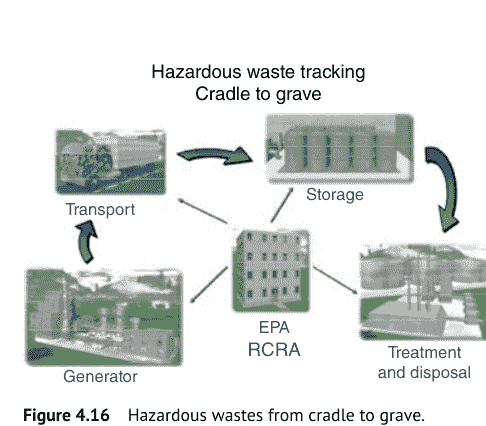

统一危险废物清单（*清单*）是从摇篮到坟墓废物管理的关键（第 D.6 节）。通过使用清单，产生者可以追踪危险废物从产生点到最终 TSD 点的移动。

## 4.20.8.1 非危险固体废物

非危险固体废物包括被免除 C 标题法规的某些危险废物，例如来自家庭和有条件豁免少量产生者的危险废物。石油和天然气勘探与生产废物，如钻屑、产出水和钻井液，被归类为“特殊废物”，也免于 C 标题（USEPA 2002b）。C 标题还包括垃圾（例如食品容器、咖啡渣）、未回收的家用电器、焚烧汽车轮胎的残渣、金属废料、建筑材料等废物，以及工业和市政废水处理设施和饮用水处理厂的污泥。

## 4.20.8.2 地下储罐

### 背景
地下储罐（UST）的运行在 1984 年《危险废物和固体废物修正案》颁布后成为 RCRA 监管计划的管制对象。当时约有 210 万个储罐受联邦监管，EPA 计划导致大多数不合格储罐关闭和移除。截至 2019 年 3 月 31 日，约有 548 700 个活跃 UST 分布在 198 000 个场所受联邦监管（USEPA 2019a）。新法规包括若干排除项：

- 危险废物 UST 系统
- 受管制的废水处理设施
- 容量小于 41.5l 的任何 UST 系统
- 含有 *de minimis*（可忽略）浓度受管制物质的任何 UST 系统
- 使用后迅速排空的任何应急溢出或溢流 containment 系统

## 4.20.8.3 危险废物的运输

本节涵盖运输危险废物的重要方面。这应使读者熟悉所涉及的风险和挑战的复杂性。1975 年，美国国会通过了《危险材料运输法》。该法的意图是通过赋予交通部长广泛的权力来监管危险材料运输的各个方面，从而改善监管和执法活动。运输方式包括飞机、水运、机动车和铁路。


**表 4.12** 运输和包装危险品的分类。

| 危险 | 类别 | 分区 |
|---|---|---:|
| 禁止运输材料 | — | — |
| 禁止爆炸物 | — | — |
| 爆炸物（具有质量爆炸危险） | 1 | 1.1 |
| 爆炸物（具有质量抛射危险） | 1 | 1.2 |
| 爆炸物（主要具有火灾危险） | 1 | 1.3 |
| 爆炸物（无显著爆破危险） | 1 | 1.4 |
| 极强感度炸药、炸药 | 1 | 1.5 |
| 极不敏感的起爆物质 | 1 | 1.6 |
| 易燃气体 | 2 | 2.1 |
| 不可燃压缩气体 | 2 | 2.2 |
| 有毒气体 | 2 | 2.3 |
| 易燃和可燃液体 | 3 | — |
| 易燃固体 | 4 | 4.1 |
| 自燃材料 | 4 | 4.2 |
| 遇湿危险材料 | 4 | 4.3 |
| 氧化剂 | 5 | 5.1 |
| 有机过氧化物 | 5 | 5.2 |
| 有毒材料 | 6 | 6.1 |
| 传染性物质（病原体） | 6 | 6.2 |
| 放射性物质 | 7 | — |
| 腐蚀性物质 | 8 | — |
| 其他危险材料 | 9 | — |
| 其他受管制材料 | — | — |

*来源：40 CFR 173.*

美国联邦航空管理局执行有关航空运输的法规。美国海岸警卫队执行有关水路运输的法规。同样，美国联邦公路管理局执行有关危险废物通过公路和铁路运输的法规。

表 4.12 列出了受联邦运输法规管制的危险品的分类。其目的是规范在运输过程中若意外释放可能对公众和承运人员造成伤害的材料。49 CFR 172.101 中的危险品表进一步定义了特定危险化学品的标签、包装和承运人要求（见第 4.5.13 节）。

## 4.20.9 TSDFs 许可

TSDFs 根据 RCRA 第 C 子标题管理危险废物，通常必须获得许可才能运营。虽然大多数设施拥有 RCRA 许可证，但一些设施仍在所谓的“临时状态”下运营。临时状态要求见 40 CFR 第 265 部分（USEPA 2012）。TSDFs 的许可要求见 40 CFR 第 264 和 270 部分。TSDFs 在可能包括容器储存区、储罐、地表蓄水池、废物堆、土地处理单元、填埋场、焚化炉、 containment 建筑物和/或滴液垫的单元中管理（处理、储存或处置）危险废物。单元特定的许可和运营要求在 40 CFR 第 264 部分第 J 至 DD 分部中进一步详细描述（USEPA 1999）。

### 4.20.9.1 回收

一些危险废物可以回收再制成新产品。示例可能包括铅酸电池或电子电路板。当这些类型的灰烬中的重金属经过适当处理时，它们可以与其它污染物结合并将其转化为更易于处置的固体，或者可作为路面填充物使用。此类处理降低了有害化学品如飞灰和底灰的威胁水平，同时也回收了安全产品。

### 4.20.9.2 波特兰水泥

另一种常用的处理方法是水泥基固化和稳定化（Chaudhary and Rachana 2006）。水泥被使用是因为它可以通过改善物理特性并降低污染物的毒性和传播来处理多种危险废物。所生产的水泥根据其强度和成分分为五个不同的等级。将污泥转化为水泥的过程可能包括添加 pH 调节剂、磷酸盐或硫试剂，以减少沉降或固化时间，增加抗压强度，或降低污染物的浸出能力。

### 4.20.9.3 焚烧、销毁和废物能源化

焚烧的三大要素——温度、时间和湍流的重要性已得到多年的认可。最近关于三大要素的一般指南包括更高的温度（1200–2000°F）和更长的停留时间（0.2–2.0 秒），以促进 HAPs 的更完全破坏。危险废物可能被“销毁”。例如，通过高温焚烧，可燃废物有时可作为能源来源燃烧。例如，许多水泥窑焚烧危险废物如废油或溶剂。如今，焚烧处理不仅减少了危险废物的数量，还从过程中释放的气体中产生能量。众所周知，这种特定的废物处理会释放由副产品或其他材料燃烧产生的有毒气体，可能影响环境。然而，目前的技术已开发出更高效的焚烧装置，可将这些排放控制到一定程度，使这种处理被认为是一种更有益的选择（例如废物能源化 – 见第 7.13.5 节和附录 G）。

### 示例 4.19 汞废物

一台焚化炉焚烧含汞医疗废物。废物材料的灰分含量为 1%。固体废物进料速率为 1000 lb/h，气体流量为 20000 dscf。据报道，当蒸气浓度为 0.3 mg/dscm（干标准立方米）时，颗粒物中汞的平均含量为 2.42 µg/g。对于焚化炉排放物满足颗粒物标准 0.08 gr/dscf（0.1832 g/dscm）且使用 99.5% 高效静电除尘器（ESP）的情况下，计算

- 1) 被 ESP 捕获的与飞灰结合的汞量，单位为克/天
- 2) 以蒸气形式和随飞灰离开烟囱的汞量，单位为克/天。

### 解答

离开烟囱的灰量为：

```
(0.08 gr/dscf)(1 lb/7000 gr)(20000 dscf/min)(60 min/h)(24 h/day) = 329 lb ash/d
```

使用 99.5% 高效 ESP 在 ESP 中收集的灰量为

```
= (329 lb/day)/(1.0 - 0.995 collected) = 65800 lb/day
```

随飞灰离开烟囱的汞量为

```
= (329 lb ash/day)(2.42×10⁻⁶ g Hg/g ash) = 7.96×10⁻⁴ lb Hg/day × 454 g/lb = 0.361 g Hg/day
```

以蒸气形式离开烟囱的汞量为

```
= (3×10⁻⁴ g Hg/dscm)(20000 dscf/min)(1 m³/35.31 ft³)(60 min/h)(24 h/day) = 244.689 g/day
```

因此，离开烟囱的总汞量 = 244.689 + 0.361 = 245 g/day。

### 4.20.9.4 热解

一些危险废物类型可在超高温电弧中惰性条件下进行热解以避免燃烧而被消除。这种处理方法在某些情况下可能优于高温焚烧，例如在破坏浓缩有机废物类型时，包括 PCBs、POHCs、农药和其他持久性有机污染物。

USEPA 对危险废物焚烧（HWI）设施的法规要求主要有机危险成分（例如 PCBs、POHCs）的破坏和去除效率（DRE）至少为 99.99%。在这些情况下，EPA 几乎总是要求最终运营许可证具有高温（1800°F 或更高）和在二燃室中至少 2.0 秒的停留时间。医院（生物医学）废物焚烧炉通常利用 HWI 类型的设施。

DRE 是根据引入焚烧炉的废物的质量平衡为每个指定的 POHC 确定的：

```
DRE = (W_in - W_out)/W_in × 100% (4.19)
```

其中

DRE = 破坏和去除效率（百分比）
W_in = 送入焚烧炉的 POHC 的质量进料速率（lb/h 或 kg/h）
W_out = POHC 排放到大气中的质量排放速率（lb/h 或 kg/h）

### 示例 4.20

在一次试验焚烧中，焚烧炉以 5000 lb/h 的废物进料速率和烟气中 7% O₂ 干体积运行。烟囱中测得的气体流量为 19200 dscfm。在这些条件下，主要有机危险成分的测量浓度为

- 三氯乙烯（1）= 4.9 µg/dscf
- 1,1,1-三氯乙烷（2）= 1.0 µg/dscf
- 二氯甲烷（3）= 49 µg/dscf
- 四氯乙烯（4）= 490 µg/dscf

这里列出的每种危险成分约占总废物进料速率的 5%。计算 POHCs 的 DRE。该装置是否符合法规？

### 解答

每种危险成分占总废物进料的 5%，因此，

```
W_in = (0.05)(总进料速率) = (0.05)(5000 lb/h) = 250 lb/h
```

烟囱中每种危险成分的质量流量由


(W_out)_i = q_s C_i / 7.57×10^6
其中
q_s = 体积气体流量 (dscfm)
C_i = 组分 i 的浓度 (µg/dscf)
7.57×10^6 = 将 µg/min 转换为 lb/h 的浓度因子
(注意 (454 g/h)(10^6 µg/g)(h/60 min) = 7.57×10^6)
因此，
(W_out)_1 = ((19200)(4.9) / 7.57×10^6) = 0.01243 lb/h
(W_out)_2 = ((19200)(1.0) / 7.57×10^6) = 0.00254 lb/h
(W_out)_3 = ((19200)(49) / 7.57×10^6) = 0.1243 lb/h
(W_out)_4 = ((19200)(490) / 7.57×10^6) = 1.243 lb/h

组分 i 的 DRE，DRE_i，由式 (4.16) 给出：
DRE = [((W_in)_i - (W_out)_i) / W_in] 100%
DRE_1 = ((250 - 0.01243)/250)100 = 99.995%
DRE_2 = ((250 - 0.00254)/250)100 = 99.999%
DRE_3 = ((250 - 0.1243)/250)100 = 99.95%
DRE_4 = ((250 - 1.1243)/250)100 = 99.55%

法规要求必须达到最低 99.99% 的 DRE。在此情况下，只有两个主要有机危险组分 (1 和 2) 达到了这一标准。假设组分 3 或 4 (或两者) 为指定的 POHC，则该装置将不符合规定。

## 4.21 危险废物填埋场 (封存、隔离等)

危险废物可封存在危险废物填埋场或永久处置设施中。“就危险废物而言，填埋场被定义为处置设施或设施的一部分，其中危险废物被放置在土地上，且不是堆场、土地处理设施、地表蓄水池、地下注入井、盐穹构造、盐床构造、地下矿井、洞穴或纠正措施管理单元” (40 CFR 260.10)。

### 4.21.1 危险废物的最终处置

历史上，一些危险废物曾被处置在普通填埋场。这导致不利数量的危险物质渗入地下。这些化学物质最终进入自然水文系统。许多填埋场现在要求采取防止地下水污染的对策。例如，必须在填埋场基础沿线安装屏障，以容纳处置废物中可能残留的危险物质。目前，危险废物通常必须在进入填埋场前进行稳定化和固化，并且必须经过不同处理以稳定和处置它们。大多数易燃材料可以回收为工业燃料。一些含有危险成分的材料可以回收，例如铅酸电池。

## 例 4.21 土地处置日覆盖

填埋场-DNR 询问：我们拟建的危险废物填埋场的日覆盖需要多少材料？在填埋场使用寿命期间，我们的总容积 (空气空间) 有多少将被用作日覆盖？如果不使用日覆盖，填埋场可以使用多久？填埋场平均平面为 500 m × 250 m，高 15 m。日填埋率为 15 m × 10 m × 2 m，日覆盖为 0.3 m。

## 解

填埋场总空气空间为
V1 = 500 × 250 × 15 = 1.88 × 10^6 m³。
每个日层 (升层) 的体积为
V2 = 15 × 10 × 2 = 300 m³
日覆盖的体积为
V3 = 1.5 × 10 × 0.3 = 45 m³
日覆盖使用的空气空间体积 (百分比) 为
V_pc = (V3/V1) × 100 = 45/300 × 100 = 15%
使用日覆盖的填埋场寿命为
t1 = V1/(V2 + V3) = 5449 天
= 每周 5 天工作 21 年

已有的管理体系，并评估受监管和未受监管材料和做法的风险。

环境审计是一种管理工具，被认为通常能改善制造设施的整体环境绩效。这些审计通常侧重于可能涉及加工、制造、材料采购、储存、维护、分销和废物管理的运营设施。环境审计应能发现诸如不合规和不当或不充分的废物管理操作等问题，并 hopefully 允许及时纠正。然而，危险废物设施的管理人员持怀疑态度，并担心商业秘密的保密性以及可能由可能竞争类似制造或加工业务的外部人员披露。

## 4.23 综合环境响应、赔偿和责任法及超级基金

*超级基金* 是美国联邦政府设计用于资助清理受危险物质和污染物污染场地的计划。该计划管理的场地被称为“超级基金”场地。它于 1980 年以《综合环境响应、赔偿和责任法》 (CERCLA) (USEPA 1980) 的形式设立。它授权联邦自然资源机构，主要是 EPA、各州和美洲原住民部落追回由危险物质造成的自然资源损害，尽管大多数州都有自己的 CERCLA 版本，并且最常使用。CERCLA 成立了有毒物质和疾病登记署。EPA 可以识别对环境中危险物质释放负责的各方 (污染者)，并要么迫使其清理场地，要么自行使用超级基金 (信托基金) 进行清理，并通过向美国司法部提出申请从污染者处收回成本。

历史上约 70% 的超级基金清理活动由负责清理污染的各方 (PRPs) 支付。例外情况发生在责任方无法找到或无力支付清理费用时。直到 1990 年代中期，大部分资金来自石油和化工行业的税收，体现了污染者付费原则，但自 2001 年以来，清理危险废物场地的资金大部分来自纳税人。尽管名称如此，该计划一直因资金不足而受苦，超级基金清理工作已减少到 2014 年仅 8 项，而总数超过 1200 项。因此，EPA 通常与潜在责任方 (PRPs) 协商同意令，以研究场地并制定清理替代方案，须经 EPA 监督和批准所有此类活动。

EPA 和州机构使用危害排名系统 (HRS) 根据场地危险物质的实际或潜在释放计算场地评分 (范围 0 至 100)。28.5 分的评分使场地列入国家优先名单，有资格在超级基金计划下进行长期补救行动 (即清理)。截至 2019 年 6 月 12 日，有 1344 个场地列入名单，另外 255 个已被除名，41 个新场地已被提议。

### 4.23.1 历史

CERCLA 由国会于 1980 年通过，以应对危险废物场地的威胁，其典型代表是纽约的 Love Canal 灾难和肯塔基州的 Valley of the Drums。用于清理无法识别污染者、无法或不愿支付 (破产或拒绝) 的场地的初始信托基金约为 16 亿美元 (Beins and Lester 2015)。

EPA 于 1981 年发布了首个 HRS，并于 1983 年发布了首个国家优先名单 (NPL)。实施初期，仅 799 个超级基金场地中的 16 个得到清理，且仅收回了 7 亿美元可回收资金中的 4000 万美元。里根的政策被描述为放任自流。

1986 年的《超级基金修正和再授权法》在第 121 节中增加了最低清理要求，并要求与污染者的大多数清理协议必须作为同意令在联邦法院提交并接受公众评论 (第 122 节)。这是为了解决国会发现的行业与里根时代 EPA 之间的“甜心交易”。

根据美国政府问责办公室 (2015) 报告，自 2001 年以来，清理危险废物场地的资金大部分来自纳税人：州通常支付 10% 的清理成本，至少 50% 由造成污染的设施运营。到 2013 年，资金已从 1999 年的 20 亿美元下降到不足 11 亿美元 (Ryan 2004)。

### 4.23.2 条款

CERCLA 授权两种响应行动：

- 1) *清除行动*。这些通常是短期响应行动，可采取行动应对需要及时响应的释放或威胁释放。


清除行动被分为 (i) 紧急；(ii) 时间关键；和 (iii) 非时间关键。清除响应通常用于解决局部风险，例如含有危险物质的废弃油桶，以及对人类健康或环境构成急性风险的受污染地表土壤。

- 2) *补救行动。* 这些通常是长期响应行动。补救行动旨在永久且显著地降低危险物质释放或威胁释放相关的风险，通常规模更大、费用更高。它们可以包括使用围堵措施防止污染物迁移，以及移除、处理或中和有毒物质的组合。这些行动只能在美国及其领土上列入 EPA 国家优先名单的场地上使用联邦资金进行。在 EPA 监督下，根据同意令或单方面行政命令由责任方进行的补救行动可在国家优先名单和非国家优先名单场地进行，通常在 EPA 已发布的指导和政策文件中称为超级基金替代场地。

PRP 是可能最终根据 CERCLA 对特定财产或资源造成的污染或误用承担责任的潜在污染者。可能对超级基金场地污染承担责任的 PRP 有四类：

- 1) 场地当前所有者或运营者
- 2) 在危险物质、污染物或污染物处置发生时场地的所有者或运营者
- 3) 安排在某场地处置危险物质、污染物或污染物的个人
- 4) 将危险物质、污染物或污染物运输到某场地并选择该场地处置这些危险物质、污染物或污染物的个人。

## 4.23.3 程序

超级基金场地地图。红色表示目前在最终国家优先名单上，黄色为拟议中，绿色为已删除（通常意味着已清理完毕）。该地图截至 2018 年 9 月 13 日。在接到潜在危险废物场地的通知后，EPA 会进行初步评估/场地检查（PA/SI），其中包括记录审查、访谈、目视检查和有限的现场采样。PA/SI 的信息由 EPA 用于制定 HRS 评分，以确定场地的 CERCLA 状态。得分足够高而被列入名单的场地通常会进入补救调查/可行性研究（RI/FS）。RI 包括广泛的采样计划

和风险评估，界定场地污染的性质和范围以及风险。FS 用于制定和评估各种修复替代方案。首选替代方案以《建议计划》形式提交公众审查和评论，随后在《决策记录》（ROD）中选定替代方案。场地随后进入补救设计阶段，然后进入补救行动阶段。许多场地包括长期监测。在补救行动完成后，只要场地内仍残留对非限制性使用不安全的危险物质，就必须进行五年审查。

- CERCLA 信息系统（CERCLIS）是由 EPA 和各州维护的数据库，列出可能发生过、必须处理或已处理的释放场地。CERCLIS 由三个清单组成：CERCLIS 清除清单、CERCLIS 补救清单和 CERCLIS 执法清单。
- *超级基金创新技术评估*（SITE）计划支持为评估和处理超级基金场地废物而开发技术。EPA 评估该技术并提供对其在超级基金修复行动中未来使用潜力的评估。SITE 计划由四个相关组成部分构成：示范计划、新兴技术计划、监测与测量技术计划以及技术转让活动。
- *报告数量*是指如果释放，必须报告的危险物质的最低数量。
- *源控制行动*是指为防止危险物质（主要来自地面上方或内部、建筑物或其他结构中的源）持续释放到环境中而进行的建设或安装及启动所需行动（40 C.F.R. 300.5）。
- *第 104(e) 条信函*是政府要求提供有关某场地信息的请求。它可能包括向潜在责任方发出一般通知，称可能在该责任方可能负责的场地采取 CERCLA 相关行动（42 U.S.C. 9604 e）。该条款还授权 EPA 进入设施并获取与 PRP、危险物质释放和责任相关的信息，并下令为 CERCLA 活动提供通道。104(e) 信函的信息收集类似于民事诉讼中的书面质询。
- *第 106 条命令*是 EPA 向 PRP(s) 发出的单方面行政命令，要求其在 EPA 认定可能对

暴露于铅污染。市政府于 1974 年起诉铅冶炼厂，随后于 1976 年降低了其铅法规。直到 1981 年，EPA 才委托对该社区的铅污染进行研究，并发现了十年前发现的相同结果。1983 年，由于铅暴露，周边的日托中心被迫关闭，而铅冶炼厂仍在运营。后来揭露 EPA 副局长 John Hernandez 故意拖延了铅污染热点区域的清理工作。直到 1993 年，该场地才被宣布为超级基金场地，当时它是最大的场地之一。然而，直到 2004 年，EPA 才完成清理工作并消除了该场地的铅污染源。

北卡罗来纳州沃伦县的 Afton 社区是环境不公正案例中最突出的之一，常被认为是环境正义运动的根源。PCB 被非法倾倒到社区中，最终成为 PCB 填埋场。社区领袖敦促州政府整整十年清理该场地，直到最终被解毒（Braithwaite et al. 2009）。然而，这种去污染并没有使该场地恢复到 1982 年之前的状况。社区要求赔偿的呼声至今未得到满足。

旧金山的 Bayview-Hunters Point 是一个历史上以非裔美国人为主的社区，由于联邦宣布的超级基金场地旧金山海军造船厂的修复工作不力，长期面临持续的环境歧视。多个机构未能充分清理该场地，导致 Bayview 居民遭受高污染率、士绅化，并与旧金山其他地区相比癌症、哮喘和整体健康危害率更高有关。

## 4.23.8 原住民社区案例研究

一个例子是纳瓦霍族的 Church Rock 铀矿厂泄漏事件。这是美国最大的放射性泄漏事件，但在被列为低优先级场地后，政府的响应和清理工作被长期拖延。国会制定了两套五年清理计划，但 Church Rock 事件造成的污染至今尚未完全清理。今天，冷战时期采矿造成的铀污染仍遍布纳瓦霍族领地，对纳瓦霍社区构成健康风险。

削减 EPA 的资金和资源将阻碍超级基金场地的监管和修复。这将延续邻近社区因靠近超级基金场地而面临的健康风险暴露。政府对超级基金状况的响应延迟会增加邻近社区的健康风险暴露（Konisky 2015；美国政府问责局 2015）。

社区因靠近超级基金场地而面临健康风险。政府对超级基金状况的响应延迟会增加邻近社区的健康风险暴露（Konisky 2015；美国政府问责局 2015）。

## 4.24 印度工业废物管理：换挡

随着印度人口增长，加上快速工业化和城市化，废物产生量预计将从 6200 万吨/年增加到 2030 年约 1.65 亿吨（ASSOCHAM India 2017；TERI 2014）。印度在政策、视角和工业化（印度制造倡议）方面正在经历范式转变，同时还有 Swachh Bharat Abhiyan（清洁印度运动）倡议。工业和公司致力于发挥催化作用，通过敦促包括城市、州和联邦废物管理在内的所有利益相关者作为“清洁印度倡议”的一部分共同努力，推动“绿色经济”概念。图 4.17 显示了废物的一般分类，包括工业危险和非危险废物、城市废物、电子废物和生物医学废物。这些是在提取原材料为中间产品和最终产品、消费最终产品以及其他人类活动过程中产生的。

### 4.24.1 综合固体废物管理

综合固体废物管理（ISWM）是指对固体废物的可持续管理采取的战略方法，涵盖所有来源和所有方面，如产生、分拣、转运、分选、处理、回收和处置的综合管理，重点是最大化资源利用效率。有效的 ISWM 系统考虑如何以最有效地保护人类健康和环境的方式预防、回收和管理固体废物。ISWM 涉及评估当地需求和条件，然后为这些条件选择和组合最合适的废物管理活动。主要 ISWM 活动是废物预防、回收和堆肥，以及焚烧（废物能源）和在设计、建设和管理良好的垃圾填埋场中处置。

选择最合适的废物管理系统和可持续技术也是提供最佳和可持续 ISWM 系统所必需的。结合经济和社会考虑，这种方法将有助于废物管理者设计更可持续的废物管理系统。


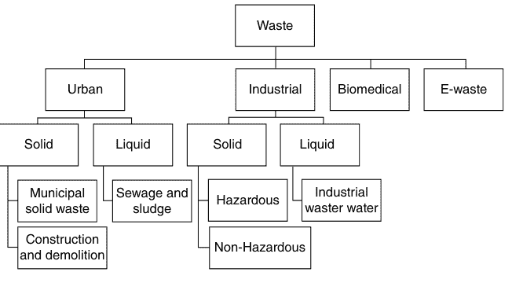

因此，对于固体废物的管理，以下是优先的处理方法层级：

- 源头减量：指在消费的每个阶段都贯彻废物管理的原则，从材料的设计、制造、购买或使用开始，以减少产生的废物数量或毒性。
- 环境适宜的再利用和回收：通过系统的分类、收集和再加工来节约自然资源和能源。

ISWM 概念必须适应这样一种观点：有效的管理方案需要设计、适应和系统的灵活性，以最好地满足当前的社会、经济和环境条件。这些条件可能随时间变化并因地而异。ISWM 涉及三个方面的生命周期废物产生和废物管理（TERI 2014）。

## 4.24.2 危险废物处理和管理规则

为应对工业废物问题，部于 1989 年发布了《危险废物（管理和处理）规则》（2000 年和 2003 年修订），并于 2008 年发布了《危险废物（管理、处理和越境转移）规则》。1989 年的规则旨在使监管机构能够控制本国产生的危险废物的处理、移动和处置。2000 年和 2003 年的修订主要旨在使危险废物的定义与《巴塞尔公约》的规定保持一致。2008 年的规则将电子废物管理纳入危险废物管理的范围（Gadgil 等 2011；Khwaja 等 2010）。

## 4.24.3 医疗废物规则

《医疗废物（管理和处理）规则》于 1998 年发布（2000 年和 2003 年修订）。该规则基于将一般废物与医疗废物（BMW）分离的原则。它们为容器规定了颜色编码，并为 10 类废物规定了处理和处置选项。各邦政府已采取措施建立共同医疗废物处理设施（CBWTFs）用于废物的处理和处置。用于处理和处置本国产生的 BMW，目前有 177 个共同处理和处置设施正在运行，这些设施由私营企业开发（Gadgil 等 2011；Khwaja 等 2010）。

## 4.24.4 电子废物规则

《电子废物（管理和处理）规则》于 2011 年 5 月发布，自 2012 年 5 月起实施。该规则引入了生产者延伸责任的概念，使生产者对其生命周期结束产品的环境无害管理负责，包括收集并将其送至注册拆解商或回收商。这些规则适用于制造、销售或购买以及处理《附表 I》所列电气和电子设备或部件的每位制造商、消费者或大宗消费者，以及电子废物的收集中心、拆解商和回收商（Gadgil 等 2011）。

## 4.24.5 塑料非危险废物规则

环境与森林部发布了《塑料制造、使用和废物管理规则，2009 年（草案）》，以取代 1999 年《再生塑料制造和使用规则》（2003 年修订），以规范塑料手提袋的制造和使用。草案规则已广泛公布征求公众意见。部成立了一个专家委员会来审查这些意见并提出经济手段。这些规则最终确定为《塑料废物（管理和处理）规则 2011》，并于 2011 年 2 月 4 日发布（Khwaja 等 2010）。

## 问题

**4.1** 水以 47.8 ft³/s 的速率流经帕歇尔量水槽。喉宽为 4.0 ft。计算量水槽上游水头，单位为英尺。

**4.2** 计算喉宽为 1.5 ft 的帕歇尔量水槽在流量为 5.56 ft³/s 时的量水槽上部水头。

**4.3** 皮托管安装在飞机上用于测量空速。在海拔 10 000 ft 处，温度为 23 °F，压力为 10 psia，测得的压差相当于 10 in. 的水柱。空速是多少？23 °F 时水和空气的性质如下：ρ_H₂O = 62.4 lb/ft³；R_air = 1716 J/kg K。

**4.4** 差压计连接在风洞中的皮托管-静压管上。在风洞试验中，压力计指示的 ΔP 为 712 Pa。风洞中的空气速度是多少 m/s？风洞中的压力和温度分别为 98 kPa 绝对压力和 23 °C。20 °C 时空气的性质如下：R_air = 287 J/kg K。

**4.5** 水流经喉宽为 4.0 ft 的帕歇尔量水槽，水深为 7.5 ft。确定流量。

**4.6** 水流经喉宽为 5.0 ft 的帕歇尔量水槽，水深为 3.4 ft。确定流量。

**4.7** 一个矩形、尖刃堰带端部收缩，长 1.6 m。为了在 0.5 m²/s 流量下保持上游水深 2.5 m，它应放置在渠道中的多高？

**4.8** 对于一个尖刃被抑制堰（C_w = 3.33），长度 B = 8.0 ft，P = 2.0 ft，H = 1.0 ft，确定堰上的流量。忽略进流速度水头。

**4.9** 90° V 型堰上的水头为 1.5 ft。确定流量。

**4.10** 确定 90° V 型堰在水头为 18 cm、流量为 20 l/s 时的堰系数。

**4.11** 判断一座装机容量为 60 MW 的燃用烟煤的粉煤、干底、墙式燃烧锅炉的火力发电厂是否符合 SO₂、PM 和 NOₓ 的 NSPS。该电厂燃用含硫 1.8% 和灰分 6.2% 的烟煤。煤的热值为 14 000 Btu/lb。锅炉效率为 35%。使用 EPA 排放因子估算排放量。假设 SO₂ 控制效率为 85%，PM 控制设备效率为 99%。

**4.12** 缩写 NPDES 指什么？列出该许可计划背后的几个理念。美国如何监测 NPDES 计划？

**4.13** 如果一条季节性低流量为 200 cfs 的河流对总磷的水质标准为 0.02 mg/l，计算 P 的 TMDL。分散的农业径流贡献约 10 lbs P/天。如果 MOS 设定为 4 lbs P/天，则排入该河流的造纸厂 WWTP 的 P 的最大 WLA 为多少？忽略所有其他点源和非点源。

**4.14** 列出在制定 TMDL 时可能使用的负荷应用和废物负荷应用类型。还需要哪些其他信息？

**4.15** 定义 RACT、BACT、MACT 和 LAER。CAA 中这些监管术语之间有什么区别？

**4.16** 什么是 SIP？SIP 在不符合空气质量标准地区如何运作。

**4.17** 根据连续排放监测系统提供的以下信息，计算火力发电厂的 SO₂ 排放率，单位为磅/小时：
A. 排气烟囱流量为 1 300 000 干立方英尺/分钟，按 EPA 标准条件（68 °F，1 atm）计算。
B. SO₂ 浓度为 25 ppm，按干体积计。

**4.18** 由三种主要有机危险成分（POHCs）（氯苯、甲苯和二甲苯）组成的试验焚烧废物混合物在 1000 °C 下焚烧。废物进料速率和烟囱排放量如表所示。烟囱气体流量为 375.24 dscm/min。该装置是否符合要求？（注：HCl 排放限值为 1.8 kg/h）。

| 化合物 | 入口（kg/h） | 出口（kg/h） | 化合物 | 入口（kg/h） | 出口（kg/h） |
|---|---|---|---|---|---|
| 氯苯（C6H5Cl） | 153 | 0.010 | HCl | n/a | 1.2 |
| 甲苯（C7H8） | 432 | 0.037 | 颗粒物 | n/a | 3.615 |
| 二甲苯（C8H10） | 435 | 0.070 |  |  |  |

注：出口浓度在空气污染控制（APC）设备后在烟囱中测量。

**4.19**

试验焚烧的 POHCs 如表所示。焚烧炉在 1100°C 的温度下运行。烟囱气体流量为 5.90 dscm/s。假设进料中的所有氯都转化为 HCl。允许的颗粒物排放为 180 mg/m³。

如果在 APC 设备下游测量排放，该装置是否符合要求？

| 化合物 | 入口（kg/h） | 出口（kg/h） |
|---|---|---|
| 苯 | 913.98 | 0.2436 |
| 氯苯 | 521.63 | 0.0494 |
| 二甲苯 | 1378.91 | 0.5670 |
| HCl | n/a | 4.85 |
| 颗粒物 | n/a | 10.61 |

**4.20**

一种由甲苯和环苯组成的废物混合物正在 2050°F、停留时间 2.2 秒的条件下焚烧。废物入口进料速率和烟囱排放速率（包括颗粒物捕集）如下所示。烟囱气体流量已确定为 13 250 dscfm（60°F，1 atm），O₂ 浓度为 4% 干 O₂ 体积。该装置是否符合现行法规？成分（1）和（2）为指定的 POHCs。

| 化合物 | 入口（lb/h） | 出口（lb/h） |
|---|---|---|
| 1) C7H8（甲苯） | 953 | 0.082 |
| 2) C6H5Cl（氯苯） | 337.5 | 0.022 |
| 3) HCl | — | — |
| 4) 颗粒物 | — | — |

**4.21**

一家化工厂的危险废物焚烧炉用于处理液体浆料生产废物流。你的经理要求你在进行试验焚烧前，遵循获得排放法规合规性的程序。废物流进料速率 800 lb/h，烟囱气体流量为 22 760 scfm（60°F，1 atm）。焚烧炉需对六氯苯的 DRE 运行。

分析实验室告知你六氯苯的检出限为 10 µg/l。如果样品浓缩在 25 ml 的溶剂中，为检测 99.995% 的 DRE，需要收集的烟道气最小体积是多少以及收集烟道气所需的时间？

**4.22**

描述 RCRA 许可程序。

**4.23**

提供危险废物焚烧炉、水泥窑和轻质骨料窑的 MACT 标准细节。

**4.24**

定义少量产生者。

**4.25**

以下数据来自纸浆和造纸厂废水样品的总固体和总挥发性固体测试。计算总固体、挥发性固体、SS 和溶解固体。

总固体数据
空盘重量 = 68.942 g
盘加干固体重量 = 69.049 g
盘加挥发性（灼烧）固体重量 = 69.003 g
废水样品体积 = 100 ml

**4.26**

下面列出了工业废水样品的总固体和 SS 数据。计算总固体、挥发性固体、SS 和溶解固体。

总固体数据
空盘重量 = 85.337 g
盘加干固体重量 = 69.049 g
盘加挥发性（灼烧）固体重量 = 85.375 g
废水样品体积 = 85 ml

SS 数据
玻璃纤维滤盘重量 = 0.1400 g
盘加干固体重量 = 0.1530 g
盘加（挥发性）灼烧固体重量 = 0.1426 g
废水样品体积 = 200 ml

**4.27**

在未接种的 BOD 试验中，将 100 ml 受污染的地表水样品加入 300 ml BOD 瓶中并用稀释水填满。初始 DO 测得 8.2 mg/l，最终


环境、交通和地区部（DETR）（1999）。《与废物共处：英格兰和威尔士废物战略草案》，第一部分，24–25。DETR。
联邦公报（1994）。《59 联邦公报》，第 59 卷，第 65 期。
Fensterstock, J.C., Kurtzweg, J.A., 和 Ozolins, G.（1971）。通过环境规划减少空气污染潜力。《空气污染控制协会期刊》21（7）：395–399。
Frisch, K.C., Klempner, D., 和 Prentice, G.（1999）。《聚氨酯的回收：塑料回收进展》，第 1 卷。兰开斯特，宾夕法尼亚州：Technomic Publishing Company Inc。
Gadgil, M., Pisupati, B., Sankar, U. 等（2011）。《致人民的环境与森林报告》，印度政府环境与森林部。
Gandy, M.（1994）。《回收与城市废物的政治》，38–76。伦敦：Earthscan。
Hammer, M.J. 和 Hammer, M.J.（2012）。《水和废水技术》，第 7 版。上鞍河，NJ：Prentice Hall。
Haque, A.（1998）。发达经济体和发展中经济体塑料回收的局限性。伦敦大学博士论文。
ISCO（2001）。《明渠流量测量手册》。林肯，内布拉斯加州：ISCO。
Jolánkai, G.（1997）。《基本河流水质模型》，水质建模计算机辅助学习（CAL）项目（WQMCAL 版本 1.1），国际水文计划，技术文件，水文卷，第 13 卷。巴黎：联合国教科文组织。
Karell, M.（2017）。估算空气排放速率。《化学工程进展》113（7）：59–65。
Keith, L.H.（1991）。《环境采样与分析：实用指南》。切尔西，密歇根州：CRC Press，Lewis。
Khwaja, R.H., Ghosh, N., Biswas, M. 等（2010）。《致人民的环境与森林报告》，印度政府环境与森林部。
Konisky, D.M.（2015）。《失败的承诺：评估联邦政府对环境正义的回应》。MIT Press。
Kumar, A.（1998）。估算事故释放的危险距离。《化学工程》：121–128。1998 年 8 月。
Kumar, A.（1999）。估算农村地区事故释放的扩散。《化学工程》：91–94。1999 年 7 月。
LIDAR（1980）。使用激光雷达（LIDAR）也提供了一种替代方法 9。
Mader, F.（1997）。欧洲塑料废物管理：综合方法的需求。在：《塑料回收的化学方面》（eds. W. Hoyle 和 D.R. Karsa），13–27。剑桥：英国皇家化学学会。
Muellenhoff, W.P., Soldate, A.M., Baumgartner, D.J. 等（1985）。市政海洋排放的初始混合特性，报告 EPA/600/3-85/073。华盛顿特区：USEPA。

Nahar, N.（1990）。达卡市的固体废物管理。达卡大学硕士论文，达卡，第 35–38 页。
国家公园管理局（2010）。《联邦土地管理者空气质量价值工作组（FLAG）第一阶段报告 – 修订版》。NPS/NRPC/NRR – 2010/232。
Nova Gas（2018）。烟气和排放分析仪。https://www.nova-gas.com/analyzers/flue-emissions（访问日期 2018 年 2 月 19 日）。
O’Neil, S.G.（2007）。《超级基金：评估行政命令 12898 的影响》。《环境健康展望》115（7）：1087–1093。
PNM（2018）。第 2 层发电资本项目。www.pnm.com（访问日期 2018 年 2 月 18 日）。
Prater, E.T. 和 Midgley, C.（2008）。一种新的空气扩散建模系统正在帮助创建更准确的工业源模型。《环境保护》17（3），Stevens Publishing。
Ratra, O.P.（1994）。塑料废物与环境。印度工商联合会和印度塑料协会关于塑料与环境的会议论文集，新德里（1994 年 9 月 7–8 日），第 18–28 页。
《资源保护与回收法》（RCRA）（1976）。P.L. 94-580，90 Stat. 2795，42 U.S.C. § 6901。
Ryan, H.（2004）。美国环境保护署的新自由主义与环境正义：将政策转化为危险废物修复的管理实践。《Geoforum》35（3）：285–297。
Saba, R.G. 和 Pearson, W.E.（1995）。路边回收基础设施：一种务实的方法。在：《塑料、橡胶和纸张回收：一种务实的方法》（eds. C.P. Rader, S.D. Baldwin, D.D. Cornell, 等），2–10。华盛顿特区：美国化学学会。
Scire, J.S., Strimatis, D, 和 Yamartino, R.J.（1990）。《CALPUFF 扩散模型模型公式和用户指南》。报告号 A025-2，加州空气资源委员会，萨克拉门托，加州。
Shah, K.L.（2000）。《固体和危险废物管理技术基础》。上鞍河，NJ：Prentice Hall。
南加州空气质量管理区（SCAQMD）（1995）。《最佳可行控制技术方法学报告》草案。
Stephan, C.E.（1977）。计算 LC50 的方法。在：《水生毒理学和危害评价》，ASTM STP，第 634 卷（eds. F.L. Mayer 和 J.L. Hamelink），65–84。费城：美国试验与材料学会。
Streeter, H.W. 和 Phelps, E.B.（1925）。《俄亥俄河污染与自然净化研究》。III. 氧化和再曝气现象中涉及的因素，《公共卫生公报》，第 146 卷。华盛顿特区：美国公共卫生局。
Stultz, S.C. 和 Kitto, J.B.（2005）。《蒸汽：其产生与使用》，第 41 版。巴布科克·威尔科克斯公司。

能源与资源研究所（TERI）（2014）。《废物到资源：废物管理手册》。新德里，印度：TERI。
Turner, D.B.（1994）。《大气扩散估算工作手册：扩散建模导论》，第 2 版。博卡拉顿，佛罗里达州：CRC Press。
美国政府问责办公室（2015）。《超级基金：联邦资金和 EPA 非联邦国家优先清单场地清理趋势》。GAO 报告编号 GAO-15-812。
USEPA（1972）。法律和法规。《清洁水法历史》。https://www.epa.gov/laws-regulations/history-clean-water-act（访问日期 2018 年）。
USEPA（1973）。《工业废水监测手册》，EPA/625/6-73/002。华盛顿特区：USEPA，技术转让。
USEPA（1980）。《综合环境响应、补偿和责任法》（超级基金）摘要，42 U.S.C. §9601。
USEPA（1983）。《水和废水化学分析方法》，EPA600/4-79-020，辛辛那提，俄亥俄州：环境监测与支持实验室，研究与开发办公室，USEPA。https://www.epa.gov/cwa-methods（访问日期 2018 年 8 月 28 日）。
USEPA（1985a）。《生产基础预处理标准和联合废物流公式使用指南手册》。华盛顿特区：工业技术司，水法规和标准办公室和水执法与许可办公室。
USEPA（1985b）。《测量 4 种淡水和海洋生物急性毒性的<|message|> 方法》，LEFIA-600/4-85/013。辛辛那提，俄亥俄州：EPA 环境监测与支持。
USEPA（1985c）。《估算淡水生物慢性排放和受纳水体短期方法》，EPA-660/4-85-014。辛辛那提，俄亥俄州：环境监测与支持实验室，研究与开发办公室，USEPA。
USEPA（1985d）。《地表水质量建模中的速率、常数和动力学公式》，第 2 版。雅典，佐治亚州：环境研究实验室文件编号 EPA/600/3-85/040。
USEPA（1986）。《RCRA 定位手册》，固体废物计划，EPA/530-SW-86-001。华盛顿特区：USEPA。
USEPA（1988）。《估算海洋和河口生物慢性排放和受纳水体的短期方法》，EPA-600/4-88/028。辛辛那提，俄亥俄州：USEPA，研究与开发办公室。
USEPA（1989）。《估算淡水生物慢性排放和受纳水体的短期方法》，EPA-660/2nd。华盛顿特区：USEPA，水办公室。

USEPA（1990）。《新源审查研讨会手册：重大恶化预防和非达标许可》。空气、噪声和辐射办公室。研究三角公园，北卡罗来纳州：空气质量规划与标准办公室。
USEPA（1991a）。《水质为基础决策指南：TMDL 流程》，EPA 440/4-91-001。华盛顿特区：USEPA。
USEPA（1991b）。方法 5：确定固定源颗粒物排放。（40 CFR 60，第 60 部分附录 A）。美国政府出版办公室。
USEPA（1992）。《逸散性粉尘背景文件和最佳可行控制措施技术信息文件》，EPA-450/2-92-004。研究三角公园，北卡罗来纳州：空气质量规划与标准办公室。
USEPA（1993）。《气体校准标准测定和认证的可追溯性协议》，EPA-600/R93/224。研究三角公园，北卡罗来纳州：USEPA，研究与开发办公室，1993 年 9 月修订。
USEPA（1995a）。方法 1669：EPA 水质标准水平下痕量金属的环境水采样，EPA 821-R-95-034。华盛顿特区：USEPA，水办公室。
USEPA（1995b）。《国家污染物排放消除系统许可申请要求——面向公共所有污水处理厂和其他处理生活污水设施》，拟议规则。《联邦公报》60（234），USEPA，水办公室。华盛顿特区。
USEPA（1995c）。BACT/RACT/LAER 清除屋信息系统（BLIS），EPA 空气质量规划与标准办公室（OAQPS）技术转让网络（TTN），研究三角公园，北卡罗来纳州。
USEPA（1997）。《1997 年汞研究报告致国会》。USEPA www.ep.gov。
USEPA（1998）。《电公用事业蒸汽发电装置有害空气污染物排放研究：致国会的最终报告》，EPA-453/R-98-004a，第 1 卷。研究三角公园，北卡罗来纳州：USEPA。
USEPA（1999）。“第 264 部分 – 危险废物处理、贮存和处置设施所有者和运营商标准。” 40 C.F.R. 264。“第 270 部分 – EPA 管理的许可计划：危险废物许可计划。” 40 C.F.R. 270。
USEPA（2002a）。《美国市政固体废物：事实与数据》，EPA/530/R-002/001。华盛顿特区：固体废物和应急响应办公室。
USEPA（2002b）。固体废物办公室，石油和天然气勘探和生产废物免于联邦危险废物法规。华盛顿特区：USEPA，固体废物和应急响应。
USEPA（2004a）。EPA 事实表。USEPA。www.epa.gov（访问日期 2018 年 9 月 1 日）。
USEPA（2004b）。模型公式描述，EPA-454/R-03-004。研究三角公园，北卡罗来纳州：空气


表 5.1 暗示风险评估的美国安全、健康和环境法规。

环境保护署

原子能法（另见 NRC）	42.U.S.C.2011
综合环境响应、赔偿和责任法（CERCLA，或超级基金）	42.U.S.C.9601
清洁空气法	42.U.S.C.7401
清洁水法	33.U.S.C.1251
应急规划和社区知情权法	42.U.S.C.11001
联邦食品、药品和化妆品法（另见 HHS）	21.U.S.C.301
联邦杀虫剂、杀菌剂和灭鼠剂法	7.U.S.C.136
1988 年铅污染控制法	42.U.S.C.300j-21
海洋保护、研究和保护区法（另见 DA）	16.U.S.C.1431
核废物政策法	42.U.S.C.10101
资源保护和回收法	42.U.S.C.6901
安全饮用水法	42.U.S.C.300f
有毒物质控制法	15.U.S.C. 136
1996 年食品质量保护法	7.U.S.C.6

消费品安全委员会

消费品安全法	15.U.S.C.2051
联邦危险物质法	15.U.S.C.1261
含铅油漆中毒法（另见 HHS 和 HUD）	42.U.S.C.4801
1988 年铅污染控制法	42.U.S.C.300j-21
防止中毒包装法	15.U.S.C.1471

农业部

鸡蛋产品检验法	21.U.S.C.1031
联邦肉类检验法	21.U.S.C.601
家禽产品检验法	21.U.S.C.451

劳工部

联邦矿山安全与健康法	30.U.S.C.801
职业安全与健康法	29.U.S.C.651

交通部

危险液体管道安全法	49.U.S.C.1671
危险材料运输法	49.U.S.C.1801
机动车运输安全法	49.U.S.C.2501
国家交通和机动车安全法	15.U.S.C.1381
国家天然气管道安全法	49.U.S.C.2001

来源：摘自 National Academy of Sciences (2006), Hoppin et al. (2006), Asante-Duah (2002), Kammen and Hassenzahl (1999), Roberts and Abernathy (1997) 和 Federal Focus (1991)。

## 5.1.2 问题制定

问题制定包括生态风险评估（ERA）的目标、空间和时间尺度的定义、场地概念模型（SCM）的开发，以及终点和非人类受体物种的选择。最后一步是识别潜在关注污染物，并确定例如是否已超过阈值限值（TLVs）。示例 5.1 和 5.2 说明了如何将三种常见工业污染物的环境监测结果用于计算其存在量。

### 示例 5.1 监测

空气采样器在 6 小时工作班次中收集了 16 mg 的甲基氯。采样器具有以下特性：

平均流量 = 1.2 l/min

收集效率 = 0.9

甲基氯的八小时加权平均值（TWA）是多少？

### 解答

收集的空气总量为

```
1.2 l/min • 60 min/h = 4320 l
4320 / 1000 l/m³ = 0.432 m³
```

采样器内容为 16 mg 或 16/0.9 = 17.8 mg 在采样空气中

空气中二氯甲烷浓度 = 17.8 mg / 0.432 m³ = 41.2 mg/m³

六小时收集时间内的平均空气浓度

```
= 41.2 mg/m³ • 6 hours / 8 hours = 31 mg/m³
```

是否超过了 TLV？

甲基氯的 TWA 为 50 ppm（mg/m³）且未被超过。

### 示例 5.2 连续监测

在铅燃烧作业中产生铅烟。工作室内连续监测器连续运行五天。已知如下：

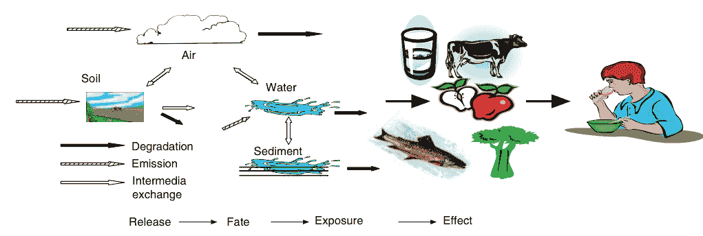

初始采样率 | 1 cfm（立方英尺/分钟）  
最终采样率 | 0.7 cfm  
过滤效率 | ≥20µm 平均平均直径（AMD）颗粒物的 0.999  
 | <20µm AMD 颗粒物的 0.83  
收集的粉尘质量 | 1.7 g  
粉尘中铅的 % | 23

假设铅的产生仅在八小时工作日内发生，则 TWA 为

```
TWA = 0.0022 mg/m³ • 24/8 = 0.007 mg/m³
```

### 解答

粉尘在确定可接受的空气浓度方面存在特定问题。需要考虑颗粒尺寸分布，并必须使用文献中公布的特定可呼吸分数来确定暴露。粉尘颗粒尺寸可以通过尺寸选择性采样器，通常是多级冲击器来完成。

确定工作空气中的 TWA 铅浓度。

这些采样示例仅触及问题制定中使用的技术的表面。它们是说明性的。有时，如示例 5.1 中，监测显示现有的污染预防措施运行正常且不存在问题。示例 5.2 显示，确定污染物的 TWA 并不足以制定问题。

采样空气质量 = 平均采样率 × 采样时间

## 5.1.3 暴露评估

假设随着过滤器负载，采样率呈近似线性降低。因此，平均采样率为

衡量持续的健康风险暴露需要确定浓度。在第 5.1.3.1 节中，示例 5.3 显示如何确定生物浓缩，示例 5.4 解释了斜率因子的使用，斜率因子常用于量化癌症风险。

```
(1 + 0.7)/2 = 0.85 cfm
```

### 5.1.3.1 分配系数和生物浓缩因子

和总采样空气为

虽然广泛的研究仍在继续完善现有方法并开发新的暴露和效应标志物，但经验已确定了几种对

```
0.85 cfm × 5 days × 1440 min/day = 6120 ft³
```

总收集粉尘 = 1.7 g 或 1.7 • 0.23 = 0.39 g 铅，因为粉尘中 23% 为铅。由于铅以烟雾形式存在，AMD <20 µm 且收集的总铅为

```
0.39 g / 0.83 = 0.47 g
```

平均铅浓度为总量除以样品体积或

```
0.47 g / 6120 ft³ = 470 mg / 6120 ft³ • 1 / 35.31 m³/ft³
= 0.0022 mg/m³
```

## 5.1.3.4 受体剂量

暴露评估阶段的最后一步是估计受体在暴露点可能暴露于不同类别化学物质的剂量。有三种剂量类型：给药剂量（摄入、吸入或与皮肤接触的量）、摄入剂量（被身体吸收的量）和靶剂量（到达靶器官的量）。

为了计算风险的目的，剂量应与针对特定化学物质和研究中的暴露途径报告的剂量-反应关系的形式相同。这几乎总是给药剂量或吸收剂量。给定暴露点处的污染物浓度，计算给药剂量是直接的。相比之下，基于给药剂量计算吸收剂量需要考虑一些复杂因素。影响身体摄取污染物的关键因素简化如下：

| 摄入 | 摄入介质中的污染物浓度 |
| | 摄入材料的量 |
| | 对胃肠系统的生物可利用性 |
| 吸入 | 空气和粉尘中的浓度 |
| | 颗粒尺寸分布 |
| | 对肺系统的生物可利用性 |
| | 呼吸速率 |
| 皮肤接触 | 土壤和粉尘中的浓度 |
| | 粉尘从空气中沉积的速率 |
| | 与土壤的直接接触 |
| | 生物可利用性 |
| | 暴露的皮肤面积 |

确定污染物摄入时需要考虑的其他因素包括生活方式、暴露频率和持续时间（例如慢性、亚慢性或急性）以及受体的体重考虑。在大多数危险废物场址，长期（即慢性）暴露通常是最令人担忧的。

给药剂量的计算总结在以下通用方程中：

```
I = (C × CR × EF × ED) / (BW × AT)   (5.2)
```

其中

+ I = 摄入量（mg/kg 体重-日）
+ C = 暴露点处的浓度（例如水中 mg/l 或空气中 mg/m³）
+ CR = 接触率（例如 l/天或 mg/m³/天）

EF = 频率（天/年）
ED = 暴露持续时间（年）
BW = 体重（kg）
AT = 平均时间（天）

方程（5.2）通常针对特定暴露途径进行修改。例如，逸散粉尘吸入的摄入剂量可计算为

```
I = (C × CR × EF × ED × RR × ABS) / (BW × AT)   (5.3)
```

其中

+ RR = 保留率（小数分数）
+ ABS = 进入血液的吸收（小数分数）

对于逸散粉尘，空气中的浓度由下式确定

```
C = Cs × Pc
```

其中

+ Cs = 逸散粉尘中化学物质的浓度（mg/mg）
+ Pc = 空气中逸散粉尘的浓度（mg/m³）

通常，适当的参数可以在文献中找到。近年来已进行了大量研究以定义许多基本参数，例如皮肤表面积、土壤摄入率和吸入率。其他参数，例如暴露频率和持续时间，通常基于现场特定信息（如果有）或专业判断。例如，在非法入侵者情景的评估中，现场调查活动期间对非法入侵者的观察可能会决定用于暴露频率（例如每年天数或每年事件数）和暴露持续时间（例如活动发生的年数）的值。常识在选择暴露参数中也发挥着重要作用。例如，如果评估两个场址的住宅使用，一个在北达科他州，一个在佛罗里达州，就不合理地假设在两个风险评估中儿童因在后院玩耍而暴露于地表土壤的暴露频率（例如活动发生的每年天数）相同。

平均时间（AT）是摄入方程中必须定义的另一个重要参数。所选的平均时间将取决于所评估的成分类型。例如，为了评估与非致癌物暴露相关的长期或慢性效应，摄入量在暴露持续时间（以天表示）上平均。然而，致癌物的暴露在寿命（假设为 70 年或 25 550 天）上平均，以与用于开发斜率因子的方法保持一致。

用于此类计算的一些参数如表 5.3 所示。应注意，这些值可以


### 表5.3 为垃圾填埋场确定的剂量和摄入量计算标准参数

| 参数 | 成人（男性） | 儿童（6–12岁） | 儿童（2–6岁） |
|---|---|---|---|
| 平均体重（kg） | 70 | 29 | 16 |
| 皮肤表面积（cm²） | 18150 | 10470 | 6980 |
| 饮水摄入量（L/day） | 2 | 2 | 1 |
| 呼吸空气量（m³/h） | 0.83 | 0.46 | 0.25 |
| 滞留率（吸入空气）（%） | 100 | 100 | 100 |
| 吸收率（吸入空气）（%） | 100 | 100 | 100 |
| 土壤摄入量（mg/day） | 100 | 100 | 200 |
| 沐浴时间（分钟） | 30 | 30 | 30 |
| 暴露频率（天） | 365 | 365 | 365 |
| 暴露持续时间（年） | 30 | 6 | 4 |

这些参数因假定的暴露条件（即所选暴露情景）不同而差异很大。例如，表5.3中成年男性的空气呼吸速率为0.83 m³/h。然而，该速率可相差一个数量级，从静息时的0.6 m³/h到剧烈体育锻炼时的7.1 m³/h。

例5.5和例5.6分别说明了通过吸入途径和皮肤接触途径计算污染物摄入量的方法。

### 例5.5 污染物摄入量计算

确定成年人对一种非致癌性化学物质的慢性每日吸入摄入量，该摄入量为ABC垃圾填埋场逸散性粉尘中该物质浓度的函数（表5.3）。

### 解

对于暴露于非致癌性组分的成人，摄入量I_N可由式（5.2）计算：

```
I_N = (C × CR × EF × ED × RR × ABS) / (BW × AT)
```

由表5.3，取成人的空气呼吸速率为0.83 m³/h，并写出

- CR = 0.83 × 24 = 19.92 m³/day
- EF = 365天
- ED = 30年（慢性暴露于非致癌物）

在没有更充分信息的情况下，保守的做法会假定RR和血液吸收率均等于1.0。

- BW = 70 kg（表5.3）
- AT = 365天 × 30年

```
I_N = (C × 19.92 × (365 × 30) × 1.0 × 1.0) / (70 × (365 × 30))
```

```
I_N = 0.285 m³/kg/day × C
```

C = 暴露点浓度（mg/m³）

### 例5.6 通过皮肤接触土壤的平均每日摄入量

确定现场工人在一年暴露期内通过皮肤接触土壤摄入氯苯的平均每日摄入量：

假设以下附加参数：

- A = 暴露皮肤面积 = 20% × 18150 cm² = 0.2 × 18150 cm² = 3630 cm²
- DA = 土壤黏附量 = 0.51 mg/cm²
- ABS = 皮肤吸收率 = 6%
- SM = 土壤基质效应 = 15%（即由于土壤基质的影响，实际可供接触的污染物仅为15%）
- EF = 每天2次暴露事件；每年156个暴露日
- ED = 1年
- BW = 70 kg
- AT = 365天

### 解

```
I_N = [C (mg/kg) × A (cm²) × DA (mg/cm²) × ABS × SM × 2 exposure events/day × 156 days/year × ED × 10⁻⁶ kg·soil/mg·soil] / (BW × AT)
```

```
I_N = (C × 3630 × 0.51 × 0.06 × 0.15 × 2 × 156 × 10⁻⁶) / (70 × 365)
```

```
I_N = C × 2.03 × 10⁻⁷ /day
```

已知土壤中氯苯的平均浓度为1.39 mg/kg。氯苯的每日摄入量为

1.39 mg/kg × 2.03 × 10⁻⁷ /day

因此，I_N = 2.82 × 10⁻⁷ (mg/kg·day)

同样，上述示例仅代表了暴露评估过程中计算污染物摄入量的两种方法。接下来要分析的因素是毒性。

## 5.1.4 毒性评估

广义上，毒性是物质有毒的程度。大多数化学品，无论有毒与否，都会通过眼睛、呼吸道、消化道和皮肤进入人体。毒性分为两个级别：急性“短期”暴露会引发中毒，慢性“长期”暴露会导致贫血、白血病和死亡。

在风险评估过程第三阶段的语境中，毒性由每种替代化学物质的剂量-反应关系来定义。其输出采取数学常数的形式，用于代入风险计算方程。除了提供一组用于计算风险的数学常数外，毒理学评估还应分析这些数字中固有的不确定性，并描述这种不确定性可能如何影响风险估计。

在审慎保护公众健康的方法中，EPA在其制定参考剂量和致癌斜率因子的方法中纳入了多个安全系数（USEPA 2002a, 2002b, 2005）。几乎所有不确定性误差都朝着公共卫生保护的方向设定，以确保风险被高估而不是被低估。这种保护性方法的四个示例如下：

- 对于非致癌物，将动物参考剂量外推到人类时使用两个10倍安全系数，一个用于动物到人的外推，另一个用于人群中毒性敏感性的差异。
- 对于致癌物，线性化多阶段模型假定外推数据的95%置信水平上限（即20次中有19次可能是保守的）。
- 对于致癌物，线性化多阶段模型将实验动物中观察到的10%–90%致癌范围的数据外推到0.0001%致癌率的监管目标，这一步可能使风险高估几个数量级。
- 尽管有证据表明，非遗传毒性致癌物与非致癌物一样，存在一个阈值，低于该阈值时它们不会影响细胞分化或分裂，但根据线性化多阶段剂量-反应模型，它们在数学上仍被当作遗传毒性致癌物处理。

## 5.1.5 风险表征

四阶段人体健康风险评估的最后阶段是估计风险。癌症并非污染唯一的不良健康后果：例如，暴露于电离辐射和煤尘可导致辐射病、出生缺陷以及癌症。然而，为了说明风险表征，我们将重点放在那些能够对所考虑的所有暴露情景下受体面临的致癌和非致癌风险进行定量估计的计算上。通常需要对所有三种暴露途径、最大暴露个体以及最可能暴露的人群进行计算估计。这类计算很简单，并能得出定量的风险估计。挑战不在于计算本身，而在于解读结果，以便在决策中恰当应用。这一整体工作被称为风险表征。有毒化学品的风险，视具体情境而定，可以通过不同方式定义、描述和计算。

风险通常被定义为个体因某一事件而遭受不良影响的概率。接触花生制品中的黄曲霉毒素或汽油中的苯的人，患上某些类型癌症的概率是多少？接触铅的工人患上神经系统疾病的可能性有多大？在本文的语境中，化学品释放是事件的一个例子。与任何表达或使用概率的关系一样，对于一个本质上是概率性的现象，并没有既定的方法（在数学上或以科学严谨的方式）来表达单一的确定性数值。表达化学风险的一种概念性方法，是将其写成危害和暴露的函数。

危害是物质或情况对人或环境造成伤害或不良影响的可能性。危害的程度反映了潜在的不良后果，包括死亡、寿命缩短、身体功能受损、对环境化学物质的致敏或生殖能力下降。暴露表示生物体与环境污染物（包括化学、辐射或生物污染物）接触的程度和时间长短。

当风险以概率表示时，以没有单位的小数形式表达。其值介于0.0（绝对确定没有风险）和1.0（绝对确定不良后果将发生）之间。

对于化学品而言，危害一词通常与化学品在特定暴露类型下的毒性特性相关。类似的化学品具有相似的固有危害。然而，要确定风险，必须考察对该危害的暴露情况。例如，假设你有三台泵，都在输送同一种化学品（危害相同），但其中一台泵的密封件泄漏。哪台泵对工人造成的风险最大？密封泄漏的泵暴露可能性最大，而危害相同（同一种化学品），因此密封泄漏的泵风险最大。进一步展开，假设我们有三台泵，输送不同的化学品；哪一台对工人造成的风险最大？在这种情况下，工程师需要考察每种化学品的危害或固有毒性，以及泵的运行情况，才能确定哪一台风险最大。


## 5.1.5.1 平均暴露和最大暴露的风险

在 Superfund 场地的风险评估练习中，平均暴露点浓度和最大暴露点浓度均用于估算风险。使用这两个值进行具体的风险计算可以估算潜在风险的范围，这在提供特定暴露条件相关潜在危害的视角时通常很有用。两种测量的意义取决于数据量以及对该数据的置信度。然而，一般而言，使用平均浓度计算潜在风险可以更好地估算慢性暴露相关的风险，因为平均值更有可能代表受体在一段时间内所暴露的暴露点浓度。最大值的用途最适合估算短期、亚慢性风险，尽管其使用可以提供潜在风险的有用上限估计。

需要注意的是，目前的风险评估指南强调在计算潜在风险时使用单一的暴露点浓度上限估计值。该值通常取为 95% CI，即算术平均值的 95% 置信上限。使用该数值通常会提供最坏情况的风险估计，并且在该值与其他最坏情况假设结合以定义合理最大暴露时，可能会显著高估潜在风险。

## 5.1.5.2 致癌风险

致癌风险可定义为慢性日摄入量（在暴露评估中得出）乘以致癌斜率因子（由毒性评估选定）。其乘积是一个实际术语：暴露于该化学物质所致的超额终生癌症概率。计算如下：

Risk = CDI × SF

其中

- CDI = 慢性日摄入量 (mg/kg/day)
- SF = 致癌物斜率因子 (mg/day/mg)$^{-1}$

致癌风险的表征首先涉及确定适用于所研究暴露途径和途径的每种化学物质的摄入量，然后将每一项乘以适当的暴露点浓度和斜率因子。经典的风险评估方法假设来自单个有毒物质的风险具有可加性。对于致癌物，这意味着总致癌风险等于所有单个物质通过各暴露途径的致癌风险之和。这些计算针对每个暴露情景和暴露人群重复进行。必须强调，斜率因子特定于暴露途径（例如经口），并且只有在暴露数据适用于相同途径时才可使用。考虑到这一警告，我们可以继续考虑评估一些常见环境污染物相关风险。

## 5.2 评估一些常见污染物的风险

风险评估建立在这样一个原则之上：微小暴露会带来某种不良健康效应的风险，例如在未来某个时间发展为恶性肿瘤或白血病。此类风险通常被认为具有随机性或概率性，并以风险系数表示，即每单位暴露发生特定健康效应的概率或几率。虽然电离辐射的反应通常被认为与剂量呈线性关系，但化学致癌物的风险可能并非如此；因此，风险评估需要考虑诸如阈值剂量是否存在以及剂量-反应曲线的形状等效应。

此外，还需要考虑潜伏期，即暴露与疾病发作之间的时间。例如，如果潜伏期为 25 年，而暴露发生在 50 岁时，个体可能在该特定健康效应出现之前死于其他原因。即使个体活得足够长以使健康效应显现，由于暴露发生在较早年龄，损失的生命年数和生产性生命年数也会少于暴露发生在较早年龄的情况。健康和安全风险有时以每千工人年的生产性（或健康）生命损失年数表示，如例 5.7 所示。

### Example 5.7 Cancer Risk Assessment

估算 50 年内 100000 人暴露于平均年剂量 500 µGy 的人群中致死性白血病的总数，如果风险系数为 0.03 Gy$^{-1}$。

### Solution

FatalLeukemias = $\frac{0.03}{Gy} \times \frac{500 \mu Gy}{person\ year} \times 50 years \times 100000 persons = 75$

## 5.2.1 NOₓ、烃类和 VOC：地面臭氧

地面臭氧是美国最普遍且最棘手的空气污染问题之一。在 20 多个城市地区，其浓度超过一个或多个环境空气质量标准。用监管者的语言来说，这些地区被称作“未达标”。（我们强调“坏”臭氧——在地面或近地面形成——与保护我们免受紫外线辐射的“好”或平流层臭氧之间的区别。）

地面臭氧是光化学烟雾的组成部分，实际上是一种二次污染物，因为需要某些前体污染物才能形成它。前体污染物是氮氧化物（NOₓ，主要是 NO 和 NO₂）和烃类。氮氧化物与阳光共同导致臭氧形成，但烃类的作用是加速和增强臭氧的积累。

### 5.2.1.1 烟雾形成

大气低层臭氧形成的最重要过程是 NO₂ 的光解离：

```
NO₂ + hν → O(³P) + NO
O(³P) + O₂ + M → O₃ + M
O₃ + NO → NO₂ + O₃
```

其中 M 为分子氧或氮氧化物。该循环导致 O₃ 浓度处于由 NO₂ 光解速率和 [NO₂]/[NO] 比值决定的光稳态。VOC 在烟雾形成中的作用是形成自由基，将 NO 转化为 NO₂ 而不导致 O₃ 破坏，从而增加 [NO₂]/[NO] 比值并增加 O₃。

```
VOC + •OH → •RO₂ + other oxidation products
•RO₂ + NO → NO₂ + radicals
Radicals → •OH + other oxidation products
```

单个 VOC 影响 O₃ 水平的能力取决于其羟基自由基（•OH）速率常数及其反应机理的要素，包括自由基引发、自由基终止和去除 NOₓ 的反应。基于仅 VOC 羟基自由基速率常数的简化烟雾形成潜力指数已被提出。

氮氧化物（NOₓ）是在高温工业和交通燃烧过程中形成的。

2016 年，美国交通来源占 NOₓ 总排放量的 56.6%，非交通燃料燃烧贡献了 34.4%。与短期暴露于 NO₂（<3 小时高浓度）相关的健康影响是儿童呼吸系统疾病增加以及已有呼吸系统问题个体呼吸功能受损。

烃类排放的主要来源是化工和石油炼制工业以及机动车。2016 年，工业过程占人为（非生物源）烃类来源总量的 80.5%，而交通部门贡献了 19.5%；交通来源占总 VOC（人为和生物源）排放量的 18.1%，非交通来源占 81.9%。溶剂占工业排放量的 66% 和总 VOC 排放量的 34%。应注意，存在天然（生物源）HC/VOC 来源，如异戊二烯和单萜烯，可显著贡献于区域烃类排放和低水平臭氧。

此外，某些物理和大气因素会加剧地面臭氧浓度。高强度太阳辐射、低盛行风速（稀释）、大气逆温以及靠近山脉或海岸线（静止气团）均有助于光化学烟雾形成。图 5.2 显示了洛杉矶市中心天空被烟雾覆盖导致能见度变差的照片（《纽约时报》，2018 年 2 月 17 日 b）。

人类暴露于臭氧可能导致急性（短期）和慢性（长期）健康影响。臭氧的高反应性使其即使在低浓度下也是强烈的肺部刺激物。甲醛、过氧乙酰硝酸酯（PAN）和其他烟雾相关含氧有机物是眼部刺激物。地面臭氧进入叶片气孔后还会破坏叶绿素，从而破坏光合作用，对作物和植被产生不利影响。由于臭氧是氧化剂，与其接触的材料，如橡胶和乳胶涂漆表面，会发生劣化。

使我们闻起来好闻的香水、除臭剂、肥皂正以与今日汽车和卡车排放相当的水平污染空气——一种有害类型的污染。研究人员发现，香水、油漆和其他消费品中使用的石油基化学品，综合起来可排放与机动车相当的 VOC 形式的空气污染。VOC 与空气中其他颗粒相互作用，形成烟雾的构建模块，即臭氧，可诱发哮喘并永久性损伤肺部，以及另一种被称为 PM2.5 的污染物，即与心脏病发作、中风和肺癌相关的细颗粒。烟雾通常与汽车相关联，但自 1970 年代以来，监管机构推动汽车制造商投资技术，实质性地减少了 VOC


图 5.2 加利福尼亚州洛杉矶的烟雾。来源：《纽约时报》，2018年2月17日（2018b）。摄影：弗雷德里克·J·布朗/法新社-盖蒂图片社。

来自汽车的排放。加州空气资源委员会关于消费品与空气质量的初步结果也表明，来自这些产品和工艺的排放（包括点源和无组织排放源）均高于此前的估计（《纽约时报》，2018年2月17日2018b）。

消费品中含有数以万计的化学物质，研究人员尚未确定哪些化学物质最有可能形成臭氧或 PM$_{2.5}$ 颗粒。我们需要提醒自己，我们日常使用的能源和消费品正在不断改变大气的组成。

## 5.2.2 一氧化碳

一氧化碳（CO）是一种无色、无味的气体，主要是不完全燃烧的副产物。CO 的主要健康危害在于它能与血液中的血红蛋白结合，从而降低血液的携氧能力。交通源占全国 CO 排放总量的大部分（76.6%）。过去二十年间，由于车辆控制技术的改进，环境空气中的 CO 浓度已显著下降。交通拥堵严重的地区通常环境 CO 浓度较高：美国有 80 个城市地区 CO 未达标。高浓度的局部和室内 CO 可来自香烟（二手烟）、燃木壁炉和煤油取暖器。示例 5.8 讨论了工作场所中的 CO 暴露。

## 示例 5.8 总加权平均浓度

- a) 在某工厂，员工全天暴露于不同浓度的环境 CO，具体如下：

| 时间 | 浓度（ppm） |
| :--- | :--- |
| 上午8-9点 | 0 |
| 上午9-11:30 | 225 |
| 上午11:30-下午12:30 | 100 |
| 下午12:30-2:00 | 165 |
| 下午2:00-4:00 | 45 |

TWA 以 ppm 计是多少？如果国家环境空气质量 8 小时标准为 50 ppm，员工的暴露水平是否超标？

- b) 工作环境中的 CO 浓度为 150 ppm。工作面积为 1 150 000 ft$^{3}$。需要向室内通入多少空气才能使 CO 浓度降低至 50 ppm？

- c) 出于安全原因，不建议采用通风稀释。为什么？（注意 CO 的分子量与空气相近。）

## 解答

- a) 八小时加权平均

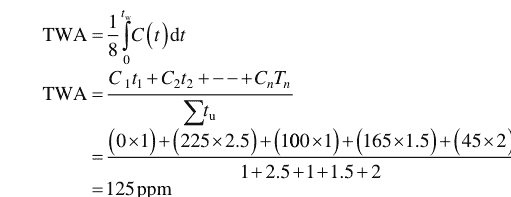

因此，125 ppm 的 8 小时 TWA 浓度超过了国家环境空气质量标准 50 ppm。

b) 假设稳态、完全混合和指数衰减。
$$C = C_0 \times \exp\left(\frac{-t}{L_d}\right)$$
$$50 = 150 \exp\left(\frac{-t}{1.6}\right)$$
$\therefore t_d = 0.91 \text{ hour} = 54.6 \text{ minutes}$
$\therefore \text{volume of air need to ventilate} = \frac{\text{area}}{\text{time}} = \frac{1\,500\,000}{54.6} = 27\,472 \text{ cfm}$

c) 加热装置中的不完全燃烧可能会增加 CO 浓度，并向仓库空气中添加其他有害污染物。同样，在 CO 产生高峰期，固定的稀释通风速率可能不足以去除 CO。此外，在封闭的仓库环境中，稀释通风可能无法充分去除 CO 浓度较高的气穴。无论如何，CO 具有急性毒性，不建议对急性有毒气体采用稀释通风。

## 5.2.3 铅与汞

大气中的铅主要存在于细颗粒物中，直径可达 10 微米，可在空气中悬浮相当长的时间。四乙基铅曾作为辛烷值提升剂和抗爆剂使用多年，此后人们才完全了解其毒理学效应。1970 年的《清洁空气法》禁止了所有含铅添加剂，铅浓度和排放量的大幅下降是过去 25 年中最重要但未获充分宣传的环境改善之一。1997 年，工业过程占剩余铅排放量的 74.2%，其中交通源占 13.3%，非交通燃料燃烧占 12.6%（USEPA 1997）。

铅还通过城市径流和工业废水进入水体，并附着在受纳水体中的沉积物颗粒上。水生生物吸收后可导致畸形、死亡和水生生态系统不稳定。另一个值得关注的问题是，酸沉降会增加铅在水中的溶解度从而提高其生物可利用性，可能导致局部铅水平升高。铅在环境中持久存在，并被水生生物富集。

铅通过吸入和摄入食物（受污染的鱼）、饮用水、土壤、涂料和空气粉尘进入人体。它也是铜管中高铅焊点、连接水主管服务管线的旧铅管鹅颈管和旧黄铜配件的腐蚀副产物。环境铅对人类健康的主要影响是对器官、组织和大脑发育的影响，尤其是对儿童。血液中铅水平升高与智商下降有直接相关性，尤其是在尚未禁止铅作为汽油添加剂的发展中国家城市地区。

据美国环保署称，目前美国燃煤发电企业每年排放超过 50 吨汞。毫无疑问，这些浓度很高，对人类和野生动植物构成潜在健康威胁。食用受汞污染的鱼类可引发多种问题，从成人的脱发和慢性疲劳，到胎儿和儿童的神经系统损伤。

汞污染全球大气，但不同地点降落到陆地或水中的汞量差异很大。最近的实验开始识别氧化性气体，如臭氧和含有卤素溴和氯的分子，作为汞沉降的诱因。哪种氧化剂在该过程中占主导地位，似乎取决于环境、季节、空中汞的高度，甚至日照量。

汞很容易进入空气。当煤炭燃烧、金矿开采、某些氯气制造，甚至荧光灯泡破碎时，汞都会释放。空气中约 99% 的汞以元素态存在。该形态的汞相当不溶且不活泼，可在全球循环长达两年。因此，污染大沼泽地的汞可能来源于迈阿密、印度或西伯利亚。

然而，大气化学家发现，当元素态汞遇到某些氧化剂时，会转化为所谓的活性气态汞。与该元素不同，这种形态既高度活泼又可溶于水，但只能在大气中停留数小时至数天，并会以雨雪形式或附着在尘埃上，在形成地附近沉降。在湖泊或海洋中，细菌将其转化为甲基汞，这是汞的有害形态，鱼类以及食鱼的人类和其他捕食者会将其蓄积在组织中。甲基汞中毒的症状包括精神障碍以及言语、听力、视力和运动功能损害。

## 示例 5.9 汞的去除

含汞的医疗污泥在焚烧炉中燃烧。汞的进料速率为 0.92 lb/h。产生的 500°F 产物（气体 40000 lb/h，分子量 MW = 32）用水急冷至 150°F。将所得气流过滤以去除所有颗粒物。汞会怎样？假设过程压力为 14.7 psi，且 Hg 在 150°F 下的蒸气压为 0.005 psi。

### 解

若要让汞被过滤器去除，它必须冷凝并形成颗粒物。因此，需要回答的问题是去除过程中汞的分压与其在 150°F 时蒸气压的比较。

汞的摩尔流量 = $(9.3 lb/h)/(200.6 lb Hg/lbmol)$
$= 0.046 lbmol/h$

气体的摩尔流量 = $(40\ 000 lb gas)/(32 lb gas/lbmol)$
$= 1250 lbmol/h$

$y_{i} = \frac{lbmol Hg}{lbmol Hg + lbmol gas} = \frac{\frac{0.046 lbmol}{h}}{\frac{0.046 lbmol}{h} + \frac{1250 lbmol}{h}}$

$= 3.68 \times 10^{-5}$

分压 $= y_{i}P = 3.68 \times 10^{-5}(14.7 psi) = 5.41 \times 10^{-4} psi$。

由于分压远小于 $5 \times 10^{-3}$ psi 的蒸气压，汞不会冷凝，因此不会被过滤器去除。

## **示例 5.10 可吸入的多氯联苯（PCBs）和多环芳烃（PAHs）**

一些工业设施排放可吸入污染物，包括环氧乙烷（EO）、多氯联苯（PCBs）和多环芳烃（PAHs）。工人对 EO、PCBs 和 PAHs 的年均暴露浓度分别为 10、2 和 $5\mu g/m^3$。

计算每种污染物引起的致癌风险及总致癌风险。结果以每百万人中额外癌症病例数表示。使用下面表格中给出的数据以及公式（5.5）来求解本题。

污染物的致癌风险 $= \frac{(\text{年平均浓度})}{(\text{单位风险})}$
(5.5)

| 单位风险数据 |
|---|
| **污染物** | **单位风险（$m^3/\mu g$）** |
| EO | $8.8 \times 10^{-5}$ |
| PCBs | $1.4 \times 10^{-3}$ |
| PAHs | $1.7 \times 10^{-3}$ |

### 解

利用公式（5.5）和问题陈述中给出的数据，可确定环氧乙烷引起的致癌风险：

EO 的致癌风险 $= \frac{10 \mu g/m^3}{(8.8 \times 10^{-5} m^3/\mu g)}$
$= \frac{88 \times 10^{-5}}{880 \times 10^{-6}}$

$= 880$ 例每百万人额外癌症病例。

PCBs 的致癌风险估计为

PCBs 的致癌风险 $= \frac{2 \mu g/m^3}{(1.4 \times 10^{-3} m^3/\mu g)}$
$= \frac{2.8 \times 10^{-3}}{2800 \times 10^{-6}}$

$= 2800$ 例每百万人额外癌症病例。

PAHs 的致癌风险估计为

PAHs 的致癌风险 $= \frac{5 \mu g/m^3}{(1.7 \times 10^{-3} m^3/\mu g)}$
$= \frac{8.5 \times 10^{-3}}{8500 \times 10^{-6}}$

$= 8500$ 例每百万人额外癌症病例。

吸入致癌总风险由上述个体致癌风险的算术和计算，并假定各污染物在致癌效应方面不存在相互作用。

总致癌风险 $= 880 + 2800 + 8500 = 12 180$ 例每百万人额外癌症病例。

这一比率极高，是通常用作空气毒物管理基准的百万分之一致癌风险的 12180 倍。应尽快通过大幅减少空气毒物排放来纠正这种情况。还要注意，PAHs 对该设施工人的风险贡献最大。

### 5.2.4 颗粒物

颗粒物（PM）是悬浮在空气中微观固态或液态（气溶胶）颗粒的总称。PM 有各种尺寸，直径范围从几埃到几百微米。颗粒要么直接由一次源排放，要么通过气相反应在大气中形成（二次气溶胶）。

由于颗粒大小决定了颗粒被吸入肺部的深度，PM 有两项国家环境空气质量标准（NAAQS），即 $PM_{2.5}$ 和 $PM_{10}$，其下标表示以微米为单位的颗粒直径。小于 2.5 $\mu m$ 的颗粒称为“细颗粒”，主要由无机盐（主要是硫酸铵和硝酸铵）、有机物和痕量金属组成。细 PM 可沉积在肺部深处，难以清除。大于 2.5 $\mu m$ 的颗粒称为“粗颗粒”，主要由悬浮粉尘组成。粗 PM 往往沉积在上呼吸道，更容易被清除。1997 年，工业过程占传统清单所列 $PM_{10}$ 排放率的 42.0%。非交通燃料燃烧和交通源占……


分别为34.9%和23.0%。与其他标准污染物一样，由于污染控制措施，PM10浓度和排放率已适度下降。

吸入粗颗粒物常常引发或加重上呼吸道疾病，包括哮喘。吸入细颗粒物会降低肺功能并导致慢性支气管炎。现已证实，吸入石棉、煤矿粉尘或纺织纤维等特定有毒物质会分别引发相关的特定癌症（石棉肺、黑肺病和褐肺病）。

PM的环境影响之一是美国许多地区（包括一些国家公园）的能见度受限。此外，沉降在陆地上的含氮和含硫颗粒会增加土壤酸度并改变养分平衡。当沉降到水体中时，酸性颗粒会改变水的pH值，导致水生生物死亡。PM沉降还会弄脏和腐蚀文化古迹和建筑物，尤其是那些由石灰石建造的。美国有100多个地区PM10未达标。

### 5.2.4.1 能见度损害

《清洁空气法》确立了一项国家能见度保护目标，即防止一类联邦地区因人为污染造成的能见度损害进一步恶化，并补救任何现有的此类损害。NOx和SOx都会导致区域雾霾，并扰乱生态系统中其他养分和金属的生物地球化学循环（*《纽约时报》*，2018年2月17日）。沉降到陆地上的氮会导致土地氮饱和，使更多可利用的氮流入附近水域，从而加剧土壤和水体的酸化。硝酸盐氮的增加会从土壤中带走钙和镁。

硫酸盐和硝酸盐是SO2和NOx转化为颗粒形态后形成的二次气溶胶。大气中的转化速率取决于多种因素，包括天气条件、相对湿度以及大气中氨等化学物质的可用性。硫酸盐（SO4）和硝酸盐（NO3）气溶胶均被视为PM2.5。无论湿度是否存在，这些大气中的细气溶胶都会吸收和散射光线，从而导致该地区能见度降低（图5.2）。

### 5.2.5 SO2、NOx与酸沉降

二氧化硫（SO2）是硫氧化物（SOx）气体中最常见的一种，在含硫固体和液体燃料（主要是煤和油）燃烧时形成。SOx主要来自电力设施、金属冶炼和其他工业过程。氮氧化物（NOx）也在燃烧反应中产生；然而，大多数NOx的来源是燃烧空气中氮的氧化。排放后，SOx和NOx可长距离传输，并在大气中通过气相和水相反应转化为酸性成分（H2SO4和HNO3）。气相反应产生含酸成分的微小气溶胶，而水相反应发生在现有颗粒内部。酸以两种形式沉降到地球表面：在无降水时期以气溶胶的*干沉降*形式，或以含酸的雨或其他降水的*湿沉降*形式。硫和含氮化合物也有天然排放源，它们会导致酸沉降。考虑到硫和氮酸性雨前体物的天然来源，“天然”背景雨水的pH值预计约为5.0。基于这些考虑，“酸雨”被定义为pH值低于5.0的降水。图5.3显示了酸雨导致地表水酸化的主要环境因果步骤。

在美国，SO2排放的主要来源是非运输燃料燃烧（72.6%）、工业过程（18.7%）、运输（5.8%）和其他（2.9%）（见表4.6）。美国有15个城市地区SO2未达标。随着环保局根据《清洁空气法》第四章于1997年制定的酸雨计划的实施，排放量预计将继续下降。该计划的目标是，通过控制公用事业、冶炼厂和硫酸制造厂的SO2及其他排放，并降低工业、商业和住宅锅炉燃料的平均硫含量，大幅减少酸沉降。

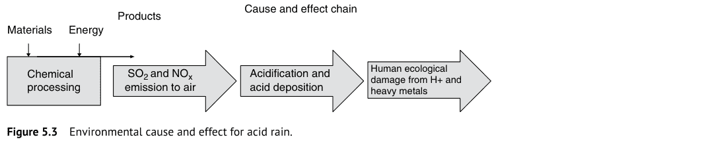

SO2、NOx和酸沉降对健康和环境有许多影响（图5.4a、b）。SO2很容易被上呼吸道湿润的组织内壁吸收，导致该组织受刺激和肿胀以及气道收缩。长期暴露于高浓度SO2可导致肺部疾病，并加重心血管疾病。酸沉降在土壤、植物、湖泊和河流上会造成森林和植物破坏、地表水酸化、植被和古迹等受损，尤其是在SO2浓度较高且土壤和地表水的缓冲能力和离子交换能力较低的地区。水体酸化会通过使鱼类接触重金属（如从土壤中淋溶出的铝）而危害鱼类种群。植物过度接触SO2会降低植物生长和产量，并已被证明会减少一个地区植物物种的数量和多样性（McLaughlin and Taylor 1985；USEPA 1998a）。

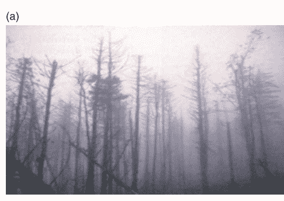

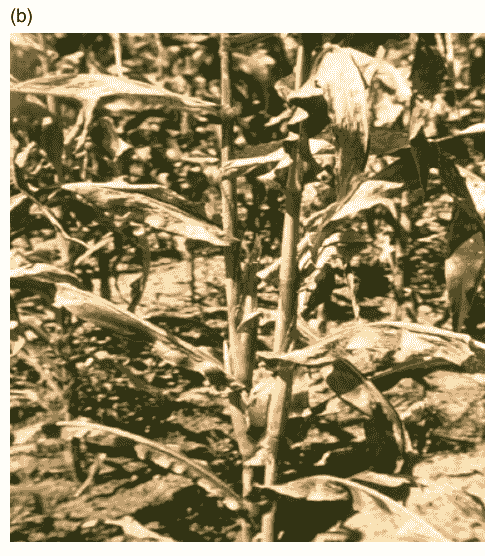

**图5.4** （a）北卡罗来纳州米切尔山被酸雨杀死的树木。（b）被SO2杀死的玉米树。

## 5.2.6 空气有毒物质

危险空气污染物（HAPs），又称空气毒物，是已知对人体健康有不良影响（如致癌）的空气污染物。《清洁空气法》C.2节所列的HAPs清单中确定了180多种化学物质（USEPA 1998c）。空气毒物的例子包括重金属汞和铬，以及有机化学品，如苯、己烷、全氯乙烯（perc）、1,3-丁二烯、二噁英和多环芳烃（PAHs）。

《清洁空气法》将HAPs的主要来源定义为固定源，其有可能排放清单中任何一种HAPs每年10吨，或任何HAPs组合每年25吨。主要来源的例子包括化工联合企业和炼油厂。《清洁空气法》为HAPs规定了一种非常高水平的污染控制技术，称为最大可达控制技术。小型面源，如干洗店，排放的HAPs吨位较低，但合计起来却是HAPs的重要来源。通过改变工作实践，如材料替代和其他污染预防策略，可以实现减排。

HAPs通过典型的吸入或摄入途径影响人体健康。HAPs可在鱼类组织中积累，污染物的浓度会沿食物链向上增加，最终到达人类。许多这些持久性和生物累积性化学物质是已知或可疑的致癌物。

## 5.3 生态风险评估

ERA范式的四大组成部分是问题表述、暴露评估、效应评估和风险表征（Anderson and Albert 1998；Suter et al. 2000；USEPA 1992、1997、1998a）。ERA从问题表述开始。此阶段开展的活动包括：定义ERA的目标及空间和时间尺度、制定SCM、选择终点和非人类受体物种，以及初步识别潜在关注污染物。随后进行暴露评估和效应评估，两者可同时进行。暴露评估评估化学品在环境中的归宿、迁移和转化，以及受体生物对这些物质的定量摄取和摄入。效应评估建立暴露水平与受体毒性效应之间的关系。风险表征是ERA的最后一步，在这一步中，将暴露信息和毒性效应信息结合起来，描述不良效应发生的可能性。


receptors. 许多用于评估 ERA 的评估标准与人类健康风险评估（HHRA）中已呈现的标准相同。本节主要关注 ERAs 的独特方面，并且不重复适用于两个主题的 HHRA 中已涵盖的材料。

返回受污染的河流产卵；迁徙鸟类临时使用某地）。

## 5.3.1 生态问题表述的技术方面

确定为解决 ERA 目标所需的数据量是满足项目数据质量目标（DQO）过程的一部分。所有风险评估利益相关者（例如美国环保署、州政府、鱼类和野生动物管理局等）都应参与此过程。DQO 在评估开始时即被断言，以定义完成评估所需的数据量和质量。在 ERA 开始时安排时间完成 DQO 最终可能为项目节省时间和金钱。一旦目标和 DQO 确定后，问题的其余表述即可进行。

问题表述的最终目标是 SCM。问题表述期间可考虑多种生态系统特征。这些包括非生物因素（例如气候、地质、土壤/沉积物特性）和生态系统结构（例如不同营养级物种的丰度、栖息地大小和破碎化）。环境描述可使用近期照片和地图记录。应编制植物和动物物种名录。

评估的规模尤其重要，如果一个大型复杂场地被细分为几个较小的场地。超级基金场地彼此相邻的情况也不少见。因此，必须定义评估的面积范围。例如，如果评估中包含场外区域，则必须指定场外距离。SCM 的开发和评估终点的选择将直接与空间尺度相关。例如，由于鹿的活动范围较大，如果场地仅占两英亩，则不会评估土壤污染对鹿的影响；评估活动范围较小的终点物种，如小型哺乳动物，则更为合适。

必须决定评估是否必须考虑时间变化。应评估所有历史信息。然后，可确定需要多少新信息才能充分评估影响和风险。评估的采样季节中可能需要包含一年中的某些部分。例如，由于化学形态或生物行为的各种季节性影响，环境暴露可能在一年或数年内发生变化（例如鲑鱼

### 5.3.1.1 场地概念模型

SCM 描述了一系列工作假设，说明污染物或其他压力源如何影响生态受体（ASTM 2003）。SCM 清晰地说明了风险评估中受污染的介质、暴露途径和受体。除了文字描述外，图表式 SCM 易于理解，有助于确保评估中没有遗漏任何相关组成部分。该模型确保考虑所有暴露情景，并允许对选择和省略途径和受体的理由进行完整记录。SCM 的思想是，虽然问题表述期间可能制定许多假设，但只有那些预计会对现场风险产生显著贡献的假设才会被带入 ERA 过程的其余部分。

在 SCM 开发期间，确定所有污染源（例如垃圾填埋场、掩埋场、贮水池、空气烟囱、废水排放管），并表示所有受污染介质（例如土壤、水、沉积物、空气、生物）。地下水通常在成为地表水之前不被视为暴露介质，但地下水中的污染物可从土壤迁移到地表水和生物体。一个例外是浅层地下水或渗出点，植物可能通过根系暴露。所有暴露途径均有表示，除非能提供充分理由将某途径从评估中排除。例如，排放金属到溪流的废水排放管不需要空气暴露途径，且仅需考虑洪泛平原的土壤。因此，陆生受体可通过直接接触或饮用溪流、生活在洪泛平原土壤中、或摄食来自溪流和洪泛平原的受污染食物而暴露。必须提出适当的食物网。从受污染土壤到蚯蚓再到鼩鼱的食物网可能适用于一英亩的场地，但面积显著更大的场地可能需要食物网继续延伸到具有更大活动范围的大型捕食者（见图 5.5）。

对于非化学压力源，如水位或温度变化，或栖息地干扰，SCM 描述了哪些生态受体暴露于物理干扰，以及改变的时间和空间尺度。

ERAs 可能有多个 SCM。在预测性 ERAs 中，各种活动对生态系统不同组成部分的影响可能需要多个 SCM。在回顾性 ERAs 中，通常需要评估假设的未来情景。例如，目前为野生动物提供很少栖息地的工业区（因此暴露很少且风险很小）未来可能长出植被。它将更具野生动物栖息地吸引力，因此对污染物暴露的风险将变得更大。同样，目前不污染池塘的受污染地下水羽流在几年后可能成为水源。未来风险必须进行评估。

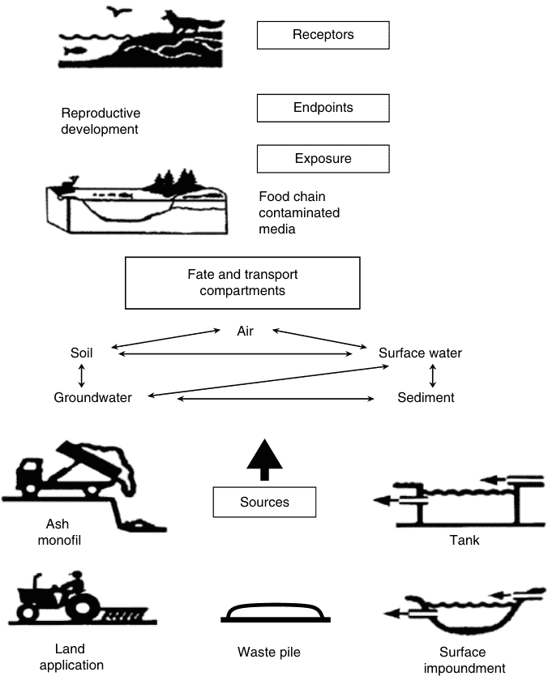

**图 5.5** 环境风险评估多途径分析。来源：改编自 USEPA（1995）。

### 5.3.1.2 识别终点

在 SCM 完成之前，必须定义 ERA 的评估终点并给出其选择的理由。评估终点是要保护的实际环境价值（Suter 1993；Suter et al. 2000）。评估终点的示例为“溪流中大口黑鲈种群的存活、生长或繁殖下降不超过 20%”。评估终点物种的理想特征如下（Suter 1993；Suter et al. 2000）：

- 评估终点必须与决策相关。
- 必须了解生态系统组成部分的结构和功能，才能确定终点的生态相关性或重要性。控制其他物种丰度和分布的物种以及参与养分循环和能量流动的物种通常被认为在生态上相关。
- 社会参与和关注可能影响终点的选择。
- 只有在现场存在或可能存在的物种才应用于风险评估，无论该物种的价值或重要性如何。
- 由于现场只能评估部分物种，因此必须选择对现场污染物敏感且可能接受高暴露的终点物种。这样，其他可能较不敏感的物种

## 5.3.2 生态暴露评估

ERA 有一些 HHRA 所没有的考虑因素。影响暴露评估的最重要因素之一是评估的空间和时间尺度。空间上，暴露估计必须考虑受体物种的活动范围以及相对于污染面积范围的适宜栖息地的可获得性。时间考虑包括受体物种是留居种还是迁徙种，以及由于季节性变化污染物浓度是否在一年中发生变化。

HHRA 中很少涉及的另一个概念是不同物种获得的不同保护水平。HHRAs 设计用于保护个体。在 ERA 中，只有受威胁和濒危物种，或其他具有特殊法律（如候鸟）或公众关注的物种，才在个体水平上评估影响。对于其他物种，保护主要在种群水平上。例如，保护现场的鹿群很重要；不会保护个体鹿。实际上，这意味着评估与整个种群相关的指标，如存活和繁殖。个体生活质量不予考虑。

与 HHRA 一样，要使暴露途径完整，必须存在受污染介质、传输介质、受体物种以及使污染物进入生物体的暴露途径。然而，ERA 具有独特的暴露途径，例如鱼类通过呼吸水。 在暴露评估中，确定暴露点的污染物浓度，或计算摄入率。在风险表征中，这些浓度与毒理学基准相关；基准是假设对受体物种无害的污染物浓度。

ERA 中的暴露情景可能与 HHRA 的情景不同。ERA 没有默认的“住宅情景”或“工业情景”。然而，危险废物场地通常具有工业性质。会制定适合当前土地利用的情景。与人类健康评估一样，ERA 可能对未来土地利用做出假设。这一未来情景可能假设场地被废弃并自然演替。因此，不能合理假设当前和未来情景中存在相同的野生动物物种，特别是如果栖息地发生变化。所有关于暴露情景的假设必须在 ERA 过程早期记录。

在暴露环境表征期间，详细说明受体物种与环境之间的关系。生态系统特征可改变污染物的性质和程度。化学物质可通过微生物群落或水解和光解等物理过程发生转化。环境还可能影响污染物的生物可利用性。物理压力源如溪流淤积和水温波动可能对生态风险产生 considerable 影响，因此必须描述。

作为暴露环境表征的一部分，考虑受体物种的栖息地需求以及现场可用的适宜栖息地数量也很重要。栖息地的可获得性将决定现场的使用量。因为如果受体物种不存在则不会发生暴露，而如果没有适宜栖息地受体物种也不会存在，所以在暴露评估早期识别栖息地需求和可获得性很重要。选择暴露途径取决于要评估的终点。几类终点和暴露途径在第 5.3.2.1–5.3.2.5 节中讨论。

### 5.3.2.1 鱼类群落

鱼类通过呼吸和皮肤吸收暴露于地表水中的污染物。它们还可能通过摄食受污染沉积物或食物而暴露。鱼类群落有两个重要考虑因素。首先，对于无机污染物，鱼类通过吸入（即鳃摄取）暴露的是地表水中污染物的溶解部分。实际上，这涉及在分析前通过纳米滤器过滤水样。HHRA 使用水中的总无机浓度计算暴露。然而，颗粒结合部分在鳃处不可用于鱼类。其次，皮肤吸收作为单独的暴露途径不予评估，因为鱼类的现有毒性数据要么是通过喂食受污染食物给鱼类产生，要么是通过将鱼类暴露于水中的污染物产生，而没有尝试对各种摄取途径进行单独评估。

### 5.3.2.2 底栖大型无脊椎动物群落

底栖大型无脊椎动物生活在受污染沉积物中或其上。它们可能通过摄食沉积物或受污染食物而暴露。此外，底栖生物可能呼吸覆盖水或沉积物孔隙水。该终点的特殊考虑包括需要沉积物整体污染物浓度和孔隙水分析，以便将这些浓度与基准浓度进行比较。对于非离子/非极性有机污染物，使用沉积物整体浓度。还需要沉积物的有机碳含量。


暴露评估应记录并表征每一种不确定性的来源，包括与分析数据、暴露模型变量、污染物分布和生物可利用性、受体物种的存在和敏感性以及其他不完整的暴露信息相关的不确定性。

## 5.3.3 生态效应评估

生态效应评估包括评估中使用的生态毒理学基准的描述、关注污染物的毒性特征以及现场采样工作的结果。现场数据可能包括现场调查信息和毒性测试结果。

生态毒理学基准代表环境介质（即水、土壤、沉积物、生物体）中化学物质的浓度，被认为对生物体无害。每种介质和每种终点物种可能有多个基准，这使得可以根据现场的污染物浓度估算可能出现的效应的大小。例如，可能存在“无效应水平”、“低效应水平”、“慢性效应水平”、“种群效应水平”和“急性效应水平”的基准。使用所有这些基准将为决策者提供比其中任何一个都更多的信息。

目前在美国或其他地方可用的联邦或州基准很少。被用作基准的标准是《水生生物保护国家环境水质标准》（NAWQC）（USEPA 1986）。这些是 ARARs，并被用作鱼类群落和其他水柱物种（例如无脊椎动物如溞）的基准。然而，并非所有污染物都有这些标准。因此，需要其他基准。鱼类、底栖、土壤无脊椎动物和植物群落以及野生动物的基准在第 5.3.3.1–5.3.3.4 节中简要描述。这些基准开发中使用的主要毒性信息来源是公开文献（Risk Assessment Forum 1996, 1999）。

### 5.3.3.1 鱼类群落

急性期和慢性期 NAWQC 或州水质标准是 ARARs，必须用作基准。然而，这些是作为广泛适用的值开发的，因此更合适的做法是为地理位置和现场存在的物种确定基准。应查阅文献，查找与现场系统相似的系统中的慢性值，无论是淡水、河口、海水、硬水还是软水系统。对许多不同水生物种和许多污染物已进行了实验室毒性测试。事实上，水生系统目前拥有最大、最易获得的污染物浓度/效应数据数据库。

### 5.3.3.2 底栖群落

可用于计算底栖群落沉积物基准的几种方法。对于非离子/非极性有机污染物，通常采用平衡分配法。对于无机污染物，可使用文献中现有的沉积物整体毒性值，或将污染物孔隙水浓度与现有的 NAWQC 进行比较。不幸的是，沉积物单污染物暴露/效应数据的数据库有限。大多数数据来自受污染的场地，因此存在多种污染物。然而，沉积物污染正受到更多关注，风险评估人员和管理人员必须紧跟沉积物毒理学和政策方面的进展。

### 5.3.3.3 土壤无脊椎动物和植物群落

植物群落在生态系统的能量流动和养分循环中发挥主导作用。土壤无脊椎动物和植物构成了许多食物网的基础。土壤污染物数据库非常广泛。然而，研究人员使用的多数终点是粮食作物物种。虽然这些信息对人类健康风险评估人员至关重要，但不能直接适用于生态风险问题。初级文献将是开发毒性基准时必须使用的毒性信息的主要来源。土壤污染对植物、无脊椎动物甚至微生物群落的影响是近期的重要问题。同样，这也是 ERA 中必须保持最新信息的一个领域。

### 5.3.3.4 野生动物

野生动物基准尤其复杂，因为野生动物可能通过饮用水、周围土壤以及其饮食（来自植物和动物来源）接触污染物。因此，野生动物基准必须考虑这些多重暴露途径。基准可为每条暴露途径单独制定（在仅通过一条途径暴露的情况下），也可为总暴露制定。在多途径暴露的情况下，选择如 NOAEL 或 LOAEL（无/最低观察到不良效应水平）之类的基准，并以剂量表示，例如每公斤体重（每天）污染物毫克。野生动物基准具有物种特异性，以考虑不同物种的敏感性、体重、觅食习惯和饮食差异。在选择适当的基准值时，必须查阅毒理学文献，重点关注繁殖终点。污染物毒性特征有助于风险评估读者清楚了解环境中污染物的毒性效应。风险评估中的毒性特征可以提供相关毒性信息的简明总结。值得重申的是，信息必须与废弃物现场和关注的终点相关。那就是，特征不应仅仅是老鼠和大鼠的中位致死剂量（LD₅₀）的清单。应为现场发现的污染物以及感兴趣的受体物种汇编剂量-反应信息。

感兴趣物种的毒性特征和生物效应数据也有助于风险评估人员和风险管理者评估风险的程度和大小。应列出观察到致死和亚致死效应（包括行为改变）的污染物浓度（即剂量-反应信息）。诸如化学物质的迁移性（例如水溶性、土壤吸附、辛醇-水分配系数）、环境持久性以及与其他污染物的相互作用等信息将有助于风险管理者做出明智的决策并教育公众。

## 5.3.4 生态风险评估的附加组成部分

### 5.3.4.1 采样和调查

尽管在 ERA 进入效应评估阶段之前，总体采样问题必然已得到解决，但在本文中提及其中一些问题仍然是值得的。这将确保风险评估人员已提及并考虑了这些问题可能产生的潜在影响。现场调查和环境介质化学分析也已涉及。

### 5.3.4.2 现场采样

在确定采样位置之前，必须定义采样“河段”。这些是可能受特定污染物源影响的区域。例如，一条溪流沿其长度可能有几个污染物源；河段可定义为两个源之间的区域。在河段内采样可确定各种来源对观察到的毒性的相对贡献。切记不要忘记采样适当的背景（或参考）地点。事实上，最好有几个参考地点，以考虑环境中的自然变异性。过去，背景（意味着原始）和参考（意味着不受该特定场地影响）之间存在区别。然而，由于这种区别正在失去时效性，因此有必要知道使用的是哪种定义。

当制定时间表时，现场参数的季节性问题是经常被遗忘的一个方面。对于全国大部分地区，冬季会阻碍采样工作。例如，当地面和溪流结冰时，很难采集蠕虫或鱼类。蝙蝠在冬季冬眠，鸟类迁徙，稀有植物在不开花时更难识别。与其在不适当的时间收集数据，不如推迟风险评估的完成。

废弃物现场调查必然涉及协调各种调查人员完成各种采样任务。协调很重要，以便获得对 ERA 有用的结果。例如，虽然水浓度可能在短时间内发生巨大变化，但用于毒性测试的水样应与用于化学分析的水样在同一时间和同一地点采集。协调其他活动，如沉积物样品的采集，则不太关键，因为沉积物浓度需要更长时间才能显示污染。

在 ERA 中，环境介质样品不仅包括地下水、地表水、沉积物、土壤和空气；还必须包括生物体，以便评估污染物暴露和效应。这一重要信息来源可供生态风险评估人员使用，可能使 ERA 结果更具确定性。

### 5.3.4.3 现场调查

现场调查的优点是能给出效应的真实世界指示。然而，任何观察到的效应的原因可能未知。例如，年幼鱼数量的减少可能是由于影响鱼卵或幼鱼的污染物，也可能是由于自然原因，例如导致水流增加、侵蚀产卵床的风暴事件。另一个缺点是，很难检测到小的变化。通常，现场参数（例如种群大小、物种数量）下降超过 20% 才能检测到有害变化。如果没有适当且可比较的参考地点，现场调查可能变得更加复杂，因为对现场观察到的效应的解释将极其困难。

在预测性 ERA 的情况下，现场调查提供了可能在未来接收污染物的环境的信息。为了记录任何未来的不利影响，必须拥有这些信息。调查可能包括受威胁和濒危物种调查、水生和陆生群落调查以及湿地调查。我们在转向物种形成问题之前顺便提及后者。

在美国，必须对场地进行湿地调查以识别并在必要时划定湿地。请注意，识别湿地比划定湿地更容易（且成本更低）。只有在修复或其他活动需要破坏全部或部分湿地时，才需要划定湿地。


## 5.3.4.4 物种化

有关化学物质在各种介质中的物种化信息对于砷或铬等污染物可能很有用，因为这些污染物的不同物种具有非常不同的相对毒性。在样品送去分析之前，必须确定所使用的分析方法是否具有低于所关注的监管浓度（如 ARAR）以及会产生不可接受风险的浓度的检出限，除非在技术上或经济上不可行。如果无法达到这些检出限，风险评估中将存在额外的不确定性，因为无法知道这些污染物是否存在，因而无法判断它们是否构成风险。

某一场地的介质中的化学浓度以及文献中可获得的大量单一化学毒性数据可用于确定在实地调查或毒性测试中观察到的影响的具体原因，并界定污染来源。这些数据用于预测性 ERA 中模拟污染物暴露的影响。然而，测得的浓度可能并不能反映生物可利用的比例（例如，化学物质可能与土壤颗粒结合，因此无法被生物吸收）。

## 5.3.4.5 其他影响信息来源

有助于解释生态数据的补充信息包括生物标志物分析。生物标志物是生物个体暴露于污染物或其他亚致死应激源的敏感指标。它们通常是生理或生化反应，例如酶浓度、遗传异常、组织病理学异常或污染物体内负荷。虽然生物标志物可表明暴露于应激源，但它们无法提供这种暴露对个体的影响信息。这是因为 ERA 主要关注的是生物种群的生存能力，而非单条鱼或鸟类的生理效应。然而，一些生物标志物是化学特异性的，因此可能为观察到的毒性效应的潜在原因提供有价值的信息。例如，酶 δ-氨基乙酰丙酸脱水酶的血液水平升高表明暴露于铅。

## 5.3.4.6 许多 ERA 中涉及的额外影响 *全球变暖*

大气允许来自太阳的太阳辐射几乎无显著能量吸收地通过。到达地球表面的部分太阳辐射被吸收，加热陆地和水。红外辐射从地球表面发出，但大气中的某些气体吸收这种红外辐射，并将其中一部分反射回表面，从而使地球变暖，使我们所知的生命成为可能。该过程通常被称为 *温室效应*。地球的表面温度将上升，直到太阳辐射吸收速率与红外辐射发射速率之间达到辐射平衡。人类活动，例如化石燃料燃烧、森林砍伐、农业和大规模化学生产，已可衡量地改变了大气中气体的组成。有人认为，这些变化将通过增强温室效应导致地球-大气系统的变暖。

主要的温室气体（GHGs）是水蒸气、二氧化碳、甲烷、氧化亚氮、氯氟烃和对流层（地面）臭氧。水蒸气是最丰富的温室气体，但由于其通常并非人为来源而被省略。二氧化碳由于其高排放率和浓度对全球变暖有显著贡献。化学物质的全球变暖潜势的主要因素是红外吸收能力和在大气中的驻留时间。

## 5.3.5 对流层臭氧污染及其对植物的影响

臭氧在对流层中形成，在那里阳光引起涉及主要来自汽油发动机和其他化石燃料燃烧的氮氧化物（$NO_x$）和 VOC 的复杂光化学反应。木本植被也是 VOC 的主要来源（例如异戊二烯或萜烯、甲醛、乙醛、甲乙酮、丙酮等）。$NO_x$ 和 VOC 可通过区域天气模式长距离输送，然后在反应形成大气中的臭氧之前，可在数周内持续存在。导致臭氧形成的光化学主要反应如下所示。

```
$2NO + O_2 \to 2NO_2$ 
$RH + OH \cdot \rightleftharpoons RH \cdot \rightleftharpoons RO \cdot + NO \to NO_2$ 
$NO_2 + h\nu \to NO + O$ 
$O + O_2 + M \to O_3$ 
Net reaction : $NO_x + RH + h\nu \to O_3$
```

### 5.3.5.1 视程和区域霾

氧化剂、臭氧（$O_3$）、PAN、过氧苯甲酰硝酸盐和其他微量物质与氮氧化物和 VOC 反应并产生烟雾。这些光化学烟雾的成分对植物最具破坏性，对人类健康最不利，是这些光化学氧化剂。烟雾形成过程中产生的气溶胶导致能见度明显降低和区域霾，并使大气呈现棕色。区域霾发生在羽流已均匀分散到大气中、无法辨认羽流的距离。区域霾的主要原因是硫酸盐和硝酸盐（主要为铵盐），它们由大气中 SO₂ 和 NOₓ 的化学反应形成（图 5.2）。

### 5.3.5.2 富营养化：一种广泛的生态效应

富营养化是水体老化的自然过程。它是微观生物自然沉积的非常缓慢过程的结果，需要地质时间才能完成。过程完成会导致水体灭绝。

富营养化过程由生物活动所需营养物质浓度的增加所推动。首先，设想清洁清澈的水。在这种条件下，由于可用的营养物质极少，水柱中没有可支持沉积的显著生物活动。水体健康，条件称为贫营养。随着时间的推移，营养物质会积累。营养浓度支持生物活动但不令人反感且高于贫营养条件的淡水体被认为是中营养。在生命周期的下一个阶段，水体变得富营养——其特征是浑浊的水和微生物沉积加速。灭绝前的最后生命阶段是池塘、沼泽或沼地。

尽管在自然条件下富营养化发生非常缓慢，历经地质时间，人类活动促进了营养物质的产生并缩短了周期。拥有绿草如茵草坪的人是营养物质的 prolific 生产者。农田是营养物质的极佳来源。例如，马里兰州的切萨皮克湾就装载着来自远至纽约的农田的营养物质。

为了生存，微生物必须供给含有其组分的营养物质：碳、氢、氧、氮、磷和微量元素。由于碳、氢和氧在环境中已十分丰富，富营养化控制侧重于限制氮和磷的输入。生物以 NH₄⁺、NO₂⁻ 和 NO₃⁻ 的形式利用氮；磷以正磷酸盐的形式利用。藻类是富营养化的主要原因，可通过限制其获取氮或磷来控制。应选择哪一种？研究发现，蓝绿藻可在几乎任何地方生存，并在不利条件下可轻松超过其他藻类生长，它们可从空气中固定氮。出于此及其他原因，默认选择是推荐磷控制。

富营养化是我们生态风险分析中包含的影响的最后一个例子。当然还有许多其他影响；文献十分丰富。现在，我们准备考虑 ERA 中的下一步：毒性测试。

## 5.3.6 毒性测试

生态毒性测试根据持续时间（短期、中期和/或长期）、测试溶液添加方法（静态、循环、更新或连续流动）以及（为满足拟议污染物排放消除系统的许可要求，并确定混合区等）进行分类。详细的当代测试方案在法规文献中进行了总结（USEPA 1985a, b, 1988, 1989）。

近年来，毒性测试已得到广泛验证。即使生物体对废物流毒性的敏感性各不相同，美国环保署已记录到，当废物流稀释度被测定时，废物流毒性与受纳水体中发现的毒性相关性良好，并且来自废物流和受纳水体毒性测试的影响预测与受纳水体中生态群落的响应相比非常有利。美国环保署已在全国范围内对淡水、河口和海洋生态系统进行了测试。方法包括急性以及慢性暴露。

目前的生物测定方法可在四到七天内评估多个不同的系统发育类群（USEPA 1988）。测试基于几乎全国分布的物种，这些物种具有大量生活史和毒性敏感性数据。适当的测试方案涉及评估测试物种对特定废物流的一系列敏感性。通常考虑两种或三种物种以消除该因素的不确定性。

常见的海洋物种包括 Champia parvula，红藻；Mysidopsis bahia，糠虾；Menidia beryllina，内陆银鱼；以及 Cyprinodon variegatus，羊头鲈。常见的淡水物种包括 Pimephales promelas，肥头鲫，以及 Ceriodaphnia dubia，水蚤虾。

测试结束时，确定存活率并测量生长（与对照相比干重增加）。急性终点是鱼的死亡。

### 5.3.6.1 毒性测试结果的评价

表达毒性测试结果使用了许多术语。急性毒性是严重到足以产生


风险分析师和风险管理者，我们简要讨论风险管理。风险分析师不为风险管理者执行决策过程，风险管理者也不规定分析师使用的数据、模型和假设，但他们必须沟通，才能使风险分析具有相关性，决策具有充分依据。

如前所述，这种关系应始于对关注的来源、环境和终点的定义。因为科学家/风险分析师的这些活动需要做出不基于科学的价值判断，避免分析师不当注入自身价值观的唯一方法是通过政策声明或临时判断来介入风险管理者的价值观。然而，风险管理者往往不是环境科学家，因此风险分析师有义务协助风险管理者获得足够的科学背景以做出明智的判断。此外，风险分析师必须足够了解风险管理者的需求和利益，才能进行风险表征。

图 5.6 是设定空气、水或其他环境介质中化学物质允许浓度的标准所涉及因素的简单示意图。风险分析的理想输入是与关注终点上不可接受影响的概率相关的函数，该函数与标准水平相关，或更可能的是，每个终点各自的函数。一位前 EPA 主任曾说，概率分布比数值对决策者更清晰（Ruckelshaus 1984）。从该函数中，风险管理者可以选择一条不太可能从曲线上端过度保护的标准，也可能选择一条不太可能从曲线下端保护不足的标准，或选择中间标准。虽然并非所有风险管理者都同样适应概率，但监管机构承认和量化不确定性的压力正在增加（Finkel 1990）。

除了人类健康和 ERA 的结果外，决策还将基于各种社会、政治、法律、工程和经济考虑。法律考虑包括所实施法律的措辞以及任何表明适当保护程度的司法判决。主要工程考虑是满足标准的实用技术是否可用。满足标准成本和受风险资源价值可能是正式风险-收益或成本-收益分析的主题。其他更模糊的考虑包括公众关注程度和现任政府的政治哲学。管理者可以设定标准，也可以推迟决策并要求进行更多测试、测量或研究，以减少不确定性对函数斜率的贡献。

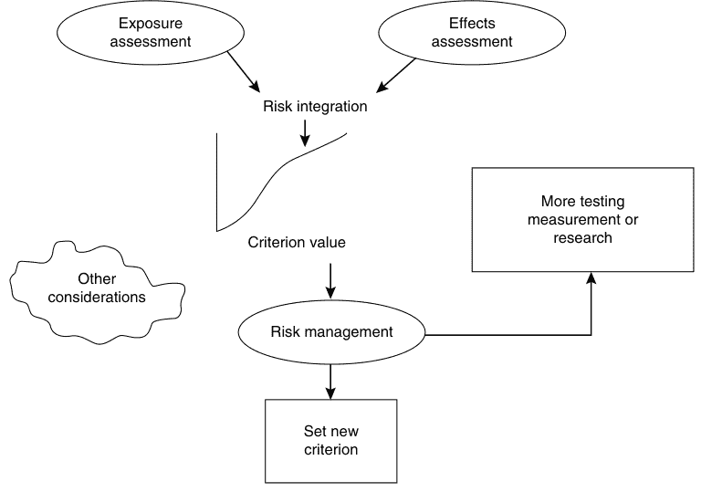

图 5.6 设定环境质量标准的风险管理示意图。

## 5.4.1 生态资源的估值

为了进行成本-效益分析或设定环境损害的罚款或补偿水平，有必要预测、衡量或估计系统潜在或实际价值损失，然后将该损失转换为货币或等价单位。许多生态学家和环保主义者反对对自然环境组成部分进行货币估值的行为，因为他们认为经济分析不可避免地会低估环境相对于新化学品或开发的价值，或相对于处理或清理成本的价值。反驳的论点是，决策者在判断中不可避免地会考虑经济因素，如果环境科学家不开发货币化环境价值的方法，决策者很可能会低估环境的经济价值。例如，在美国，EPA 被要求通过进行成本-效益分析来证明新的环境法规的合理性。

反对估值环境组成部分的一个基本论点是，它们具有独立于人类价值的内在价值（Rolston 1988）。然而，即使接受这一前提，人类也无法确定森林的价值是什么（即它更愿意是原始林还是年轻且生长旺盛的？），因此对森林内在价值的诗意描述并非功利性的，但它也不比美元价值更少的人类中心主义。人类设计的所有价值体系不可避免地基于人类价值观。

在估值生态资源时，考虑存在各种功利性和非功利性价值类别是有帮助的。每类环境价值都必须有其自身的方法进行估计和估值。

### 5.4.1.1 功利主义

功利主义价值通常按商品、潜在商品、娱乐和自然服务分类。

- **商品价值：** 树木、牧场、商业鱼类以及其他物种和群落被出售或租赁，因此它们具有可通过常规市场调查轻松确定的市场价值。
- **潜在商品价值：** 植物和动物是可直接营销或合成后作为药物、农药等营销的化学品来源。此外，所有物种都构成可用于作物、牲畜、工业微生物等基因工程的遗传资源。因此，所有物种都具有潜在商品价值，很难估计。然而，这种价值仅在灭绝的情况下才会丧失。
- **娱乐：** 鱼类和野生动物对渔民、猎人、观鸟者和在自然栖息地欣赏动物的人具有娱乐价值。自然区域对露营者、徒步旅行者和环境学习者具有娱乐价值。
- **自然服务：** 生态系统调节洪水、控制局部和全球气候、降解和封存污染物、减少土壤和养分流失，并提供其他具有明显经济效益的服务。这些可估计为替代服务的成本（例如额外的废物处理）或缺乏服务造成的成本（例如洪水损失）。

### 5.4.1.2 非功利主义

非功利主义价值从存在性和美学到科学和文化不等。

- **存在：** 许多人仅仅因为物种和生态系统存在而赋予其价值。这些人可能不期望看到金狮狨或北极国家野生动物保护区，但如果狨猴灭绝或保护区被改造成油田，他们会感受到损失。
- **美学：** 生物体和生态系统提供的审美体验具有与绘画或舞蹈表演等价的价值，但不易量化。
- **科学：** 物种和生态系统可能具有科学价值，因为它们可能成为自然未被认识属性的特别恰当例证，或因为它们是长期研究的主题，可能被破坏。其中，只有商品价值和娱乐价值是现有方法能够合理描述的。需要研究以确定是否可以开发出可为其他价值损失估计并货币化这些损失的可靠方法。可以认为，试图货币化非市场价值本质上是人为的，苹果和橙子的权衡应由决策者而非经济学家来执行（NRC 1975）。关于范畴错误的问题，以及贴现任何价值的适当性和对后代的义务等问题，由 Costanza（1991）、Desvousges 和 Skahen（1987）以及期刊 *Ecological Economics* 的许多撰稿人讨论。
- **文化和伦理：** 某些生态系统和物种具有文化意义。这一价值由更大的


美国公众对秃鹰数量下降的情感冲击，超过了同期且更为严重的游隼和棕鹈鹕数量下降。

最后，必须强调成本效益分析不应被视为决策制定的唯一可靠依据。它是一种描述特定标准的输入。特别是，它忽略了道德和伦理方面的考虑。现代西方文化中的许多人，如果不是大多数人，都会认为我们对环境负有道德责任，这种责任超越了效用考虑。然而，这些责任必须与对穷人、饥饿者、传统文化从业者等的责任相平衡（Randall 1991）。因此，即使从道德角度来看，环境价值也不是绝对的，而必须与竞争价值相平衡。诸如此类的复杂性使风险管理超出了正式分析的范围。

## 5.4.2 风险管理建模

确定风险严重程度是风险管理者首要的任务之一。在此基础上，他或她必须决定给定的风险是否不可接受，因此必须通过监测来降低或预防风险，还是可以接受，至少在目前可以接受。可能替代方案相关的风险也必须考虑。例如，杀死每年 x 只鸟的农药的替代方案可能是清洁农业，它破坏了害虫的避难所，但也消除了 y 只鸟的栖息地。即使 y 远大于 x，清洁农业可能更受青睐，因为它更易被环境和动物权利团体接受。整合此类考虑几乎总是非正式的过程。

我们提供的简短示例似乎只有一种暴露模型、一种效应模型，以及关于如何参数化它们并将其组合成风险估计的一组假设。这种方法通常适用于人类健康风险评估，其中终点、模型和参数处理是标准化的。然而，它不适用于 ERA。人们可以用生态系统模型、种群模型和个体水平毒性测试的统计模型来估计对渔业的影响。生态系统层面的影响可能由微宇宙测试、湖泊生态系统模型和溪流生态系统模型的结果表示。每种风险估计都将有其自身的假设和相关的不确定性，而这些不确定性可能无法以等效的方式表达。必须以某种连贯的方式评估、组织这些单独的证据线，并向风险管理者解释，以便进行证据权重评估。

呈现替代证据线的一种方法是使用共同轴进行图形化呈现。轴

应从风险估计的四个维度中选择，以便阐明对决策最重要的风险估计差异。那就是，决策主要取决于效应发生的浓度、恢复时间、死亡的生物数量，还是这些轴的某种组合？替代模型、假设或数据的输出应绘制在这些轴上。

## 5.4.3 风险表征的其他考虑

负责人类健康风险管理的相关人员完全清楚，有些风险的后果如此严重，以至于无论成本如何都必须避免。如此明显不可接受的风险被称为 de manifestis。伴随的概念 de minimis，我们稍后将探讨，指出存在后果如此微不足道以至于不值得处理的风险，无论成本多么低。Whipple（1987）撰写了关于 de minimis 风险的文章，而 Travis 等人（1987）和 Kocher 和 Hoffman（1991）讨论了这两个概念与癌症预防的关系。

de manifestis 和 de minimis 边界之间的风险水平会根据成本、补救措施的技术可行性和其他考虑来平衡，以确定其可接受性。由于生态效应没有标准评估终点，因此没有 de minimis 或 de manifestis 生态风险水平。然而，美国对濒危物种的保护为 de manifestis 风险水平提供了一个依据，因为它显然排除了经济和社会政治方面的考虑。建立 de manifestis 和 de minimis 风险将使评估者在进行最小评估后即可快速处理明显不可接受或微不足道的风险，而无需确定确切的预期风险水平，或权衡成本和收益。考虑哪些水平和类型的生态效应是明显且必然可接受的，哪些是明显且必然不可接受的，将为风险评估者和风险管理者提供良好的基础，以确定社会价值与生态原则之间的关系。

风险表征和管理中的最后一点考虑是，除了风险管理者之外，其他受众也需要理解风险和决策的基础。这些包括公众、环境倡导团体和受监管方。向非专业人士进行风险沟通一直是关于健康风险的研究和讨论的主要话题，但对于生态风险则不是（NRC 1989）。这是可以理解的，因为普通公民更关心个人和家庭健康，而不是生态效应。然而，当外部各方变得

偶尔，时间是一维评估的基础。如果释放的浓度相对恒定，则风险管理者需要知道在没有不可接受风险的情况下可以释放多长时间。例如，废水处理厂可能因维修而停机，操作员希望知道可以释放未经处理的废水多长时间。最常见的以时间定义的测试终点是中位致死时间（LT₅₀）。事实上，许多释放具有相对恒定的浓度，时间将比浓度更适合作为评估的单一维度。然而，由于时间通常被认为不如浓度重要，因此它更常在更高维模型中考虑。

风险估计最常见的模型是商值法（Barnhouse et al. 1982；Urban and Cook 1986），它依赖于一维尺度。该方法包括将预期环境浓度除以测试终点浓度（即确定它们在浓度尺度上的相对位置）；风险被认为随着商值的增大而增加。

### 5.4.5.2 二维模型

**浓度/反应** 生态毒理学中最常见的二维模型是浓度-反应函数。这种主导地位可以用对化学物质浓度增加时反应增加的渴望来解释，从而建立化学物质与反应之间的因果关系。在此模型中，时间被折叠，只考虑测试结束时，并且要么严重程度要么反应比例被消除，以便有一个单一的反应变量。最常见的是保留反应比例并通过只考虑一种类型的反应，通常是死亡率，将严重程度折叠。严重程度最常用于当种群或群落的生物的功能反应，如初级生产力，而非个体间反应的分布是感兴趣时。

对测试中获得的浓度-反应数据拟合正态概率单位、logit 或其他函数。通常，该函数用于通过逆回归生成标准 LC₅₀ 或 LD₅₀ 或中位有效剂量（ED₅₀），从而回到一维模型并丢弃大量信息。由于评估更常关注防止死亡或至少防止种群中显著比例的死亡，因此计算 LC₁、LC₁₀ 或其他阈值水平会更有用，但信息仍会被丢弃。如果保留两个维度，浓度-反应函数可以在每次新评估中用于估计预测暴露浓度下的反应比例，或为显著效应选择特定地点的阈值。当只有 LC₅₀ 可用且评估需要估计反应比例时，可以通过假设函数标准斜率并使用 LC₅₀ 将线定位在浓度尺度上来近似浓度-反应曲线。浓度-反应函数比被困在 LC₅₀ 上有所改进，但在许多情况下，反应比例不如反应开始所需的时间重要。

浓度-反应函数的一项改进是使测试持续时间与暴露持续时间相匹配，而不是使用标准测试持续时间并假设暴露持续时间相当匹配。理想情况下，暴露的时间模式应被预期并在毒性测试中再现。例如，如果发电厂将定期“吹扫”氯化冷却水，按固定时间表持续固定时间，则这种间歇性暴露可以在实验室毒性测试中再现（Brooks and Seegert 1977；Heath 1977）。

**时间-反应函数** 时间-反应函数与浓度-反应函数类似，主要用于计算一维终点，在本例中为 LT₅₀。当浓度相对恒定但暴露持续时间可变时，时间-反应函数很有用。确定时间-反应函数后，评估者可以考虑暴露时间变化对效应严重程度或反应比例的影响。

**时间-浓度** 包含时间的毒性最有用的二维模型是时间-浓度函数或毒性曲线（Sprague 1969）。它由实验数据创建，通过在测试期间多个时间点记录数据，并对每个时间计算 LC₅₀、EC₅₀ 或导致其他反应比例或严重程度的浓度，如上所述。然后将这些浓度随时间绘制并拟合函数（图 5.7）。此类函数已被著名科学家在重要出版物中提倡（Lloyd 1979；Sprague 1969），但它们很少被使用，即使它们所需的数据量与标准方法用于鱼类连续流动 LC₅₀ 所需的数据量相同（ASTM 1991；USEPA 1982）。如果使用的反应对应于评估终点上显著效应的阈值，则该函数可用于确定任何暴露浓度和持续时间的组合是否会超过该阈值（即图 5.8 中的线以上区域）。

当时间是关注点但没有时间测试数据时，有必要近似时间动态。


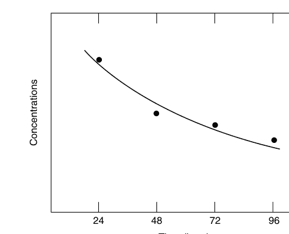

**图5.7** 毒性效应随浓度和时间的变化。该函数通过以LC$_{50}$或其他试验终点对测定时间（即24、48、72和96小时）作图得出。

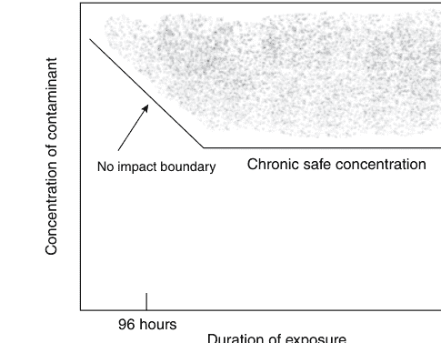

**图5.8** 毒性效应随浓度和时间的变化，其中时间以二分变量表示，即急性和慢性。急性时间终止于96小时，即鱼类标准急性致死试验的结束时间。

最简单的方法是将效应水平和暴露浓度在设定的时间类别内视为常数。这种方法在大多数环境评估中使用。评估者面对以标准试验终点表示的毒性效应，试图以某种合理的方式将试验持续时间与种群的时间动态相匹配。时间被分为急性和慢性两类，标准急性和慢性试验终点被用作区分可接受和不可接受浓度的基准。这种分类存在严重的概念性问题，我们现在就来讨论这些问题。

## “急性”和“慢性”作为时间类别

术语的歧义使试验持续时间与暴露持续时间的匹配复杂化。由于“急性”和“慢性”分别指短时间和长时间，人们很容易将急性试验的终点与短期暴露联系起来，将慢性试验的终点与长期暴露联系起来。然而，这些术语已经获得了额外的含义，用它们来描述严重程度和持续时间会导致复杂化。人们假设急性暴露和反应比慢性暴露和毒性持续时间更短且更严重。这一假设背后的隐含模型是，慢性效应是长期暴露中毒物或毒物诱导的损伤累积而产生的亚致死反应。相反，由于慢性毒性试验的成本高昂，毒理学家试图通过识别那些发生迅速、严重到足以容易观察、但发生在与慢性试验中引起效应的浓度同样低的浓度下的反应来降低试验成本（McKim 1995）。结果，急性-慢性二分法与时间和严重程度梯度之间的关系变得混乱。

鱼类标准试验终点说明了这种混乱。标准急性终点是成鱼或幼鱼的96小时半数致死浓度（LC$_{50}$）（ASTM 1991; OECD 1981; USEPA 1982）。标准慢性试验终点一直是最大可接受毒物浓度（MATC，也称为“慢性值”），即对存活、生长或繁殖产生统计学显著效应的阈值（ASTM 1991; USEPA 1982）。由于该慢性终点仅基于最敏感的反应，那些总体上似乎较不敏感的生命阶段已从慢性试验中剔除，从而使这些试验从生命周期（12～30个月）缩短为早期生命阶段（28～60天）（McKim 1995）。目前已有人提出，仅将幼鱼暴露11天或5～7天的试验可与较长的慢性试验等效。因此，鱼类慢性试验终点现在与短期事件（幼鱼的存在和反应）相关联，而急性终点适用于持续时间相似的暴露和持续存在的生命阶段。

即使是急性和慢性试验之间的严重程度区别也不明确。虽然LC$_{50}$明确表示对高比例种群的严重影响，但MATC与统计阈值而非特定效应幅度相关联的事实意味着它也可能对应种群中许多个体的严重影响。例如，在MATC下暴露于氯丹的雌性溪鳟中，超过一半未能产卵。

通过恢复原始的时间区分并以通用术语表达效应来澄清急性和慢性毒性之间的区别将是有利的。没有这种明确的区分，像图5.8这样的浓度-时间函数便毫无信息量。

## 以浓度和持续时间替代浓度和时间

在缺乏来自试验数据的可靠时间-浓度信息的情况下，可以假定一个浓度-持续时间函数。例如，用于A类损害评估的海洋溢油效应模型第一版只是简单地假设了一个线性函数（USDOI 1986, 1987）。Lee和Jones（1982）将急性暴露中时间效应的线性假设与慢性暴露中时间独立性的假设相结合，生成了图5.8所示的浓度-持续时间函数。选择这种线性假设是出于其简单性，而非任何理论或经验证据。Parkhurst等人（1981）假设24、48和96小时的$LC_{50}$值可用，在这些值之间进行线性插值，并假设超过96小时的暴露具有时间独立性，从而生成了图5.9所示的函数。

这些方法依赖于这样的假设，即时间动态可以根据规定浓度下的不同暴露持续时间来处理。实际上，由于水体稀释体积或大气扩散的变化、废水水质和水量的变化、废水的间歇性排放以及意外泄漏或事故性排放，生物体所面临的暴露浓度存在连续波动的谱系。如果满足以下条件，则可以用常规方式处理这些波动：

- (i) 事件之间的时间足以恢复，从而可以将它们视为独立的；
- (ii) 波动的频率足够高且振幅足够低，使生物体能够有效地对其取平均；或
- (iii) 某些频率占主导地位，因此可以如上所述确定暴露的时间类别。

第三种可能性的一个例子是Tebo（1986）对水基点源废水波动的分类：性质相当均匀的蓄积且混合良好的废水、受短期日常波动的废水，以及受剧烈波动的分批处理废水。

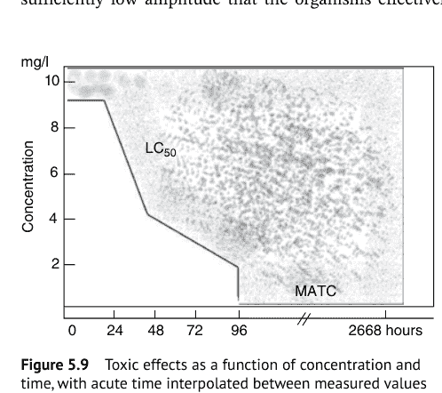

**图5.9** 毒性效应随浓度和时间的变化，其中急性时间在实测值之间插值，并外推至零和慢性时间的值，慢性时间以恒定离散变量表示。*来源*：引自Parkhurst等人（1981）。

## 最坏情况

如果无法以这些方式中的任何一种来表征波动，则可以定义一个最坏情况的浓度和持续时间，并假设如果该事件在单独发生时不会引起不可接受的效应，那么当它作为波动暴露历史的一部分发生时也将是可接受的（图5.10）。这种假设在废水排放监管中被普遍采用。例如，水基废水的最坏情况稀释条件传统上是平均重现期为10年的7日最低流量，称为*7Q10*。EPA建议使用平均每三年重现一次的最低一小时平均稀释流量和四天平均稀释流量（USEPA 1985c）。这些对应于最高的一小时和四天暴露。假设三年重现频率允许系统恢复，从而使峰值暴露可以被视为独立事件。

## 寻找折中方案

最好的解决方案是识别暴露或生物反应的特征时间模式，并要么进行毒性试验以模拟这些模式，要么将试验结果归类到其持续时间所落入的基于环境的时间类别中，从而避免急性-慢性二分法和最坏情况假设。也就是说，可以将时间缩放到决定这些过程的特征时间尺度上

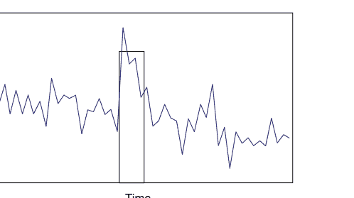

**图5.10** 在评估中，波动的环境暴露浓度可以由与最坏情况峰值暴露相对应的连续暴露来表示，如垂直条所突出显示。


风险。例如，来自点源的气态污染物暴露可分为：(i) 烟羽冲击（一小时或更短），(ii) 停滞事件（数小时至一周），以及 (iii) 生长季节平均暴露。关于引起植物毒性效应的空气污染物浓度的现有数据，可以按这些类别相对于时间绘制（图5.11），然后与这三类事件中每一类的估计地面浓度进行比较。无论如何，暴露持续时间与毒理学终点的匹配应基于对所评估情况的分析，而不是基于对急性和慢性毒性的先入之见。

空气污染对植物的影响被称为“暴露剂量”。例如，McLaughlin和Taylor（1985）汇编了用SO₂对大豆和菜豆进行田间熏蒸的数据，并将产量减少百分比与以ppm·小时为单位的剂量作图。Newcombe和MacDonald（1991）发现悬浮沉积物对水生生物的影响严重程度是浓度与时间乘积的对数线性函数。

剂量的最严格定义是递送剂量，即化学物质在其毒作用部位的浓度或浓度的时间积分。这个概念的实证应用是测量给药化学物质在靶器官或组织、某些容易采样的替代组织（如血液）中的浓度，或者在小型生物的情况下测量全身浓度。通过将效应与体内浓度联系起来，而不是（或除了）环境暴露浓度，这种方法可以更好地理解试验期间观察到的化学物质的作用，并且作为环境监测的辅助手段是很有用的。它可以将野外采集的死亡、垂死或表面健康生物体内的污染物负荷与受控试验结果进行比较，以解释野外效应。毒物动力学模型提供了一种根据外部暴露数据预测靶器官剂量的方法。

效应可能不仅仅是峰值体内负荷（即mg/kg）的函数，而可能是体内负荷与时间的乘积，或更一般地，体内负荷的时间积分的函数。这个变量被称为“剂量负担”，用于评估放射性核素暴露的影响，也可能适用于某些重金属和其他环境污染物。

## 剂量-反应函数

尽管剂量的定义多种多样，但所有定义都涉及生物体摄入的物质量。传统上，剂量只是生物体一次摄入、注射或以其他方式给予的物质量。对于这个定义，暴露持续时间不是问题（尽管反应时间可能是），结果以剂量-反应函数表示。这些函数，连同由其计算出的LD₅₀值，对环境评估者很有用，例如在施用杀虫剂时，由于摄入、吸入或表面暴露而发生极短时间暴露的情况下。

剂量的另一种定义是浓度与时间的乘积，如前文结合图5.7所讨论的，或者，如果浓度不是恒定的，则是浓度对时间的积分。这个概念适用于暴露浓度以及体内负荷，允许计算暴露于受污染介质中的剂量-反应函数。它已被普遍用于评估

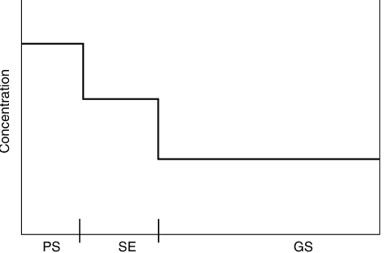

图5.11 毒性效应作为浓度和时间的函数，其中时间表示为按暴露类别定义的划分变量（PS，烟羽冲击；SE，停滞事件；GS，生长季节）。

## 5.4.5.3 三维模型

毒性效应的三维表示很少见。只有浓度-时间-反应模型可以容易地从常规试验数据中推导出来。这类函数可以从ASTM和EPA规程所要求的鱼类流水式96小时LC₅₀试验数据中推导出来（ASTM 1991；USEPA 1982）。这类模型的明显优点是允许评估者从暴露浓度和持续时间的不同组合中估计效应水平。Richardson和Burton（1981）为暴露于臭氧化水中的两种河口物种以及暴露于SO₂的树木开发的响应曲面就是很好的例子。

浓度-时间-反应关系也可以是处理不同数据的有效工具。如果试验数据在效应持续时间和严重程度上都存在差异，那么如果要计算监管标准浓度，这两个维度都必须与浓度相关。Dourson（1986）解释了如何用这种方法估算人类每日允许摄入量。各种暴露被分类为：未观察到效应、未观察到有害效应、有害效应或明显效应。然后将这个严重程度等级转换为一组符号，绘制在剂量-时间平面上。然后通过目测拟合出曲线，将严重程度类别分开，并确定无有害效应水平、有害效应水平和明显效应水平。EPA也采用了同样的方法来制定空气污染物对植物毒性的空气质量标准。美国农业部报告称，地面臭氧对植物造成的损害（生长和产量）比其他空气污染物的总和还要大（图5.12和图5.13a、b）（USDA 2011）。

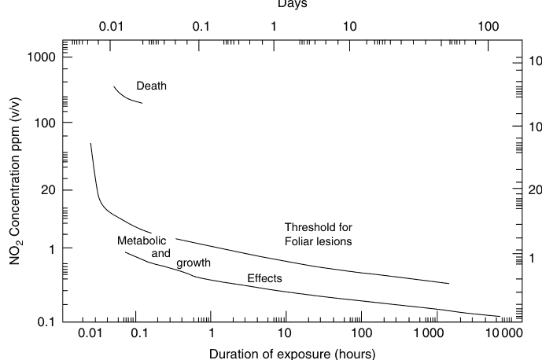

图5.12 NO₂对植物效应的分类，按暴露浓度和持续时间排列。
来源：摘自USEPA（1982）。

环境。目前只有14%的塑料包装被收集回收。图5.14显示了在伦敦泰晤士河老Queenhithe码头现场冲上来的部分塑料垃圾（《西雅图时报》，2018年2月22日）。据估计，仅2010年就有440万至1320万公吨塑料进入海洋环境。该报告还强调，如果目前的趋势继续下去，到2050年海洋中塑料的重量将等于鱼类的重量。

在确定了化学品向空气、水和土地释放的暴露风险以及与该风险相关的不确定性程度之后，下一步是利用这些信息改进决策基础。这通常涉及公众，或者至少要考虑公众的关注和态度。这需要审视一个问题：“什么风险是可接受的？”其中一个重要部分是风险沟通——以公开和透明的方式进行沟通，理解和吸引利益相关者参与，以及提供平衡的信息，让公众能够就如何应对风险做出决定。

在《纽约时报》发表的一篇文章（2018年3月23日刊）中，据报告约有87 000公吨塑料存在于太平洋地区。在加利福尼亚和夏威夷之间的太平洋上，距任何大城市数百英里处，塑料瓶、儿童玩具、破损的电子产品、废弃的渔网以及数百万碎片漂浮在水中。这片臭名昭著的区域被称为“大太平洋垃圾带”，这是一个旋转的海洋墓地，日常物品被洋流沉积于此。塑料最终会分解成微小颗粒，常被鱼类吞食，并可能最终进入我们的食物链（《纽约时报》，2018年3月23日）。

## 5.4.5.4 塑料垃圾堵塞海洋、河流和垃圾填埋场

有史以来生产的91亿公吨塑料中，约60%已成为废物，其中四分之三以上进入垃圾填埋场或自然环境

根据这些报告，Amcor、Ecover、Evian、欧莱雅、Mars、M&S、百事可乐、可口可乐、联合利华、沃尔玛和Warner & Mertz——这些公司每年合计使用超过600万公吨的塑料包装——已承诺到2025年仅使用可重复使用、可回收或可堆肥的包装。在有关塑料垃圾在全球构成风险的证据日益增多的情况下，一些公司正在拥抱环保和更多的回收利用（参见第4.20.7节中关于RCRA的讨论


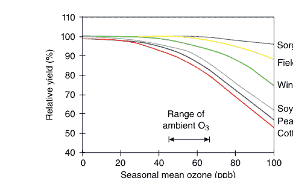

**图 5.13** （a）臭氧对萝卜植株的损害导致萝卜变小。*来源：* 引自 Haggestad (2001)。（b）臭氧对植物生长和产量的影响。Heck 等 (1983)。

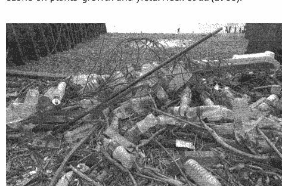

**图 5.14** 伦敦泰晤士河中的塑料垃圾。

资源保护与回收以及有关塑料回收的更多内容见第 4.20.6 节）。

在死去的抹香鲸体内发现了超过 48 磅的塑料，包括一次性餐具、波纹管、购物袋以及条形码仍清晰可见的洗涤剂包装。这是鲸类尸体因数十磅塑料垃圾而负担沉重的最新一起令人沮丧的国际案例。欧洲是世界上第二大塑料生产国，每年向海洋倾倒 15 万至 50 万吨大块塑料和 7 万至 13 万吨微塑料。“塑料污染是当今世界上海洋物种最糟糕的敌人之一。”

## 5.5 环境与健康风险信息的沟通

任何行业成功的环境与健康风险管理的一个关键组成部分是有效的社区外联，或社会责任计划。在当前公众获取和接触有关当地健康和环境问题的信息的爆炸式增长，以及对这些信息的兴趣日益增加的背景下，这一点比过去更重要。互联网

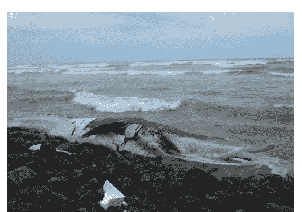

**图 5.15** 死鲸体内发现的塑料垃圾。*来源：* Seame Sardinia Onlus 拍摄的照片，美联社。《纽约时报》，2019 年 4 月 3 日。

提供全天候 24 小时公众可用的工业设施信息；美国环保署和环境保护基金等提供的网站只需点击鼠标即可向所有用户提供当地工业状况的最新信息。

未采取主动沟通方法的设施可能会发现公众被大量关于工厂运营的负面信息所包围，而没有积极的数据或信任行业的理由。事实上，如果缺乏开放的沟通或公众对信息可获取性的认知，一家公司即使其设施运营不存在环境或健康风险，也可能获得负面形象。

化学工业为缺乏沟通时真实风险与感知风险可能出现分歧提供了很好的例子。虽然 1991 年至 1997 年间有毒化学品和疑似致癌物的排放量大幅减少，且化学工业的事故率下降了 32%，但公众对化学工业的看法并未改善。事实上，只有 25% 生活在化工厂附近的人对该行业持 favorable 态度。一般来说，公众不会听到关于积极创新或风险降低进展的消息，对所听到的内容持怀疑态度。这些行业必须努力建立信任。如果他们想缓解和/或避免与邻居的未来冲突，就必须积极改善其公众形象。

行业致力于与当地社区建立并保持持续对话至关重要。这种对话需要成为几乎每个工业设施日常运营不可或缺的一部分，管理层提供信息获取，同时学习并回应公众的疑问和关切。

正如第 5.5.1 节所示，未与邻居建立沟通渠道的设施可能会在不情愿的情况下被卷入其中——在这种情况下，他们将处于防御状态，并可能引发公众担忧，甚至愤怒。唯一有效的解决方案是随着时间的推移与当地社区和其他关键受众建立关系。

### 5.5.1 从担忧到愤怒：公众反应的决定因素

什么可能使人们对真实或感知的风险感到担忧或愤怒？答案取决于一系列风险感知和环境脆弱性因素。表 5.5 列出了其中一些环境脆弱性因素。如果行业与公众之间缺乏定期沟通，人们往往会利用其总体印象来形成对社区内设施可接受性的看法。印象可能基于工厂的“外观”，例如建筑物和场地是否得到良好维护和保养。如果排放烟雾或蒸汽，或邻居能闻到或听到工厂运营，则该设施的环境脆弱性会被认为更大。如果工厂有社区或员工健康投诉的历史，或已知现场存在高关注物质，如放射性物质，则环境脆弱性也会很高。此外，设施在其所在社区的适当性或不适当性也很重要。人们会对位于学校、医院或重要风景或文化遗址附近的设施运营所带来的风险特别敏感。

环境脆弱性概念有助于识别加剧公众担忧的因素。然而，

## 表 5.5 环境脆弱性因素清单。

| 环境脆弱性因素 |
|---|
| • 人们可以看到、闻到、听到的东西（例如气味、蒸汽云、噪音） |
| • 大量的排放物或危险废物 |
| • 社区或员工健康投诉的历史 |
| • 不明气味或泄漏的历史 |
| • 存在已知致癌的“令人恐惧”物质 |
| • 设施、卫生或外观不佳 |
| • 靠近敏感地点，包括学校、养老院和医院 |
| • 学校儿童或教职工健康问题报告 |
| • 靠近重要的风景或文化遗址 |
| • 有组织的环保团体的积极存在 |
| • 社区外联历史不佳 |
| • 缺乏风险和危机沟通计划 |

环境脆弱性并不能阐明为什么人们会对某些风险感到愤怒，而对其他风险却不然。在他对“愤怒因素”的经典讨论中，Sandman (1993) 概述了有助于确定人们对风险反应中愤怒或恐惧程度的风险特征。根据 Sandman 的说法，公众对风险的感知超出了科学家和工程师偏好的狭义定义。后者使用技术定义的风险，可通过将危害程度乘以暴露概率来确定，如下所示：

```
Risk = hazard × exposure  (5.6)
```

在此定义中，风险随着过程或材料的危险性（例如化学品的毒性）以及受影响人员暴露的量和时间而增加。

然而，公众对风险的理解需要将 Sandman 所称的“愤怒”纳入方程。愤怒涵盖了与风险相关的所有因素，不包括技术危害。这些因素对公众感知极其重要，包括风险是自愿承担的，如吸烟或不系安全带，还是非自愿的，如死于工厂爆炸，风险是由个人控制还是由系统控制，以及它是工业性的还是自然的。与行业或事件相关的感知风险如果其影响令人恐惧、集中在时间和空间上、非自愿、令人难忘且没有可见益处等，则会很高。在纳入愤怒因素后，外行人对风险的看法可以概括并表示如下：

```
Risk = hazard + outrage  (5.7)
```

其中风险和危害与式 (4.9) 相同，而愤怒代表愤怒因素的纳入。虽然技术风险水平也会引起人们关注，他们会期望采取行动，但愤怒因素将有助于决定他们的愤怒程度，并影响风险被感知为更危险还是更不危险。Sandman 愤怒因素的定性分解见表 5.6。

显然，对行业有利的是在公民反应达到愤怒状态之前，向公众传达关于潜在或感知问题的可信信息。

### 5.5.2 环境与健康风险沟通的可持续策略

虽然许多工业设施可能认识到沟通的好处，但许多设施不愿投入必要的时间和金钱来启动社区


### 表5.6 愤怒因素。

| 风险较高 | 风险较低 |
|---|---|
| 非自愿 | 自愿 |
| 工业/人工 | 自然 |
| 奇特/不寻常 | 熟悉 |
| 易记住 | 不易记住 |
| 令人恐惧 | 不令人恐惧 |
| 时间和空间上集中 | 时间和空间上不集中 |
| 不公平 | 公平 |
| 道德相关 | 道德中立 |
| 不可信 | 可信 |
| 封闭过程 | 开放过程 |
| 无明显益处 | 可见益处 |

*来源：出自桑德曼（1993）。*

外联项目。一些管理者认为，如果人们已经通过行业无法控制的方式获取信息，那么对抗这一过程毫无意义。事实上，他们明智地不去质疑环保团体声明的技术依据：行业不具备这些团体所拥有的可信度，此类质疑很可能被视为混淆视听，进一步损害行业形象。然而，缺乏沟通会助长负面认知。沟通不应被视为对负面宣传的回应，也不应具有对抗性。要想有效，沟通必须成为日常运营的基本组成部分。

## 5.5.2.1 打破沟通障碍

> *沟通中最大的问题，是那种“沟通已经发生”的错觉*
> 
> - 乔治·伯纳德·肖。

行业通常使用以下合理化理由来为不沟通的立场辩护。

### 我们规模太小，不适合做外联

一个低调或“无形象”的设施，实际上可能因缺乏外联历史而招致更多公众审查。没有为社区外联分配预算、活动或人员的公司，可能认为这是与其规模和潜在风险相匹配的。然而，即使是一家小型化工设施，也可能成为公众愤怒的对象，尤其是当人们认为风险被隐瞒时。

### 我们的设施和运营在环境上是健全的

良好的环境绩效当然是一个设施努力成为好邻居的关键。然而，只有将环境绩效与定期沟通和信任相结合，才能建立成功的关系。特别是，如果行业与公众之间没有沟通记录，人们就会基于对其设施的总体印象来判断某个运营者是否是好的邻居。每个设施在某种程度上都会受到公众的质疑、担忧甚至愤怒的影响（谢德 2014）。

### 如果我们和人们交谈，他们会心烦意乱

有时，经过数年甚至数十年的沉默，一个工业设施会突然发现自己与邻居展开了积极而激烈的对话。引发沟通的事件可能是一次轻微的化学品泄漏，尽管风险很小，却需要消防部门和其他应急响应人员作出大规模反应。虽然风险的技术水平会影响公众反应，但愤怒程度在很大程度上取决于此前与公司的经历。沟通本身并不制造愤怒。当不公平的表象导致不信任，并让人认为风险无法或不会被控制时，愤怒就会产生。

### 我们的人手已经超负荷了

风险沟通和社区外联必须成为每个设施日常业务计划和员工岗位职责的一部分。第5.5.2.2节讨论了如何实现这些目标。从长远来看，如果公众愤怒保持低位并避免对抗，则可以节省时间和金钱。风险沟通计划应被视为一种预防未来与邻居发生问题的保险。通过关注社区关切，行业可以在很大程度上避免因本不应引起恐慌的情况而措手不及。

## 5.5.2.2 建立沟通计划

在确定了接触标准污染物和有害污染物的风险以及相关不确定性之后，下一步是利用这些信息来改善决策基础。这通常涉及公众，或至少包含公众的关切和态度。

有效的风险沟通计划的理由，以及确定公众对风险的反应或愤怒程度的理论基础，都已经讨论过。在实践层面，行业需要将这些概念付诸实施。尽管每个设施都会制定自己的方法，

该设施却没有努力与其邻居交谈，也没有了解他们的潜在担忧。事实上，附近大多数居民并不知道该工厂的存在。当人们突然通过黑烟排放发现这个设施时，他们感到愤怒。居民们认为，他们有权知道自己社区内存在什么样的工业设施，以及该设施对环境和健康构成什么样的风险。

## 5.5.3.2 不沟通的代价

该油水分离设施只有在公司资助了两次健康风险评估、为清洁和停工期间使用的化学品设定了健康保护水平、承诺在非常规操作期间提供广泛的环境监测，并主办了四次社区会议之后，才得以继续运营。尽管公司努力赢得社区信任，但当该公司试图在20英里外重新开设类似设施时，第一个社区的居民提出抗议，并成功阻止了第二家设施获得运营许可证。

公司代表发现得太晚了：被忽视的公众所引发的关切，其后果可能代价高昂。当地社区关切的问题包括当地工业的基本事实以及其运营可能带来的风险。在美国，根据《信息自由法》和许多环境法规条款，人们有权获得此类信息。如果油水分离设施早与社区展开对话，那么这次与公众的会面就不会与发展中的危机相关联。

这个案例研究说明了当行业与公众之间缺乏持续、双向沟通的记录时，情况会以多快的速度升级为危机。表5.5中列出的若干环境脆弱性因素都起了作用：人们最初开始对来自意外来源的不明排放感到担忧；他们事后才质疑将该设施设在如此靠近小学和住宅区的地方是否明智；而那些经历过异常健康问题的人开始怀疑这与油水分离设施有关。

在类似这种情况下，公众几乎没有理由信任造成风险的行业或设施，愤怒因素的作用也可能非常强烈（见表5.6）。不寻常且令人难忘的冒烟排放引发了一种担忧，即人们对自己社区允许何种工业毫无控制权。分离厂的管理层被认为不值得信任。此外，人们还对该公司在事件发生前未能与邻居沟通而感到不满（博霍尔姆 2008）。

## 5.5.4 经验教训

与公众沟通的关键不仅在于简单地解释技术危害，还在于理解并回应人们愤怒的根源。公共沟通并不随着分发知情权信息而结束。恰恰相反——随着越来越多的社区成员获取信息，他们倾向于在整个风险管理过程中要求更多发言权。行业不仅必须准备好沟通，还必须准备好与当地社区共享决策权。只有社区参与成为设施日常运营和公司文化的一部分，这些努力才能成功。与公众建立良好关系需要时间。然而，正是这些关系会给公司带来信任和信誉。这并不意味着永远不会出现冲突，但确实意味着，在向公众解释关于健康、环境和安全风险的复杂技术信息时，设施不必从零开始。

## 5.6 互联网上的环境信息获取

互联网提供了即时获取大量环境（以及化学和其他）信息资源的途径。互联网提供了许多可用于环境风险评估和环境风险管理的资料。然而，并非所有来源都具有同等价值。第5.6.2节向使用以下来源数据的人给出了一些重要警告：

- 联邦、州和地方政府的可检索法规数据库
- 大学和研究机构的技术信息
- 关于化学品和环境趋势及具体事件的数据，这些数据由数百家公司报告，并由行业协会、政府机构和非政府组织进行分析
- 美国职业安全与健康管理局（OSHA）和美国环境保护署（USEPA）提供的执法检查指南和处罚选择
- 环境和化学工程支持服务提供商的产品列表和能力说明，以及此类公司的目录


- 与材料交换相关的链接，以及污染预防技术和其他资源，用于降低与危险材料处理、释放和处置相关的成本和责任
- 在线新闻服务
- 出版物、会议公告以及其他专业交流机会

以下是网络上可用的最佳环境资源，以及一些鲜为人知但极具价值的网站，用于支持环境和化学决策的数据、监管机构提供的模型和资源、宣传和公众沟通方面的帮助，以及环境出版物（Bolstridge 2003）。

## 5.6.1 互联网资源

### 5.6.1.1 EPA 的综合风险信息系统

http://www.epa.gov/irisweb/iris/index.html. 综合风险信息系统（IRIS）是 EPA 关于化学品暴露对人类健康影响的剂量-反应数据的数据库。可搜索的数据库包含超过 500 种物质的信息，旨在用于癌症风险评估、决策制定和监管活动（USEPA 2005）。

### 5.6.1.2 EPA 化学事故历史和调查

http://yosemite.epa.gov/oswer/ceppoweb.nsf/content/preventingaccident.htm. 该页面允许访问近期化学事故的文档和报告、EPA 化学事故调查队的调查以及国家响应中心的事发摘要，以及相关的咨询和通知。EPA 的意外释放信息计划数据库包含 1986 年至 2000 年间美国固定设施发生的危险化学品意外释放信息。EPA 地区办公室要求设施填写一份 23 个问题的问卷，内容涉及设施、事件的 circumstances 和原因、事件发生前已实施的控制和预防措施和技术，以及因释放而做出的改变。问卷侧重于事故预防，包括危害评估、培训、应急响应、公众通知程序、缓解技术以及预防设备和控制措施。整个数据库（压缩格式）可以下载并使用任何能够处理 dbase 格式文件的数据库程序进行搜索。问卷的副本和解释数据库字段的数据字典也包含在压缩文件中。

### 5.6.1.3 国际毒性估计风险数据库

http://www.tera.org/jiter. 国际毒性估计风险（ITER）数据库是汇编了全球各健康组织认定的 500 多种环境关注化学品的人类健康风险值。用户可以获取任何所列化学品的实际风险值（例如 非致癌经口；致癌经口；非致癌吸入；致癌吸入），以及产生所报告风险值的研究或调查的详细信息，包括同行评审信息和详细的文献参考。

### 5.6.1.4 AIRNow 的实时空气污染数据链接

http://www.epa.gov/airnow. 该网站提供全国空气质量信息访问，包括空气质量预报和超过一百个美国城市的实时空气质量。提供本地空气质量预报，以及链接到州和地方网站以提供实时空气质量监测和预报数据。每个州/地方互联网站点提供的信息类型不同，但很大程度上集中于城市地区臭氧和空气质量指数，这些指数通常在新闻媒体中报道。

### 5.6.1.5 空气与废物管理协会的州机构名录

http://www.awma.org/resources/gad/state.htm. 空气与废物管理协会网站提供与环境法规和合规执法相关的州机构的链接。

### 5.6.1.6 酸雨、大气沉降和降水化学

http://btdqs.usgs.gov/acidrain. 美国地质调查局的国家大气沉降计划和国家趋势网络在美国各地 220 个站点收集数据，以确定减少空气污染的监管措施是否改善了降水的质量。由于需要实验室分析，从数据收集到结果可用之间存在五到六个月的时间滞后。在线数据访问需要填写表格并提供请求者的姓名、地址以及数据的预期用途。数据收集包括日降水量、现场和实验室 pH 值，以及硫酸盐（SO₄）、硝酸盐（NO₃）、氨（NH₄）、钙（Ca）、镁（Mg）、钾（K）、钠（Na）、氯化物（Cl）以及来自 NO₃ 和 NH₄ 的氮（N）的每周、每月和年度平均浓度和干沉降数据。

### 5.6.1.7 预测混合化学品的反应

http://response.restoration.noaa.gov/chemaids/react.html. 国家海洋和大气管理局（NOAA）的化学反应工作表是一款免费软件包，包含 4000 种化学品的反应性数据，并确定化学品意外混合的反应性影响。根据化学品被归类为一个或多个反应性组，软件预测当各组成员混合在一起时可能发生的反应类型。它不限制可选择混合的化学品数量，但对于超过 10 种化学品时效果会降低。

### 5.6.1.8 模拟油泄漏

http://response.restoration.noaa.gov/software/gnome/gnome.html. NOAA 提供软件，可指定油泄漏情景。通用 NOAA 油建模环境模型使用潮汐和洋流数据生成泄漏的预测轨迹。

### 5.6.1.9 有毒物质危害分析，第 3 版

http://yosemite.epa.gov/oswer/ceppoweb/content/dsepd_s.htm#hats. 有毒物质危害分析是面向应急规划者和响应人员的菜单驱动屏幕演示。它介绍了 EPA 的《应急规划和社区知情权法》计划以及 EPA 分析制造厂周边社区有毒物质危害的方法，在这些工厂中制造或使用此类材料。

### 5.6.1.10 EPA 暴露评估建模中心

http://www.epa.gov/ceampubl/index.htm. 该网站提供暴露评估软件包的表格清单，用于解决地下水、地表水、食物链和多媒体系统中有机化学品和金属的建模问题。模型可供下载，并附有软件包功能描述。

### 5.6.1.11 监管空气模型

http://www.epa.gov/ttn/scram. EPA 的监管空气模型支持中心提供各种空气模型的源代码、数据集和用户指南，包括监管模型（ISCST3、UAM、BLP、CTDMP）、受体模型（CMB7、CMB8）、筛选模型（CAL3QHC、CTSCREEN、LONGZ、SHORTZ、VALLEY）、其他空气模型（DEGADIS、PLUVUE2、TOXST、MESOPUFF、RPM-IV、FDMI）、相关程序（CALMPRO、RAMMET、WRPLOT、MPRM、MIXHTS）以及非 EPA 模型（SLAB、ADAM、AFTOX、SCREEN）。

### 5.6.1.12 EPA 的风险管理后果分析（RMP*Comp）

http://www.epa.gov/ceppo/tools/rmp-comp/rmp-comp.html. EPA 提供该免费软件的 1.07 版，用于执行《清洁空气法》第 112(r) 条要求的风险管理后果分析。

### 5.6.1.13 有毒物质和疾病登记署的健康风险沟通入门

http://atsdr1.atsdr.cdc.gov/HEC/primer.html. 有毒物质和疾病登记署提供了一套向多元受众传达健康风险信息的原则和方法的框架。它面向必须回应公众对环境中危险物质暴露担忧的发言人。该文件包含一份“应做和不应做”清单，描述了传达风险信息时应采用的方法和应避免的陷阱。

### 5.6.1.14 印第安纳法学院的灾害沟通

http://www.law.indiana.edu/webinit/disaster/index.html. 该网站总结了影响全球自然和人为灾害相关信息和沟通的国家法律和国际公约，包括改善救援工作和减少总体影响。该网站提供访问有关新闻媒体在灾害减缓中作用的文档，并链接到其他参与灾害沟通的组织。

### 5.6.1.15 EPA 国家环境出版物服务中心

http://www.epa.gov/ncepihom/ordering.htm. 该网站接入 EPA 所有文档的中央存储库，可免费下载或通过邮寄获取。超过 5500 个标题可提供纸质和/或电子格式。

### 5.6.1.16 国家科学院报告在线

http://nap.edu/info/browse.htm. 国家科学院出版社出版国家科学院、国家工程院、国家研究委员会和医学院发布的报告。各种环境、健康、自然资源和工程主题的许多文本可在线查阅或订购。

## 5.6.2 使用互联网的含义和局限性

互联网已成为科学和技术的终极数据源。然而，在将互联网数据应用于科学工作或监管合规时必须谨慎使用。通常，信息在互联网上发布时并未描述用于开发数据的研究或研究。当此类文档是


缺乏时，考虑向维护该网站的组织或个人发送电子邮件以请求参考信息。一些在线数据严重过时，或代表尚未经过准确性或质量审查的学生研究成果。最后，互联网上提供的数据可能并非为环境或化学分析目的而开发，因此可能包含隐藏的偏见或不准确之处，使其不适合您的预期用途。请认识到，从互联网上下载免费数据时，您可能得不到您认为所获得的东西。

依赖官方政府网站有助于避免被某些互联网网站的内容误导。然而，大学和非营利组织可以提供关于近期事件和问题的更及时或更详细的信息。始终审查任何作为资源使用的互联网位置背后的组织。重点关注定位资金来源类型、同行评审和数据质量评估，以及最后更新日期，以获得对特定网站所代表真实价值的额外洞察。许多此类信息可在网上获得，或可通过向网站开发者发送电子邮件获得。化学和环境工程专业人员需要多种类型的信息。现在许多所需数据，甚至整个软件包，都可免费从互联网上下载。事实上，随着互联网的成熟，海量数据和软件正变得人人可得。然而，将数据转化为信息，更重要的是将信息转化为知识，已成为科学专业人员面临的主要挑战。

## 5.7 健康与职业安全

### 5.7.1 职业安全与健康管理局

《OSHA 法案》旨在尽可能确保全国每一位工人享有安全健康的工作条件并保护我们的人力资源（OSHA 2018）。根据该法案，OSHA 在美国劳工部内部成立，以

- 1) 鼓励雇主和雇员减少工作场所危害并实施新的或改进现有的安全和健康计划
- 2) 提供研究以开发应对职业安全和健康问题的创新方法
- 3) 建立雇主和雇员在实现更好安全和健康条件方面的“各自独立但相互依存的责任和权利”
- 4) 维持报告和记录保存系统以监测与工作相关的伤害和疾病
- 5) 建立培训计划以增加职业安全和健康人员的数量和能力
- 6) 制定强制性工作安全和健康标准并有效执行
- 7) 为州职业安全和健康计划的发展、分析和评估以及批准提供便利。

### 5.7.1.1 “知情权”法律

也许有史以来采用的最重要的安全和健康标准之一是 OSHA 危害沟通标准，更通俗地称为“知情权”法。该危害沟通标准要求雇主向雇员传达工作场所内存在的有害化学品的信息。该计划要求雇主制定书面的危害沟通计划，为所有有害化学品保存材料安全数据表（MSDS），并确保适当的警告标签到位。

OSHA 颁布的《危险废物作业与应急响应法规》解决了参与《授权》作业以及根据 RCRA 进行的某些危险废物处理、储存和处置作业的雇员的安全和健康问题。该标准为初始现场表征和分析、监测活动、培训和应急响应期间的雇员保护提供了规定。

法规下的四个主要领域如下：

- 1) 在政府健康或环境机构已确定需要清理的无控制危险废物场地的清理作业。
- 2) 危险废物 TSD（运输、储存和处置）设施的常规作业，或受 40 CFR 第 264 和 265 部分监管的任何设施的部分。
- 3) 危险物质已或可能泄漏的场地的应急响应作业。
- 4) RCRA 场地的纠正措施。

该法规针对上述作业中的三类特定工人群体。第一，它规范了根据 CERCLA 进行的危险物质响应作业，包括在确定 CERCLA 场地是否存在危险物质之前进行的初始调查；根据 RCRA 进行的清理作业中的纠正措施；以及已被州或地方政府当局指定进行清理的场地的危险废物作业。第二类受覆盖的工人是从事危险废物 TSD 设施作业的雇员。第三类受覆盖的雇员是从事危险物质泄漏或严重泄漏威胁的应急响应作业以及对该类设施的应急响应后作业的雇员。

### 5.7.1.2 国家职业安全与健康研究所

国家职业安全与健康研究所（NIOSH）为 OSHA 在其法规中使用的工业暴露标准提出建议。OSHA 有权执行 NIOSH 推荐的所有安全和健康法规和标准。尽管 OSHA 隶属于美国劳工部，但 NIOSH 隶属于美国卫生与公众服务部，是一个旨在通过收集信息、开展科学研究并将获得的知识转化为产品和服务来帮助提供职业伤害、残疾和死亡领域的科研、信息、教育和培训的机构。NIOSH 的使命对每一位美国工人的健康和安全至关重要。NIOSH 的目标包括以下内容：

- 1) 开展研究以减少与工作相关的疾病和伤害
- 2) 通过干预、建议和能力建设促进安全健康的工作场所。
- 3) 通过国际合作增强全球工作场所安全和健康。

NIOSH 口袋指南可在网上找到：http://www.cdc.gov/niosh/npg/pgdstar.html。它包括安全信息、某些化学特性以及 OSHA 允许接触限值浓度，或 PEL。允许浓度越低，对人类健康的危害越大。根据法律，这些浓度值在工作场所不得被超过。必须对这些化学品进行浓度测量，以便了解暴露水平并解决任何记录在案的过度暴露情况。

### 5.7.1.3 材料安全数据表

MSDS 是由化学品制造商编制的文件。MSDS 包含安全和危险信息、物理和化学特性以及安全操作和使用的预防措施。它还可能包括对动物，特别是水生物种的危害。制造商有义务保持其最新。任何购买化学品的雇主均依法有义务向雇员提供 MSDS。MSDS 的编制要求源于 OSHA 的《危害沟通标准》。

### 5.7.1.4 综合风险信息系统

IRIS 是由 USEPA 维护的数据库。IRIS 代表综合风险信息系统。可通过 http://www.epa.gov/ngispgm3/iris/index.html 获取。IRIS 是可能因接触环境中发现的各种物质而导致的人体健康影响数据库。

### 5.7.1.5 纳米技术立法

请评论从 OSHA 角度来看，为环境控制/关注纳米技术（操作者）需要何种程度的新立法和规则制定。工作场所接触化学物质（包括纳米颗粒）以及肺毒性的潜在风险受 OSHA 法案下的 OSHA 管制，包括要求在 MSDS 上披露潜在危害。（一个有趣的问题是，碳纳米管在化学上是碳，但由于其尺寸和结构不同，其性质不同，对于 MSDS 目的而言是否被视为与炭黑相同或不同）。预计政府和私营机构都将制定工作场所暴露所需的最适阈值限值（Theodore 2006）。

## 5.8 工业过程安全系统指南

工业安全系统是石油和天然气厂以及核电厂等任何危险工厂中的关键对策。它们用于在工艺超出允许控制范围时保护人员、工业厂房和环境。

顾名思义，这些系统并非旨在控制工艺本身，而是提供保护。工艺控制通过工艺控制系统（PCS）进行，并由安全系统联锁，以便在 PCS 失效时立即采取行动。

工艺控制和安全系统通常合并为一个系统，称为集成控制和安全系统。工业安全系统通常使用经过安全完整性等级（SIL）认证的专用系统。SIL 定义为安全功能提供的相对风险降低水平，或指定目标风险降低水平。简单来说，SIL 是对安全仪表功能所需性能的衡量。SIL 适用于硬件和软件要求，如卡件、处理器冗余和表决功能。在任何情况下，安全都不得因成本而受损（CCPS 2012；Crowl and Louvar 2011；Das and Prabhudesai 1996）。


## 5.8.1 安全系统类型

化工及相关产品行业中的*安全系统*主要有两种类型：

- 过程安全系统或过程停车系统（PSS）
- 安全停车系统（SSS）：包括紧急停车（ESD）和紧急泄压（EDP）系统

还存在第三种系统，它起到屏障作用，容纳来自法兰、阀门和管接头喷出的热油和气体。这类系统通常称为安全喷溅防护罩和法兰护罩。OSHA 规定必须使用喷溅防护罩。

### 5.8.1.1 紧急停车系统

这些系统也可按 ESD/EDP 级别重新定义如下：

- ESD 1 级：负责全厂区域停车，必要时可激活 ESD 2 级。该级别只能在过程工业工厂的主控室中启动。
- ESD 2 级：该级别将各个 ESD 区域停车并隔离，必要时激活 EDP。
- ESD 3 级：该级别提供“液体物料截留”。

### 5.8.1.2 安全停车系统

在紧急情况下，SSS 应将设施停车至安全状态，从而保护人员、环境和资产。SSS 应管理与 ESD 功能（环境和人员保护）相关的所有输入和输出。该系统也可能由主火灾和可燃气体系统（FGS）的信号驱动。

### 5.8.1.3 火灾和可燃气体系统

火灾和可燃气体系统（FGS）控制的主要目标是保护人员、环境和工厂（包括设备和结构物）。FGS 应通过以下方式实现这些目标：

- 在早期阶段检测可燃气体的存在
- 在早期阶段检测液体泄漏（LPG 和 LNG）
- 检测初期火灾和火灾的存在
- 按需提供自动和/或手动启动消防系统的设施
- 启动环境调节，使液体保持在其闪点以下
- 按需启动声光报警信号，以警告检测到的危险
- 当 2 个检测器中 2 个或 3 个检测器中 2 个被触发时，自动关闭设备和通风
- 启动排风系统

### 5.8.1.4 紧急泄压系统

在工艺过程中，由于 ESD 阀关闭，可能会有一些被截留的可燃流体，必须将其释放以避免任何不良后果（如容器和管道中的压力升高）。为此，EDP 系统与 ESD 系统结合使用，以安全的方式将这些截留的流体释放到安全位置。

### 5.8.1.5 压力安全阀

压力安全阀（PSV）通常用作最终安全解决方案：当所有前述系统都未能阻止压力进一步积聚时，通过其设计动作保护容器免因超压而破裂。

## 5.9 工业卫生

*工业卫生*或*职业卫生*是对可能导致工人受伤、患病或影响其健康的工作场所危害进行预见、识别、评估、控制并确认防护措施。这些危害或应激源通常分为生物、化学、物理、人体工效学和社会心理等类别。特定应激源产生健康影响的风险是危害程度乘以个人或群体暴露量的函数。对于化学品，其危害可通过剂量-反应关系来理解，该关系通常基于毒理学研究或模型。*工业卫生学家*与毒理学家密切合作以了解化学危害，与物理治疗师合作应对物理危害，与医生和微生物学家合作应对生物危害。环境和工业卫生学家被认为是暴露科学和暴露风险管理方面的专家。根据个人工作类型，卫生学家会运用其暴露科学专业知识来保护工人、消费者和/或社区（Johnson 2017）。

### 5.9.1 毒理学

物质有毒的程度称为毒性。毒物是指任何化学物质，当被吸入、摄入、经皮肤吸收，或涂敷、注射入体内或在体内生成时，即使量相对较小，也可能通过其化学反应导致身体结构损伤或人体功能紊乱甚至死亡。大多数化学物质通过呼吸道、消化道、眼睛和皮肤进入人体。

定义了两个毒性水平：（i）急性“短期”暴露，导致立即中毒；（ii）慢性“长期”暴露，导致贫血、白血病和死亡。

### 5.9.2 TLV 与暴露限值

毒性阈限值（TLV）是指在给定时间内可耐受且不产生任何毒性作用的空气中毒物的最大浓度。常用限值的定义如下。

TLV 和暴露限值的不同类型如下：

| TLV-TWA | 正常 8 小时工作日或 40 小时工作周内，工人可暴露且无不良影响的时间加权平均浓度（TWA） |
| TLV-STEL | 短时间暴露限值，即工人连续暴露至多 15 分钟而无不良影响的最大浓度 |
| TLV-C | 上限值，即任何时候都不应超过的浓度 |
| PEL | 容许暴露限值，即 OSHA 29 CFR 1910.1000 允许的最大暴露量 |
| IDLH | 立即威胁生命或健康浓度，即人员可在 30 分钟内逃离而不出现影响逃逸症状或任何不可逆健康影响的最大浓度 |

TLV 以按体积计的百万分率（ppm）或毫克/立方米（mg/m³）表示。

```
1 ppm = (P · M) / (0.08205 T) mg/m³ = 0.04 M at 25°C and 1 atm
```

其中

- P = 压力，单位为 atm；
- T = 温度，单位为 K；
- M = 分子量

## 5.10 大气危害

大气危害主要包括三种类型：缺氧大气、爆炸性/可燃性大气和有毒大气。对于这些类型的危害，在进入人孔或其他受限空间之前需要进行空气监测和通风。空气监测设备将在本章后面讨论。应当注意，由工业用户排放引起或促成的大气危害，导致工厂和工作场所内存在数量可能造成工人急性健康与安全问题的有毒气体、蒸气或烟雾，违反了 40 CFR 403.5(b)(7) 中的具体禁止规定。

### 5.10.1 缺氧大气

OSHA 对大气中氧气浓度的最低要求为 19.5%。进入氧气浓度低于 19.5% 的大气环境必须使用自给式呼吸器。氧气浓度大于 25% 时即为富氧大气，因其能够支持燃烧，也被视为危险。正常空气由表 5.7 所列的气体组成。其他气体（如氮气和二氧化碳）在正常条件下无害，但可能在受限空间中积聚到足以置换维持生命所需氧气的量。当大气中的氧气浓度降至 10%–16% 时，人会出现呼吸急促。氧气浓度为 6%–10% 时会发生意识丧失；当氧气浓度降至 6% 以下时，人将迅速死亡。

### 5.10.2 有毒大气

评估大气中化学危害的指南有多种。TLV 是由美国政府工业卫生学家会议（ACGIH）制定并发布的指南，用于识别和控制潜在危害。TLV 的一种形式，即 TWA，是指工人在 8 小时工作日或 40 小时工作周内可接触的蒸气相浓度，且不会产生慢性或急性健康影响。TLV-TWA 数值有时用于计算工业用户排放 VOC 的筛选水平。各种化学物质的 TLV 请参见 http://www.acgih.org/tlv-bei-guidelines/tlv-chemicalsubstances-introduction。

美国环保局（EPA）于 1992 年 6 月发布了一份题为《保护公有污水处理厂（POTW）工人免受有毒和活性气体及蒸气危害的指南》（EPA 812-B-92-001）的指导文件。该文件应用于评估暴露于有毒大气的可能性以及避免接触的必要步骤。

**表 5.7 大气成分。**

| 气体 | 体积（%） |
| 氮气 | 78.09 |
| 氧气 | 20.95 |
| 氩气 | 0.93 |
| 二氧化碳 | 0.03 |


在这样的环境中。硫化氢（H₂S）是收集系统中常见的一种气体。这种气体由有机物厌氧分解产生，比空气重，容易在密闭空间底部聚集。低浓度时，硫化氢有臭鸡蛋味；但浓度较高时，嗅觉系统会受损，无法通过气味察觉该气体。硫化氢的TLV-TWA为100 ppm。在较高浓度下，H₂S会对眼睛、神经系统和呼吸系统造成损害。当气体与潮湿组织（如眼睛和呼吸道）接触时，会形成腐蚀性溶液（硫化钠），从而引起刺激和化学危险。在500–1000 ppm浓度下，呼吸系统会麻痹，导致死亡。

氰化氢气体在氰化物盐与酸性废水流反应时可能产生。氰化物盐常见于电镀槽和金属精加工设施中。这种气体通过阻止血液中的氧气传输而导致死亡。

在用于氰化物破坏的电镀设施中可能会遇到氯气（Cl₂）。除了刺激性气味外，氯气在潮湿环境中具有腐蚀性。它会与肺部和呼吸道中的水分结合形成盐酸。在50 ppm时可能出现肺水肿（肺部积液），在1000 ppm时迅速导致死亡。

一氧化碳（CO）是收集系统中由有机物厌氧分解产生的另一种气体。暴露于这种气体会导致窒息，因为血液中的血红蛋白对一氧化碳的亲和力是对氧气的300倍。一氧化碳与血红蛋白结合形成碳氧血红蛋白。结果，含有一氧化碳的血细胞无法将氧气输送到身体组织，从而导致死亡。

有毒蒸气也对检查人员和采样人员构成危害。蒸气是通常处于固态或液态物质的挥发性形态。脱脂或光刻胶显影操作中使用的氯化溶剂会产生蒸气，这些蒸气可能在收集系统中积聚。吸入其中一些蒸气会产生麻醉作用。此外，蒸气通常比空气重，会置换密闭空间中的氧气，从而可能导致该空间缺氧。

## 5.10.3 慢性工业暴露

在危险废物管理中，慢性毒性通常由长期低水平接触危险化学品引起。与急性毒性评估相比，由于对化学品的长期影响了解较少，慢性毒性难以量化。图5.16显示了典型的慢性毒性剂量-反应曲线。

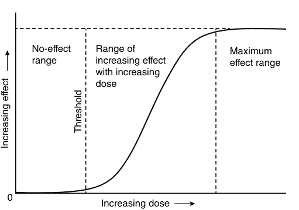

图5.16 无效应区的剂量-反应函数。

在低污染物浓度下，基本上没有表现出毒性迹象，这称为无效应区。从零剂量到阈剂量无反应的原因是一种生化或生理防御机制，如解毒或排泄，阻止了效应的发生。中间部分从显示出一定毒性的点（阈值）开始上升，然后以S形方式增加，直到达到最大效应。随着化学品暴露量的增加，解毒机制不堪重负，效应得以显现。

## 5.10.4 氯气意外释放：案例研究

位于华盛顿州塔科马的皮尔斯县钱伯斯克里克污水处理厂使用氯进行消毒；该气体在现场储存于一个1吨的容器中。预计最大储存量为十个容器（20 000磅），超过了《意外释放预防计划》（USEPA 1996）中规定的风险管理计划（RMP）适用性阈值。氯的阈值为2500磅。这种有毒气体意外释放对厂外可能造成的后果十分严重，因此需要对该情况进行评估。本分析所采用的方法遵循EPA污水处理厂风险管理计划指南（USEPA 1998b）以及White的《氯化与替代消毒剂手册》（2010）中提供的指导。

根据《意外释放预防计划》（USEPA 1996），有毒气体最坏情况情景必须假设单个最大容器在10分钟内释放。钱伯斯克里克最大的容器是前面提到的1吨容器。

对于最坏情况情景，假设释放发生时不考虑物理原因或发生的可能性。仅考虑被动缓解措施（例如堤坝、围护结构）

## 表5.9 终点圈内的人口估算。

|  | 最坏情况 | 替代情况 |
|---|---|---|
| 到终点的距离（英里） | 1.3 | 0.1 |
| 到终点距离内的估计居住人口 | 13 322 | 5 |
| 到终点距离内的公共受体 | 住宅、商业和工业设施、休闲区、医院 | 住宅、休闲区 |
| 到终点距离内的环境受体 | 公园 | 无 |

## 表5.10 一些常见危险化合物的TLV。

| 化合物 | TLV |
|---|---|
| 丙酮 | 750 ppm |
| 艾氏剂 | 0.25 mg/m³ |
| 莠去津 | 5 mg/m³ |
| 苯 | 10 ppm |
| 西维因 | 5 mg/m³ |
| 四氯化碳 | 5 ppm |
| 氯苯 | 10 ppm |
| 氯仿 | 10 ppm |
| Chrysene | 可疑人类致癌物 |
| 环己烷 | 300 ppm |
| 环己烯 | 300 ppm |
| DDT | 1 mg/m³ |
| 2,4-滴（二氯苯氧乙酸） | 0.1 mg/m³ |
| 狄氏剂 | 0.25 mg/m³ |
| 邻苯二甲酸二甲酯 | 5 mg/m³ |
| 乙苯 | 100 ppm |
| 正庚烷 | 400 ppm |
| 六氯苯 | 0.025 mg/m³ |
| 六氯环戊二烯 | 0.01 ppm |
| 马拉硫磷 | 10 mg/m³ |
| 甲基丁基酮 | 50 ppm |
| 甲乙酮（MEK） | 200 ppm |
| 甲基异丁基酮（MIBK） | 50 ppm |
| 二氯甲烷 | 50 ppm |
| 萘 | 10 ppm |
| 正辛烷 | 300 ppm |
| 对硫磷 | 0.1 mg/m³ |
| 五氯苯酚 | 0.5 mg/m³ |
| 全氯乙烯（PCE） | 50 ppm |
| 苯酚 | 5 ppm |
| 苦味酸 | 0.1 mg/m³ |
| 多氯联苯（PCBs） | 0.5 mg/m³ |
| 甲苯 | 100 ppm |
| 1,1,2-三氯乙烷（TCA） | 10 ppm |
| 三氯乙烯（TCE） | 50 ppm |
| 2,4,6-三硝基甲苯（TNT） | 0.5 mg/m³ |
| 邻二甲苯 | 100 ppm |
| 间二甲苯 | 100 ppm |
| 对二甲苯 | 100 ppm |

危险废物管理中的慢性毒性通常由长期低水平接触危险化学品引起。慢性毒性难以量化，因为与急性毒性评估相比，对化学品的长期影响了解较少。工业卫生学家使用的参数TLV，是指工人在其整个职业寿命期间（即每天8小时、每周5天，整个工作寿命）可安全接触的空气中的化学物质浓度。目前已为数百种空气污染物规定了TLV。一些污染物（如致癌物）的TLV被设为零，因为没有阈值存在。TLV是美国政府工业卫生学家会议（ACGIH）的版权术语，该组织制定政策并不断更新TLV数据。表5.10列出了一些常见危险化合物的TLV。TLV上限值是指在任何时间都不应超过的浓度（ACGIH 1986）。

## 例5.11 如果一名工人接触100 ppm浓度1小时、90 ppm浓度2小时、80 ppm浓度5小时，估算8小时的时间加权平均浓度。

### 解答

利用式（5.8），可得

```
TWA = (100×1 + 90×2 + 80×5) / (1 + 2 + 5) = 85 ppm
```

如果工作场所中存在多种化学物质，一种做法是假设这些毒物的效应是叠加的。对于具有不同TLV-TWA的多种毒物，其综合暴露量通过以下方程确定：

> 来源：摘自ACGIH（1986）。


$$
\sum_{i=1}^{n}\frac{C_i}{(TLV-TWA)_i}\tag{5.9}
$$

其中

- *n* 是有毒物质的总数量  
- *Cᵢ* 是相对于其他有毒物质的化学物质 *i* 的浓度  
- (TLV–TWA)ᵢ 是化学物质 *i* 的 TLV–TWA。

如果式 (5.9) 中的该和超过 1，则工人处于过度暴露状态。

混合物 TLV–TWA 可由下式计算

$$
TLV\text{-}TWA_{mix}=\frac{\sum_{i=1}^{n}C_i}{\sum_{i=1}^{n}\frac{C_i}{(TLV-TWA)_i}}\tag{5.10}
$$

如果混合物中有毒物质的浓度之和超过该数值，则工人处于过度暴露状态。

对于具有不同作用的有毒物质混合物（如酸性蒸气与铅烟混合），TLV 不能假定为可加性（Crowl and Louvar 2011）。

**例 5.12**  确定一名在 RCRA 溶剂回收作业空气中暴露于 42 ppm PCE、38 ppm TCE、86 ppm MEK 和 35 ppm MIBK 的工人的混合 TLV–TWA。这些化学物质的浓度是否超过 TLV–TWA<sub>mixture</sub>？

根据表 5.10，这些化学物质的 TLV 为

| Compound | TLV (ppm) |
|---|---:|
| PCE | 50 |
| TCE | 50 |
| MEK | 200 |
| MIBK | 50 |

使用式 (5.9)，这些数值用于确定 8 小时工作日的 TLV–TWA<sub>mixture</sub>。

$$
(TLV-TWA)_{mix}=\frac{42+38+86+35}{\frac{42}{50}+\frac{38}{50}+\frac{86}{200}+\frac{35}{50}}
$$

$$
(TLV-TWA)_{mix}=73.6\,ppm
$$

总暴露量 ΣCᵢ = 42 + 38 + 86 + 35 = 201 ppm；由于 ΣCᵢ/(TLV − TWA)<sub>mix</sub> 的比值大于 1，这些 RCRA 化学物质的浓度超过了限值。根据 TLV，溶剂回收设施的空气质量不健康。

## 5.11  安全设备

认识与在各行业和制造厂工作相关的物理和大气危害很重要。然而，仅承认危害并不能保证安全的工作条件。雇主有义务根据 OSHA 提供安全设备并为员工建立培训计划。需要记住的重要一点是，使用设备和遵守安全程序的责任在于个人员工。下面的讨论将使员工和工厂工人熟悉正确的安全技术。

### 5.11.1  个人防护设备

如果工程控制不能消除暴露，选择 PPE 的第一步是尽量减少需要保护的身体部位（眼睛、面部、耳朵、脚趾、全身等）。个人防护设备（PPE）的选择取决于覆盖范围以及暴露的严重程度和类型。更高风险的暴露需要更谨慎地选择 PPE 并进行严格的培训和认证（Ibrahim et al. 2018）。

公司应选择经认证符合广泛接受标准的 PPE，以确保 PPE 足以用于预期用途。表 5.11 列出了各种危害的标准和最佳实践及其适用性。了解每种 PPE 的局限性以及员工的潜在暴露非常重要。暴露途径需同时考虑危害源和靶受体。常见危害以及环境危害包括冷空气和表面、热应激和烟雾。靶受体可包括皮肤和眼睛（皮肤途径）和肺部（吸入途径）（Ibrahim et al. 2018；ISO 2015；NFPA 2006, 2015, 2017, 2018a, b, c, d）。

**表 5.11** 安全标准有助于选择合适的 PPE。

| Regulation | Target area | Hazard | Intended users |
| :--- | :--- | :--- | :--- |
| NFPA 70E – Standard for Electrical Safety in the Workplace | Full body | Electrical | All |
| NFPA 1852 – Standard on Selection, Care, and Maintenance of Open-Circuit Self-Contained Breathing Apparatus (SCBA) | Inhalation | Biological, chemical, radiological, and/or nuclear (CBRN) | All |
| NFPA 1891 – Standard on Selection, Care, and Maintenance of Hazardous Materials Clothing and Equipment | Dermal | Physical and health | All |
| NFPA 1986 – Standard on Respiratory Protection Equipment for Technical and Tactical Operations | Inhalation | Health | First responders |
| NFPA 1992 – Standard on Liquid Splash-Protective Ensembles and Clothing for Hazardous Materials Emergencies | Dermal | Liquid chemicals | First responders and trained personnel |
| NFPA 2112 – Standard on Selection, Care, Use, and Maintenance of Flame-Resistant Clothing for Protection of Industrial Personnel against Short-Duration Thermal Exposures from Fire | Dermal | Fire | Industrial personnel |
| NFPA 2113 – Standard on Selection, Care, Use, and Maintenance of Flame-Resistant Garments for Protection of Industrial Personnel against Short-Duration Thermal Exposures from Fire | Dermal | Fire | Industrial personnel |
| ISO 11612 – Protective Clothing – Clothing to Protect against Heat and Flame – Minimum Performance Requirements | Dermal | Fire | All |

### 5.11.1.1  热暴露

大多数行业特定指导重点关注防止火焰和热的 PPE。NFPA 2113（NFPA 2015）建议进行工作场所危害分析，以确定何时需要阻燃服装、手套。标准的第 A.5.2 节列出了建议使用阻燃服装的具体材料和任务（NFPA 2015）。

### 5.11.1.2  电暴露

电气危害的 PPE 要求在 NFPA 70E《工作场所电气安全》中已明确规定，该标准涵盖了广泛的电气活动（NFPA 2018a）。NFPA 70E 2018 版增加了电气危害和非电气危害（如防坠落、头部保护、足部保护等）的全面 PPE 清单（Ibrahim et al. 2018）。

### 5.11.1.3  化学暴露

*安全数据表*（或以前的 *材料安全数据表*（SDS/MSDS））通常在标准温度和压力（STP）条件下推荐使用 PPE，并且通常不考虑化学品的全部潜力。化学过程的危害潜力取决于工艺操作条件的严重程度。某些工艺操作参数（如高压）可能会提高化学品的危害，而其他参数（如低温）可能会降低其危害。某些防护措施，例如容器的密封，也可降低化学品的危害潜力。

PPE 评估还应考虑任何潜在的副产物。两种相对无害的化学品的反应可能形成特别有害的化学品。例如，含有单质铜的稀硝酸溶液会形成一氧化氮，一种高毒性气体。

### 5.11.1.4  吸入风险

防止吸入危害可能是 PPE 选择中最艰巨的任务之一。NIOSH 提供了一个在线工具，*认证设备* 清单，提供有关呼吸器和呼吸装置如何防止化学、生物、放射性和/或核（CBRN）危害的信息（NIOSH 2016）。该参考和附带的 URL 允许用户搜索满足其需求的 NIOSH 认证设备。在为有毒吸入物确定 PPE 时，了解毒性类型、慢性与急性暴露的影响以及毒性的其他特征非常重要。

### 5.11.1.5  眼部风险

眼部保护极其重要，应佩戴以保护工人的眼睛。安全眼镜可防止外部碎屑、粉尘，并应通过包覆式设计或侧护板提供侧面保护。此外，护目镜提供更好的保护，有效防止化学品飞溅、撞击和粉尘环境中的眼部伤害。焊接需要特殊护目镜或防护罩（ANSI 2015）。ANSI Z87.1 工作用安全眼镜标准概述了针对撞击、飞溅、粉尘和细粉尘（包括易燃粉尘和/或工厂建筑外“风吹粉尘”，例如煤堆和锯末）等各种危害的眼部保护要求。选择眼部保护时，应考虑人员的舒适度以及部分员工需要佩戴处方眼镜的需求。还应考虑某些化学品与隐形眼镜之间的相互作用。

### 5.11.2  个人防护服

防护服是安全的重要方面，在工业设施工作时应遵循此处提供的指南。

- **安全帽** – 所有进入受限空间的人员均要求佩戴安全帽。全强度安全帽应具有


帽檐和下颌带可防止头部受伤。硬帽在流程区域巡检时也可能防止受伤。

- **连体服** – 人员的皮肤应尽可能覆盖，以防止擦伤和割伤，并避免与危险物质接触皮肤。
- **手套** – 在使用和/或操作机器以及处理液体、气体和固体材料时需要手部防护。除了防止有害化学品（例如溶剂、生物危害等）和/或热量通过皮肤吸收外，手套还能保护手免受割伤、擦伤或热应激。
- **鞋子** – 在受限空间内或周围、在流程区域、化学品储存区等处必须始终穿着橡胶底、防滑、防砸鞋（例如钢头、复合材料）和靴子。安全鞋旨在防止冲击和/或有害化学品。
- **耳塞** – 在噪音水平高的区域工作时应佩戴耳塞（例如一般制造区域）。该设备可保护员工和人员免受工作场所大声噪音的累积影响。
- **安全护目镜** – 在制造行业工作期间需要佩戴安全护目镜，以防止眼睛接触有害物质。接触镜在某些工业流程（如电镀作业）周围通常被禁止。如果有害物质通过飞溅或暴露于雾气或蒸气而进入人员眼睛，该物质可能会被困在镜片后面，很难冲洗干净，并可能造成严重的眼部损伤。
- **安全背心** – 在有车辆通行的工业工作区域中，安全背心是必要的警示装置。

## 5.12 通讯设备

对讲机和手机是与主要安全办公室保持联系的有效方式。对于危险场所，采样小组应在到达和离开每个采样地点时进行联系。工业外场通常位于无人居住的地区；因此，保持无线电或手机处于工作状态非常重要，以防需要呼叫求助。如果发生事故，救援人员必须在提供任何帮助给受害者之前先呼叫求助。

### 5.12.1 空气监测设备

进入受限空间前，应进行测试以检测 (i) 爆炸性气体、(ii) 有毒气体的存在以及 (iii) 氧气不足。检测这些状况最有效的方法是使用大气监测仪。

以下讨论的气体探测器是用于大气监测最常用的。

- *单一用途探测器* – 设计用于检测特定气体，例如一氧化碳、甲烷或硫化氢。这些气体通常存在于各种系统和受限空间中。用于测量较少见气体的单检测单元或管也可用。
- *双用途探测器* – 能够检测区域内氧气缺乏和爆炸性状况。
- *组合探测器* – 能够检测氧气缺乏、爆炸性和有毒气体的存在。此类仪表通过检测全部三种危害提供最大保护。硫化氢和一氧化碳是通常测量的气体，因为它们在受限区域或缺氧系统中出现最频繁。

受限空间内的气氛可能会突然变化；因此，建议使用持续监测气氛的探测器。此外，探测器应配备在特定危险状况或电池电量低时激活的听觉和视觉报警装置，从而无需花费时间读取表盘或量规。

必须记住，使用大气测试仪并不能确保安全条件。气体探测器只是与潜在危险情况相关的信息来源之一。大多数气体探测器设计用于检测常见气体，如硫化氢，对于检测较少见物质如三氯乙烯蒸气则无效。有用于检测较少见气体的测试套件。该套件由活塞式泵和装有指示化学品的玻璃管组成，管的两端在使用前密封。探测管中的指示化学品针对特定污染物或一组气体。预定体积的空气通过管抽取，污染物与指示化学品反应，产生颜色变化，可与校准色卡比较以确定近似浓度。

在测量爆炸性时，气体仪表测量校准气体，通常为甲烷的下爆炸极限（LEL）百分比。气体在多种空气混合物中可燃。

仪表不会区分气体，但仅相对于校准气体指示爆炸性。范围从下爆炸极限开始，下爆炸极限是可燃气体或蒸气在空气中支持燃烧所需的最低浓度。爆炸范围向上延伸至上爆炸极限（UEL），即支持燃烧的最大浓度。如果气体浓度低于 LEL，则燃料不足以

建议使用带肩部连接救生绳的全身降落伞式安全带。此类安全带可使身体保持垂直，防止松软的身体在被拉出区域时掉落。

救生绳应连接到包括防坠落机构的救援系统。此类安全系统的工作方式与汽车安全带类似，其中离心锁定机构在坠落时被激活。如果需要救援，此类救援系统可消除进入空间的需要。约有一半发生在受限空间的死亡事故是未计划的救援尝试，工人在本能冲动下冲入受限空间协助受伤的同事。

救援系统应从信誉良好的制造商或授权经销商处购买为完整系统，包括正确使用的维修和培训。救援系统的多数部件必须符合某些制造商规格，替换这些部件可能会导致人身伤害的责任。

安全设备必须定期维护和检查。安全带和救援绳应检查是否有纤维断裂、割伤或撕裂、化学损伤、腐烂以及扭结或极度僵硬。在每次使用前应对该设备进行目视检查，并应实施正式程序进行定期检查和维护。

### 5.12.4 呼吸

呼吸器的主要功能是防止暴露于有害气氛。选择呼吸器时应根据要执行的作业和员工可能暴露的潜在危害。呼吸器的基本类型如下：

- *空气净化* – 过滤空气中有害物质的面罩。
- *供气* – 从罐中提供安全呼吸空气的装置。

空气净化呼吸器可去除粉尘颗粒和少量气体或蒸气，但不能防止重度气体浓度。此外，此类呼吸器提供的氧气仅为通过面罩过滤的氧气。空气净化呼吸器包括以下类型：

- *气体和蒸气呼吸器* – 受污染空气通过活性炭，活性炭捕获气体和蒸气。
- *颗粒物呼吸器* – 受污染空气通过过滤器去除颗粒物。
- *动力空气净化呼吸器* – 鼓风机将受污染空气通过去除污染物并向面罩提供净化空气的装置。
- *组合气体、蒸气和颗粒物呼吸器*（称为防毒面具）– 气体、蒸气和颗粒物通过装有过滤器和吸收气体和蒸气装置的罐过滤受污染空气。

空气净化呼吸器*绝不*应在缺氧气氛中使用。由于此限制，供气呼吸器更适合进入可能缺氧的受限空间。

供气呼吸器与空气净化呼吸器不同之处在于佩戴者呼吸的空气来自外部来源。供气呼吸器的类型包括以下：

- *自给式呼吸器* – 通过提供可运输的呼吸空气供应来防止有毒气体和氧气不足。例如自给式呼吸器（SCBA）。
- *供气呼吸器* – 通过空气软管从压缩机向佩戴者供应呼吸空气。
- *组合自给式和供气呼吸器* – 辅助气瓶在空气软管供应中断时提供帮助。

人员必须意识到可能遇到的气氛危害，并应使用适合这些危害的呼吸器。仅使用已获国家职业安全卫生研究所批准的呼吸器（见 29 CFR 1910.134）可在 https://www.osha.gov/pls/owadisp.show_document?p_id=12716&p_table=standards 找到。在紧急情况下，呼吸器设备成为必不可少的防护装备。该设备故障可能导致受伤或死亡。必须严格遵守使用、清洁和维护说明以安全使用任何呼吸器。员工必须接受对其呼吸器使用和局限性的充分培训。

### 5.12.5 受限空间进入

由于可能暴露于物理和呼吸危害，受限空间进入必须始终被视为危险任务。到达受车辆和行人交通影响的采样现场后，采样小组必须立即放置工作车辆并正确放置交通锥和警示旗，如有必要。完成此项后，必须对受限空间的大气条件进行测试，以检测氧气不足、爆炸性和有毒


gases. 应遵循以下空气监测程序：

- 校准空气监测设备。每种气体探测器都有其自身的校准方法，人员必须接受对其可使用设备的校准和操作程序的培训。此外，人员必须知道如何解读设备的读数。校准数据应记录在案并纳入现场记录中。
- 将空气监测探头的尖端置入检查井的通风孔中以测试大气。应使用非金属探头，以免意外产生火花。
- 如果读数可接受，则取下检查井盖并测试检查井。由于气体和蒸气可能比空气重，检查井内的气氛应从顶部到底部在多个深度进行测试。
- 如果受限空间内的读数可接受，则继续进行受限空间进入程序。如果读数因爆炸性气氛而不被接受，检查井盖可能会产生火花，因此不应打开。当遇到爆炸性气氛时，应立即联系相关部门（当地消防部门）。如果读数因缺氧或气体积聚而不被接受，则必须通风直至读数可接受。通风时间长短取决于空间大小。

所有进入受限空间的人员除所需的安全设备（即安全帽、安全手套等）外必须佩戴全身安全带。受限空间绝不能单独或无人协助进入。必须始终有一名第二人在场以应对紧急情况。此外，进入受限空间时，除安全带外应始终佩戴 SCBA，除非您拥有适当的通风和空气监测设备。安全带必须系在安全绳上，而安全绳又系在地面以上的救援系统上。在紧急情况下，待命人员应使用救援系统迅速将受伤人员移除。

## 5.12.6 安全培训

充分安全培训的重要性不容过分强调。如果发生紧急情况，采样人员必须能够确定事故原因并做好相应准备。过于频繁地，由于准备不足，救援者会成为另一个受害者。安全程序应成为常规，最好的实现方式是通过持续培训。应为所有需要在受限空间工作或与在受限空间工作的人员团队一起工作的人员提供以下方面的培训：

- 心肺复苏和基本急救
- 相关安全设备的使用
- 受限空间进入程序

进入和退出程序包括以下步骤：

- *识别* – 采样人员必须能够识别检查和采样相关的潜在危害。培训应强调不当安全程序可能产生的后果。
- *测试* – 进入前必须对所有受限空间进行测试。
- *评估* – 测试必须评估氧气水平、爆炸性和潜在有毒物质。采样和作业人员还应考虑所需的安全设备。
- *监测* – 受限空间内的气氛可能发生变化。因此，在采样和其他活动期间应持续监测该区域。

必须为采样人员可能遇到的每种类型的受限空间制定救援程序。应保存培训和安全演练的书面记录。救援程序应经常练习，以确保在任何必要的救援情况下具备熟练程度。在制定成功的培训计划时，行业应鼓励征求其他机构（例如当地消防和救援部门）的帮助，这些机构在上述任何领域具有专业知识。

此外，化学和相关工业厂卫生方法的摘要见表 E.1。

## 5.13 噪声

噪声，通常定义为不需要的声音，是我们在出生前及一生中都会接触到的环境现象。噪声被视为一种环境污染物，是与各种人为活动同时产生的废物。噪声是任何声音——无论响度如何——它可能对个人产生不期望的生理或心理效应，并可能干扰个人或群体的社会目的。这些社会目的包括我们所有的活动——交流、工作、休息、娱乐和睡眠。

### 5.13.1 职业性噪声暴露

噪声，或不需要的声音，是最普遍的职业健康问题之一。它也是许多工业过程的副产品。声音是由振动或湍流引起的介质（通常为空气）中的压力变化。这些压力变化产生远离湍流或振动源传播的波。暴露于高水平的噪声会导致听力损失，也可能导致其他有害健康影响。损害程度主要取决于噪声强度和暴露持续时间。噪声引起的听力损失可能是暂时性的或永久性的。暂时性听力损失源于短期噪声暴露，经过一段时间休息后听力会恢复。一般来说，长时间暴露于高噪声水平会逐渐造成永久性损伤。OSHA 的听力保护计划旨在保护在整个工作生涯中可能暴露于此类噪声的工人免受听力损伤。

更响；40 dB 是 10 000 倍更响，等等。因此在高水平下，即使是水平值的微小降低也会对噪声强度产生显著差异。

### 5.13.2 职业性噪声和听力保护基础

### 5.13.3 噪声：物理原理

估计有 2500 万美国人——其中许多是工人——暴露于威胁其听力的噪声。每个人在某个时候都经历过噪声污染的影响。许多人不知道导致他们严重健康威胁的声音是噪声污染的结果。噪声污染传统上并未被列为国家面临的主要环境问题之一；然而，它是日常生活中最常遇到的污染源之一。噪声通常被视为一种烦恼而不是污染源。这部分是因为与其它污染源不同，噪声不会在环境中留下可见的影响。

声音的频率是指源产生完整的高压和低压区域循环的速率。这以赫兹（Hz）为单位测量：1 Hz 为每秒一个完整循环。年轻人可听频率范围为 20 Hz 至 20 KHz。随着人年龄增长或暴露于过度噪声，听高频的能力会下降。老年人可能的有效截止频率为 10 KHz 或更低。

传统空气和水污染造成的损害已被广泛认可。证据就在眼前——在受污染的水、藻类爆发、石油泄漏和死鱼中，以及在灼伤眼睛和灼伤肺部的烟雾中。然而，噪声是一种更微妙的污染物。据估计，超过 2000 万美国人不知不觉中暴露于来自卡车、飞机、摩托车、立体声、割草机和厨房家电等危险噪声水平。声音像水中的波浪一样通过空气传播波。波越高，其功率越大。声音的波数越多，其频率和音调就越大。

声强（I）是声能在垂直于声传播方向的单位面积上平均传输速率。它表示为能量通量率，通常以分贝为单位。分贝被定义为 10⁻¹² W/m²。声强是声源声功率（P）的函数。声强与声功率的关系由下式给出

I = P / 4πd²

(5.12)

声音强度或声级以分贝（dB）为单位测量。分贝刻度范围从 0，即正常健康耳朵的听觉阈值，到 94，即纯音的理论最大值。由于分贝刻度与 pH 刻度一样是对数刻度，20 dB 比 0 响 100 倍；30 dB 是 1 000 倍

不应将声功率与声压（p）混淆。声压是指声源产生的超过环境大气水平的压力变化的均方根（rms）值。它通常以帕斯卡、牛顿每平方米（N/m²）或 dB 为单位测量。用于声压的 dB 以 20 µPa 或 2×10⁻⁵ N/m² 为参考，这被认为是正常人的听觉阈值。日常生活中遇到的声压范围相当广。代表性水平见表 5.12。

它由声级计测量，声压级（SPL），Lp，以 dB 为单位表征并以 dB 表示。

Lp = 20 log (p / p0)

(5.13)

其中 p 为测量的 rms 声压，p0 为参考值，0.00002 N/m²。

声强 I 与声参考强度的关系为

LI = 10 log (I / I0)

(5.14)

参考强度 I0 为 10⁻¹² W/m²。


表5.12 代表性声压级。
| 活动 | dB | N/m² | 瓦特 |
|---|---|---|---|
| 最大感知级 | 1 | 0.00002 | 10⁻¹² |
| 夜间，安静乡村地区 | 20 | 0.0002 | 10⁻¹⁰ |
| 安静房间 | 40 | 0.002 | 10⁻⁸ |
| 正常交谈（3英尺） | 60 | 0.02 | 10⁻⁶ |
| 重型车辆高速公路交通（汽车，50英尺） | 80 | 0.20 | 10⁻⁴ |
| 直升机内部 | 90 | 0.70 | 10⁻³ |
| 电动割草机 | 95 | 1.0 | 0.04 |
| 喷气式飞机 | 110 | 7.0 | 0.10 |
| 疼痛阈值 | 120 | 20 | 1.0 |

较短的时间间隔；每半段暴露时间（0.4小时/15分钟）可允许增加5 dBA，上限为115 dBA。因此，95 dBA可允许每天4小时，100 dBA可允许2小时，以此类推。一般而言，噪声水平超过85 dBA会使电话使用变得不可能，语音交流非常困难且受限，需要在仅2至3英尺的距离内大喊大叫。

雇主必须向所有暴露于8小时时间加权平均噪声水平为85 dB或以上的工人提供听力保护器。这一要求确保员工在经历任何听力损失之前就能获得保护器：

- 1) 从他们首次暴露于8小时TWA噪声水平85 dB或以上起，直至接受基线听力图检查的任何超过6个月的期间。
- 2) 如果他们出现了标准阈值偏移，表明其对噪声敏感。
- 3) 如果他们在8小时TWA中暴露于超过允许暴露限值90 dB的噪声。

## 示例5.15 声压/声强关系

某工厂安装了一台声级为83 dB的新噪声源，背景噪声水平为75 dB。组合声级是否会超过8小时工作日噪声的TLV？

**解答**

ACGIH指南给出的8小时噪声TLV为85 dB。计算可使用式(5.14)进行。

$L = \log(I/I_0)$ dB；参考值 $I_0 = 10^{-12} \text{ W/m}^2$（表5.12），并根据新声源计算声压

$L = 83 = 10\log\left(\frac{I}{10^{-12}}\right)$ 或 $\frac{83}{10} = \log\left(\frac{I}{10^{-12}}\right)$

取反对数并整理得 $I = 2 \times 10^8 \times 10^{-12} = 2 \times 10^{-4}$

对背景声压级进行相同运算得

$75 = 10\log(I/10^{-12})$
$3.2 \times 10^{-4} \times 10^{-12} = I$；因此，$I = 3.2 \times 10^{-5}$。

将两个声强相加得 $2 \times 10^{-4} + 0.32 \times 10^{-4} = 2.32 \times 10^{-4}$，然后可用其确定组合声压级。$L = 10\log(2.32 \times 10^{-4}/10^{-12}) = 10\log(2.32 \times 10^8) = 10 \times 8.37 = 83.7 \text{ dB（平均）}$，低于85 dB（平均）的TLV限值。

## 示例5.16 噪声暴露

一名工人每天暴露于94 dBA噪声水平30分钟，并暴露于88 dBA噪声水平3小时。该暴露是否超过噪声TLV？

**解答**

94 dBA噪声的TLV为1小时。
85 dBA的TLV为4小时。
组合噪声TLV可表示为

$C_1/T_1 + C_2/T_2 + C_3/T_3 + C_n/T_n = \text{TLV的分数}$

对于两种噪声水平的暴露，

$0.5/1 + \frac{3}{4} = 1.25$，

大于1；因此，超过了TLV。

## 5.13.4 噪声暴露与噪声防护

对于8小时工作日的连续噪声暴露，OSHA设定的限值为90 dB平均，作为8小时TWA。

雇主必须为平均每日8小时暴露超过85 dBA的员工提供听力保护计划、噪声监测、年度听力图检查和听力保护。更高的水平允许用于

## 5.13.5 噪声控制

噪声控制可通过多种方式实现。可以重新设计机械以降低噪声。基本原理类似于控制室内空气污染：消除噪声源。这可以通过改进机械设计和维护，或通过增加刚度或使用橡胶或塑料缓冲垫或减震器来阻尼振动来实现。较大、较慢的机器通常比较小、较快的设备产生更少的噪声。可以使用皮带传动代替齿轮和凸轮，并且可以用液压或电动装置替代机械装置。

可以设计和建造各种类型的噪声屏障。噪声挡板是有效的，特别是对于较高

频率。装饰性修正，如植树或视觉屏障，可能会提高对噪声水平的接受度，但对降低实际声压级作用甚微。距离是一种非常有效的噪声控制策略。值得注意的是，较高的声音频率比较低的频率更容易被衰减。

还有其他减少运动部件和机器噪声的手段和方法，如下所示：

- • 减少摩擦阻力
- • 减少旋转面积
- • 减少噪声泄漏
- • 隔离和阻尼振动元件
- • 提供消声器或其他消音装置
- • 在传播路径上进行噪声控制
- • 应用吸声材料
- • 隔声罩

## 示例5.17 噪声控制

一台涡轮机的声功率输出为10 W。工作站计划位于距涡轮机10英尺处，位于可提供29 dB降噪的隔声 booth 中。 booth 内的声压级将是多少？它是否足够低以允许正常交谈？

# 解答

对于自由场、全向声源，使用式(5.12)计算在d = 10英尺处的声强。

```
I = 10/4\pi(3.05)^2 [将d转换为米：
10 ft \times 0.305m/ft = 3.05m]
= 0.086 W/m^2
```

使用式(5.14)转换为声压：

```
L_t = 10log(I/I_0) = 10log(0.086/10^-12) = 109.3 dB
```

无衰减时

```
隔声 booth 内 SPL = 109.3 - 29 = 80.3 dB
```

80.3 dB（未加权），高于正常交谈时的60 dB（表5.12）；因此，它会干扰正常交谈。

## 5.14 辐射

### 5.14.1 定义

辐射被定义为能量通过真空或物质的传播。任何能够通过与物质相互作用直接或间接产生离子的电磁辐射或粒子辐射，称为电离辐射。医疗用途通常涉及X射线和伽马射线，以及高能电子和低能β粒子。放射性物质或其他来源发出的微粒辐射，通常是α粒子、β粒子、重离子和中子，也是电离辐射的形式。波形式的辐射根据波长分类。辐射波长、速度和频率的关系如式(5.15)所示：

```
辐射波长 = 辐射速度 / 辐射频率 (5.15)
```

### 5.14.2 不同辐射源

太阳是一座巨大的核熔炉。它制造了大部分撞击地球大气层外部的宇宙辐射。大气层阻挡了大部分宇宙射线。生活在高海拔地区的人或喷气式飞机的机组人员，其上方的空气较少，因此他们比其他人受到更多的宇宙射线辐射。人们也暴露于人造辐射。大部分来自医疗和牙科使用的X射线和伽马射线。这些平均约为自然本底辐射的四分之一。

我们可以使铀原子分裂（裂变）来产生大量能量。裂变也会产生大量放射性同位素（“裂变产物”）和中子。稳定原子和中子可以结合产生放射性同位素。大多数裂变产物释放β粒子和伽马射线。β粒子是高能电子。伽马射线是高能波。一些放射性原子释放α粒子。α粒子是由两个质子和两个中子组成的高能粒子。它们比β粒子重数千倍。

### 5.14.3 外部暴露和内部暴露

外部暴露：伽马射线可以穿透进入或穿过身体。β粒子可以穿透皮肤。α粒子甚至不能穿透皮肤外层。除了眼睛外，α粒子在体外是无害的。β粒子可被纸或铝等常见轻质材料的薄层阻挡。阻挡伽马射线需要厚层的常见材料（如混凝土）或厚层的高密度材料（如铅）。

内部暴露：任何放射性物质都可能随食物或饮料进入体内（摄入），或通过呼吸（吸入），或通过开放性伤口（皮肤）。如果发生这种情况，任何类型的辐射都可能直接伤害活细胞。一定量的放射性物质所造成的伤害存在差异


material can do. That depends on how quickly it decays and the kind of radiation it produces. It also depends on the kind of element it is. Some elements decay quickly, while some elements are eliminated by normal body functions. But some are long-lived and attach to tissues. They can stay in the body for a long time. Some stay in the body indefinitely.

## 5.14.4 放射性核素衰变

所有放射性核素，即 α、β 等，均以特定的物理或放射性半衰期为特征，即一半放射性核衰变所需的时间。放射性衰变是指数过程，并由基本衰变定律描述，其数学表达式为

```
A = A₀ e^(-λt)  (5.16)
```

其中 A 表示任意时刻 t 的活度，A₀ 表示零时刻的活度。衰变常数 λ 以时间的倒数为单位，表示衰变的速率或概率。λ 值越大，半衰期 T₁/₂ 越短，其表达式为

```
T = 0.693/λ  (5.17)
```

经验法则是，经过 7 个半衰期后，活度降至原始量的 1% 以下，经过 10 个半衰期后，降至 0.1% 以下。活度是指单位时间内放射性转化的次数。在旧单位制中，活度以居里 Ci 为单位表示。1 Ci 定义为 3.7×10¹⁰ 次/秒的衰变。SI 单位中的对应单位是贝可勒尔 Bq，即每秒一次衰变。

### 例 5.18 放射性衰变

如果某放射性核素的衰变常数为 0.086/天，750 Bq 的该核素衰变到 200 Bq 需要多长时间？其半衰期是多少？

### 解

A₀ = 750 Bq
A = 200 Bq
λ = 0.086/天
衰变时间，使用式 (5.16)：

```
A = A₀ e^(-λt);  200 = 750 e^(-0.086t);  ln(200/750) = 0.086t
t = 15.4 days
```

半衰期，使用式 (5.17)

```
T = 0.693 / 0.086 = 8.06 days
```

## 5.14.5 放射剂量

从根本上讲，电离辐射对活体有害的后果是由于细胞和组织吸收的能量。吸收的能量或剂量会产生对活细胞中分子进行化学分解。分解的机制似乎与辐射与组织内原子之间的电离和激发相互作用有关。电离辐射在细胞或组织中产生的电离量或离子对数可作为由给定剂量或剂量预期产生的分解或生理损伤量的某种衡量。因此，辐射剂量测量的理想基础可以是感兴趣介质中发生的离子对数。出于某些实际原因，用于定义照射的介质选择为空气。

### 5.14.5.1 辐射剂量单位

照射剂量：伦琴 Roentgen  用于表示 X 射线或伽马辐射照射的单位中 X 射线或伽马辐射的照射剂量为伦琴 R。其优点在于，伦琴表示的照射剂量通常可以与吸收剂量相关，而吸收剂量对于预测或量化辐射引起的预期生物效应 或损伤非常重要。

伦琴是 X 射线或伽马辐射的照射剂量，使得每 0.001293 g 空气产生的相关微粒发射在空气中产生携带一个静电单位电量的离子，无论正负。注意，标准状况下 1 cm³ 空气的质量为 0.001293 g。

吸收剂量：戈瑞 Gray  任何电离辐射的吸收剂量是电离辐射赋予物质的能量除以受照物质在感兴趣处的单位质量。吸收剂量的 SI 单位是戈瑞 Gy。1 戈瑞相当于吸收 1 J/kg 焦耳/千克。吸收剂量的旧单位为拉德。1 拉德相当于吸收 100 erg/g。1 Gy = 100 rads。希沃特 Sv 是将以 Gy 表示的吸收剂量乘以辐射加权因子得到的。

## 5.14.6 电离辐射的生物效应

进入体内的放射性物质通过两种机制排出：物理衰变和生物过程，每种机制都有其自身的特征半衰期。这两种机制的联合排出称为有效半衰期 T_eff，其由下式确定

```
T_eff = (T_rad × T_bio / (T_rad + T_bio))   (5.18)
```

有效半衰期始终小于生物半衰期或放射性半衰期中的任一个。如果生物半衰期远小于另一个，则其近似等于有效半衰期。

### 例 5.19 生物半衰期

一名工人一次急性暴露吸入放射性核素。体液样本显示半衰期为 6.1 天。该核素的衰变常数为 0.08/天。工人的生物半衰期是多少？

### 解

放射性半衰期由式 (5.17) 确定：

```
T = 0.693/λ = 0.693/0.08 = 8.7 days
```

生物半衰期由式 (5.18) 得到：

```
T_eff = (T_rad × T_bio / (T_rad + T_bio))
6.1 = (8.7 × T_bio / (8.7 + T_bio))
6.1(8.7) + 6.1 T_bio = 8.7 T_bio
53.1 = 8.7 T_bio - 6.1 T_bio = 2.6 T_bio; Therefore, T_bio = 20.41 days
```

#### 5.14.7 放射防护原则

基本辐射照射限值为每年 5 rem 50 mSv，称为最大允许剂量 MPD。来自所有来源的剂量，无论是内部还是外部辐射，均包括在内。对各种放射性核素制定了特定的年摄入量限值 ALI。摄入一个 ALI 将产生相当于 5 rem 50 mSv 的 MPD。特定放射性核素的允许空气浓度是通过将 ALI 除以年呼吸率并换算为空气体积的比活度得到的。这称为导出空气浓度，通常以旧单位制中的 μCi/ml 或 SI 单位中的 Bq/m³ 表示。

上面描述的基本衰变定律的形式与 X 射线和伽马射线的屏蔽方程相同。基本屏蔽或衰减可表示如下：

```
- dI/dx = μ I₀   (5.19)
```

其中
dI = 辐射的减少量
I₀ = 入射辐射
μ = 比例常数
dx = 吸收体或屏蔽材料的厚度
积分后得到

```
I = I₀ e^(-μx)   (5.20)
```

比值 I/I₀ 有时称为透射率。线性衰减系数 μ 是光子能量和屏蔽材料的特定函数，通常以厘米的倒数为单位。这是线性衰减系数除以密度并用 μ/ρ 表示。如果使用质量衰减系数，则屏蔽材料的厚度必须以可比较的倒数单位表示，该单位是通过将线性厚度乘以密度得到的。表和图表提供了通过实验确定的 μ 值，或不同厚度和不同屏蔽材料下的透射率值 图 5.17 和 5.18。

### 5.14.7.1 外照射危害的降低

采用三种基本方法来降低外照射危害：屏蔽、距离和减少照射时间。

### 屏蔽

屏蔽是辐射防护最重要的方法之一。它是通过在源与受保护人员之间放置某种吸收材料来实现的。辐射在吸收介质中被衰减。常用的屏蔽材料有铅、水泥和铁，取决于辐射源。

### 距离

距离不仅非常有效，而且在许多情况下也是最易应用的辐射防护原则。单一能量的 β 粒子在空气中具有有限的射程。有时使用遥控操作装置提供的距离可提供完全保护。

点源 X 射线、伽马和中子辐射的辐射强度降低适用平方反比定律。平方反比定律指出，点源的辐射强度随距源距离的平方成反比变化。

```
I₁/I₂ = (R₂)²/(R₁)²   (5.21)
```


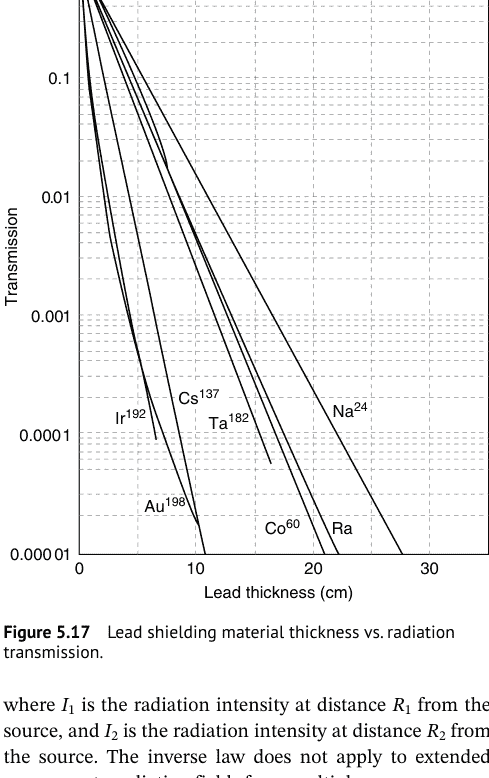

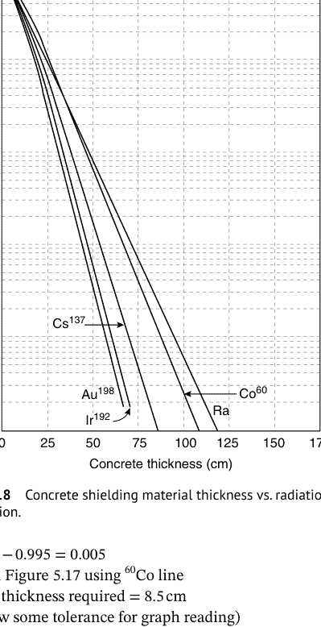

图 5.17  铅屏蔽材料厚度与辐射透射率。

图 5.18  混凝土屏蔽材料厚度与辐射透射率。

其中，I₁ 是距源 R₁ 处的辐射强度，I₂ 是距源 R₂ 处的辐射强度。反平方定律不适用于扩展源或来自多个源的辐射场。

- a) 1.000 − 0.995 = 0.005
- b) 根据图 5.17，使用 ⁶⁰Co 线
  所需铅厚度 = 8.5 cm
  （根据图表读数允许一定误差）

**减少暴露时间** 通过限制暴露于所有辐射源的持续时间，并在暴露之间提供充足的恢复时间，可以将辐射的不利影响降至最低。在紧急情况下，偶尔可能需要在剂量率很高的区域工作。可以通过限制总暴露时间来安全地完成这一点，使以一天为基础计算的平均允许值不超过辐射防护指南剂量，即每周 1×10⁻³ Gy（0.1 rad）。

## 示例 5.20 铅厚度

需要多厚的铅（单位：cm）来屏蔽 ⁶⁰Co 源，使透射率降低 99.5%？

## 示例 5.21 混凝土厚度

为实现与问题 5.20 中铅相同的屏蔽效果，所需混凝土的等效厚度（单位：cm）是多少？

## 解

- a) 使用问题 5.20 中的透射率 0.005，以及图 5.18 中的 ⁶⁰Co 线。
  混凝土厚度 = 53 cm
  （根据图表读数允许一定误差。）

## 示例 5.22 放射性衰变

应用公式 (5.21)

```
I₁/I₂ = (R₂)²/(R₁)²
```

```
I₁/I₂ = (2.0)²/(1.0)²
```

```
I₂ = 1.0/4.0 I₁ = 0.25 I₁
```

## 示例 5.23 放射性衰变

如前面所述，指数一级衰变可以用反应速率系数 (k) 或半衰期 (τ) 来描述。联系这两个参数的方程如下：

```
τ = 0.693 / k
```

指数衰变可以用以下方程表示：

```
N = N₀ e⁻ᵏᵗ
```

其中

- k = 反应速率系数（每单位时间）
- N₀ = 初始量
- N = 时刻 t 的量

使用以下方法确定 100 g 的 Po-210 样品在 5.52 天后剩余多少：

- 1) 反应速率系数
- 2) 半衰期
- 3) 计算两种方法之间的百分误差

Po-210 的半衰期为 1.38 天。

## 解

- 1) 确定反应速率系数：
  k = 0.693/τ = 0.693/1.38 day = 0.502/day
  5.52 天后剩余的物质数量如下：
  N = N₀e⁻ᵏᵗ = 100e⁻⁰·⁵⁰²×⁵·⁵² = 6.26 g

- 2) 第一步是确定 100 g 样品在给定时间段内经历了几次半衰期：
  半衰期次数 = (5.52 天)/(1.38 天) = 4.0
  因此，在 5.52 天的时间段内，100 g 样品经历了 4 个半衰期。
  一个半衰期后剩余的物质数量计算如下：
  (0.5)¹(100 g) = 50 g
  因此，四个半衰期后剩余的物质数量为
  (0.5)⁴(100 g) = 6.25 g

3) 由于这两个方程在原理上是相同的，两个值之间没有差异。两个结果之间的微小差异是由舍入误差造成的。

## 5.15 全球变暖的影响：气候变化——世界的健康

大约 40 年前，一小群科学家和政策制定者开始意识到人类正走在一条剧烈的碰撞轨道上：快速增长的世界经济和人口有可能与地球有限的资源和脆弱的生态系统发生碰撞。这一危险最早在 1972 年斯德哥尔摩联合国人类环境会议上得到全球关注。同年出版的一本著名且有影响力的书《增长的极限》警告说，一切照旧可能导致 21 世纪的崩溃。

地球正在升温。自 1880 年开始有记录以来，陆地和海洋现在都更暖了，而且气温仍在上升。简言之，这种温度上升就是全球变暖。总而言之，气候变化因此是一个非常棘手的问题，而且时间所剩无几！导致人为气候变化的主要温室气体排放量每年都在增加，对地球的威胁也在增加。尽管地球面临的风险极高，我们却正在失去时间。

以下是美国国家海洋和大气管理局（NOAA）给出的基本数据。1880 年至 2016 年间，地表平均温度总计上升了 0.95 °C（1.71 °F）。变化速度为每十年额外上升 0.07 °C（0.13 °F），其中陆地表面升温快于海洋表面——分别为每十年 0.10 °C（0.18 °F）和 0.06 °C（0.11 °F）。过去 140 年的全球平均温度距平绘制在图 3.2 中。从图 3.2 可以看出，大部分变暖发生在两个时期——1910 年至 1940 年以及 1980 年至今。

截至 2017 年夏天，197 个国家中有 174 个国家批准了《巴黎协定》，其目标是将变暖控制在比工业化前地球平均温度高 1.5 °C（2.7 °F）的水平——大多数科学家和政策制定者都认为这是一个难以实现的目标。这就是人类如何设法让地球升温的。

### 5.15.1 温室效应

19 世纪，科学家们已经弄清了基本物理原理和人为引起的气候变化。一位伟大的科学天才、瑞典诺贝尔化学奖得主斯万特·阿伦尼乌斯（Svante Arrhenius）在没有计算机的情况下，徒手精确计算了大气中二氧化碳（CO₂）浓度翻倍的影响（Arrhenius 1896）。而且他是在 1896 年就完成了这一计算！他正确计算出，大气中 CO₂ 浓度翻倍将导致地球平均温度上升约 5 °C。这一估计在今天看来处于可能的范围之内，而这一范围是基于先进的计算机模型以及远比阿伦尼乌斯当时掌握的更广泛的数据得出的。

3500 磅。进一步假设汽油密度为 5.9 磅/加仑，按重量计含有 85% 的碳。“每辆汽车每年排放的二氧化碳相当于其自身重量”这一说法是否属实？接下来，鉴于全球约有 8 亿辆机动车，请估算机动车每年的全球碳排放量。以每年太克（Tg）为单位给出答案（1 Tg = 1 万亿克 = 1 MT）。

## 解

每年燃烧的汽油中所含的碳为
(1200 mi/year) × (1 gal/20 mi) × (5.9 lb/gal) × 0.85
= 3010 lb C/year

排放的二氧化碳为
(3010 lb C/year) × (44 lb CO₂/12 lb C) = 11040 lb CO₂/year

因此，美国普通汽车每年排放的二氧化碳远远超过其自身重量！

为了估算全球机动车的排放量，我们必须对世界上的平均车辆（包括轿车、卡车、公交车、摩托车等）做出一系列粗略的假设。假设世界上平均每辆车每年行驶 24 000 公里，每升油行驶 9 公里，燃烧的燃料密度为 0.75 千克/升，碳含量为 87%。在这些假设下，年碳排放量为

(24 000 km/year) × (1 l/9 km) × (0.75 kg/l)
× 0.87 × 800 × 10⁶ vehicles
× (1 Tg/10⁹ kg) = 1392 Tg/year
（约 14 亿公吨/年，或约 1.4 Gt/年）。

森林砍伐也是大气中 CO₂ 过量的一大因素。事实上，森林砍伐是第二大人为（人类活动）二氧化碳来源。当树木被砍伐时，它们会释放出在光合作用中储存的碳。根据 2010 年《全球森林资源评估》，森林砍伐每年向大气中释放近 10 亿吨碳。

甲烷是第二常见的温室气体，但它捕获热量的效率要高得多。据美国环保署称，2012 年甲烷约占美国温室气体排放总量的 9%。美国环保署报告称，在 100 年时间里，甲烷对气候变化的影响是二氧化碳的 20 倍。

### 5.15.3 全球变暖的影响真的是我们未来的担忧吗？

简短回答：是的。即使看似轻微的平均气温上升，也足以导致我们星球发生剧烈转变。

8 华氏度——听起来可能不算什么，也许就像早春时节穿不穿毛衣的区别。但对我们所生活的世界而言，如果全球排放量继续沿着当前轨迹发展，气候专家预计到 2100 年气温将至少升高 8 华氏度，这一小小的上升将对每个生态系统和生物——包括我们——造成严重后果，而这些后果已经开始显现。

根据《国家气候评估》，人类影响是全球变暖的首要原因，尤其是我们通过燃烧化石燃料造成的碳污染，以及我们通过毁坏森林而失去的碳汇能力。我们释放到大气中的二氧化碳、甲烷、烟尘和其他污染物就像一条毯子，困住太阳的热量，导致地球变暖。证据表明，2000—2009 年比至少过去 1300 年中的任何其他十年都要热。这种变暖正在以深远的方式改变着地球的气候系统，包括陆地、大气、海洋和冰层。

### 5.15.4 更频繁、更严重的天气

更高的温度正在加剧多种灾害，包括风暴、热浪、洪水、干旱和野火。气候变暖使大气能够收集、保持和释放更多水分，从而改变天气模式，使湿润地区变得更湿润，干旱地区变得更干旱。

据自然资源保护委员会（NRDC）的清洁电力计划倡议（2015）称：“极端天气事件造成的代价越来越高，‘十亿美元级’天气灾害的数量预计还会增加。”

根据美国国家海洋和大气管理局的数据，2015 年美国发生了 10 起天气和气候灾害事件——包括严重风暴、洪水、干旱和野火——每起造成的损失至少为 10 亿美元。作为参照，1980 年至 2015 年间，年均灾害损失为 52 亿美元（经通胀调整）。如果关注 2011 年至 2015 年，年均损失为 108 亿美元。

随着变暖的大气容纳并倾泻更多水分，我们看到干旱、强风暴和洪水日益增多，这也对公众健康和安全构成风险。长时间的干旱不仅仅意味着草坪枯萎。干旱状况危及清洁饮用水的获取，助长失控的野火，并在美国导致风沙尘暴、极端高温事件和突发性洪水。在世界其他地方，缺水是死亡和严重疾病的主要原因。相反，强降雨导致溪流、河流和湖泊泛滥，损害生命和财产，污染饮用水，造成危险物质泄漏，并滋生霉菌……


不健康的空气。更温暖、更潮湿的世界也为食源性和水源性疾病以及携带疾病的昆虫，如蚊子、跳蚤和蜱虫，提供了便利。

## 5.15.5 死亡率升高

今天的科学家将气候变化视为“二十一世纪最大的全球健康威胁”。这是一种影响我们所有人的威胁——尤其是儿童、老年人、低收入社区和少数群体——并且以多种直接和间接的方式影响。我们。随着气温飙升，疾病发病率、急诊室就诊次数和死亡人数也在上升。

## 5.15.6 空气更脏

气温升高还会通过增加地面臭氧而加剧空气污染，地面臭氧是在汽车、工厂和其他来源的污染物与阳光和热量反应时产生的。地面*臭氧*是烟雾的主要成分，气温越高，我们拥有的就越多。空气更脏与哮喘患者的住院率和死亡率升高有关。它会恶化患有心脏病或肺部疾病的人的健康。而且更暖的气温还会显著增加空气中的花粉，这对患有花粉热和其他过敏的人来说是不好的消息。

## 5.15.7 野生动物灭绝率升高

作为人类，我们面临着诸多挑战，但我们显然不是唯一承受高温的人。随着陆地和海洋发生快速变化，如果它们不能足够快地适应，栖息其中的动物注定会消失。有些会存活下来，有些则不会。根据政府间气候变化专门委员会（IPCC）2014年的评估，许多陆地、淡水和海洋物种正在将其地理分布范围向较凉爽的气候或更高海拔迁移，以试图逃离变暖。它们也在改变季节性行为和传统的迁徙模式。然而，许多物种仍然面临“由于气候变化而灭绝风险增加”。事实上，一项2015年的研究表明，具有脊椎的动物——鱼类、鸟类、哺乳动物、两栖动物和爬行动物等——的灭绝速度比应有的速度快114倍，这一现象与气候变化、污染和森林砍伐有关。

## 5.15.8 海洋更酸化

由于气候变化，地球的海洋生态系统正承受压力。海洋正变得越来越酸化，这在很大程度上是由于它们吸收了我们过量的排放。随着酸化加速，它对水下生命构成了严重威胁，特别是具有碳酸钙外壳或骨骼的生物，包括软体动物、螃蟹和珊瑚。这可能对贝类渔业产生巨大影响。事实上，截至2015年，酸化据信已使太平洋西北部牡蛎产业损失近1.1亿美元。15个州的沿海社区依赖全国每年10亿美元的牡蛎、蛤蜊和其他有壳软体动物收获，也面临类似的长期经济风险。

## 5.15.9 海平面升高

极地地区对变暖的大气特别脆弱。北极的平均气温上升速度是地球其他地区的两倍，世界冰盖正在快速融化。这不仅对该地区的人们、野生动物和植物造成严重后果；其最严重的影响可能是海平面上升。到2100年，预计我们的海洋将升高一到四英尺，威胁沿海系统和低洼地区，包括整个岛国和世界最大的城市，包括纽约、洛杉矶和迈阿密，以及孟买、悉尼和里约热内卢。

## 5.15.10 全球变暖对人类的影响

气候变化带来了对地球地质、生物和生态系统的可能永久性改变（NAP 2011）。这些变化导致了对人类健康等不太大规模的环境危害的出现，例如极端天气（MPR 2013）、臭氧层破坏、野外火灾危险增加、（Tang et al. 2014）生物多样性丧失（Sahney et al. 2010a）、粮食生产系统压力以及传染病的全球传播（McMichael et al. 2003）。世界卫生组织估计，自1950年以来，有160,000例可以直接归因于气候变化。

迄今为止，气候变化辩论中被忽视的一个方面，与全球变暖相关的地球物理变化相比，对气候变化对健康、粮食供应、经济增长、迁移、安全、社会变革以及饮用水等公共产品的影响所开展的研究要少得多。人类影响既可以是负面的也可以是正面的。例如，西伯利亚的气候变化预计将改善粮食生产和当地经济活动，至少在短期至中期如此。然而，许多研究表明，气候变化对人类社会当前和未来的影响是并且将继续以压倒性的负面为主。

气候变化的绝大多数不利影响由世界各地的贫困和低收入社区承受，他们对健康、财富等环境决定因素以及其他因素的脆弱性要高得多，而应对环境变化的能力却要低得多。全球人道主义论坛于2009年发表的一份关于气候变化对全球人类影响的报告估计，每年有超过30万死亡和约1250亿美元的经济损失，并指出大多数气候变化引起的死亡是由于发展中国家洪水和干旱加剧造成的。

2013年的一项研究得出结论，在当前排放情景下，热应激将大大降低劳动能力（Dunne et al. 2013）。有证据表明，高温会增加胎儿和儿童的死亡率。虽然主要关注点通常是更高温度的健康影响和风险，但应记住它们也会降低学习和工作生产力，这会影响一个国家的经济和发展。

## 5.16 关键脆弱性

## 5.16.1 健康

气候变化对人口健康构成广泛的风险——如果全球气候变化继续沿着当前轨迹发展，这些风险将在未来几十年增加，往往达到关键水平（McMichael et al. 2003）。健康风险的三大主要类别包括（i）直接作用效应（例如由于热浪、加剧的空气污染和物理天气灾害），（ii）通过气候相关生态系统和关系变化介导的影响（例如作物产量、蚊子生态、海洋生产力），以及（iii）与贫困、流离失所、资源冲突（例如水）和灾后心理健康问题相关的更分散（间接）后果。

## 5.16.2 极端天气事件

这种向更大变异性和波动性的趋势可能比长期逐渐升高的平均气温趋势更重要，因为它对人类健康的影响更大（Epstein 2002）。传染病通常伴随着极端天气事件，如洪水、地震和干旱。这些地方性流行病是由于基础设施丧失，例如医院和卫生服务，但也是由于当地生态和环境的变化。

## 5.16.3 环境

气候变化可能会对栖息地丧失产生巨大影响，例如，干旱条件可能导致雨林的森林砍伐，正如过去所发生的那样（Sahney et al. 2010b）。

## 5.16.4 温度

持续的湿球温度超过35°C是一个阈值，此时人类系统的韧性已不再能够充分冷却皮肤。美国国家海洋和大气管理局的一项研究

## 5.16.5 水

人类所依赖的淡水资源对天气和气候变化高度敏感。2007年，IPCC高度确信地报告说，气候变化对所有地区的淡水资源和淡水生态系统都有净负面影响。IPCC还非常确信地发现，干旱和半干旱地区特别容易受到淡水影响（Kundzewicz et al. 2007）。

随着气候变暖，它改变了全球降雨、蒸发、降雪、径流和其他影响水供应和水质的因素。具体影响包括以下几点：

- 更暖的水温影响水质并加速水污染（Miller 2007）。
- 海平面上升预计会在某些地区增加海水入侵地下水。这减少了可用于饮用和耕作的淡水量（Miller 2007；USEPA 2015）。
- 在一些地区，冰川和积雪的减少威胁着水供应。依赖融水径流的地区可能会看到径流减少，晚夏的流量减少，春季高峰提前（Miller 2007）。这会影响灌溉作物的能力。（这种情况对南美洲的灌溉、中央亚洲的灌溉和饮用水供应以及挪威、阿尔卑斯山和北美太平洋西北部的水力发电尤其严重。）
- 极端天气增加意味着更多的水落在无法吸收的硬化地面上，导致山洪暴发，而不是补充土壤水分或地下水位。
- 蒸发增加将降低水库的有效性。
- 与此同时，人类对水的需求将因冷却和补水目的而增长。

## 5.16.6 极端天气的社会影响

世界气象组织解释说，“热带气旋对社会的近期影响增加”


“在很大程度上是由沿海地区人口和基础设施集中度的上升造成的。” Pielke 等人（2008 年）将 1900 年至 2005 年美国本土飓风损失标准化后发现，绝对损失增加的趋势已不复存在。1970 年代和 1980 年代之所以引人注目，是因为与其它年代相比，损失金额极低。1996–2005 年十年是过去 11 个十年中损失第二严重的十年，仅次于 1926–1935 年十年。损失最严重的单场风暴是 1926 年迈阿密飓风，标准化损失为 1570 亿美元（Pielke 等人 2008）。

美国保险杂志预测，“由于建筑成本的增加、建筑物数量的增加及其特征的变化，预计灾难损失大约每 10 年就会翻一番。” 英国保险人协会（ABI）表示，限制碳排放将避免到 2080 年代热带气旋额外年均成本的 80%。成本也在部分增加，因为在暴露区域如海岸和洪泛区进行建设。ABI 称，减少对气候变化某些不可避免影响的脆弱性，例如通过更具韧性的建筑和改善的防洪设施，也可能在长期内带来相当可观的成本节约（ABI 2005）。

## 5.17 能源部门

### 5.17.1 石油、煤炭和天然气

石油和天然气基础设施容易受到气候变化以及风暴、气旋、洪水和海平面长期上升等灾害风险增加的影响。通过在灾害较少发生的地区建设来最大限度地降低这些风险可能代价高昂，并且对于沿海地区或岛国而言是不可能的。所有火力发电站都依赖水进行冷却。不仅淡水需求增加，而且气候变化可能增加干旱和淡水短缺的可能性。热电厂的另一个影响是，运行温度的升高会降低其效率，从而降低其输出。石油的来源通常来自容易发生自然灾害的地区，例如热带风暴、飓风、气旋和洪水。一个例子是卡特里娜飓风对墨西哥湾石油开采的影响，它摧毁了 126 个石油和天然气平台，并损坏了另外 183 个（Urban and Mitchell 2011）。然而，以前 pristine 的北极地区现在将可用于资源开采。

### 5.17.2 核能

气候变化以及极端天气和自然灾害可能会以与使用石油、煤炭和天然气的方式类似的方式影响核电站。然而，水短缺对由河流冷却的核电站的影响将大于对其它热电厂的影响。这是因为旧式水冷堆芯反应堆设计必须在较低的内部温度下运行，因此， paradoxically，必须向环境排放更多的热量才能产生相同数量的电力。这种情况迫使一些核反应堆关闭，并且如果这些工厂的冷却系统不增强以提供更多容量，将再次发生这种情况。低河流水位和干旱导致河流达到冷却的最大温度，从而降低了核电供应。法国在 2003 年和 2006 年热浪期间发生了此类停机。在热浪期间，17 个反应堆不得不限制输出或关闭。在法国，77% 的电力由核能生产；2009 年出现了类似情况，造成 8 GW 的短缺，并迫使法国政府进口电力。德国也报告了其它案例，极端高温导致 1979 年至 2007 年间核电生产因高温而九次下降。

### 5.17.3 水电

河流流量的变化量将与大坝产生的能源量相关。由于干旱、气候变化或上游大坝和分流导致河流流量降低，会减少水库中的活储量，从而减少可用于水电的水量。河流流量减少的结果可能是严重依赖水电的地区出现电力短缺。随着气候变化，流量短缺的风险可能会增加。美国科罗拉多河的研究表明，适度的气候变化（例如 2°C 的变化，可能导致降水减少 10%）可能会使河流径流减少多达 40%。巴西尤其脆弱，因为其依赖水电，随着气温升高、水流量减少以及降雨制度改变，到本世纪末总能源生产每年可能减少 7%（Urban and Mitchell 2011）。

### 5.17.4 运输

道路、机场跑道、铁路线路和管道（包括石油管道、下水道、自来水主管道等）可能会因承受更大的温度变化而需要增加维护和更新。已受不利影响的地区包括永久冻土区，其沉降水平高，导致道路弯曲、基础下沉和跑道严重开裂。

## 问题

5.1 一个 RCRA 填埋场由于现场温度、风速和活动的变化，导致污染物挥发出现昼夜变化。最主要的污染物苯遵循以下模式：

| 时长（小时） | 苯浓度（ppm） |
|---|---|
| 8–9 a.m. | 5 |
| 9–10 a.m. | 8 |
| 10–11 a.m. | 8 |
| 11 a.m.–12 p.m. | 9 |
| 12–1 p.m. | 11 |
| 1–2 p.m. | 14 |
| 2–3 p.m. | 11 |
| 3–4 p.m. | 10 |

确定填埋场苯浓度的 TWA。

5.2 在一个 RCRA 90 天储存设施中采集的空气样品含有 8 ppm 甲苯、12 ppm PCE 和 25 ppm MEK。
A) 混合物的 TLV–TWA 是多少？
B) 是否超过了 TLV？

5.3 确定在 RCRA 溶剂回收作业中暴露于 41 ppm PCE、38 ppm TCE、86 ppm MEK 和 35 ppm MIBK 的工人的混合物 TLV–TWA。化学品浓度是否超过 TLV–TWA混合物？

5.4 一个地下储罐泄漏导致地下水羽流形成，烟雾已迁移到附近工厂的地下室。工厂室内空气样品显示甲苯和苯浓度分别为 50 和 70 µg/m³。

确定在该工厂工作、暴露于这些蒸气 15 年的成年男性所产生的健康风险，假设呼吸量为 15 m³/天，两种物质均为甲苯和苯。通过吸入途径的致癌斜率因子-风险特定剂量为 0.021（mg/kg day）⁻¹ 和 0.029（mg/kg day）⁻¹，分别对应甲苯和苯。假设甲苯和苯的环境风险是相加的。

5.5 OSHA 规定了雇主必须履行的基本职责。讨论这些基本职责。另请说明 NIOSH 和 OSHA 的主要作用。

5.6 提供对典型 MSDS 表格上每项信息的简短（几句话）说明其必要性。

5.7 在应对化学紧急情况时，环境氧气测量经常用于帮助确定为工人安全所需个人防护装备的级别。NIOSH/OSHA 按体积百分比定义的缺氧大气为（选择其一）
1) 25 或更少
2) 19.5 或更少
3) 15 或更少
4) 12.5 或更少
5) 10 或更少

5.8 哪些因素将最影响由于颗粒物空气污染（PM-2.5）导致的工人死亡率？

5.9 一个工作场所计划安装五台机器。单个噪声水平如下所示。预测 SPL 或总噪声水平将会是多少。

| 机器 | SPL（dBA） |
|---|---|
| 1 | 86.0 |
| 2 | 88.1 |
| 3 | 88.1 |
| 4 | 82.2 |
| 5 | 84.5 |

5.10 五台机器，每台测量为 85 dB，将被移入同一工作区。预测由此产生的适当总 SPL。

以下数据为员工在班次期间的暴露情况：

| dBA | 90 | 88 | 90 | 82 | 88 | 92 |
|---|---|---|---|---|---|---|
| Cᵢ | 1 | 2 | 1 | 1 | 2 | 1 |
| Tᵢ | 8 | 10.6 | 8 | 24.3 | 10.6 | 6.1 |

确定均匀混合物粉尘的 TLV，其中包含以下颗粒：

| 粉尘类型 | 浓度（wt, %） | TLV（mppcf） |
|---|---|---|
| Dust A | 80 | 20 |
| Dust B | 20 | 2 |

注：mppcf（每立方英尺百万颗粒）。

5.11 以下数据为员工在班次期间的暴露情况：

| dBA | 90 | 88 | 90 | 82 | 88 | 92 |
|---|---|---|---|---|---|---|
| Cᵢ | 1 | 2 | 1 | 1 | 2 | 1 |
| Tᵢ | 8 | 10.6 | 8 | 24.3 | 10.6 | 6.1 |


## 5.12 确定含有以下颗粒物的均匀粉尘混合物的TLV：

| 粉尘类型 | 浓度（wt %） | TLV（mppcf） |
|---|---:|---:|
| 粉尘A | 80 | 20 |
| 粉尘B | 20 | 2 |

*注：* mppcf（每立方英尺百万颗粒数）。

## 5.13 确定以下噪声水平在没有额外控制措施的情况下是否允许：

| 噪声水平（dBA） | 持续时间（wt %） | 最大允许时间（小时） |
|---:|---:|---:|
| 85 | 3.6 | 16 |
| 95 | 3.0 | 4 |
| 110 | 0.5 | 0.5 |

## 5.14 需要多少新鲜外部空气才能将工作场所空气中的甲乙酮浓度维持在100 ppm以下（即TLV–TWA）？

在脱脂操作中，预计一个8小时班次内蒸发3加仑的MEK，而通风质量被评为平均水平。另外，如果操作在带有50 ft²开口和100 ft/min面速度的封闭通风柜中进行，请计算所需空气量。温度为81 °F，压力为1 atm。MEK的比重为0.81，分子量为72.1。k值为1/8（0.125）。使用以下方程计算所需的通风稀释空气量。

$$Q_v = \left(\frac{Q_m R_g T}{k C_{ppm} P M}\times 10^6\right)$$

其中$Q_v$是通风稀释空气流量，单位ft³/min；$Q_m$是蒸发速率；$M$是挥发性化学品的分子量；$R_g$是理想气体常数；$T$是绝对温度；$k$是通风安全系数；$C$是蒸汽浓度，以ppm为单位。

## 5.15 强调并简要说明减少工作场所工人接触暴露的类型和技术。

## 5.16 生物可降解性是解决海洋和陆地塑料废物污染的解决方案吗？

## 5.17 定义“从摇篮到坟墓”。

## 参考文献

Allen, D.T. 和 Shonnard, D.R. (主编) (2002). *绿色工程：化学过程的环境友好设计.* Upper Saddle River, NJ: Prentice Hall PTR.

美国政府工业卫生学家会议 (ACGIH) (1986). *阈限值和生物暴露指数文献*, 第5版. Cincinnati, OH: ACGIH.

美国国家标准学会 (ANSI) (2015). *职业和教育用个人眼部和面部防护装置美国国家标准*, 出版物Z87.1. Washington, DC: ANSI.

美国公共卫生协会 (APHA) (1989). *水和废水检验标准方法*, 第17版. Washington, DC: 美国公共卫生协会.

美国材料与试验协会 (ASTM) (1991). *ASTM标准年鉴，第11部分：水与环境技术.* Philadelphia, PA: ASTM.

美国材料与试验协会 (ASTM) (2003). *污染场地概念场地模型制定标准指南*, E1689-95. Philadelphia: ASTM.

Anderson, E.L. 和 Albert, R.E. (1998). *风险评估与室内空气质量.* Boca Raton, FL: Lewis Publishers.

Armitage, P. 和 Doll, R. (1954). 癌症的年龄分布与致癌作用的多阶段理论. *英国癌症杂志* 8: 1–12.

Arrhenius, S. (1896). 论空气中碳酸对地面温度的影响. *伦敦、爱丁堡和都柏林哲学杂志与科学杂志* 4 (251): 273–276.

Asante-Duah, K. (2002). *人类化学品暴露的公共卫生风险评估.* London: Kluwer Academic.

英国保险协会 (ABI) (2005). 气候变化的金融风险. http://insurance.abi.org/documents/abi-climate.pdf (访问于2018年11月12日).

Barnhouse, L.W., Deangelis, D.L., Gardner, R.H. 等人 (1982). *环境风险分析方法学,* ORNL/TM-8167. Oak Ridge, TN: 橡树岭国家实验室.

Boholm, A. (2008). 复杂社会中风险沟通不确定性的新视角. *风险研究杂志* 11 (1–2): 1–3.

Bolstridge, J. (2003). 在互联网上获取环境信息. *化学工程进展:* 50–54. (一月).

Brooks, A.S. 和 Seegert, S.R. (1977). 间歇氯化对虹鳟和金鲈的影响. *美国渔业学会汇刊* 106: 278–286.

化工过程安全中心 (CCPS) (2012). *过程安全工程设计指南*, 第2版. Hoboken, NJ: Wiley.

Chu, J. (2013). 空气污染每年在美国导致20万人早逝，麻省理工学院航空与环境实验室. 《麻省理工新闻》(8月29日).

Costanza, R. (1991). 生态经济学：可持续性的科学与管理. New York: 哥伦比亚大学出版社.

Crowl, D.A. 和 Louvar, J.F. (2011). 化工过程安全：原理与应用, 第3版. Englewood Cliffs, NJ: Prentice Hall.

Daniels, J. A. (1973). 空气污染工程手册, AP-40, 第2版. Washington, DC: USEPA.

Das, D.K. 和 Prabhusai, R.K. (1996). 化学工程许可证复习课程, 第2版. San Jose, CA: Engineering Press.

Desouesses, W.H. 和 Saken, V.A. (1987). 自然资源损害测量技术, 最终报告, PB88-100136. Springfield, VA: 国家技术情报服务处.

Dourson, M.L. (1986). 推导可接受每日摄入量（ADI）的新方法. 《毒理学评论》 1: 35–48.

Dunne, J.P., Stouffer, R.J. 和 John, J.G. (2013). 气候变暖下热应力降低劳动能力. 普林斯顿大学福雷斯特尔校区地球物理流体动力学实验室, Princeton, NJ.

Epstein, P. (2002). 气候变化与传染病：暴风雨天气即将来临？ 《流行病学》 13 (4): 373–375.

联邦焦点公司 (1991). 迈向共同措施：关于环境风险评估和风险管理政策的总统行政命令建议. Washington, DC: 联邦焦点公司和监管政策研究所.

Finkel, A. (1990). 直面风险管理中的不确定性. Washington, DC: 未来资源.

Haggestad, H.E. (2001). 环境臭氧与植物健康. 《植物病害》 85, 1–11. https://www.coursereport.com/file/p621p4/SULFUR-DIOXIDE-DAMAGE-TO-CORN-OZONE-DAMAGE-DO-RADISH-PLANT-RESULTING-IN-SMALLER (访问于2018年12月4日).

Heath, A.G. (1977). 间歇氯化对淡水鱼类的毒性：温度和化学形态的影响. 《水生生物学》 56: 39–47.

Heck, W., Adams, R.M., Cure, W.W. 等人 (1983). 对臭氧造成作物损失的重新评估. 《环境科学与技术》 17 (12): 572A–581A.

Hoppins, J.A., Adgate, J.L., Eberhart, M. 等人 (2006). 农场工人住宅中农药的环境暴露评估. 《环境健康展望》 (6): 929–935. http://doi.org/10.1289/ehp.8530.

Ibrahim, F., Lebowitz, J. 和 Hughes, J. (2018). 工作危害分析要点. 《化学工程进展》 114 (11): 52–56.

国际标准化组织 (ISO) (2015). 防护服装：防热和火焰的服装——最低性能要求, 出版物11612. 瑞士日内瓦: ISO.

Johnson, D.L. (2017). 工业卫生与环境健康科学综合实践统计工具, 第1版. Hoboken, NJ: Wiley.

Jones, J.M. (2015). 美国对环境威胁的担忧基础. 《政治学》 (2015年3月15日).

Kammen, B. 和 Hassenzahl, D. (2009). 我们应该冒险吗？探索环境、健康和技术问题的解决. Princeton, NJ: 普林斯顿大学出版社.

Kocher, D.C. 和 Hoffman, F.O. (1991). 管制环境致癌物：我们应该划在哪里？ 《环境科学与技术》 25: 1986–1989.

Kundzewicz, Z.W., Mata, L.J., Arnell, N.W. 等人 (2007). 淡水资源及其管理. 见：*气候变化2007：影响、适应与脆弱性*. 政府间气候变化专门委员会第四次评估报告第二工作组的贡献 (M.L. Parry 等人 编). Cambridge 和 New York: 剑桥大学出版社.

Lee, G.F. 和 Jones, R.A. (1982). 评估水生栖息地评价中化学污染物潜在意义的一种方法. 见：《水生栖息地存量信息的获取与利用》 (G.M. Bain 和 N.J. Stevenson 编), 294–302. Washington, DC: 美国渔业学会.

Lloyd, R. (1979). 水生生物毒性试验. 在第六届FAO/SIDA关于水生污染与保护生物资源研讨会上发表的演讲. 联合国粮食及农业组织. Rome.

马克斯·普朗克研究 (MPR) (2013). Reichstein, M. 极端气象事件与全球变暖：恶性循环？ Jena, 德国: 马克斯·普朗克研究所.

McDermaid, H.J. (1976). 污染物控制通风手册. Ann Arbor, MI: Arbor Science.

McKim, J.K. (1995). 早期生命阶段毒性试验. 见：《水生毒理学基础》 (G.M. Rand 和 S.R. Petrocelli 编). Washington, DC: Hemisphere Publishing.

McLaughlin, S.B. 和 Taylor, G.E. (1985). SO2对双子叶植物玫瑰的影响：一些问题、机制和指标. 见：《二氧化硫与植被》 , W.E. Winner, H.A. Mooney 和 R.A. Goldstein 编), 227–249. Stanford, CA: 斯坦福大学出版社.

McMichael, A., Campbell-Lendrum, M., Corvalan, C. 等人 (2003). 全球气候变化与健康：一个被放大的古老故事. 瑞士日内瓦: 世界卫生组织.

Miller, K. (2007). 气候变化对水资源的影响, 美国国家大气研究中心, Boulder, CO. http://


www.isse.ucar.edu/water_climate/impacts.html (accessed 27 November 2018).
National Academies Press (NAP) (2011). America's Climate Choices. The Average Temperature of the Earth's Surface Increased by About 1.4°F (0.8°C) over the Past 100 Years with About 1.0°F (0.6°C) of This Warming Occurring over Just the Past Three Decades. Washington, DC: National Academy Press.
National Academy of Sciences of the United States of America (2006). Fluoride in Drinking Water: A Scientific Review of EPA's Standard. Washington, DC: National Academies Press.
National Fire Protection Association (NFPA) (2006). Standard on Selection, Care, and Maintenance of Hazardous Materials Clothing and Equipment, NFPA 2113. Quincy, MA: NFPA.
National Fire Protection Association (NFPA) (2015). Standard on Selection, Care, Use, and Maintenance of Flame-Resistant Garments for Protection of Industrial Personnel against Short-Duration Thermal Exposure from Fire, NFPA 2113. Quincy, MA: NFPA.
National Fire Protection Association (NFPA) (2017). Standard on Respiratory Protection Equipment for Tactical and Technical Operations, NFPA 1986. Quincy, MA: NFPA.
National Fire Protection Association (NFPA) (2018a). Standard for Electrical Safety in the Workplace, NFPA 70E. Quincy, MA: NFPA.
National Fire Protection Association (NFPA) (2018b). Standard on Selection, Care, and Maintenance of Open-Circuit Self-Contained Breathing Apparatus (SCBA), NFPA 1852. Quincy, MA: NFPA.
National Fire Protection Association (NFPA) (2018c). Standard on Liquid Splash-Protective Ensembles and Clothing for Hazardous Materials Emergencies, NFPA 1992. Quincy, MA: NFPA.
National Fire Protection Association (NFPA) (2018d). Standard on Flame-Resistant Clothing for Protection of Industrial Personnel against Short-Duration Thermal Exposure from Fire, NFPA 2112. Quincy, MA: NFPA.
National Institute of Occupational Safety and Health (NIOSH) (2016). Certified Equipment List, Atlanta, GA, NIOSH. https://www.cdc.gov/niosh/npptl/topics/respirators/cel/default.html (accessed 12 December 2018).
National Oceanic and Atmospheric Administration, Earth System Research Laboratory (n.d.) Trends in atmospheric carbon dioxide. http://www.esr.noaa.gov/gmd/ccgg/trends/full.html (accessed 23 September 2019).
National Research Council (NRC) (1975). Decision Making for Regulating Chemicals in the Environment. Washington, DC: National Academy Press.
National Research Council (NRC) (1983). Risk Assessment in the Federal Government: Managing the Process. Washington, DC: National Academy Press.

National Research Council (NRC) (1989). Improving Risk Communication. Washington, DC: National Academy Press.
New York Times (2018a). 87,000 tons of plastic and counting in Pacific. New York Times (23 March 2018).
New York Times (2018b). Want to save the planet? Try using less deodorant. New York Times (17 February 2018).
New York Times (2019). 48 pounds of plastic junk are found in Dead Whale. New York Times (3 April 2019).
Newcombe, C.P. and MacDonald, D.D. (1991). Effects of suspended sediments on aquatic ecosystems. North American Journal of Fisheries Management 11: 72–82.
NRDC, National Resources Defense Council (2015). Clean Power: The Case for Carbon Pollution Limits. Report No. R-15-06-B.
Omenn, G.S. and Faustman, E.M. (2002). Risk assessment. In: Risk Assessment and Risk Management (eds. R. Detels et al.). Oxford University Press.
Organization for Economic Cooperation and Development (OECD) (1981). OECD Guidelines for Testing of Chemicals. Paris: OECD.
Parkhurst, M.A., Onishi, Y., and Olsen, A.R. (1981). A risk assessment of toxicants to aquatic life using environmental exposure estimates and laboratory toxicity data. In: Aquatic Toxicology and Hazard Assessment, ASTM/STP 737 (eds. D.R. Branson and K.L. Dickson), 59–71. Philadelphia, PA: American Society for Testing and Materials.
Pielke, R.A., Gratz, J., Landsea, C.W. et al. (2008). Normalized hurricane damage in the United States: 1900–2005. Natural Hazards Review 9 (1): 29–42.
Pilson, M.E. (2006). We are evaporating our coal mines into the air. AMBIO: A Journal of the Human Environment 35 (3): 130–133.
Randall, A. (1991). The value of diversity. AMBIO 20: 64–68.
Richardson, L.B. and Burton, D.T. (1981). Toxicity of ozonated estuarine water to juvenile blue crabs (Calinectes sapidus) and juvenile Atlantic menhaden (Brevoortia tyrannus). Bulletin of Environmental Contamination and Toxicology 26: 171–178.
Risk Assessment Forum (1996). Summary Report for the Workshop on Monte Carlo Analysis. Washington, DC: USEPA.
Risk Assessment Forum (1999). Guiding Principles for Monte Carlo Analysis, Washington, 1997. Risk Assessment Forum, Report of the Workshop on Selecting Input Distributions for Probabilistic Assessments, Washington.
Roberts, W.C. and Abernathy, C.O. (1997). Risk assessment: principles and methodologies. In: Toxicology and Risk Assessment (ed. A.M. Fan). Academic Press.
Rolston, H. (1988). Environmental Ethics. Philadelphia, PA: Temple University Press.

Ruckelshaus, W.D. (1984). Risk in a free society. Risk Anal 4: 157–162.
Sahney, S., Benton, M.J., and Falcon-Lang, H.J. (2010a). Rainforest collapse triggered Pennsylvanian tetrapod diversification in Euramerica. Geology 38 (12): 1079–1082.
Sahney, S., Benton, M.J., and Ferry, P.A. (2010b). Links between global taxonomic diversity, ecological diversity and the expansion of vertebrates on land. Biology Letters 6 (4): 544–547.
Sandman, P. (1993). Responding to Community Outrage: Strategies for Effective Risk Communication. Fairfax, VA: American Industrial Hygiene Association.
Seattle Times (2018). As plastic piles up, companies vow to clean up: waste is choking oceans, rivers, landfills. Seattle Times (22 February 2018).
Sheader, G. (2014). 10 ideas that will breakdown the barriers to effective workplace communication. The Manufacturer Alliance, Champion for UK Manufacturing Group.
Slovic, P., Finucane, M., Peters, E., and MacGregor, D.G. (2004). Risk as analysis and risk as feelings: some thoughts about affects, reason, risk, and rationality. Risk Analysis 24 (2): 1–12.
Sprague, J.B. (1969). Measurement of pollutant toxicity to fish I. Bioassay methods for acute toxicity. Water Research 3: 793–821.
Suter, G.W. (ed.) (1993). Ecological Risk Assessment. Boca Raton, FL: Lewis.
Suter, G.W., Efroymson, R.A., Sample, B.E., and Jones, D.S. (2000). Ecological Risk Assessment for Contaminated Sites. Boca Raton, FL: Lewis.
Tang, Y., Zhong, S., Luo, L. et al. (2014). The potential impact of regional climate change on fire weather in the United States. Annals of the Association of American Geographers 105 (1): 1–21.
Tebo, L.B. (1986). Effluent monitoring: historical perspective. In: Environmental Hazard Assessment of Effluents (eds. H.L. Bergman, R.A. Kimerle and A.W. Maki), 13–31. New York: Pergamon Press.
Theodore, L. (2006). Nanotechnology: Basic Calculations for Engineers and Scientists. Hoboken, NJ: Wiley.
Travis, C.C., Richter, S.A., Crouch, E.A.C. et al. (1987). Cancer risk management. Environmental Science and Technology 21: 415–420.
U.S. Department of Agriculture (USDA) (2011). Effects of Ozone Air Pollution on Plants. Raleigh, NC: Agricultural Research Service, Plant Science Research.
U.S. Department of the Interior (USDOI) (1986). Natural resource damage assessment: final rule. Federal Register 51: 27674–27753.
U.S. Department of the Interior (USDOI) (1987). Natural resource damage assessment: final rule. Federal Register 52: 9042–9100.
U.S. Occupational Safety and Health Administration (OSHA) (2018). Title 29, Code of Federal Regulation (CFR), – Part 1910 – Occupational Safety and Health Standards. Washington, DC. https://www.osha.gov/laws-regs (accessed December 2018).
Urban, D.J. and Cook, N.J. (1986). Hazard Evaluation, Standard Evaluation Procedure, Ecological Risk Assessment, EPA-540/9-85-001. Washington, DC: USEPA.
Urban, F. and Mitchell, T. (2011). Climate Change, Disasters and Electricity Generation, Overseas Development Institute and Institute of Development Studies, London, UK. https://www.odi.org/sites/odi.org.uk/files/odi-assets/publications-opinion-files/7151.pdf (accessed 16 January 2019).
USEPA (1982). Guidelines and Support Documents for Environmental Effect Testing. Washington, DC: USEPA.
USEPA (1985a). Methods for Measuring the Acute Toxicity of 4 Freshwater and Marine Organisms, USEPA Environmental Monitoring and Support L EFIA-600/4-85/013. Cincinnati, OH: USEPA.
USEPA (1985b). User’s Guide to the Conduct and Interpretation of Effluent Toxicity Tests at Estuarine/Marine Sites, EPA-600/X-86/224. Washington, DC: USEPA.
USEPA (1985c). Technical Support Document for Water Quality-Based Toxics Control, EPA-440/4-85/032. Washington, DC: USEPA Office of Water.
USEPA (1986). Quality Criteria for Water. Washington, DC: Office of Water.
USEPA (1988). Short Term Methods for Estimating the Chronic Effluents and Receiving Waters to Marine and Estuarine Organisms, EPA-600/4-88/028. Narragansett, RI: USEPA.
USEPA (1989). Short Term Methods for Estimating Chronic Effluents and Receiving Waters to Freshwater Organisms, EPA-660/2nd. Cincinnati, OH: USEPA.
USEPA (1992). Framework for Ecological Risk Assessment. Washington, DC: Risk Assessment Forum.
USEPA (1993). Wildlife Exposure Factors Handbook, vol. 1. Washington, DC: Office of Research and Development.
USEPA (1995). Development of Human Health Based and Ecologically Based Exit Criteria for the Hazardous Waste Identification Project. Washington, DC: USEPA.
USEPA (1996). Chemical Accidental Prevention and Risk Management Programs, 40 CFR 68 Subpart B (June). USEPA, Washington, DC. http://www.epa.gov/rmp/rmpcomp; http://response.restoration.noaa.gov/chemaids/rmp/rmp.html (accessed 12 January 2019).
USEPA (1997). Ecological Risk Assessment Guidance for Superfund Process for Designing and Conducting Ecological Risk Assessments. Washington, DC: Interim Final, Emergency Response Team.
USEPA (1998a). Guidelines for Ecological Risk Assessment. Washington, DC: Risk Assessment Forum.


USEPA (1998b). *EPA's Risk Management Program Guidance for Wastewater Treatment Plants, 40CFR68*, EPA 550-B-98-010. Washington, DC: USEPA, Office of Solid Waste and Emergency Response, Chemical Emergency Preparedness and Prevention Office.

USEPA (1998c). *Study of Hazardous Air Pollutant Emissions from Electric Utility Steam Generating Units: Final Report to Congress*, EPA-453/R-98-004a, vol. 1. Washington, DC: USEPA.

USEPA (2002a). *Short Term Methods for Estimating Chronic Effluents and Receiving Waters to Freshwater Organisms*, EPA 821-R-02-013, 4e. Washington, DC: USEPA.

USEPA (2002b). *A Review of the Reference Dose and Reference Concentration Processes*, EPA/630/P-02/002F. Washington, DC: Risk Assessment Forum.

USEPA (2003). *Framework for Cumulative Risk Assessment*, EPA/630/P-02/001F. Washington, DC: Risk Assessment Forum.

USEPA (2005). *Guidelines for Carcinogen Risk Assessment*, Washington, DC, Risk Assessment Forum, EPA/630/P-03/001B. http://www.epa.gov/iris/cancer032505.pdf (accessed 12 January 2019).

USEPA (2015). Climate change indicators: sea level rise. https://www.epa.gov/climate-indicators/climate-change-indicators-sea-level (accessed 12 January 2019).

Weinberg, A. (1987). *Science and its limits: the regular's dilemma*. In: *De Minimus Risk* (ed. C. Whipple), 27–38. New York, NY: Plenium Press.

Weiner, J. (1990). *The Next One Hundred Years: Shaping the Fate of Our Living Earth*. New York, NY: Bantam Books.

Whipple, C. (ed.) (1987). *De Minimus Risk*. New York, NY: Plenum Press.

White, G.C. (2010). *White's Handbook of Chlorination and Alternative Disinfectants*, 5e. Hoboken, NJ: Wiley.

World Health Organization (WHO) (2014). Million Premature Deaths Annually Linked to Air Pollution. WHO Media Center.
