## 6
## 工业过程污染预防
从生命周期评估到最佳可行控制技术

### 6.1 工业废物

工业废物是指工业活动中产生的废物，包括在工厂、工业、磨坊和采矿作业等制造过程中被废弃的材料。自工业革命开始以来就一直存在。工业废物及其来源的例子有化学品及相关产品、溶剂、颜料、污泥、金属、灰渣、油漆、家具及固定装置、纸及相关产品、塑料、橡胶、皮革、纺织品、石油炼制及相关行业、电子设备及零部件、工业副产品、金属、放射性废物、各类制造业等，列表不胜枚举。危险废物或有毒废物、化学废物、工业固体废物和市政固体废物也是工业废物的称谓。

仅在美国，每年产生的工业废物就超过120亿吨。这大致相当于美国每人、每女、每名儿童超过40吨的废物。这些数字的巨大规模令人担忧，促使我们去识别废物的特性、产生废物的各种工业作业、废物管理的方式，以及工业污染预防政策和策略。本章的第一部分专门论述污染预防层级。接下来概述如何将生命周期评估（LCA）工具应用于选择最佳可行技术（BACT），以在产品制造过程的各个阶段尽量减少废物。最后，回顾了若干应用LCA工具的工业竞争性工艺和产品案例研究；从而选择BACT以展示层级污染预防（P²）和环境绩效策略。

### 6.1.1 废物作为污染

废物被定义为制造过程中产生的 unwanted by-product 或损坏、缺陷或多余的材料。在其当前状态下，通常被认为或被认为没有价值。它在释放到环境中时可能有害或有毒，也可能无害。污染是指任何向环境释放废物的行为（即任何常规或意外排放、废水排放、泄漏、排放或处置到空气、土地或水体），从而污染或破坏环境。废物是一种低效率的形式，“如果一个经济系统产生废物，就不能被认为有效率，或最终具有竞争力”（Paul 1996）。

### 6.1.2 工业中的污染预防

污染预防（P²）减少了工业、农业或消费者产生的污染。与在污染物产生后寻求管理污染物并降低其对环境影响的污染控制策略不同，污染预防方法寻求提高工艺效率，减少产生的污染量。尽管广泛认为源头削减是首选策略，但一些专业人士也使用污染预防这一术语。

随着人类人口的增加，污染已成为一个重大问题。美国环境保护署（EPA）致力于推行污染预防计划以减少和管理废物（USEPA 1992a）。减少和管理污染可能会降低因污染相关疾病导致的死亡和疾病人数。作为一种环境管理策略，污染预防与清洁生产具有许多共同属性，后者这一术语在美国以外使用更为普遍。污染预防涵盖了更专业的子学科，包括绿色化学和绿色设计（也称为环境意识设计）。

我们将工业污染预防定义得相当宽泛为任何防止有害物质释放到环境中的行动。这种定义表现为污染预防层级，以安全处置为金字塔底部，以源头最小化废物产生为顶峰（图6.1）。

相比之下，美国环保署对污染预防的定义仅承认源头削减，这仅涵盖层级中的上两个层级——最小化产生和最小化引入（USEPA 1992a）。EPA将图6.1的七级层级描述为“环境管理选项”。另一方面，欧洲共同体在其污染预防定义中包含了整个层级。

污染预防层级中的层级大致描述如下：

- 源头削减。将化学反应步骤中不可销售副产品的形成降至最低，并在所有化学和物理分离步骤中将废物成分（如焦油、细粉等）降至最低，并尽可能减少未反应通过系统的工艺材料量或转化为废物的量。这意味着尽量减少引入对生产最终产品非必需成分的材料。例如，工厂设计人员可以决定不使用水作为溶剂，而使用反应物、中间体或产品之一来发挥相同功能，或者他们可以添加空气作为氧源、热沉、稀释剂或输送气体，而不是大量氮气。

- 再利用。避免将废物流合并在一起而不考虑对毒性或处理成本的影响。可能有意义将低体积、高毒性的废水流与高体积、低毒性的废水流分开。对每个废物流进行源头检查，并确定可能在工艺中再利用或转化为有价值的副产品的废物流。

- 回收。它是将废弃材料转化为新材料和物品的过程。它是“常规”废物处置的替代方案，可以节约材料并有助于降低温室气体（GHG）排放。回收可以防止潜在有用材料的浪费，减少新鲜原材料消耗，从而降低能源使用、空气污染（来自焚烧）和水污染（来自填埋）。

回收是现代废物减量中的关键组成部分，是“减量、再利用和回收”废物层级中的第三个组成部分（Lienig and Bruemmer 2017）。因此，回收旨在通过将原材料投入经济系统并将废物输出从经济系统重新定向来实现环境可持续性（Geissdoerfer et al. 2017）。

与回收相关的一些ISO标准包括用于塑料废物的ISO 15270:2008和用于回收实践环境管理控制的ISO 14001:2004。待回收的材料要么送到收集中心，要么从路边取回，然后进行分拣、清洁和再加工，制成用于制造的新材料。

严格意义上讲，材料的回收会产生相同材料的新供应——例如，使用过的办公纸会转化为新的办公纸，或使用过的聚苯乙烯泡沫会转化为新的聚苯乙烯。然而，这通常很困难或成本太高（与从原材料或其他来源生产相同产品相比），因此许多产品或材料的“回收”涉及将其再用于生产不同的材料（例如纸板）。另一种回收形式是从复杂产品中回收某些材料，要么由于其内在价值（如汽车电池中的铅，或电路板中的黄金），要么由于其危险性（例如从温度计和恒温器中去除和再利用汞）。

- 回收废物中的能量价值。作为最后的手段，废弃有机液体、含有挥发性有机化合物的气流和氢气可以因其燃料价值而燃烧。通常，用于制造原始化合物的能源和资源价值远大于通过燃烧废物流作为燃料价值所能回收的价值（另见图G.1）。

- 排放前处理。在任何废物流排放到环境之前，应采取措施降低其毒性、浊度、全球变暖潜势、病原体

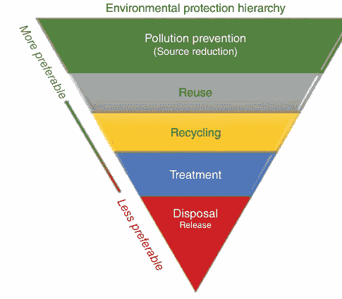

图 6.1 环境保护层级。


- *安全处置。* 使废物流完全无害化，从而不对环境造成不利影响。在本书中，我们将其定义为将废物成分完全转化为二氧化碳、水和无毒矿物。例如，污水处理厂出水在私人湿地进行后处理。所谓的“安全”填埋场除非废物完全封装在花岗岩中，否则不属于此类。
- *焚烧。* 这是一种处置方法，其中固体有机废物经受燃烧，从而将其转化为残渣和气态产物。该过程可将固体废物的体积减少 80–95%。焚烧和其他高温废物处理系统有时被称为“热处理”。焚烧炉将废物转化为热、气体、蒸汽和灰烬。焚烧既可由个人小规模进行，也可由工业大规模进行。它用于处置固体、液体和气态废物。它被认为是处置某些危险废物（如生物医疗废物）的实用方法。焚烧是一种有争议的废物处置方法，因其存在气体污染物排放等问题。

焚烧在日本等土地稀缺的国家很常见，因为这些设施通常不需要像填埋场那样多的面积。废物能源或能源回收（见附录 G）是焚烧废物以产生热、蒸汽或电力的设施的广义术语。焚烧炉中的燃烧并不总是完美的，人们担心焚烧炉烟囱的气体排放中存在污染物。特别关注的是一些非常持久的有机化合物，如二噁英、呋喃和多环芳烃，它们可能被产生并可能产生严重的环境后果。

## 6.1.3 定义过程污染预防（P³）

“过程污染预防”（P³）的原理和策略是同时实现进一步的废物减少（环境影响）和生产改进（经济激励）。

P³ = 废物 ↓ + 生产 ↑　　　　　　　　　　　　　　　　　(6.1)

每当废物流中减少一磅时，很可能它会进入产品（式 6.1）。目标是在经济子系统中形成闭环，以便人类活动不可避免产生的废物不会逸出污染环境。

人们需要技术来管理和将当今的废物转化为可用的原料以增强盈利性的污染预防。化工工艺设计工程师和咨询公司将通过技术开发、工艺强化、系统集成和设施运营提供重点服务来满足这一需求。有效的工艺和产品管理需要设计在整个生命周期内优化性能。下一节将重点介绍工艺生命周期评价，而类似的概念和工具也应用于期望的产品生命周期，并通过几个简化的案例研究加以突出。

## 6.2 什么是生命周期评价？

随着环境意识的增强，行业和企业开始评估其活动对环境的影响。社会对自然资源枯竭和环境退化问题日益关注。许多企业和行业通过提供“更绿色”的产品和使用“更绿色”的工艺来回应这种意识。产品和工艺的环境绩效已成为一个关键问题，这就是为什么一些公司正在研究如何最大限度地减少其对环境的影响。许多公司发现，通过污染预防策略和环境管理系统超越合规以改善其环境绩效是有利的。其中一种工具称为生命周期评价（LCA）。LCA 在我们今天所知的形式上首次在环境毒理学和化学学会（SETAC 1991）佛蒙特会议上被定义。该概念是一种整体的、从摇篮到坟墓的环境方法，通过促进对与某项活动相关的所有环境影响的分析、量化与理解，为工艺或产品在其整个生命周期内的环境方面提供全面的视角。但更重要的是，LCA 识别了环境影响从一种介质转移到另一种介质和/或从一个生命周期阶段转移到另一个生命周期阶段的潜在情况。如果未进行 LCA，这些权衡可能不会被认识到并正确纳入分析，因为它超出了决策过程的典型范围或重点。此类信息的提供有助于决策并有助于制定环境战略和政策，因此，LCA 已被纳入环境思想和管理的主流（Azapagic 2000; Cooper 2003; Curran 2003, 2012, 2015; Das 2002, 2005; ENDS 1996; Pineda et al. 2002; SETAC 1991, 1993; UNEP-SETAC 2000, 2011; USEPA 2006）。

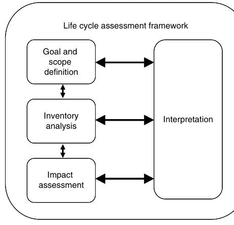

Figure 6.2 Life cycle stages (ISO 1997).

are obtained. Every decision made during goal definition and scoping impacts either how the study will be conducted or the relevance of the final results. Goal definition and scoping will result in the determination of the following:

1) The goal(s) of the project
2) The type of information is needed to inform the decision-makers
3) How the data should be organized and the results displayed
4) What will or will not be included in the LCA
5) The accuracy required of the data
6) Ground rules for performing the work

Each decision made in the fleshing out of these six areas has an impact on the LCA process, as explained in Sections 6.2.3.1 through 6.2.3.6.

### 6.2.3.2 Define the Goal(s) of the Project

The primary goal of the LCA is to choose the best product, process, or service with the least effect on human health and the environment. There may also be secondary goals for performing an LCA, which would vary depending on the type of project. Some typical secondary goals are as follows:

- To prove one product is environmentally superior to a competitive product
- To identify stages within the life cycle of a product or process where a reduction in resource use and emissions might be achieved
- To determine the impacts to particular stakeholders or affected parties
- To establish a baseline of information on a system’s overall resource use, energy consumption, and environmental loadings
- To help guide the development of new products, process, or activities toward a net reduction of resource requirements and emissions

### 6.2.3.3 Determine the Type of Information Needed to Inform the Decision-Makers

LCA can help answer a number of important questions. Identifying the questions that the decision-makers care about will help define the study parameters. Some examples include the following:

- What is the impact to particular interested parties and stakeholders?
- Which product or process causes the least environmental impact (quantifiably) overall or in each stage of its life cycle?
- How will changes to the current product/process affect the environmental impacts across all life cycle stages?
- Which technology or process causes the least amount of acid rain, smog formation, or damage to local trees (or any other impact category of concern)?
- How can the process be changed to reduce a specific environmental impact of concern (e.g. global warming)?

Once the appropriate questions have been identified, the types of information needed to answer them will be apparent.

### 6.2.3.4 Determine How the Data Should Be Organized and the Results Displayed

LCA practitioners like to organize data in terms of a functional unit that appropriately describes the function of the product/process being studied. Comparisons between products and processes must be made on the basis of the same function, quantified by the same functional unit. This ensures that the activities being compared are true substitutes for each other. Careful selection of the functional unit to measure and display the LCA results will improve the accuracy of the study and the usefulness of the results.

An LCA study comparing two types of wall insulation to determine environmental preferability must be evaluated on the same function, the ability to decrease heat flow. Six square feet of 4-in. thick insulation Type A is not necessarily the same as 6 ft² of 4-in. thick insulation Type B. Insulation type A may have an R factor equal to 10, whereas insulation type B may have an R factor equal to 20. Therefore, types A and B do not provide the same amount of insulation and cannot be compared on an equal basis. If Type A decreases heat flow by 80%, you must determine how thick Type B must be to also decrease heat flow by 80%.


## 6.2.3.5 将包括和将不包括的内容

理想情况下，LCA 涵盖产品或过程生命周期的全部四个阶段：原材料获取、制造、使用/再利用/维护，以及回收/废物管理。下文将更详细地解释这些产品阶段。要确定应在 LCA 范围中纳入一个阶段还是所有阶段，必须评估以下方面：研究目标、所需结果的准确性，以及可用的时间和资源。图6.3展示了与处理技术相关的制造项目中可纳入的一组生命周期阶段。请注意“系统边界”，它涵盖了 LCA 的所有方面。下面对这四个生命周期阶段的其他示例进行了更详细的说明。

原材料获取 产品的生命周期始于从地球获取原材料和能源。例如，采伐树木或开采不可再生材料均属原材料获取。将这些材料从获取点运输到加工点的过程也包含在此阶段（USEPA 1993）。

制造 在制造阶段，原材料被转化为产品或包装，然后交付给消费者。制造阶段分为三个部分：材料制造、产品加工、以及灌装/包装/分销（USEPA 1993）。虽然这些活动不言而喻，但需要指出的是，将成品运送到零售店或直接运送给消费者的分销环节，会因运输方式（卡车运输、航运或其他）而产生环境影响。

使用/再利用/维护 一旦产品到达消费者手中，就必须识别与该物品使用寿命相关的所有活动：产品储存和消耗所产生的能源需求与环境废物，以及可能需要的任何整修、维修或保养服务（USEPA 2012）。当消费者不再需要该产品时，它将被回收或处置。

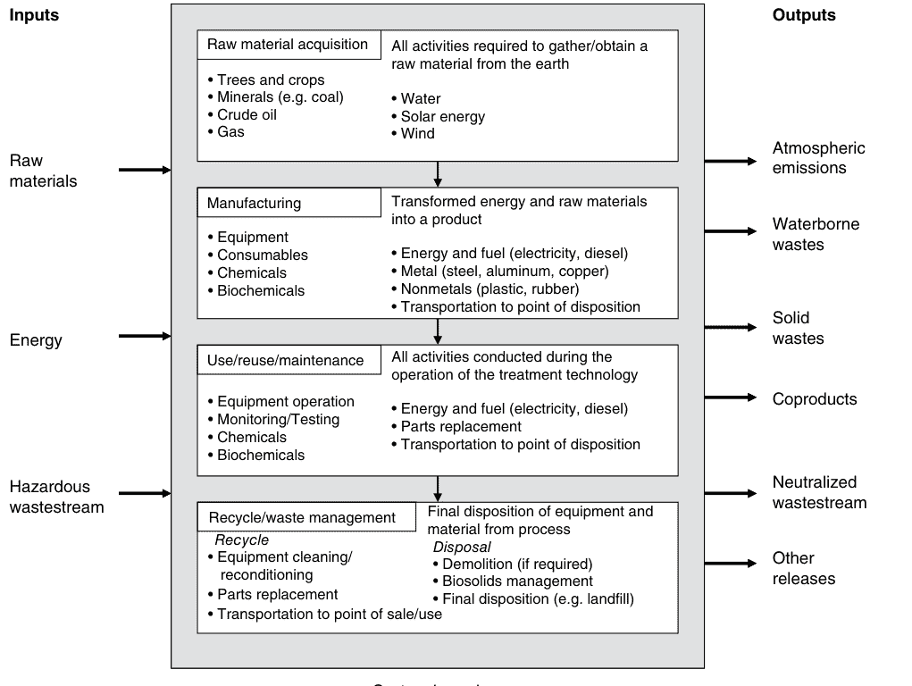

图6.3 工业制造过程的示例生命周期阶段。

## 回收/废物管理

任何产品或材料的处置——无论是通过回收、焚烧、倾倒还是其他废物管理方式——都需要能源，并会产生其他环境废物（USEPA 1993, 2012）。这些都必须预先考虑并列出。

## 6.2.3.6 数据所需的准确性

项目所需的数据准确性水平取决于最终结果的用途和目标受众（结果将用于支持内部流程的决策？还是在公共论坛中使用？）。例如，如果意图是在公共论坛上使用结果，向当地社区或监管机构支持产品或工艺选择，那么估算数据或最佳工程判断可能不足以作为政策决策的依据。相反，如果 LCA 仅用于内部决策，则可以更频繁地采用估算和最佳工程判断。这可以降低执行 LCA 的总体成本和时间，并能在缺乏精确一手数据的情况下完成研究。待做决策的关键性和涉及的金额大小，也会影响所需数据准确性水平的确定。

## 6.2.3.7 开展工作的基本规则

在进入清单分析阶段之前，确定项目的一些程序性安排非常重要。

- 1) 记录假设——整个项目中做出的所有假设或决策，必须与 LCA 项目的最终结果一并报告。如果省略假设，最终结果可能会脱离背景或被轻易误解。随着 LCA 过程从一个阶段推进到另一个阶段，可能还需要增加额外的假设和范围限制，以便利用可用资源完成项目。

- 2) 质量保证程序——质量保证程序对于确保在项目结束时实现执行 LCA 的目标和目的非常重要。项目采用的质量保证程序水平取决于可用的时间和资源以及结果的使用方式。如果结果将在公共论坛中使用，建议采用正式审查流程。评估者可能包括内部和外部的 LCA 专家，以及希望其支持最终结果的相关方。如果结果仅供内部决策使用，那么一位熟悉 LCA 实践且不参与该 LCA 研究的内部审查者，就可以有效满足质量保证目标。每位审查者都应就其对该 LCA 过程每个阶段的评估出具正式声明，并将其纳入最终项目报告。

- 3) 报告要求——为确保 LCA 符合适当预期，参与者应从一开始就知道最终结果将如何记录，以及最终报告应包含哪些内容。在报告最终结果或某一 LCA 阶段的结果时，必须详尽描述分析中使用的方法。报告应明确定义所分析的系统以及设定的边界。系统间比较的依据以及在开展工作过程中做出的所有假设都应清楚说明。结果的呈现应与研究目的保持一致，不应仅为呈现效果而过度简化。

## 6.2.4 生命周期清单

生命周期清单（LCI）量化了产品、过程或活动整个生命周期中的能源和原材料需求、大气排放、水体排放、固体废物以及其他释放（USEPA 1993）。这种清单以列表形式列出释放到环境中的污染物数量以及消耗的能源和材料数量。结果可以按生命周期阶段、介质（空气、水、土地）、特定过程或其任意组合进行分类。

没有 LCI，就不存在评估相对环境影响或潜在改进的基础。所收集数据的准确性和详细程度会在 LCA 过程的其余部分中得到反映。工业界可将 LCI 分析用于比较产品、工艺和材料。政府政策制定者也可在制定针对资源使用和环境排放的法规时使用 LCI 分析。

USEPA 发布了两份指导文件：《生命周期评价：清单指南与原则》（USEPA 1993）和《生命周期清单分析质量评估指南》（USEPA 1995）。这些联邦指南为执行清单分析以及评估所用数据和结果的质量提供了框架。这两份文件定义了 LCI 的以下步骤：

- 编制所评估过程的流程图
- 制定数据收集计划
- 收集数据
- 评估并报告结果

## 6.2.4.1 第1步：编制流程图

流程图是一种工具，用于绘制过程或系统的输入和输出。LCA 的系统边界在目标定义和范围界定阶段确定，并扩展到包括过程输入和输出，作为流程图的系统边界。系统边界内的单元过程相互连接，形成系统所需输入和输出（物质和能量）的完整生命周期图景。图6.4展示了给定系统边界内流程图中一个通用单元过程的组成部分。流程图越复杂，结果的准确性和实用性就越高。但复杂度的增加也意味着需要为这一步骤以及数据收集和分析步骤投入更多时间和资源。

流程图用于对所有考虑中的替代方案（例如基线系统和替代系统）进行建模。对于比较研究，重要的是基线和替代方案使用相同的系统边界，并以相同的详细程度进行建模。否则，结果的准确性可能会产生偏差。

## 6.2.4.2 第2步：制定 LCI 数据收集计划

LCI 数据收集计划可确保在目标定义和范围界定阶段所确定的数据质量和准确性满足决策者的期望。

数据收集计划的关键要素包括：

- 确定数据质量目标
- 确定数据来源和类型
- 确定数据质量指标
- 制定数据收集工作表和检查清单

确定数据质量目标——数据质量目标提供了一个框架，用于在可用时间和资源与就整体环境或人类健康影响做出决策所需的数据质量之间取得平衡（USEPA 1989a）。数据质量目标与总体研究目标密切相关，既帮助 LCA 实践者制定适当的数据收集方法，又作为数据质量绩效标准。

尽管数据质量目标的数量和性质必然取决于特定 LCA 所需的准确性水平，但以下假设性数据质量目标列表是典型的。原材料和能源输入、用水量、大气排放、废水排放和固体废物产生量需要特定场地的数据。对于能源数据类别，近似数据值即可满足要求。大气排放数据应能代表美国境内类似场所的情况。LCI 中至少应说明95%的材料和能源输入。

确定数据质量指标——数据质量指标是衡量所收集数据的基准，用以确定数据质量要求是否已满足。其选择取决于现有指标中哪些最适合并适用于所评估的特定数据源。指标示例包括精确性、完整性、代表性、一致性和可再现性。

确定数据来源和类型——对于每个生命周期阶段、单元过程或环境释放类型，指定能够提供足够准确性和质量以满足研究目标的数据来源和/或类型。在数据收集之前完成这一工作，有助于降低数据收集的成本和时间。数据来源包括：

- 设备运行日志或记录中的仪表读数；行业数据报告、数据库或顾问的实验室测试结果；政府文件、报告和数据库；其他公开来源

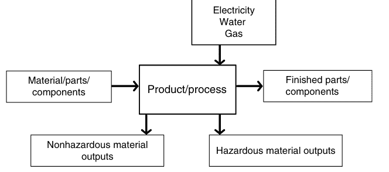

图6.4 单元过程输入/输出模板


可用的数据库或清算所；期刊和论文、书籍；参考书籍；专利；以及行业协会。相关的 LCI 研究也很有用，设备和工艺规范、最佳工程判断也很有用。

数据类型的示例包括完整测量的、建模的和抽样的数据；非现场特定（即替代）数据；非 LCI 数据（即不用于 LCI）；以及供应商数据。

所需汇总数据水平也应予以说明。例如，读者应能够迅速确定数据是否代表一个工艺还是多个工艺。

制定数据收集工作表和清单 – LCI 清单应涵盖库存执行过程中大部分的决策领域。该文件可用于指导数据收集和验证，并可实现构建数据库以电子方式存储收集的数据。以下一般决策领域应在库存清单中得到解决：

- 库存的目的
- 系统边界
- 地理范围
- 使用的数据类型
- 数据收集程序
- 数据质量措施
- 计算模型构建
- 结果呈现

流程图中建模的每个工艺的所有输入和输出都应记录在随附的数据工作表上。

清单和工作表是确保完整性、准确性和一致性的有价值工具。对于大型项目，当多人从多个来源收集数据时尤其重要。清单和工作表应根据特定 LCI 的需求进行定制。

## 6.2.4.3 第 3 步：收集数据

第 1 步中开发的流程图为需要收集的数据提供了路线图。第 2 步规定了所需的数据来源、类型、质量、准确性和收集方法。第 3 步包括查找并用数值数据填充流程图和工作表。这可能不是一项简单的任务。如果某些数据难以或无法获得，并且可用数据难以转换为适当的功能单位；因此，研究系统边界或数据质量目标将不得不进行完善，以描述可以从可用数据中可靠获得的结果。这种迭代过程对于大多数 LCA 来说很常见。

数据收集工作涉及研究、现场访问和与专家直接联系的结合，从而产生大量数据。电子数据库或电子表格对于保存和操作数据非常有用。或者，购买商用 LCA 软件包（见第 6.3 节）可能更具成本效益。在购买 LCA 软件包之前，决策者或 LCA 从业者应确保其能提供所需的数据分析水平。

减少数据收集时间和资源的一种第二种方法是获取非现场特定库存数据。几个组织已专门为 LCA 开发了数据库，其中包含构建 LCI 时通常需要的一些基本数据。其中一些数据库与 LCI 数据收集软件一起销售；其他则是独立资源。许多拥有专有软件的公司还提供 LCA 设计的咨询服务。

## 6.2.4.4 第 4 步：评估和记录 LCI 结果

当数据收集并整理后，必须验证结果的准确性。在记录 LCI 结果时，重要的是彻底描述分析中使用的分析方法，定义所分析的系统和设定的边界，并说明在执行库存分析时所做的所有假设。使用清单和工作表（见第 2 步）支持记录此信息的清晰流程。库存分析的结果是包含释放到环境中的污染物数量以及消耗的能源和材料数量的清单。信息可以按生命周期阶段、按介质（空气、水、土地）、按具体工艺或其一致于基本规则的任何组合进行组织。

如果在进入下一阶段生命周期影响评价（LCIA）之前未正确确定 LCI 数据收集工作的敏感性，则 LCA 本身可能不得不重复，因为发现数据不足以得出所需结论。

## 6.2.5 生命周期影响评价

LCIA 阶段是对 LCI 期间识别的环境资源和排放的潜在人类健康和环境影响的评估。影响评价应解决生态和人类健康影响；它也可以解决资源枯竭问题。LCIA 试图在产品或工艺与其潜在环境影响之间建立联系。例如，LCIA 可以确定一种产品或工艺是否比另一种产生更多的温室气体，或可能杀死更多的鱼。

该组件的关键概念是压力源。压力源是一组可能导致影响的条件。例如，如果产品或工艺排放温室气体，大气中温室气体的增加*可能导致*全球变暖。导致过量营养物排放到水体中的工艺*可能导致*富营养化。LCIA 为分类和表征这些类型的环境影响提供了一个系统程序。

### 6.2.5.1 为什么进行 LCIA？

虽然通过考虑 LCI 数据可以学到很多关于工艺的知识，但 LCIA 提供了进行比较的更精确基础。因此，我们知道二氧化碳和甲烷的大量排放都有害；LCIA 可以确定 9000T 的 CO₂ 还是 5000T 的甲烷会产生更大的潜在影响。利用基于科学的特征化因子，LCIA 可以计算每种环境排放对诸如烟雾或全球变暖等问题的影响。影响评价还可以纳入价值判断。例如，在空气非达标区，空气排放可能比在空气质量更好的地区同等排放水平更令人担忧（ISO 2000）。

### 6.2.5.2 LCIA 的关键步骤

以下步骤构成 LCIA。

- 1. *选择和定义影响类别* – 识别相关的环境影响类别（例如全球变暖、酸化、陆地毒性）。
- 2. *分类* – 将 LCI 结果分配到影响类别（例如将 CO₂ 排放分类为全球变暖）。
- 3. *特征化* – 使用基于科学的转换因子对影响类别内的 LCI 影响进行建模（例如建模 CO₂ 和甲烷对全球变暖的潜在影响）。
- 4. *归一化* – 以可比较的方式表达潜在影响（例如比较两种方案中 CO₂ 和甲烷的全球变暖影响）。
- 5. *分组* – 对指标进行排序或排名（例如按位置排序：本地、区域和全球）。
- 6. *加权* – 强调最重要的潜在影响。
- 7. *评估和报告 LCIA 结果* – 更好地了解 LCIA 结果的可靠性。

国际标准化组织关于进行影响评价的标准规定，影响类别选择、分类和特征化是 LCIA 和数据评估（第 7 步）的强制性步骤（ISO 1998a）。是否使用其他步骤将取决于研究的目标和范围。

**第 1 步：选择和定义影响类别**  作为整体 LCA 的一部分将考虑的影响类别已在初始目标和范围定义阶段选定。为了指导 LCI 数据收集过程和为 LCIA 所需的重新考虑，影响被定义为系统输入和输出流对人类健康、对植物和动物（即生态健康）或对自然资源未来可用性（即资源枯竭）的影响。表 6.1 显示了一些常用的影响类别。

**第 2 步：分类**  对于仅贡献于一个影响类别的 LCI 项目，分类程序是直接分配。例如，二氧化碳排放可以替换为全球变暖类别。

对于贡献于两个或多个不同影响类别的 LCI 项目，必须建立分类规则。有两种方法可将 LCI 结果分配到多个影响类别（ISO 1998a）：

- 将 LCI 结果的代表性部分分配给其所贡献的影响类别。这通常允许在影响相互依赖的情况下使用。
- 将所有 LCI 结果分配给其所贡献的所有影响类别。这通常允许在影响相互独立的情况下使用。

例如，由于一分子二氧化硫（SO₂）可能停留在地面或进入大气，它有可能影响人类健康或酸化（但不能同时影响两者）。因此，SO₂ 排放通常在这两个影响类别之间分配（例如 50% 分配给人类健康，50% 分配给酸化）。另一方面，由于二氧化氮（NO₂）可能同时影响地面臭氧形成和酸化，NO₂ 的全部数量将分配给这两个影响类别（例如 100% 分配给地面臭氧和 100% 分配给酸化）。分配程序必须清楚记录。

**第 3 步：特征化**  影响特征化使用基于科学的转换因子，称为特征化因子，将 LCI 结果转换为人类和生态健康影响的代表性指标。特征化因子也常被称为当量因子。特征化因子将不同的 LCI 输入——例如铅、铬和锌的毒性数据——转换为可直接比较的影响指标。掌握此类数据后，可以对这些金属的相对陆地毒性进行估计。


### 表 6.1 常用生命周期影响类别。

| 影响类别 | 规模 | 相关 LCI 数据（即分类） | 常见特征化因子 | 特征化因子描述 |
| :--- | :--- | :--- | :--- | :--- |
| 全球变暖 | 全球 | 二氧化碳（CO₂）二氧化氮（NO₂）甲烷（CH₄）氯氟烃（CFCs）氢氯氟烃（HCFCs）溴甲烷（CH₃Br） | 全球变暖潜势 | 将 LCI 数据转换为二氧化碳（CO₂）当量 注：全球变暖潜势可以是 50、100 或 500 年潜势 |
| 平流层臭氧损耗 | 全球 | 氯氟烃（CFCs）氢氯氟烃（HCFCs）哈龙 溴甲烷（CH₃Br） | 臭氧损耗潜势 | 将 LCI 数据转换为三氯氟甲烷（CFC-11）当量 |
| 酸化 | 区域 地方 | 硫氧化物（SOₓ）氮氧化物（NOₓ）盐酸（HCl）氢氟酸（HF）氨（NH₃） | 酸化潜势 | 将 LCI 数据转换为氢离子（H⁺）当量 |
| 富营养化 | 地方 | 磷酸盐（PO₄）氮氧化物（NOₓ）二氧化氮（NO₂）硝酸盐 氨（NH₃） | 富营养化潜势 | 将 LCI 数据转换为磷酸盐（PO₄）当量 |
| 光化学烟雾 | 地方 | 非甲烷烃（NMHC） | 光化学氧化剂生成潜势 | 将 LCI 数据转换为乙烷（C₂H₄）当量 |
| 陆地毒性 | 地方 | 有报道对啮齿动物致死浓度的有毒化学品 | LC₅₀ | 将 LC₅₀ 数据转换为当量 |
| 水生毒性 | 地方 | 有报道对鱼类致死浓度的有毒化学品 | LC₅₀ | 将 LC₅₀ 数据转换为当量 |
| 人类健康 | 全球、区域、地方 | 向空气、水和土壤的总排放量 | LC₅₀ | 将 LC₅₀ 数据转换为当量 |
| 资源耗竭 | 全球、区域、地方 | 使用的矿物数量 使用的化石燃料数量 | 资源耗竭潜势 | 将 LCI 数据转换为资源使用量与剩余资源储量之比 |
| 土地利用 | 全球、区域、地方 | 填埋处置的数量 | 固体废物 | 使用估算密度将固体废物质量转换为体积 |

表 6.1 中列出的影响类别具有许多可能的终点，包括以下内容：

**全球影响**
- *全球变暖*：极地融化、土壤湿度丧失、季节延长、森林丧失/变化，以及风和洋流模式变化
- *臭氧损耗*：紫外线辐射增加
- *资源耗竭*：未来世代可用的资源减少

**区域影响**
- *光化学烟雾*：“烟雾”、能见度下降、眼睛刺激、呼吸道和肺部刺激，以及植被损害
- *酸化*：建筑物腐蚀、水体酸化、植被效应和土壤效应

**地方影响**
- *人类健康*：发病率和死亡率增加
- *陆地毒性*：生产力和生物多样性下降，以及用于狩猎或观赏的野生动物减少
- *水生毒性*：水生植物和昆虫生产力和生物多样性下降，以及商业或休闲捕鱼减少
- *土地利用*：野生动物陆地栖息地丧失和填埋场空间减少

影响指标通常使用以下方程进行特征化：

```
Inventory data × characterization factor = impact indicators
```

例如，所有温室气体都可以通过将相关 LCI 结果乘以 CO₂ 特征化因子，然后合并所得的影响指标来表示为二氧化碳当量，从而提供全球变暖潜势的总体指标。

政府间气候变化专门委员会为多种工业污染物提供了转换因子。在以下示例中，对不同量的氯仿（CHCl₃）和甲烷（CH₄）的全球变暖影响进行了特征化。转换因子的值，称为 GWP，即全球变暖潜势，CHCl₃ 为 9，CH₄ 为 21。

因此，我们写道：

```
GWP$_{\mathrm{CHCl}_3}$ $= 9 \times 20 = 180$
GWP$_{\mathrm{CH}_4}$ $= 21 \times 10 = 210$
```

转换因子的使用表明，10 磅甲烷对全球变暖的影响大于 20 磅氯仿。

影响特征化的关键在于使用适当的特征化因子。对于一些影响类别，如全球变暖和臭氧损耗，已就可接受的特征化因子达成共识。对于其他影响类别，如资源耗竭，共识仍在形成中。表 6.1 包括了一些常用生命周期影响类别的可能特征化因子的描述。经过适当引用的 LCIA 将记录每个特征化因子的来源，以确保其与研究的 goal 和 scope 相关。例如，许多基于欧洲研究制定的特征化因子，除非能验证其适用于美国条件，否则不能应用于美国数据。

### 第 4 步：归一化

归一化是 LCIA 的一种工具，用于以可在影响类别之间进行比较的方式表达影响指标数据。在此过程中，指标结果除以为此目的选择的参考值。参考值可从众多方法中选择。

以下为代表性方法：

- 某一特定区域的总排放量或资源使用量，该区域可能为全球、区域或地方。
- 某一特定区域的人均总排放量或资源使用量。
- 一个替代方案与另一个替代方案的比率（即基线）。
- 所有选项中的最高值。

LCA 的 goal 和 scope 可能会影响适当参考值的选择。请注意，归一化后的数据只能在同一影响类别内进行比较。例如，酸化的影响不能直接与水生毒性进行比较，因为特征化因子是使用不同的科学方法计算的。

### 第 5 步：分组

分组将影响类别划分为一个或多个集合，以促进将结果解释为特定关注领域。通常分组涉及对指标进行排序或排名。ISO（1998a）列出了两种可能的 LCIA 数据分组方式：

- 1) 按排放物（如空气和水排放物）或位置（如地方、区域或全球）等特征对指标进行排序
- 2) 按价值选择进行排序的指标排序系统，例如高、低或中等优先级。

### 第 6 步：加权

加权（也称为估值）根据其 perceived 重要性或相关性为不同影响类别分配相对价值。

加权很重要，因为影响类别还应反映研究目标和利益相关者价值观。但由于加权不是科学过程，其方法必须清楚地解释和记录。加权阶段是影响评估步骤中最不成熟的阶段，也是最有可能因 integrity 而受到质疑的阶段。

总体而言，加权包括以下活动：

- 识别利益相关者的潜在价值观
- 确定对影响的权重
- 将权重应用于影响指标

除非加权程序有明确记录，否则加权数据不应跨影响类别合并。未加权数据应与加权结果一起显示，以确保对所分配权重的清晰理解。

在某些情况下，影响评估结果非常明确，可以在不进行加权步骤的情况下做出决策。例如，当最佳表现的替代方案在至少一个影响类别中显著且有意义地优于其他方案，并且在剩余影响类别中与替代方案相等时，则一个替代方案明显更好。

加权存在若干挑战。第一个问题是主观性。根据 ISO 14042，任何优越性判断都是对一个影响类别相对于另一个影响类别相对重要性的主观陈述（ISO 1998a）。此外，这些价值判断可能会随地点或季节而变化。例如，洛杉矶的居民可能比怀俄明州谢延的人更重视光化学烟雾的数值。

第二个问题源于第一个问题：鉴于加权的客观性，用户应如何公平、一致地基于环境优越性做出决策？试图制定真正客观（或普遍可接受）的权重或加权方法集是不可行的。然而，确实存在几种加权方法，并且在决策中被成功使用。

### 第 7 步：评估和记录 LCIA 结果

现在每个选定影响类别的影响潜势已计算完毕，必须验证结果的准确性。LCIA 结果的记录包括彻底描述分析中使用的 methodology，定义所分析的系统和设定的边界，并列出库存分析所依据的所有假设。

LCIA 与所有其他评估工具一样，具有固有的局限性，包括以下内容：

- 空间分辨率不足（例如，在小溪中释放 4000 加仑氨比在大河中更糟）
- 时间分辨率不足（例如，在一个月内释放 5 T 颗粒物比全年分散释放更糟）
- 库存规范（例如，“VOC”或“金属”等宽泛的库存清单无法提供准确评估环境影响所需的信息）
- 阈值和非阈值影响（例如，10T 污染并不一定比 1T 污染糟 10 倍）

选择更复杂或更具 site-specific 的影响模型可以帮助减少影响评估准确性的局限性。必须记录这些局限性，并将 LCIA 方法的全面描述以及影响模型中潜在假设、价值选择和已知不确定性的讨论与 LCIA 的数值结果一起提供，以便用于解释 LCA 的结果。

## 6.2.6 生命周期解释

生命周期解释是一种系统技术，用于识别、量化、检查和评估 LCI 和 LCIA 结果的信息，并有效传达它们。生命周期解释是 LCA 过程的最后阶段。ISO 已定义了生命周期解释的以下目标：

- 1) 分析结果、得出结论、解释局限性，并根据 LCA 前期阶段的发现提供建议，并以透明的方式报告生命周期解释的结果。
- 2) 根据研究的 goal 和 scope（ISO 1998b），提供对 LCA 研究结果易于理解、完整且一致的表述。

并非总是可以用 LCA 作为开始的依据，因为一个替代方案优于其他方案。这并不意味着工作白费了。尽管最终结果存在不确定性，LCA 过程仍为决策者提供了对每个替代方案相关的环境和健康影响、它们发生的位置（地方、区域或全球）以及可归因于所调查的每个拟议替代方案的每种类型影响的相对大小的更好理解。这些信息更充分地揭示了替代方案的利弊。

进行 LCA 的目的是通过提供一种特定类型的信息（通常未被考虑），以生命周期视角为决策者提供有关每个产品或工艺相关的环境和人类健康影响的更好信息。然而，LCA 并未考虑技术性能、成本或政治和社会


可接受性。因此，建议将LCA与这些其他参数结合使用。

## 6.2.6.1 解读LCA结果的关键步骤

到目前为止提供的指导总结了ISO草案标准《环境管理——生命周期评估——生命周期解读》（ISO 1998b）中关于生命周期解读的信息。该ISO草案标准涵盖了进行生命周期解读的以下步骤：

- 1) 识别重大问题
- 2) 评估数据的完整性、敏感性和一致性
- 3) 得出结论和建议

图6.5 展示了生命周期解读过程的步骤与LCA过程其他阶段的关系。

### 第一步：识别重大问题

重大“问题”是指对每个产品、过程或服务的LCI和LCIA结果贡献最大的数据要素。例如：

- 清单参数（如能源使用、排放、废弃物）
- 影响类别指标（如资源使用、排放、废弃物）
- 对LCI或LCIA结果有重要贡献的生命周期阶段，如单个单元过程或过程组（如运输、能源生产）

当识别出这些问题后，结果将用于评估LCA研究的完整性、敏感性和一致性（第二步）。重大问题的识别为评估步骤提供指导。

在确定LCI和LCIA的哪些部分对每个备选方案的结果影响最大之前，应全面审查LCA的先前阶段（例如研究目标、基本规则、影响类别权重、结果和外部参与等）。

对所收集信息以及形成的结果展示进行审查，可以判断LCA研究的目标和范围是否已达成。如果已达成，则可以确定结果的显著性。有几种分析方法可用。

- 贡献分析——将生命周期阶段或过程组的贡献与总结果进行比较，并检验其相关性。
- 优势分析——使用统计工具或其他技术（如定量或定性排序，例如ABC分析）来识别需要检验相关性的重大贡献。
- 异常评估——根据以往经验，观察与预期或正常结果的异常或惊人偏差，并检验其相关性。

### 第二步：评估数据的完整性、敏感性和一致性

解读阶段的评估步骤确立了LCA结果的置信度和可靠性。通过执行完整性、敏感性和一致性检查，确保产品/过程得到公平比较。

生命周期评估框架

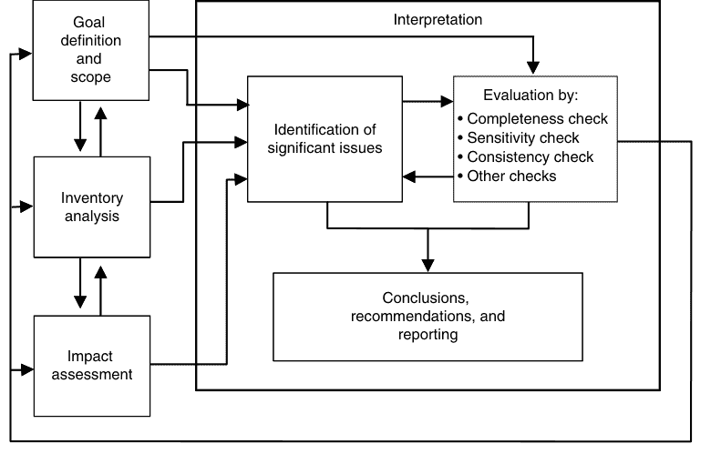

图6.5 解读步骤与LCA其他阶段的关系（ISO 1998b）。

*完整性检查*——完整性检查确保解读所需的所有相关信息与数据都可用且完整。应制定一个核对表，以标明结果中涉及的每个重要领域。使用已建立的核对表，可以验证构成结果各领域的数据是否与系统边界一致（例如是否包含所有生命周期阶段），以及数据是否具有指定领域的代表性（例如占所有原材料和环境排放的90%）。

这一工作的结果将是一份核对表，表明每个产品/过程的结果都是完整的，并反映了LCA研究所陈述的目标和范围。如果发现不足之处，必须设法加以纠正。如果由于数据不可用而无法纠正，则必须在最终结果中突出显示因数据不足而描述不充分的领域，并定量（百分比不确定性）或定性（备选方案A的汇报结果可能更高，因为其评估中未包含“X”）估计这些领域对比较的影响。

*敏感性检查*——敏感性检查的目的是通过确定第一步中识别的重大问题的不确定性是否影响决策者自信地得出比较结论的能力，来评估结果的可靠性。执行敏感性检查时可使用三种常用的数据分析技术。

- 1. 重力分析——识别对影响指标结果贡献最大的数据。
- 2. 不确定性分析——描述LCA数据的变异性，以确定影响指标结果的显著性。
- 3. 敏感性分析——衡量LCI结果和特征化模型的变化对影响指标结果的影响程度。

关于如何进行重力分析、不确定性分析或敏感性分析的进一步指导，可参见EPA文件《生命周期清单分析质量评估指南》（USEPA 1995）。如果这些分析中的某一种已在LCI和LCIA阶段作为一部分进行，则可以使用其结果。然后，敏感性检查将用于验证研究早期定义的数据质量和准确性目标是否已达成。如果存在不足，则需要额外努力来提高所收集的LCI数据和/或LCIA中所用影响模型的准确性。如果无法获得更好的数据或影响模型，则必须报告每个相关重大问题的不足，并像完整性检查一样，定量或定性估计其对比较的影响。

*一致性检查*——一致性检查确定整个LCA过程中使用的假设、方法和数据是否与研究的目标和范围以及所评估的每个产品/过程一致。在结论中验证并记录研究已按预期完成，可以增强最终结果的置信度。应制定正式的核对表来传达一致性检查的结果。表6.2列出了七个类别，并提供了可能渗入数据的不一致示例。LCA的目标和范围决定了应使用哪些类别。

如果在完成第一步和第二步后，确定影响评估结果和基础清单数据完整、可比，并且可作为得出结论和提出建议的基础，那么就可以到此为止！如果检测到任何不一致之处，请记录其在整体一致性评估中的作用。虽然某些不一致可能是可接受的，具体取决于LCA的目标和范围，但不一致的存在通常意味着有必要重复第一步和第二步，直到结果能够支持进行LCA的原始目标。

**表6.2** 核对表类别和潜在不一致的示例。

| 类别 | 不一致示例 |
|---|---|
| 数据来源 | 备选方案A基于文献数据，备选方案B基于实测数据。 |
| 数据准确性 | 对于备选方案A，使用详细的工艺流程图来编制LCI数据。对于备选方案B，可用的过程信息有限，所编制的LCI数据针对的是未详细描述或分析的过程。 |
| 数据年代 | 备选方案A使用1980年代的原材料制造数据。备选方案B使用一项一年前的研究。 |
| 技术代表性 | 备选方案A是实验室规模的模型。备选方案B是全面生产工厂的运营。 |
| 时间代表性 | 备选方案A的数据描述的是最近开发的技术。备选方案B描述的是技术组合，包括新建工厂和旧工厂。 |
| 地理代表性 | 备选方案A的数据来自欧洲环境标准下采用的技术。备选方案B使用美国环境标准下采用的技术数据。 |
| 系统边界、假设和模型 | 备选方案A使用基于500年潜势的全球变暖潜势模型。备选方案B使用基于100年潜势的全球变暖潜势模型。 |


## 第 3 步：得出结论和建议

本步骤的目标是对 LCIA 的结果（而非 LCI）进行解释，以确定哪种产品/工艺对人类健康和环境，或对研究目标和范围所定义的一个或多个特定关注领域的影响总体最小。根据 LCA 的范围，影响评估的结果将返回每个影响类别下每个替代方案的未归一化且未加权的影响指标列表，或每个替代方案的单个分组、归一化且加权后的评分。在后一种情况下，建议可能只是接受得分最低的产品/工艺。然而，分析所依据的假设应牢记在心。如果 LCIA 止步于特征化阶段，则 LCIA 的解释就不那么明确。结论和建议取决于在研究目标和利益相关者关切的背景下权衡潜在的人类健康和环境影响。

必须理解并传达产生最终建议的程序中的不确定性和局限性。也许由于进行 LCA 所用方法的固有不确定性和局限性，没有一种产品或工艺比另一种更好。也许缺乏足够的好数据，或者时间或资源的限制阻止分析人员彻底探索问题的某些方面。即使如此，LCA 的结果仍可用于帮助决策者了解人类健康和环境方面的利弊，并理解每种影响的显著性。此类 LCA 结果将揭示影响发生在本地、区域还是全球，并将提供每种影响类型相对于所调查的拟议替代方案的量级的大致估计。

### 6.2.6.2 报告结果

完成 ACA 后，必须将材料汇编成一份全面报告，以清晰、有条理的方式记录研究。这将有助于公平、完整、准确地向对结果感兴趣的其他人传达评估结果。报告以足够的细节呈现结果、数据、方法、假设和局限性，以便读者能够理解 LCA 研究中固有的复杂性和权衡。

如果结果将传达给未参与 LCA 研究的各方（例如利益相关者），该报告将作为参考文件，并有助于防止结果被歪曲。

### 6.2.6.3 结论

将 LCA 添加到决策过程中，为负责选择产品或工艺的人员提供了传统上无法获得的人类健康和环境影响的理解水平。这些宝贵的信息提供了一种方法来核算决策的全部影响，尤其是那些在场外做出的、直接受产品或工艺选择影响的决策。如前所述，LCA 是一种更好地为决策者提供信息的工具，必须权衡成本和性能等其他决策标准才能做出平衡的决策。

正如我们所见，LCA 和 LCI 可以成为环境分析中的有价值工具。要理解任何此类研究中收集的众多大型数据集，显然是一项过于复杂的任务，无法在没有计算机帮助的情况下进行。第 6.3 节描述了一些为此目的而开发的软件工具。

## 6.3 LCA 和 LCI 软件工具

表 6.3 列出了本节将讨论的 LCA 和 LCI 工具，以及每个工具的供应商或开发商及其组织的互联网地址。

### 6.3.1 ECO-it 1.0

ECO-it 是一种数据库工具，用于辅助 LCI 和 LCIA。ECO-it 包含超过 100 个常用材料的指标值，如金属、塑料、纸、纸板和玻璃，以及生产、运输、能源和废物处理工艺。

### 6.3.2 EcoManager

EcoManager 是一种 LCI 工具，设计用于具有或获得 LCI 方法工作知识的人员进行内部规划、筛选和评估。EcoManager 使用由英国 Pira International 开发的软件程序，结合 Franklin Associates, Ltd.（FAL）数据库中的美国 LCI 数据。EcoManager 为 Microsoft Excel 开发，利用电子表格和称为“宏”的程序代码引导用户构建 LCI、访问数据库中的数据、执行文件管理功能、编辑现有数据并生成图形和报告。系统在操作每个阶段都提供在线帮助。系统还提供图形和报告功能。而且由于该程序是在 Excel 中创建的，Excel 用于图形、导出和文件管理的全部功能都可用于自定义输出。

### 6.3.3 Eco Bat 2.1

Eco Bat 是一种 LCIA 和环境设计（DFE）工具，使用流程图对产品生命周期进行建模。

**表 6.3** LCA 和 LCI 软件工具。

| Name | Developer/vendor | URL |
|---|---|---|
| 1. ECO-it | PRé Consulting | http://www.pre.nl.eco-it.html |
| 2. EcoManager | Franklin Associates, Ltd | http://www.fal.com/software/ecoman.html |
| 3. EcoPro 1.5 | EcoPerformance Systems, Switzerland | http://www.sinum.com/ |
| 4. Gabi 4 | Institute for Polymer Testing and Polymer Science University of Stuttgart | http://www.pre-product.de/english/main/software.htm |
| 5. IDEMAT | Delft University of Technology | http://www.io.tudelft.nl/research/mpo/idemat/idemat.htm |
| 6. LCAID | Battelle Memorial Institute/US Department of Energy | http://www.estd.battelle.org/sehsm/lca/LCAadvantage.html |
| 7. LCAiT | Chalmers Industriteknik, Sweden | http://www.ekologik.cit.chalmers.se/lcait.htm |
| 8. REPAQ | Franklin Associates, Ltd. | http://www.fal.com/software/repaq.html |
| 9. SimaPro 7 | PRé Consulting | http://www.pre.nl/simapro.html |
| 10. TEAM | Ecobalance | http://www.ecobalance.com/software/team/team_ovr.htm |
| 11. TRACI | U.S. Environmental Protection Agency | http://www.epa.gov/ORD/NRMRL/std/sab/iam_traci.htm |
| 12. Umberto NXT CO₂ | Institute for Energy and Environmental Research Heidelberg, Hamburg GmbH | http://www.ifu.com/software/umberto-e/ |

该 Windows 基于的应用提供在线帮助、工具栏和图标，包括大型数据库。

### 6.3.4 GaBi 4

GaBi 是一种生命周期工程或生命周期管理（LCM）和生命周期工程（LCE）工具，使用来自行业和文献的许多预定义数据对象。用户可以将 GaBi 数据库提供的的数据集与自己的数据链接起来，以便计算生命周期清单和影响评估。它允许对清单和估值平衡进行清晰的薄弱环节分析。其结构对更改和扩展是开放的。

### 6.3.5 IDEMAT

Idemat 是代尔夫特理工大学工业设计工程系环境产品开发系的 365 多种材料的计算机数据库。它以文字、数字和图形形式提供材料和工艺的技术信息，并强调环境信息。该程序开发用于由工业设计工程、土木工程、材料科学和航空航天工程等技术导向学术学科的学生使用。用户必须非常熟悉 LCA 的原则以及 SETAC 和莱顿大学环境研究中心（CML）发表的环境影响特征化和评估方法，并在 SimaPro 中使用。

### 6.3.6 EIOLCA

EIOLCA：经济投入-产出生命周期评估（EIOLCA）模型由卡内基梅隆大学开发，估计我们经济活动中所需的材料和能源资源以及由此产生的环境排放。它是一个免费、快速、易用的 LCA 模型，可在线获取（www.eiolca.net）。

### 6.3.7 LCAD

生命周期优势，或 LCAD5，是一种生命周期建模工具，具有图形用户界面和数据库结构。LCAD 可以用物料和能量平衡以及劳动力和收入投入来建模工艺流程图。LCAD 还可以评估数据可靠性。LCAD 系统包括美国的基础商品数据库，涵盖燃料生产和分销、电力生产，以及所选林产品、纸张、金属、水泥、基础化学品和塑料的从摇篮到大门的运营。

### 6.3.8 LCAiT

LCAiT 是一种 LCI 工具，有助于生成能源和物料平衡。LCAiT 还包含有关某些材料的从摇篮到大门的信息。

### 6.3.9 REPAQ

REPAQ 是一种 LCI 软件程序，允许用户检查产品的整个生命周期中从原材料开始的能源和环境排放


extraction 和随后的精炼与加工、材料制造、产品制造以及处置。产品、工艺和包装都可以用 REPAQ 进行评估。用户可以通过 Custom Materials 功能访问 REPAQ 数据库并输入自己的数据，该功能允许为任何可以收集 LCI 数据的工艺输入数据。

## 6.3.10 SimaPro 7

SimaPro 是一款功能全面的 LCA 软件工具，可促进复杂产品的比较和分析，能够处理复杂的工具和软件：LCM、LCIA、LCI、LCE、物质/材料流分析（SFA/MFA）、DfE、产品 stewardship、供应链管理、生命周期可持续性（LCS）以及生命周期成本（LCC）。工艺数据库和影响评价数据库可以无限编辑和扩展。SimaPro 可以追溯已实施的任何结果的来源。特殊功能包括多种影响评价方法、多种工艺数据库以及自动单位转换。SimaPro 附带几种知名的影响评价方法，包括 CML、Eco-points 以及由 PRé 开发的 Eco-indicator 方法。所有影响评价数据都可以编辑和扩展。

## 6.3.11 TEAM (Tool for Environmental Analysis and Management)

TEAM 是一款 LCA 软件程序，允许用户构建和使用数据库并对代表产品、工艺和活动（废物管理选项、运输方式等）相关操作的任何系统进行建模。它旨在描述和建模复杂的工业系统，并计算相关的生命周期清单（LCM、SFA/MFA、DfE、DiR）、生命周期潜在环境影响、法规合规性检查、产品 stewardship 以及面向工艺的生命周期成本。

## 6.3.12 TRACI: A Model Developed by the USEPA

用于化学品及其他环境影响的减少和评估的工具（TRACI）及其历史、所包含的研究和方法论以及其在各个影响类别中提供的见解进行了描述。

TRACI 是一款由美国环境保护署（USEPA）开发的独立计算机程序，可促进对具有潜在影响的环境压力因子的表征，包括臭氧层破坏、全球变暖、酸化、富营养化、对流层臭氧（烟雾）形成、生态毒性、与人类健康标准相关的效应、人类健康致癌效应、人类健康非致癌效应、化石燃料枯竭以及土地利用效应。TRACI 最初是为 LCA 使用而设计的，但预计未来将有更广泛的应用（Bare 2003；USEPA 2003）。

## 6.3.13 Umberto NXT CO₂

Umberto 是一款 LCA 工具，使用以下工具：LCM、LCIA、LCI、LCE、用于建模材料流网络以输入和跟踪材料和能量流的图形界面、SFA/MFA、供应链管理、LCS 以及 LCC。

## 6.3.14 International Organizations and Resources for Conducting Life Cycle Assessment

附录 F 列出了各个国家的组织列表、各组织的简要描述，以及遍布非洲、亚洲、澳大利亚和新西兰、欧洲、北美和南美洲所有大洲的 LCA 中心和学会。

## 6.4 Evaluating the Life Cycle Environmental Performance of Chemical-, Mechanical-, and Bio-Pulping Processes

### 6.4.1 Introduction

纸浆和造纸制造在美国是按水和能源使用量以及向环境排放总量计算的最大行业之一。然而，与许多其他行业相比，该行业在可持续发展中发挥着重要作用，因为其主要原材料——木纤维——是可再生的。该行业提供了一个资源如何被管理以提供持续供应以满足社会当前和未来需求的例子。本工作的目标是介绍化学（kraft-硫酸盐）、机械（或热机械）和生物制浆工艺之间的简化环境 LCA。该 LCA 将帮助我们评估该行业在环境管理、法规和非法规力量、其工艺和产品的生命周期以及未来发展方面的当前经验和实践。

制浆工业传统上使用机械或化学制浆方法，或两者结合来生产具有所需特性的纸浆。机械制浆目前约占世界木浆产量的 25%。机械制浆由于其高得率，被视为延长森林资源的一种方式。然而，机械制浆耗电量大，且生产的纸张强度低于化学制浆工艺。这些缺点限制了机械浆在许多纸张等级中的使用。化学制浆约占世界木浆产量的 75%。该工艺生产出强度极高的纸张。然而，该工艺的缺点是资本和能源密集、得率相对较低、产生麻烦的废物产品以及产生相对价值较低的副产品。

一种新的技术，即生物制浆工艺，具有改善其中一些问题的潜力，目前正在商业规模上进行测试。生物制浆在机械制浆前用天然木腐真菌处理木片，可以节省大量电力，与传统制浆相比显著减少空气污染物（包括 CO₂ 和一些引起气味的总还原硫化合物）和水污染物（BOD、COD、TSS），改善纸张质量并增强经济竞争力。

美国环保署的 TRACI（USEPA 2003）模型用于评估三种纸浆和造纸工艺所归因的化学、环境和人类健康影响。生物制浆工艺获得的结果表明环境和人类健康影响显著减少。生物制浆工艺在经济优势以及环境和人类健康效益方面被证明更具可持续性。

### 6.4.2 Application of LCA

LCA 是一种工具，已在第 6.4 和 6.5 节中描述，用于评估工艺、产品或活动的环境绩效，从原材料提取开始，经过制造、使用，直至最终处置。这被称为“从摇篮到坟墓”方法（图 6.3）。由于其对系统分析的整体方法，LCA 正在成为环境系统管理中日益重要的决策工具。其相对于其他特定场地的环境分析方法（如环境影响评价或环境审计）的主要优势在于扩大系统边界，以包括产品或工艺生命周期中的所有负担和影响，而不仅仅关注工厂或制造现场产生的排放和废物。

作为环境管理工具，LCA 有两个主要目标。其第一个目标是量化并评估工艺或产品的环境绩效，从而帮助决策者在替代产品或工艺之间做出选择。LCA 的另一个目标是为评估现有或新设计系统的环境绩效的潜在改进提供依据。这对工程师和环境管理人员可能特别重要，因为它可以建议他们如何修改或设计系统以降低其整体环境影响。因此，LCA 既可以由公司内部使用，也可以由行业、政策制定者、规划者、教育工作者和其他利益相关者外部使用。如果 LCA 的结果要由公司内部使用，那么 LCA 可能有用的领域包括但不限于以下内容：

- 战略规划或环境战略制定
- 系统中的问题解决
- 识别环境改进机会并跟踪改进
- 工艺和产品设计、创新、改进和优化

LCA 的外部应用包括将 LCA 用作营销工具，以支持环境标签或声明，或信息目的，或支持政策决策。LCA、绿色化学、绿色工程、面向环境的设计、工业生态学以及化学工程和环境工程的其他新兴领域为开发可持续和创新的工艺和产品提供了更大的机会（Das and Scott 2003）。

在本案例研究中，我们仅关注与三种工艺相关的 LCA：使用木片的化学、机械和生物制浆。这种简化 LCA 方法将有助于通过考虑环境影响、人类健康和安全以及工艺经济性来确定哪种工艺更具可持续性。

### 6.4.3 The Pulping Processes

#### 6.4.3.1 Mechanical Pulping

机械制浆顾名思义依赖机械能将木材转化为纸浆。当前的机械纸浆制造工艺包括几种高能研磨和精炼系统，包括精磨机机械制浆（RMP）工艺、热机械制浆（TMP）工艺、化学机械制浆工艺和化学热机械制浆工艺（Someswhar and Pinkerton 1992；Smook 1992）。机械制浆目前约占世界木浆产量的 25%。机械制浆由于其高得率，被视为延长这些资源的一种方式。然而，机械制浆耗电量大，且生产的纸张强度低于化学制浆工艺生产的纸张强度，而化学制浆工艺在制浆过程中使用。图 6.6 显示了 TMP 的基本流程图（Smook 1992）。TMP 是 RMP 的改进；它涉及在几个精炼阶段之前和期间对原材料进行短时间蒸汽处理。蒸汽处理的作用是


软化木片，其结果是生产的纸浆中长纤维的比例更高，而碎片比RPM少。最常见的是在压力下同时进行加热和精炼（TMP），但有些系统在常压下进行精炼。在精炼的各个阶段有时会添加化学品。在TMP工艺中，木片通常在20–40 psi的压力下蒸汽处理2–4分钟，然后再进行精炼。

美国造纸工业空气与水流改善国家委员会（NCASI 1983）的一项研究估计，在蒸煮和精炼过程中，随着蒸汽的释放，很可能会释放挥发性有机化合物（VOC）。VOC排放量范围可根据木材种类在每吨纸浆1.0至7.0磅碳之间变化。机械制浆过程预计不会产生除VOC以外的其他排放。

表6.4列出了机械/热机械制浆通常需要的补充化学品的平均数量（以%计）（USDA，个人交流）。表6.5列出了TMP和造纸工艺的各个操作中的能源消耗（美国纸浆和造纸工业1988）。表6.6显示了TMP工艺的排放负荷范围和其他环境影响（Hynninen 1998；Sundholm 1999）。表6.4–6.6的数据用于量化将在第6.4.3.7节后面讨论的环境和人类健康影响。

## 6.4.3.2 化学制浆工艺

以下讨论集中于化学制浆工艺，其供应了世界上超过三分之二的木浆。造纸中最广泛使用的化学制浆工艺是硫酸盐，或硫酸盐工艺。其他化学制浆工艺（主要使用酸性亚硫酸盐和碱液）有时会与各种化学回收子工艺结合使用。早在一百多年前就已使用，这些工艺现在可回收90%的无机物，这些无机物用于制浆工艺。几乎100%的溶解有机物被转化为能量。典型的硫酸盐工艺涉及将原木制成木片，然后进行制浆（图6.7）（Someshwar和Pinkerton 1992）。化学纸浆和造纸工艺的主要步骤包括木材场作业、制浆、除节、洗涤和筛选、化学回收、纸浆漂白、纸浆干燥和造纸（Smook 1992；Someshwar和Pinkerton 1992）。在硫酸盐工厂内会产生各种气体、颗粒物、液体和固体废物流（BOD、COD、TSS、NOₓ、SO₂、CO、CO₂、PM、TRS、气味和灰分）。现有文献中有大量信息涉及这些废物流的各种处理方法、污染预防和工艺优化技术。一些污染预防进展以及美国硫酸盐和亚硫酸盐工厂在过去20–25年中总环境排放量（废水、空气排放以及固体和危险废物）的减少情况在参考文献中引用的文献中有讨论（Das 2005；Das和Jain 2001）。

表6.4列出了化学制浆通常需要的补充化学品的平均数量（以百分比计）。化学制浆使用的化学品比机械制浆多63%，比生物制浆多53%。表6.5列出了化学制浆和造纸工艺的各个操作中的能源消耗。表6.6显示了化学制浆和造纸工艺的排放负荷范围和其他环境影响。表6.4–6.6的数据用于量化将在第6.4.3.7节后面讨论的环境和人类健康影响。

## 6.4.3.3 生物制浆：试点项目回顾

生物制浆是在制浆前用降解木质素的真菌处理木片和其他木质纤维素材料。十年的行业资助研究已证明该技术在实验室规模的机械制浆中具有技术可行性。在威斯康星州麦迪逊的美国农业部林业局林产品实验室（FPL）进行的两次50吨户外木片堆试验，已确立了该技术的工程和经济可行性。精炼控制木片和真菌处理的木片通过热机械浆（TMP）磨后，所得纸浆在FPL的试点规模造纸机上制成纸张。除了精炼过程中电能消耗节省30%之外，真菌预处理还改善了所得纸张的强度。由于纸张强度更高，我们能够在机械浆和硫酸盐浆的混合物中替代至少5%的硫酸盐浆。这项最新工作清楚地证明，通过能源节约以及用更强的生物制浆TMP替代更昂贵的硫酸盐浆，同时保持纸张质量，可以实现生物制浆技术的经济效益。

## 6.4.3.4 生物制浆简介

生物制浆使用天然木材腐朽生物，有可能克服这些问题。真菌改变木材细胞壁中的木质素，其效果是“软化”木片。这大大减少了机械制浆所需的电能，并提高了纸张强度特性。真菌

一次处理约1.5公斤木片（干重基准）。在我们将生物制浆从实验室规模扩大到更大规模的放大实验中，选择了每个步骤的特定实施方式。所选的实施方式使我们能够实现该项目阶段的两个目标：（i）证明木片可以在连续工艺中而不是像实验室试验那样以批处理方式进行除菌和接种，以及（ii）证明该工艺从工程角度来看按预期规模放大。以下讨论了放大试验中获得的结果与工业工艺的关系。

在反应器放大研究中，Kirk等人（1993）研究了两种类型的反应器系统：管式反应器和木片堆。管式反应器在获得放大工艺所需的工程和动力学数据方面具有优势。该系统的单维特性易于分析和建模。反应器还允许系统内进行良好的受控气流，气流模式众所周知。系统中的热损失可通过外部绝缘轻松控制，从而实现与大型木片堆中心所经历的相同条件。这些反应器和木片堆的配置细节已发表。

## 6.4.3.5 生物制浆的大规模实施

在大型规模上，除菌和接种必须以连续方式进行，而不是像实验室试验那样分批进行（图6.9）。为此，FPL研究人员建立了一个基于两个螺旋输送机的处理系统，该输送机运输木片并充当处理室。图6.9是5吨和50吨试验中使用的连续工艺设备的概述。蒸汽注入第一个螺旋输送机，加热并除菌木片表面。位于两个输送机之间的缓冲仓充当缓冲器。从缓冲仓底部，第二台螺旋输送机取出木片，随后用过滤空气冷却。在第二台螺旋输送机的后半部分，含有真菌、未灭菌玉米 steep 液和水的接种液悬浮液被施加并通过翻滚作用与木片混合。从螺旋输送机，木片落入堆或反应器进行两周的孵育。在第一次放大试验中，5吨云杉木片以约0.5吨/小时的通量进行接种和孵育。

在与生物制浆真菌*Coriolopsis subvermispora*的成功户外试验中，约50吨云杉在超过20小时内以约2吨/小时（干重基准）的通量连续处理。在两周的时间里，尽管暴露于室外环境条件，木片堆仍保持在真菌生长的温度范围内。

## 6.4.3.6 生物制浆工艺的经济和环境效益

根据工艺研究和工程数据评估的生物制浆的经济效益源于多种效应。精炼机的能源减少被用作生物制浆有效性的主要标准。对于两周的工艺，在最坏情况下的木材种类和最小工艺控制下，节省应至少为25%，而在某些情况下可达到近40%。此外，目前由于精炼机容量限制而受通量限制的工厂可能会因

## 表6.6 林产品制造的排放负荷。

| 产品 | 排放物（m³/MT） | 悬浮固体（kg/MT） | BOD（kg/MT） | COD（kg/MT） | *N*（g/MT） | *P*（g/MT） |
|---|---|---:|---:|---:|---:|---:|
| 纸浆 | 20–60 | 12–15 | 5–10 | 20–30 | 200–400 | 80 |
| 硫酸盐纸浆，未漂白 |  |  |  |  |  |  |
| 硫酸盐纸浆，常规漂白ᵃ | 60–100 | 12–18 | 18–25 | 60–120 | 300–500 | 120 |
| 硫酸盐纸浆，ECF或TCFᵇ | 30–50 | 10–15 | 14–18 | 25–40 | 400–600 | 100 |
| 亚硫酸盐纸浆，常规漂白 | 150–200 | 20–40 | 30–40 | 60–100 | 100–200 | 60 |
| 地木浆，未漂白 | 6–10 | 10–30 | 10–15 | 30–50 | 100–200 | 50 |
| TMP，未漂白 | 6–15 | 10–30 | 15–25 | 40–80 | 100–200 | 70 |
| TMP，过氧化物漂白 | 6–5 | 10–30 | 20–40 | 60–100 | 200–300 | 100 |
| 回收纤维，脱墨 | 10–20 | 5–10 | 20–40 | 40–80 | 100–200 | 40 |
| 纸张和纸板 | 30–50 | 10–20 | 3–8 | 10–20 | 50–100 | 5 |
| 精细纸，涂布 |  |  |  |  |  |  |
| 新闻纸 | 10–25 | 5–10 | 1–3 | 2–4 | 10–20 | 5 |
| 折叠箱板 | 10–25 | 5–10 | 2–4 | 3–6 | 50–100 | 8 |
| 麻袋纸 | 15–30 | 5–10 | 2–4 | 4–8 | 100–200 | 15 |
| 卫生纸 | 20–40 | 5–10 | 1–3 | 3–6 | 50–80 | 8 |

表中的数据来自芬兰工厂的测量。ECF，无元素氯；TCF，无氯。

ᵃ  kappa数20–30，取决于木材种类。

ᵇ  延长蒸煮，氧脱木质素，kappa数8–14，取决于木材种类。

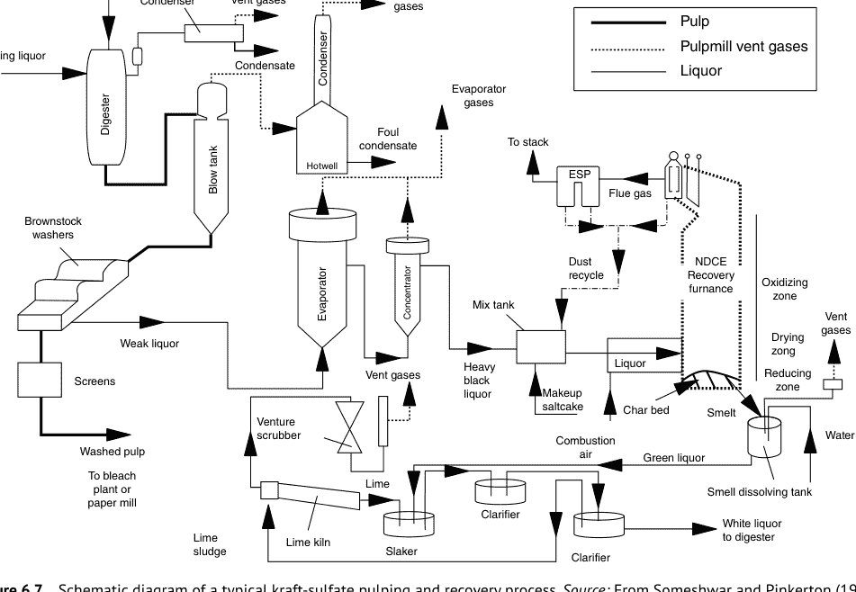

**图6.7** 典型的硫酸盐制浆和回收工艺示意图。*来源：* From Someshwar and Pinkerton (1992).

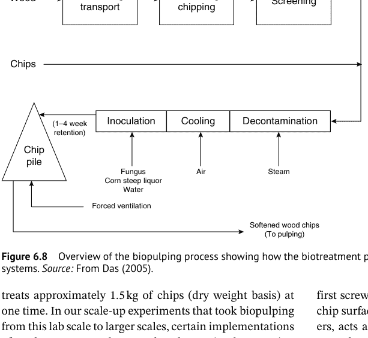

**图6.8** 生物制浆工艺概述，显示生物处理工艺如何融入现有工厂的木材处理系统。*来源：* From Das (2005).


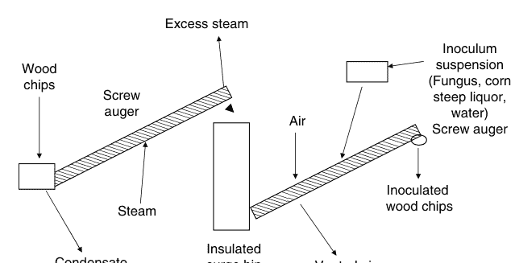

图 6.9 用于除污、冷却和接种木屑的连续处理系统。木屑在第一个螺旋输送机中蒸汽处理后被放置到缓冲仓中。第二个螺旋输送机随后拾取木屑，对其进行冷却并施加接种物。堆放储存与通风。来源：引自 Das (2005)。

生物制浆。生物机械浆的强度提高，使得在浆料混合的情况下，可以用较低比例的硫酸盐浆达到所需的混合强度。最后，只使用无害材料，且不会产生额外的废物流。对该工艺的经济分析得出了非常有利的结果。这里总结了 200T/天 TMP 工厂的分析。在不同情景和对公用事业成本、设备需求和运营成本的假设下，净节省可从每吨浆料生产的 10 美元到超过 26 美元不等，预计资本投资为 250 万美元。受磨木机限制的工厂，由于磨木机能量减少，可以将磨木机运行到恒定的总功率负荷，从而使产量提高超过 30%。即使产量仅 modest 提高 10%，再加上 30% 的节能，也能在不到 1 年内收回成本。这相当于在资本 15% 的回报率下节省 34 美元/吨。此外，许多工厂将机械浆和硫酸盐浆混合以达到所需的光学和强度性能。当预期强度更高的生物制浆 TMP 部分替代硫酸盐浆，替代率为 5% 时，还可实现超过 10 美元/吨的额外收益。600T/天分析的结果也已发表（Scott et al. 1998a, b）。该初步分析需作适当限定。资本成本存在一定变异性，特别是与将新设施整合到现有厂址相关的成本。生物制浆的额外优势，包括环境效益和松香减少，在本报告中尚未量化。最后，大部分分析是特定于现场的，取决于考虑将生物制浆纳入其运营的特定工厂的运行条件。

尽管生物制浆对机械制浆的环境效益尚未从经济角度定量确定，但我们可以定性地讨论其效益。Sykes (1994) 确定生物制浆工艺的排放物没有环境问题。就温室气体而言，生物制浆工艺具有净效益。该工艺本身是氧化性的，随着真菌代谢各种木质成分会产生二氧化碳。然而，基于电力产生的典型发电效率，减少的能源需求（~30%）显著降低了整个系统分析时的总体二氧化碳产生量。最后，就在木场使用真菌的生物学问题而言，使用生物制浆菌群是有益的。生物制浆真菌会 outcompete 在不受控制的木屑堆中生长的正常真菌和其他生物。其中一些其他生物，如曲霉，可能对人类健康有害。生物制浆真菌在世界各地的森林中自然存在，对人类没有已知的健康影响。有关化学工艺和制造业的成本效益分析以及经济投入产出模型（EIO-LCA）的更多信息可在附录 F 中找到。

## 6.4.3.7 使用 USEPA 模型 TRACI 进行定量分析

用于化学品和其他环境影响的减少与评估的工具（TRACI）及其历史、其所纳入的研究和方法、以及其在各个影响类别中提供的见解进行了描述。

TRACI 是一种由美国环境保护署（USEPA）开发的独立计算机程序，可促进对具有潜在影响的环境压力源进行表征，包括臭氧层破坏、全球变暖、酸化、富营养化、对流层臭氧（烟雾）形成、生态毒性、人类健康标准相关影响、人类健康致癌影响、人类健康非致癌影响、化石燃料枯竭和土地利用影响。TRACI 最初是为与 LCA 一起使用而设计的，但预计未来将在更广泛的应用中找到（Bare 2003；UNEP-SETAC 2000）。

气味、噪音、辐射、废热和事故等类别不在 USEPA 的管辖范围内，通常由于各种原因不包括在美国的案例研究中，包括也许是因为这些类别的 perceived 威胁通常被认为很小、局部或难以预测。资源枯竭类别被认为在美国具有重要意义，尤其是在化石燃料、土地和水使用方面。

为开发 TRACI，每个上述影响类别都被考虑，并对其当前的发展状态和 perceived 社会价值进行了评估。臭氧层破坏、全球变暖、人类毒理学、生态毒理学、烟雾形成、酸化和富营养化等传统污染类别被纳入 TRACI，因为 USEPA 内的各种计划和法规都认可减少这些类别影响的价值。人类健康类别进一步细分为致癌、非致癌和标准污染物（最初侧重于颗粒物），以更好地反映可再生燃料和购买电力的重点使用。废水处理厂和其他生物过程的排放不包括在内。在华盛顿州，纸浆和造纸厂使用的 60% 能源由可再生资源产生（几乎全部来自水电），40% 来自购买的电力，该电力由天然气、煤炭和石油产生。可再生能源来源的 CO₂ 排放假设为零。假设典型的燃烧效率为 70%，电力传输效率为 60%。在计算非可再生来源的 CO₂ 排放时，总体效率因子为 42%，用于向纸浆厂供电的发电厂。

USEPA 法规以及允许与美国法规、手册和指南一致的方法开发（USEPA 1989b, c）。烟雾形成影响保持独立，未与其他人类健康影响进一步汇总，因为与烟雾形成相关的环境影响在汇总过程中会被掩盖和/或丢失。标准污染物作为单独的人类健康影响类别得以保留，允许采用一种建模方法，该方法可以利用与这些研究充分的 impact 相关的大量流行病学数据。

## 6.4.3.8 模型输入和输出

必须注意，数据质量是 LCA 及其解释的基础。一些数据质量问题，如可靠性和一致性，可以通过使用标准化数据库来克服，这些数据库在多年数据汇编及其纳入公共和商业可用数据库后开始出现。表 6.7 提供了在 TRACI 中使用的一些化学品释放数据。表 6.8 提供了总体环境和人类健康影响，包括全球变暖、烟雾形成、人类健康标准污染物、酸化、富营养化和生态毒性。结果表明，由于其能源消耗减少，生物制浆的环境影响低于 TMP 工艺。生物制浆在所有衡量指标中除全球变暖外的环境影响均低于化学制浆。应注意，每吨的 CO₂ 总产量对化学制浆最高，但由于硫酸盐回收炉使用源自木材的可再生资源木质素作为燃料，因此该对温室气体的贡献被假设为净零。图 6.10 显示了 TRACI 预测的全球变暖表征结果。

这些结果可能表明，当电力供应以可再生能源为主时，生物制浆是优选工艺。在电力生产燃料组合主要为化石燃料的情况下，化学制浆提供了一种由可再生能源驱动的工艺，但以更高的危险废物排放为代价。

总之，该简化 LCA 清楚地表明，造纸工艺中的生物制浆具有

表 6.7 化学、机械和生物制浆及造纸工艺的排放，1000 T OD/天。

| 污染物 | 化学 | 机械 | 生物（TMP） |
|---|---|---|---|
| 丙酮（lb） | 1.5×10³ | — | — |
| BOD（lb） | 4.4×10³ | 1.76×10³ | 1.76×10³ |
| CO₂,ᵃ（lb） | 3.5×10⁶ | 8.0×10⁶ | 5.5×10⁶ |
| CO（lb） | 5.5×10⁴ | 5.5×10³ | 5.5×10³ |
| 三氯甲烷（lb） | 8.5×10² | 7.5×10² | 7.5×10² |
| COD（lb） | 6.0×10³ | 1.0×10³ | 5.0×10² |
| 乙醇（lb） | 5.0×10² | 5.0×10¹ | — |
| H₂S（lb） | 2.35×10³ | — | — |
| 异戊二烯（lb） | 1.0×10³ | 1.0×10³ | 1.0×10³ |
| 甲烷（lb） | 8.2×10³ | 2.7×10³ | 2.7×10³ |
| 甲醇（lb） | 2.3×10³ | 6.0×10² | 6.0×10² |
| 氮（lb） | 7.5×10² | — | — |
| NO₂（lb） | 3.5×10⁴ | 1.0×10³ | 5.0×10² |
| NO（lb） | 3.5×10⁴ | 1.0×10³ | 5.0×10² |
| SO₂（lb） | 1.75×10⁴ | — | — |

ᵃ CO₂ 排放将取决于实际的非可再生能源来源。


and dechlorination processes; therefore, the use of UV does not affect a drinking water supply or the aquatic biota in receiving waters.

The objective of this work is to present streamlined environmental (LCAs) between two competitive disinfection processes: chlorine vs. UV. This section discusses the use of LCA to quantify the environmental and public health benefits of UV disinfection technology as opposed to chlorination and dechlorination methods. LCA tools are used to evaluate the short-term and long-term environmental effects of both processes and to select the best sustainable process. Our approach applies environmental LCA to these disinfection processes, incorporating economic criteria and all aspects of the environment: chemical use, electricity use, and releases to water, air, and land.

## 6.5.1 The Challenge

With increasing emphasis on promoting sound ecological practices and concern over introducing toxic chemicals into water, designs for disinfection processes are increasingly leaning toward technologies that destroy pathogens while balancing the effects of this disinfected wastewater on aquatic biota or a drinking water supply.

In the United States and Canada, the use of ultraviolet light irradiation for the disinfection of wastewater has become the accepted alternative to chlorination or chlorination/dechlorination. There are several reasons for this move away from a proven technology. For example, because of current Uniform Fire Codes, containment requirements for volatile gases like chlorine, and public health concerns, municipalities are limited in the amounts of chlorine that can be stored in a water treatment plant. Moreover, the dechlorination process uses yet another chemical pollutant, sulfur dioxide, to remove chlorine from the effluent before discharged into the receiving water. Thus, and because chlorination/dechlorination of wastewater produces possible carcinogens in addition to destroying aquatic biota in the receiving waters, USEPA started to look for an alternative wastewater disinfection system.

Various governments, municipalities (Das 2002, 2004; Das and Ekstrom 1999; Ecology 1998; LOTT 1994; USEPA 1986, 1992b), and corporations have sponsored research (Loge et al. 1996; Scheible 1987; Scheible and Forndran 1986; White 2010) that shows that the UV disinfection of wastewater was effective and economical. Another most important development was the parallel flow open channel modular UV system. This new design of the UV system for wastewater in the early 1980s opened up UV disinfection for both the retrofit market and new wastewater treatment plants. To promote a friendlier discharge to the marine environment, designers have begun to prefer alternative

disinfection technologies, which emphasize sustainable and clean ecological disinfectants – such a clean technology is UV disinfection.

## 6.5.2 The Chlorination (Disinfection) Process

Despite the acknowledged advantages of disinfection by means of UV irradiation, however, chlorine continues to be the most widely used chemical for the disinfection of wastewater in the United States and elsewhere. The major advantages of chlorine over alternative disinfectants are cost-effectiveness, reliability, and efficacy against a host of pathogenic organisms. We turn now to a detailed examination of the chlorination process.

When chlorine (Cl₂) is dissolved in freshwater, a mixture of hypochlorous acid (HOCl) and hypochlorite ion (OCl⁻) is formed (Eq. 6.2). Chlorine exists predominantly as HOCl below pH 7.6 and as OCl⁻ above pH 7.6. HOCl and/or OCl⁻ is defined as free available chlorine, with the hypochlorous acid being the primary disinfectant.

```
Cl₂ + H₂O ↔ HOCl + HCl
(6.2)
```

Mono-, di-, and tri-chloramines (NH₂Cl, NHCl₂, and NHCl₃) are formed when chlorine reacts with nitrogen present in secondary effluent in the form of ammonia. Municipal effluents usually contain all these forms of chlorine in some proportion and taken together they are known as “total residual chlorine” (TRC). Because saltwater contains bromide, the addition of chlorine to saltwater will also form hypobromous acid (HOBr), hypobromite ion (OBr⁻), and bromamines.

Chlorine is typically supplied as liquefied gas in cylinders. Chlorinators apply gaseous chlorine to a feed stream which is then injected into a mixing zone in the chlorine contact chambers. Initial mixing and effective contact times are essential for good process performance. Generally, contact periods of 15–30 minutes are required at peak flow (USEPA, 1985).

### 6.5.2.1 Limitations

Although chlorine disinfection is a largely reliable and effective process, it has certain limitations. For examples, chlorine reacts with certain chemicals in the wastewater, leaving only the residual for disinfection. Wastewater components that readily combine with chlorine include reduced iron and sulfur compounds, ammoniated-nitrogen, organic nitrogen, tannins, uric and humic acid, cyanides, phenols, and unsaturated organics. Cysts of Entamoeba histolytica, Giardia lamblia, and Mycobacterium tuberculosis, some viruses, and eggs of parasitic worms show resistance to chlorine. Consistent disinfection in effluents containing organic nitrogen may pose problems, even when a measured free chlorine residual is present.

### 6.5.2.2 Human Health and Environmental Impact

Chlorine is toxic to aquatic, estuarine, and marine organisms. An additional hazard is the carcinogenic potential of chloro-organic compounds. Chlorine gas is potentially toxic when inhaled, and chlorine transport poses a risk (see Section 5.10.5 and Tables 5.8 and 5.9). Special handling is required and emergency response plans are required under right-to-know regulations for on-site storage of gaseous chlorine. Chlorine gas and the hypochlorites are also highly corrosive. Chlorine gas concentrations of 15–20 ppm for 30–60 minutes are dangerous; higher concentrations for very brief periods can be fatal. Chlorination can result in the formation of carcinogenic chloro-organics.

The EPA has established toxicity criteria for TRC in receiving waters. In freshwaters the acute level is 19 mg/l (1-hour average) and the chronic level is 11 mg/l (4-day average). The saltwater acute and chronic criteria are 13 mg/l (1-hour average) and 7.5 mg/l (4-day average), respectively. Due to the toxicity of chlorine residuals at such low concentrations and the high limit of analytical detection (50–100 mg/l), chlorine induced toxicity in the receiving stream is difficult to control.

## 6.5.3 Dechlorination with Sulfur Dioxide

In the past decade, concerns over chlorine toxicity and protection of fish and wildlife have led to a dramatic growth in the practice of dechlorination to remove all or part of the chlorine residual and halogenated organics remaining after chlorination. Dechlorination also reduces or eliminates toxicity harmful to aquatic life in receiving waters.

Sulfur dioxide gas successively removes free chlorine, monochloramine, dichloramine, nitrogen trichloride, and polychlorinated compounds. When sulfur dioxide is added to wastewater, the following reactions occur:

```
SO₂ + H₂O → HSO₃⁻ + H⁺  (6.3)
HOCl + HSO₃⁻ → Cl⁻ + SO₄²⁻ + 2H⁺  (6.4)
SO₂ + HOCl + H₂O → Cl⁻ + SO₄²⁻ + 3H⁺ (free chlorine) (6.5)
SO₂ + H₂O → HSO₃⁻ + H⁺  (6.6)
NH₂Cl + HSO₃⁻ + H₂O → Cl⁻ + SO₄²⁻ + NH₄⁺ + H⁺  (6.7)
SO₂ + NH₂Cl + 2H₂O → Cl⁻ + SO₄²⁻ + NH₄⁺ + 2H⁺ (combined chlorine) (6.8)
```

For the overall reaction between sulfur dioxide and chlorine (Eq. 6.5), the stoichiometric weight ratio of sulfur dioxide to chlorine is 0.9 : 1. In practice, it has been found that about 1.0 mg/l of sulfur dioxide will accomplish for the dechlorination of 1.0 mg/l of chlorine residue

(expressed as Cl₂). Because the reactions of sulfur dioxide with chlorine and chloramines are nearly instantaneous, contact time is not usually a factor and contact chambers are not used; however, rapid and positive mixing at the point of application is an absolute requirement.

The ratio of free chlorine to the total combined chlorine residual before dechlorination determines whether the dechlorination process is partial or proceeds to completion. If the ratio is less than 85%, it can be assumed that significant organic nitrogen is present and that it will interfere with the free residual chlorine process (Metcalf and Eddy 2003).

Since dechlorination removes most of the TRC from disinfected wastewaters, it reduces the toxicity of disinfected wastewater effluent to aquatic wildlife. In most situations, sulfur dioxide dechlorination is a very reliable unit process in wastewater treatment, provided the precision of the combined chlorine residual monitoring service is adequate. Excess sulfur dioxide dosages should be avoided not only because of the chemical wastage but also because of the oxygen demand (BOD and COD) exerted by the excess sulfur dioxide.

### 6.5.3.1 Limitations

Chlorination/dechlorination is more complex to operate and maintain than chlorination alone. Major difficulties are the inability to measure residual SO₂ and problems in the continuous measurement of a zero or low chlorine residual. Many halogenated organics are also rapidly formed upon chlorine addition and are unaffected by application of SO₂. Heltz and Nweke who examined many plants, reported that the amount of residual chlorine in dechlorinated effluents considerably exceeded EPA criteria for receiving waters (Heltz and Nweke 1995).

### 6.5.3.2 Environmental Impact

Sulfuric acid and hydrochloric acid are products of SO₂ dechlorination in small amounts but are generally neutralized in the wastewater. Based on laboratory experiments, residuals of sulfite dechlorination are at least three orders of magnitude less toxic than chlorine or ozone.

No cases of sulfur compounds affecting dissolved oxygen consumption or pH change in receiving waters or in dechlorinated effluents have been reported. In pilot studies, no significant oxygen depletion occurred until sulfur dioxide overdoses exceeded 50 mg/l. It is not uncommon, however, to find plants with post aeration after dechlorination to assure that dissolved oxygen requirements are met. Dechlorination with SO₂ would significantly reduce toxicity due to chlorination disinfection process.

Sulfur dioxide, which is used for dechlorination purposes, is stored on site in small quantities. The maximum


预计的储存库存量相当小，且无需担心对工人健康或附近居民区居民的健康构成威胁。

## 6.5.3.3 氯对水生生物的影响

表 6.9 总结了氯毒性对 14 种水生物种的潜在环境和化学影响。虹鳟是对测试物种中最敏感的，其次是金色鲫和三刺鱼。基于将测得的 2.0 mg/l 浓度稀释后计算出的 0.03 mg/l 的氯残留，使浮游植物光合作用降低了超过 20%，其值与无氯残留的废水稀释液相比。用亚硫酸氢钠进行脱氯也消除了与氯相关的毒性。用二氧化硫进行脱氯也大大降低了对鱼类和无脊椎动物物种的急性和慢性毒性。

**表 6.9 残留氯对水生生物急性及慢性毒性效应的选择性汇总。**

| 物种 | 效应终点 | 测得的残留氯浓度 (mg/l) |
|---|---|---|
| Coho salmon | 7-day TL50^a | 0.083 |
| Pink salmon | 100% kill (1-2) | 0.08-0.10 |
| Coho salmon | 100% kill (1-2) | 0.13-0.20 |
| Pink salmon | Maximum nonlethal | 0.05 |
| Coho salmon | Maximum nonlethal | 0.05 |
| Brook trout | 7-day TL50 | 0.083 |
| Brook trout | Absent in streams | 0.015 |
| Brown trout | Absent in streams | 0.015 |
| Brook trout | 67% lethality (4) | 0.01 |
| Brook trout | Depressed activity | 0.005 |
| Rainbow trout | 96-h TL50 | 0.14-0.29 |
| Rainbow trout | 7-day TL50 | 0.08 |
| Rainbow trout | Lethal (12) | 0.01 |
| Trout fry | Lethal (2) | 0.06 |
| Yellow perch | 7-day TL50 | 0.205 |
| Largemouth bass | 7-day TL50 | 0.261 |
| Smallmouth bass | Absent in streams | 0.1 |
| White sucker | 7-day TL50 | 0.132 |
| Walleye | 7-day TL50 | 0.15 |
| Black bullhead | 96-h TL50 | 0.099 |
| Fathead minnow | 96-h TL50 | 0.05-0.16 |
| Fathead minnow | 7-day TL50 | 0.082-0.115 |
| Fathead minnow | Safe concentration | 0.0165 |
| Golden shiner | 96-h TL50 | 0.19 |
| Fish species diversity | 50% reduction | 0.01 |
| Send | Safe concentration | 0.034 |
| Send | Safe concentration | 0.012 |
| Daphnia magna | Safe concentration | 0.003 |
| Protozoa | Lethal | 0.1 |

a TL50，耐受中值极限（50%存活率）（Brungs 1973）。

在考虑这些数据时，应牢记，氯废物在河流中的毒性并不取决于加入的氯量，而取决于溶解液中残留的氯浓度（Merkens 1958）。这种残留氯的毒性将取决于其组成（即游离氯和氯胺的相对比例）。确定该比例，其本身取决于至少五个其他变量，这是一个复杂的工作。尽管游离氯比氯胺更具毒性，但自 1950 年代以来一直成立的研究表明，游离氯和氯胺对鱼类的毒性差异并不很大（Dondoroff and Katz 1950；Merkens 1958；Hart 1973；Kozloff 1974）。

### 实验室生物测定结果

几项研究（Dondoroff and Katz 1950；Merkens 1958；Thatcher 1977）表明，鲑科鱼类是最敏感的鱼类。实验室生物测定支持这一概括。0.006 mg/l 的残留氯浓度在 2 天内对鳟鱼稚鱼是致命的，而虹鳟的 7 天耐受中值极限，或 TL50，为 0.08 mg/l，在 0.004 mg/l 时估计的中位存活期为 1 年（Merkens 1958）。在海水中，粉红鲑和银鲑在 23 天内最大无害残留氯浓度为 0.05 mg/l（Holland 1960）。虹鳟在 0.01 mg/l 下 12 天死亡，并在 0.001 mg/l 下避开（Sprague and Drury 1969）。溪鳟在 0.35 mg/l 下平均存活时间为 9 小时，在 0.08 mg/l 下为 18 小时，在 0.04 mg/l 下为 48 小时。在 0.01 mg/l 下 4 天后死亡率为 67%（Dandy 1967, 1972）。在 10.5 小时内，50% 的棕鳟在 0.02 mg/l 下死亡，在 0.01 mg/l 下在 43.5 小时内死亡（Pike 1971）。鳟鱼、鲑鱼和一些鱼类食物生物比暖水鱼、蜗牛和 crayfish 更敏感（表 6.9 和 6.10）。

## 6.5.4 紫外线消毒工艺

紫外线消毒系统将汞弧灯的电磁能量传递到生物的遗传物质，即含有 DNA 和 RNA 的染色体。当紫外线辐射穿透生物的细胞壁时，会破坏细胞繁殖的能力。在消毒过程中，由汞蒸气放电产生的紫外线辐射穿透微生物的遗传物质并引起分子重排，从而减缓其繁殖能力。Das 对杀菌作用的机制、紫外线的工作原理、紫外线损伤 DNA 的修复以及废水水质参数对消毒效率的影响进行了详细综述（Das 2004）。

**表 6.10 鱼类短暂暴露于残留氯的结果汇总。**

| 物种 | 效应终点 | 时间 | 测得的残留氯浓度 (mg/l) |
|---|---|---|---|
| Chinook salmon | First death | 2.2 h | 0.25 |
| Brook trout | Median mortality | 90 min | 0.5 |
| Brook trout | Mean survival time | 9 h | 0.35 |
| Brook trout | Mean survival time | 18 h | 0.08 |
| Brook trout | Mean survival time | 48 h | 0.04 |
| Brown trout | Depressed activity | 24 h | 0.005 |
| Rainbow trout | Slight avoidance | 10 min | 0.001 |
| Rainbow trout | Lethal | 2 h | 0.3 |
| Fingerling Rainbow trout | Lethal | 4–5 h | 0.25 |
| Trout fry | Lethal | Instantly | 0.3 |
| Yellow perch | TL50^a | 1 h | <0.88 |
| Yellow perch | TL50 | 12 h | 0.494 |
| Smallmouth bass | Median mortality | 15 h | 0.5 |
| White sucker | Lethal | 30–60 min | 1.0 |
| Largemouth bass | TL50 | 1 h | <0.74 |
| Largemouth bass | TL50 | 12 h | 0.365 |
| Fathead minnow | TL50 | 1 h | <0.79 |
| Fathead minnow | TL50 | 12 h | 0.26 |
| Miscellaneous | Initial kill | 15 min | 0.28 |
| Miscellaneous | Erratic swimming | 6 min | 0.09 |

a TL50，耐受中值极限（50%存活率）（Brungs 1973）。

紫外线消毒系统并非批量生产。由于其效率强烈取决于导致废水中紫外线强度降低的废水特性，因此每个应用都必须有专门设计的系统。表 6.11 显示了在为废水设计紫外线消毒系统时必须考虑的主要参数。与氯化/脱氯相比，紫外线消毒可减少受纳水体中潜在氯化烃（包括潜在致癌物）的产生，同时对废水处理厂操作人员和附近居民区的安全性大大提高。

### 6.5.4.1 紫外线透射或吸收

紫外线穿透废水的能力是在分光光度计中以杀菌灯产生的相同波长（254 nm）测量的。该测量值称为 *透射百分比* 或吸光度，它是吸收或反射紫外线的所有因素的函数。随着透射百分比降低（吸光度升高），紫外线穿透废水并到达目标生物的能力下降。

它不能仅通过肉眼观察废水样品来估计。有效透射率 (*T*) 的范围将根据二级处理系统而变化。一般来说，悬浮生长处理工艺产生的出水 *T* 在 60 至 65% 之间。固定膜工艺范围为 50 至 55% *T*，而氧化塘为 35-40% *T*。影响紫外线透射率的行业包括纺织、印刷、造纸、食品加工、肉类和家禽加工、照相显影以及化学制造。Das（2004）对影响废水紫外线消毒效率的其他主要参数进行了讨论。

### 6.5.4.2 消毒标准

为获得 EPA 国家污染物排放消除系统（NPDES）许可证而要求的消毒水平通常小于每 100 ml 200 个粪大肠菌单位作为 30 天几何平均值。一般来说，在透射率为 65% 且总悬浮固体（TSS）低于 20 mg/l 的二级处理废水中，需要 20-30 mW·s/cm² 的紫外线剂量才能达到此消毒水平。满足特定限值的紫外线剂量需求取决于颗粒的性质，包括数量、大小和组成。因此，紫外线剂量需求会有所不同（表 6.11）。加利福尼亚州和夏威夷州对水再利用要求更严格的限值（<每 100 ml 2.2 个总大肠菌单位）。在这种情况下，TSS 为 2 mg/l 或更少且透射率为 65% 的过滤出水可能需要高达 120 mW·s/cm² 的紫外线剂量才能达到此消毒水平。固体浓度、颗粒中的细菌以及颗粒尺寸分布是设计必须满足严格消毒限值系统的设计主要限制因素。看来，实现传统大肠菌群限值所需的紫外线剂量比相当的氯剂量能实现更好的病毒灭活。图 6.11 说明了与粪大肠菌群指示物相比灭活所选生物所需的紫外线和氯的相对剂量，也显示出灭活大多数生物所需的氯剂量远高于可实现相同消毒水平的相当紫外线剂量（Das 2002, 2004；Trojan Technologies Inc. 2010）。

**表 6.11 影响废水紫外线消毒的主要参数。**

| 参数 | 可接受值/条件 |
| :--- | :--- |
| 透射百分比 (*T*) 或吸光度 | 35-65 |
| 总悬浮固体（TSS） mg/L | 5-10 |
| 颗粒尺寸分布（PSD） µm | 10-40 |
| 流速或水力学设计 | 理想塞流 |
| 铁（mg/l） | <0.3 |
| 硬度（mg/l） | <300 |

### 6.5.4.3 运行、维护和工人安全

紫外线消毒系统的正确运行和维护（O&M）可确保向生物体传输足够的紫外线辐射使其灭活。紫外线辐射与目标生物体之间的所有表面必须保持清洁，且镇流器、灯管和反应器必须处于最佳状态。不充分的清洁是紫外线系统失效的最常见原因。在所有情况下，石英套管或特氟龙管必须定期通过机械擦拭器、超声设备或化学品进行清洁。清洁频率非常具体：有些系统需要比其他系统更频繁地清洁。

化学清洁最常用柠檬酸。其他清洁剂包括温和的醋溶液和亚硫酸氢钠。应测试多种清洁剂的组合，以找到最适合废水特性且不产生有害或有毒副产物的清洁剂。

紫外线是在现场产生的，对周边社区没有显著的安全问题。工人安全要求主要针对防止紫外线光暴露（主要是眼睛和皮肤）的保护，以及对


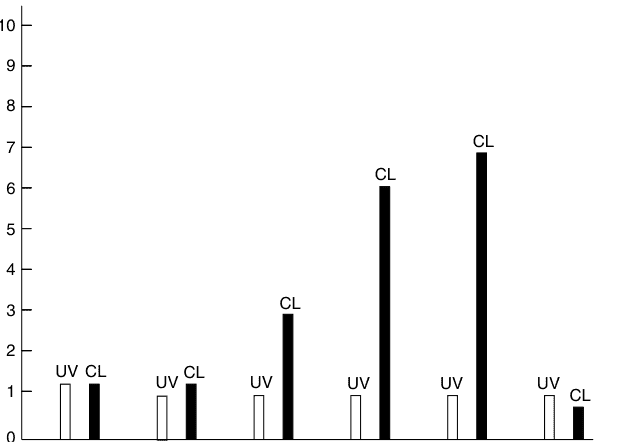

图 6.11 氯和紫外线对细菌和病毒相对有效性的比较。 (i) 大肠杆菌 (ii) 伤寒沙门氏菌 (iii) 金黄色葡萄球菌 (iv) 1型脊髓灰质炎病毒 (v) 柯萨奇 A2 病毒 (vi) 腺病毒型 (Das 2002, 2004; Trojan Technologies Inc. 2010)。

严格监控电气危害并安全处理废弃灯具、石英和镇流器的处置 (US EPA 1996; US EPA 1998)。

#### 6.5.4.4 成本

具体而言，必须考虑环境问题如何影响我们的经济思维，以及反过来经济决策如何影响环境。成本考虑是决策过程中在确定流程、产品或活动潜在改进措施阶段不可或缺的一部分。

1、10 和 50 百万加仑/天 (mgd) (1 mgd = 3785 m³/天) 厂的估计资本成本分别为 $150 000、$700 000 和 $3 000 000。O&M 成本估计分别为 2.6、1.4 和 0.8 美元美分/1000 加仑 (或 3.785 m³)，平均剂量为 6 mg/l。当剂量为 10 mg/l 时，这些成本上升至 4.0、3.0 和 1.5 美元美分/1000 加仑。

氯气和次氯酸盐的化学成本因地区、需求和供应情况而有很大差异。Cl₂ 的当前价格范围为：$0.0425–0.06/lb (或 454 g) 用于 90 T (或 ~90 000 kg) 槽车；$0.10/lb 用于 55 T (或 ~55 000 kg) 铁路车；$0.25–0.275/lb 用于 1 T (或 ~1 000 kg) 气瓶；以及 $0.50–0.55/lb 用于 150 lb (或 ~68 kg) 气瓶。液态次氯酸钠 (12.5%) 报价为 $0.50–1.75/gal。

对处理污水处理设施的氯化/脱氯和紫外线消毒工艺进行简要成本分析，处理能力为 18 mgd，见图 6.12。这些成本会因地区、需求和供应而有很大差异。替代方案的年化成本值基于 20 年期间 5.5% 的利率和设计平均厂流量 18 mgd (F. Soroushian, 个人交流; Temmer et al. 2000)。

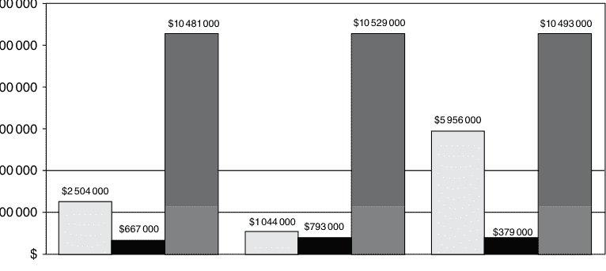

图 6.12 18 百万加仑/天设施的消毒系统成本比较。

图 6.12 表明，尽管氯化系统的建设成本明显低于紫外线系统，但两种系统的年化成本大致相同。追求氯化消毒系统并无更多实际经济效益。

#### 6.5.4.5 能源来源的环境影响及可再生能源的启示

与氯化一样，紫外线消毒系统也需要能源供应。能够促进可持续发展实现的最重要因素之一是需要一种本身完全可持续的能源资源供应。有效高效地利用能源资源要求这些资源能够以合理成本随时获得，用于所有所需任务而不造成负面社会影响。显然，可再生能源与可持续发展之间存在密切联系 (Das 2002)。

表 6.12 简要总结了可再生能源和其他形式能源来源的发电成本、空气质量和环境影响。它说明可再生能源可为减少温室气体和酸性气体排放做出重大贡献。可再生能源也有其自身环境影响，但这些影响通常很小，具有场地特异性且为局部性质。

**表 6.12** 发电成本、空气质量和环境影响。

| 来源 | 成本 | 潜在环境影响和关注污染物 |
|---|---|---|
| 太阳能光伏 (大规模) | ~18–20 美元美分/kWh | 腐蚀性酸，可能有毒和有害物质，土地利用和栖息地丧失，视觉侵入，垃圾填埋场无控制倾倒 |
| 太阳能光伏 (小规模) | ~22–24 美元美分/kWh | 可能有毒和有害物质 |
| 风能 | ~4.5–10 美元美分/kWh | 土地利用和栖息地破坏，噪音，鸟类撞击 |
| 生物质 | ~6–8 美元美分/kWh (不含乙醇燃料) | CO₂, NOₓ, PM₁₀, CO, VOC, 有毒空气污染物 (TAPs) |
| 地热 | ~5–8 美元美分/kWh | 运行期间 H₂S 排放，地下水和土壤污染，地表水，土地利用，视觉影响 |
| 太阳能热 | ~5–25 美元美分/kWh | 地表水的热或化学污染 |
| 大规模水电 | 2.0 至 7.8 美元美分/kWh 范围 | 鱼类和其他水生生物，陆地生态系统，当地气候，公共卫生，水流和供应，人口迁移，农业用地丧失 |
| 现有水电 | 范围从 … 至 2.0 美元美分/kWh | 鱼类和其他水生生物，水供应，灌溉，SO₂ |
| 核能 | 5.5–6.0 美元美分/kWh | 放射性物质，公共卫生 |
| 燃煤发电厂 | 4.8–5.5 美元美分/kWh | CO₂, NOₓ, SO₂, PM₁₀, CO, VOC, TAPs |
| 柴油发电机 | 10–15 美元美分/kWh | CO₂, NOₓ, SO₂, PM₁₀, CO, VOC, TAPs |
| 天然气联合循环燃气轮机 | (天然气价格为 $5/MMBtu 时) = 5 美元美分/kWh | CO₂, NOₓ, PM₁₀, CO, VOC, TAPs |
| 简单循环燃气轮机 | 天然气价格为 $5/MMBtu 时 6 美元美分/kWh | CO₂, NOₓ, PM₁₀, CO, VOC, TAPs |

来源: Energy Ideas Clearinghouse (2018)。

## 6.6 案例研究：生物可再生能源与化石燃料发电的 LCA 比较

对生物质、煤炭和天然气系统进行了一系列 LCA，以量化每种系统的环境效益和弊端。所有这些评估均以从摇篮到坟墓的方式进行，以涵盖发电厂运行所需的所有流程，包括原材料开采、原料制备、运输、废物处置和回收。我们总结了每种系统的能量平衡、GWP、空气排放和资源消耗数据 (NREL 2011)。

发电和一般能源消费都会对环境造成后果。利用可再生资源并采用先进技术如整体煤气化联合循环 (IGCC) 可能导致更少的环境破坏，但程度如何，又有哪些权衡？已对各种发电选择进行了 LCA 研究，以便更好地了解每种技术的环境效益和弊端。

物料和能量平衡被用来量化发电厂运行所需每个过程的排放、能源使用和资源消耗。这些包括原料采购 (开采煤炭、提取天然气、种植专用生物质、收集残余生物质)、运输、设备和中间材料 (例如化肥、石灰石) 的制造、发电厂建设、退役以及任何必要的废物处置。

研究了以下系统：

- 使用生物质能源作物 (杂交杨树) 的生物质燃烧 IGCC 系统
- 蒸汽循环的粉煤 (pc) 锅炉，代表美国今天燃煤发电厂的平均水平
- 共燃生物质残渣与煤炭的系统 (按热输入计 15% 将在此介绍)
- 使用生物质残渣 (主要为城市) 的直接燃烧生物质发电厂
- 天然气联合循环 (NGCC) 发电厂。

每项研究都是独立进行的，因此可以单独成立，给出每种发电技术的完整图景。然而，每种系统的排放、资源消耗和能源需求最终可以相互比较，揭示可再生和化石基系统的环境效益和弊端。

### 6.6.1 结果

#### 6.6.1.1 系统能量平衡

每个系统消耗的总能量包括燃料能量消耗加上系统消耗的原材料和中间材料的能量。第一类能源使用示例是运输中花费的燃料和化石燃料发电厂消耗的化石燃料。第二类能源是材料在燃烧时释放的能量之和 (如果它是燃料) 以及将材料输送到使用地点的总能量。这一类能源消耗的示例是化肥制造中天然气的使用和烟气脱硫 (FGD) 中石灰石的使用。燃烧能量计算适用于使用不可再生燃料的情况，反映了燃料被系统消耗的潜在能量。可再生资源的燃烧能量，即以等于或大于消耗速率的速度补充的资源，不从系统的净能量中扣除。这是因为从生命周期来看，资源并未被消耗。为了确定每个系统的净能量平衡，发电厂产生的能量减去每个过程块中使用的能量。每个系统的总系统能量消耗如表 6.13 所示。

**表 6.13** 总系统能量消耗。

| 系统 | 总能量消耗 (kJ/kWh) |
|---|---:|
| 平均煤炭 | 12 575 |
| 天然气联合循环 | 8 377 |
| 生物质/煤炭共燃 (按热输入计 15%) | 10 118 |
| 使用杂交杨树的生物质燃烧 IGCC | 231 |
| 使用生物质残渣的直接燃烧生物质发电厂 | 125 |

来源: 引自 NREL (2011)。

为了检查每个系统中消耗最大能量量的工艺操作，定义了两个能量测量参数。首先，计算输送到电网的能量除以每个系统消耗的总化石衍生能量。该指标称为净能量比，有助于评估每单位化石燃料消耗产生的能量。另一个指标，外来能量比，定义为输送到电网的能量除以输送到电厂的总非原料能量


电厂。也就是说，化石燃料电厂所用煤炭和天然气中包含的能量被排除在外。外部能量比评估的是每消耗一单位上游能量所产生的能量。

由于生物质中的能量被认为是在系统边界内产生和消耗的，因此对于纯生物质案例（生物质整体煤气化联合循环和直燃生物质），净能量比和外部能量比是相同的。在计算外部能量比时，我们实质上将供给化石燃料电厂的煤炭和天然气视为可再生燃料，以便对上游能量消耗进行比较。每个案例的能量结果如图6.13所示。

正如预期的那样，纯生物质电厂总体消耗的能量较少，因为化石燃料电厂消耗不可再生的煤炭和天然气导致净能量平衡小于1。直燃生物质残渣案例每消耗单位能量产生的电量最多。这是因为向电厂提供可用的残渣生物质所需的能量相当低。尽管生物质整体煤气化联合循环电厂的发电效率更高，但由于种植专用生物质作物所需的能量，其净能量平衡低于直燃电厂。然而，残渣资源的有限性可能要求将来使用能源作物。将生物质与煤炭混合燃烧比纯燃煤案例的能量比略有提高，尽管电厂效率降低了0.9个百分点。

在计算外部能量比时，供给电厂的原料被排除在外，实质上将所有原料均视为可再生燃料。由于人们认为生物质燃料的质量低于化石燃料，因此预计化石燃料系统的外部能量比将大大高于生物质系统。然而，事实恰恰相反，这是因为化石燃料系统在上游作业中消耗了大量能量。各系统消耗的非原料总能量如表6.14所示。

## 表6.14 非原料能量消耗

| 系统 | 总能量消耗 (kJ/kWh) |
| --- | --- |
| 平均煤炭 | 702 |
| 天然气整体煤气化联合循环 | 1718 |
| 生物质/煤炭混合燃烧（按热量输入15%） | 614 |
| 使用杂交杨树的生物质整体煤气化联合循环 | 231 |
| 使用生物质残渣的直燃生物质电厂 | 125 |

资料来源：摘自NREL（2011）。

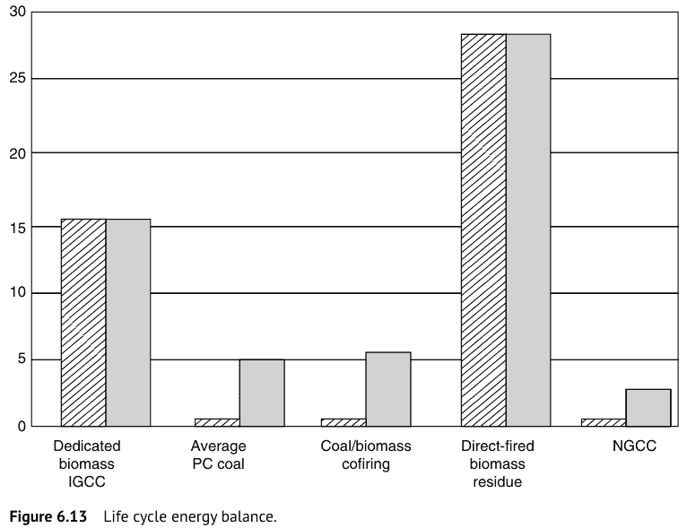

煤炭开采消耗了这部分能量的25%，而煤炭运输占32%。与天然气整体煤气化联合循环系统相关的上游能量消耗中，超过97%来自天然气开采和管道输送环节，包括逃逸损失。虽然生物质系统的上游过程也消耗能量，但较短的运输距离以及无需烟气脱硫（FGD）这一事实降低了总能量负担。

这里给出的基准案例假设土壤碳没有净变化，因为实际的增加和损失将高度取决于具体地点。在电厂使用残渣的直燃生物质系统具有极高的负温室气体排放率，因为这避免了与生物质分解相关的甲烷产生。根据当前的处理实践，假设直燃和混燃案例中使用的46%的残渣生物质将被送往垃圾填埋场，其余部分将用作覆盖物和其他低价值产品。文献中报道的分解研究被用来确定，如果生物质残渣没有被电厂使用，大约9%的碳最终会变成CH₄，61%变成CO₂。剩余碳在填埋场中抗分解。如果所有残渣生物质都经好氧分解，产生的CO₂将为1.85千克/千克生物质。如果生物质残渣没有在电厂使用，上述分解途径将导致总温室气体排放量为2.48千克CO₂当量/千克生物质（1.117千克CO₂ + 0.065千克CH₄）。净差异是直燃系统产生负温室气体排放的原因。

## 6.6.1.2 全球变暖潜能值

图6.14显示了这些研究所量化的三种温室气体的净排放量：二氧化碳（CO₂）、甲烷（CH₄）和一氧化二氮（N₂O）。生物质整体煤气化联合循环系统的全球变暖潜能值远低于化石燃料系统，因为在生物质生长周期中吸收了CO₂。敏感性分析表明，即使是中等程度的土壤固碳量（1900千克/公顷/7年轮作周期）也会使生物质整体煤气化联合循环系统实现净零温室气体平衡。超过此值的固碳量将导致温室气体负排放，使系统整体上从大气中清除碳。

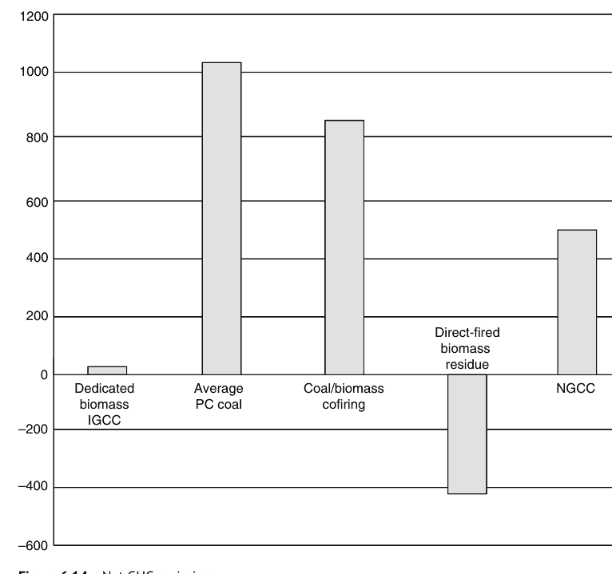

NGCC电厂在所有化石燃料系统中具有最低的全球变暖潜能值，因为其效率更高，尽管天然气损失增加了净CH₄排放。天然气在开采和输送过程中的损失被假设为开采总量的1.4%。由于甲烷作为温室气体的效力，该系统总全球变暖潜能值的近四分之一来自这些损失。按热量输入15%将生物质与煤炭混合燃烧，使平均燃煤电厂的全球变暖潜能值降低了18%。温室气体减排量大于生物质混燃比例，这是因为避免了与分解相关的甲烷排放，而如果生物质未被电厂使用，这些分解本会发生。该情景下的生物质处置和分解排放与直燃案例中使用的相同。

## 6.6.1.3 大气排放

图6.15绘制了以下排放物：颗粒物、硫氧化物（SOₓ）、氮氧化物（NOₓ）、CH₄、CO₂和非甲烷碳氢化合物（NMHCs）。由于天然气在开采和输送过程中的损失，天然气案例的甲烷排放量较高。直燃生物质和煤炭/生物质混燃案例由于避免了分解过程（填埋和覆盖）而具有负的甲烷排放。生物质案例中的CO和NMHCs较高，这是因为生物质生长和制备过程中上游柴油燃烧所致。混燃使煤炭系统的大气排放按大约混燃的比例降低，但颗粒物除外，颗粒物是在生物质粉碎和处理过程中产生的。

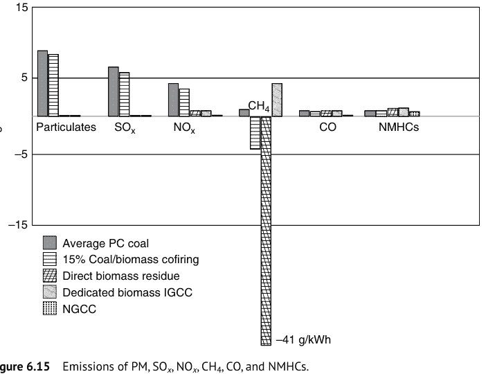

## 6.6.1.4 资源消耗

图6.16显示了所研究系统消耗的不可再生资源总量。燃煤电厂使用大量石灰石进行烟气脱硫（FGD）。天然气整体煤气化联合循环电厂消耗的资源量几乎可以忽略不计，但原料本身除外，包括在开采和输送过程中损失的部分。

## 6.6.2 敏感性分析

对每个系统进行了敏感性分析，以确定哪些参数对结果影响最大，并找出减少系统环境负担的机会。一般来说，与提高系统效率和减少化石燃料使用相关的参数影响最大。此外，对于生物质系统，与种植专用原料相关的变量以及影响使用生物质残渣避免多少CO₂和CH₄排放的因素显著影响了系统的全球变暖潜能值。然而，总体而言，敏感性分析表明，随着不同参数的变化，从这些研究中可以得出的结论保持相对稳定。

## 6.6.3 总结与结论

很明显，生物质发电系统降低了与发电相关的环境负担。关键比较结果可总结如下：

- 在整体煤气化联合循环系统中使用专用能源作物发电的全球变暖潜能值，仅为美国平均燃煤发电系统的4.7%。


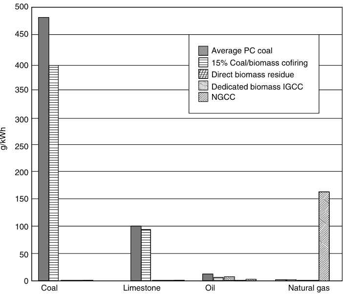

Figure 6.16 Total amount of nonrenewable resources consumed by the systems.

图 6.16 系统消耗的不可再生资源总量。

- 以热输入计掺烧 15% 的残余生物质，可使平均燃煤系统的温室气体排放和净能量消耗分别减少 18% 和 12%。
- 煤和天然气系统的生命周期能量消耗显著低于生物质系统，这是因为消耗了不可再生资源。
- 不计入这些系统中发电厂消耗的煤和天然气，净能量消耗仍低于生物质系统，这是由于烟气净化、运输以及天然气开采和煤炭开采相关过程所使用的能量。
- 与化石系统相比，生物质系统产生的颗粒物、NOx 和 SOx 水平非常低。
- 使用残余生物质时，系统甲烷排放为负值，因为避免了分解排放。
- 与化石系统相比，生物质系统消耗的自然资源数量非常少。
- 除了天然气外，天然气 IGCC 消耗的资源量很小。

这些结果表明总体而言，生物质发电相对于传统化石燃料发电系统具有显著的环境效益。特别是，生物质系统可以显著减少每千瓦时发电产生的温室气体。此外，由于生物质系统使用可再生能源而非不可再生的化石燃料，它们消耗的自然资源非常少，并且具有正的净能量平衡。掺烧生物质与煤炭为减少目前在美国发电量超过一半的燃煤发电系统相关的环境负担提供了机会。最后，通过减少 NOx、SOx 和颗粒物，生物质发电可以改善煤炭发电的当地空气质量。

## 6.7 最佳可行控制技术（环境修复）

### 6.7.1 什么是“最佳可行控制技术”？

最佳可行控制技术（BACT）是《清洁空气法》规定的污染控制标准：

> ...一种基于受本法监管的每种污染物从任何主要排放设施排放或由此产生的最大程度削减的排放限制，许可机构在逐案考虑能源、环境和经济影响及其他成本的情况下，确定该设施可通过

应用生产工艺和可用的方法、系统和技术，包括燃料清洁、清洁燃料或处理或创新燃料燃烧技术来实现对每种此类污染物的控制。

美国环保署确定将用于将特定污染物控制到规定限值的空气污染控制技术。当确定 BACT 时，会考虑诸如能源消耗、总源排放、区域环境影响和经济成本等因素。这是所有受新源审查（NSR）和 PSD 许可指南管辖的污染源的现行 EPA 标准，并逐案确定。BACT 标准比合理可行控制技术标准严格得多，但比最低可实现排放率标准宽松得多（U.S. EPA, 2016a）。

### 6.7.1.1 合理可行控制技术

合理可行控制技术（RACT）是 EPA 制定的污染控制标准，用于确定将用于将特定污染物控制到规定限值的空气污染控制技术。RACT 适用于未达到国家环境空气质量标准的受控空气污染物的地区现有源，并且要求所有符合这些标准的源都必须执行。RACT 标准比 BACT 宽松。

### 6.7.1.2 最低可实现排放率

最低可实现排放率（LAER）由 EPA 用于确定新或改建的主要固定源的排放是否符合 SIP 指南。LAER 标准在新固定源位于未达标空气质量区域时要求（见图 4.14）。它是高于最佳可行控制技术和合理可行控制技术标准的空气污染最严格标准。

### 6.7.1.3 基于生命周期的环境法

生命周期概念越来越多地成为环境法规的一部分，尤其是涉及温室气体排放的法规。现在 LCA 通常用于碳核算的写作中。在人们对气候变化日益担忧的时代，个人、组织和政府机构都渴望衡量温室气体的释放和影响。例如，各种政府机构正在制定规范燃料生产和使用相关温室气体排放的方法。例如，《能源独立与安全法》（HR 6）2007 年（EISA 2007）旨在：使美国朝着更大的能源独立和安全迈进；增加清洁可再生燃料的生产；保护消费者；提高产品、建筑物和车辆的效率。各州也在实施温室气体排放法规（USEPA 2010）。例如，2006 年加州全球变暖解决方案法案导致制定了法规，规定运输燃料的生命周期温室气体排放限值。加州低碳燃料标准和 EISA 第 526 条均要求对运输燃料的温室气体排放进行生命周期评估，这已成为考虑温室气体排放的常见方法（Allen et al. 2009）。

### 6.7.1.4 生命周期最佳控制技术

正在出现许多定量工具，使生命周期评估和分析成为可能，并随后为选择 PSD、NPDES 和其他环境许可程序的最佳可行控制技术提供指导。我们许多环境法都基于风险框架。现在，在环境许可程序中做出的基于生命周期的最佳控制技术决策不仅纳入健康和环境，还纳入经济和社会影响。接下来，我们将介绍一个发电设施 BACT 的案例研究。

## 6.8 BACT：应用于燃气轮机发电厂

在美国，BACT 包括实现受联邦法规管辖的任何拟建主要固定源或其主要改建排放的污染物最大程度削减所需的设备和方法。受 PSD 法规审查并要求进行 BACT 分析的污染物包括氮氧化物（NOₓ）、一氧化碳（CO）、直径小于或等于 10 μm 的颗粒物（PM₁₀）和 VOC。所有 PM 都被假定为 PM₁₀。BACT 审查遵循 USEPA 推荐的“自上而下”方法。自上而下过程要求确定给定污染物的所有可用控制技术并按控制有效性降序排列。许可申请人应首先检查排名最高的（“顶部”）选项。除非许可申请人向许可机构证明，技术考虑或能源、环境或经济影响证明最高排名的技术在该情况下不可“实现”，否则应将最高排名的选项确定为 BACT。如果以这种方式消除最有效的控制策略，则应评估下一个最有效的替代方案，依此类推，直到选择一个选项作为 BACT。

USEPA 已将此分析过程分为以下五个步骤：

- Step 1: Identify all available control technologies
- Step 2: Eliminate technically infeasible options
- Step 3: Rank remaining control technologies
- Step 4: Evaluate most effective controls and document results
- Step 5: Select the BACT

如果没有单一的行业 BACT，则根据具体情况确定，考虑成本效益、经济、能源、环境以及拟议解决方案的其他影响。BACT 分析中的三个重要术语是 PSD、“显著排放率”（SER）以及环境空气质量分析和国家环境空气质量标准（NAAQS）。PSD 计划的目的是实施联邦《清洁空气法》关于防止空气质量“显著”恶化的要求。这些确保拟议新建工业设施的许可和相关的经济增长以与保护清洁空气资源一致的方式进行。该计划为实施 BACT、保护国家公园等风景区以及知情公众参与提供了特别强调。SER 指净排放增加或源排放污染物的潜力，SER 等于或大于《联邦法规》第 40 篇第 51 条所列的速率。必须对每种受监管污染物进行环境空气质量分析，并必须证明该源不会导致或促成任何适用 NAAQS 的违反。

随着工业的老化和扩张，它们会获得污染物的新排放并修改旧排放。联邦法律要求对每个此类新或更改的“主要固定源”单元进行 BACT 分析。主要固定源的定义见《联邦法规》第 40 篇第 51 部分第 1 分部，新源和改建审查审查——任何固定源（1）在《清洁空气法》下排放或有排放潜力（PTE）250t/Y 或更多任何污染物；或（2）在 28 个来源类别之一下排放或有 PTE 100t/Y 或更多受监管污染物（《联邦法规》第 40 篇）。

USEPA 一直将法定和法规 BACT 定义解释为包含两个核心要求，机构认为任何 BACT 决定都必须满足。首先，BACT 分析必须考虑最严格的可用技术（即提供“最大程度排放削减”的技术）。其次，任何要求较低程度排放削减的决定都必须通过对“能源、环境和经济影响”的客观分析来证明。

BACT 必须至少与适用于排放源的任何新源性能标准（NSPS）一样严格。以这组数据为基线，BACT 分析通常通过 EPA 推荐的所谓自上而下方法进行。第一步是确定所讨论的排放单元是否与类似或相同的源或源类别最严格的控制可用。如果可以证明该控制水平对所讨论的单元在技术上不可行，则确定下一个最严格的控制水平并同样进行评估。此过程一直持续到所考虑的 BACT 水平不能因任何实质性或独特的<|message|>


burner firing) to 2 ppm, the cost effectiveness is $13,627/T of NOₓ removed (Catalytica Energy Systems Inc. 2004).

### 6.8.2.3 XONON

Several companies are reported to be working on a second technology for the control of NOₓ. Introduced commercially by Catalytica Combustion Systems, it is being marketed under the name XONON. This technology replaces traditional flame combustion with flameless catalytic combustion. NOₓ control is accomplished through the combustion process using a catalyst to limit the temperature in the combustor below the temperature where NOₓ is formed. The XONON was demonstrated to achieve near-zero emissions. The XONON combustion system consists of four sections: (i) the preburner, for start-up, acceleration of the turbine engine, and adjusting catalyst inlet temperature if needed; (ii) the fuel injection and fuel-air mixing system, which achieves a uniform fuel-air mixture to the catalyst; (iii) the flameless catalyst module, where a portion of the fuel is combusted flamelessly; and (iv) the burnout zone, where the remainder of the fuel is combusted.

The single field installation of the XONON technology at a municipal power company is being used to perform engineering studies of the technology at Silicon Valley Power, in Santa Clara, California. NOₓ emissions are well below 2.5 ppm on the 1.5 MW Kawasaki M1A-13A gas turbine. Catalytica has a collaborative commercialization agreement with General Electric Power Systems, committing to the development of XONON. In conjunction with General Electric Power Systems, the XONON system was specified for use with the GE 7FA turbines at the proposed 750 MW natural gas-fired Pastoria Energy Facility, near Bakersfield, California. The project entered commercial operations in 2003. Because the NOₓ emissions limitations of 2.5 ppm have been demonstrated in practice by a commercial facility, this technology is considered commercially available at this time (Catalytica Energy Systems Inc. 2004).

### 6.8.2.4 Selective Catalytic Reduction

SCR systems selectively reduce NOₓ by injecting ammonia (NH₃) into the exhaust gas stream upstream of a catalyst. NOₓ, ammonia, and oxygen react on the surface to form molecular nitrogen (N₂) and water. The overall chemical reaction can be expressed as

$$4NO + 4NH_3 + O_2 \rightarrow 4N_2 + 6H_2O$$

Parallel plates or honeycomb structures, permeated with the catalyst, are installed in the form of rectangular modules, downstream of the gas turbine in simple-cycle configurations, and into the heat recovery steam generator (HRSG) portion of the gas turbine downstream of the superheater in combined-cycle and cogeneration configurations.

The turbine exhaust gas must contain a minimum amount of oxygen and be within a somewhat narrow temperature range in order for the SCR system to operate properly. The temperature range is dictated by the catalyst: if it is too low, the reaction efficiency drops and increased amounts of NOₓ and ammonia are released from the stack; if it becomes too high, the catalyst may begin to decompose. Turbine exhaust gas is generally too hot to be passed through the catalyst, so it is cooled by the HRSG, which extracts energy from the hot turbine exhaust gases and creates steam for use in other industrial processes or to turn a steam turbine. In simple-cycle power plants where no heat recovery is accomplished, high temperature catalysts (e.g. zeolite) are an option. SCR can typically achieve NOₓ emission reductions in the range of about 80–95%.

SCR is the most widely applied post-combustion control technology in turbine applications and is currently accepted as LAER for new facilities located in ozone non-attainment regions. It can reduce NOₓ emissions to as low as 4.5 ppmvd for standard combustion turbines without duct burner firing and as low as 2–2.5 ppmvd when combined with lean-premix combustion (again without duct burner firing). SCR uses ammonia as a reducing agent in controlling NOₓ emissions from gas turbines. The portion of the unreacted ammonia passing through the catalyst and emitted from the stack is called ammonia slip. The ammonia is injected into the exhaust gases prior to passage through the catalyst bed. There is also a potential for increased particulate emissions from formation of ammonia salts. SCR may also result in the generation of spent vanadium pentoxide catalyst, which is classified as a hazardous waste. In addition, there is an energy loss from the performance loss due to the pressure drop across the SCR catalyst.

Gas turbines using SCR typically have been limited to 10 ppmvd ammonia slip (emissions of ammonia that has not reacted with nitrogen) at 15% oxygen. However, levels as low as 2 ppmvd at 15% oxygen have been proposed and guaranteed by control equipment vendors. In addition, Massachusetts and Rhode Island have established ammonia slip LAER levels of 2 ppmvd. Massachusetts has permitted at least two large gas turbine power plants using SCR reduction with 2 ppmvd ammonia slip limits. California recommended the establishment of ammonia slip levels below 5 ppmvd at 15% oxygen on the basis of guarantees from control equipment vendors of single-digit levels for ammonia slip.

Data supplied by the vendor show that when NOₓ is reduced from 15 ppm (gas turbine with duct burner firing) to 3.5 ppm, the cost effectiveness is $9,473/T of NOₓ removed.

### 6.8.2.5 Lean-Premix Technology or Dry-Low NOₓ

Processes that use air as a diluent to reduce combustion flame temperatures achieve reduced NOₓ by premixing the

## 6.8.5 VOC Control Technologies

The NSPS regulations for combustion turbines and duct burners provide no VOC emission limits. The following sections assess the control strategies that are potentially feasible for decreasing VOC emissions from the facility.

### 6.8.5.1 Catalytic Oxidation

The formation of VOC in combustion units depends primarily on the efficiency of combustion. Inefficient combustion leads to the formation of aldehydes, aromatic carbon compounds, and various other organic compounds by several mechanisms. Catalytic oxidation decreases VOC emissions by facilitating the complete combustion of organic compounds to water and carbon dioxide. Prior to entering the catalyst bed where the oxidation reaction occurs, the exhaust gas must be preheated to about 400–800 °F.

The RBLC database shows few instances of catalytic oxidation being selected as BACT for VOC at any gas-fired turbine power plant nationwide. An economic analysis for the catalytic oxidation of VOC emissions based on vendor information estimates the cost at $30,811/T of VOC removed. This cost level is economically infeasible for VOC removal. Thus, catalytic oxidation would not be selected as BACT for VOC emissions from turbines and duct burners proposed in the present time frame.

### 6.8.5.2 Good Combustion Practices

All the RBLC database BACT determinations for VOC outside California and New York show the use of combustion control or good combustion practices. Thus, in most areas good combustion practices are acceptable as BACT for VOC, with limits of 7.25 ppmvd at 15% O₂, as methane.

## 6.8.6 BACT Evaluation for SO₂ and H₂SO₄ Emissions

Control techniques available to reduce SO₂ and H₂SO₄ emissions include FGD systems and the use of low-sulfur fuels. Although FGD systems are common in boiler application, the RBLC database shows no known FGD systems on combustion turbines. Thus, the use of an FGD system is not warranted and an FGD system should be rejected as a BACT control alternative.

Another available technique is the use of low-sulfur fuels. There are no adverse environmental or energy impacts associated with the properly specified use of pipeline natural gas with low-sulfur content, and this control alternative should be acceptable as BACT. NSPS Subpart GG requires that either SO₂ emissions from a gas turbine be limited to 0.015% by volume (or 150 ppmvd) at 15% O₂, or that the turbine fuel contain less than 0.8% sulfur by weight.

The power plant proposes to combust only low-sulfur fuel (i.e. pipeline quality natural gas or diesel with a sulfur content < 0.05% by weight) in the proposed units, which is a widely accepted BACT determination for SO₂. By firing low-sulfur fuels, the turbines will meet the NSPS emission standard of 150 ppm at 15% O₂.

### 6.8.6.1 Step 1: Identify Potential Control Technologies

The first step in the BACT analysis is to identify all potential control technologies available for the control of SO₂ emissions. The technologies identified for the control of SO₂ emissions are as follows:

- FGD
- Spray dryers
- Fuel specification: low-sulfur fuels

### 6.8.6.2 Step 2: Eliminate Technically Infeasible Options

Neither FGD systems nor spray dryers have been applied to the exhaust gases from turbines, and significant technological difficulties are envisioned to apply to either of these technologies with high exhaust temperatures. The high temperature of the turbine exhaust deems FGD units and spray dryers infeasible. Thus, both FGD systems and spray dryers are eliminated for the control of SO₂ emissions from the proposed PSE turbines.

### 6.8.6.3 Step 3: Ranking of Remaining Control Technologies by Control Effectiveness

All add-on control options for the control of SO₂ emissions have been eliminated due to technical unfeasibility. For the control of SO₂ emissions, the use of low-sulfur fuels is the only control method determined to be technically feasible.

### 6.8.6.4 Step 4: Evaluation of the Most Effective Emissions Controls

As stated above, all add-on control options for the control of SO₂ emissions have been eliminated due to technical unfeasibility. Thus, the use of low-sulfur fuels containing less than 0.05% by weight of sulfur is the most effective means for reducing SO₂ emissions.

### 6.8.6.5 Step 5: Select BACT for the Control of SO₂ Emissions

The low SO₂ emissions levels inherent with low-sulfur fuel in a turbine constitutes BACT. Thus, the permittee proposes that BACT for the proposed turbines is the firing of low-sulfur fuels.


National Renewable Energy Laboratory (NREL) (2011). U.S. National Life Cycle Inventory Database. www.nrel.gov/lci (accessed 14 February 2019).

Pauli, G. (1996). *Breakthroughs*. Haslemere: Epsilon Press Limited.

Pike, D.J. (1971). Toxicity of chlorine to brown trout, *New Zealand Wildlife*, No 33.

Pineda-Henson, R., Culaba, A.B., and Mendoza, G.A. (2002). Evaluating environmental performance of pulp and paper manufacturing using the analytical hierarchy process and life-cycle assessment. *Journal of Industrial Ecology* 6: 15–28.

Scheible, O.K. (1987). Development of a rationally based design protocol for the ultraviolet light disinfection process. *Journal (Water Pollution Control Federation)* 59: 25.

Scheible, O.K. and Fornandan, M. (1986). *Ultraviolet Disinfection of Wastewaters from Secondary Effluent and Combined Sewer Overflows*, EPA-600/2-86/005. Cincinnati, OH: USEPA.

Scott, G.M., Akhter, M., Lentz, M.J. et al. (1998a). Engineering aspects of fungal pretreatment for wood chips. In: *Environmentally Friendly Pulping and Bleaching Methods*. New York, NY: Wiley.

Scott, G.M., Akhter, M., Lentz, M.J. et al. (1998b). New technology for papermaking commercialization biopulping. *Tappi Journal* 81 (12): 153–157.

SETAC (1991). *A Technical Framework for Life Cycle Assessment, Workshop Report from the Smugglers Notch, Vermont, USA*. Sandestin: The Society of Environmental Toxicology and Chemistry.

SETAC (1993). *Guidelines for Life-Cycle Assessment: A Code of Practice*. Pensacola, FL: The Society of Environmental Toxicology and Chemistry Sesimbra, Portugal (31 March to 3 April).

Smook, G.A. (1992). *Handbook for Pulp and Paper Technologies*, 2e. Bellingham, WA: Angus Wilde Publications.

Somekhar, A.V. and Pinkerton, J.E. (1992). Mechanical pulping. In: *Air Pollution Engineering Manual* (eds. A.J. Buonicore and W.T. Davis), 848–849. New York, NY: Van Nostrand Reinhold.

Sprague, J.B. and Drury, D.E. (1969). Avoidance reactions of salmonid fish to representative pollutants. In: *Advances in Water Pollution Research, Proceedings of the Fourth International Conference on Water Pollution Research Held in Prague* (ed. S.H. Jenkins), 169. London, UK: Pergamon Press.

Sundholm, J. (ed.) (1999). *Papermaking Science and Technology, Book 56: Mechanical Pulping*. Helsinki, Finland: Fapet Oy/Finnish Pulp and Paper Research Institute.

Sykes, M. (1994). Environmental compatibility of effluents of aspen biochemical pulps. *Tappi Journal* 77: 160–164.

Temmer, B., Soroshium, F., and Noesen, M. (2000). UV emerges bright spot for wastewater disinfection. *Pollution Engineering* 32: 46–49.

Thatcher, T.O. (1977). The relative sensitivity of Pacific Northwest fishes and invertebrates to chlorinated sea water. Battelle, Pacific Northwest Laboratories, Sequim, Washington. In: *Proceedings of the Second Conference on Water Chlorination Environ, Impact and Health Effects*, vol. 2 (eds. R.L. Jolly, H. Gorachov and D.H. Hamilton), 341–350. Richland, WA: Battelle, Pacific Northwest National Laboratory (31 October to 4 November).

Trojan Technologies Inc. (2010). Overview of UV disinfection. 3020 Gore Road, London, Ontario, Canada N5V 4T5.

U.S. Pulp and Paper Industry (1988). *An energy perspective*, Report Number DOE/RL/01830T57. Richland, WA: Pacific Northwest Laboratory.

UNEP-SETAC (2000). *United Nations Environmental Programme–Society of Environmental Toxicology and Chemistry Letter of Intent: Best Available Practice of Life Cycle Assessment with Generic Application Precedence*. Signed by the International Council of SETAC, and UNEP, Division Technology, Industry, and Economics, www.unepie.org/pc/sustain/lca/letter-of.intent.htm (accessed 29 March 2018).

UNEP-SETAC (2011). *Global Guidance Principles for Life Cycle Assessment Databases: A Basis for Greener Processes and Products*. Paris, France: United Nations Environmental Programme – Society of Environmental Toxicology and Chemistry.

USDOE (2007). *Cost and Performance Baseline for Fossil Energy Plants – Volume 1: Bituminous Coal and Natural Gas to Electricity*. DOE/NETL-2007/1281.

USEPA (1985). *Design Manual, Odor and Corrosion Control in Sanitary Sewage Systems and Treatment Plant*, EPA/625/1-85/018, (October). Washington, DC: Office of Water.

USEPA (1986). *Design Manual: Municipal Wastewater Disinfection*, EPA/625/1-86/021. Cincinnati, OH: Office of Research and Development, Water Engineering Research Laboratory.

USEPA (1989a). *EPA Quality Assurance Management Staff, Development of Data Quality Objectives: Description of Stages I and II*, EPA QA/G-4. Washington, DC: USEPA, Office of Research and Development.

USEPA (1989b). *Risk Assessment Guidance for Superfund, Vol. 2, Environmental Evaluation Manual*, EPA/540/1-89/001. Washington, DC: USEPA.

USEPA (1989c). *Exposure Factors Handbook*, EPA/600/889/043. Washington, DC: Office of Health and Environmental Assessment.

USEPA (1990). *Workshop Manual: Prevention of Significant Deterioration and Nonattainment Area Permitting*. Research Triangle Park, NC: Office of Air Quality, Planning and Standards, USEPA.

USEPA (1992a). *Facility Pollution Prevention Guide*, EPA/600/R-92/088. Washington, DC: U.S. EPA, Office of Research and Development (May).

USEPA (1992b). *Users Manual for UVDIS, Version 3.1 UV Disinfection Process Design Manual*. EPAG703, Contract No. 68-C8-0023. Cincinnati, OH: USEPA.

USEPA (1993). *Office of Research and Development, Life Cycle Assessment: Inventory Guidelines and Principles*, EPA/600/R-92/245. Washington, DC: USEPA.

USEPA (1995). *Office of Solid Waste, Guidelines for Assessing the Quality of Life Cycle Inventory Analysis*, EPA/530/R-95/010. Washington, DC: USEPA.

USEPA (1996). Chemical Accidental Prevention and Risk Management Programs. *40 CFR 68 Subpart B* (June). http://response.restoration.noaa.gov/chemaids/rmp/rmp.html (accessed 27 February 2019).

USEPA (1998). EPA’s Risk Management Program Guidance for Wastewater Treatment Plants, *40CFR68, EPA 550-B-98-010*, Washington, DC (June).

USEPA (2003). The tool for the reduction and assessment of chemical and other environmental impacts (TRACI), USEPA, 2003. http://epa.gov/ORD/NRMRL/std/sab/iam_traci.htm (accessed 27 February 2019).

USEPA (2006). *Life Cycle Assessment: Principles and Practices*, EPA/600/R-06/066. Washington, DC: Office of Research and Development.

USEPA (2010). Life Cycle Assessment of Greenhouse Gas Emissions from Renewable Fuels. http://www.epa.gov/wastes/otaq/renewablefuels/420f09024.htm (accessed 29 March 2018).

USEPA (2012). Sustainable materials management: non-hazardous materials and waste management hierarchy. https://www.epa.gov/smm/sustainable-materials-management-non-hazardous-materials-and-waste-management-hierarchy (accessed 24 September 2019).

USEPA (2016a). Technology Transfer Network, Clean Air Technology Transfer, RACT/BACT/LAER Clearinghouse, http://cfpub1.epa.gov/rblc/htm/b102.cfm (accessed 6 September 2019).

USEPA (2016b), STAPPA/ALAPCO Clean Air World, http://cleanairworld.org/scripts/us.temp.asp?id=307 (accessed 6 September 2019).

White, G.C. (2010). *White’s Handbook of Chlorination and Alternative Disinfectants*, 5e. Hoboken, NJ: Wiley.
