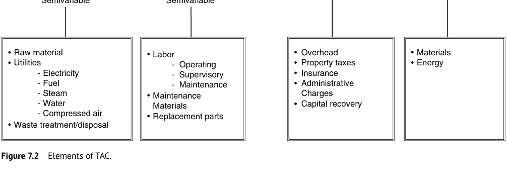
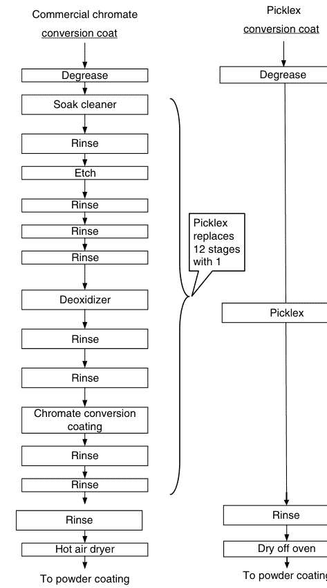
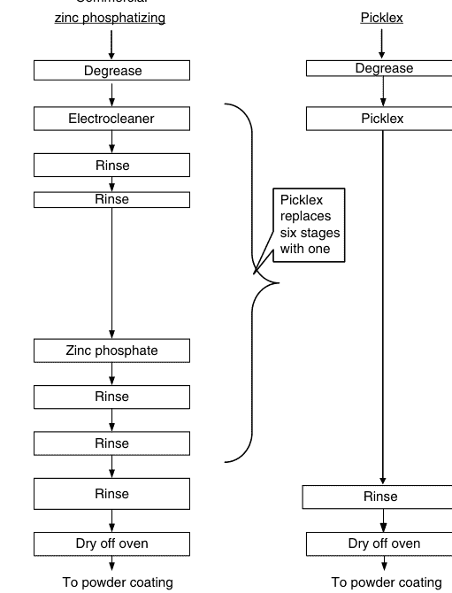
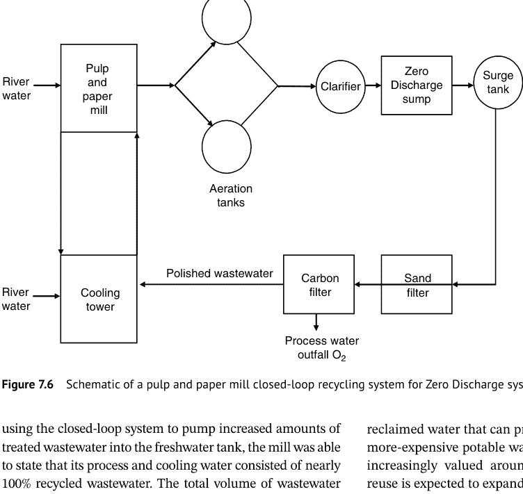
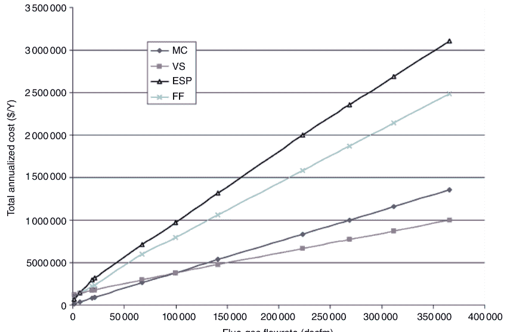
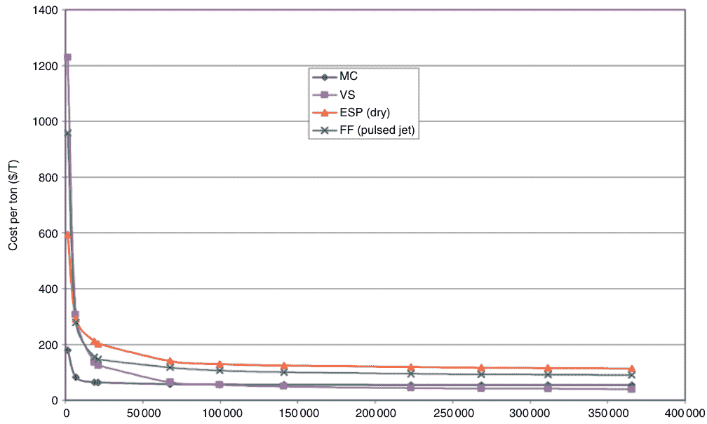
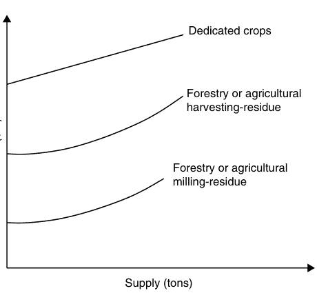

## 7
## 污染预防的制造经济学
### 迈向环境可持续的工业经济

## 7.1 引言

许多污染预防计划的失败可以追溯到工程师和科学家无法说服企业领导层改变对环境不利的制造工艺。 这种不愿改变往往并非因为推荐的工艺改进在技术上不合理，而是因为工程团队未能讲企业的语言，即金钱。 经济学在污染预防中的作用非常重要，甚至与识别工艺变化技术、新兴技术、工艺和/或产品改造、零排放技术、生物基工程化学品、产品、可再生能源来源技术及其相关成本的能力一样重要。

新技术、产品、工艺和服务的市场接受度取决于成本、物理性能、环境绩效、公共政策、文化偏见等多种因素的复杂相互作用。 准确预测是一项困难且耗时的活动，最好留给专家。 然而，成本估算是一项有价值的技能，使工程师能够获得项目成本的“大概”近似值。 目标是获得一个估计值，如果企业得以推进，其与实际成本的误差在±30%以内。 这样的估计相对容易制定。 工程师使用相对较少的一套财务工具来评估替代资本投资并向高级管理层证明其选择。 最常见的是，工程师的目的是展示推荐的投资将如何提高公司的盈利能力。 资本改善的支出在很大程度上是自愿的。 增加一条装配线或从一种垫圈材料改为另一种材料可以推迟、或提案被 outright 拒绝。 这对于污染控制设备来说并非如此，这些设备是遵守州和联邦污染标准所必需的，通常必须在规定的最后期限之前或之前安装。 因此，安装设备 X 的决定可能并非源于工程师。 相反，污染控制设备的需求可能是由公司的环境经理确定的，然后将获取设备 X 的决定下放到工程师。 本章提供了一些可用于评估实施污染预防技术成本的成本估算方法； 这些方法在成本比较以及成本效益、最佳可行技术和新兴技术的考虑中也很有用。 还提供了一些关于可再生资源成本以及从此类原料生产生物基产品的成本的信息。 然而，我们首先对盈利的污染控制技术和最佳控制技术得以实施的经济矩阵做一些评论。

## 7.2 污染预防的经济评估

工程项目的经济评估通常涉及设备、安装、原材料、能源和维护成本的估算。 在确定经济回报率时，处置和污染控制成本通常会纳入这些计算，但其他监管和社会成本则不会。 本章描述了废物管理替代方案的总成本评估，并讨论了与废物产生相关的隐藏成本、未来负债和较不切实际的成本。

### 7.2.1 污染控制和预防战略的总成本评估

工程项目的传统经济衡量标准评估设备、原材料、能源、运营和维护成本。 这些评估通常忽略了废物产生的一些成本。 对环境成本的更完整核算被称为总


systems, such as those used for flue-gas desulfurization or selective catalytic reduction (SCR), require larger quantities of land for the equipment, chemicals storage, and waste disposal. In these cases, especially when a retrofit installation must be performed, space constraints can significantly influence the cost of installation, and the purchase of additional land may be a significant factor in the development of the project’s capital costs. Land retains its value over time; however, land is not treated the same as other capital investments, retains its value over time, the purchase price of new land needed for siting a pollution control device can be added to the TCI, but it must not be depreciated. Instead, if the firm plans to dismantle the device at some future time, either the land should be excluded from the analysis or its value included at the disposal point as an “income” to the project, to net it out of the cash flow (CF) analysis.

One might expect to include initial operational costs (the initial costs of fuel, chemicals, and other materials, as well as labor and maintenance related to start-up) in the operating cost section of the cost analysis instead of in the capital component, but such an allocation would be inappropriate. Routine operation of the control does not begin until the system has been tested, balanced, and adjusted to work within its design parameters. Until then, all utilities consumed, all labor expended, and all maintenance and repairs performed are a part of the construction phase of the project and are included in the TCI in the “start-up” component of the indirect installation costs.

## 7.3.2 Elements of Total Annual Cost

Total annual cost (TAC) has three elements: direct costs (DC), indirect costs (IC), and recovery credits (RC), which are related by the following equation:

> TAC = DC + IC − RC                                                     (7.1)

Clearly, the basis of these costs is one year, a period that allows for seasonal variations in production (and emissions generation) and is directly usable in financial analyses. The various annual costs and their interrelationships are displayed in Figure 7.2.

DC are those that tend to be directly proportional (variable costs) or partially proportional (semi-variable costs) to some measure of productivity – generally the company’s productive output, but for purposes of pollution control, the proper metric may be the quantity of exhaust gas processed by the control system per unit time. Conceptually, a variable cost can be graphed in cost/output space as a positive sloped straight line that passes through the origin. The slope of the line is the factor by which output is multiplied to derive the total variable cost of the system. Semi-variable costs can be graphed as a positive sloped straight line that passes through the cost axis at a value greater than zero – that value being the “fixed” portion of the semi-variable cost and the slope of the line being analogous to that of the variable cost line discussed above.



NPV is the sum of the PVs of a series of CFs:

NPV = CF₀ + (CF₁ × D₁) + (CF₂ × D₂) + (CF₃ × D₃) + ⋯  (7.3)

where, CF₀, CF₁, CF₂ represent CF in year 0, 1, 2, and so on, and the D terms are discount factor for the respective years.

In the context of pollution control, cost-effectiveness is defined as the annualized cost of the control option divided by the annual emission reductions resulting from the control option. The following information is required to calculate the cost-effectiveness of a proposed control option: (i) the capital cost of purchasing and installing the control equipment or making a process modification, (ii) the annual operating costs of the control option, and (iii) an estimate of the emissions before and after application of the control option.

The capital costs of purchasing the control option should be determined from actual vendor price quotes for each proposed control option. Installation costs should also be based on vendor price quotes. If vendor price quotes are unavailable, elements of the installation cost may be estimated (Vatavuk 2002). To illustrate cost-effectiveness calculations, let us consider a facility that is a major source of NOₓ emissions.

## Example 7.1 Total Capital Cost

As part of a company’s ongoing pollution prevention program, an existing appliance coating operation is to be replaced by a minibell automatic electrostatic spray system. The company estimates that the coating operation is presently operating at a 50% transfer efficiency, and it has received a guarantee of 90% transfer efficiency with a new unit. The company operates 250 days/year and processes 200 appliance units per day. An average of 2 gal of paint are presently required to coat each unit. The coating material has a volatile organic compound (VOC) content of 5.0 lb VOC/gal solids. Information on the minibell system is given below. If the paint worth $5/gal shows that an annual profit will be realized by replacing the existing spray system with the more efficient minibell unit. Cost information on the proposed minibell system is given below.

Installed cost = $1 125 000
Operation and maintenance cost = $70 000/year
Lifetime guarantee = 15 years
Interest rate per purchase cost = 8%

## Solution

4) Obtain the annual operating and maintenance cost. From the data given,

Annual O & M cost = $70 000/year

5) Calculate the annualized capital cost, ACC.

ACC = (IC)(CRF)
= (IC)(i)(1+i)ⁿ / [(1+i)ⁿ − 1]
= (1 125 000)(0.08)(1.08)¹⁵ / [(1.08)¹⁵ − 1]
= $131 444

6) Calculate the TAC, if the minibell system is installed

TAC = O & M + ACC
= 70 000 + 131 444
= $201 500

7) Calculate the total annual operating savings, TAS, if the minibell system is installed. Since the spray system operates more efficiently, a savings will be realized because of the reduced paint usage. At 50% transfer efficiency only 1 gal of the 2 gal of paint used per unit is actually applied. The paint usage for the minibell system, operating at 90% transfer efficiency, is (1.0/0.9) or 1.11 gal. Thus, the gallons saved per unit is 2.0 − 1.11 = 0.89 gal. The total annual savings, TAS, becomes

TAS = (gas used/number units/day)(operating days)(cost)
= (0.89 gal)(299 units/day)(250 days/year)
(5.0 lb VOC/gal)
= $222 5000

8) Calculate the annual savings.
The savings, S, can be calculated by subtracting the result of step (3) from that of step (4).

S = $222 500 − $201 500
= $21 000

Once a particular process scheme has been selected, it is common practice to optimize the process from a capital cost and O&M standpoint. There are many optimization procedures available, most of them too detailed for meaningful application to simple pollution prevention projects. These sophisticated optimization techniques, some of which are routinely used in the design of conventional chemical and petrochemical plants, invariably involve computer calculations.

## Example 7.2 Cost-Effectiveness Calculation

For a boiler operating at 100% of its operating capacity (50 Btu × 10⁶), the following information was determined for the purposes of calculating the cost-effectiveness of installing SCR as a control option. The facility is a major source of NOₓ emissions.

Given:
Capital cost of control option = $1 500 000
Capital recovery factor (CRF) = 0.1627 (assuming 10% interest for 10 years)
Annual operating and maintenance costs = $98 000
Uncontrolled emissions = 21 T of NOx per year
Capture efficiency = 100%
Control efficiency = 80%

## Solution

We insert the data into the following equations:

Cost-effectiveness ($/T) = annualized costs/T of pollutant reduced
Annualized costs ($) = (capital cost × CRF) + annual operating costs
Pollutant reduced (T) = (uncontrolled emissions × capture efficiency × control efficiency)

The result is
Cost-effectiveness = ($1 500 000 × 0.1627 + $98 000) / (21 tons × 1.0 × 0.80) = $20 400 / ton

Inducing industries to adopt effective new production methods and pollution control technologies in timely fashion is a challenge for regulators everywhere. Environmental protection costs money, and the charges that will be incurred by a given enterprise depend on the nature and extent of the pollution it generates. These factors, in turn, are functions of the type and scale of production, the plant’s input, the technology used, and the size of the plant.

Generators of pollution range from private individuals and small business to municipalities, large corporations, and the government itself. Each polluting entity must decide how to invest in the socially desirable goal of a cleaner environment; influencing such decisions, inevitably, will be the benefit the entity expects to obtain from the investment.

When business owners consider how to implement the installation of modern pollution control technology, their decisions incorporate the results of comparative analyses of the costs and benefits of the investments contemplated. Later we shall present a case study focused largely on financial costs and benefits associated with biobased energy and products (Section 7.4). To provide the necessary background for this material, we turn now to some basics of cost estimation and capital investments.

## 7.5.1 Achieving a Responsible Balance

In the real worlds, taking socially desirable action for pollution prevention may not be in the best interest of an industry in the short run, since environmental protection costs money. The type of production, input used, technology employed, space used as well as plant size and the scale of production determine the nature and extent of pollution which, in turn, influence the abatement cost. Hence, the decisions of the profit maximizing private investor for implementation of pollution abatement measure are influenced by the benefit expected as a result of the investment required. On the other hand, the task of government planners and policy makers is to encourage industry to adopt modern production and pollution control technologies to provide a better environment for the society. In upgrading their facilities to meet the near antipollution regulations, industries turn for guidance to the principles of best available control technology (BACT).

## 7.6 From Pollution Control to Profitable Pollution Prevention

As companies incorporate pollution prevention approaches in their strategic planning, capital investment priorities, and process design decisions, it is vital that they understand both the quantitative and qualitative dimensions of assessing pollution prevention projects. These projects tend to reduce or eliminate costs that may not be captured in cursory financial analyses due to the way costs are categorized and allocated by conventional management accounting systems. Additionally, pollution prevention projects often have impacts on a broad range of issues, such as market share and public impact that are difficult to quantify but that can be of strategic importance. Identifying and analyzing all costs and less tangible items is an important step in an evaluation of the potential benefits of pollution prevention projects.

Pollution prevention can take many forms – from simple “housekeeping improvements,” which cost little to carry out, to installation of expensive capital equipment. Although many pollution prevention projects, such as material substitution or process redesign, do not require large outlays for purchase of equipment, they may require extensive qualitative assessments related to such issues as product quality or employee health and safety. The analytical tools described here are applicable to the assessment of most pollution prevention initiatives that fit under the umbrella of the capital budgeting process. Pollution prevention projects involving capital budgeting generally include

- 1) new manufacturing equipment
- 2) replacement equipment
- 3) plant expansion and construction


资本预算是对基于公司需求的资本投资选项进行评估并分析投资对公司随时间推移的现金流（CF）影响的过程。污染预防和其他资本项目通过展示项目如何提高公司的收益而得到证明。财务工具以收入、费用和利润的形式展示了污染投资在生命周期或总成本基础上的重要性。资本预算中使用的关键概念和因素接下来进行描述。

生命周期成本（LCC）：也称为总成本核算，该方法分析与设备或程序相关的成本和收益，涵盖设备或程序整个使用时间。LCC也是在技术上同样适合实施的情况下，确定在购买、拥有、运营、维护以及最终处置对象或流程时最具成本效益的选项的工具。例如，对于高速公路路面，除了初始建设成本外，LCC还考虑了所有用户成本（例如施工区内的通行能力降低）和与未来活动相关的机构成本，包括未来的定期维护和修复。所有成本通常都会折现并汇总为现值，称为净现值（NPV）。该示例可推广到任何类型的材料、产品或系统。

为了进行LCC，范围界定至关重要，需要包含哪些方面以及不包含哪些方面？如果范围过大，该工具可能变得不切实际使用，且在决策和替代方案考虑方面的帮助能力有限；如果范围过小，则结果可能会因所考虑因素的选择而失真，从而导致输出不可靠或片面。LCC具有更广的范围，包括环境成本。为了帮助建筑和设施管理人员做出明智的决策，美国联邦能源管理计划提供了关于应用LCC的指导和资源，以便评估能源和水效率投资的成本效益。LCC可采用两种方法进行：确定性方法和概率方法。

现值（PV）：PV或现值的重要性在于时间就是金钱。现在的一美元与一年后的一美元之间的偏好是由现在手中的美元可以赚取利息这一事实驱动的。在数学上，这种关系如Eq. (7.2)所示，并举例说明了现值和未来值。

财务分析的比较因素：用于比较投资选项的更常见方法都利用Eq. (7.2)中提出的PV方程。一般来说，以下四种因素之一被使用：

- 1) 投资回收期（PP）：该因素衡量收回初始投资资本所需的时间。

从概念上讲，回报最快的项目是最佳投资。

- 2) 内部回报率：该因素也称为投资回报率或ROI。它是会产生与项目回报相当的投资资本回报的利率。例如，内部回报率为20%的污染预防项目表明，推进该项目相当于将资金投资于银行并获得20%的利息。

- 3) 效益成本比：该因素是通过取污染预防项目所有财务效益的总PV并除以项目所有成本的总PV而确定的比率。如果比率大于1.0，则效益超过成本，项目在经济上值得开展。

- 4) 净收益现值：该因素以PV总和的形式显示污染预防项目的价值。它是通过计算所有效益的PV，对所有成本做同样的计算，然后减去两个总额来确定的。新结果将是一笔资金，代表开展该项目的有形价值。

## 7.6.1 生命周期成本

虽然企业可以使用这些因素中的任何一个，但LCC（用于总成本分析）的重要性使得净收益现值成为首选方法。LCC和TCA的更多细节如下。

LCC工具和总成本评估（TCA）工具作为概念概述被介绍。两种工具都可用于建立经济标准以证明污染预防项目合理。TCA通常用于描述内部成本和节约，包括环境标准。LCC包括整个过程、产品或活动生命周期内产生的全部内部成本加上外部成本。

LCC多年来一直被公共和私营部门使用。它将经济标准和与污染预防机会相关的社会（外部）成本联系起来。LCC的目的是量化给定机会在较长时间范围内的一系列随时间变化的成本，并将这些成本表示为单一价值。这些随时间变化的成本通常包括以下内容：

- 1) 资本支出。用于具有长期经济寿命的大型、不频繁投资的成本（例如新建建筑物、主要翻新和设备更换）。

- 2) 非经常性运营和维护（O&M）。反映非资本支出的、发生频率低于每年的项目的成本（例如溶剂蒸馏单元中部件的维修或更换）。

- 3) 经常性O&M。用于每年或更频繁发生的项目的成本（例如油和液压油更换）。

- 4) 能源。所有能源或发电相关成本。虽然能源成本可作为经常性O&M成本的一部分，但由于其经济规模庞大且对市场价格和建筑物利用率敏感，通常会单独列出。

- 5) 残值。反映LCC分析期结束时设备价值的成本。这考虑了折旧和服务改进的影响。

通过考虑所有成本，LCC分析可以量化成本类别之间存在的关联。例如，某些类型的资本改进会降低运营、维护和能源成本，同时提高分析期结束时设备的残值。

社会（外部）成本包括因健康和生态损害而产生的成本，例如与未受监管排放、湿地丧失或森林砍伐相关的成本，也可以在定性或定量方式下反映在LCC分析中。LCC包括以下成本组成部分：

- 1) 天然资源开采。用于开采材料以及该过程的任何直接或间接环境成本。

- 2) 原材料生产。加工原材料的全部成本。

- 3) 制造基本零部件和产品。材料加工和产品制造的总成本。

- 4) 内部储存。产品在运往分销商和/或零售店之前包装和储存的成本。

- 5) 分销和零售储存。将产品分销到零售店的成本，包括运输成本，以及消费者购买前的零售储存成本。

- 6) 产品使用。消费者使用产品的成本。这可能包括使用设备必须进行的任何燃料、油、维护和维修。

- 7) 产品处置或再利用和/或回收。产品处置或回收的成本。

### 7.6.2 总成本评估

TCA工具尤其有趣，因为它通常同时采用经济和环境标准。与LCC分析一样，TCA研究通常侧重于特定过程如何影响用户的底线成本。环境标准不是明确的，即成功不是以废物减少或资源节约来衡量，而是以成本节约来衡量。然而，由于TCA的目的是通过纳入环境成本来改变会计实践，因此环境目标是通过成本降低来实现的。

由于其对成本和成本效益的关注，TCA与LCC分析共享许多特征，通过跟踪DC，例如资本支出和O&M费用/收入。然而，TCA还包括IC、责任成本和不太具体的收益——这些主题在经济和环境目标中通常不包括在内，因为它们具有私营部门导向，以及其他经济计算方法。

### 7.6.3 与污染预防相关的经济考虑

任何污染预防（P²）计划背后的最大驱动力是长期经济机会和成本节约的承诺。污染预防已被公认为废物/污染物管理的最低成本选项之一。因此，了解P²项目/选项所涉及的经济问题对于在工程和管理层面做出决策非常重要。每位工程师都应能够对拟议项目进行经济评估。如果在考虑了所有因素——包括前面讨论的因素之后——项目在经济上无法证明合理，则显然不应继续推进。越早识别此类项目，浪费的资源就越少。

在能够评估P²项目的真实成本或利润之前，必须认识到影响经济的因素。如前所述，有两个传统贡献因素（资本成本和运营维护成本），但与P²相关的还有其他重要成本和收益，如果要进行有意义的经济分析，则需要对其进行量化。TCA旨在量化P²的经济方面以及从摇篮到坟墓（即生命周期）过程中、产品或服务相关的社会成本。TCA试图量化不太具体的收益，例如不使用危险物质所带来的风险降低。未来肯定会更加重视在任何P²项目中采用TCA方法。例如，一家公用事业公司考虑将燃气锅炉改为燃煤，通常不会关心与开采、运输和在用作能源原料前储存煤炭等活动相关的环境影响和影响。污染预防方法将变得更加意识到这种需求。

## 7.7 资源回收和再利用

临时战略的一个关键要素是增强回收。这可以从两个方向进行：产品再利用和材料回收。产品再利用


包括返还、整修和再制造。重复使用和回收所需的能量是决定产品可回收性的关键因素之一。回收产品越接近其回收所需的形式，进行这种转变所需的能量就越少。从经济发展的角度来看，值得指出的是，整修或再制造循环是相对的；每单位实物产出大约需要一半的能量和两倍的劳动力。

材料回收意味着在消费后废物的供应与生产资源的需求之间建立闭环。材料回收将是零排放工程师的职责；产品再利用也会涉及零排放工程师，但会有大量来自另一专业——并行工程师的前期工作。并行工程融合了工业工程、产品设计和产品制造的各个方面，是一种旨在优化材料、装配和工厂运营的集成方法。这些工程师审视产品的更广泛背景，包括管理其运输、预期用途、可回收性和处置的环境影响的技术，以及其生产中使用的原材料开采的环境后果。

因此，所有材料的最终命运是耗散、被丢弃，或回收与再生。由于从环境中提取的材料中有94%转化为废物，目前的回收水平显然不足。从废物中回收材料将减少资源开采的程度（但不会减缓材料在经济中的流动速度）。铝和铅是当前被大量回收的两种资源，但有证据表明，还有更多资源可以从废物中回收。

舍伍德图是一种图表，可以直观比较自然界中物质的浓度与其商品成本。示例图（见图1.7）显示，商品的价格取决于其开采和提炼之前在自然界中的浓度。在类似的废物中物质浓度图（见图1.8）中，同样呈现出一条一致的曲线。

总之，舍伍德图证明了材料的回收潜力。在图1.7中位于线上方的元素应大力回收，因为它们存在于单个副产品中，浓度相对较高。铅、锌、铜、镍、汞、砷、银、硒、锑和铊从废物中回收比从自然界中回收更经济。广泛的废物交易可以显著减少需要处置的材料数量，因为资源开采使用的是废物，而非原始原料（Allen 和 Rosselot, 1997）。

## 7.8 金属精加工行业中可盈利的污染预防

金属产品的表面精加工是一项主要的制造作业，在数千家生产车间中进行，为数千种制成品提供耐候、耐磨且美观的表面处理。¹

表面精加工技术涉及基材（如钢、铝、黄铜或塑料）与金属或有机表面顶层涂层之间的直接原子对原子结合，从而提供所需的材料性能和外观特性。表面预处理对于所生产零件的性能和耐久性至关重要。清洁和去除氧化物是关键，因此预处理工艺通常涉及许多用途各异的槽。通常采用多步表面预处理工艺来去除油脂、污垢和脏物、旧涂层、腐蚀产物、残留切削液、钎焊残留物、酸洗残液、清洁剂残留物等。表面预处理工艺可去除污染物、保持清洁的表面，和/或为下一次涂覆改质表面。精加工后，零件需要漂洗/清洗以去除残留电镀液。这些电镀槽和清洗槽最终会因溶液强度耗尽或杂质积累而失效，从而成为主要废物流（Burckle 和 Ferguson, 2005; USEPA, 2001）。

过去，金属精加工行业的污染控制主要通过末端处理实现。设施将废物处理系统作为最终工艺步骤，以满足市政下水道的监管排放限值，或作为直接排放者。这种方法会产生受重金属污染的残余污泥，需要适当的预处理才能进行环境安全处置（即美国《资源保护与回收法案》中适用于危险废物处置的所谓“哈默条款”）。20世纪80年代中期，各种设施开始将“污染预防”纳入其运营，以减少产生和处理的废水量。然而，采用速度相对较慢，尤其是在较小的设施中（USEPA, 1982, 1985）。

有效实现环境保护最合理、最高效的方法是预防污染。预防是通过使用减少、消除或循环/再利用废料的技术来实现的，从而消除废物的产生，避免废物处置的需要，并对产生的废物进行负责任的处理，要么通过回收和循环利用来替代其他材料需求和/或节约能源，要么将其最小化并使之

1. 本材料大部分来源于第9.2.3节 Burckle 和 Ferguson（2005）。

环境管理体系（EMS）。ISO 14001认证——一种全球标准化的环境管理体系——正日益要求从事出口产品制造的公司，包括此类产品供应链中的零部件供应商。此外，美国环保局还提供合规激励措施——“在特定条件下，为自愿发现、及时披露并迅速纠正环境问题的企业、行业和政府设施免除、减少或豁免处罚的政策和计划”，并且正在将实施环境管理体系的要求纳入和解协议中。有关这些激励措施、计划以及此类计划所实现的环境效益的信息，可在互联网上查阅（http://www.epa.gov/compliance/incentives/index.html）。

### 7.8.2.3 实践污染预防

基于污染预防理念的技术旨在消除废物的产生，或通过循环/再利用减少废物的处置。金属精加工行业的污染基本上是有害形式的材料或其他资源（能源、劳动力、时间等）的排放。这些资源的损失等同于利润和经济生产力的损失。理所当然，某种资源的使用量超过工艺所需最低量越多，这种增量使用（真正的“废物”）就越会增加运营总成本中“不必要”的部分。例如，就用水而言，这种不必要的成本不仅仅是被浪费的过量水的成本。这种废物的成本因其处理与处置的整体管理成本而放大，包括将过量水输送过工艺、对其进行清洗以及处理处理后的水和任何残余废物的资本和运营成本。处理和处置成本通常比初始原材料更昂贵。由于所使用的会计流程不足以进行此类跟踪，公司通常不会跟踪这些成本（工艺操作成本和合规成本）。

参加SGP的公司通过实施P2实践发现了显著的成本节约（USEPA, 2001）。显著的成本节约提高了经济效率和资产负债表上的底线，使运营更具竞争力。其他优势包括保护员工、减少负债，同时提升公司的商业形象。

SGP在金属精加工行业成功实现其目标，主要归功于污染预防技术的采用。该计划的主要目的是展示基于P2的废物减少方法所提供的诱人的环境和经济效益。预期的结果是“激发对这些极其宝贵工具的高度认识和赏识”，以便在整个行业范围内将其纳入日常实践。此外，采用环境管理体系并将其融入公司运营，可确保参与公司整体结构中的持续改进（既在环境绩效方面，也在成本节约方面）。

在20世纪80年代，美国环保局资助的研究调查并记录了各种单元过程中减少污染的多种方法，包括内务管理和维护方法，以及工艺化学品和冲洗水的管理。这些方法在题为《表面精加工迈向零排放》的EPA简报（USEPA, 2000）和题为《金属电镀与精加工的P2概念与实践》的培训课程文件中有所描述（AEFS，美国电镀与表面精加工协会）。这些学习辅助工具涉及多个工艺设计领域，例如表7.2所列的那些。

制造业运营向基于P2的系统的过渡已通过一系列技术选择得到证明，从对现有工艺技术相对简单的改进到基于重大工艺变革的更复杂方法。污染预防技术的力量有许多实例，从相对简单的用水管理改进到更复杂的回收工艺，如SGP和其他计划的结果所记录的那样。

### 迷你案例研究（USEPA 1998）：水管理P2示例

加利福尼亚州的一家公司实施了一些相对简单且低成本的P2措施：在漂洗槽中安装限流器以管理漂洗水，在处理槽之间使用滴液板以及电镀槽上方使用挂杆来减少带出液。1997年至2000年间，该工厂实现了水耗降低50%、能耗降低25%以及金属利用率达98%。自2001年10月以来，该工厂通过将节约率提高到能耗比原始基准减少62.5%、工艺用水减少70%，进一步增加了能源和水消耗的节约。

如需其他案例研究，请在线访问：
http://es.epa.gov/cooperative/topics/metcasesstudies.html
http://www.epa.gov/ORD/NRMRL/std/mtb/metal_finishing.htm#nmm5f


# 表 7.2 表面处理商的污染预防技术。

| 在这些操作中改进 | 采用这些技术和做法 |
|---|---|
| 延长槽液寿命<br>- 减少化学品消耗<br>- 减少槽液排放<br>- 最大化在线时间<br>- 保持产品质量 | - 改善槽液化学溶液管理<br>- 通过改善卫生管理减少污染<br>- 增加新的连续槽液净化技术 |
| 减少水消耗<br>- 改善水利用以减少用水需求和污水费用<br>- 增加厂内循环利用<br>- 减少废水排放和取水量 | - 采用用水量更少的漂洗方法<br>- 减少带入和带出<br>- 采用新的工艺分析和规划方法以节约用水<br>- 使用先进技术去除化学品以允许漂洗水循环利用 |
| 最小化废物<br>- 减少所有化学品和用水的用量<br>- 减少废物产生<br>- 改善厂内回收和循环利用 | - 改善工艺管理与监督<br>- 实施环境管理体系<br>- 改善如上所述的漂洗操作<br>- 增加厂内水循环利用 |
| 减少有害化学品的使用<br>- 降低环境风险和成本<br>- 改善工人安全<br>- 保持或提高生产率和质量<br>- 获取新市场或保持现有市场，其中客户正在“绿色供应链” | - 转向毒性较低的化学品<br>- 使用新的表面处理工艺和涂层<br>- 减少生产线中的工序数量 |

许多槽具有各种用途。例如，铝阳极氧化可能需要八个预处理槽；在传统的铬酸盐转化涂层中，有十二个工序，而传统的锌磷化需要六个。所有这些槽液都含有重金属，必须定期排放。

金属表面处理作业产生的有毒/有害废物流的体积是显著的（USEPA 1995a）。消除任何表面处理步骤对制造过程都有益，因为它可以降低加工成本、废物产生和能源消耗。预处理金属所使用的强酸对工人构成极大的健康和安全风险。考虑到这一点，设计用于降低金属表面处理作业加工成本的无废或减废表面处理剂将具有极大的益处。

Picklex 工艺（一种专有工艺）就是这种替代传统金属表面预处理的替代方案之一，可显著减少废物产生。该工艺由 International Chemical Products, Inc. 在 USEPA 协助下开发。Picklex 工艺的工作方式与传统工艺完全不同。它将金属表面的腐蚀产物并入施加到同一金属表面的保护涂层中。这种新的 P² 方法通过在工件上形成保护性表面涂层，同时解决金属在处理槽中积累的常见环境问题，从而“另辟蹊径”。开展了一个两阶段项目，以评估 Picklex 作为基于污染预防的传统金属预处理或预处理/转化涂层在表面处理作业中的替代品，在技术和经济上的可行性。目标是证明其在保持相同或更好的产品性能特性的同时，消除或显著减少所消耗的有害和有毒化学品的数量以及所产生的污染的潜力。

对 Picklex 进行了广泛的实验室评估，其中使用并排测试线对七种传统工艺和 Picklex 进行了全多步、台架规模、批次操作测试。实验室测试的结果非常有利，并进行了现场测试（Ferguson and Monzyk 2003），以评估其在与传统制备技术并排测试中的厂内性能。只有最有前景的应用——即取代铬酸盐转化涂层和锌磷化——被带入现场评估。在这些有针对性的现场测试中，Picklex 仅用于为粉末涂层制备铝和钢基材。虽然测试范围缩小了，但更详细。总共测试了 41 种不同的基材、脱脂剂、预处理、转化涂层和粉末涂层的组合。仅使用未受污染的面板和部件，且无腐蚀产物。所有测试案例的结果均表明，最终产品的质量在各方面都与传统做法相同。产品质量被确定为所有综合结果中单一最重要的验收标准，因为如果最终产品质量不可接受，污染减少就无关紧要。现场测试结果复制了早期获得的结果，表明实验室测试可用于准确预测实践中可实现的结果。

## 7.8.2.4 案例研究：一种新兴的盈利性污染预防技术

USEPA 最近完成了对专有 Picklex 工艺的研究。Picklex® 是一种“‘无污染’预处理/转化涂层，可替代粉末涂层、油漆和其他有机涂层应用中的铬酸盐转化涂层和锌和铁磷化”（Ferguson and Monzyk 2003; Ferguson et al. 2001）。

描述 金属预处理对于清洁和氧化物去除以获得生产零件的适当性能和耐久性至关重要，通常涉及

## 7.8.2.5 环境效益

两种商业工艺，铬酸盐转化涂层和锌磷化，被用作现场测试中的实验对照基线（图 7.3 和 7.4，分别）。金属在这些传统工艺中的积累会破坏槽液，槽液必须被排放。

在金属表面处理领域，丢弃此类含金属废物流是污染的主要贡献者。Picklex 工艺中处理槽中使用的化学品被产品使用；然而，通过过滤，槽液不会受到污染。因此，不需要排放槽液来控制杂质积累，化学品配制只需根据需要添加到槽液中即可。该工艺已证明具有作为表面制备作业污染预防领先技术的强大潜力。

正如与这种新兴技术相比的传统做法所示，Picklex 工艺可消除金属表面处理工艺中多达十一个步骤。源头废物减少非常显著。这些减少是通过消除六价铬槽及其随后的漂洗操作；消除用于蚀刻和清洁的酸性槽液及其随后的漂洗操作；消除锌磷化槽液及其随后的漂洗操作；以及消除脱氧化槽及其随后的漂洗来实现的。所有被消除的步骤都是排放污染的步骤。此外，





图 7.3 Picklex 与传统铬酸盐转化涂层的比较。

图 7.4 Picklex 与传统锌磷化的比较。

Picklex 工艺显著减少了剩余步骤的污染。它在提供与传统工艺相同的优质表面和耐磨能力的同时实现了这一点。

虽然通常 Picklex 槽液不需要排放，但作为研究的一部分，槽液在泄漏或意外污染情况下的废物处理问题进行了评估。新鲜、已使用和杂质加标的已使用 Picklex 样品使用常规 pH 9 沉淀工业废水处理方法进行处理，以生产用于 Picklex 废物处置评估的样品。废渣被评估其有毒浸出性。用于排放的水上清液也被检查，发现很可能可排放。废物处理在许多工艺中可能并不频繁或不必要。工业废水处理厂运营的实际排放限值是特定场地的，并且由地方、州（以及必要时联邦）监管机构逐案确定。因此，在特定地点已知之前，不可能对这些潜在废物溶液进行确切分类。所有浸出液均符合适用的联邦法规（USEPA 1995b）。因此，Picklex 似乎不会带来异常的废物处理问题。

## 7.8.2.6 经济效益

对两种最有前景的工艺——取代铬酸盐转化涂层和锌磷化——进行了成本比较。这些是根据行业可能实现成本节约的潜力而选择的。基于 Picklex 技术预计的显著资本和年度运营成本，摘要见表 7.3，似乎有显著的经济激励将现有做法迁移到这种新技术。例如，采用该工艺代替铬酸盐转化涂层的新车间将节省 254 000 美元的资本成本，将工艺从 12 个槽减少到 1 个槽（图 7.3）。对于钢的锌磷化，估计节省为 230 000 美元。

# 表 7.3 潜在成本节约。

| 成本类型 | Picklex 相对于传统工艺的节约 |  |
| | 铝的铬酸盐转化涂层（$） | 钢的锌磷化（$） |
| 资本成本节约 | 254 000 | 230 000 |
| 年度运营成本节约 | 46 000 | 32 000 |
来源：摘自 Ferguson and Wilmoth（2000）和 Ferguson et al.（2001）。

## 7.8.2.7 技术可转移性

Picklex 技术非常稳健且灵活（Ferguson and Monzyk 2003）。它适用于从非常大到非常小的作业。它可用于新建安装、工艺现代化改造，或作为任何现有设施的即插即用替代品。Picklex 可通过浸入槽中或通过喷涂或刷涂的方式应用。成本节约非常显著，并且是设施规模和所需加工线的数量的函数。可转移性通过整体设施成本节约和生产率改善的预期重要性而得到增强。

## 7.8.3 来自纸浆厂废气的增值化学品

甲醇是在木材制浆过程中形成并被还原硫化合物和萜烯污染，是 Kraft 纸浆厂 VOC 排放的最大单一来源，占总排放量的 70–80%。集群规则（Cluster Rule Regulation: 40CFR Part 63 1998）限制美国所有纸浆厂的甲醇排放。加拿大面临类似的立法（Das 1997, 1999a, b; Das and Houtman 2004; Das and Jain 2001）。

甲醇排放可以通过收集来自蒸煮器、蒸发器和工厂其他来源的冷凝液流来减少。然后收集的冷凝液流可通过蒸汽汽提浓缩甲醇以进行焚烧。少数工厂“硬管”将这种含甲醇的流送至生物处理厂，从而避免焚烧。

汽提塔 overhead 气体（SOG）含有大约相等比例的甲醇和水（40–50 wt%）以及大约相等比例的 TRS 和萜烯（1–5 wt%）。

在美国，SOG 很可能在焚烧炉、窑或锅炉中燃烧。最近，一些工厂发现将 SOG 精馏至约 80% 甲醇并作为液体收集是有利的，其燃料价值更高。有了这种浓缩（70–80%）的甲醇流，工厂可以减少必须购买的天然气量。

Georgia-Pacific 开发了一种工艺，将精馏 SOG 中的甲醇和 TRS（主要是巯基化合物）转化为甲醛。基于 Wachs（1999a, b）的研究，这种专利催化工艺（Burgess et al. 2002）已从典型的纸浆厂 SOG 含甲醇、水和 TRS 化合物的进料中实现了商业上可行的甲醛产率（70–80%）。

将甲醇和 TRS 转化为甲醛为 Kraft 厂提供了比将气体作为燃料焚烧更有利可图的 SOG 替代方案。生产的甲醛可被树脂制造商用于生产


# 表7.4 2000风干吨/日纸浆厂、14磅甲醇/吨SOG的年化收入、成本与收益

|  |  |
|---|---|
| 收入：15 000 000磅/年甲醛（50%），按0.06美元/磅，工厂离岸价 | 900 000美元 |
| 运营成本 |  |
| 直接人工 | 110 000美元 |
| 公用工程 | 25 000美元 |
| 进料甲醇，按2.25美元/百万英热单位燃料热值 | 260 000美元 |
| 杂项、催化剂、耗材等 | 70 000美元 |
| 总运营成本 | 465 000美元 |
| 毛利率 | 435 000美元 |
| 折旧 | 210 000美元 |
| 税前收益 | 225 000美元 |
| 蒸汽生成抵免（取决于纸浆厂的蒸汽平衡） | 95 000美元 |
| 回收并销售松节油的抵免 | 110 000美元 |
| SO₂循环利用抵免 | 45 000美元 |
| 副产品抵免总额 | 250 000美元 |
| 总收益（含副产品抵免） | 475 000美元 |

来源：引自Burgess等（2002）。

热固性树脂通常用于胶合板和其他结构板材。一个典型的日产2000风干吨（ADT PD）的纸浆厂可能实现2至4年的投资回收期，具体取决于甲醇价格和当地经济状况。

该工艺还通过将大部分甲醇转化为甲醛（而非CO₂），产生两级低压蒸汽（60和70磅/平方英寸表压），可在造纸厂内使用。CO₂减排量约为焚烧或生物处理厂原本会产生量的80–85%。对于一个日产2000风干吨的纸浆厂，这相当于每年避免排放28吨（T/Y）CO₂。

表7.4给出了收入、成本和收益的典型明细。对于日产2000风干吨的纸浆厂，基于甲醛价格0.06美元/磅（50%浓度基准），计算得出3至4年的投资回收期。这假设客户运输半径为距生产甲醛的纸浆厂500英里。已计入纸浆厂的热值抵免（相当于天然气燃料），针对的是那些原本会被焚烧并通过热回收换热器产生蒸汽的甲醇。

## 7.8.4 硫排放的回收与控制

硫通常被认为是化学工业的四种基本原料之一。它可以从脱硫和硫回收工艺中作为副产品回收（Kirk和Othmer，2004）。历史上，硫回收工艺专注于去除硫化氢（H₂S）和二氧化硫（SO₂）并将其转化为单质硫，因为这些物质是制浆过程中的重要排放物。有多种工艺可用于去除燃烧气体中的SO₂。将SO₂直接催化氧化为SO₃，随后SO₃在水中吸收生成硫酸，是一种替代方法（Paik和Chung，1996）。全厂总还原硫（TRS）排放的10–20%来自粗浆洗涤器、泡沫槽、黑液过滤器、氧化槽和储罐的排气物流，这些通常不被不凝性气体系统收集（Pinkerton，1999）。这些来源的排放物可以收集并燃烧以回收能量，从而减少TRS和挥发性有机化合物（VOCs）的大气排放。

### 7.8.4.1 减少淡水使用及化学品回收与再利用为纸浆厂节省百万美元

废水排放
在纸浆厂废水排放到环境之前，必须进行处理。一级处理使用沉淀池或沉淀罐，使悬浮固体从液体废水中沉降出来。固体可以堆肥并撒在土地上、转化为其他有用的产品，或焚烧处理。二级废水处理包括在面积广阔的浅水池中进行氧化和曝气，或在较小的区域使用机械搅拌器和曝气器在排放前对液体进行充氧。生物过滤系统可用于去除有机化合物和重金属，通常可以通过添加营养物质和使用纯氧而非空气来加速该过程。在一些地区，已设计天然湿地系统来实现这一目标。其他处理方法包括石灰混凝和升高pH值，使有机色体以木质素钙盐的形式沉淀。一旦沉淀，污泥经脱水后焚烧以破坏有机物。

据NCASI报告，1975年至1988年间，纸浆厂的废水流量减少了30%。同一时期，最终废水的5日生化需氧量（BOD）和总悬浮固体（TSS）分别减少了75%和45%（NCASI，1991）。表7.5列出了1975年、1985年和1988年的数据。随着纸浆和造纸厂实施集群规则所要求的所谓最佳管理计划（BMP），这些减少将持续下去。

# 表7.5 纸浆和造纸厂的废水排放

|  | 1975 | 1985 | 1995 |
|---|---|---|---|
| 废水流量（加仑/吨） | 22 800 | 17 200 | 16 000 |
| 生化需氧量（磅/吨） | 18.0 | 4.8 | 4.4 |
| 总悬浮固体（磅/吨） | 13.0 | 8.3 | 7.1 |

来源：引自Das（1997）。

BMP将要求更好地管理工艺损失和泄漏，并有望减少废水排放。例如，在约10年时间里，辛普森塔科马硫酸盐浆厂通过各种污染预防方法将淡水消耗减少了约50%（K. Schumacher和M. Mammenga，个人通讯；USEPA 1992a，b）。

辛普森塔科马工厂现在每天使用约1800万加仑（mgd）淡水，而1990年代为每天3200万加仑。这一淡水用量的减少每年节省约192万美元（350美元/百万加仑，塔科马市按平均固定和可变成本收费）。工厂还通过减少氢氧化钠（NaOH）流入下水道和产品纤维的损失来节省资金，具体措施包括阻止稀弱洗NaOH溶液溢出以及回收工艺水。否则，工艺中需要补充NaOH以弥补损失的碱（钠）。每年节省约340万美元（基于NaOH 375美元/吨和每天节省25吨NaOH）。辛普森公司还通过减少黑液硫流入下水道和烟囱的损失，每年节省18万美元（K. Schumacher和M. Mammenga，个人通讯）。

其他公司通过安装纤维回收装置（从工艺水中分离纤维的装置）、换热器和其他允许更多回用工艺水的设备来节约用水。内部水净化系统使得用过滤后的白水替代清水成为可能。将工艺冷却水与清水分离通常是实现运行和水资源利用平衡所必需的。

### 7.8.4.2 用于废水回收利用的盐水浓缩器

盐水浓缩器是蒸汽压缩蒸发器系统，可产生蒸馏水和非常小的盐浓缩物流。这些系统非常适合水回收利用，因为浓缩物流量非常小，可以经济地处理废水，实现非常高的回收率且无液体排放（Dalan，2005）。

迷你案例研究
拯救科罗拉多河
盐水浓缩器市场最初因联邦清洁水法规而兴起。科罗拉多河是美国西南部主要的饮用和灌溉水源，由于人类活动，其盐度不断升高。正是为了控制这里和其他地方的环境损害，美国环保署（USEPA）在20世纪70年代颁布了法规，限制向科罗拉多河排放废水，并禁止新建无法实现向河中零排放水的工厂。

为遵守法规，使用河水的新建和现有电厂都必须回收利用其废水。虽然蒸汽压缩作为能源在工业中并不新鲜，但与电厂的技术契合是自然而然的，因为它允许这些设施使用自己产生的电力作为水回收所需机械能的来源。

联邦法律并不是促使工业界转向使用盐水浓缩器回收废水的唯一因素。在全国各地，还存在当地的选址法规。因此，随着20世纪90年代初私营电力行业的出现，企业家们转向零排放水系统，这使他们能够使用远离排放点、供水有限的场地。同样，转向清洁燃烧的天然气降低了对电厂选址靠近燃料或水源的要求。

截至2004年，美国约有60台盐水浓缩器。它们作为成套装置销售，设计建造遵循节能原则。最初的所有设备都位于燃煤电厂，但随着金属冶炼厂、化学品和半导体制造商以及其他企业开始认识到消除废水排放的必要性，盐水浓缩技术的应用已得到推广。

### 7.8.4.3 盐水浓缩器系统的经济性

基于盐水浓缩器系统的参数化成本信息，我们现在概述这些系统的一些经济方面。

盐水浓缩器，以及延伸的集成式零液体排放系统，只有在以下情况下才对新建（grassroots）设施有意义：

-   存在地表水或井水短缺
-   设施需要水才能运行
-   没有废水排放选项，例如饮用水源或河流
-   无法获得排放许可

零液体排放消除了选址限制；也就是说，不再需要将工厂建在大型可用水源或合适的排放点附近。这种效果的经济优势很难一概而论，因为其非常依赖于实际情况。

零排放设施的净现值（NPV）为负。Dalan和Rosain（1992）发现，一台265加仑/分钟的盐水浓缩器的运行成本为8.94美元/1000加仑处理水（总计每年1 252 600美元），而额外除盐器再生化学品的避免成本为每年216 000美元。避免成本为1.54美元/1000加仑。由于这里的任何金额均为运营费用，现金流量（CF）为负。


## 表 7.6 265 gpm 系统的运行成本 breakdown，成本为 $9.62/1000 加仑进料。

| 项目 | 消耗量 | 单位成本 ($) | 年度成本 ($) |
|---|---|---|---|
| 运行人工 | 1 mhr（最高小时费率）/h | 50/mhr | 438 000 |
| 维护（人工） | 2 mhr/h | 50/mhr | 87 600 |
| 维护（材料，包括备件） |  |  | 80 000 |
| 电力 | 1 617 kWh | 0.05/kWh | 707 000 |
| 化学品 |  |  |  |
| 硫酸 | 293 lb/day | 0.06/lb | 6 416 |
| 聚合物 | 40 lb/day | 1.50/lb | 21 900 |
| 化学品总计 |  | 28 316 |  |
| 年度运行总成本 |  | 1 340 916 |  |
| $/1000 加仑进料 |  | 9.62 |  |

> 来源：引自 Dalan 和 Rosain（1992），由 Dalan（2005）更新。

典型的具体运行费用在 $5–7/1000 加仑处理量的范围内。此估算中电价按零售价 0.05/kWh 计算。在草根电厂规划中，电力多次被视为电厂的寄生负荷（生产电力所需的电力）。在此会计方法中，电力的成本为零。消除电力作为运行成本可将总处理成本降至 $2–3/1000 加仑范围。盐水浓缩器的典型能耗为 100 kWh/1000 加仑产水量。

水经济性的确定非常依赖地理位置。例如，在华盛顿西部，自来水和污水费通常在 $1–2/1000 加仑范围内，而在华盛顿东部，水费更高，如果经济上可获得的话。

对于非电厂应用，当地电价高昂时，可通过寻求替代能源来源来克服。盐水浓缩器厂中压缩机（主要耗能用户）已安装蒸汽驱动或天然气（通过天然气发动机）驱动的设备。表 7.6 提供了典型运行成本的 breakdown（Dalan 2005；Haussman and Rosain 1996）。

对于现有设施，在以下情况下安装零排放厂是有意义的

- 排放许可条件发生变化，导致现有设施无法经济运行
- 水权成本加上处理费超过零排放设施的运行成本

最后一点由一个迷你案例研究说明。

## 迷你案例研究

## 零排放系统投资回报计算

一座电厂在厂后有 300 gpm 的排放。初步估算显示，零排放厂的运行成本为 $4.55/1000 加仑。地方公用事业将水费和处置费提高到 $3.00/1000 加仑，工厂总成本为 $6.00/1000 加仑。
300 gpm 蒸馏流量容量的资本成本约为 $7.5 百万美元（Dalan 2005）。年度节省为 ($1.45 × 300 × 1 440 × 365)/1 000，或 $228 636/年。这代表了一个简单投资回报率为 3%，简单投资回收期为 32 年的项目。

## 7.9 将处理过的市政废水用作电厂冷却系统补水：三级处理 vs. 循环水水质管理的扩展化学处理方案

### 7.9.1 引言

每天，美国的水冷热电厂从河流、湖泊、溪流和含水层中抽取 60 亿至 1700 亿加仑的淡水，其中消耗 28 亿至 59 亿加仑。热电生产中用于冷却的淡水取水量约占所有取水量的 40%，

与农业灌溉的取水量基本相同，如美国地质调查局所记录。全国持续的干旱凸显了使用处理过的市政废水（MWW）用于电力发电冷却的迫切需要。它需要大量水用于电力生产，以在电厂蒸汽系统中冷凝蒸汽。空气冷却是可能的，但成本更高且效率更低。水将继续成为新建热电厂的首选冷却剂（Dzombak 2013）。

项目动机：电力需求的增加带来了冷却所需水的增加。热电厂的冷却占美国所有淡水取水量的 41%，即大约与农业灌溉取水量相同。美国一些地区几乎没有或没有淡水可用。新的电力生产需要替代水源。美国能源部一直在进行并赞助研究，以调查使用替代水源用于电厂冷却的可行性和成本，尤其是在循环冷却系统中，这在美国大多数新建电力生产中是必需的。

项目目标和亮点：处理过的 MWW 是美国热电厂循环冷却系统补水的常见且广泛可用的替代水源，这是在项目团队由 DOE 开展的前期项目（2006–2009）中确定的。然而，处理过的废水中的可生物降解有机物、氨氮、碳酸盐和磷酸盐分别对增强生物污损、腐蚀和结垢构成挑战。本研究的总体目标是评估在循环冷却系统使用前对二级处理 MWW 进行三级处理的好处和 LCC。

该研究包括三种不同三级处理 MWW 的 bench- 和 pilot-scale 实验研究，以及各种三级处理方案的 LCC 和环境分析。还评估了将处理过的废水再用于电厂冷却系统的可持续性因素和指标。研究的三种三级处理废水为：二级处理 MWW 经酸添加进行 pH 控制（MWW_pH）；二级处理 MWW 经硝化和砂滤（MWW_SF）；以及二级处理 MWW 经硝化、砂滤和 GAC 吸附（MWW_NFG）。

确定三级处理对于实现二级处理 MWW 在电厂冷却系统中使用所需的腐蚀、结垢和生物污损控制是必不可少的。特别是，与二级处理废水相比，发现三级处理废水显著提高了控制结垢的能力。MWW_pH 处理水（调整至 pH 7.8）在减少结垢形成方面有效，但它增加了腐蚀和实现适当生物污损控制所需的杀生物剂用量。然而，腐蚀可以通过甲苯三氮唑添加（4–5 ppm TTA）得到充分控制，这对于所有三级处理水都是如此。对于 MWW_NF 处理水，通过硝化去除氨有助于降低腐蚀性和杀生物剂需求。额外的 GAC 吸附处理，MWW_NFG，未产生净效益。对于所有三级处理，生物污损控制是可实现的，且最有效的是预成单氯胺（2–3 ppm），与 NaOCl 和 ClO2 相比。

与二级处理废水相比，废水。MWW_pH 处理水（调整至 pH 7.8）在减少结垢形成方面有效，但它增加了腐蚀和实现适当生物污损控制所需的杀生物剂用量。然而，腐蚀可以通过甲苯三氮唑添加（4–5 ppm TTA）得到充分控制，这对于所有三级处理水都是如此。对于 MWW_NF 处理水，通过硝化去除氨有助于降低腐蚀性和杀生物剂需求。额外的 GAC 吸附处理，MWW_NFG，未产生净效益。对于所有三级处理，生物污损控制是可实现的，且最有效的是预成单氯胺（2–3 ppm），与 NaOCl 和 ClO2 相比。

对实验研究的三级处理系统以及其他几种处理方案进行了 LCC 分析。为此开发了一个公共领域的概念成本工具（LC3 模型）。MWW_SF（石灰软化和砂滤）和 MWW_NF 在考虑的三级处理替代方案中是最具成本效益的处理方案，因为其出水水质较高且基础设施成本适中，且所需调质化学品剂量相对较低（Dzombak 2013）。

进行了生命周期清单（LCI）分析，并整合了排放物的外部成本与 DC，以评估三级处理替代方案建设和运行相关的环境排放和外部成本的相对情况。综合 LCI 和 LCC 分析表明，MWW_MW 和 MWW_SF 替代方案表现出中等外部影响成本，且基础设施和化学调质剂投加量适中，这使得它们（尤其是 MWW_NF）成为更好的处理替代方案，从环境可持续性角度来看，因为它们对排放造成的环境损害贡献最小（Dzombak 2013）。

### 7.9.2 关键要点

- 1) 本研究采用了全面、综合的方法，通过研究采用处理过的 MWW 作为补水水的循环冷却系统中水质控制问题的所有方面，并以综合方式确定了三级处理的最佳方法，同时考虑了替代水处理/管理方法的直接经济成本和环境影响。
- 2) 该工作除了实验室和建模工作外，还与一家 MWW 处理设施合作，在现场进行了 pilot-scale 演示。
- 3) 关于原创性和创新性，本研究是公共领域中第一个全面研究水质控制问题的研究


domain of the use of treated MWW as makeup water in recirculating cooling systems of electric power plants.

+   4) 使用处理后的 MWW 作为电力厂循环冷却系统补水面临诸多挑战，包括在采用低质量补水水的循环冷却系统中控制腐蚀、结垢和生物污堵的技术挑战；在水在循环冷却系统中浓缩四倍或更多倍的复杂运行环境中确定资本和运行成本的挑战；以及评估将处理后的废水用作冷却系统补水水的环境和社会风险与效益的挑战。这是一个复杂的问题，且因所涉及的经济、社会接受度和可持续性问题而更加复杂。

+   5) 在没有新的淡水来源的地区，需要替代水源用于新的电力生产。我们的研究将有助于推动在电力生产中使用处理后的 MWW，从而有助于促进经济发展。此外，在本研究中，我们通过在考虑直接经济成本的同时考虑环境影响和社会接受度因素，明确评估了各种水处理/管理替代方案的相对可持续性。

## 7.9.3 世界首个零排放纸浆厂梅多湖：闭环概念

耗资 2.5 亿美元的 Millar Western Meadow Lake Mill 位于萨斯喀彻温省萨斯卡通西北约 200 英里、占地 247 英亩的厂址上。它使用机械作用辅以温和化学品将杨木屑加工成漂白化学机械浆（BCTMP），年产量约 240 000 吨。比硫酸盐法更高效，这种方法用一半的树木生产相同量的纸浆，在无水基础上每吨木材可生产近一吨纸浆。Millar Western BCTMP 工艺还消除了氯化合物和有气味的硫基浸渍化学品。该环保型纸厂使用过氧化氢提高纸浆亮度，使其适用于印刷和书写等级纸张以及卫生纸和纸巾。该厂是世界上首家成功运行零液体排放系统的纸浆厂。热机械制浆工艺的废水由三个降膜蒸汽压缩蒸发器从 2% 固体浓缩至 35% 固体，然后由两个蒸汽驱动浓缩器进一步浓缩

其将废水进一步浓缩至约 70% 固体。送入系统的 1760 加仑/分钟废水中，1720 加仑被回收为高纯度水用于制浆工艺再利用。固体埋入锅炉；熔块铸成锭并存放在现场以备将来化学回收。20 世纪 90 年代初，Millar Western Pulp（Meadow Lake）Ltd. 宣布计划在萨斯喀彻温省北部建设一家纸厂时，当地社区担心其会产生污染，尤其是排放到比弗河的废水。尽管纸厂计划的生物处理系统会使废水比河水更清洁，Millar Western 还是更进一步，决定消除纸浆厂的所有废水排放。梅多湖的零排放系统是世界上首个此类系统。蒸发器系统是水回收过程中的关键设备，由 Resources Conservation Company 设计并供应（Fosberg 1992）。所有从工厂流出的废水都在水回收厂进行处理。因此，工厂仅需约 300 gpm 的补水来补充因蒸发而损失到大气中的水。没有水回收厂的同类纸厂需要约 2500 gpm 的原水补水。废水处理系统于 1992 年 1 月启动，当时工厂投产。Millar Western 的 Meadow Lake BCTMP 纸厂是机械纸浆厂成功实现水循环闭合的范例。加拿大此前曾尝试通过将漂白厂废水循环回硫酸盐化学品回收工艺来关闭硫酸盐厂，但由于腐蚀性物质的积累而失败（Smook 1992）。因此，有必要详细研究梅多湖的先进系统。梅多湖 BCTMP 工艺产生的废水排放速率接近 1800 gpm。温度为 150 °F，pH 约为 8，含有约 20 000 ppm 溶解固体。图 7.5 显示了系统的水回收部分的更详细视图，由五个阶段组成：澄清、蒸发、浓缩、汽提和焚烧。

### 7.9.3.1 澄清

接收纸浆厂废水的第一个单元操作是浮选澄清器。由于去除纤维对蒸发器性能非常重要，工厂决定安装两个澄清器而不是一个。这可以实现最大去除效率和灵活性。添加化学品以促进固体絮凝和浮选。为确保纸浆厂的波动不会直接影响蒸发器，在线仪表测量澄清器接受流中的悬浮固体。当悬浮固体超过 900 ppm 时，澄清器接受物被导向沉淀池。澄清器接受物在冬季通常直接进入蒸发器以节约热量。

back end of the mill. 干净冷凝水的平衡部分进入蒸馏液均化池，在那里与来自梅多湖的补水混合并作为工厂的冷水供应。含有挥发性有机物的污冷凝水在蒸汽汽提器中汽提后重复使用。蒸汽汽提器顶部产品（含有浓缩有机物）被焚烧。

### 7.9.3.3 浓缩

与三个蒸发器一样，两个浓缩器也是垂直管降膜设计。与使用蒸汽压缩机驱动系统不同，浓缩器使用回收锅炉产生的蒸汽运行。浓缩器中的操作过程与蒸发器中的基本相同，但废水被进一步浓缩至约 67% 固体。浓缩废水在回收锅炉中焚烧。首台浓缩器将液体从 35% 浓缩至 50%，而末台浓缩器将固体从 50% 浓缩至 67%。

### 7.9.3.4 汽提

污冷凝水仅占总冷凝水的约 10%，在填料塔汽提器中去除挥发性有机化合物。由于蒸发器加热元件内置的冷凝物分离功能，VOC 选择性地富集在污冷凝水中。来自浓缩器的工艺蒸汽被送至再沸器，从部分被汽提的冷凝水中产生汽提蒸汽。被汽提的冷凝水与干净冷凝水混合并在工厂中重复使用。浓缩的 VOC 以浓缩蒸汽的形式在回收锅炉中焚烧。

### 7.9.3.5 焚烧

在回收锅炉中，废水的有机成分被焚烧，该过程还产生蒸汽以运行浓缩器。废水中的无机化学品在锅炉熔块中回收，铸成锭并存放在现场。该厂正在考虑回收碳酸钠，然后将其转化为氢氧化钠，这是 BCTMP 工艺中使用的主要化学品。

## 7.9.4 零排放计划的成功实施

1996 年 7 月，位于密西西比河西岸的一家造纸公司启动了一项计划，以消除向河流排放工业废水。由泵、缓冲罐和过滤系统组成的废水回收系统使排放量减少了 99%。成功的

污染预防包括每年消除 5.62 亿加仑废水、149 000 磅总悬浮固体和 57 000 磅生化需氧量。该厂主要生产彩色建筑级纸张，由二次纤维、石磨木浆和硫酸盐浆混合而成。

该公司启动了零排放计划，Klinker（1996）对此进行了详细描述，具有两个目标：

+   1) 消除向密西西比河排放废水。
+   2) 提高制造用水效率，减少工厂对河水的依赖。

将处理后的废水循环回工厂供水系统将实现这些目标。

除了废水再利用的监管动机外，公司还担心向工厂供水流量周期性中断。位于上游的当地电力公司水电站造成了这些中断。有时，公用事业公司通过停止通过运河的水流来降低河流水位，该运河还为造纸厂从密西西比河输送水。当这种情况发生时，工厂必须停止生产过程，直到有足够的水量运行工厂。通过重复使用废水，公司可以减少对河水的依赖并避免对生产的这种干扰。

零排放计划的核心是工厂内的闭环废水回收系统，不仅提供环境效益，还因制造中使用的回收废水量增加以及解决这些问题相关的费用而产生困难。

### 7.9.4.1 闭环

图 7.6 是公司闭环废水回收系统的示意图。在零排放计划开始之前，密西西比河为工厂提供所有工艺和冷却用水。来自河流的淡水进入工厂，经过细网筛后进入 2700 加仑淡水罐。厂内泵将其输送至工厂的工艺和冷却用水需求点。

由此产生的工艺废水在公司拥有的活性污泥废水处理厂进行处理。排放通过指定为排放口 01 的工艺废水排放口进行。冷却废水排放位于排放口 02。废水污泥在带式压滤机上脱水，然后在公司拥有的农业用地进行土地施用。

在零排放计划之前，该厂每天平均向河流排放 607 000 加仑工艺废水和 114 万加仑冷却废水。通过




**Figure 7.6** 零排放系统造纸厂和纸浆厂闭环回收系统的示意图。

利用闭环系统将增加量的处理后废水泵入淡水箱，该厂能够声明其工艺用水和冷却水几乎完全由 100% 回收废水组成。排入河流的废水总量减少了 82%（Klinker 1996）。

再生水可以提供与更昂贵的自来水相同的性能。随着世界各地水资源的日益珍贵，工业用水再利用预计将扩大（DaSilva and Goodman 2014）。

## 7.9.5 结论

美国造纸和纸浆工业通过创新技术和工艺改造，在减少用水量和增加水回收与再利用方面取得了重大进展。一些工厂实施了“闭环”工艺，并证明了成功的零排放漂白厂系统。2001 年 4 月 15 日开始适用的 EPA 集群规则的影响尚未完全显现。然而，可以合理预期，旨在减少空气和水污染的联邦法规的新联系，将导致未来十年或二十年内加工水回收、工厂内再利用以及水、空气和固体废物领域的污染预防和零排放水平进一步提高。随着减少工厂用水、化学品和能源使用的技术不断进步，其他化学工业，如造纸和发电行业，越来越多地采用再生水用于广泛的用途：从工艺用水、锅炉给水和冷却塔使用到冲洗厕所和场地灌溉。当前技术可生产

## 7.10 脏空气的后果：成本-效益

氮氧化物（NOₓ）、二氧化硫（SO₂）、挥发性有机化合物（VOCs）和汞以及二氧化碳（CO₂）的排放，以及更热的气候，正在破坏公共健康、环境和整体州经济。美国空气质量最差的地方在加利福尼亚，该州以提高环境标准、削减温室气体排放和对抗气候变化而闻名（加州空气资源委员会最佳可行控制技术指南 2000）。根据美国肺脏协会“2017 年空气状况”报告，加利福尼亚的臭氧水平是任何州中最高的，该报告根据臭氧和颗粒物污染水平分析了全国各县。加利福尼亚的情况在稳步改善，但该州仍落后于美国其他地区。三个加州县——洛杉矶-长滩、贝克斯菲尔德和弗雷斯诺-马德拉——的烟雾水平在全国最差。据美国肺脏协会称，加州超过 90% 的居民生活在空气不健康县（见图 5.2）。

为什么加州的臭氧问题如此极端？
根据美国人口普查局的数据，加州人口迅速增长，从 1960 年的 1580 万增加到 2016 年的 3920 万。像洛杉矶这样的大城市以汽车出行设计为主。此外，臭氧是在阳光将氧分子分解时自然产生的——这意味着加州的阳光加剧了其现有的烟雾问题。

### 7.10.1 公共卫生

全国范围内，该报告发现近十分之四的美国人生活在空气污染水平经常危险的地区。但总体而言，暴露于不健康空气污染水平的美国人数量降至约 1.25 亿人，低于去年报告中的 1.66 亿人（涵盖 2012 年至 2014 年期间）。
空气污染可导致哮喘发作、心力衰竭、肺癌、生殖危害和过早死亡。全球范围内，世界卫生组织称每年有 300 万人因呼吸污染空气而过早死亡，儿童尤其处于高风险。空气中的汞落入河流和河口，污染淡水和咸水鱼类种群。汞化合物在食物链中生物累积，使旗鱼、鲈鱼（在某些地区）和弓鳍鱼对儿童和育龄妇女不适合食用。

### 7.10.2 可见度

东南地区的可视度已从自然水平下降了 75%。在平均一天中本应能看到 93 英里，但现在空气污染已将其降低到平均 20 英里。在任何夏季的一天，由于区域性烟雾，在区域内，视野可能完全被污染物遮挡的可能性很大。

### 7.10.3 生态系统

空气污染导致酸雨和氮沉降，使植被更容易受到疾病和害虫的侵害，导致生长受阻和红杉、山茱萸、云杉、冷杉、山毛榉和其他树种种群显著下降。区域降雨比正常降雨更酸性。在西部，空气中的氮增加了敏感沿海流域的营养污染，导致藻类大量繁殖和鱼类死亡。

### 7.10.4 经济后果

加州的脏空气威胁着该州经济的活力。估计脏空气每年给该州造成的发病率和死亡率成本超过 200 亿美元。

臭氧对植物的影响是“农业生产中的重大压力因素”。空气污染降低作物产量，导致加州农民每年损失估计超过 3 亿美元。臭氧-烟雾不达标地区的频繁烟雾警报阻碍了徒步旅行和其他户外活动。可视度的受损削弱了加州 100 亿美元的旅游业。该州国家公园的经济活动损失估计每年超过 5 亿美元。

### 7.10.5 全球气候变化

来自移动源和点源的二氧化碳污染是导致全球变暖的主要污染物之一，预计未来 30 年内将导致加州海岸线海平面上升。

### 7.10.6 生活质量

空气质量的丧失显然降低了所有加州人的生活质量，但给其定价是困难的。尽管如此，一些间接衡量是可能的。例如，生活质量长期以来一直是说服新企业落户该州的主要因素，这意味着随着空气质量下降，该州吸引新投资和就业将变得更加困难。

### 7.10.7 成本-效益分析

《1990 年清洁空气法修正案》第 812 节提供了一个需要特别详细的风险评估（或成本-效益）的案例研究的状况。该法案这一部分的目的是评估清洁空气法的成本。它要求美国环保署估计法案涵盖的空气污染物的危险性（USEPA 2011）。

所给出的统计数据并不全面：酸雨、富营养化、汞暴露和其他环境问题的经济影响未包含在内。因此，脏空气的实际成本远高于所引用的美元金额所反映的成本。而且没有任何经济计算能够量化哮喘儿童所承受的痛苦或因暴露于高水平细颗粒物而导致死亡加速的心肺疾病老人所承受的痛苦。

## 7.11 一些正在进行的污染预防技术

工业空气污染预防（P²）工作已集中于源头和废物减少，以及再利用和回收。一个关键的方法是防止公司制造工艺中的空气污染，特别是在化学工艺工业中。经常我们未能考虑到控制系统本身是消耗能源并可能向大气排放大量污染物的工业过程。人们倾向于独立追求每种目标污染物的控制而忽视次生污染物。通过选择可持续的污染控制技术仅通过减少能源消耗和次生污染物来减少的机会正在增加。

空气污染来自多种来源：固定源如工厂和其他制造过程；移动源如汽车、休闲车辆、雪地摩托和水上交通工具；以及区域源，即与人类活动相关的所有其他排放。空气质量问题与工业和交通部门经济中发生的燃烧过程密切相关。

空气污染控制是 P² 和可持续性概念相对较新且刚刚开始应用的领域，其显著的环境和经济效益的承诺很强。然而，法规发展过程和框架尚未充分采纳它们。

由于大型工业可以合理地将控制成本纳入其经营成本，美国的空气质量监管方法首先从这些来源开始，具有最立即的环境改善潜力。监管要求已逐步收紧标准并将限制适用于更小的来源。法规开始针对优先污染物作为单独且不同的实体进行控制。这些趋势是国会通过 1990 年《污染预防法》所要解决问题的部分内容，其第 3 条发现如下：

> 由于现有法规以及其为合规所需的工业资源侧重于处理和处置而非源头削减；现有法规不强调污染的多媒体管理；企业需要信息和技术援助以克服采用源头削减做法的制度障碍，因此源头削减的机会往往未被实现。（Pollution Prevention 1997；State of California January 2001；United State Congress, Pollution Prevention Act of 1990；CFR 2019）

然而，一些 P² 概念和对较小来源缺乏具有成本效益的处理技术也指导了监管方法。例如，许多涂料和油漆行业法规已将产品配方中的 VOC 限值设定为主要合规模式，而末端处理作为替代合规选项（State of California 2001）。另一方面，当前法规也具有诸如 BACT 等要求，要求大型来源对每种目标污染物实现高水平的处理，仅有限考虑成本，无论是金钱还是次生环境影响。

一个特别的机会领域是 VOC 和气味的控制。传统的控制技术，如热氧化和催化氧化，在减少 VOC 排放方面非常有效，减少率超过 95%。它们已成为通过监管概念如 BACT 衡量其他 VOC 控制技术可接受性的标准。然而，这些技术经常需要大量能源并产生诸如 NOₓ、SOₓ 和温室气体等次生废物。设施因其 VOC 去除系统的次生排放而难以满足 NOₓ 排放标准的情况并不少见。VOC 控制技术经常燃烧大量天然气以维持破坏 VOC 所需的温度，导致大量温室气体排放。

### 示例 7.3 干洗店的溶剂排放

洛杉矶一家干洗店正在估算是否需要对其运营应用合理可得控制技术（RACT）。洛杉矶清洁空气法案主要来源的阈值为 10T（1T = 2000 lb）每年 VOC 排放量。该店每天运营清洁设施 8 小时，每周 6 天，每年 51 周。该店新的蒸气回收设备有一个 250 加仑的储罐，运营期间平均每小时损失 0.70 加仑溶剂。溶剂为四氯乙烯，其液体密度为 1483 kg/m³（12.17 lb/gal）。

- 1) 这家店是否需要应用 RACT？
- 2) 如果不是洛杉矶，而是位于纽约市，这家店是否需要应用 RACT？纽约市的 VOC 排放阈值为 25 T/Y。

### 解答

为计算该店的每小时质量排放量，使用以下表达式：

```
Mass rate = (volumetric solvent loss rate)(solvent density)
        = (0.70 gal / h)(12.71 lb/gal) = 8.66 lb/h
```

质量排放率以 lb/天计为：

```
= lb/day = (8.66 lb/h) 8 h/day = 69.3 lb/day
```


质量排放速率随后换算为年排放量 lb/year，计算如下

lb/year = (69.3 lb/day)(6 day/week)(51 week/year)
= 21 206 lb/year

排放速率随后换算为 T/Y，计算如下

ton/year = (21 206 lb/year)(1 ton/2 000 lb)
= 10.6 ton/year.

实际年排放速率随后与洛杉矶的主要污染源阈值 10 T/Y 进行比较，即 10.6 T/Y 实际 > 10 T/Y。由于结果略微超过 10 T/Y 阈值，因此该店必须因此适用 RACT。

纽约市的主要污染源阈值为 25 T/Y。由于该店排放 10.6 T/Y，低于纽约市 25 T/Y 的阈值，因此无需适用 RACT。

作为经验法则，释放 1 gal/h 比重为 1.0 的溶剂相当于大约 10 T/Y，按 52 周、8 小时工作制计算，以及 24 小时工作制下约为 30 T/Y。

## 示例 7.4 催化/热焚烧炉的成本

研究催化焚烧炉以替代在 750°C 下运行的热焚烧炉，燃料气体流量速率为 2.53 lb/min。由于所需温度较低，所需燃料气体流量下降至 1.44 lb/min。燃料气体成本为 $4.00/MBtu，计算催化系统的最大合理成本。假设两个系统的壳体成本相同，因此唯一额外成本是催化剂本身。假设催化剂每五年必须更换一次，且焚烧炉运行 24 h/day，300 days/year。

### 解答

计算节省的燃料量。

Fuel_saved = (2.53 − 1.44) lb/min = 1.09 lb/min

计算全年节省的燃料量。

Energy_saved = (1.09 lb/min)(21 560 Btu/lb) = 23 500 Btu/min

根据焚烧炉运行时间计算全年燃料节省量。

Yearly_savings = (23 500 Btu/min)($4.00/MBtu)(1 MBtu/10^6 Btu)(60 min/h)(24 h/day)(300 day/year) = $40 608/year.

计算五年内可节省的资金。

Total_saved = (40 608/year)(5 year) = $203 040

综合考虑，催化剂可花费的最大金额约为 $203 000，以使热焚烧炉和催化焚烧炉的成本相等。

Cost = $203 000 (answer).

## 7.11.1 经济绩效指标

与环境和社会绩效不佳相关的成本可能非常巨大。废物处置费用、许可成本和责任成本都可能相当可观。原材料浪费、能源浪费以及制造吞吐量降低也是废物和排放的后果。如果绩效不达标，企业形象以及与员工和社区的关系也可能受损。但这些成本如何量化？本节将回顾用于估算环境和社会成本和收益的工具。这些包括传统概念，如货币的时间价值、PV、PP、内部 ROR 以及其他财务评估计算。非传统工具包括将隐藏于正常会计程序之外的环境成本货币化的方法。我们还将涉及一些不太切实但仍可货币化的成本和收益。

总体而言，传统的会计做法一直是可持续工程项目实施的障碍，因为它们隐藏了环境和社会绩效不佳的成本。许多组织现在更重视所有重大的环境和社会成本来源。原则是，如果成本得到正确核算，那么促进良好经济和社会绩效的管理实践也将促进卓越的环境和社会绩效（USEPA 1995c）。

## 7.11.2 环境成本估算

通常认为，在环境和社会成本核算中，像全面（例如全面成本核算）、总计（例如总成本评估）、真实和生命周期（例如生命周期成本）等词语用于表示并非所有成本都包含在传统会计和资本预算做法中。最容易追踪的环境成本之一是与排放处理和废物处置相关的成本。美国人口普查局追踪污染防治成本，且成本一直在稳步增长。1972 年的支出总额为 $52 billion（1990 年美元），预计到 2000 年将增长至约 $140 billion（1990 年美元），占国民生产总值的 2.0–2.2%（有关这些数据的回顾和分析，见 United States Congress 1994）。

**表 7.7** 美国制造业行业的污染防治支出。

| 行业部门 | 污染防治支出（占销售额的 %） | 污染防治支出（占增加值的 %） | 资本支出（占总资本支出的 %） |
|---|---:|---:|---:|
| 石油 | 2.25 | 15.42 | 25.7 |
| 初级金属 | 1.68 | 4.79 | 11.6 |
| 造纸厂 | 5.70 | 12.39 | 17.2 |
| 纸张 | 1.87 | 4.13 | 13.8 |
| 化工制造 | 1.88 | 3.54 | 13.4 |
| 石材制品 | 0.93 | 1.77 | 7.2 |
| 木材 | 0.63 | 1.67 | 11.1 |
| 皮革制品 | 0.65 | 1.37 | 16.2 |
| 制造材料 | 0.65 | 1.34 | 4.6 |
| 食品 | 0.42 | 1.11 | 5.3 |
| 橡胶 | 0.49 | 0.98 | 2.0 |
| 纺织 | 0.38 | 0.93 | 3.3 |
| 电气产品 | 0.49 | 0.91 | 2.9 |
| 交通运输 | 0.33 | 0.80 | 3.0 |
| 家具 | 0.38 | 0.73 | 3.4 |
| 机械 | 0.25 | 0.57 | 1.9 |

*来源：* 数据由 US Congress（1994）报告；原始数据由 US Census Bureau 收集。http://www.census.gov

这些支出在各行业部门之间分布并不均匀。如表 7.7 所示，石油炼制和化工制造等部门在净销售额和资本支出中所占的污染防治比例远高于其他工业部门。因此，在这些工业部门，通过防止废物和排放来降低成本将比在其他部门更具战略意义。

## 示例 7.5 温室气体潜在污染控制成本

估算发电厂（EGU）或发电厂温室气体控制成本占销售额的百分比。假设（i）EGU 使用煤炭作为燃料，并以 35% 的效率将煤炭燃烧的热能转化为电能，（ii）煤炭的热值为 10 000 BTU/lb，（iii）煤炭含碳 85%，（iv）碳捕获和封存成本为 $20/T，（v）电能可售价为 $0.10/kWh。

### 解答

基准：

1 T 煤 = 1 T 煤 × 0.85 T C × 2000 lb/T × 10 000 Btu/lb × kWh/3413 Btu × 0.35 = 1743 kWh/T of C.

控制成本为 $20 对应 1743 kWh 电力发电，导致 1743 kWh × $0.10/kWh = $174 的电力销售。因此控制成本约占销售额的 11%。

各公司报告的污染防治成本既反映了这些总体趋势，也提供了有关环境支出规模和分布的更多细节。例如，表 7.8 和 7.9 显示了 Amoco Yorktown 炼油厂和 DuPont LaPorte 化工制造厂报告的环境成本分布（Heller et al. 1995；Shields et al. 1995）。在 Amoco 炼油厂的情况下，约四分之一的量化环境成本与废物处理和处置有关；表 7.7 中汇总的与从燃料中去除硫、满足其他基于环境的燃料要求以及维护环境设备相关的成本大于与废物处理和处置相关的成本。这表明环境成本的规模是

**表 7.10** TAC 和 PM 去除吨成本与流量和锅炉蒸汽容量的关系。

| 流量 (dscfm) | 蒸汽 (lb/h) | 成本, MC | 成本, VS | 成本, ESP | 成本, FF | T/MC 90% | $/TY, MC | T/VS 90% | $/TY, VS | T/ESP 99.5% | $/TY, ESP | T/FF 99.5% | $/TY, FF |
| --- | --- | --- | --- | --- | --- | --- | --- | --- | --- | --- | --- | --- | --- |
| 1 500 | 3 500 | 18 203 | 124 592 | 66 563 | 107 370 | 101 | 180 | 101 | 1 229 | 112 | 594 | 112 | 958 |
| 6 744 | 15 000 | 37 960 | 139 485 | 147 139 | 140 647 | 456 | 83 | 456 | 306 | 504 | 292 | 504 | 279 |
| 18 685 | 40 000 | 82 292 | 173 398 | 296 329 | 216 415 | 1 263 | 65 | 1 263 | 137 | 1 396 | 212 | 1 396 | 155 |
| 21 118 | 45 000 | 91 283 | 179 983 | 320 471 | 231 852 | 1 428 | 64 | 1 428 | 126 | 1 578 | 203 | 1 578 | 147 |
| 67 540 | 137 776 | 264 428 | 298 057 | 711 959 | 595 016 | 4 566 | 58 | 4 566 | 65 | 5 045 | 141 | 5 045 | 118 |
| 99 478 | 200 000 | 381 768 | 376 049 | 967 426 | 797 667 | 6 725 | 57 | 6 725 | 56 | 7 431 | 130 | 7 431 | 107 |
| 141 109 | 280 000 | 534 321 | 475 904 | 1 316 887 | 1 061 828 | 9 539 | 56 | 9 539 | 50 | 10 541 | 125 | 10 541 | 101 |
| 223 023 | 435 000 | 833 661 | 668 958 | 1 996 247 | 1 581 600 | 15 076 | 55 | 15 076 | 44 | 16 660 | 120 | 16 660 | 95 |
| 268 464 | 530 000 | 999 392 | 774 805 | 2 355 381 | 1 869 935 | 18 148 | 55 | 18 148 | 43 | 20 054 | 117 | 20 054 | 93 |
| 311 500 | 600 000 | 1 156 191 | 874 473 | 2 690 738 | 2 143 013 | 21 057 | 55 | 21 057 | 42 | 23 269 | 116 | 23 269 | 92 |
| 365 608 | 700 000 | 1 353 146 | 999 146 | 3 107 276 | 2 486 341 | 24 715 | 55 | 24 715 | 40 | 27 311 | 114 | 27 311 | 91 |

来源：From Dos (2003).
假设锅炉排气流中的颗粒负荷 = 2.0 gr/dscfm.
多旋风分离器 (MC) 效率 = 90%.
文丘里洗涤器 (VS) 效率 = 90%.
静电除尘器 (ESP) 效率 = 99.5%.
布袋除尘器 (FF) 效率 = 99.5%.




图 7.7 烟气流量 vs. PM 年化控制成本。



图 7.8 烟气流量 vs. PM 四种控制技术成本效益（$/T）。

## 示例 7.7 旋风洗涤器

VS 每分钟输入 PM 负荷 = 2.0 gr/dscfm

```
∴ T/Y = (2×60×24×365 / 7000×2000) dscfm = 0.0751 dscfm
```

对于 18 685 dscfm
T / Y = 18 685×0.0751
= 1 403

对于 90% 去除效率
T/Y = 1403×0.9 ≈ 1263

18 685 dscfm 时的年化成本 = $173 398（图 7.7）
∴ $/T = 173 398 / 1 263 = 137

## 示例 7.8 静电除尘器

ESP 和 FF 每分钟输入 PM 负荷 = 2.0 gr/dscfm

```
∴ T/Y = (2×60×24×365 / 7000×2000) dscfm = (0.0751) dscfm
```

对于 18 685 dscfm
T/Y = 18 685×0.0751
= 1 403

对于 ESP 和 FF 均为 99.5% 去除效率
T/Y = 1403×0.995 ≈ 1396

18 685 dscfm 时的年化成本 = $296 329（图 7.7）
∴ $/T = 296 329 / 1 396 = 212

## 示例 7.9 布袋除尘器

FF 每分钟输入 PM 负荷 = 2.0 gr/dscfm

```
∴ T/Y (2×60×24×365 / 7000×2000) dscfm = (0.0751) dscfm
```

对于 18 685 dscfm
T/Y = 18 685×0.0751
= 1 403

对于 FF 99.5% 去除效率
T/Y = 1403×0.995 ≈ 1396

18 685 dscfm 时的年化成本 = $216 415（表 7.10）
∴ $/T = 216 415 / 1 396 = 155

结论：对于锅炉排气流量为 18 685 dscfm，MC 可以最低成本运行（$65/T）具有 90% 去除 PM10 的效率；另一方面，ESP 可以最高成本运行（$212/T）具有 99.5% 去除 PM10 的效率。

## 7.12 成本指数和设备成本估算

目前可用于初步或预设计估算的大多数成本数据仅在开发当时有效。由于经济条件变化，价格可能随时间发生显著变化，因此必须使用某些方法将过去某个日期适用的成本数据更新为代表以后时间条件的成本。这可以通过使用成本指数来完成。

成本指数是某一特定时间项目或设备组的成本与过去某个基期成本的比率。政府会发布劳动力和材料（零售和批发）的指数。最熟悉的指数是商务价格指数，每年提供通胀的衡量。在等价成本估算中，使用设备或工艺成本指数来更新设备成本如下：

```
Cost_present = Cost_past (present index/past index) (7.4)
```

在估算工艺和空气污染控制设备成本时，经常使用的两个指数如表 7.11 所示。Marshall-Swift 和 Chemical Engineering 成本指数的简要描述见《Chemical Engineering》期刊。

## 示例 7.10 1991 年一台 0.2 m³ 玻璃衬里夹套反应器（无驱动）的购置成本为 $10 000。估算 1996 年一台类似的 1.2 m³ 玻璃衬里夹套反应器（无驱动）的购置成本。使用年平均 Chemical Engineering 厂房成本指数更新反应器的购置成本。玻璃衬里夹套反应器的成本与容量的指数为 0.54。

### 解答

1991 年的 Chemical Engineering 厂房成本指数为 361.3，1996 年为 381.7（表 7.11）。因此使用式（7.4），我们得到 1996 年反应器的成本

```
= ($10 000)(381.7/361.3)(1.2/0.2)^0.54 = $27 800
```

### 7.12.1 设备成本

工艺设备成本可通过以下关系与尺寸或容量相关联。

```
Cost_B = Cost_A (capacity_B/capacity_A)^b = cost_A (size_B/size_A)^b' (7.5)
```

废物焚烧 WtE 厂：

- Lee County 固体废物资源回收设施，佛罗里达州 Fort Myers，美国（1994）
- Montgomery County 资源回收设施，Dickerson，马里兰州，美国（1995）
- Essex County 资源回收设施，新泽西州 Newark，美国（1996）
- Spokane 废物能源设施，华盛顿州，美国（1996）
- Spittelau（1971），和 Flötzersteig Vienna，（Wien Energie），奥地利（1963）
- SYSAV 废物能源厂，马尔默，瑞典（2003 和 2008）
- Stoke 焚化炉，Stoke-on-Trent，英格兰，英国（1989）
- Teesside EfW 厂，Middlesbrough 附近，英格兰东北部，英国（1998）
- Greater London 英格兰的 Edmonton 焚化炉（1974）
- Burnaby 废物能源设施，Metro Vancouver，加拿大（1988）
- Timarpur-Okhla 废物能源厂，新德里，印度（2001）
- Algonquin Power，Brampton，安大略省，加拿大（1990）

## 7.13.5 案例研究：来自美国华盛顿州 Spokane 市市政固体废物的能源回收：盈利性污染预防（见附录 G）

## 示例 7.13 废物能源

英国 Newcastle-Upon-Tyne 市焚烧部分市政 RDF 用于发电。该市运营两台 13 MW RDF 锅炉，整体效率为 88%。RDF 的平均热值 1650 Btu/lb。计算以下内容：

- a) 为产生相同功率需要燃烧的 RDF 日质量（T/天）。
- b) 如果使用煤炭代替 RDF，需要燃烧多少煤炭（T/Y）才能产生相同的能量。煤炭的平均热值为 33 516 kJ/kg。

### 解答

这本质上是一个质量和能量平衡问题，其中具有显著热值的固体废物被收集并燃烧以产生热和电力。

a) RDF 日质量 T/天
首先，求所需输入功率。
\frac{2(13\ MW)}{0.88}=30.58\ MW=30.58\frac{MJ}{s}

然后，产生相同功率所需的 RDF 质量
= \frac{30.58\frac{MJ}{s}\times10^3\frac{KJ}{MJ}\times0.948\frac{Btu}{KJ}\times86\ 400\frac{s}{day}}{1\ 650\frac{Btu}{lb}}
=1.518\times10^3\frac{lb}{day}=760\frac{ton}{day}\text{RDF}

b) 产生相同功率所需的煤炭质量
= \frac{\left(30.58\frac{MJ}{s}\times0.948\frac{Btu}{KJ}\times86\ 400\frac{s}{day}\right)\left(2.205\frac{lb}{Kg}\right)}{\left(33\ 516\frac{KJ}{Kg}\right)\left(\frac{MJ}{10^3\ KJ}\right)}
=74\ 732\frac{lb}{day}=37.37\frac{ton}{day}\text{coal}

## 示例 7.14 废物能源

假设固体废物的近似分析和元素分析。

| 近似分析 | （wt%） | 元素分析 | （wt%） |
|---|---|---|---|
| 湿度 | 20 | 湿度 | 20 |
| 挥发物 | 60 | 碳 | 30 |
| 灰分 | 20 | 氢 | 4 |
| 总计 | 100 | 氧 | 25.5 |
| | | 氮 | 0.37 |
| | | 硫 | 0.13 |
| | | 灰分和金属（惰性） | 20 |
| | | 总计 | 100 |

还假设以下条件适用：

- 1) 固体废物的原状热值由方程表示：
- HHV = 145.7(C) + 619(H) − 59.8(O) + 45.1(S) Btu/lb，(7.6)
- LHV = HHV − 10.50(W + 9H) Btu/lb (7.7)
- 其中 HHV 为高热值，LHV 为低热值；C、H、O、S 和 W 分别为碳、氢、氧、硫和水分的重量百分比。答案以 Btu/lb 为单位。
- 2)  grate 残渣含有 10% 未燃碳。
- 3) 进入空气温度为 77°F，残渣温度为 700°F。
- 4) 辐射损失为 0.006 Btu/Btu。
- 5) 残渣比热为 0.3 Btu/lb °F。
- 6) 水的潜热为 1040 Btu/lb。
- 7) 废物中的所有氧都以水形式结合。
- 8) 基于化学计量的理论空气需求如下：

| 元素 | 与氧的反应 | 空气需求（lb/lb） |
| :--- | :--- | :--- |
| C | C + O → CO | 11.52 |
| H | 2H₂ + O₂ → 2H₂O | 34.56 |
| S | S + O₂ → SO₂ | 4.31 |

- 9) 燃烧空气中的水分可忽略不计。
- 10) 可用于燃烧的净氢等于分数 $(H - \frac{O}{8})$。
  
换句话说，这是氢百分比减去氧百分比的 1/8。这考虑了干可燃材料中的“结合水”。

- 11) 碳的热值为 14000 Btu/lb。

求：

- a) 使用式（7.6）和（7.7）估算该废物的 HHV 和 LHV。
- b) 计算完全燃烧 100 T 该废物的空气需求。
- c) 通过热平衡确定由 100 T/天废物燃烧产生的烟气中的可用热量，以百万 Btu 和 kWh 单位表示。

### 解答

- a) 由式（7.6）得，
  
$HHV = 145.7(C) + 619(H - 59.8(O) + 45.1(S)$
$= 145.7 \times (30) + 619 \times 4 - 59.8 \times 25.5 + 45.1 \times 0.13$
$= 4371 + 2476 - 1525 + 5.86$
$= 5327.86 \text{ Btu/lb} = 5328 \text{ Btu/lb}$

由式（7.7）得，

$LHV = HHV - 10.50(W + 9H)$
$= 5328 - 10.50(20 + 9 \times 4) = 5328 - 588$
$= 4740 \text{ Btu/lb}$

- b) 首先，计算废物元素的重量：

| 元素 | 计算（lb） | lb/天 |
| :--- | :--- | :--- |
| 碳 | 0.30 x 200 000 | 60 000 |
| 氢 | 0.04 x 200 000 | 8000 |
| 氧 | 0.255 x 200 000 | 51000 |
| 氮 | 0.0037 x 200 000 | 740 |
| 硫 | 0.0013 x 200 000 | 260 |
| 灰分和金属（惰性） | 0.20 x 200 000 | 40000 |
| 湿度 | 0.20 x 200 000 | 40000 |

其次，计算残渣：

$Inerts = 40\ 000 lb/day$

由于 grate 残渣含有 10% 未燃碳（本问题的假设），

$40\ 000$
$Total\ residue = \frac{40\ 000}{0.90} = 44\ 444 lb/day$

残渣中碳 $= 44\ 444 - 40\ 000 = 4\ 444 lb/day$

第三，计算可用氢和结合水：

$Net\ available\ hydrogen = \left(4.0\% - \frac{25.5\%}{8}\right)$
$= 0.812\ 5\%$
$= 0.008\ 125 \times 200\ 000 lb$
$= 1\ 625 lb/day$

$Hydrogen\ in\ bound\ water = 4\% - 0.812\ 5\% = 3.187\%$
$= 0.031\ 875 \times 200\ 000 lb/day$
$= 6\ 375 lb/day$

因此，

$Bound\ water = oxygen + hydrogen\ in\ bound\ water$
$= 51\ 000 + 6\ 375 = 57\ 375 lb/day$

第四，计算所需空气：

| 元素 | 空气需求（lb/天） |
| :--- | :--- |
| 碳 = (60 000 - 4 444) × 11.52 | 640 005 |
| 氢 = 1.625 × 34.56 | 56.160 |
| 硫 = 260 × 4.31 | 1120 |
| 总干理论空气（C + H + S） | 697 285 |
| 总干空气（100% 过量） | 1 394 570 |

- c) 首先，确定通过燃烧可用氢产生的用水量。
  
$H_2O = \frac{18 lb\ of\ H_2O}{2 lb\ of\ H} \left(1\ 625 \frac{lb}{day}\right) = 14\ 625 \frac{lb}{day}$

过程热平衡的其余计算如下：

| 项目 | 热值（$10^6$ Btu/天） |
| :--- | :--- |
| 总热输入 | 1065.6 |
| $2 \times 10^6 \frac{lb}{d} \left(5328 \frac{Btu}{lb}\right)$ | |
| 未燃碳热损失： | 62.21 |
| $4\ 444 \frac{lb}{day} \left(14\ 000 \frac{Btu}{day}\right)$ | |


| 项目 | 热值（10⁶ Btu/天） |
|---|---|
| 辐射热损失：$0.006\frac{\text{Btu}}{\text{Btu}}\left(1.0655\times10^{6}\frac{\text{Btu}}{\text{day}}\right)$ | 6.39 |
| 内在水分：$40\,000\frac{\text{lb}}{\text{day}}\left(1.040\frac{\text{Btu}}{\text{lb}}\right)$ | 41.60 |
| 结合水中的水分：$57\,375\frac{\text{lb}}{\text{day}}\left(1.040\frac{\text{Btu}}{\text{lb}}\right)$ | 59.65 |
| 有效氢燃烧生成的水分：$14\,625\frac{\text{lb}}{\text{day}}\left(1.040\frac{\text{Btu}}{\text{lb}}\right)$ | 15.21 |
| 残渣显热：$44\,444\frac{\text{lb}}{\text{day}}\left(0.3\frac{\text{Btu}}{\text{lb}}\right)(700°F-77°F)$ | 8.30 |
| 总损失 | 193.38 |
| *烟气中的净有效热量：*$(1065.6-193.38)\times10^{6}\frac{\text{Btu}}{\text{day}}$ | 877.22 |
| 因此，以kWh计的净能量 = $877.22\times10^{6}$ Btu = $877.22\times10^{6}\text{Btu}\times2.93\times10^{-4}\text{kWh/Btu}$ = 257 000 kWh | |
| *燃烧效率：*$\left(\frac{877.22\times10^{6}\frac{\text{Btu}}{\text{day}}}{1065.5\times10^{6}\frac{\text{Btu}}{\text{day}}}\right)\times100\%$ | 81.86% |

我们这一代面临的挑战是在环境恶化导致长期经济衰退之前扭转这些趋势，正如许多早期文明所经历的那样。

## 7.14.1 什么是可持续经济？

环境可持续经济——生态经济——要求在制定经济政策框架时遵循生态学原理，并且要求经济学家认识到，所有经济活动，实际上所有生命，都依赖于地球的生态系统——即相互共存、相互作用并与其物理栖息地相互影响的众多物种所构成的复杂整体。数以百万计的动植物物种处于一种精妙的平衡之中，通过养分循环、水循环和全球气候系统沿食物链交织在一起。经济学家懂得如何将目标转化为政策。经济学家和生态学家，连同工程师、科学家和政策制定者，正面临共同设计和建设一种生态经济的挑战，这种经济能够维持进步（Brown 2001a, b; Western Governors’ Association, 2004年12月3日）。

通过工业生态学、生态工业园区、生态效率、零排放制造，以及利用农业原料（生物可再生资源）设计新产品，一种促进可持续经济进步的生态经济，为长期实现可持续经济和健康星球提供了潜力。人类直到最近才走出生物环境来满足其大部分物质需求。就在150年前，植物基资源还是西方能源、有机化学品和纤维的主要来源，并且至今在许多发展中国家继续发挥着重要作用。

向非生物（或不可再生）能源和材料来源的转型在世界历史上是相对迅速而新近的。生物可再生资源按定义属于可持续的自然资源；也就是说，它们以一定的速度自我更新，确保后代能够使用。生物可再生资源可以转化为生物能源或生物基工程产品。生物能源，也称为生物质能源，是将生物可再生资源的化学能转化为热能和固定电力的结果。生物基产品包括源自生物可再生资源的运输燃料、化学品和天然纤维。运输燃料通常是液体燃料，如乙醇或生物柴油，但压缩氢气和甲烷也被提出并评估用于车辆推进。

化学品可包括药品、营养保健品和其他精细化学品，但这里重点是

## 7.14 可持续经济与地球

经济与地球自然系统相冲突的证据，可以从每日新闻报道中看到：渔业崩溃、森林萎缩、土壤侵蚀、牧场退化、沙漠扩张、二氧化碳浓度上升、地下水位下降、气温升高、破坏性更强的风暴、冰川融化、海平面上升、珊瑚礁死亡和物种消失。这些趋势标志着经济与地球生态系统之间关系日益紧张，并造成越来越大的经济损失。在某一点上，这可能会压垮全球进步的力量，导致经济衰退。这



图7.9 不同种类生物可再生资源的供给曲线示例。

大宗化学品，它们对生物可再生资源产生高需求。例如，聚乳酸，它由玉米淀粉水解糖发酵制得，并可转化为用于地毯等各类消费产品的生物基聚合物。

生物可再生资源的成本与其需求量通过供给曲线相关联。图7.9是三种生物可再生资源供给曲线的概括性表示。生物可再生资源的成本变化很大，且取决于当地的供需状况。对于加工残余物和废物的成本而言尤其如此。表7.13提供了几种残余物和废物的可得性与成本估算，并对几种作物的成本进行了比较。另一方面，专用能源作物的种植和收获适合采用标准化的成本估算，因为关于“单元操作”（如种植、施肥和收获）的信息可以很容易地从权威来源获得（Brown 2001b）。

### 7.14.2 各种生物基产品与能源的制造成本

在接下来的几十年里，更大比例的燃料、化学品和材料将由可再生植物原料生产。这些生物基工业产品为基于环境友好型产品的更可持续经济提供了潜力。本节简要介绍利用生物可再生资源从各种原料生产电力、燃料和化学品的相关成本。

表7.13 潜在原料的可得性和成本。
| 原料 | 产量（10⁶吨/年） | 价格（1994年美元/千克） |
| --- | --- | --- |
| 玉米 | 191 | 0.09 |
| 马铃薯 | 17 | 0.16 |
| 高粱 | 16 | 0.09 |
| 甜菜糖蜜 | 1 | 0.09 |
| 甘蔗糖蜜 | 1 | 0.03 |
| 甘蔗 | 25 | 0.03 |
| 农业残余物 |  |  |
| 低成本 | 4 | 12.9 |
| 中等成本 | 36 | 38.8 |
| 高成本 | 50 | 47.4 |
| 森林残余物-采伐 |  |  |
| 低成本 | 3 | 12.9 |
| 中等成本 | 3 | 25.9 |
| 高成本 | 3 | 43.1 |
| 森林残余物-加工厂 | 3 | 17.2 |
| 城市固体废物 |  |  |
| 混合废纸 | 26 | 0–19 |
| 包装材料 | 14 | 0–5.2 |
| 城市木材 | 3.5 | 12.9–25.9 |
| 庭院废物 | 11 | 0–12.9 |

*来源：作物数据来自Polman（1994），废物和残余物数据来自Lynd（1996）。*

### 7.14.2.1 生物质燃烧发电

以生物质为燃料的蒸汽发电厂的资本和运营成本相对广为人知，因为这些系统具有丰富的运行经验。新建电厂的资本成本在每千瓦1400至1800美元之间。因此，一座基于直接燃烧的50兆瓦生物质电厂大约耗资8000万美元。基于生物质每千兆焦41.90美元的目标价格，直接燃烧生物质发电的生产成本约为每千瓦时0.06美元（Environmental Law & Policy Center 2001）。

### 7.14.2.2 生物质气化发电

气化厂的资本成本，包括燃料供给和气体净化，取决于系统的规模和运行压力。在美国，一座产生50兆瓦热能的大气压气化炉成本约为1500万美元。一座发电量为50兆瓦的气化/燃气轮机发电厂，总资本成本在7500万至1.38亿美元之间（即每千瓦1500至2750美元），较小的数字反映了在建成后技术知识的改进。


至少十座工厂。如果燃料以乐观的价格范围 $1.00–$1.50/GJ 可获得，电力生产成本将介于 $0.05 至 $0.09/kWh 之间。

目前适用于集成气化/燃料电池发电厂的高温燃料电池的资本成本为 $3000/kW。预计熔融碳酸盐燃料电池在进入市场时为 $1500/kW，降至商业成熟单元约 $1000/kW。成熟单元以天然气运行的电力成本预计在 $0.049 至 $0.085/kWh 之间。如果有更便宜的燃料可用，则经济性更具吸引力。使用成熟燃料电池技术从垃圾填埋气产生的电力的成本预计与内燃机/发电机组相当，即约 $0.05/kWh（Bridgewater 1995；Hirschenhofer et al. 1994；William and Larson 1993）。

## 7.14.2.3 来自厌氧消化的沼气

厌氧消化已商业化用于废水处理。厌氧消化发电尚处于起步阶段。产生的甲烷通常在内燃机中燃烧以产生电力，以期抵消废水处理成本，但目前没有取代天然气的即时前景。处理超过 200 T/天挥发性固体厌氧消化设施的资本成本估计为每处理 1 T/天挥发性固体 $44 000 至 $132 000。甲烷产量约为每千克挥发性固体 0.38 m³。因此，200 T/天厌氧消化厂每年可生产 2800 万 m³ 甲烷，相当于几乎 2900 GJ/天的化学能。1986 年美元计，生产专用能源作物的甲烷的预计运行成本在 $5–6/GJ 范围内。相比之下，美国天然气的价格因季节和地理位置差异很大，在 $1.90 至 $4/GJ 之间。在利基市场中，当原料便宜且天然气不可用时，沼气可以成为一种可行的替代能源（Benson et al. 1986）。使用催化蒸汽气化工艺的家禽 WTE 类似的沼气制造在第 10 章中进行了描述。

## 7.14.2.4 来自生物质的乙醇

乙醇从生物质生产成本因所用原料、设施规模和管理以及作为某些转化过程一部分产生的副产品的市场价值而大不相同。美国拟建乙醇厂的成本信息对于使用玉米淀粉的工厂最为可靠，这是美国乙醇工业的基础。从零开始建造的 5000 桶/天工厂（约 265 百万升/天）的资本成本约为 1987 年美元的 $140 百万，或每年产能的 $0.53/升。较小的设施的资本成本可能高达每年产能的 $0.79/升，任何规模设计不良的设施可能花费 $1.06/升的年产能。另一方面，从现有设施（如炼油厂或化工厂）或与更大工业设施集成的乙醇厂建造的乙醇厂的资本成本可大幅降低，通常在每年产能的 $0.26–0.40/升范围内。

低端生产成本约为 $0.26/升。然而，乙醇的体积热值仅为汽油的 66%。因此，该生产成本相当于在税费、运输或利润之前汽油售价为 $0.39/升。相比之下，1990 年美元计的炼油厂汽油价格为 $0.20/升。目前，发酵的经济性使得乙醇的商业可行性完全依赖于政府激励措施形式的税收抵免，目前每升用于燃料混合的乙醇为 $0.16。此外，发酵副产品的强劲市场是玉米乙醇经济可行性的关键因素。

预计将木质纤维素转化为糖的技术将降低燃料乙醇的成本，尽管目前没有专门的经济信息。生产乙醇的 5000 桶/天工厂的资本成本估计为 $175 百万（1994 年美元），使用同时糖化和发酵的木质纤维素。假设木材成本为 $42/干吨，乙醇可生产约 $0.31/升。将规模经济与加工技术进步相结合预计将使生产成本降至 $0.31/升。然而，一些报告表明，纤维素乙醇的成本必须低至 $0.08–0.11/升才能与 21 世纪初预期汽油价格竞争（Lynd et al. 1996；National Advisory Panel 1987）。

## 7.14.2.5 来自生物质衍生合成气的甲醇

生产甲醇的 7500 桶/天工厂的资本投资约为 1991 年美元的 $280 百万。从 $40/干吨木材生产的甲醇成本预计约为 $0.27/升。由于甲醇的体积热值仅为汽油的 49%，该工厂的生产成本相当于汽油售价为 $0.55/升。从天然气生产甲醇的成本可显著降低，但这假设了更大的工厂产能以获取规模经济。对于分散的生物质原料而言，这样的规模化工厂是不可行的。新的甲醇合成技术可能能够显著降低这一价格。美国能源部的生物质甲醇计划的目标为 $0.15/升（$7.90/GJ），基于 $1.90/GJ 的原料成本（Klass 1998）。

## 7.14.2.6 来自快速热解的生物油

生产热解液的 5000 桶/天工厂的资本投资为 1987 年美元的 $63 百万。假设生物质原料在 $1.70/GJ 可获得，该规模工厂可生产热解液 $0.18/升，其能量价值为 $6.70/GJ（Elliott et al. 1990）。

## 7.14.2.7 来自植物油的生物柴油

生物柴油设施的资本成本相对适中，50 桶/天（320 万升/年）的成本约为 $250 000。然而，生物柴油生产的原料成本相对高于其他燃料生产的原料，废弃脂肪的范围为 $0.16 至 $0.26/升，植物油为 $0.53–0.79/升。在最佳情况下，生物柴油厂可能以 $0.44/升的价格生产燃料。石油生产的柴油通常售价低于 $0.25/升（Gavett et al. 1993）。

## 7.14.2.8 琥珀酸

琥珀酸用于生产食品和药品产品、表面活性剂和洗涤剂、可生物降解溶剂和塑料，以及刺激动物和植物生长的成分。尽管它是植物、动物和微生物形成的常见代谢物，其目前的商业生产量为 15 000 T/Y 来自石油。

## 问题

7.1 一个制造过程目前的年运行成本为 $10.9 百万，年废物处置成本为 3.3 百万。工厂经理希望通过安装新设备以 $23.3 百万的资本成本升级该过程。这将使年运行和废物处置成本分别降至 $7.1 和 $1.4 百万。在无残值的情况下，以 12% 利率 10 年为基准，比较两个过程的现值。

7.2 （a）收益/成本之和 = 0.85 的项目是否应实施？解释你的答案；（b）依赖收益/成本比来证明项目存在哪些缺点？

7.3 一个社区计划建设一个垃圾填埋场以处置未来 20 年的废物。成本估算和预期收入如下：

| 项目 | 金额 |
|---|---|
| 垃圾填埋场建设成本 | $7 600 000 |
| 启动成本 | $500 000 |
| 每年运营维护成本 | $1 000 000 |
| 每年收取的倾倒费 | $4 500 000 |

然而，最近发现的瘤胃生物体 Actinobacillus succinogenes 以高达 110 g/l 的产量生产琥珀酸，为从生物可再生资源生产这种化学品提供了前景。与大多数其他商业发酵不同，该过程消耗 CO₂，并且与乙醇发酵等过程集成时，琥珀酸生产可有助于减少温室气体排放。

在最佳 pH 条件下，琥珀酸盐而非游离酸被生产。因此，回收涉及盐的浓缩、转回游离酸以及对酸进行抛光以达到所需纯度。下游纯化可占产品成本的 60–70%。

## 7.14.2.9 乳酸

乳酸是一种三碳分子，用于生产聚乳酸树脂，一种可生物降解聚合物，预计将在合成纤维和塑料市场与聚乙烯和聚苯乙烯竞争。乳酸目前通过研磨玉米、分离淀粉、水解淀粉为葡萄糖，并用 Bacillus dextrolactius 或 Lactobacillus delbrueckii 厌氧发酵葡萄糖为乳酸来生产。用乙醇酯化产生乳酸乙酯，可聚合为聚乳酸树脂。

假设公民只有在收益/成本比大于 1.5 时才会支持新的垃圾填埋场设施。在 7% 利率、20 年使用寿命下，确定是否应建设垃圾填埋场。

7.4

一个县希望在河流上建造一座免收费大桥，以便缩短穿过山区的路线。收益是减少旅行时间、减少事故、减少燃油使用、减少污染等。是否应建造大桥？收益和成本数据如下。

|  | 百万美元 ($) |
|---|---|
| 初始成本 | 40 |
| 年度维护 | 12 |
| 年度用户收益 | 49 |
| 残值 | 0 |

7.5

鉴于湿式洗涤器在 2001 年的 TIC 为 $800 000，请使用表 7.11 中给出的两个成本指数（Marshall-Swift 和 Chemical Engineering Plant）估计 2008 年的 TIC。使用合理的方法估计 2013 年的 TIC。


7.6 一家公司使用 50% 的 NaOH 溶液来维持其一座炉排烟脱硫装置中循环水的 pH 值。该溶液的成本为 $200/T 含运费。供应商表示更愿意向该公司出售 65% 的 NaOH 溶液，而公司表示只要等效成本相同包括运费，水分含量无关紧要。如果运费为 $15/T，公司为 65% 溶液每吨应支付的最高价格是多少？

7.7 一位工程师已汇总了两种不同项目方案的数据——一种包括全面的污染预防计划/方案，另一种不包括。数据如下表所示。从经济角度来看，工程师应选择哪个项目？设备的寿命为 10 年，利率为 10%。

污染预防成本数据：

|  | 采用污染预防的项目 (W) ($) | 未采用污染预防的项目 (WO) ($) |
|---|---|---|
| 设备成本 | 1 294 000 | 1 081 000 |
| 安装成本 | 786 000 | 659 000 |
| 运营人工（每年） | 39 900 | 8 500 |
| 维护（每年） | 43 000 | 17 000 |
| 公用事业（每年） | 958 000 | 821 000 |
| 管理费（每年） | 51 300 | 13 900 |
| 税费、保险和行政管理（每年） | 86 200 | 72 600 |
| 抵免（每年） | 380 000 | 0 |

7.8 一个人口为 850 人的小型农村社区产生的可回收固体废物，平均产生率为 2.0 lb/天/人。废物的化学组成是 C89.10H138.61O51.98N1。RDF 中各种材料的近似 Btu 值可使用以下方程计算：

Btu / lb = 145C + 610(H2 − 1/8 O2) + 40S + 10N;

其中 C、H、O、S 和 N 的值为 wt%。
确定
a) 废物中各元素的重量百分比分布，四舍五入系数并建立表格
b) 被当地 WtE 设施接收的废物的日能量含量。

7.9 在苏格兰阿伯丁市，一座设有气体收集系统的垃圾填埋场正在运行，服务人口为 250 000。按 (4.4 lb)/(人·天) 的速率，从该市的固体废物中产生 RDF。气体以每年 2.8 l/lb 的速率在该市的垃圾填埋场产生。气体含有 60% 的甲烷。气体回收率约为产生的 20%。填埋场气体的热值约为 480 Btu/ft³（该值低于理论值，因为气体回收过程中甲烷被空气稀释）。填埋场运营商和该市提议将甲烷供应给将在填埋场附近建造的住宅。预计这些住宅用于供暖和做饭的平均年用量为 95×10⁶ Btu/年。冬季高峰期使用量为平均使用量的 1.3 倍。填埋场产生的能量可以服务多少户住宅？

7.10 最近，一台 100 ft² 的铸铁叶式压力过滤器用于澄清无机液体流，购买价为 $15 000。在类似的应用中，公司需要一台 450 ft² 的铸铁叶式压力过滤器。该过滤器的规模指数为 0.6。估算 450 ft² 设备的购买价格。

7.11 一台不锈钢离心机在 1990 年的成本为 $83 000。该离心机在 2001 年的成本是多少？使用 CE 指数。

7.12 1994 年，处理能力为 5000 acfm 的固定床活性炭吸附系统的交付设备成本 (DEC) 为 $100 000。估算 2000 年处理能力为 7500 acfm 的类似系统的总安装成本。假设活性炭吸附系统的规模指数为 0.7，且 TIC 为 DEC 的 1.5 倍。

7.13 检索有关燃煤电厂汞排放的文献并撰写简要报告。在报告中，论述以下内容：美国的总汞排放量、煤中汞含量的范围、美国针对燃煤电厂汞排放的法规，以及控制电厂排气中汞的方法（并附大致控制效率）。

7.14 一项水资源项目在 20 年后产生了 $40 000 的效益。确定使用 6% 利率时这些效益的现值？确定第 20 年末效益的现值。

Elliott, D.C., Osman, A., Borje Gevvett, S. et al. (1990). Biomass for renewable energy and fuels. In: Energy from Biomass and Wastes XIII (ed. D.L. Klass). Chicago, IL: Institute of Gas Technology.

Environmental Law and Policy Center (2001). Repowering the Midwest: the clean energy development plan for the Heartland. www.repowermidwest.org (accessed 18 February 2019).

Ferguson, D., Hindin, D.W., Chen, A., and Monzky, B. (2001). Picklex as a non-polluting metal finishing pretreatment and pretreatment/conversion coating. Clean Products and Processes 2: 220–227.

Ferguson, D. and Monzky, B. (2003). Non-polluting metal surface finishing pretreatment and pretreatment/conversion coating. Plating and Surface Finishing 90: 66–75.

Ferguson, D. and Wilmoth, R. (2000). Cost-effective control of hexavalent chromium air emissions from functional chromium electroplating. Environmental Health and Safety Solutions 1 (3): 10–19.

Fichtner Consulting Engineers Ltd. (2004). The Viability of Advanced Thermal Treatment of MSW in the UK. London: ESTE.

Fosberg, T. (1992). Case study: water recovery systems at the world's first zero effluent pulp mill. Proceedings of the International Water Conference 51st Annual Meeting, Pittsburgh, USA (19–21 October 1992).

Gavett, E.E., van Dyne, D., and Blasé, M. (1993). Fuel cells for distributed generation. In: Energy from Biomass and Waste XIII (ed. D.L. Klass). Chicago, IL: Institute of Gas Technology.

Haussman, C. and Rosain, R. (1996). Power Plant Wastewater Treatment Technology Review Report, Report No. EPRI TR-10781. Palo Alto, CA: Electric Power Research Institute.

Heller, M., Shields, P.D., and Belloff, B. (1995). Environmental accounting case study: Amoco Yorktown refinery. In: Green Ledgers: Case Studies in Corporate Environmental Accounting (eds. D. Ditz, J. Ranganathan and D. Banks). Washington, DC: World Resources.

Hirschenhofer, J. H., Stauffer, D. B., and Engleman, R. R. (1994). Fuel Cells: A Handbook, Department of Energy Technical Report DOE/METC-94/1006 (DE94004072). Washinghton, DC: United States Department of Energy. https://www.annurevenergy.org/doi/abs/10.1146/annurev.energy.21.1.403 (accessed 24 September 2019).

Kirk, R.E. and Otner, D.F. (2004). Encyclopedia of Chemical Technology, 5e. Hoboken, NJ: Wiley.

Klass, D.L. (ed.) (1998). Thermal conversion. In: Biomass for Renewable Energy, Fuels, and Chemicals. San Diego: Academic Press.

Klinker, R. (1996). Successful implementation of a Zero Discharge program. TAPPI Journal 79 (1): 97–102.

Lynd, L.R. (1996). Overview and evaluation of fuel ethanol from cellulotic biomass: technology, economics, the environment, and policy. Annual Review of Energy and the Environment 21: 403–465.

Lynd, L.R., Elander, R.T., and Wyman, C.E. (1996). Likely features and costs of manure biomass ethanol technology. Applied Biochemistry and Biotechnology 57/58: 741–761.

National Advisory Panel on Cost Effectiveness of Fuel Ethanol Production (1987). Fuel Ethanol Cost-Effectiveness Study Final Report.

National Council of the Paper Industry for Air and Stream Improvement, Inc. (NCASI) (1991). Progress in Reducing Water Use and Wastewater Loads in the U.S. Paper Industry, Technical Bulletin No. 603. Research Triangle Park, NC: NCASI.

Paik, S.C. and Chung, J.S. (1996). Selective hydrogenation of sulfur dioxide with hydrogen to elemental sulfur over transition metal sulfide supported on Al2O3. Applied Catalysis B: Environment 8: 267–279.

Perry, R.H. and Green, D.W. (1997). Perry's Chemical Engineers' Handbook, 7e, 9–10. New York, NY: McGraw-Hill and 9–16.

Peters, M.S. and Timmerhaus, K. (2002). Plant Design and Economics for Chemical Engineers, 5e. New York: McGraw-Hill.

Peters, M.S., Timmerhaus, K., and West, R.E. (2002). Plant Design and Economics for Chemical Engineers, 5e. New York, NY: McGraw-Hill.

Pinkerton, J.E. (1999). Trends in U.S. Kraft mill TRS emissions. Tappi Journal 82 (4): 166–169.

Pollution Prevention 1997: A National Progress Report. https://www.epa.gov/opptint/p297/foreword.pdf (accessed 4 March 2019).

Polman, K. (1994). Review and analysis of renewable feedstocks for the production of commodity chemicals. Applied Biochemistry and Biotechnology 45 (4/6): 709–722.

Shields, P., Heller, M., Kite, D., and Belloff, B. (1995). Environmental accounting case study: DuPont. In: Green Ledgers: Case Studies in Corporate Environmental Accounting (eds. D. Ditz, J. Ranganathan and D. Banks). Washington, DC: World Resources.

Smook, G.A. (1992). Handbook for Pulp and Paper Technologies, 2e. Bellingham, WA: Angus Wilde Publications.

Standar, L. and Theodore, L. (2008). Environmental Regulatory Calculations Handbook. Hoboken, NJ: Wiley.

State of California (2001). South Coast Air Quality Management District Rule 1151 (amended December 1998) and Rule 1132 (adopted January 2001).

Title 40 Code of Federal Regulation (CFR) (2019). Part 51, Subpart I, Review of New Sources and Modifications.


美国国会（1990）。1990年《污染防治法》。http://www.epa.gov/opptintr/p2home/p2policy/act1990.htm （）。
美国国会（1994）。技术评估办公室。
USEPA（1982）。*金属精加工行业的控制与处理技术：厂内变革*，EPA 625/ 8-82-008。USEPA，研究与发展办公室。
USEPA（1985）。*环境法规与技术：电镀行业*，EPA 625/ 10-85-001。USEPA，研究与发展办公室。
USEPA（1992a）。*设施污染防治指南*，EPA/600/R-92/088。华盛顿特区：研究与发展办公室。
USEPA（1992b）。*纸浆和造纸工业牛皮纸浆工段的污染防治示范计划*，EPA/910/9-92-030。华盛顿州西雅图：EPA第10区。
USEPA（1995a）。SIC 340 金属制品设施的有毒物质释放清单（TRI）释放数据。http://www.epa.gov/tri explorer（访问日期：2019年3月7日）。
USEPA（1995b）。40CFR261《危险废物的鉴别和列表》。*联邦法规汇编*，美国政府出版局（US GPO）。http://www.gpoaccess.gov/cfr/index.html（访问日期：2019年3月19日）。
USEPA（1995c）。*环境会计作为企业管理工具导论：关键概念与术语*，EPA 742-R-95-001。伦敦：ACCA。
USEPA（1996）。*空气质量规划与标准办公室（OAQPS）控制成本手册*，EPA 453/B-96-001，第5版。北卡罗来纳州三角研究园：USEPA，空气质量规划与标准办公室。
USEPA（1998）。金属精加工/电镀行业：案例研究。http://es.epa.gov/cooperative/topics/metcasestudies.html（访问日期：2019年3月20日）。

USEPA（2000）。*表面处理迈向零排放*，EPA/625/R-99/008。北卡罗来纳州三角研究园：USEPA，研究与发展办公室。
USEPA（2001）。*践行愿景：国家金属精加工战略目标计划取得的成就*，北卡罗来纳州三角研究园。USEPA，研究与发展办公室。EPA 240-R-00-007。www.strategicgoals.org（访问日期：2019年3月20日）。
USEPA（2003a）。环境管理体系：系统性地改进绩效。*MetFin_BizCase_15*。http://www.epa.gov/ispd/metalfinishing/metfin_pdf/metfin_bizcase.pdf（访问日期：2019年3月22日）。
USEPA（2004）。*金属精加工设施环境管理体系开发指南*。华盛顿特区：USEPA，行业战略处。http://www.epa.gov/sectors/metalfinishing/metfin_ems.html（访问日期：2019年3月27日）
USEPA（2011）。《清洁空气法》第812节：1990年至2020年《清洁空气法》收益与成本分析。www.epa.gov/ora/sec812（访问日期：2019年3月27日）。
Vatavuk, W.M.（2002）。*控制成本手册，空气质量规划与标准办公室排放标准处*，EPA/452/B-02-001。USEPA。
Wachs, I.E.（1999a）。处理含甲醇废气流。美国专利5,907,066。
Wachs, I.E.（1999b）。由甲硫醇生产甲醛。美国专利5,969,191。
西部州长协会（2004）。西部环境管理原则（2003年12月3日）。http://www.westgov.org/wga/policy（访问日期：2004年2月22日）。
William, R.H. 和 Larson, E.D.（1993）。化石能源。载于：*基于气化的生物质发电进展，可再生能源：燃料与电力的来源*（编：T.B. Johnson、H. Kelly、A.K. Reddy 和 R.H. Williams）。华盛顿特区：Island Press。
