## 8
## 精益制造

零缺陷与零影响：环境意识制造

### 8.1 引言

本章主要关注各种产品的精益制造，同时应用技术和方法实现产品零缺陷，并大幅消除制造过程中产生的废物和对环境的排放。

如今，产品、过程和服务的质量已成为大多数行业和企业的主要决策因素之一。无论消费者是个人、企业、军事国防项目还是零售商店，在做出购买决策时，都可能认为质量与成本、进度同等重要。因此，*质量改进*已成为许多美国工业和企业关注的重点。*质量控制与质量保证*是生产高质量产品的关键过程，在当今竞争激烈的环境中，应成为任何制造企业的首要任务。这也意味着设计和制造符合规格并满足或超越客户期望的产品。

美国质量控制协会（ASQC）将质量定义为“产品或过程或服务满足给定需求能力的全部特征和特性”（Evans and Lindsay 1992）。*质量控制（QC）*是相关实体审查生产中所有因素质量的过程。ISO 9000 将质量控制定义为“质量管理中侧重于满足质量要求的一部分”（ISO 2018a）。

在环境意识制造中，质量意味着*适用性*，也就是*零缺陷或零影响*。例如，你或我购买汽车时，期望它没有制造缺陷，并提供可靠、经济的交通；零售商购买成品时，期望包装妥当、摆放方便，易于储存和展示；制造商购买原材料时，期望加工过程中无需返工或产生废品。换言之，所有消费者都期望所购买的产品和服务能满足其需求。这些需求定义了*适用性*。

*质量或适用性*是由*设计质量*和*符合性质量*与*质量控制*的相互作用决定的。所谓面向环境及其他方面的设计质量，是指经过审慎的工程和*环境管理*决策所达到的不同性能、可靠性、可维修性和功能等级或水平。所谓符合性质量，是指*系统性地减少变异性并消除缺陷*，直到生产的每个单元、批次和产品在物理和化学性质上都完全相同（*零缺陷和零影响*）。

在我们的社会和制造业中，对质量改进存在一些困惑；一些人仍认为质量改进意味着给产品*镀金*，或花更多钱来开发*工艺*或/*和*产品。这种想法是错误的。*质量改进*意味着*系统性地消除浪费*。浪费的例子包括制造中的废品和返工、检验和测试、文件错误（如工程图纸、支票、采购订单和计划）、客户投诉热线、保修成本，以及本可第一次就做对却需要重做的时间。成功的质量改进工作可以消除大量此类浪费，并带来更低的成本、更高的生产率、更高的客户满意度、更好的企业声誉、更大的市场份额，最终为公司带来更高的利润。杜邦公司的一位副总裁曾说过：

公司每消除一磅废物，这些物料很可能最终会进入产品中。在杜邦，二氧化钛废料被转化为高纯度食盐、肥料和食品级二氧化碳。

精益制造是一种系统，其技术旨在大幅消除制造过程中的浪费。丰田模式或丰田体系是关于汽车行业中的丰田文化，其聚焦于丰田在4P模型中的管理原则：理念（Philosophy）、流程（Process）、人员（People）和问题解决（Problem Solving）——其基础是一种强调为客户和社会创造价值的长期理念。在此基础上，丰田投资于*精益流程*，其重点是通过*消除浪费*缩短交付周期。人员和合作伙伴运用严谨的问题解决方法（即4P模型最上面的两层）来消除浪费。关于丰田管理体系及*精益制造*（或简称为精益）的更多内容将在8.2节中介绍。

### 8.2 工程数据汇总与展示

在进入*统计过程控制*（SPC）的理论与实践之前，工程师必须参与思想交流；在整个过程中，工程领域的同事会相互分享信息和数据，工程师也要向没有工程背景的决策者做演示。在这些情况下，所展示数据的质量和清晰度将在统计分析和过程控制中发挥重要作用。构造良好的图形和数据汇总对于良好的统计思维至关重要，因为它们使工程师关注数据的重要特征。它们帮助工程师理解数据，并可能为潜在的问题解决方法或应使用的模型类型提供洞见。

计算机已成为数据展示和分析的重要工具。虽然许多统计技术只需要手持计算器，但这种方法可能耗时。计算机可以更高效地完成这些任务。大多数统计分析是使用预先编写好的统计程序库进行的。用户输入数据，然后选择感兴趣的分析类型和输出显示。统计软件包可用于大型机和个人计算机。其中，最流行且应用最广的软件包包括可用于服务器和个人计算机（PC）的 Statistical Analysis System（SAS），以及可用于 PC 的 Minitab。我们可以用数值来描述数据特征。例如，我们可以用普通算术平均值或均值来表征数据的位置或集中趋势。由于我们几乎总是将数据视为样本，因此我们将算术平均值称为*样本均值*（Montgomery et al. 2011）。

#### 8.2.1 样本均值

如果样本中的 *n* 个观测值记为 *x₁, x₂, ..., xₙ*，则样本均值为

```
x̄ = (x₁ + x₂ + ⋯ + xₙ)/n = Σᵢ₌₁ⁿ xᵢ   (8.1)
```

样本均值是给定数据集中所有观测值的平均值。通常，这些数据是从某个较大的观测*总体*中选取的样本。我们也可以考虑计算总体中所有观测值的平均值。该平均值称为总体均值，用希腊字母 μ（mu）表示。当总体中的观测值数量有限（设为 *N*）时，总体均值为

```
μ = (Σᵢ₌₁ᴺ xᵢ)/N   (8.2)
```

尽管样本均值很有用，但它并不能传达样本数据的全部信息。数据的变异性或离散程度可以用*样本方差*或*样本标准差*来描述。如果样本中的 *n* 个观测值记为 *x₁, x₂, ..., xₙ*，则样本方差为

```
S² = Σᵢ₌₁ⁿ (xᵢ - x̄)² / (n - 1)   (8.3)
```

与样本方差 *S²* 类似，总体中也有一种变异性度量，称为*总体方差*。我们将用希腊字母 σ²（sigma squared）表示总体方差。σ² 的正平方根，即 σ，表示*总体标准差*。当总体有限且包含 *N* 个值时，我们可以将总体方差定义为

```
σ² = Σᵢ₌₁ⁿ (xᵢ - μ)² / N   (8.4)
```

**示例 8.1** 水的一个重要质量特性是悬浮固体颗粒物的浓度（mg/l）。某工业场地对威斯康星河中的悬浮固体进行12次测量，结果如下：42.4、65.7、29.8、58.7、52.1、55.8、57.0、68.7、67.3、67.3、54.3 和 54.0。计算样本平均值和样本标准差。


## Solution

样本平均值：$\bar{x}=\sum_{i=1}^{n}x_i=\sum_{i=1}^{12}x_i/12=673.1/12=56.09\ \text{mg/l}$

样本标准差：$\sum_{i=1}^{12}x_i=673.10;\sum_{i=1}^{12}x_i^2=39\ 178$

$S=\sqrt{\frac{\sum_{i=1}^{n}x_i^2-\left(\sum_{i=1}^{n}x_i\right)^2/n}{n-1}}$

$S=\sqrt{\frac{39\ 168-(673.10)^2/12}{12-1}}=\sqrt{\frac{1\ 412.70}{11}}$ $=\sqrt{128.43}=11.33\ mg/l$

## Example 8.2 The following data are direct solar intensity measurements (W/m²) on different days at a location in the State of Rajasthan, India: 562, 869, 708, 775, 775, 704, 809, 856, 655, 806, 878, 909, 918, 558, 768, 870, 918, 940, 946, 661, 820, 898, 935, 952, 957, 693, 835, 905, 939, 955, 960, 498, 653, 730, and 753. Calculate the sample mean and sample standard deviation. Prepare a dot diagram of these data. Indicate where the sample mean falls on this diagram. Provide a practical interpretation of the sample mean.

## Solution

样本平均值：$\bar{x}=\frac{\sum_{i=1}^{35}x_i}{35}=\frac{28\ 368}{35}=810.51\ \text{W/m}^2$

样本方差：$\bar{x}=\frac{\sum_{i=1}^{35}x_i}{35}=28\ 368$ $\sum_{i=1}^{35}x_i^2=23\ 552\ 500$

样本标准差：$S^2=\frac{\sum_{i=1}^{n}x_i^2-\left(\sum_{i=1}^{n}x_i\right)^2}{n-1}$; $S=\sqrt{\frac{\sum_{i=1}^{n}x_i^2-\left(\sum_{i=1}^{n}x_i\right)^2/n}{n-1}}$ $=\frac{23\ 552\ 500-(28\ 368)^2/35}{35-1}=\frac{559\ 830.74}{34}=16\ 465.62\ \text{W/m}^2$

因此，样本偏差，$S=\sqrt{16\ 465.62}=128.32\ \text{W/m}^2$

样本标准差也可以使用 $S=\sqrt{\frac{\sum_{i=1}^{n}(x_i-\bar{x})^2}{n-1}}$ 求得，其中 $\sum_{i=1}^{35}(x_i-\bar{x})^2=559\ 830.74$

点图（数据取整用于创建点图）

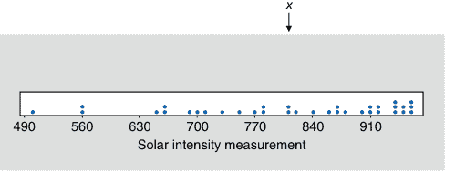

样本均值是数据在天平上平衡时的点。

## 8.2.2 Stem-and-Leaf Diagram

点图是小样本的有用数据展示，约多达 20 个观测值。然而，当观测值数量中等较大时，其他图形展示可能更有用。茎叶图或茎叶图，也称为茎叶图，是一种以图形格式呈现定量数据的设备，类似于直方图，有助于可视化分布的形状。它们源于 20 世纪早期 Arthur Bowley 的工作，是探索性数据分析中有用的工具。茎叶图在 1977 年 John Tukey 出版探索性数据分析书籍后，在 1980 年代变得更常用 [Tukey 1977]。

茎叶图通常指另一种图表类型。简单的茎叶图可能指将一组 y 值绘制到共同的 x 轴上，并用垂直线标识共同的 x 值，并用线上的符号标识各个 y 值 [Wild and Seber 2000]。

与直方图不同，茎叶图保留原始数据至少两位有效数字，并将数据排序，从而便于转向基于顺序的推断和非参数统计。

基本的茎叶图包含两个由垂直线分隔的列。左列包含茎，右列包含叶。

## 8.2.3 Constructing a Stem-and-Leaf Display

Example 8.3 To construct a stem-and-leaf display, the observations must first be sorted in ascending order: this can be done most easily if working by hand by constructing a draft of the stem-and-leaf display with the leaves unsorted, then sorting the leaves to produce the final stem-and-leaf display. Here is the sorted set of data values that will be used in the following example:

44, 46, 47, 49, 63, 64, 66, 68, 68, 72, 72, 75, 76, 81, 84, 88, 106

接下来，必须确定茎将代表什么，叶将代表什么。通常，叶包含数字的最后一位数字，茎包含其他所有数字。对于非常大的数字，数据值可能被四舍五入到特定位值 [例如百位]，该位值将用于叶。叶位值左侧的剩余数字用作茎。在此示例中，叶代表个位，茎将代表数字的其余部分 [十位及以上]。

茎叶图用两列绘制，中间由垂直线分隔。茎列在垂直线的左侧列出。重要的是每个茎只列出一次，并且不得跳过任何数字，即使这意味着某些茎没有叶。叶按升序列在每个茎的右侧。

需要注意的是，当数据中存在重复数字 [例如两个 72] 时，图必须反映这一点 [因此图看起来像 7 | 2 2 5 6 7 当它具有数字 72 72 75 76 77 时]。

| Stem | Leaf | Frequency |
|---|---|---|
| 4 | 4 6 7 9 | 4 |
| 5 |  | 0 |
| 6 | 3 4 6 8 8 | 5 |
| 7 | 2 2 5 6 | 4 |
| 8 | 1 4 8 | 3 |
| 9 |  | 0 |
| 10 | 6 | 1 |

Key : 4 | 4 = 44

可能需要四舍五入来创建茎叶图。基于以下数据集，将创建下面的茎叶图：

−23.6 78 758, −12.45, −3.4, 4.43, 5.5, 5.678, 16.87, 24.7, 56.8

对于负数，茎单元前放置一个负号，该单元仍为值 X/10。非整数被四舍五入。这使得茎叶图即使对于本示例中这种更复杂的数据集也能保留其形状：

| Stem | Leaf | Frequency |
|---|---|---|
| −2 | 3 | 1 |
| −1 | 2 | 1 |
| −0 | 3 | 1 |
| 0 | 4 6 6 | 3 |
| 1 | 7 | 1 |
| 2 | 5 | 1 |
| 3 |  | 0 |
| 4 |  | 0 |
| 5 | 7 | 1 |

Key : −1 1 2 = −12

茎叶图使找到数据特征如百分位数、四分位数和中位数变得相对容易。中位数是将数据分为两等份的集中趋势度量，一半在中位数以下，一半在中位数以上。如果观测值数量为偶数，中位数是两个中间值之间的一半。

## 8.2.4 Application

茎叶图对于显示数据的相对密度和形状很有用，为读者提供分布的快速概览。它们保留 [大部分] 原始数值数据，通常具有完美的完整性。它们也用于突出异常值和寻找众数。然而，茎叶图仅对中等大小的数据集有用 [约 15–150 个数据点]。对于非常小的数据集，茎叶图可能用处不大，因为需要合理数量的数据点来建立明确的分布特性。点图可能更适合此类数据 [Example 8.1]。对于非常大的数据集，茎叶图会变得非常杂乱，因为每个数据点必须以数字形式表示。随着数据量的增加，直方图或箱线图可能更合适。

## 8.2.5 Histogram

直方图是比茎叶图更紧凑的数据汇总。直方图是数值数据分布的准确表示。它是连续变量 [定量变量] 概率分布的估计，由 Karl Pearson 于 1895 年首次引入。

它与条形图不同，因为条形图关联两个变量，而直方图只关联一个。要构造直方图，第一步是“分箱”值范围——即将整个值范围划分为一系列区间——然后计算有多少值落入每个区间。箱通常指定为变量的连续、不重叠区间。箱 [区间] 必须相邻并且通常 [但不是必须] 大小相等 [Hovwitt and Cramer 2008]。

如果箱大小相等，则在箱上方竖立一个矩形，其高度与频率成正比——每个箱中的案例数。直方图也可以归一化以显示“相对”频率。然后它显示有多少比例的案例落入若干类别中，高度之和等于 1。

然而，箱不必大小相等；在这种情况下，竖立的矩形定义为其 *面积* 与箱中案例的频率成正比 [Freedman et al. 1997]。垂直轴此时不是频率而是 *频率密度* ——水平轴变量单位上的案例数。 Census 局数据上显示了可变箱宽度的示例 [Freedman et al. 1997]。由于相邻箱之间没有间隙，直方图的矩形相互接触以表示原始变量是连续的 [Stangor 2011]。

直方图大致显示底层数据分布的密度，并且通常用于密度估计：估计底层变量的概率密度函数。用于概率密度的直方图的总面积始终归一化为 1。如果 x 轴上区间的长度均为 1，则直方图与相对频率图相同。

一旦确定了箱数以及每个箱的下边界和上边界，数据就被排序到箱中，并计算每个箱中的观测值数。要构造直方图，使用水平轴表示数据的测量尺度，垂直尺度表示计数或频率。有时每个箱中的频率除以总观测值数 (*n*)，然后直方图的垂直尺度表示相对频率。在每个箱上方绘制矩形，每个矩形的高度与频率 [或相对频率] 成正比。大多数统计软件包构造直方图。

**Example 8.4** Construct a cumulative frequency plot and histogram for the solar intensity data in Example 8.2. Use six bins.

## Solution

对于六个箱

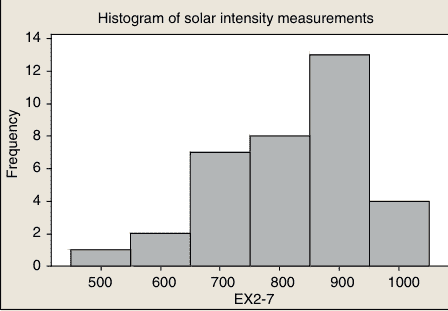

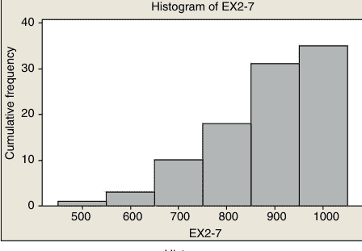


## 8.2.6 Pareto Diagram

帕累托图是直方图的重要变体。*帕累托图* 以意大利经济学家 Vilfredo Pareto 命名，它们通常表现出 *帕累托原则*，即大多数缺陷通常可以由少数类别解释。帕累托原则本质上指出 80% 的效果是由 20% 的原因造成的 [通常称为 80/20 规则或“重要的少数和不重要的多数”]。帕累托图组织数据以显示哪些项目或问题对流程或系统影响最大。然后，在图表上，我们对数据进行分层以显示组，从最大开始，逐步降至每个组中项目数量最少。想法是通过这种格式组织数据，我们可以制定计划来解决将为流程改进工作带来最大回报的问题。帕累托图的唯一目的是突出大量因素中最重要的因素。使用图表，可以识别导致大多数缺陷的重要 20% 因素。在质量控制中，它


通常代表缺陷的最常见来源、发生率最高的类型缺陷，或客户投诉的最频繁原因等（Montgomery 1985；Tague 2004）。Wilkinson（2006）提出了一种算法，用于为帕累托图中的每个条产生基于统计的接受限（类似于置信区间）。帕累托图还可以帮助在 SPC 中消除制造过程中的原因和影响，以实现“零缺陷和零影响”的理想。

## 示例 8.5 获得以下汽车车门结构缺陷信息：凹陷，4；坑，4；部件装配顺序错误，6；部件修剪不足，21；缺少孔/槽，8；部件未润滑，5；部件轮廓不符，30；部件未去毛刺，3。构造并解释帕累托图。

## 解答

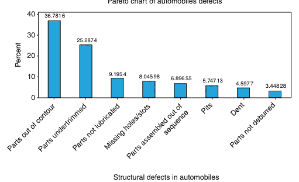

图 8.1 帕累托图。

大约 63% 的缺陷由部件轮廓不符和部件修剪不足描述。

## 8.2.7 箱线图

进一步总结值分布信息的显示是箱线图。箱线图不是绘制实际值，而是显示分布的汇总统计量。它是 25th、50th 和 75th 百分位数以及远离其余值的绘图。

图 8.2 显示了箱线图的注释草图。箱的最低边界是 25th 百分位数。Tukey（1977）将 25th 和 75th 百分位数称为“铰链”。请注意，50th 百分位数是整个数据集的中位数，25th 百分位数是中位数以下值的的中位数，而 75th 百分位数是中位数以上值的的中位数。箱内的水平线代表中位数。50% 的案例包含在箱内。箱的长度对应于四分位距，即 25th 和 75th 百分位数之间的差值。

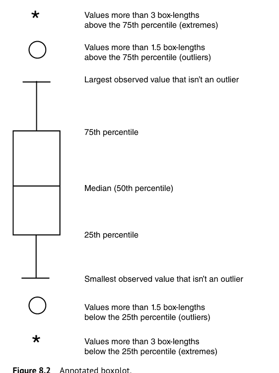

图 8.2 注释的箱线图。

箱线图包括两类具有异常值的案例。值比箱子上边缘或下边缘远超过 3 个箱长度的案例称为极值。在箱线图上，这些用星号（*）表示。值在箱子上边缘或下边缘 1.5 到 3 个箱长度之间的案例称为异常值，用圆圈表示。最大和最小的非异常值观测值也显示出来。从箱的两端画线到这些值。（这些线有时称为须线，图则称为箱须图。）

尽管其简单，箱线图包含大量信息。从中位数可以确定中心趋势或位置。从箱的长度可以确定观测值的离散程度或变异性。如果中位数不在箱的中心，则说明观测值有偏态。如果中位数更接近箱顶部而不是底部，

则相反为真：分布呈负偏态。尾部的长度由须线和异常及极值点显示。

## 示例 8.6 记录并排序了化学分散系统的分散速率（cm$^3$/s）的 18 次测量：

| 6.50 | 6.77 | 6.91 | 7.38 | 7.64 | 7.74 | 7.90 | 7.91 | 8.21 |
| :--- | :--- | :--- | :--- | :--- | :--- | :--- | :--- | :--- |
| 8.26 | 8.30 | 8.31 | 8.42 | 8.53 | 8.55 | 9.04 | 9.33 | 9.36 |

- a) 计算样本均值和样本方差。
- b) 求样本上四分位数和下四分位数。
- c) 求样本中位数。
- d) 构造数据的箱线图。
- e) 求内径的 5th 和 95th 百分位数。

## 解答

- a) 样本均值：8.059；样本方差：0.661
- b) $Q_1$: 7.575, $Q_3$: 8.535
- c) 样本中位数：8.235

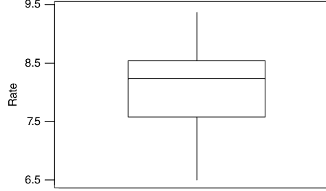

d) 5th 百分位数：6.175；95th 百分位数：9.331。

## 8.2.8 实验设计的统计工具：过程和产品开发

本节介绍 SPC，这是一组在质量改进活动中必不可少的工具。统计方法在质量改进中发挥着至关重要的作用。接下来概述了一些应用：

- 1) 在产品和/或过程设计开发中，可以使用统计方法，包括设计实验，来比较不同的材料、组件或成分，并帮助确定系统和组件公差。该应用可显著降低开发成本并缩短开发时间。
- 2) 统计方法可用于确定制造过程的能力。SPC 可用于通过降低变异性系统地改进过程。
- 3) 实验设计方法可用于研究过程改进。这些改进可带来更高的产量和更低的制造成本。
- 4) 寿命测试提供有关产品可靠性和其他性能数据。这可带来新的改进设计和产品，具有更长的使用寿命和更低的运行和维护成本。

工程师、科学家、经理和政策制定者必须深入了解这些统计工具，任何希望成为高质量、低成本生产者的行业或企业都需要。在本节中，我们介绍了统计质量控制的基本方法，以及与实验设计一起构成成功质量改进努力的基础。

SPC 起源于 1920 年代。贝尔电话实验室的 Walter A. Shewhart 博士是该领域的早期先驱之一。1924 年他撰写了一份备忘录，说明了控制图，这是 SPC 的基本工具之一。二战见证了这些方法向美国工业的广泛传播。Edward Deming 博士和 Joseph Juan 博士在二战后传播该方法论方面发挥了重要作用。

SPC 是一套可应用于任何过程的问题解决工具。SPC 的主要工具有以下：

- 1) 茎叶图
- 2) 直方图
- 3) 帕累托图
- 4) 因果图
- 5) 缺陷集中图
- 6) 控制图
- 7) 散点图
- 8) 检查表

尽管这些工具是 SPC 的重要组成部分，但它们仅构成该主题的技术方面。SPC 的同等重要元素是态度——组织内所有个人都希望通过系统地减少变异性来持续改进质量和生产率。控制图是 SPC 工具中最强大的工具。有关这些方法的完整讨论，请参阅 Montgomery（2009）。

## 8.3 时间序列：随时间变化的过程

在许多实际情况下，制造过程中数据通常随时间收集。可能影响过程或系统的现象在数据的面向时间绘图中往往变得更加明显，并且可以更好地判断过程的稳定性。例如，控制图是一种显示随时间变化数据的技术，使工程师能够评估过程的稳定性。

**370** | **8 精益制造**

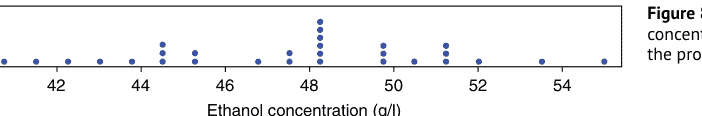

图 8.3 是工业综合体中二元精馏塔每小时测量的乙醇浓度读数的点图。点图显示的大幅变化表明可能存在问题，但图表并不能帮助解释变化的原因。由于数据随时间收集，因此称为时间序列。数据相对于时间的图，如图 8.4 所示，称为时间序列图。图中可见过程均值水平可能出现向下偏移，并且可以获得偏移时间的估计。

### 8.3.1 基本原理

在任何生产过程中，无论设计得多么好或维护得多么仔细，总会存在一定量的固有或自然变异。这种自然变异，或“背景噪声”，是许多微小、基本上不可避免的原因的累积效应。当过程的背景噪声相对较小时，我们通常认为它是可接受的过程性能水平。在 SPC 的这一框架中，这种自然变异通常称为“稳定机会原因系统”。仅存在 *机会原因* 变异的过程称为处于统计控制状态。换句话说，机会原因过程固有的一部分。

其他类型的变异偶尔也可能出现在过程输出中。关键质量特性的这种变异通常源于以下来源：机器调整不当、操作员错误或原材料缺陷。与背景噪声相比，这类变异通常很大，并且通常代表不可接受的过程性能水平。我们将这些不是机会原因模式一部分的变异来源称为 *可指定原因*。在存在可指定原因的情况下运行的过程称为失控。*机会* 和 *可指定* 原因的术语由 Walter Shewhart 博士提出（Montgomery et al. 2011）。

控制图是描述统计控制含义的装置；因此，可用于多种方式。在许多应用中，它用于在线过程监控。即收集样本数据并用于构建控制限，如果 $\bar{x}$（任意）样本值落在控制限内且不表现出任何系统模式，我们就说过程在图表指示的水平下受控。请注意，我们这里可能有兴趣确定过去数据是否来自受控过程，以及未来样本是否表明统计控制。控制图最重要的用途是 *改进* 过程。利用控制图进行的过程改进活动如图 8.5 所示。请注意，（i）大多数过程不处于统计控制状态；（ii）因此，控制图的常规和细致使用将识别可指定原因。如果这些原因可以

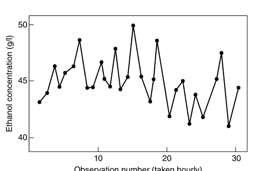

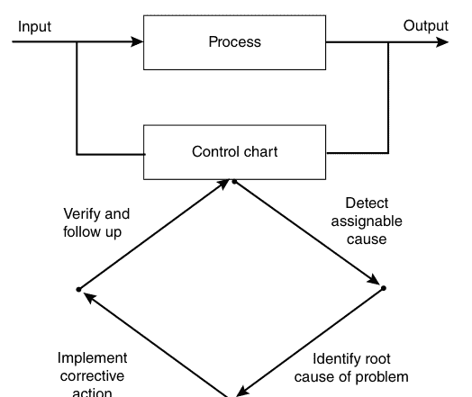


被消除，变异性将会降低，过程也将得到改进；(ii) 控制图只能检测出可赋因。管理、操作人员和工程方面的行动通常是必要的，以消除可赋因。制定对控制图信号做出响应的长期计划至关重要（Montgomery et al. 2011）。

在识别和消除可赋因时，找到问题的根本原因并加以解决非常重要。表面上的解决方案不会带来任何真正的、长期的过程改进。建立有效的纠正措施体系是有效 SPC 实施的重要组成部分。控制图也可以用作估计工具。也就是说，从表现出统计受控的控制图上，我们可以估计某些参数，例如均值、标准差以及不合格品率或不良率。这些估计值随后可用于确定过程生产合格产品的能力。此类过程能力（$PC$）研究对产品生命周期中出现的许多管理决策问题具有相当大的影响，包括自制或外购决策、降低过程变异性的工厂和工艺改进，以及与客户或供应商就产品质量达成的合同协议。

用于质量特性的控制图称为属性控制图。控制图在工业中已有悠久的使用历史。它们受欢迎的原因至少有五点：

- 1) 控制图是提高生产率的成熟技术。成功的控制图计划将减少废品和返工，而废品和返工是任何作业中生产率下降的主要原因。如果减少废品和返工，生产率就会提高，成本就会降低，生产能力（以每小时合格件数衡量）也会提高。

- 2) 控制图在缺陷预防方面有效。控制图有助于保持过程受控，这与“第一次就做对”的理念一致。事后对“好”单元和“坏”单元进行分拣永远不会比最初就造好更便宜。如果没有有效的过程控制，你就是在为制造不合格产品付钱。

- 3) 控制图可防止不必要的过程调整。控制图能够区分背景噪声和异常变异；没有其他设备，包括人工操作员，能像它一样有效地做出这种区分。如果过程操作员基于与控制图计划无关的定期测试来调整过程，他们往往会过度反应于背景噪声并做出不必要的调整。这些不必要的调整通常会导致过程性能下降。

- 4) 控制图提供诊断信息。经常，控制图上点的模式会包含对经验丰富的操作员或工程师具有诊断价值的信息。这些信息使操作员能够对过程进行更改，从而提高性能。

- 5) 控制图提供关于 PC 的信息。控制图提供了关于重要过程参数的值及其随时间稳定性的信息，从而可以估计 PC。这些信息对产品和工艺设计人员来说非常有用。

控制图是最有效的管理控制工具之一，其重要性与成本控制和物料控制一样重要。现代计算机技术使得在任何类型过程中实施控制图变得容易，因为数据收集和分析可以在微型计算机或局域网终端上实时在线在作业中心进行（Montgomery et al. 2011）。

## 8.4 过程能力

在任何制造过程和作业中，过程输出都存在变异性。在机加工作业中，这是最精确的过程之一，被加工零件看起来可能完全相同，但仔细检查会发现零件之间存在尺寸差异。制造变异可分为两类：随机和可赋因。

随机变异由许多因素引起：每次作业循环的人为变异、原材料变异、机器振动等。单独来看，这些因素可能影响不大，但综合起来，误差足以造成麻烦，除非它们在零件公差范围内。随机变异通常形成正态统计分布。过程输出倾向于围绕均值聚集，就产品感兴趣的质量特性而言（例如长度、直径或重量）。大部分零件集中在均值附近，远离均值的零件较少。当过程的唯一变异属于此类时，称该过程处于统计受控状态。这种变异只要过程正常运行就会持续存在。正是当过程偏离这种正常运行条件时，第二种变异才会出现。

可赋因变异表明偏离正常运行条件。过程中发生了随机变异无法解释的情况。可赋因变异的原因包括操作员失误、原材料缺陷、工具失效、机器故障等。制造中的可赋因变异通常通过导致输出偏离正态分布而表现出来。过程不再处于统计受控状态。

PC 与过程处于统计受控时输出中固有的正常变异有关。按定义，PC 等于均值输出值上下各 ±3 个标准差（总共六个标准差）：

```
PC = μ ± kσ
```

其中 PC 为过程能力；μ 为过程均值，设定为产品特性的标称值；k 是控制限距中心线的“距离”，以标准差单位表示。常见的选择是 k = 3 和 σ，过程标准差。该定义所依据的假设是 (i) 输出呈正态分布且 (ii) 已达到稳态运行且过程处于统计受控状态。在这些假设下，99.73% 的零件或产品产生的输出值将落在均值 ±3.0 范围内。这种控制图的基本理论最初由 Walter A. Shewhart 博士提出，并根据这些原则开发的控制图通常称为 Shewhart 控制图。

### 8.4.1 统计过程控制

SPC 涉及使用各种统计方法来评估和分析过程中的变异。SPC 方法包括简单地记录生产数据、直方图、PC 和控制图。控制图是最广泛使用的 SPC 方法，本节的讨论将集中于它们。

控制图的基本原理是任何过程中的变异可分为两种类型（第 8.4 节）：(i) 随机变异，即过程处于统计受控时存在的变异，以及 (ii) 可赋因变异，即表明偏离统计受控的变异。控制图的目的是识别过程何时超出统计受控，从而发出应采取纠正措施的信号。

控制图是一种图形技术，其中根据某一过程特性测得的值计算出的统计量随时间绘制，以确定过程是否保持统计受控。控制图的一般形式如图 8.6 所示。该图由三条随时间保持恒定的水平线组成：中心线、下控制限（LCL）和上控制限（UCL）。中心线通常设定为正常设计值。UCL 和 LCL 通常设定为样本均值的 ±3 个标准差。

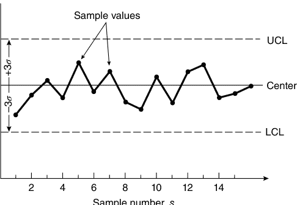

图 8.6 设定为样本均值 ±3 个标准差的控制图。

在过程处于统计受控时，样本值落在 UCL 或 LCL 之外的可能性极小。因此，如果样本值确实落在这些限之外，则解释为过程失控。因此，将进行调查以确定失控条件的原因，并采取适当的纠正措施以消除该条件。同样，如果发现过程处于统计受控状态且数据中没有不良趋势的证据，则不应进行调整，因为它们会向过程引入可赋因变异。“如果没坏，就别修”的理念适用于控制图。

控制图主要有两种基本类型：(i) 变量控制图和 (ii) 属性控制图。变量控制图需要对感兴趣的质量特性进行测量。属性控制图只需确定零件是否不合格或样本中存在多少缺陷。

### 8.4.2 变量控制图

过程失控表现为 (i) 过程均值和/或 (ii) 过程变异性的显著变化。相应地，变量控制图主要有两种类型：(i) x̄ 图和 (ii) R 图。x̄ 图（称为“均值图”）用于绘制从生产过程中抽取的一系列样本中某一质量特性的平均测量值。它显示过程均值随时间的变化。R 图绘制每个样本的极差，从而监控过程的变异性并指示其是否随时间变化。


必须选择一个合适的过程质量特性作为在 x̄ 和 R 图上进行监控的变量。在机械过程中，这可能是一个轴直径或其他关键尺寸。必须使用过程本身的测量值来构建两个控制图。在过程平稳运行且不存在可分配变差的情况下，收集一系列样本（例如，通常建议 m = 20 或更多）的小样本（例如，每个样本 n = 5 个零件），并对每个零件测量感兴趣的特性。用于构建每个图的中心线、LCL 和 UCL 的步骤如下：

- 1) 计算每个 m 个样本的均值 x̄ 和极差 R。
- 2) 计算总均值 x̄，即 m 个样本的 x̄ 值的均值；这将是 x̄ 图的中心线。
- 3) 计算 R̄，即 m 个样本的 R 值的均值；这将是 R 图的中心线。
- 4) 确定 x̄ 和 R 图的 UCL 和 LCL。可以从样本数据估计标准差值并用于计算这些控制限。然而，更简单的方法是基于专门为这些控制图推导的、列于表 H.1 中的统计因子。因子值取决于样本大小 n。对于 x̄ 图，

```
LCL = x̄ − A₂ R̄  (8.6)
UCL = x̄ + A₂ R̄  (8.7)
```

对于 R 图，

```
LCL = D₃ R̄  (8.8)
UCL = D₄ R̄  (8.9)
```

### Example 8.7  x̄ and R Charts

已从处于统计控制中的制造过程中收集了 8 个样本（m = 8），样本大小为 4（n = 4），并对每个零件测量了感兴趣的尺寸。希望确定构建 x̄ 和 R 图的中心线、LCL 和 UCL 的值。每个样本的 x̄ 和 R 的计算值如下所示（测量值以英寸为单位），这是我们步骤中的第 1 步。

| Sample, s | 1 | 2 | 3 | 4 | 5 | 6 | 7 | 8 |
|---|---|---|---|---|---|---|---|---|
| x̄ | 2.008 | 1.998 | 1.993 | 2.002 | 2.001 | 1.995 | 2.004 | 1.999 |
| R | 0.027 | 0.011 | 0.017 | 0.009 | 0.014 | 0.020 | 0.024 | 0.018 |

### Solution

在步骤 1 中，我们在表 8.1 中列出了 x̄ 和 R 图的常数，来源于表 H.1。

**Table 8.1** Constants for the x̄ and R charts.

| Sample size, n | x̄ chart A₂ | R chart D₃ | R chart D₄ |
|---|---:|---:|---:|
| 3 | 1.023 | 0 | 2.575 |
| 4 | 0.729 | 0 | 2.282 |
| 5 | 0.577 | 0 | 2.114 |
| 6 | 0.483 | 0 | 2.004 |
| 7 | 0.419 | 0.076 | 1.924 |
| 8 | 0.373 | 0.136 | 1.864 |
| 9 | 0.337 | 0.184 | 1.816 |
| 10 | 0.308 | 0.223 | 1.777 |

在步骤 2 中，我们计算样本平均值的总均值。

```
x̄ = (2.008 + 1.998 + … + 1.999) / (8) = 2.000
```

在步骤 3 中，计算 R̄ 的均值。

```
R̄ = (0.027 + 0.011 + … + 0.018) / (8) = 0.0175
```

在步骤 4 中，基于表 8.1 中的因子确定 LCL 和 UCL 的值。首先，使用公式 (8.6) 和 (8.7) 对 x̄ 图，

```
LCL = 2.000 − 0.729(0.0175) = 1.9872
UCL = 2.000 + 0.729(0.0175) = 2.0128
```

对于 R 图，使用公式 (8.8) 和 (8.9)，

```
LCL = 0(0.0175) = 0
UCL = 2.282(0.0175) = 0.0399
```

两个控制图在图 8.7 中构建，样本数据已绘制在图表中。

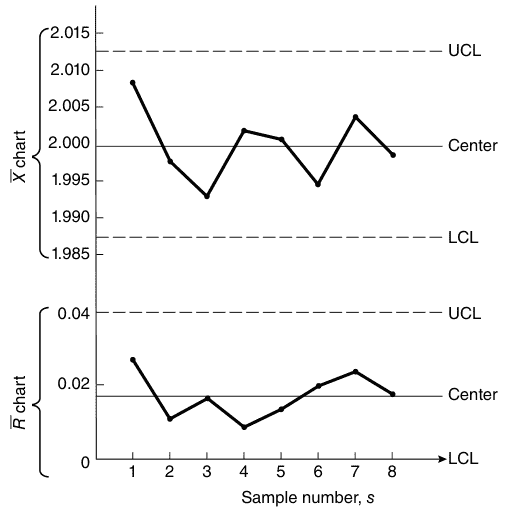

**Figure 8.7** Control charts for Example 8.7.

如果已知过程的均值和标准差，则计算 x̄ 图的中心线、UCL 和 LCL 的另一种方法如下：

```
LCL = μ − 3σ / (√n)  (8.10)
UCL = μ + 3σ / (√n)  (8.11)
```

其中 μ，过程均值；σ，过程的标准差；n，样本大小。公式 (8.10) 和 (8.11) 给出的 LCL 和 UCL 值在理论上与公式 (8.6)–(8.9) 计算的值相同。然而，在首次为过程设置 x̄ 图时，感兴趣的过程变量的均值和标准差通常是未知的。因此，基于测量的 x̄ 和 R̄ 值的公式 (8.6)–(8.9) 可以方便地用于计算控制图参数。控制限设置为公式 (8.6)–(8.9) 或公式 (8.10) 和 (8.11) 定义的值时，99.73% 的随机样本来自处于统计控制中的过程会落在控制限之内。

请注意，样本均值的标准差与总体标准差的关系为样本中单位数 n 的平方根的倒数，即

```
σₓ = σ / (√n)  (8.12)
```

其中 σₓ 是样本均值的标准差，其他项如上所述定义。

### 8.4.3 PC Analysis

通常需要获得有关 PC 分析的一些信息——即过程在受控状态下运行时的性能。PC 也是一个数学计算，用于确定制造过程（过程的声音）与工程规范的比较。目的是使工程规范与使用我们生产的产品和服务的客户的迫切需求和愿望相匹配（客户的声音）。多年来已开发出几种不同的计算方法，其中最流行的是 PC 比率（Cₚ）。Cₚ 可以表示为如下定义的指数：

```
Cₚ = (USL − LSL) / 6σ  (8.13)
```

Cₚ 的分子是规范的宽度。过程均值两侧的三个西格玛限有时称为自然公差限，因为这些代表了受控过程应满足的大多数生产单元的限值。因此，六西格玛通常被称为过程的宽度。Cₚ 是过程潜能计算。Cₚ 将工程规范限作为分子，将制造过程在六个标准差上的分布作为分母。如果在制造过程中使用可变过程行为图，则可以使用极差值来估计六个标准差值，并且工程图纸将包含制造应遵循的规范。Cₚ 的数值永远不会为负。Cₚ = 1.0 的值表示六个标准差计算的尾部与工程规范宽度相遇。

### 8.5 Lean Manufacturing

精益制造或精益生产，通常简称为精益，其起源于二战后日本的时代。它由丰田生产主管大野耐一开发，以应对困扰日本工业的一系列问题。主要问题是为满足日本国内市场而需要的高品种生产。亨利·福特为经济地生产大量相同产品而开发的大规模生产技术，不适合丰田所面临的情况。丰田在 1940 年代末面临的这些条件在整个行业中都很常见，精益正被世界各地的企业采用，以提高效率并更好地服务客户。

精益方法（术语 *Lean* 最早由麻省理工学院的研究人员约翰·F·克拉夫契克 [1988] 在 1980 年代末首次提出）系统地最小化价值流中的浪费——称为 *muda*。克拉夫契克的研究由麻省理工学院国际汽车车辆项目继续，该项目产生了由沃马克、琼斯和罗斯合著的国际畅销书 *The Machine That Changed the World*（1990）。

*Muda* 包括所有类型的缺陷工作，而不仅仅是缺陷产品。浪费的时间、动作和材料都是 *muda*。大野（1988）确定了企业中以下类型的 *muda*：

- 1) 缺陷
- 2) 过度生产
- 3) 库存（在制品或产成品）
- 4) 不必要的加工
- 5) 人员不必要的移动
- 6) 货物不必要的运输
- 7) 等待

沃马克和琼斯（2003）增加了另一种类型的 *muda*：

- 8) 设计不符合客户需求的商品和服务。

“精益思维”就是向 *muda* 宣战。它是关注 *muda* 的对立面价值。定义价值意味着回答以下问题：

- 客户愿意为哪些东西付费？
- 这些价值是通过什么过程创造的？
- 过程中的每个活动如何帮助满足客户的愿望和需求？
- 我们如何使价值创造过程流动得更高效？
- 我们如何确保我们只生产所需的东西，在需要时生产？
- 我们如何做到完美地创造价值？

精益对这些问题的回答可以归为五类：价值、价值流、流动、拉动和完美。

### 8.5.1 Overview

对于许多人来说，精益是 *协助识别和持续消除浪费的“工具”集合*。随着浪费的消除，质量提高，而生产时间和成本降低。精益制造的第二种方法是由丰田推广的，称为丰田生产系统（TPS），其中重点是改善工作的“流动”或顺畅性，从而通过系统持续消除 *mura*（“不均匀性”），而不是专门针对“浪费减少”。改善流动的技术包括生产均衡、“拉动”生产（通过 *kanban*）和 *Heijunka box*。这与大多数改进方法学有根本不同，并且需要比基本应用工具更多的坚持，这可能部分解释了其缺乏普及性（Liker 和 Hoseus 2008）。这两种方法之间的区别不在于目标本身，而在于实现它的主要方法。平滑流动的实现暴露了已经存在的质量问题，因此浪费减少自然成为其后果。声称这种方法的优势在于它自然采取系统范围的视角，而浪费重点有时错误地假设了这一视角。

精益和 TPS 都可以被视为一组密切相关且可能相互竞争的原则，其目标是通过消除浪费来降低成本（大野 1988）。这些原则包括拉动加工、首次合格质量、浪费最小化、持续改进、灵活性、与供应商建立和维护长期关系、自主自动化（智能自动化）、负荷均衡和生产流动，以及目视控制。某些原则的脱节性质或许源于 TPS 自 1948 年以来根据其在自身生产设施中看到的问题而务实成长的事实。因此，今天看到的是“需求”驱动的学习改进的结果，每一步都建立在先前的想法之上，而不是基于理论框架。

丰田的观点是，精益的主要方法不是工具，而是减少三种类型的浪费：*muda*（不增值工作）、*muri*（过载）和 *mura*（不均匀性），以系统地暴露问题并在理想无法实现时使用工具。从这个角度来看，工具是适应不同情况的工作方案，这解释了上述原则的任何明显不一致（大野 1988）。

也被称为柔性大规模生产，TPS 有两个支柱概念：*准时制*（JIT）或“流动”，和“自主自动化”（大野 1988）。丰田方法的支持者会说，价值的顺畅流动会作为副作用实现所有其他改进。如果生产完美流动（意味着它既是“拉动”且没有中断），则没有库存；如果只生产客户重视的功能，则产品设计简化，并且只在客户重视的功能上花费精力。TPS 的另外一个支柱是自动化的非常人性化的方面，即自动化以人为本。在这种情况下，“人性化”意味着自动化设计以帮助人类专注于人类最擅长的事情（大野 1988）。

精益实施强调通过战略运营程序优化工作流程的重要性，同时最小化浪费并保持适应性。需要灵活性以允许使用诸如 *研究与开发*（R&D）等工具进行生产均衡（*Heijunka*）。然而，适应性通常受到限制，因此可能不需要大量投资。更重要的是，所有这些概念都必须为开发产品并启动交付价值的过程的员工所认可。精益的文化和管理方面可能比生产本身的实际工具或方法论更重要。存在许多精益工具实施但没有持续收益的例子，这些例子通常归咎于整个组织对精益的理解薄弱。

精益旨在通过简化运营结构以便理解、执行和管理工作环境来提高生产率。为了同时实现这三个目标，可以使用丰田的一种指导方法（松散地称为 *Senpai* 和 *Kohai*，日语中意为资深和初级）来从下而上在整个组织结构中培养精益思维。最接近丰田指导过程的概念是 *Lean Sensei* 的概念，它鼓励公司、组织和团队寻求可以提供建议和指导的第三方专家（沃马克和琼斯 2003）。斯皮尔和鲍恩（1999）确定了四个特征“丰田 DNA”的规则：


- 1) 所有工作都应明确具体地规定内容、顺序、时间和结果。
- 2) 每个客户-供应商连接都必须是直接的，并且必须有一种明确的“是”或“否”的方式来发送请求和接收响应。
- 3) 每种产品和服务的路径都必须是简单直接的。
- 4) 任何改进都必须按照科学方法，在教师的指导下，在组织中尽可能低的层级进行。

## 8.5.2 历史：二十世纪前

### 8.5.2.1 本杰明·富兰克林

本杰明·富兰克林（图8.8）对减少浪费的思想做出了巨大贡献。精益制造和减少浪费的大部分基本目标都源于本杰明·富兰克林，并有文献记载的实例为证。《穷理查年鉴》谈到浪费时间时说：“一个人无所事事地损失了价值5先令的时间，就是损失了5先令，还不如明智地把5先令扔进河里。”他补充说，避免不必要的开支可能比增加销售额更有利可图：“省下一便士，净赚两便士。一天省一针，一年省一克朗。省则有所。”

富兰克林在《致富之路》中再次谈到了持有不必要库存的问题。“你们称这些为商品；但是，如果你们不小心，它们对你们中的某些人来说将变成祸害。你们预期它们会便宜卖出去，也许它们可以以低于成本的价格被买走；但如果你们用不着它们，它们对你们来说必然很昂贵。记住穷理查的话：‘买你不需要的东西，不久之后你就得卖掉你的必需品。’他在另一处说：‘许多人因为买便宜货而破产。’”亨利·福特称富兰克林对自己包括准时制生产在内的商业实践产生了重大影响。


图8.8 本杰明·富兰克林。来源：https://commons.wikimedia.org/wiki/File:Benjamin-Franklin-U.S.-$100-bill.jpg. 公共领域。

工作环境中浪费和能量的积累被动作效率专家弗兰克·吉尔布雷斯注意到，他目睹了泥瓦匠经常弯腰从地上捡砖的低效做法。引入一种无需弯腰的脚手架，将砖块运送到腰部高度，使泥瓦匠能以大约三倍的速度工作，并且花费的力气最少。

### 8.5.2.2 威廉·波音

威廉·E·波音（图8.9）于1881年10月1日出生于密歇根州底特律。波音移居到华盛顿州霍奎厄姆的太平洋西北地区，购买了奥林匹克半岛太平洋（西）侧格雷斯港周围的大片林地，并投资了木材业务。他成功经营了这项事业，部分原因是通过新建的巴拿马运河将木材运往东海岸，积累了资金，这些资金后来被他用于一个非常

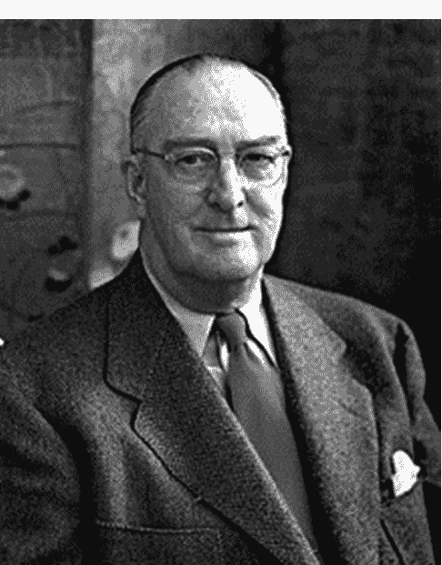

图8.9 威廉（比尔）·波音。来源：https://en.wikipedia.org/org/wiki/William_Boeing.

不同的行业。威廉·波音于1903年离开耶鲁大学，以抓住西北木材行业风险高、周期性波动但经济回报丰厚的机会。这段经历后来在航空业中对他大有裨益。

1916年，波音与乔治·韦斯特维尔特合作创办了“B & W”公司，并创立了太平洋航空产品公司。该公司的第一架飞机是波音1型（B & W水上飞机）。1917年4月8日美国加入第一次世界大战，一个多月后，波音将太平洋航空产品公司更名为波音飞机公司，并获得了美国海军50架飞机的订单。战争结束后，波音开始专注于商用飞机。他获得了提供航空邮件服务的合同，建立了成功的航空邮件运营业务，后来又发展为客运服务，最终演变为联合航空公司。

在他的指导下，一家小型飞机制造公司成长为拥有相关产业的大型企业。1934年，大萧条后的立法强制要求公司拆分，波音出售了他在波音飞机公司的权益，但他继续从事其他商业项目。

他成为美国最成功的纯种马饲养者之一。他从未失去对航空的兴趣，在第二次世界大战期间，他自愿担任该公司的顾问。他活到1956年，得以看到自己创办的公司进入喷气时代。

威廉·E·波音是一个注重隐私的人，一个有远见的人，一个完美主义者，也是一个坚持事实的人。他外间办公室的墙上挂着一块标语牌，上面写着：“2329 希波克拉底说过：1. 除了事实，没有权威。2. 事实通过准确的观察获得。3. 推论只能基于事实。4. 经验证明了这些规则的真实性。”据他的儿子小威廉·波音说，波音读书又快又贪婪，并且记住所读的一切。他还是一个完美主义者。1916年，在参观杜瓦米什造船厂的飞机制造车间时，波音看到一组锯得不正确的云杉肋条。他把它们扫到地上，踩来踩去，直到它们断裂。一根磨损的副翼钢索让他说：“我宁愿关门停业，也不愿把这种工作成果交付出去。”

### 8.5.2.3 弗雷德里克·温斯洛·泰勒

弗雷德里克·温斯洛·泰勒（图8.10），科学管理之父，引入了现在所谓的标准化和最佳实践部署。在《科学管理原理》（泰勒 1911）中，泰勒说：“每当工人提出改进建议，管理层的政策都应对新方法进行仔细分析，如有必要，进行一系列实验，以准确确定新建议与旧标准的相对优劣。每当发现新方法明显优于旧方法时，就应采用它作为整个企业的标准。”

泰勒还明确警告，当效率改进减少了对新劳动力的需求时，不要削减计件工资（或暗示削减工资或解雇工人）：“……当一个工人由于更加努力工作并增加了产量，而使自己正在做的工作的每件价格被降低了两次或三次，他很可能会完全忽视雇主这边的立场，并充满一种坚决的决心：如果‘磨洋工’（混时间，只做被告知的事）能够阻止再被削减工资，就绝不再容忍。”

新乡重夫，单分钟换模（SMED）和防错法（poka-yoke）最著名的倡导者，将《科学管理原理》视为自己的灵感来源（新乡重夫 1987）。美国工业家在1910年代认识到廉价海外劳动力对美国工人构成的威胁，并明确提出了如今所谓的精益制造的目标作为应对措施。美国机械工程师学会前会长亨利·汤在弗雷德里克·温斯洛·泰勒的《车间管理》（1911）前言中写道：“我们理应为我国普遍存在的高工资水平感到自豪，并警惕他国更廉价劳动力的产品对此的任何干扰。”为了维持这种状况，加强我们对国内市场的控制，尤其是扩大我们在国外市场的机会（在那里我们必须与其他工业国家的产品竞争），我们应当欢迎并鼓励一切有助于提高我们生产流程效率的影响。

### 8.5.2.4 亨利·福特

亨利·福特（图8.11）在发展大规模装配制造系统时，最初忽视了浪费积累的影响。查尔斯·巴克斯顿·戈因在1915年写道：“福特的成功震惊了全国，几乎震惊了整个世界，无论是资金、工业还是机械方面。它比大多数人认为可能的程度更高地展示了真正效率的那些看似矛盾的要求，即：质量不断提高，工人工资大幅增加，消费者成本一再降低。与此同时，还出现了一个绝对令人难以置信的产量扩大，不到十年就达到约一百倍，以及制造商获得巨大利润，这既是原因又是结果”（阿诺德和福罗特 1915）。

福特在《我的生活与工作》（福特和克劳瑟 1922）中，用一段话描述了浪费的全部概念：

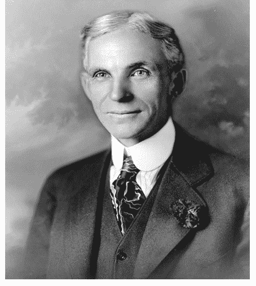

图8.11 亨利·福特。来源：https://simple.wikipedia.org/wiki/Henry_Ford. 公共领域。

我相信，普通农民真正用于有效用途的能量只占他所消耗能量的5%左右。……不仅一切都靠手工完成，而且很少考虑合理的布局。一个干农活的农民会在一架摇摇晃晃的梯子上爬上爬下十几次。他会多年提水，也不愿装几段水管。当有额外工作时，他的全部想法就是雇更多人手。他把花钱改进视为一种开支……正是浪费的动作——浪费的精力——使得农产品价格高昂而利润微薄。

工作场所布局不当——现代改善（kaizen）的一个主要关注点——以及出于习惯而低效地做事——即使在现代工作场所中也是主要的浪费形式。

福特还指出，物质浪费是多么容易被忽视。一位前雇员哈里·贝内特写道：“有一天，我和福特先生在一起，他在给D.T. & I [铁路]道床压载的矿渣中发现了一些锈迹。这些矿渣是我们自己炉子里倒在那里的。‘你知道吗，’福特先生对我说，‘那些矿渣里有铁。’你让把矿渣倒在那里的吊车工人们把它分拣一下，然后送回工厂”（贝内特和马库斯 1951）。

换句话说，福特看到了锈迹，并意识到钢厂并没有回收所有的铁。

然而，福特的早期成功并不可持续。正如詹姆斯·沃麦克和丹尼尔·琼斯在《精益思想》中所指出的，福特所取得的成就代表了一种“特殊情况”，而非稳健的精益解决方案（沃麦克和琼斯 2003）。福特面临的主要挑战是，他的方法是为稳定环境而构建的，而不是为当今企业日益面临的动态条件而构建的（鲁法 2008）。尽管他僵化的自上而下控制使得将工作活动中的变异保持在极低水平成为可能，但他的方法对不确定、动态的商业条件反应不佳；对新产品创新的需求反应尤其糟糕。这一点从福特公司的急剧衰落中可以看出：公司最终被迫推出T型车的后继车型。

面向制造的设计（DFM）是一个源自福特的概念，它强调在《我的生活与工作》（福特和克劳瑟 1922）中标准化单个零件以及消除冗余部件的重要性。这种标准化是福特大规模生产概念的核心，而制造“公差”，即确保零件互换性的尺寸上下限，在制造业中得到了广泛应用。几十年后，著名的日本质量大师田口玄一证明了这种“球门柱”

测量方法是不充分的。他指出，能力的“损失”并不仅仅在超出这些容差后才开始，而是在任何偏离标称条件的条件下，都会按照田口损失函数所描述的那样增加。这成为20世纪80年代W·爱德华兹·戴明质量运动的重要组成部分，后来帮助深化了对关键关注领域的理解，例如在航空航天及其他行业中，缩短周期时间变异对提高制造质量和效率的作用。

尽管福特以其生产线而闻名，但人们往往没有认识到他为消除装配工的工作以使生产线成为可能而付出了多少努力。在使用生产线之前，福特的汽车部件在使用点由熟练工程师进行装配和整形，以确保它们能够正确连接。通过对部件制造实施非常严格的规格和质量标准，他几乎完全消除了这项工作，将制造工作量减少了60%到90%（豪恩谢尔，1984年）。然而，福特的大规模生产系统未能纳入“拉动生产”的概念，因此常常遭受过度生产的困扰。

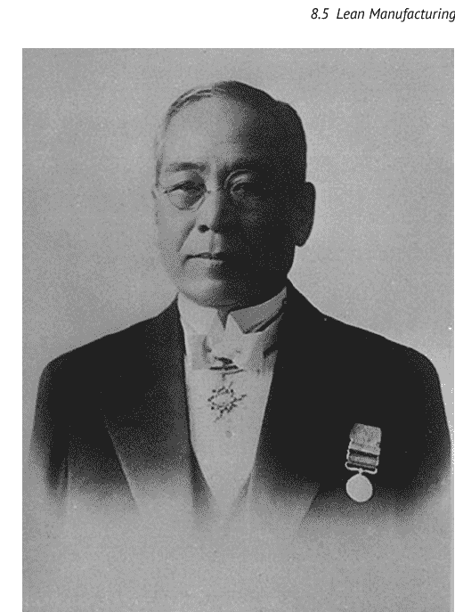

图8.12 丰田佐吉。*来源：* https://commons. wikimedia.org/wiki/File:Sakichi_TOYODA.jpg。

## 8.5.3 丰田开发TPS

### 8.5.3.1 丰田佐吉

丰田对后来成为精益的思想的发展，可能始于20世纪初的丰田佐吉（图8.12），当时他在一家纺织厂工作，那里的织机在断线时会自动停止。这成为自动化和*自働化*的雏形。丰田与*JIT*的渊源可能始于1934年，当时它从纺织业转向生产第一辆汽车。丰田汽车公司的创始人丰田喜一郎指导了发动机铸造工作，并发现了制造过程中的许多问题。他决定必须通过对每个工艺阶段的深入研究来停止修复劣质产品。1936年，当丰田赢得与日本政府的第一份卡车合同时，他处理了新的问题，并组建了“改善”团队。

战后日本经济中的需求水平较低，因此通过规模经济实现单位最低成本的大规模生产重点几乎无用武之地。在参观并看到美国的超市后，大野耐一（1988年）认识到，工作的调度不应由销售或生产目标驱动，而应由实际销售驱动。鉴于这一时期的财务状况，必须避免过度生产，因此拉动（按订单生产而非目标驱动的推动）的概念开始支撑生产调度。

在丰田，正是大野耐一将这些主题汇集在一起。他在已有的内部思想流派基础上进行了发展，并将其广度和应用扩展为如今所谓的*丰田生产系统*（TPS）。精益生产主要源于TPS（在20世纪80年代被广泛称为*JIT制造*），但现在也包含了许多其他来源，并不断发展。

诺曼·博德克在为福特《今天与明天》重印本所写的前言中写道：

丰田于1980年首次接触到JIT和TPS的概念。随后，丰田（贵司）先生在我们多次赴日学习考察中有机会目睹了其在丰田的实际应用。在那里，我见到了该系统的创建者大野耐一先生。当被我们团队问及是什么启发了他的思考时，他只是笑着说，他这一切都是从亨利·福特的书中学来的。TPS的规模、严谨性和持续学习的特性使其成为精益的核心概念。

在丰田，正是大野耐一将这些主题汇集在一起。他在已有的内部思想流派基础上进行了发展，并将其广度和应用扩展为如今所谓的*丰田生产系统*（TPS）。精益生产主要源于TPS（在20世纪80年代被广泛称为*JIT制造*），但现在也包含了许多其他来源，并不断发展。

## 8.5.4 塔塔集团

*贾姆希德吉·塔塔*，全名*贾姆希德吉·努塞尔万吉·塔塔*（1839年3月3日生于印度古吉拉特邦纳夫萨里 – 1904年5月19日卒于德国巴特瑙海姆），印度慈善家和企业家，创立了塔塔集团（图8.13）。他雄心勃勃的事业帮助推动了印度跻身工业化国家之列。

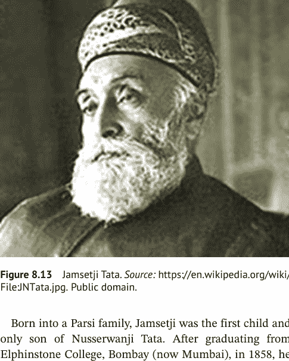

**图8.13** 贾姆希德吉·塔塔。*来源：* https://en.wikipedia.org/wiki/File:NTata.jpg。公有领域。

贾姆希德吉出生于一个帕西家庭，是努塞尔万吉·塔塔的第一个孩子和唯一的儿子。1858年从孟买（现孟买）的埃尔芬斯通学院毕业后，他加入了父亲的出口贸易公司，并帮助其在日本、中国、欧洲和美国建立了分公司。1868年，贾姆希德吉创办了一家贸易公司，该公司后来发展成为塔塔集团。1872年，他专注于棉纺制造，随后在那格浦尔、孟买和库尔拉建立了工厂。他的企业以高效、改善劳工保护政策以及引入更精细的纤维等级而闻名。他还规划了孟买地区的水力发电厂，这些电厂于1906年成为塔塔电力公司。

1901年，贾姆希德吉开始筹办印度第一家大型钢铁厂，六年后，该厂注册为塔塔钢铁公司（现为塔塔钢铁）。在他的儿子们——多尔布吉·贾姆希德吉·塔塔爵士（1859–1932年）和拉坦吉·塔塔爵士（生于1937年 – 2012年退休）——的指导下，塔塔钢铁公司成为印度最大的私营钢铁制造商，并成为一个企业集团的核心，其产品不仅包括纺织、钢铁和水力发电，还包括化学品、农业设备、卡车、机车和水泥。贾姆希德吉的其他商业项目包括泰姬陵皇宫酒店，这是印度第一家豪华酒店。1904年贾姆希德吉去世后，他的家族保持了对塔塔集团的控制，并将其打造为一个全球性的企业集团，到21世纪初，该集团已包括100多家公司。

作为一位著名的慈善家，贾姆希德吉于1892年设立了J.N.塔塔基金会，鼓励印度学生追求高等教育。1898年，他为班加罗尔（现为本加卢鲁）的一个研究所捐地，他的儿子们最终于1911年在那里建立了印度科学研究所。塔塔家族后来成为印度也许是技术教育和科学研究最重要的私人资助者。

## 8.6 浪费的类型

尽管消除浪费看似是一个简单明了的话题，但值得注意的是，浪费通常被非常保守地识别。这极大地降低了此类目标的潜在效果。消除浪费是精益的目标，丰田定义了三大类浪费：*muda*、*muri*和*mura*；在许多精益实施中，这个列表往往缩减为仅第一类浪费，从而相应减少了收益。

为了说明这种思维状态，新乡重夫观察到，螺栓只有最后一圈拧紧才起作用——其余的都是移动。这种对浪费日益精细的区分，是区分增值活动、浪费和非增值工作的关键（大野耐一，1988年）。非增值工作是在当前工作条件下必须完成的浪费。一个关键点是衡量或估计这些浪费的规模，以展示所实现变革的效果，从而体现向目标迈进的步伐。

基于“流动”（或顺畅性）的方法旨在通过消除工作调度引起的变异来实现JIT，从而使用各种技术为实施提供驱动力、理由或目标和优先级。实现JIT的努力会暴露许多被缓冲库存掩盖的质量问题；通过强制仅使增值步骤顺畅流动，这些问题变得可见，并且必须被明确处理。

*Muri*是指管理层由于组织不善而强加给工人和机器的所有不合理工作，例如搬运重物、到处移动东西、危险任务，甚至工作速度显著快于平时。这是把人或机器推向超出其自然极限。这可能仅仅是要求一个流程在其无法承受的性能水平下运行，而无需采取捷径和非正式地修改决策标准。不合理的工作几乎总是导致多种变异的根源。

在TPS和精益中，将这三个概念联系起来很简单。首先，*muri*关注流程的准备和规划，或者通过设计可以主动避免哪些工作。接下来，*mura*则关注工作设计如何实施，以及在调度或操作层面消除波动，例如


质量和数量。Muda 是在流程建立后才被发现，并以被动的方式处理。它通过产出变化体现出来。管理层的职责是检查流程中的 muda，并通过考虑系统与 muri 和 mura 的联系来消除其深层原因。muda 和 mura 的不一致必须反馈到 muri，即规划阶段，以便用于下一个项目。

这些浪费相互作用的典型例子是企业在报告期结束时“做数字”的行为。当“数字”偏低时，需求被提高以“完成计划”，从而增加（mura），这会导致生产试图从流程中挤出额外产能，进而导致例行工作和标准被修改或拉伸。这种拉伸和即兴发挥导致 muri 式的浪费，进而导致停机、错误和逆流，以及等待，从而产生等待、返工和搬运的 muda。

原始的七大浪费（TIM WOOD）如下：

- 运输（移动实际不需要进行加工的产品）
- 库存（所有未加工的零部件、在制品和成品）
- 动作（人员或设备移动或行走超过进行加工所需的距离）
- 等待（等待下一个生产步骤，换班期间生产中断）
- 过量生产（超需求生产）
- 过度加工（因工具或产品设计不良而产生的活动）
- 缺陷（检验和修复缺陷所花费的精力）（Womack and Jones 2003）。

最终，Womack 等人（1990）定义了第八个“muda”；它被描述为制造不符合客户需求或规格的商品或服务。许多人还将“未利用的人才浪费”添加到原始七大浪费中。例如，六西格玛包括技能浪费，被称为“未充分利用能力并在培训不足的情况下委派任务”。其他新增的浪费例如“空间”。这些浪费最初并不是丰田生产方式（TPS）中由大野耐一定义的七大浪费的一部分，但在实践中被发现是有用的补充。1999年，Geoffrey Mika 在其著作《Kaizen Event Implementation Manual》中增加了三种现在被普遍接受的浪费形式：为错误指标或无指标而工作的浪费、因不允许员工提出想法和建议并参与参与式管理而不充分利用完整员工的浪费，以及最后因计算机使用不当而产生的浪费；没有合适的软件、培训

使用方法，以及花费时间冲浪、玩游戏或只是浪费时间。有关“旧”和“新”浪费的完整列表，请参阅 Bicheno 和 Holweg（2009）。

将非增值工作与浪费工作区分开来对于识别当前工作流程背后的假设并在适当时候对其提出质疑至关重要（Ohno 1988）。SMED 和其他流程变更技术的突破依赖于在挑战加工假设时明确识别可能存在未开发机会的地方。

## 8.7 六西格玛在工业中的应用

Sigma（σ）表示总体标准差。六西格玛是在工业中用来描述一个过程的缺陷不超过每百万 3.4 个的术语。六西格玛的提法暗示远离正态分布中心六个标准差，但对完美稳定过程的假设与过程会轻微漂移的假设相联系，因此每百万缺陷数。该缺陷率如此之低，以至于缺陷被认为几乎被消除。采用六西格玛质量目标，摩托罗拉在数年内节省了超过 9.5 亿美元。艾利森公司报告节省了 15 亿美元。通用电气、宝丽来和德州仪器是其他采用六西格玛目标的主要公司。

## 8.8 精益实施源于 TPS

### 8.8.1 精益领导力

组织内领导者的作用是持续推进精益思维进展的根本要素。例如，丰田的资深 kaizen 成员经常提出 Senpai、Kohai 和 Sensei 的概念，因为他们强烈认为，只有当更有经验的丰田 Sensei 不断指导和引领经验较少的精益冠军时，丰田文化的传递才能在丰田内部向下和横向进行。

精益的一个失调效应体现在关键绩效指标（KPI）领域。用于评判工厂/设施的 KPI 通常会驱动行为，因为 KPI 本身就假设了对所做工作的特定方法。当例如真正精益的、固定重复计划和 JIT 方法被采用时，这可能成为一个问题，因为这些 KPI 将不再反映绩效，因为其基础假设变得无效。管理组织内这种 KPI 混乱的影响是领导者面临的关键挑战。

同样，传统上用于支持大规模生产的会计系统对于追求精益的公司已不再适用。精益会计为业务管理和财务报告提供了真正精益的方法。

在 TPS 中制定了精益制造方法的指导原则后，丰田于 2001 年正式确定了其精益管理的基石：为长期持续改进所需的关键管理价值观和态度。这些核心管理原则围绕持续改进（无情消除浪费）和尊重人（基于持续改进和相互信任的长期关系）的双支柱展开。

这种正式化源于问题解决。随着丰田在过去 20 年里扩展到本土基地之外，它在 TPS 的正确应用上遇到了与西方其他公司复制 TPS 时相同的问题。像任何其他问题一样，它一直在尝试一系列对策来解决这一特定问题。这些对策集中在文化上：人们的行为方式，这是所有挑战中最困难的。没有适当的价值观和行为原则，TPS 可能会被完全误用而无法取得成果。就像 TPS 一样，这些价值观最初是以师徒的方式传递的，从上司到下属，没有任何书面说明。就像 TPS 一样，内部曾争论正式化价值观会扼杀它们并导致进一步的误解。然而，随着丰田老员工最终写下 TPS 的基本原则，丰田着手将丰田之道写下来以教育新员工。

持续改进分解为三个基本原则：

- 1) *挑战*：要有长期的愿景，面对实现自己雄心的挑战（我们需要学习什么而不是我们想做什么，然后有勇气面对挑战）。为此，我们必须每天挑战自己，看看是否实现了目标。
- 2) *Kaizen*：足够好永远不够，任何流程都不能被认为完美，因此必须持续改进，追求创新和进化。
- 3) *Genchi Genbutsu*：亲临现场了解事实并做出正确决策、形成共识并确保以最佳速度实现目标。

尊重人原则在丰田之外鲜为人知，本质上涉及两个定义原则：

- 1) *尊重*：认真对待每个利益相关者的问题，并尽一切努力建立相互信任。为他人实现目标承担责任。
- 2) *团队合作*：这关乎通过团队解决问题来培养个人。其思想是通过对团队绩效的贡献来培养和调动员工。车间团队、整个工厂作为团队，以及从一开始的团队丰田。

### 8.8.2 与 TPS 的差异

虽然许多人认为精益是将 TPS 推广到其他行业和背景的概括，但在实施中出现了一些公认的差异。

- 1) *追求利润* 是丰田的无情关注点，以利润最大化原则（价格 − 成本 = 利润）为例，因此需要通过 TPS 或其他方式进行系统化的成本削减以实现收益。精益实施往往倾向于淡化这一关键衡量标准，从而痴迷于“流动”或“拉动”改进概念的实施。然而，“价值曲线分析”的出现有望将精益改进直接与底线绩效衡量联系起来。
- 2) *工具导向* 是许多项目中存在的倾向，即将单纯的工具 [标准化作业、价值流图（VSM）、目视管理等] 提升到超出其实用意图的不健康地位。工具只是处理特定类型问题的方法，但它们并不会为你解决问题或总是突出许多类型问题的根本原因。丰田使用的工具通常用于暴露特定问题，然后再处理这些问题，因为每个工具的局限性或盲点可能被更好地理解。例如，价值流图侧重于物料和信息流动问题（该活动名称已内置于丰田的标题中），但在指标、人员或方法方面并不强。内部他们非常清楚工具的局限性，并理解它从未打算成为查看和分析每种浪费或与质量、停机时间、人员发展、交叉培训相关问题、产能瓶颈或与利润、安全、指标或士气等有关的每个问题的最佳方式。没有一种工具能做到所有这些。为了浮现这些问题，其他工具被更广泛、更有效地使用。
- 3) *管理技术而非变革推动者* 自 1950 年代初丰田开始强调培养生产经理和主管在指导自然工作团队方面的技能组合，而不依赖员工层面的变革推动者来推动改进以来，这一直是丰田的原则。这可能表现为精益的“推”式实施，而非团队自身的“拉”式实施。这一技能发展领域并非变革推动者专家的领域，而是


制造业可以及时更新和改变生产战略。

供应链通过在主要市场附近部署第二家工厂或仓库来做出改变，以便迅速响应消费者的需求，而不是在低成本国家投资制造工厂。例如，戴尔直接从其网站销售电脑，将特许经销商排除在供应链之外。然后，该公司使用外包合作伙伴生产其零部件，并将零部件交付到世界各地这些主要市场的装配工厂。

Zara 决定通过与西班牙当地合作伙伴在五周内快速生产服装来加快时尚进入消费者市场，并且从未参与大规模生产以追求新款式并保持产品新鲜。

避免市场风险并有效控制供应的另一种方法是减少库存。宝洁已与沃尔玛和其他批发公司合作，通过建立直接面向供应商公司的库存响应系统来实现目标（Martin 2005）。随着全球规模供应链的改善，企业在全球企业和供应商之间密集应用精益实践（JIT、供应商合作伙伴关系和客户参与），以便有效地与消费者市场建立联系。

## 8.8.5.2 危机

在丰田精益生产多年成功之后，供应链网络的整合使丰田在快速扩张中成为世界最大的汽车制造商。2010年，丰田安全相关问题的危机使复制了丰田供应链系统的其他汽车制造商担心同样的召回问题也可能发生在他们身上。

James Womack曾警告丰田，与单一外包供应商合作可能会带来意想不到的问题（Hopp 2011；Ohno 1988）。事实上，这场危机耗费了巨额资金，并让丰田思考 JIT 实践是否存在问题，因为缺乏足够经验和资深工程师的外包供应商无法在日本以外的地方对供应商进行近距离监控。这被证明为经济规模全球化时，软性学习实践在外包供应商中变得更加重要，如果他们能与合作伙伴保持良好的师傅关系并不断完善生产流程。否则，丰田开始考虑是否要有更多供应商生产同一零部件；这可能会在风险控制上带来更多安全保障，并减少未来可能发生的巨大成本。

JIT 在供应链系统中的应用是全球规模精益实施的关键问题。供应合作伙伴如何避免造成生产流程？全球企业应让更多能够相互竞争的供应商，以便获得最佳质量，同时降低生产流程中断的风险。

## 8.8.6 实现精益系统的步骤

应实施以下步骤来创建理想的精益制造系统：

- 设计一个简单的制造系统
- 认识到总是有改进的空间
- 持续改进精益制造系统设计（Ohno 1988）

### 8.8.6.1 设计一个简单的制造系统

精益制造的一个基本原则是基于需求的流程制造。在这种生产环境中，库存只有在需要满足客户订单时才会被拉动通过每个生产中心。此目标的好处包括以下几点：

- 周期时间减少
- 库存减少
- 生产率提高
- 资本设备利用率提高

### 8.8.6.2 持续改进

持续改进的思维方式对于实现公司的目标至关重要。“持续改进”一词意味着随着时间的推移对产品、流程或服务进行增量改进，目标是减少浪费以提高工作场所功能、客户服务或产品性能。精益建立在对产品和流程进行持续和增量改进的概念之上，同时消除冗余活动。“增加活动的价值仅仅是客户愿意付费的东西，其他一切都是浪费，应该被消除、简化、减少或整合。”通过以客户所需速度在新理想系统布局中改善物料流动，可以减少物料搬运和库存中的浪费（Bicheno and Holweg 2009）。

## 8.8.7 衡量

整体设备效率是一组在精益环境中适用良好的绩效指标。此外，技术人员主要成员（PMTS）、方法时间测量、成本分析和也许时间研究可用于评估运营流程中的浪费和 IT 效率。例如，Jun-Ing Ker 和 Yichuan Wang 分析了两种处方技术，即无碳需求和数字扫描技术，以量化多医院健康系统中药物订购、转录和配药流程的优势。通过对这两种技术的比较，统计分析结果显示，采用数字扫描技术可显著减少流程时间。结果表明，使用数字扫描技术后，排队时间减少了 54.5%，订单录入时间减少了 32.4%，发出延迟时间减少了 76.9%，发出运输时间减少了 67.7%（Ker et al. 2014）。

## 8.8.8 实施困境

精益的一个批评是，其从业者可能更关注工具和方法，而非精益的哲学和文化。因此，需要适当的管控以避免精益方法实施失败（Hopp and Spearman 2008）。另一个陷阱是管理层在不了解真正问题且未咨询车间人员的情况下决定使用何种解决方案。因此，精益实施往往看起来对管理者不错，但未能改善状况（Hopp and Spearman 2008）。

此外，许多源自丰田生产方式的流行精益举措，都是针对丰田当时面临的具体问题的解决方案。丰田在不理想的现状下，确定了最终状态应是什么样。通过大量研究，差距被缩小，这就形成了今天许多工具。经常，当一种工具在丰田生产方式之外实施时，企业认为解决方案具体存在于其中一种流行的精益举措中。曾是特定公司特定问题的解决方案的工具，可能无法以设计的完全相同方式应用。因此，解决方案与问题不匹配，形成了临时解决方案而非实际根本原因（Ohno 1988）。

精益哲学旨在降低成本同时优化和改善绩效。价值流图和 5S 是企业迈向精益组织第一步时最常用的方法。精益行动可以专注于具体的物流流程，或覆盖整个供应链。进行差距分析可确定企业“必须采取”的步骤以改善价值流并实现目标。基于该评估，改进小组进行失效模式影响分析，以识别和预防风险因素。让一线员工参与价值流图活动至关重要，因为他们了解流程并能直接提高效率。虽然每次精益活动的影响可能很小且有限，但在供应链沿线逐步实施一系列小改进，可以带来生产率的提升（Merrill 2013）。

采用精益方法后，管理人员和员工都会经历变化。因此，在精益之旅开始时需要果断的领导者。控制精益之旅有几个要求。首先也是最重要的是，专家建议组织应拥有自己的精益计划，由精益领导层制定。换句话说，精益团队为领导者提供建议，然后领导者做出实际的实施决策。第二，在组织开始精益之旅时建议进行辅导。他们将把知识和技能传授给车间员工，精益实施将更加高效。第三，用于衡量精益和改进的指标或测量极其重要。它将使领导者能够收集进行明智决策所需的数据。没有足够的流程和产出测量能力，就无法成功实施精益。为了控制和改进未来的结果，必须看到并测量，即绘制当前正在发生的情况（Ohno 1988）。

## 8.9 制造系统特征：工艺规划基础

对计算机集成制造系统的投资是由对高质量零部件、小批量、敏捷性和短交货期的渴望所驱动的。在零件规格的早期阶段，建立集成 CAD/CAM 环境是快速离线模拟和验证新零件设计的关键。设计、工艺规划和制造集成在多个层面上发生，这取决于练习的目标和“灵活性”程度（即设计或工艺固定的程度）。设计、制造和精加工之间可实现的集成水平取决于几个因素（Stein and Dornfeld 1996）：

- 1) 设计、制造或精加工任务的性质
- 2) 执行任务的环境
- 3) 可用于协助设计者完成任务的工具

在当今和未来的生产环境中，已识别出设计、制造和精加工任务之间四个不同的集成水平（Stein and Dornfeld 1997）。集成水平可以用在每个水平上在整个零件生产过程的各个阶段预测、影响和优化零件生产目标的能力来描述。这些目标涵盖了多种工艺指标，这些指标影响保持形状公差、形态公差、所需表面特性以及亚表面损伤/残余应力的目标。从工艺规划角度来看，这四个集成水平使用特征质量作为工艺指标，示于表 8.2。


## 表8.2 设计到制造周期中集成的四个层级

| 集成层级 | 工艺规划软件专家和智能体任务 | 调整自由度 |
|---|---|---|
| 第一级 | 在迭代设计和工艺规划环境中的特征预测、控制和优化 | 设计：高<br>制造：高<br>精加工：高 |
| 第二级 | 在“隔墙式”设计到制造环境中，通过选择制造计划进行特征预测、控制和优化 | 设计：低<br>制造：高<br>精加工：高 > 低 |
| 第三级 | 通过对预设定制造工艺进行有限调整来实现特征预测和控制 | 设计：低<br>制造：有限<br>精加工：高 |
| 第四级 | 用于精加工工艺规划、精加工刀具轨迹和传感器反馈策略的特征预测 | 设计：低<br>制造：低<br>精加工：高 |

> 来源：Stein和Dornfeld（1997）。

在集成度最高的第一级，设计者正在考虑部件的设计。在此级别，任何将设计、工艺规划和制造关联起来的信息都可用于改善部件的整体“可制造性”。在集成度稍低一级的第二级，设计可能是固定的，但仍然可以制定工艺规划和制造配置，以确保满足零件规格。在更低的第三级，设计、工艺计划以及制造设备都可能是固定的。然而，即使在这个级别，仍然可能且有必要考虑对制造过程进行优化和微调，以通过改变整体几何形状或集成水平来应对意外问题；而且这可能仅仅有助于确保后续制造过程（例如精加工）得到高效、准确的执行。随着设计、制造和精加工之间的集成水平从第四级提高到第一级，软件工具（以及设计者）影响和优化特征尺寸、形状或质量等工艺指标的能力也随之增强。让设计者在更高集成级别下工作的结果是，提高了设计决策对某一工艺指标（如毛刺形成）的敏感性，并使设计者能够通过分析、仿真和决策评估来优化和平衡相互冲突的工艺指标。

## 8.10 生命周期设计

生命周期设计涉及产品制造完成后的阶段。在许多情况下，产品除了购买价格之外，还会给客户带来可观的成本。

这些成本包括安装、维护和修理、备件、产品未来升级、运行期间的安全性，以及产品在其使用寿命结束时的处置。表8.3列出了与产品生命周期设计相关的大部分因素。

## 表8.3 生命周期设计中的因素

| 因素 | 典型问题和注意事项 |
|---|---|
| 交付 | 运输成本、交付时间、大批量生产物品的存储和分销、所需承运商类型（卡车、铁路、航空运输） |
| 可安装性 | 公用设施要求（电力、气压等）、建设成本、现场装配、安装期间的支持 |
| 可靠性 | 产品的使用寿命、故障率、可靠性测试要求、产品中使用的材料、公差 |
| 可维护性 | 设计模块化、装配中使用的紧固件类型、预防性维护要求、客户维护的便利性 |
| 可维修性 | 产品复杂性、诊断技术、现场服务人员的培训、产品内部结构（工作部件）的可达性、所需工具、备件的可用性 |
| 人为因素 | 使用的简易性和便利性、控制系统的复杂性、潜在危险、操作期间受伤的风险 |
| 可升级性 | 当前设计与未来模块和软件的兼容性、升级成本 |
| 可处置性 | 产品中使用的材料、部件的回收利用、废物危害 |

> 来源：改编自Groover（1999）。

产品成本是决定其商业成功与否的主要因素。成本影响产品的定价和利润。面向产品成本的设计是指公司努力识别设计决策对整体产品成本的影响，并通过优化设计来控制这些成本。许多DFM指南都旨在降低产品成本。公司建立一个产品成本模型来预测不同设计选择可能如何影响材料、制造和检验成本，这通常很有用。

对于客户而言，如果将生命周期成本（LCC）计算在内，为产品支付的价格可能只是其总成本的一小部分。一些客户（例如联邦政府）在采购决策中会考虑LCC。制造商通常必须提供服务合同，以限制客户在失控的维护和服务成本方面的风险。此时，必须将这些LCC的准确估算纳入产品总成本中（Groover 1999）。

## 8.11 可持续设计与环境意识设计制造

在本节中，我们将围绕精密制造技术，详细讨论能源及其紧密相关的环境问题。能源与环境这两者将在未来推动精密制造的技术和实践。当然，遵循摩尔定律的更多增量式发展——更高密度的数据存储、先进光学、更复杂的医疗设备、纳米级器件、复杂的电信和IT进步等等——仍将存在并不断推动我们前进。但真正主导我们未来的，是产品设计、制造、使用和再利用或处置过程中的能源和环境影响这一双重主题。这预计将促使我们朝着以下方向发展：

- 先进能源技术（例如电池、光伏/太阳能、氢燃料发动机、光合作用、混合动力汽车、高效发动机、水力发电、风力发电、先进生物燃料制造）

- 可持续制造（例如绿色机器、绿色工厂、绿色工艺和系统（包括供应链），最大限度地减少或消除废物、耗材、能源，绿色产品（零缺陷和零影响），再利用或再制造）。

对于可持续制造，我们需要重新思考产品设计和制造的方法。例如，我们如何为全球变暖、过度的能源和资源消耗、制造业相关的大气污染等重大问题提供增量式解决方案？

### 8.11.1 可持续制造技术

人们对能源和原材料的可得性与成本、工业活动的影响以及消费产品在其使用寿命结束后的有效再利用的关注日益增加，这些正在推动绿色制造的努力。这是国际上对设计和制造中整体实现可持续性这一更大关切的组成部分。这里所定义的可持续性，意味着一种在范围上非常全面的资源利用水平。它必须与这样一个必要的水平相一致，以确保随着时间的推移，资源（i）不仅仍然可用，而且（ii）需求被降低到接近自然可持续的水平。也就是说，必须理解当前使用与可持续使用之间的“差距”。这是一个难以达到的衡量标准，但归根结底，这是必需的（Dornfeld和Lee 2008）。

“绿色商业”这一话题如今在商界非常流行。从GE（其“环保”活动）到福特（其部分产品的可持续“供应链”），企业都发现推广绿色产品和绿色经济既有利可图，又负责任。像丰田这样的汽车制造商强调整个制造过程（包括供应链）都必须是绿色的。其他公司，如康明斯发动机，则从事发动机部件的“再制造”，这些部件在首次使用后仍具有使用寿命。

接下来将对绿色制造进行简要介绍，然后回顾在讨论绿色制造时理应包含的系统要素和范围。还将讨论“技术楔子”的概念，以及如何应用该概念来识别环境友好型制造的机会，并将解决方案与现有工艺或供应链相结合。

### 8.11.2 绿色制造流程

Sheng等人（1995）很早就考虑了将绿色组件和分析集成到制造系统中。一些研究人员已更详细地成功解决了制造过程的特定部分，例如最小量润滑/干式加工，目前已在国际上许多制造作业中实施（Zimmerman等人，2003）。这些具体成果通常被称为“技术楔子”，是综合解决方案的一部分。下一节将更详细地解释这些楔子。Ishii研究了在产品设计时纳入报废考虑因素（1999）。

图8.14展示了设计和制造的绿色要素示意图。“生命周期”的


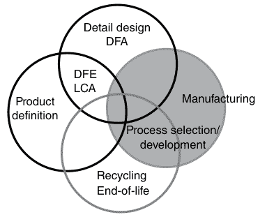

图 8.14 示意图显示了从产品定义到产品寿命终止的设计与制造绿色要素之间的关系。

从设计到寿命终止时产品回收或再利用必须被考虑。该图提及生命周期分析 LCA 工具（见第 6.3 节）(Das 2002, 2005; Das and Houtman 2004)、设计用于装配 DFA 以及设计用于环境 DFE。该图区分了产品的设计与制造产品的工艺或系统。重要的是，既要考虑工艺的设计，也要考虑工艺制造产品时的运行方式。在制造产品的机器设计中存在巨大的机会（Taniguchi et al. 2005），以及在它们的生产运行中[例如宏观和微观规划，见 Srinivasan and Sheng (1999a, b)]。

关于绿色制造实践，有必要考虑产品生命周期中所有要素的环境影响，如图 8.15 所示。该图涵盖了从原材料原始来源

的尽可能广的范围（包括采矿成本）到使用后产品最终处置。每个要素都包括废物（或未利用资源和副产品）。这些工艺各个阶段消耗的能源和资源，以及废物输出，将“抵消”新产品或机器因工艺而带来的任何益处。事实上，为了完整，我们可以认为制造包括产品生命周期大部分阶段的要素，因为采矿、转换和运输可以说都是制造的一部分。在更详细的层面上，可持续制造可以通过改进制造的各个组成部分来解决（图 8.16）。在这里我们看到促进可持续制造的因素包括能源来源和工艺。

要有效，任何以“环境友好”方式生产的产品或工艺在其生命周期内必须实现净能源、资源或环境影响节约，以满足可持续性定义。通俗地说可以说：“如果你在制造产品时消耗的资源与产品使用时节省的资源一样多，你就没成功！”这需要仔细核算整个工艺链要素的影响，而这往往不容易做到。

## 8.11.3 可持续制造：绿色等同于可持续吗？

如果我们观察资源（任何资源）的消耗或该消耗随时间的影响，我们可以识别出一种趋势，通常随时间递增。可持续的消耗率或影响往往要低得多。在这里我们可以在一个广为引用的

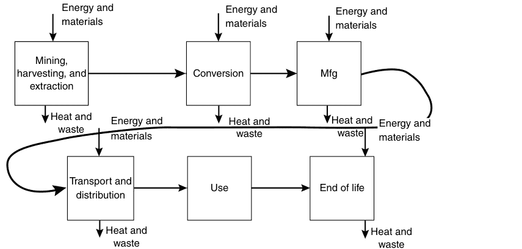

图 8.15 示意图显示了在产品生命周期内绿色制造实践中考虑环境影响的要素。

提出“技术楔子”——类似于“稳定化楔子”——为解决这些能源挑战提供了一个框架和潜在的度量指标。

有一系列基本规则支配着楔形技术在制造中的应用。按任意顺序，它们如下（Dornfeld and Wright 2007）：

规则 1. 楔子相关的材料和制造成本[以能源消耗和温室气体 GHG 排放等计]不得超过在该楔子所应用的工艺或系统或产品生命周期内实施楔子所产生的节约（见第 8.11.4 节）。

规则 2. 技术必须应用于工艺链的最低层级。

规则 3. 技术的成本和影响必须以制造系统和环境的基本指标来计算。也就是说，成本和影响必须可以用美元（或欧元、日元等）、碳当量、全球变暖气体产生或减少、焦耳、周期时间和生产率、质量指标、交货期、营运资本等单位表达，相对于当前消耗、使用、时间等的水平。

规则 4. 技术必须同时考虑社会关切以及商业和经济（Hawken 1993）。

规则 5. 必须有相应的分析手段或设计工具，以便在工艺或系统的设计阶段对其进行评估。它必须是一个集成的方法。

这些规则在应用时将确保从环境角度对技术影响进行平衡和准确的评估，并确保规则在商业角度上可行。这将避免因收益导致全球净损失而在供应链中造成的异常。社会上目前存在许多净损失的例子，例如所谓的“高科技/低成本”产品，其中一些运行高效，但使用寿命短。消费者“学会”期望这一点，因此期望在短时间内更换产品。这种趋势破坏了大量产品价值和资源，更糟的是，它助长了环境破坏。如此“一次性”产品的生命周期在设计、制造、使用或再利用中往往未被考虑。

## 8.12 精益六西格玛

### 8.12.1 引言

精益六西格玛是一种依赖协作团队努力通过系统地消除浪费和减少变异来提高绩效的方法。它结合了精益制造/精益企业和六西格玛，以消除八种浪费（muda）：

- 1) 运输
- 2) 库存
- 3) 动作
- 4) 等待
- 5) 过度加工
- 6) 过度生产
- 7) 缺陷
- 8) 员工利用不足

六西格玛寻求通过识别和消除缺陷（错误）的原因并最小化（制造和商业）过程中的变异性来提高过程输出的质量。协同地，精益旨在通过收紧工艺步骤之间的联系来实现连续流动，而六西格玛则专注于减少工艺步骤的工艺变异性（以其各种形式），从而实现这些联系的收紧。简而言之，精益暴露了工艺变异的来源，而六西格玛旨在减少该变异，使迭代改进的良性循环得以实现，目标是实现连续流动。

六西格玛是一种旨在提高质量、降低成本并提高客户满意度的业务流程。该名称来自统计学，其中高水平的质量代表每百万缺陷不超过 3.4 个。六西格玛的目标是识别并消除缺陷的原因。计划-执行-检查-行动（PDCA）或计划-执行-研究-行动（PDSA）是一种持续改进的迭代方法。它也与改进循环 DMAIC（定义、测量、分析、改进和控制）相关。DMAIC 循环用于现有产品，与产品开发期间使用的 DMADV（定义、测量、分析、设计、验证）相关。

### 8.12.2 六西格玛的历史：1980 年代–2000 年代

#### 8.12.2.1 Motorola 故事

六西格玛的起源在摩托罗拉。在对产品现场寿命的研究中，一名摩托罗拉工程师观察到，在制造中无缺陷的产品很少在客户早期使用时失效。然而，在生产过程中失效并经过返工的产品更容易在客户手中早期失效。似乎那些最初制造良好的产品工作良好，而那些最初有缺陷的产品可能还有其他缺陷。发现并修复一个缺陷并不能保证产品良好。

仅仅发现和修复缺陷是不够的，它们必须被预防。

只有当生产产品的工艺设置成缺陷不可能或不会发生时，才能预防缺陷。摩托罗拉专注于“如何”在每个和每一个工艺中完成工作。如果缺陷被预防，就不需要返工，质量会更高。由于工艺很多，摩托罗拉开发了一种可应用于每个工艺的六西格玛工作度量。

摩托罗拉开发的度量称为每个与工艺相关的关键质量特性 CTQ 的西格玛水平或西格玛值。CTQ 分析是一种研究工艺流程图以寻找问题的方法。该分析研究输入和输出并识别影响工艺及其输出质量的步骤。如果工艺处于理想状态，它是稳定、可预测的并满足 CTQ。如果它稳定、可预测但不满足 CTQ，则处于阈值状态。如果它没有特殊原因，应该相对容易通过 DMAIC 项目将其移入理想状态（见第 8.12.2.3 节）。

西格玛水平基于统计分析，将每百万机会缺陷数 DPMO 与 CTQ 相对于客户要求的水平能力联系起来。DPMO 为 3.4 的 CTQ 与能力值 Cp = 2.0 和 Cpk = 1.5 相关，被认为达到了六西格玛水平。摩托罗拉成功地将六西格玛的概念、哲学和技术应用于 Bandit 分页器的设计、开发和生产。该分页器的质量水平无与伦比。摩托罗拉表明，传统的检测和修复缺陷的方法导致 CTQ 达到四西格玛质量水平。六西格玛质量，或 3.4 DPMO，导致消除昂贵的检验和返工，进而导致制造时间减少和客户满意度提高。客户满意，摩托罗拉获得了惊人的财务节约。

#### 8.12.2.2 通用电气故事

1995 年，AlliedSignal 的 Larry Bossidy 向通用电气 GE 高层介绍了六西格玛。Bossidy 关于 AlliedSignal 实现的益处的描述促使时任 GE 首席执行官 Jack Welch 启动了六西格玛计划，目标是到 2000 年将 GE 的所有产品提升到六西格玛水平。当时，GE 的工艺运行在三到四西格玛之间，这意味着平均 35 000 DPMO。从三或四西格玛到六西格玛需要一次巨大的培训和教育工作。GE 推出了严格的六西格玛方法培训，重点 heavily 放在统计方法上。1996 年至 1998 年间，GE 的培训投资接近 10 亿美元，而该投资的回报已经跟上步伐。到 1999 年他们预计节省 15 亿美元。GE 的业务范围从各种产品到各种服务，包括 GE 资本。在整个 GE，六西格玛计划为组织的底线及其为客户服务的<|message|> 带来了益处。

#### 8.12.2.3 DMAIC 模型

DMAIC 模型的五个阶段是定义、测量、分析、改进和控制（图 8.18）。虽然该模型建议线性进展，每个阶段导致下一个阶段，但阶段之间总会有一些迭代工作。每个阶段涉及一定量的工作以完成，这是成功完成六西格玛项目不可或缺的（Ward and Poling 2004）。

DMAIC 的阶段 定义阶段用于聚焦六西格玛项目并创建具有时间线的路线图，以指导所有项目活动顺利完成。在冠军领导下，项目团队开展与项目相关的流程映射并与流程的所有利益相关者建立沟通。关于团队成员和会议时间的后勤决策被决定。章程最终确定并由所有人签署。如果关于时间或人员等资源可用性出现问题，冠军会帮助解决这些问题。

测量阶段专注于收集数据以评估当前流程绩效。它涉及确定与项目相关的所有度量。这些包括与组织记分板挂钩的记分卡指标以及流程的所有 CTQ 特征。所有度量必须明确识别并为每个度量设置数据收集计划。然后可以定期收集数据用于分析阶段。

在分析阶段，使用各种技术来确定当前流程绩效与项目章程中的绩效目标相比如何。数据被分析，其明确目的是了解当前流程为何以这种方式工作。特别重要的是确定流程是否具有可预测或不可预测的行为。可预测的流程具有始终存在并每天影响流程的常规变异来源。不可预测的流程具有常规变异来源加上特殊、不可预测的变异来源，这些来源可能使流程脱轨。

改进阶段的活动旨在找出如何改进流程。该阶段涉及调查流程的哪些变化会使

图 8.18 DMAIC 模型的五个主要组成部分。

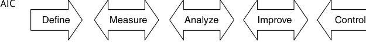


使流程更好地满足项目目标。项目团队可以进行实验，了解可以实现什么目标以及相关成本。一旦确定了几个解决方案，项目团队可以评估并试点这些方案，以了解其潜在收益。在最终改进方案被选定和实施之前，项目团队需要评估所有解决方案的潜在问题。解决所有潜在问题将确保该解决方案在未来不会受到损害。

最后，DMAIC模型中的*控制阶段*必须专注于使变革持久化，以实现持续的过程改进。这意味着项目团队将致力于那些关键活动，以便将改进后的流程移交给流程所有者。要从任何六西格玛项目中获益，改进必须由组织而非项目团队来维持。控制阶段包括员工培训、控制计划和持续关注流程的过程度量。项目团队将DMAIC模型的控制阶段交还给组织，这一过渡伴随着标准化和制度化阶段。

## 8.12.2.4 计算过程西格玛值

过程西格玛值提供了一种比较不同流程性能的方法，可以帮助您确定项目的优先次序。过程西格玛值代表首次即正确满足CTQ的案例总体。西格玛值通常以*百万机会缺陷数*表示，而不是每百或每千，以强调对世界级绩效的需求。并非所有使用六西格玛的组织都计算过程西格玛值。有些组织仅使用缺陷数量或满足CTQ的订单百分比来展示其绩效。无论哪种方式，如果要让基准测试有意义，计算必须以一致的方式进行。

表H.2包含了“合格率”百分比、西格玛水平和DPMO——即首次正确数据。您可以看到，六西格玛绩效仅相当于3.4 DPMO（Morgan和Brenig-Jones，2016）。

精益六西格玛使用与六西格玛类似的DMAIC阶段。精益六西格玛项目既包含精益消除浪费的内容，也包含六西格玛基于关键质量特性减少缺陷的重点。精益六西格玛的DMAIC工具包包含了所有精益和六西格玛工具。精益六西格玛的培训是通过类似于六西格玛的带级培训体系提供的。带级人员被指定为白带、黄带、绿带、黑带和黑带大师，类似于柔道。

## 8.12.2.5 精益六西格玛组织结构

对于每个带级，都有相应的技能集，说明在特定带级中应掌握哪些精益六西格玛工具。这些技能集详细描述了参与者在完成培训计划后将获得的学习要素。还描述了这些学习要素可应用的层级。这些技能集反映了来自六西格玛、精益以及约束理论、全面生产维护等其他流程改进方法的要素。

## 8.12.3 5S

5S是一种精益实践，用于保持生产工作场所井然有序，并让员工致力于维护秩序。

### 日文术语

- 1) *Seiri*（整理）– 将物品摆放有序
- 2) *Seiton*（整顿）– 适当布置
- 3) *Seiso*（清扫）– 清洁（保持整洁）
- 4) *Seiketsu*（清洁）– 纯净（保持清洁）
- 5) *Shitsuke*（素养）– 灌输维持5S的态度/氛围的承诺

### 英文术语

- 1) *Sort*（整理）– 清除不必要的东西
- 2) *Straighten*（整顿）– 每样东西都有其位置并放置其中
- 3) *Shine*（清扫）– 保持机器/工作场所清洁
- 4) *Standardize*（标准化）– 维持1–3的系统与程序
- 5) *Sustain*（维持）– 维持系统/程序（1–4）

## 8.13 六西格玛与精益制造

六西格玛与精益理念之间有许多相似之处。两者都专注于流程及流程改进。每一种方法的技术都对另一种形成补充，并能产生增强的效果。

### 8.13.1 比较两种方法论

六西格玛专注于改进现有流程，以产生基本无缺陷的结果。达到六西格玛水平的CTQ特性或CTQ将只有3.4 DPMO。这里有两个理念在起作用：第一，预防缺陷更具成本效益，并减少对检验和返工的需求；第二，所有产品和服务都有多个CTQ特性。如果每个CTQ都达到六西格玛水平，那么产品或服务就会按照客户的期望运行。

消除非增值步骤的收益可能尚未得到评估或解决。此外，贯穿整个组织的流动是精益拉动系统的核心，可能也尚未得到考虑。我们今天所知的精益制造始于福特汽车公司在密歇根州鲁日工厂开创的理念。基于原料钢进厂、成品车出厂的理念，鲁日工厂将生产提升到了新的高度。随后，丰田将这一理念进一步推进。精益的卓越之处在于超越手工艺和大规模生产技术，转向基本上无需设置时间的小批量生产。由于小批量、小批次的生产方式，质量问题会被立即发现，并且不会有内部零件或材料的积压。小批量使质量立即可见，并带来了质量改进（见表8.4）。

时间的浪费、材料的浪费和金钱的浪费——这些都推动着精益理念。原始精益思想已衍生出许多分支。通过消除流程中的非增值步骤来消除浪费，催生了VSM（价值流图）。消除过剩库存并采用小批量生产，带来了“拉动”式生产系统。所有精益努力都旨在消除生产系统中各种类型的浪费。精益方法为缩短上市时间、降低成本并提高产品质量提供了机会。

这两种理念都聚焦于流程。精益技术可能正是用来实现质量改进和成本降低的方法，而这些是六西格玛行动的目标。六西格玛则可能提供统计技术，将精益行动提升到一个新水平。两者都至关重要，如果协同配合，将比单独使用任何一种都有效得多（Snee和Hoerl，2003）。

## 8.14 成本与质量分析

成本-质量分析是一种研究流程的流程图以识别问题的方法。该分析帮助团队以批判的眼光审视流程中的各个步骤，以寻找改进机会。质量成本是指因质量不佳而产生的成本，如果事情首次就能做对并且每次都做对，这些成本就不会发生。在成本-质量分析中，人们寻找会产生质量成本的活动。

何时使用：

- 在绘制过程流程图时，确保将质量成本活动包含在内。
- 在绘制过程流程图之后，用于识别问题、潜在原因以及集中改进的领域。

步骤：

- 1) 绘制过程的详细流程图。
- 2) 识别所有会产生质量成本的过程步骤（包括循环回路）：检查、修复和损坏控制。（本节稍后的“注意事项”中给出了这些成本的定义。）在这些步骤或回路周围画红色圆圈（红色表示停止）。
- 3) 如果没有或很少有步骤带有红色圆圈，请问：“可能出什么问题？我们如何判断出了问题？流程如何处理出错情况？”如有必要，在流程图中添加步骤。
- 4) 对于每个红色圆圈，问问自己：哪个流程步骤如果完美执行，就能让我们消除这个带红圈的步骤？在此确定的每个步骤周围画绿色圆圈（绿色表示通行）。
- 5) 绿色圆圈显示了寻找预防问题方法以及总体寻求改进的领域。绿色圆圈将包含红色圆圈所识别问题的根本原因。

示例：

图8.19显示了填写订单流程图的成本-质量分析。假设虚线圆圈是红色的：检查、修复（包括返工）和损坏控制。这些圆圈是先画出来的。请注意，在此流程图上，所有决策菱形都是检查或检验步骤。此外，两个循环回路是修复步骤。

表8.4 两种方法论比较：六西格玛与精益制造。

|  | 目标 | 关注点 | 缺失之处 |
|---|---|---|---|
| 六西格玛 | • 提高客户满意度<br>• 改进质量<br>• 提高盈利能力 | • 减少产品和服务中的变异<br>• 消除缺陷，达到六西格玛质量水平 | • 速度和效率<br>• 精简流程 |
| 精益制造 | • 减少浪费<br>• 降低库存<br>• 降低成本<br>• 提高速度 | • 精简流程<br>• 提高效率 | • 减少变异<br>• 预防缺陷 |


# 填写订单

图 8.19 成本与质量分析示例。

= 红色 = 检验、返工、损害控制

= 绿色 = 寻找预防措施

图中没有损害控制步骤，因为该流程图未显示外部客户出现问题时会发生什么。如果一位优质客户被错误地拒绝赊账怎么办？或者客户对交货日期不满意怎么办？或者发错了产品怎么办？或者账单有误怎么办？如果这些可能性都显示出来，它们会被红色圆圈圈出。

在分析的下一步，针对每个虚线圆圈，在流程图前面的方框中寻找预防措施。对于“产品是否合格？”这一检验环节以及从“否”答案流出的再循环回路，其预防措施是“制造产品”。如果每次都能完美地制造产品，那么“产品是否合格？”这一问题就不必要了。想象一下，“制造产品”周围的实线圆圈是绿色的。对于“材料是否合格？”以及从该判定菱形流出的再循环回路，其预防措施是“订购材料”和“供应商”。请注意，虽然我们无法控制供应商的行为，但他们的流程导致我们增加了一个检验步骤。这就是为什么让供应商参与你的质量改进工作非常重要。

如果外部客户的问题已被绘制成流程图并用红色圈出，那么“检查信用”“安排发货”“发运产品”和“准备账单”周围就会被画上绿色圆圈。正确做到这一点可以防止日后的损害控制。对于三个红色（虚线）圆圈，在此流程图上找不到任何预防机会。“材料是否在库存中？”取决于材料库存流程；“产品是否在库存中？”取决于产品库存流程；“信用是否良好？”取决于信用流程（也取决于客户）。这些流程的名称已被写入并用绿色圈出。团队可能会决定，为了改进订单填写流程，应研究与之相关联的材料库存流程。

## 8.14.1 注意事项

- 有三种需要消除的会产生成本的活动类型：
  1) *检验*：通过测试、检查或核查来确定是否发生了故障或错误。例如，校对、会签文件。
  2) *返工*：对在客户受到影响之前发现的错误或不良产出进行纠正、返工或处置。例如，在发现报告中有错误信息时重新制作报告。
  3) *损害控制*：对在客户受到影响之后发现的错误或不良产出进行纠正、返工或处置。此外，还要处理因客户受到影响而产生的问题。例如，向客户解释我们如何解决问题。

- 还有第四种质量成本：预防。通常最好（更便宜、更容易）通过预防来处理问题，而不是等到需要检验、返工或损害控制。质量改进基于预防问题的发生。通过质量成本分析，你可以识别出属于检验、返工或损害控制（红色圆圈）的流程步骤，从而确定能够减少甚至消除这些步骤的预防措施（绿色圆圈）。
- 被红色圈出的流程步骤可能实际上永远不会消失。我们都是人，所以我们永远不会完美。然而，思考理想中的完美世界有助于我们看清应将改进工作重点放在何处。例如，我们可能总是希望做最终检验来检查产品是否合格。但为了改进流程，我们应该致力于改进产品制造本身，而不是改进检验方法。
- 如果一个流程图的红色圆圈很少或没有，那么它可能是以非常少的细节绘制的，属于宏观概览。这种分析只能针对包含足够细节的流程图进行，以显示问题和修复措施。
- 通常，改进机会会在你所绘制的流程图边界之外被发现。狭窄的范围可能是绘制你所关注的流程部分的最佳方式。然而，在确定改进机会时，不要将自己局限于该范围（Tague 2004）。

## 8.15 评估并降低设计中的风险：制造成本

遵循螺旋方法的设计过程优于当前的“循环”，后者代表反馈。也就是说，客户可以推断设计正在推进，但为了融入各种观点，它正在失去优势（并且花费更多的金钱和时间）。然而，通常一个协同创新设计从来不会倒退。事实上，更好、更频繁且更具成本效益的特性正在被持续集成到项目中。这超越了“现在支付还是以后支付”的决策，尽管考虑整个生命周期将节省时间和金钱，更不用说完工后未来的责任了（见图 8.20）（Vallero 和 Brasier 2008）。通过在产品和系统设计中考虑次要成本，可以获得更高的安全性和可持续性。这是生命周期视角的开端，尤其是在除了财务指标之外还考虑成本和影响时。

对于工程产品而言，安全性的任何提高通常都伴随着产品成本的增加。另一方面，不安全的产品会给制造商带来超出主要（生产）成本的次要成本，这些成本也必须被考虑在内——包括保修费用、客户商誉损失，甚至因使用产品造成伤害而失去客户、诉讼、制造过程中可能的停机时间等相关的成本（见图 8.20）。因此，对于制造商和用户来说，就任何给定产品相关的风险达成一定共识，并了解降低这些风险（或不降低）可能需要付出什么代价，这一点非常重要。

## 8.16 丰田方式的精髓：精益流程

丰田方式将丰田的管理原则总结为 4P 模型：理念（Philosophy）、流程（Process）、人员（People）和问题解决（Problem Solving）（见图 8.21）。4P 构成了一个金字塔，其基础是专注于为客户和社会创造价值的长期理念。在此基础上，是丰田对精益流程的投入，其重点是消除浪费以缩短交付周期。消除浪费是通过人员使用严谨的问题解决方法来实现的——即金字塔的上面两层。丰田的管理体系在这 4 个层级内由 14 项原则来描述（图 8.21）。

### 8.16.1 丰田方式的十四项原则

### 8.16.1.1 长期理念

原则 1. 管理决策以长期理念为基础，即使牺牲短期财务目标也在所不惜。

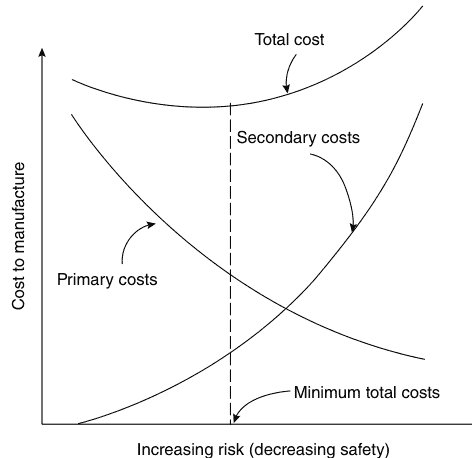

图 8.20 与主要成本和次要成本相关的安全和环境风险。风险增加以及较低的制造成本和产品成本会导致未来的责任（这超越了“现在支付还是以后支付”的说法）。来源：摘自 Martin 和 Schinzinger（2004）。

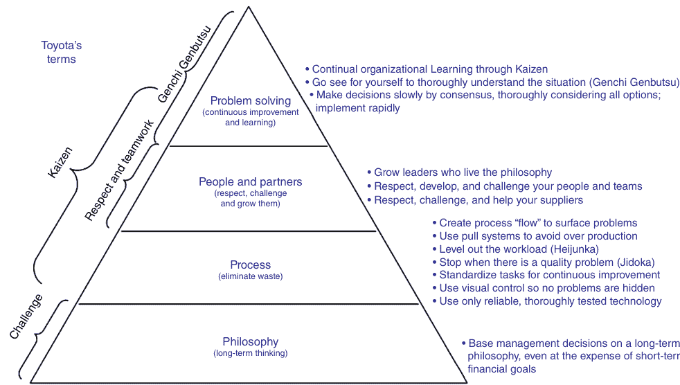

图 8.21 丰田方式的 4P 模型。

### 8.16.1.2 精益流程：正确的流程将产生正确的结果

原则 2. 建立连续流程“流动”以将问题暴露出来。
原则 3. 使用“拉动”系统以避免过量生产。
原则 4. 使工作量均衡——像乌龟，而不是兔子。
原则 5. 建立停下来解决问题的文化，以第一次就把质量做对。
原则 6. 标准化的任务和流程是持续改进和员工赋能的基础。
原则 7. 使用可视化控制，使问题无处隐藏。
原则 8. 只使用可靠的、经过充分测试的技术，服务于你的员工和流程。

### 8.16.1.3 通过长期关系培养和挑战你的员工与合作伙伴

原则 9. 培养能够透彻理解工作、践行理念并将其传授给他人的领导者。
原则 10. 培养遵循公司理念的优秀人才和团队。
原则 11. 尊重供应商，向他们提出挑战并帮助他们改进。

### 8.16.1.4 问题解决与持续改进驱动组织学习

原则 12. 亲临现场查看，以透彻了解情况。
原则 13. 通过共识缓慢做出决策，充分考虑所有意见；快速实施决策。
原则 14. 通过不断反思和持续改进成为学习型组织（Liker 2004）。

如果我们仔细审视这 14 项原则，我们会发现它们都是关于信念和价值观的陈述。它们关乎丰田的文化。
理念关乎丰田的目的及其存在的原因。
流程关乎丰田认为什么能带来卓越运营——不断消除浪费。
人员是推动公司前进的动力，而文化则教导人员如何行动、思考和感受，从而朝着共同目标协同工作。
问题解决是丰田人员集中精力持续改进的方式。

### 8.16.2 生命周期成本分析（LCCA）

生命周期成本分析（LCCA）是一种工具，用于在不同竞争方案中确定最具成本效益的方案，这些方案涉及制造流程、采购、拥有、运营、维护以及最终处置某对象或流程，前提是每个方案在技术上都同样适合实施。例如，对于高速公路路面，除了初始建设成本外，LCCA 还考虑了所有用户成本（例如工作区的通行能力降低）以及与未来活动相关的机构成本，包括未来的定期维护和大修。所有成本通常都会折现，并合计为当前价值，即净现值。这个示例可以推广到任何类型的材料、产品或系统。

为了执行 LCCA，确定范围至关重要——哪些方面应包含在内，哪些不应包含？如果范围变得太大，该工具可能变得不切实际，并且在帮助决策和考虑替代方案方面能力有限；如果范围太小，则结果可能会因所考虑因素的选择而产生偏差，使得输出变得不可靠或带有偏见。通常，LCCA 一词意味着不包括环境成本，而类似的整体生命周期成本或仅 LCA 通常具有更广泛的范围，包括环境成本。

### 8.16.3 质量成本：劣质质量与优质质量

在计算六西格玛项目的商业案例时，劣质质量成本（COPQ），即因产生缺陷而导致的成本，是一个常用的概念。然而，在质量成本总额中，COPQ 仅代表一定比例。成本不仅仅来自产生故障和修复故障；大量成本来自确保生产出优质产品。本节将质量成本解释为一个更全面的概念，涵盖 COPQ 和优质质量成本。简而言之，任何在质量完美的情况下本不会支出的成本都属于质量成本。

### 8.16.4 质量成本：不仅仅是故障成本

质量成本有两个主要组成部分：优质质量成本（或符合性成本）和 COPQ（或不符合性成本）。图 8.22 显示了以下内容。

- COPQ 影响：
  - 因未能满足要求而产生的内部和外部成本。
- 优质质量成本影响：
  - 投资于预防不符合要求的成本。
  - 为评估产品或服务是否符合要求而进行检验的成本。


| Sigma 等级 | 每百万机会缺陷数 (DPMO) | 质量成本占销售额百分比 (%) |
|---|---|---|
| 2 | 308 000 | >40 |
| 3 | 66 800 | 25–40 |
| 4 | 6 210 | 15–25 |
| 5 | 230 | 5–15 |
| 6 | 3.4 | <1 |

在工业流程中，目标是以最少的资金生产出高质量、安全水平高的产品——即对其进行衡量。能源效率是精益和可持续制造不可或缺的一部分，能源效率在这一努力中发挥着关键作用。我们应将能源视为一种原材料——那么明智的做法就是管理这一资源——使用更少的原材料来生产相同数量、相同质量的产品（零缺陷）——同时减少二氧化碳排放。

管理任何事物——财务、健康、排放等——的第一步是衡量它。能源强度是量化能源效率的有用指标，因为它不仅考虑了消耗的能源量，还考虑了生产的产量。许多追求能源效率项目的设施都有一名能源经理，对能源使用决策负责。不管你安装的新泵有多高效，如果它设计过度且在低负荷下运行，就不会很高效，例如一台 5 hp 的泵仅以 0.5 hp 的功率输送流体。因此，设计和选择最佳泵尺寸对节能工艺很重要。

美国能源部（DOE）的 Better Plants 项目一直与美国的制造商和工业规模能源用户合作，以提高能源绩效。美国能源部的 Better Plants 项目还提供技术援助、培训、软件和工具，帮助制造商提高能源绩效。该自愿项目为参与者提供广泛的工具和资源，以克服障碍并发现节省成本的机会。超过 200 个组织是 Better Plants 合作伙伴，它们共同节省了超过 1 千万亿 Btu 的能源，总计相当于约 53 亿美元的能源成本节约（Lung 2018）。

## 8.16.11 成为 ISO 50001 就绪

国际标准化组织（ISO）创建了 ISO 50001，作为一项自愿能源管理标准，帮助组织高效使用能源并降低成本。美国能源部开发了 50001 Ready 认可计划，作为指导组织使用 ISO 50001 结构建立能源管理体系的一种方式。50001 Ready 允许组织自我证明这些努力，可以成为追求 ISO 50001 认证的有用第一步（Lung 2018）。获得 50001 Ready 认可涉及三个步骤：

- 1) 完成 50001 Ready Navigator 的 25 项任务，这是一个免费的在线工具，可帮助指导和跟踪进展。
- 2) 自我证明已完成 25 项 Navigator 工具任务。
- 3) 随着时间的推移衡量和改进现场能源绩效。

## 8.16.12 能源分析的十步大纲：了解将原材料转化为成品所使用的能源以提高能源效率（Stowe 2018）

- Step 1. 识别原材料
- Step 2. 特征化最终产品
- Step 3. 参观工厂
- Step 4. 开发工艺流程（或模块）图
- Step 5. 编目能源输入
- Step 6. 识别能源浪费
- Step 7. 识别能源回收可能性
- Step 8.  pinpoint 能源效率机会
- Step 9. 识别新技术机会
- Step 10. 实施解决方案；能源分析对于能源效率计划应是一个持续的过程

## 8.17 工业环境经理的核心角色

在制造设施环境项目中工作的工业环境经理（IEMs）负责以全面、系统、计划和有文件记录的方式总体管理环境管理体系（EMS），涉及废物最小化或减少以及遵守环境法规和标准。这些经理充当环境伦理的守护者。IEMs 与环境管理流程（EMP）团队密切合作，包括工艺操作工程师、质量控制工程师，目标是生产高质量的制造产品，同时优化资源使用并减少废物。他们的任务包括但不限于支持培训新环境工程师和人员：安全、采样、监测、分析、汇总和管理环境数据；准备各种许可以确保合规，并向行业内部和外部利益相关者报告专门的环境绩效信息。这些活动促进了 EMP 团队、组织结构、规划和资源，以制定、实施和维护环境保护政策（Sroufe 2003）。

## 8.18 IEMs 的目标

IEMs 的主要目标是持续提高行业和企业监管合规性，同时减少废物。通常，环境经理遵循 PDCA 循环（图 8.25）。该图显示了首先制定环境政策、规划环境管理流程，然后实施它的过程。该过程还包括检查系统并采取行动。该模型流程通过组织审查和修订系统持续指导改进（ISO 2018b）。这是一个可被广泛组织使用的模型——从制造设施到服务行业再到政府机构。

## 8.19 环境合规与合规保证

环境合规及其保证意味着符合环境法律法规、标准以及其他要求，例如运营许可。近年来，环境问题导致全球各监管环境中合规要求的数量和范围显著增加。密切相关的是，环境问题和合规活动越来越多地与

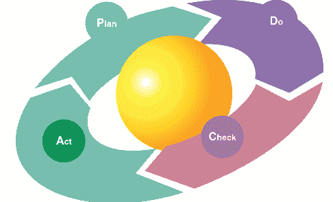

企业绩效目标保持一致，并在一定程度上得到整合，以避免冲突、浪费的重叠和差距（Tarantino 2008）。

遵守上述要求和义务需要满足某些条件。通常包括

- 开发全面的电子表格和合规保证矩阵
- 管理监测项目或计划，确保各种许可中要求的监测已在正确位置、对正确参数并以正确频率完成
- 预处理、执行计算并验证数据是否符合任何警报或报告水平
- 为州和联邦监管机构生成常规合规报告

上述管理可能复杂且耗时，导致设计用于管理环境合规的软件系统使用量不断增加。这些通常被称为环境数据管理系统。选择环境合规软件时必须考虑标准：经过验证的能力、高性能、透明、可追溯的数据处理、强大的计算引擎、先进的因子处理、简单集成、自动化工作流程和质量保证，以及灵活的报告和数据提取。

## 8.20 废物减少

废物减少或最小化是一套旨在减少产生的废物量的流程和实践。通过减少或消除有害和持久性废物的产生，废物最小化支持促进更可持续社会的努力。废物减少涉及重新设计产品和流程和/或改变社会消费和生产模式。

管理废物最具环境资源效率、经济高效且成本效益最高的方式通常是首先避免出现问题。管理人员将废物减少视为大多数废物管理策略的主要重点。适当的废物处理和处置可能需要大量时间和资源；因此，如果以有效、安全和可持续的方式进行，废物最小化或减少的好处可能相当可观。

传统的废物管理侧重于废物产生后的处理，集中于再利用、回收和废物能源化（另见附录 G）。


废物减量涉及在制造过程中避免产生废物的努力。为了有效实施废物减量，IEM 需要了解生产过程、从摇篮到坟墓分析（从材料开采到其回归地球的追踪）以及废物组成的细节。

各国废物的主要来源各不相同。在工业化国家和发展中国家，大多数废物来自各种制造业，其次是采矿、建筑和建筑拆除以及商业。工业废物通常与供应链中的要求相关。在 1980 年代，供应链管理（SCM）一词被提出，以表达将关键业务流程整合的需要，从终端用户到原始供应商（Oliver and Webber 1992）。原始供应商是指为客户和其他利益相关者提供增值产品、服务和信息的供应商。SCM 背后的基本思想是，公司和企业通过交换有关市场波动和生产能力的信息而参与供应链。

例如，一家德国造纸厂每天以 100 吨可回收纸作为其原材料供应。处理产品的公司可能会坚持要求使用特定的包装进行运输，因为它符合下游需求。另一个例子，一家巴西废金属回收公司接收超过 50 吨的废铝罐进行再加工和回收。巴西回收了其铝罐产量的 90.4%，相当于每年 145 亿个饮料罐，位居世界第一，超过日本 83.2%的回收率。巴西已连续八年位居铝罐回收榜首（AFG 2018）。

## 8.20.1 再利用和回收工艺

- **废料再利用**
  废料可以立即在制造线的开始处重新纳入生产，从而不成为废物产品。许多行业常规地这样做；例如，造纸厂会将任何损坏的卷筒退回生产线的起点，而在塑料制品的制造中，边角料和废料会被重新纳入新产品中。
- **改进质量控制和过程监控**
  可以采取措施确保拒收批次的数量降至最低。这是通过增加检验频率和检验点数量来实现的。例如，安装自动连续监测设备可以帮助及早发现生产问题。
- **废物交换**
  这是指一个过程的废物产品成为第二个过程的原材料。废物交换是减少无法消除的废物处置量的另一种方式。
- **运送至使用点**
  这涉及将 incoming 原材料或组件直接运送到组装或在制造过程中使用的地点，以最大限度地减少搬运和保护性包装或外壳的使用。
- **零废物**
  这是一种整体系统方法，旨在消除源头以及供应链各环节的废物，意图不产生废物。这是一种设计理念，强调废物预防而非末端废物管理（Das 2005）。

## 8.20.2 废物最小化的益处

废物最小化可以保护环境，并且通常会带来积极的经济效益。废物最小化可以改善以下方面：

- **高效的生产实践。** 废物最小化可以实现每单位原材料投入的产品产出更多。
- **经济回报。** 更有效地使用产品意味着降低采购新材料成本，从而改善公司的财务绩效。
- **公众形象。** 公司的环境形象是其整体声誉的重要组成部分，而废物最小化反映了积极的环境保护举措。
- **产品质量。** 新的创新和技术实践可以减少废物产生并提高生产阶段投入的质量。
- **环境责任。** 最小化或消除废物产生使得更容易满足环境法规、政策和标准的目标。废物的环境影响将被降低。

## 8.20.3 关键特征：工业环境管理流程

工业环境管理流程（IEMP）及环境管理人员的角色：

- 作为改善环境绩效和信息的主要工具或流程，“设计、污染控制和废物最小化、培训、向高层管理汇报以及目标设定。”
- 为组织的环境事务提供系统化的管理方式。
- 是行业整体管理结构中处理其产品、服务和流程对环境产生的即时和长期影响的方面。IEMP 协助组织制定、控制和监控政策。制定一些详细的电子表格和合规矩阵。
- 为组织通过资源分配、责任分配以及对实践、程序和流程的持续评估来解决环境问题提供秩序和一致性。
- 创造来自高级管理人员和员工的环境认同感，并分配问责和责任。
- 为实现目标和期望绩效设定培训框架。
- 帮助所有参与流程的人员更好地理解立法要求，以确定产品或服务的影响、重要性、优先事项和目标。
- 专注于系统的持续改进以及实施政策和目标以达到预期结果的方式。这也有助于审查和审计 IEMP 以发现未来机会。
- 鼓励承包商和供应商建立自己的 IEMP。
- 通过直接上传促进向联邦、州和地方政府环境机构的记录保存和报告/电子报告。

## 问题

8.1 一所主要大学的工程学院希望开发一个经验模型来预测其本科生完成学业的成功率。
A 在这项研究中你会用什么作为响应或结果变量？
B 讨论你将如何收集数据来构建此模型。这是回顾性研究还是观察性研究？

8.2 一名工程师希望获得一个制造数码相机的过程输出的随机样本。她在三天内抽样，每天在下午 3 点和下午 5 点从生产线输出中随机选择五台相机。 这是随机样本吗？

8.3 一名工程师从一个大型生产批次中抽取 50 个轴承的简单随机样本并测量其内径。他发现其中三个超出直径规格。由于样本单元中有 6% 是不合格的，他向制造经理报告说生产中恰好有 6% 是不合格的。从这些数据得出的结论是否正确？

8.4 一名在质量控制方法实验室课程的学生用千分尺多次测量一颗螺栓的长度。 在什么情况下可以合理地将这些测量值视为随机样本？ 总体是什么？

8.5 一名操作员使用同一仪器测量溶液的 pH 值八次。她得到以下数据：7.15、7.20、7.18、7.19、7.21、7.20、7.16 和 7.18。
A 计算样本均值。假设该溶液的理想值为 7.20。你认为这里计算的样本均值是否足够接近目标值以接受该溶液符合目标？解释你的理由？
B 计算样本方差和样本标准差。你认为这项实验中变异的主要来源是什么？为什么希望这些测量的方差很小？

8.6 绘制一个点图来说明数据的变异和范围但不识别问题。数据为 40.75、41.5、42.25、43、43.75、44.5、44.5、45.25、45.25、46.75、47.5、47.5、48.25、48.25、48.25、48.25、48.25、49.75、49.75、50.5、51.25、51.25、51.25、52、53.5、55。

8.7 绘制帕累托图分析化学罐溢出发生的特定原因，如传感器、泵、电气触点、操作员、维护和维修。

数据如下给出由于各种原因发生的重复故障：


| 传感器 | 45 |
| 电气触点 | 35 |
| 泵 | 11 |
| 操作员 | 5 |
| 维修人员 | 5 |

## 8.8
(a) 制造中因果关系中 80/20 法则的基本概念是什么？ (b) 使用下表中给出的数据绘制帕累托图，并显示哪些项目或问题对流程或系统影响最大。

| 缺陷 | 计数 |
| 元件 7 | 56 |
| 元件 6 | 13 |
| 元件 3 | 7 |
| 元件 1 | 5 |
| 元件 8 | 3 |
| 元件 2 | 1 |
| 其他 | 1 |

## 8.9
假设对产品的日常检验因划痕、凹痕、污渍、未达到规格和其他原因而被拒收。假设在大型公司某班次中收集到下表所示的数据。绘制 (a) Excel 饼图；(b) Excel 条形图；以及 (c) 帕累托图，并显示哪些项目或问题对流程或系统影响最大。

| 类别 | 频率 | 百分比 |
| 凹痕 | 15 | 30 |
| 其他 | 7 | 14 |
| 划痕 | 10 | 20 |
| 污渍 | 4 | 8 |
| 规格 | 14 | 28 |

## 8.10
在数月内收集了飞机油箱被归类为不合格的原因，并以原因和计数表格形式列出。形成不合格飞机油箱的帕累托图。

| 原因 | 计数 | 原因 | 计数 | 原因 | 计数 |
| 粘合剂 | 6 | 尺寸 | 36 | 漆坝 | 1 |
| 对齐 | 2 | 镶边 | 3 | 漆规格 | 2 |

| 原因 | 计数 | 原因 | 计数 | 原因 | 计数 |
| 铝化 | 1 | 薄膜 | 5 | 底漆坝 | 1 |
| 铸造空洞 | 2 | 机械加工 | 29 | 掩模 | 17 |
| 受损 | 34 | 掩蔽 | 17 | 程序 | 1 |
| Dalam comp | 2 | 出序 | 4 | 生锈 | 13 |
| | | | | 盐雾 | 4 |
| | | | | 错误零件 | 3 |

## 8.11
说明如何为问题 8.10 中的数据构造帕累托图。

## 8.12
列出两位开创 SPC 技术 的科学家，并简要说明他们的贡献。

## 8.13
一家工厂质量控制中心测量了 160 包的含水量并记录了样本均值、$\bar{x}$、样本极差、$R$ 和标准差、$s$。计算 (a) 含水量样本均值和极差值的 $3\sigma\bar{x}$ 图 UCL 和 LCL；(b) 含水量样本均值和极差值的 $3\sigma X$ 图 UCL 和 LCL。

## 8.14
定义 ISO 9000 系列中提及的与质量管理体系 QMS 相关的五个条款。另请定义 ISO 14000 对 EMS 和与 QMS 及工业废物最小化相关的环境政策。

## 8.15
什么是质量？

## 8.16
质量保证、质量控制和检验之间有哪些主要区别？

## 8.17
什么是质量成本？

## 8.18
“精益制造”的概念是什么？

## 8.19
什么是“看板”？

## 8.20
简要描述“丰田七大浪费”。

## 8.21
描述“精益原则”中作为“增值和浪费消除”举措的部分。

## 8.22
描述 DMAIC 模型，该模型是六西格玛项目成功的关键组成部分。

## 8.23
比较两种方法论：六西格玛和精益制造。

## 8.24
列出制造商遇到的四类风险，并简要描述每类。

## 8.25
工程是一项重要且受人尊敬的职业。作为该职业的成员，工程师们被期望表现出最高的职业道德标准。作为即将成为您工程职业的一员，请用自己的话分享关于“工程伦理”的想法和理想。

# 参考文献

Aluminum for Future Generation (AFG) (2018). http://recycling.world-aluminium.org/regional-reports/brazil.html (accessed 16 December 2018).

Arnold, H.L. and Faurote, F.L. (1915). Ford Methods and the Ford Shops. New York: The Engineering Magazine Company.

Bennett, H. and Marcus, P. (1951). We Never called Him Henry. New York: Fawcett Publications.

Bicheno, J. and Holweg, M. (2009). The Lean Toolbox: Essential Guide to Lean Transformation, 4e. Buckingham: PICSIE Books.

Brundtland, H. (1987). Our Common Future: The World Commission on Environment and Development. Oxford: Oxford University Press.

Das, T.K. (2002). Evaluating the life cycle environmental performance of chlorine disinfection and ultraviolet technologies. Clean Technology and Environmental Policy 4: 32–43.

Das, T.K. (2005). Toward Zero Discharge: Innovative Methodology and Technologies for Process Pollution Prevention. Hoboken, NJ: Wiley.

Das, T.K. and Houtman, C.J. (2004). Evaluating chemical-, mechanical-, and bio-pulping processes and its sustainability characterization using life-cycle assessment. Environmental Progress and Sustainable Energy 23 (4): 347–357.

Dornfeld, D. and Lee, D.-E. (2008). Precision Manufacturing. New York: Springer.

Dornfeld, D. and Wright, P. (2007). Technology wedges for implementing green manufacturing. Transactions of North American Manufacturing Research Institute 35: 193–200.

Evans, J.R. and Lindsay, W.M. (1992). The Measurement and Control of Quality, 2e. Minneapolis/St. Paul, MN: West Publishing Company.

Ford, H. and Crowther, S. (1922). My Life and Work. New York: Garden City Publishing Company.

Freedman, D., Pisani, R., and Purves, R. (1997). Statistics, 3e. W. W. Norton.

Groover, M.P. (1999). Fundamentals of Modern Manufacturing: Materials, Processes, and Systems. New York: Wiley.

Hanna, J. (2007). Bringing lean principles to service industries. HBS Working Knowledge. (Summary article based on published research of Professor David Upton of Harvard Business School).

Hawken, P. (1993). The Ecology of Commerce. New York: Harper Collins.

Hopp, W.J. (2011). Supply Chain Science. Long Grove, IL: Waveland Press.

Hopp, W.J. and Spearman, M.L. (2008). Factory Physics, 3e. Long Grove, IL: Waveland Press.

Hounshell, D.A. (1984). From the American System to Mass Production, 1800–1932: The Development of Manufacturing Technology in the United States. Baltimore, MD: Johns Hopkins University Press.

Howitt, D. and Cramer, D. (2008). Introduction to Statistics in Psychology, 4e. Upper Saddle River, NJ: Prentice Hall.

International Organization for Standardization (ISO) (2018a). ISO 9000 quality management. www.iso.org (accessed 24 September 2019).

International Organization for Standardization (ISO) (2018b). Environmental management software: the better way to manage and maintain ISO 14001 compliance. www.iso.org (accessed 16 December 2018).

Ishii, K. (1999). Incorporating end-of-life strategy in product definition. Eco-Design ’99: First International Symposium on Environmentally Conscious Design and Inverse Manufacturing, Tokyo, Japan (February 1999).

Januska, M. and Štasna, L. (2013). Industrial engineering in the non-manufacturing processes. Proceedings of the 22nd International Business Information Management Association Conference: International Business Information Management Association (IBIMA), Rome, Italy (13–14 November 2013), 747–766.

Ker, J.I., Wang, Y., Hajli, M.N. et al. (2014). Deploying lean in healthcare: evaluating information technology effectiveness in US Hospital Pharmacies. International Journal of Information Management 34 (4): 556–560.

Krafcik, J.F. (1988). Triumph of the lean production system. Sloan Management Review 30 (1): 41–52.

Liker, J.K. (2004). The Toyota Way. New York: McGraw-Hill.

Liker, J.K. and Hoseus, M. (2008). Toyota Culture: The Heart and Soul of The Toyota Way. New York: McGraw-Hill.

Lung, R. (2018). Better plants: working with manufacturers to save money. Chemical Engineering Progress: 31–34.

Martin, C. (2005). Logistics and Supply Chain Management: Creating Value-Added Networks, 3e. Upper Saddle, NJ: Prentice-Hall.

Womack, J.P. and Jones, D.T. (2003). *Lean Thinking: Banish Waste and Create Wealth in Your Corporation.* New York: Simon & Schuster.

Womack, J.P., Jones, D.T., and Roos, D. (1990). *The Machine That Changed the World.* New York: Free Press.

Zimmerman, J., Hayes, K., and Skerlos, S. (2003). Influence of ion type and concentration on the emulsion stability and machining performance of two semi-synthetic metalworking fluids. *Environmental Science and Technology* 38: 2483–2490.


