# 9

# 工业废物最小化方法论

工业生态学、生态工业园区以及制造过程的强化与集成

## 9.1 引言

在美国，工业界每年产生并处置约20亿吨非危险废物。这一数量相当于每人每天产生超过200磅工业废物。非危险废物的最大工业来源是制造业（约76亿吨/年）、油气生产（21亿至36亿吨/年）以及采矿业（超过14亿吨/年）。贡献量较小的来源包括发电厂（粉煤灰和烟气脱硫废物）、建筑废物、医院传染性废物以及废轮胎。美国工业危险废物的产生速率约为每年7.5亿吨（Allen and Shonnard 2012; Allen and Rosselet 1997）。一旦这些物料被认定为危险废物，其管理、处理、储存和处置的成本便会急剧上升。本章描述了一些已经成功运行的特定工业废物最小化工艺和技术，并提供了其他方法论，包括工业生态学、生态工业园区（EIP）、制造过程强化与集成。制造过程中产生的废物（气态、液态或固态）或副产物将被回收。从废物流中回收的材料和能源要么在工厂内重复使用，要么作为原料出售给另一家工厂。无论在实践上还是理论上，都有可能通过将所有废物回收为可制成消费产品的材料，从而使某些工业设施几乎完全与环境隔离。此类设施的一个例子是燃煤发电厂。一种电子束-氨转化装置将氨加入废气中，然后对废气进行电子辐照，生成硝酸铵和硫酸铵，作为原料出售给化肥制造商；此外还有通过吸附从烟气中强化回收汞，以及从燃煤电厂回收汞的工艺。这两个工艺的详细内容将在本章后面的案例研究中给出。此外，还提供了两个独立的案例研究，重点介绍了一种盈利的工业“副产物转能源”回收方式，即利用热电联产发电，以及通过气化制浆过程的副产物黑液来生产化学品和能源。

我们的目标是改进工业过程，使服务和制成品能够在无废物的情况下生产。但重要的是要认识到，即使在污染预防方面做出了所有合理努力之后，某些制造过程仍不可避免地会产生废物。因此，在某些情况下，使用转化技术可能比实施污染预防计划更为合适：许多工业废物可以通过加工处理，使其成为另一个行业的可行物料输入，或者成为由若干关联行业组成的工业集群的一部分——这正是“工业生态学”运动的一部分。

## 9.2 工业生态学

工业生态学（IE）是研究工业系统中物质和能量流动的学科。全球工业经济可以被建模为一个工业过程网络，该网络从地球提取资源，并将这些资源转化为可买卖的商品，以满足人类的需求。工业生态学力求量化物质流动，并记录支撑现代社会运转的工业过程。工业生态学家通常关注工业活动对环境的影响、地球自然资源供应量的使用以及废物处置问题。工业生态学是一个不断发展的多学科研究领域，融合了工程学、经济学、社会学、毒理学和自然科学等方面（Alleby 2006; Ashton 2009; Jensen 2011）。

工业生态学为理解当前实践并在此基础上进行合理改进提供了理论科学依据。它涵盖了能源供应与使用、新材料、新技术、基础科学、经济学、法律、管理和社会科学等方面的研究。它还包括并行工程、环境设计（DFE）、去物质化、过程污染预防、废物转化、废物交换、副产物利用以生产新产品、废物最小化和回收利用，其中“零排放”是一个重要的子集。工业生态学也可以作为一种政策工具。它是对一个系统的视角，在该系统中，人们寻求优化从原始材料到成品材料、到部件、到产品、到废弃产品、再到最终处置的整个物料循环。需要优化的因素包括资源、能源和资本。

工业生态学是一个动态的、基于系统的框架，通过最大限度地减少能源和材料的使用、确保人们可接受的生活质量、将人类活动对生态的影响降至自然系统能够维持的水平，以及保持工业、贸易和商业系统的经济可行性，来实现对人类活动的可持续管理。工业生态学的方法包括：（i）将科学应用于工业系统，（ii）界定包含自然世界的系统边界，以及（iii）寻求优化该系统。在这种背景下，工业系统不仅适用于私营部门的制造业和服务业，也适用于政府运营，包括基础设施的提供。

工业生态学是一个将工业作为与自然系统相互依存的生命系统进行设计和运营的框架，因此理解工业代谢的概念至关重要。生物圈的代谢近乎完美的回收系统，因为其众多组成部分都具有生物再生的能力；而在工业中，代谢在很大程度上依赖于系统内无法再生的化石燃料的燃烧。

因此，工业代谢的研究者会调查具有环境意义的关键工业物料的物质流量及其相关排放。有了这些信息，工业生态学家就能更好地平衡环境问题与经济绩效，将不可再生资源的真实价值和环境污染的真实成本纳入考量。对地方和全球生态约束理解的加深，进一步推动了这些努力。

工业生态学支持在产品与过程的整个生命周期内协调设计。工业生态学能够在长期背景下创造短期创新。虽然工业生态学的许多初期工作集中在制造业，但工业系统的完整定义包括服务、农业、制造业、军事和其他公共运营，以及垃圾填埋场、供水和污水处理系统、交通系统等基础设施。

当《科学美国人》发表了一篇由通用汽车公司两位研究人员撰写的文章时，“工业生态系统”的概念受到了广泛关注，该文章指出，为工业活动副产物寻找“村门之外空地”的日子正在迅速消逝（Frosch and Gallopoulos 1989）。工业生态学的概念催生了越来越多的研究和活动。在最基本的层面上，工业生态学描述了一个系统，其中一个行业的废物（输出）成为另一个行业的原材料（输入）。在这个“如图9.1所示的闭环”中，被浪费的材料将会减少。因此，如果企业能够将废物转化为“食物”，它们就能大幅减少污染和对原材料的需求（Van der Ryn and Cowan 1996）。

许多行业长期以来一直存在着共生关系，废物和材料在内部或由他人转化。例如，金属工业在生产过程中使用废料；电弧炉（EAF）的出现提高了钢铁制造商使用废料的能力。石化和化学公司擅长为废料寻找新的生产用途或市场（Richards et al. 1994）。橡胶、塑料、纸张和玻璃回收的增长为以前被丢弃的材料创造了新的用途。正如欧内斯特·洛（Ernest Lowe）所建议的那样，工业生态学是一个指导工业系统转型的广泛整体框架。从线性模型（矿坑到生产者、到消费者、再到垃圾场）向更接近生态系统循环流动的闭环模型的转变，激发了许多具有前瞻性的公司、多所大学以及美国环境保护局和能源部等政府机构的新思维方式（Low and Warren 1996; Lowe 1995, 2001）。

### 9.2.1 什么是生态工业园区？

根据欧内斯特·洛、约翰·沃伦、安德烈亚斯·海因等人的说法，生态工业园区（EIP）是一个制造业和服务业企业的社区，这些企业通过在管理环境与资源问题（包括能源、水和材料）方面的协作，寻求增强的环境和经济绩效（Lowe and Warren 1996）。通过合作，该企业社区寻求获得一种集体利益，这种利益大于每个公司仅优化其自身绩效所能实现的个体利益之和。生态工业园区的目标是在参与公司提高经济绩效的同时，最大限度地减少其环境影响。

工业活动将废物释放到地方、区域，并最终释放到全球生态系统中。自20世纪70年代以来，各国颁布了无数法律法规，以限制对空气和水的排放，并规范固体和危险废物的处置。此外，工业活动还会导致非点源


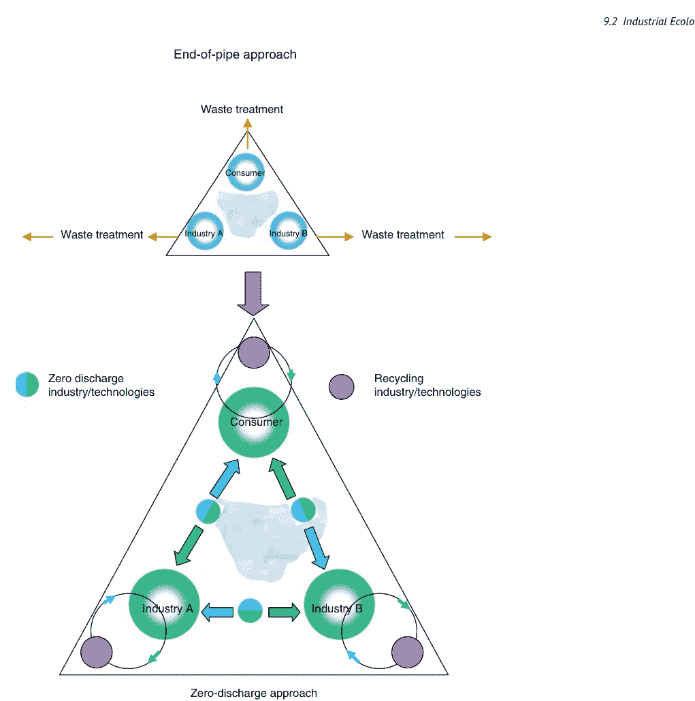
**图 9.1** 末端治理与零排放方法的示意图。*来源：* 引自日本东京荏原株式会社（2010）和 Das（2005）。

由一般径流、泄漏或非法倾倒造成的污染。传统上，商业与环境被视为天生的敌人。长期以来一直认为“环境保护越多，企业成本越高”；然而，研究和业务运营的新发展正在挑战这一假设。许多公司如 3M 早已认识到将环境原则应用于业务运营的经济效益。EIP 的目标是最大限度地减少工业活动的生态影响并改善业务绩效。在美国和加拿大，多个项目正在测试这一理念，该理念已在欧洲证明了其有效性，或许最引人注目的是丹麦卡伦堡，如 Hein 等人（2015）；EIO（2012）；Lowe（2001）及其他人所讨论的。

EIP 是一组共享资源以提高盈利能力和减少环境影响的企业。EIP 的实施可显著促进可持续经济的创建。尽管有这一前景，EIP 的实际发展仍具挑战性，因为必须考虑多种因素。不仅技术、经济和环境因素相关，而且

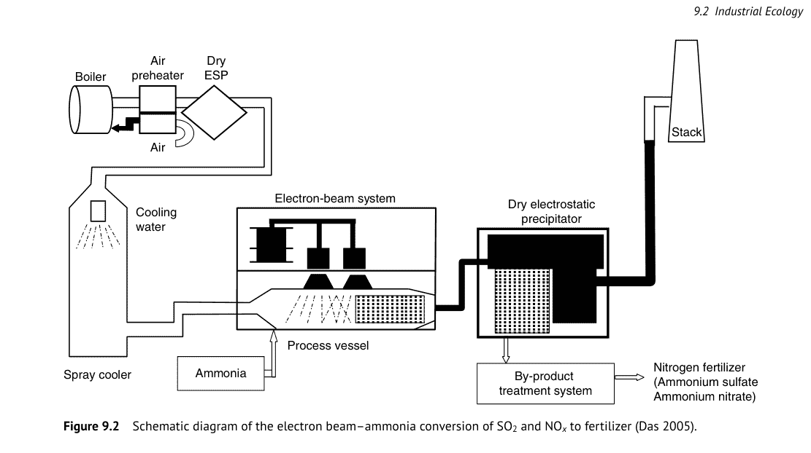
**图 9.2** 电子束-氨法将 $SO_2$ 和 $NO_x$ 转化为肥料的示意图（Das 2005）。

其他机械收集器用于去除颗粒物，例如飞灰。气体随后被输送至喷雾冷却器并加湿冷却至 160–200°F 范围内的温度，即最佳温度。此时按化学计量量引入无水氨。氨化烟气被送入电子束反应室，在那里被辐照（1.5 Mrad 剂量），产生硝酸盐和硫酸盐阴离子。这些物质与氨反应生成 $NH_4NO_3$ 和 $(NH_4)_2SO_4$ 的干颗粒混合物。

### 9.2.3.1 优点和缺点

电子束工艺至少有五大优点：

- 1) $SO_2$ 和 $NO_x$ 在同一台设备中通过添加一种化学物质一起被去除。该方法可以满足所有新源性能标准（NSPS）对 $SO_2$ 去除的要求，因为它有潜力去除 98% 的 $SO_2$ 和 70–90% $NO_x$，取决于工艺条件（CFR-40 1999）。在极低的功率消耗（占机组的 1%）下可实现高 $SO_2$ 去除。大多数能量消耗用于 $NO_x$ 减排。NSPS 标准很复杂，但在 3–6% 硫煤的情况下，需要 90% 的减排量。
- 2) 挥发性有机化合物也在工艺中被去除。
- 3) 由于没有废物产生，因此无需制定处置方案。
- 4) 由于工艺产生的是干产品，避免了与磨蚀性和腐蚀性浆料相关的高维护成本。
- 5) 产生可销售的产品。

与该工艺相关的相应缺点和挑战包括需要将氨注入保持在化学计量点附近以缓解任何氨泄漏。此外，大型电子束发生器对于大规模工厂是必需的，因为当前电子束的射程有限。该工艺的技术问题包括关于能否将电子加速器放大到全尺寸应用以及该技术相关的电力需求的问题。为了加速辐射，已开发并申请专利了一种联合微波-电子束工艺，这种混合辐射系统适用于大规模工厂（Das 2005；Ebara 2010）。

### 9.2.3.2 成本分析

表 9.1 提供了年度成本分析，包括安装和运行 $SO_2$ 和 $NO_x$ 的电子束-氨转化系统的预计整体投资回报。成本分析显示，燃煤发电行业可从该工艺中每年赚取约 1100 万美元。该系统本身比传统的烟气处理便宜得多——建设成本低 25%，运行成本低 20%——并且需要的空间明显更少。

**表 9.1** 投资回报计算：电子束-氨 $SO_2$ 和 $NO_x$ 转化。

| 样本计算 | 总利润/成本（$ 百万） |
| --- | ---: |
| 产品销售利润 | |
| 肥料：110 000 T/Y（400 T/天）× $100/T | 11/年利润 |
| 运行成本 | −0.9/年 |
| 人员费用等 | −3.8/年 |
| 氨：29 000 T/Y（105 T/天）× $130/T | −4.7/年成本 |
| 设施建设成本 | −38.1 成本 |

*来源：* 引自荏原株式会社（2010）。

按年利率 12% 计算，设施建设成本将在 15 年内收回。

但所有此类计算都存在 caveats。首先，Ebara 工艺对无水氨的成本很敏感。为控制这一变量，研究正在进行以发现从市政废水中提取氨的方法（Ebara 2010）。如果氨可从附近的市政废水处理厂获得，运行该工艺将更经济。无论如何，Ebara 工艺的肥料生产变体只有在与肥料副产品市场的位置良好且资本和电力成本变化的情况下才具有经济效益。

### 9.2.4 小案例研究 9.2：印度 Seshasayee Paper and Board Ltd.

作为成功案例，考虑一个企业集团制定并采用增长战略的案例，其中一个活动的多数废物被转化为另一个活动的原料。

Seshasayee 的原始企业是一家造纸厂。为确保原材料稳定供应，公司随后建立了糖厂。糖厂的废物蔗渣被用作造纸的原材料。另一种废物产品糖蜜被用于蒸馏厂生产乙醇。为保证甘蔗的稳定供应，公司对该地区的农民进行种植组织。Seshasayee 与农民签订长期协议回购其产品，同时负责为他们供应水。用于种植的部分水是造纸操作处理的废水。公司还使用蔗渣髓（造纸后的废物）和该地区其他可燃农业废物作为能源来源。农业工业生态复合体如图 9.3 所示。

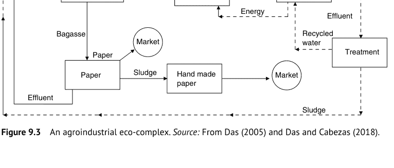
**图 9.3** 农业工业生态复合体。*来源：* 引自 Das（2005）和 Das 和 Cabezas（2018）。

这对于工艺集成和强化工作的主题尤其重要，因为它涉及生产一种商品（纸）和一种人类食物（糖），以及可持续的能源生成（来自蔗渣——例如废物能源）和可持续的水使用。在本案例中，迷你案例研究的讨论表明，可以将食物生产与能源生成结合起来，并高效利用水资源。这很重要，因为商业食物（糖）的生产在经济和社会上都很重要，尤其是如果它能尽可能可持续地生产的话。

### 9.2.5 小案例研究 9.3：美国北德克萨斯州 EIP 中的物质和能量流动

例如，考虑北德克萨斯州的一个 EIP，其中央设施是一家钢铁厂。该设施在概念上如图 9.4 所示，利用报废汽车作为主要原料。车辆的钢材进入电弧炉（EAF），生产各种钢材产品。炉子还产生大量 EAF 尘埃，其中含有大量锌、铅和其他金属。在北德克萨斯设施中，EAF 尘埃被送至水泥窑，其中微量金属（铜、铬、锰、镍、铅和其他金属）具有价值。汽车拆解残渣（ASR）可用于能源回收，或残渣中的部分塑料可被分离。

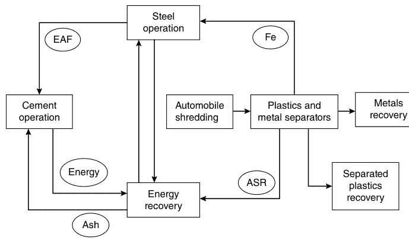
**图 9.4** 美国北德克萨斯州 EIP 中的物质和能量流动。

EAF 尘埃的另一种替代方案，目前在欧洲被利用，是作为锌和铅回收作业的原料。回收的锌随后可用于生产镀锌钢产品和电池，可作为锌的替代来源。

这些案例研究说明了 EIP 的基本原则——在不同的工业运营中整合物质、能源和水的流动，提高物质和能源效率。本节检查的三个案例研究涉及位于彼此相邻的设施之间的交换；然而，EIP 中设施的共址并非总是必要的。

### 9.2.6 小案例研究 9.4：用于制造超大规模光伏系统的众多共生工厂的 EIP

正在进行的全球气候不稳定主要是由于人类燃烧化石燃料获取能源以及由此产生的温室气体（GHG）排放（IPCC 2007）。科学家之间有很大共识，如果气候不稳定的当前趋势继续下去，地球将达到不可逆转的临界点。减少大气 GHG 如二氧化碳（CO₂）排放的挑战是重大的——《京都议定书》和最近的《巴黎协定》，整个数量级低于稳定全球气候所需的数值。为了获得稳定的气候，GHG 排放必须减少到等于自然吸收 CO₂ 的水平。稳定发生后，自然吸收水平将随着植被汇的耗尽而逐渐下降，因此 GHG 排放需要下降到仅等于海洋吸收的水平。这一水平尚未得到很好量化，但可能要求到下一个世纪下半叶排放减少到 5 Gt CO₂ 当量/年（比当前水平低 80% 以上）（Hansen and Sato 2004；Prentice et al. 2001）。

为了提高制造业的经济和环境绩效，政府可以引入第二套政策，与大规模光伏（光伏）制造相结合，以促进工业共生的广泛采用。在工业共生中，传统上分开的行业被视为一个整体，以通过建立互利的物质、能源、水和/或副产品的物理交换获得竞争优势。这样的系统在集体上优化了材料和能源使用，其效率超过任何单个过程单独可实现的效果。工业共生的主要益处是


共生是指协作以及地理邻近带来的协同效应（Chertow 2000）。工业共生系统，例如丹麦卡伦堡经典的企业网络，是在长期的时间尺度上由一系列微创新自发演化而来的。为了加速这一进程并展示互利协作的可能性，政府可以利用工业共生来设计新的太阳能光伏制造工厂。

多 GW 的光伏工厂可以位于下一代生态工业园 EIP 的中心。EIP 将由至少八个共生工厂组成，如图 9.5 所示。这些工厂可以位于主要人口中心之外，以提供原材料、劳动力和现成的市场。第一个工厂将是一个常规回收设施（1）。这样，用于制造太阳电池的玻璃和铝就可以从回收材料中回收，从而具有更低的 embodied energy（铝降低 95%，玻璃降低 20%）（Milne and Readon 2005）。

来自回收厂的原玻璃将被送入平板玻璃厂（2）并使用天然气熔化。

通常，平板玻璃的高质量要求禁止使用消费后废玻璃。然而，玻璃工业正在探索一种通过使用薄塑料涂层来消除颜色污染问题的方法，这些涂层可以用各种颜色制成，并在重新熔化过程中气化，而不会影响新玻璃的质量。这将使行业受益匪浅，因为使用回收玻璃，即碎玻璃，具有若干重要益处，包括（i）降低原材料消耗，（ii）减少原材料化学反应中形成的 CO₂ 排放，（iii）由于熔化温度降低，延长炉子寿命长达 30%，（iv）减少熔化阶段的生产能耗，从而减少额外的温室气体和运营成本，以及（v）由于 NOₓ、SO₂ 和颗粒物排放降低，减少与污染防治相关的成本（Pearce 2008）。工厂将输出厚度为 3 mm 的切割玻璃板，边缘倒角且低铁含量，以获得高太阳透射率。最后，玻璃将被钢化以提高机械强度并涂覆

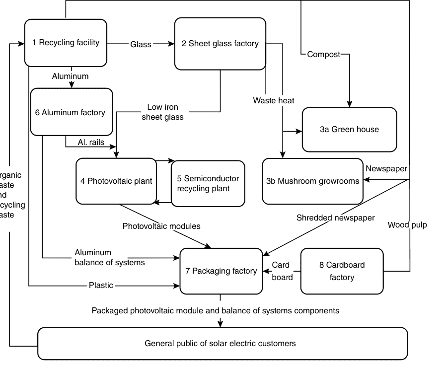

图 9.5 生产吉瓦级太阳能光伏的 EIP 示意图。来源：引自 Pearce（2008）。

透明导体，如氧化锡、氧化锌或氧化铟锡，作为基板使用。玻璃工厂中利用大量热量的生产阶段将集成热回收，为其他设施和温室综合体（3a）提供较低等级的热能。在温室综合体中，即使在北方气候下，利用 EIP 制造厂的废热也能全年种植异国植物。同样，废热可用于提供蘑菇生长室（3b）。在这两个农业工厂中，食品或其他农产品将销往园区外，而栽培基质将由回收设施（1）提供，用于温室（3a）的堆肥，以及用于蘑菇种植设施（3b）的木浆或堆肥。在较温暖的气候中，废热可用于驱动吸收式制冷机，或许可为办公园区提供制冷。

基板随后将直接送入光伏组件厂（4）。然后，一组半导体和金属薄膜沉积系统将制造并图案化太阳电池的有源层。所有废弃的半导体和金属将被捕获并返回半导体回收厂（5），以补充进入沉积系统的通常昂贵的高纯度材料。光伏沉积和图案化线的输出将是准备进行保护涂层和包装的光伏太阳能板。

回收中心（1）从普通饮用罐中提取的铝将被送入铝加工厂（6），该厂将生产用于固定玻璃太阳能板的涂层铝轨。铝轨将挤压成型，用于提供一种简单且经济的安装方式，可安装在屋顶、地面安装系统或建筑一体化光伏上。此外，挤压铝轨可设计成地面和平屋顶安装的平衡系统组件。与玻璃制造厂（2）类似，废热将被回收并用于共生集体，或用于加热温室（3a）或蘑菇生长室（3b）。

接下来，在包装厂（7）中，太阳能板如有必要将被互连，并喷涂保护性聚合物涂层以将其密封于环境中。聚合物涂层的主要成分可再次从回收厂（1）和普通塑料中获取。随后，板件将配装快速连接器，以便在现场通过相互连接、逆变器或电池组轻松安装。最后，板件将被包装在纸箱中以防止运输损坏，并用碎报纸填充缓冲。报纸再次来自回收厂（1），而纸箱可来自纸箱厂（8），该厂的原材料来自回收厂（1）。

通过将这些工厂共同布局在 EIP 中，它们之间的运输成本和能源可以最小化，并且太阳能光伏工厂的许多投入实际上可以来自周边人口中心的废弃物。应注意，每个工厂都将根据共生系统进行适当规模设计，并且应各自盈利，以便独立企业可以通过共同选址复制这一模式，并在未来的设施中受益于工业共生。

## 9.3 水-能源 Nexus

当今的水和能源系统紧密交织。水在能源生产和电力生成的各个阶段都被使用。能源是提取、输送和输送适当质量的水以满足多样化人类需求所必需的，然后再次用于在水返回环境之前处理废水。历史上，能源与水之间的相互作用是按区域或按技术进行考虑的。在国家和国际层面，能源和水系统是独立开发、管理和监管的。水和能源是关键的相互依存资源——能源生产需要大量水，而水基础设施需要大量能源（Das 2017；Das and Cabezas 2018；EPRI 2011；USDOE 2014a, 2013a, b）。

水是发电所必需的：热电冷却、水力发电、能源矿物开采和采矿、燃料生产（包括化石燃料、生物燃料和其他非常规燃料）以及排放控制都依赖于大量水。在美国，热电发电行业是取水量最大的用户。据美国地质调查局 USGS 称，2005 年美国每天取用的淡水为 3490 亿加仑。最大用途是热电，占取水淡水的 41%，为 1430 亿加仑/天。然而，与灌溉等其他用水类别相比，热电用途的淡水消耗量很低（仅 3%），灌溉用水占水消耗量的 81%。

- 取水：从湖泊或河流等水源中移除的总水量。通常，其中很大一部分水会返回水源，可再次使用。
- 耗水：取水用于使用且未返回其水源的水量。

供水也需要能源使用：提取、输送、处理和输送饮用水需要大量能源。此外，收集、处理、


and dispose of wastewater. In 2010, the US water system consumed over 600 billion kWh, or approximately 12.6% of the nation’s energy according to a study by researchers at the University of Texas at Austin. The study found water systems use about 25% more energy than is used for residential or commercial lighting in the United States.

Water and energy are both multifaceted issues with many variables impacting their supply, demand, and management. Lawmakers should consider the following variables which add complexity to the management of water and energy:

- *Growing population:* According to a 2012 United States Census Bureau projection, the US population could reach 400 million people by 2051. Population growth affects energy use through increases in housing, commercial floor space, transportation, and economic activity. The US Energy Information Administration (EIA) estimates that total electricity consumption will grow from 3841 billion kWh in 2011 to 4930 billion kWh in 2040, an average annual rate of 0.9%. With a higher generating capacity, the United States will require additional water withdrawals.
- *Agriculture:* Feeding a growing population may require greater agricultural water use. Agriculture accounts for approximately 37% of total freshwater withdrawals in the United States, and 81% of water consumption.
- *Geographical water demand:* Water supply and demand are not geographically linked. From 1990 to 2010, the second largest regional population growth, 13.8%, occurred in the west, which is one of the most water-deficient regions in the United States. Additionally, water consumption in the western United States is much higher than other regions due to agricultural demands. It is estimated that it takes over one million gallons of water a year to irrigate one acre of farmland in arid conditions. In other words, about 86% of irrigation water withdrawals were in western states in 2000.
- *Climate change:* Climate change could affect water supply and electricity use. Warmer or colder weather patterns could result in increases or decreases in energy use. Changes in precipitation in a region could increase or decrease the ability to store water, agricultural production and water use, and overall water supply.

States are beginning to assess their energy options and promote policies that allocate financial support to a diverse range of technologies to encourage responsible, sustainable energy production. States are also becoming aware of the limitations to accessible water, and as our energy demands grow, competition for water among municipalities, farmers, industrial, and power suppliers will increase. Water and energy are linked at both the supply side (electric generation and water/wastewater facilities) and the end-use side (residential, commercial, industrial, and agriculture sectors) (Figure 9.6). In order to sustain energy production and a dependable water supply, the United States must gain a

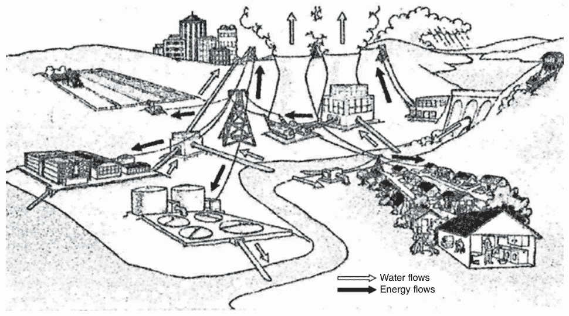

The energy requirements for water systems also have regional variability, based on the quality of water sources and pumping needs.

Water availability will affect the future of the water–energy nexus. While there is significant uncertainty regarding the magnitude of effects, water availability and predictability may be altered by changing temperatures, shifting precipitation patterns, increasing variability, and more extreme weather. Shifts in precipitation and temperature patterns – including changes in snowmelt – will likely lead to more regional variation in water availability for hydropower, biofeedstock production, thermoelectric generation, and other energy needs. Rising temperatures have the potential to increase the demand for electricity for cooling and decrease the efficiency of thermoelectric generation, as well as increase water consumption for agricultural crops and domestic use. These changes and variations pose challenges for energy infrastructure resilience.

Water and energy needs will also be shaped by population growth and migration patterns, as well as changes in fuels used and energy technologies deployed. For example, projected population growth in the arid southwest will amplify pressure on water and energy systems in that region. Increased production of oil and gas may increase both localized demand for water and generation of produced water that requires management. According to EIA data, planned retirements and additions of electricity generation units and cooling systems will likely decrease water withdrawals, increase water consumption, and increase the diversity of water sources used. While many of the forces affecting the water–energy nexus are out of the federal government’s direct control, the future of the nexus hinges on a number of factors that are within the DOE’s scope of influence, including technology options, location of energy activities, and energy mix.

The decision-making landscape for the nexus is shaped by political, regulatory, economic, environmental, and social factors, as well as available technologies. The landscape is fragmented, complex, and changing; the incentive structures are overlapping but not necessarily consistent. Water is inherently a multi-jurisdictional management issue and is primarily a state and local responsibility. States and localities vary in philosophies regarding water rights. There is also variation across states in relevant energy policies, including renewable portfolio standards, regulation of oil and gas development activities, and regulation of thermoelectric water intake and discharge. Regulations for both oil and gas development and thermoelectric water use are currently undergoing substantial change. Energy for water is also the subject of policy activity at multiple scales, from appliance standards to municipal water treatment funding mechanisms. A more integrated approach to the interconnected energy and water challenges could stimulate the development and deployment of solutions that address objectives in both domains (Table 9.2; AGU 2012; Clark and Veil 2009; DOE 2013a, b; EPRI 2011).

### 9.3.1 Technology Roadmaps and R&D

There are a number of technologies that support water-efficient energy systems or energy-efficient water systems. These technologies are at various stages of research, development, demonstration, and deployment. Figure 9.8 illustrates a range of technologies optimizing water use for energy in waste heat recovery, cooling, alternate fluids, and process water efficiency.

Cooling for thermoelectric generation is an important target for water efficiency because it withdraws large quantities of water for cooling and dissipates tremendous amounts of primary energy. One approach to reduce thermoelectric and other cooling requirements, along with associated water use, is to reduce the generation of waste heat through more efficient power cycles (e.g. the recompression closed-loop Brayton cycle). Another option is to increase the productive use of the waste heat, such as through thermoelectric materials, enhancements in heat exchanger technologies, or low-temperature co-produced geothermal power. A third approach to improve the water efficiency of cooling systems is through advancements in technologies, including air flow designs, water recovery systems, hybrid or dry cooling, and treatment of water from blowdown.

Opportunities to optimize water use also exist in other parts of the overall energy system. With further research, alternative fluids may replace freshwater in hydraulic fracturing, geothermal operations, and power cycles. Process freshwater efficiency can be improved in carbon capture, bioenergy feedstock production, and industrial processes. Many of the technologies that improve water efficiency are enhanced by advances in materials, including thermoelectric properties, heat-driven state change, scaling/fouling resistance, and temperature and pressure tolerance.

Figure 9.9 shows water treatment technologies that can potentially enhance energy efficiency of water systems and enable the productive, economical, and safe use of nontraditional water resources for energy and nonenergy applications. Such improvements in water treatment and management have particular use for treating oil- and gas-produced waters, as well as saline aquifers, brackish groundwater, brines, seawater, and municipal wastewater. For saline sources, promising water treatment technologies include membrane distillation, forward osmosis, evaporation, nanomembranes, and capacitive deionization. For municipal wastewater, treatment technologies include


表9.2 燃料发电技术的取水量与耗水量系数比较（单位：gal/MWh）。

| 燃料类型 | 冷却方式 | 技术类型 | 取水量中位数 | 耗水量中位数 |
|---|---|---|---|---|
| 核能 | 冷却塔 | 通用 | 1101 | 672 |
| | 直流冷却 | 通用 | 44350 | 269 |
| | 冷却池 | 通用 | 7050 | 610 |
| 天然气 | 冷却塔 | 联合循环 | 225 | 205 |
| | | 蒸汽 | 1203 | 826 |
| | | 联合循环（含碳捕集与封存） | 506 | 393 |
| | 直流冷却 | 联合循环 | 11380 | 100 |
| | | 蒸汽 | 35000 | 240 |
| | 冷却池 | 联合循环 | 5950 | 240 |
| | 干式冷却 | 联合循环 | 2 | 2 |
| 煤炭 | 冷却塔 | 通用 | 1005 | 687 |
| | | 超临界 | 634 | 493 |
| | | 整体煤气化联合循环 | 393 | 380 |
| | | 超临界（含碳捕集与封存） | 1147 | 846 |
| | | 整体煤气化联合循环（含碳捕集与封存） | 642 | 549 |
| | 直流冷却 | 通用 | 36350 | 250 |
| | | 超临界 | 15046 | 103 |
| | 冷却池 | 通用 | 12225 | 545 |
| | | 超临界 | 15046 | 42 |
| 生物质能 | 冷却塔 | 蒸汽 | 878 | 553 |

资料来源：美国国家可再生能源实验室（NREL）（2011年）。

厌氧氨氧化系统、厌氧预处理和厌氧膜生物反应器。此外，废水中所含的生物固体可作为甲烷能量的来源。

## 9.3.2 循环经济

关于循环经济（CE）有多种定义：一种真正可持续未来的理念，它无需产生废弃物，与我们的环境和资源共生共荣。在这样的未来中，每件产品都设计为可多周期使用，不同的材料或制造周期被精心协调，使得一个过程的输出始终成为另一个过程的输入。循环经济不将排放、生产副产品或损坏和不需要的商品视为“废弃物”，而是将其视为原材料，即新生产周期的养分（图9.10）。

英国废弃物与资源行动计划将其定义为传统线性经济（制造、使用、处置）的替代方案：在这种模式中，我们尽可能长时间地保持资源的使用，在使用期间提取最大价值，然后在每个服务寿命结束时回收和再生产品和材料。它也被描述为一个再生系统，通过减缓、封闭和缩小能量与材料循环，使资源输入以及废弃物、排放和能量泄漏最小化。这可以通过持久设计、维护、维修、再利用、再制造、翻新和闭环回收循环来实现（Geissdoerfer等人，2017年）。这与线性经济形成对比，线性经济是一种“获取、制造、处置”的生产模式。艾伦·麦克阿瑟基金会（2012年）与商业界、政府和教育界合作，帮助解释循环经济的概念和益处。该基金会的“蝴蝶图”常用于说明循环经济，但对于刚接触这一概念的人来说，可能难以理解。

### 9.3.2.1 起源

早在1966年，肯尼斯·博尔丁就提出了对“开放经济”的认识，这种经济拥有无限的输入资源和输出汇，与“封闭经济”形成对比；在封闭经济中，资源和汇相互关联，并尽可能长时间地保持为经济的一部分。循环经济的概念由两位英国环境经济学家戴维·W·皮尔斯和R·克里·特纳于1989年提出。在《自然资源与环境经济学》（Pearce和Turner，1989年）中，他们指出，传统的开放式经济发展过程中没有内生的回收倾向，这体现在将环境视为废弃物的蓄水池。其他早期思想流派包括沃尔特·斯塔赫尔教授、冈特·保利、威廉·麦克多诺和迈克尔·布朗加特，以及工业生态学、永续农业和“自然步骤”等互补方法。

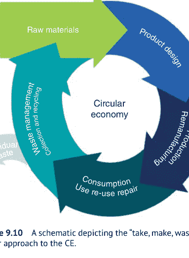

**图9.10** 描绘从“获取、制造、废弃”线性方法到循环经济的示意图。

### 9.3.2.2 摆脱线性模式

线性的“获取、制造、处置”工业过程以及依赖这些过程的生活方式，消耗了有限的储备来制造最终进入垃圾填埋场或焚烧炉的产品。这一认识引发了一些科学家和思想家的思考，其中包括沃尔特·斯塔赫尔——一位建筑师、经济学家，也是工业可持续发展的奠基人之一。他因创造“从摇篮到摇篮”这一表述（与“从摇篮到坟墓”形成对比，后者说明了我们“从资源到废弃物”的运行方式）而受到赞誉。在20世纪70年代末，斯塔赫尔致力于开发生产过程的“闭环”方法，并在25年前于日内瓦共同创立了产品生命周期研究所。在英国，史蒂夫·D·帕克于1982年研究了英国农业部门中废弃物作为资源的问题，开发了模仿并与其所利用的共生生物生态系统相结合的新型闭环生产系统。

### 9.3.2.3 理念的兴起

在他们1976年提交给欧盟委员会的研究报告《用人力替代能源的潜力》中，沃尔特·斯塔赫尔和吉纳维芙·雷代勾勒了循环（或循环经济）经济的愿景，及其对创造就业、经济竞争力、资源节约和废弃物预防的影响。该报告于1982年以《明日之工作：用人力替代能源的潜力》一书的形式出版。

斯塔赫尔的研究所被认为是首批务实且可信的可持续发展智库之一，其主要目标是延长产品寿命、长寿命商品、整修活动和废弃物预防。它还强调销售服务而非产品的重要性，这一理念被称为“功能服务经济”，有时也被归入更广泛的“绩效经济”概念之下，后者还倡导“经济活动的更多本地化”（Clift和Allwood，2011年）。

从更广泛的角度来看，循环方法是一个从生命系统中汲取见解的框架。它认为我们的系统应该像有机体一样运作，处理可以反馈回循环中的养分——无论是生物性的还是技术性的——因此“闭环”或“再生”这些术语通常与循环经济相关联。艾伦·麦克阿瑟基金会是一家成立于2010年的独立慈善机构，最近概述了循环经济的经济机遇。作为其教育使命的一部分，该基金会致力于汇集互补的思想流派，创建一个连贯的框架，从而赋予这一概念广泛的曝光度和吸引力（艾伦·麦克阿瑟基金会，2012年）。

循环经济最常被描述为一个框架，用以应对廉价石油和材料时代的终结，并有助于向低碳经济转型。与此一致，循环经济有助于实现《巴黎协定》COP 21的目标。195个国家在COP 21《巴黎协定》中作出的减排承诺不足以将全球变暖限制在1.5°C以内。为了实现1.5°C的目标，估计到2030年需要额外实现每年150亿吨二氧化碳的减排。Circle Economy和Ecofys估计，循环经济策略可能实现的减排量基本上可以弥补一半的差距（Blok等人，2018年）。然而，我们需要记住，经济和商业目标与环境目标是两个不同的目标（见附录1）。

### 9.3.2.4 可持续性

循环经济似乎直观上比当前的线性经济体系更可持续。减少系统内的资源输入以及废弃物和排放的泄漏，可以减少资源枯竭和环境污染。然而，这些简单的假设不足以处理所涉及的系统复杂性，并忽视了潜在的权衡。例如，可持续性的社会维度在许多关于循环经济的出版物中似乎只得到了很少的解决，而且有些情况需要

循环经济的许多不同“理解”可通过最近对114种不同出版物的综述得到证明。一些关键方面概述如下。

### 9.3.3.2 系统思维

系统思维是理解事物如何在一个整体内相互影响的能力。要素被视为“嵌入”其基础设施、环境和社会背景中。虽然机器也是一个系统，但系统思维通常指的是非线性系统：在这些系统中，通过反馈和不精确的起始条件，结果不一定与输入成正比，并且系统可能发生演化——系统可以显示出涌现特性。这些系统的例子包括所有生命系统和任何开放系统，如气象系统或洋流，甚至行星的轨道也具有非线性特征。

在试图对系统做出决策和规划（修正）时，理解系统至关重要。对我们社会-生态系统中的趋势、流动、功能以及人类影响的遗漏或误解可能导致灾难性的结果。为了防止规划或设计中的错误，对系统的理解应应用于整体以及计划或设计的细节。“自然步骤”创建了一套系统条件（或可持续性原则），可在设计循环经济的（部分）时应用，以确保与社会-生态系统的功能保持一致。

循环经济的概念此前在宏观经济学中被表述为货币与商品、服务、使用权、有价文件等的循环。这种情况已在许多与社会系统相关的货币和商品循环图中得到说明。作为一个系统，各种机构或实体通过路径连接，各种商品等通过这些路径进行交换以换取货币。然而，这种情况与上述循环经济不同，后者的流动是单向的——只有一个方向，也就是说，直到回收的商品再次散布到世界各地。

## 9.3.4 仿生学

《仿生学：源于自然的创新》一书的作者珍妮·班娜斯将她的方法定义为“一门研究自然最佳创意，然后模仿这些设计和过程来解决人类问题的新学科。研究一片叶子以发明更好的太阳能电池就是一个例子。我认为这是‘源于自然的创新’”（Benyus，2003年）。仿生学依赖于三个关键原则：

- 自然作为模型：仿生学研究自然的模型，并模仿这些形式、过程、系统和策略来解决人类问题。
- 自然作为衡量标准：仿生学使用生态标准来评判我们创新的可持续性。
- 自然作为导师：仿生学是一种看待和珍视自然的方式。它引入了一个时代，其基础不是我们能从自然世界中提取什么，而是我们能从中学到什么。

### 9.3.4.1 从摇篮到摇篮

由沃尔特·R·斯塔赫尔创建，他是一位瑞士建筑师，1971年毕业于苏黎世联邦理工学院。他通过倡导“商品服务寿命延长——再利用、维修、再制造、技术升级”等理念（适用于工业化经济体），在可持续发展领域具有重要影响力。1982年，他的获奖论文《产品生命周期因素》获得认可后，他在瑞士日内瓦共同创立了产品生命周期研究所，这是一家致力于制定可持续战略和政策的咨询机构。他的思想以及类似理论家的思想引领了现在所称的循环经济，其中工业界将商品的再利用和服务寿命延长作为废弃物预防、区域就业创造和资源效率的战略，以将财富与资源消耗脱钩；换言之，使工业经济非物质化。近期的技术发展，例如回收机器人（recyclebot），它能够有利地将消费后塑料废弃物转化为3D打印原料，以制造更高价值的产品（升级再循环），为收紧循环经济的循环提供了经济激励（McDonough和Braungart，2002年；Zhong，2018年）。

### 9.3.4.2 迈向循环经济

2012年1月，一份题为《迈向循环经济：加速转型的经济与商业理由》的报告发布。该报告由艾伦·麦克阿瑟基金会委托，麦肯锡公司编写，是第一份考虑向恢复性、循环模式转型的经济和商业机会的报告。该报告通过产品案例研究和整个经济体的分析，详细阐述了整个欧盟范围内实现显著利益的潜力。报告认为，欧盟制造业的一个子集到2025年每年可实现高达6300亿美元的材料成本净节省——从而刺激产品开发、再制造和整修领域的经济活动。《迈向循环经济》还确定了向循环经济转型的关键组成部分，即循环设计和生产技能、新商业模式、构建级联和逆向循环的技能，以及跨循环/跨部门合作（艾伦·麦克阿瑟基金会，2012年）。2015年1月，出版了《循环经济权威指南》（艾伦·麦克阿瑟基金会，2015年）


“加速转型”（Ellen MacArthur Foundation 2015；Ellen MacArthur Foundation 2016；Smol et al. 2017）：

- 原则1：通过控制有限存量并平衡可再生资源流，保护和增强自然资本。
- 原则2：通过在技术和生物循环中始终以最高效用循环产品、组件和材料，优化资源产出。
- 原则3：通过揭示并设计消除负外部性，提升系统有效性。

可以看出，循环经济概念的每个方面实际上都需要创新方法。所有关于循环经济的欧盟战略文件以及上述报告都将创新视为向循环经济转型的核心。同样显而易见的是，生态创新应被赋予特殊角色，并应成为关键驱动力，因为循环经济概念的核心在于经济增长、创造就业，同时减少包括碳排放在内的环境影响（Smol et al. 2015, 2017）。

## 9.5 制造业中的过程强化与集成潜力

过程强化旨在通过应用新型过程系统和设备，大幅改进制造过程。新方法可用于克服瓶颈（如热力学限制），或将多种处理现象合并到更少的处理单元中，同时降低资本、运营和维护成本以及能源、水和材料的消耗强度。过程强化方法超越了通过优化现有设备和过程系统所实现的渐进式改进，通过多种层级的污染预防技术在源头减少废物，从而在能源和材料效率、全生命周期成本降低以及环境影响方面实现阶跃式变化（Bielenberg and Bryner 2018）。

### 9.5.1 什么是过程强化？

与许多多维概念一样，过程强化并没有一个明确公认的定义。虽然过程强化可能通过实例来阐释最为恰当，但在思考过程强化时，以下几个潜在定义可供参考（Bielenberg and Bryner 2018）。

过程强化领域的知名专家斯坦凯维奇和穆林（均为代尔夫特理工大学教授）将过程强化定义为：开发创新设备和工艺技术，为化工及相关制造和加工带来巨大改进，大幅减少设备体积、能源消耗或废物产生，降低环境和健康影响，最终形成更便宜、更安全、更可持续的技术。他们还为该定义补充了四项指导原则（EFCE 2015）：

- 1）最大化分子内和分子间事件的有效性
- 2）为所有分子提供相同的过程体验
- 3）在所有尺度上优化驱动力，并最大化其作用的比表面积
- 4）最大化部分过程之间的协同效应。

过程强化旨在通过将现有操作方案重新构思为比现有操作更精确、更高效的方案，实现制造和加工的巨大改进。现有的一系列技术能够从根本上缩小设备尺寸。过程强化与微反应技术，以及新型过程强化系统的实验成果报告，包括静态混合器、超重力技术、循环精馏和反应精馏、紧凑型高比表面积换热器、多功能反应器、微通道反应系统、微工程、微技术、催化板式反应器，以及用于渗透汽化的化学微系统等。这些技术使得工厂规模能够相应缩小。极低的物料储量具有环境效益，同时也被认为具有成本效益（Reay et al. 2013）。一个附带的好处是，这些工艺在较小规模下（主要是间歇过程）也可能具有经济性，这在一定程度上促进了经济可持续性。

《欧洲过程强化路线图》将过程强化描述为提供“在工艺和设备设计中的根本性创新原则（范式转变），可使工艺和产业链效率、资本和运营支出、质量、废物、工艺安全、工艺集成等受益（通常超过两倍）”（EFCE 2015）。

Reay等人（2013）将过程强化描述为“一种化学和过程设计方法，可产生体积更小、更清洁、更安全且更节能的过程技术。”这些定义的共同核心是关注新的方案和设备，通过组合、控制和/或增强化学过程中的化学作用和传递现象来创造改进的工艺。

过程强化设备的典型例子是静态混合器。虽然静态混合器有许多不同的设计，但其基本概念是相同的。置于流体流动路径中的静止混合元件形成局部高度混合的通道，供流体通过。均匀混合快速发生，除与较小压降相关的能耗外，无需外部能量输入，且资本成本通常较低。静态混合器可以集成到其他单元操作（如反应器）中，从而实现

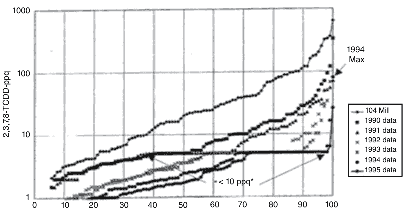

## 图9.12 通过强化过程并替代化学品消除漂白纸浆中二噁英/呋喃的生成

> 来源：摘自Das（2005）。

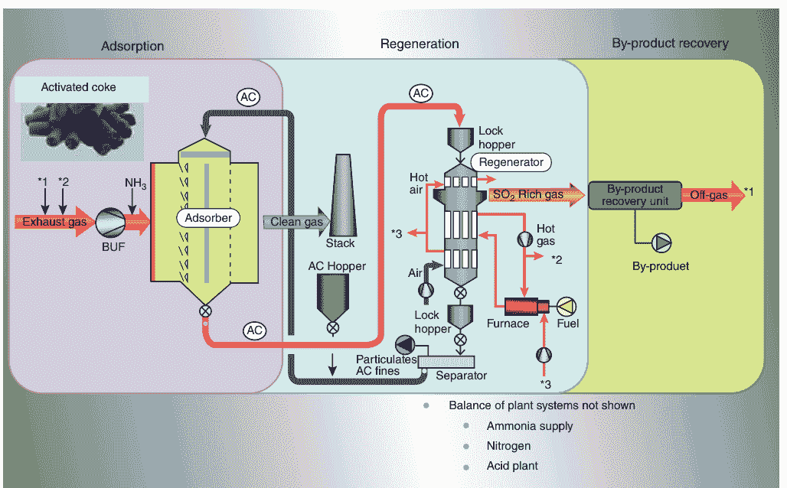

## 图9.13 三级ReACT™工艺流程示意图

> 来源：摘自Reynolds（2018）。

图9.13展示了三级ReACT™工艺，包括活性焦吸附，随后对SOₓ和汞进行再生处理，最后将富含硫的气体回收转化为可销售的硫酸副产品。

ReACT™技术基于在移动床中用活性焦吸附SO₂和NOₓ，随后对焦炭进行再生并生产可销售的副产品硫酸。该技术是一种全干式洗涤工艺，不会向烟气中蒸发任何水分，可实现极低的SO₂排放水平，并可协同控制NOₓ、颗粒物和汞。移动床干式洗涤器运行在一次颗粒物控制装置（对许多工厂而言是传统的静电除尘技术）的下游。对于允许极低颗粒物排放的特殊情况，还可以在下游加装精除尘静电除尘器。

定制与传统物料输送设备的组合将活性焦往返输送至吸收器和再生器。精细的物料处理和活性焦的稳健特性使焦炭能够在只需少量补充的情况下循环使用。

在一个容器中即可同时实现SO₂、NOₓ和汞的捕集，同时进一步降低颗粒物排放。高去除效率包括高达99.9%的SO₂、50-80%的NOₓ，以及90%以上的汞（包括元素汞）。颗粒物也可降低约50%。该技术的优势包括高减排效率、成本效益高、功耗低、安装空间小、用水量极少（干法工艺）、无需烟气再加热以及维护需求低。活性焦工艺包括三个步骤：（i）吸附，（ii）再生，以及（iii）副产品回收（图9.13）。

在吸收器中，烟气以恒定流速通过缓慢向下移动的活性焦床层。吸收器为单级，相比之前的两级吸收器设计有所改进。SO₂、NOₓ、汞和颗粒物的去除在一个步骤中完成。当活性焦被污染物饱和后，通过斗式提升机输送到再生器。再生器在399-499°C的温度范围内运行。同时，活性焦中的硫酸或铵盐分解为N₂、SO₂、SO₃和H₂O。汞保留在活性焦中，并根据ReACT™入口汞浓度在一定时间后被去除。

冷却后，再生的活性焦通过分离器（振动筛），将细颗粒和活性焦小颗粒与较大的活性焦分离，后者返回吸收器。从分离器移除的活性焦可返回锅炉燃烧，或出售用于工业应用，如二噁英吸附——来自再生器的富含SO₂的气体在副产品回收设施中被转化为可销售的产品，如硫酸（图9.14）。

- **活性焦上的吸附和反应：** SO₂和SO₃在活性焦表面以硫酸、硫酸铵和硫酸氢铵的形式被高效吸附。
- 活性焦的催化作用还可在氨存在下引发还原反应以去除NOₓ。NOₓ的控制活动在吸收器中完成，反应如下：

SO₂ + H₂O + ½O₂ → H₂SO₄*

SO₃ + H₂O → H₂SO₄*

H₂SO₄* + NH₃ → NH₄HSO₄*

NH₄HSO₄* + NH₃ → (NH₄)₂SO₄*

（*表示吸附态物质）

NO + NH₃ + ½O₂ → N₂ + 3/2H₂O

NO + C…R → N₂（C…R代表表面官能位点）

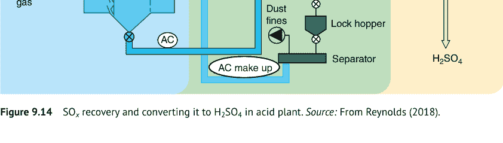

**图9.14** 在酸厂中回收SOₓ并将其转化为H₂SO₄。*来源：摘自Reynolds（2018）。*


## 9.5.3.2 AC 与再生焦

AC 是一种通过蒸汽活化（约 900 °C）生产的碳质材料。它具有很高的抗磨损和抗压机械强度。其表面积为 150–300 m²/g，小于传统活性炭，但比冶金煤高不了多少。AC 呈片剂或杏仁状，通常比活性炭大得多。AC 生产更容易，成本也更低。图 9.15 展示了 AC 的内部模型及其孔隙结构。图 9.16 显示了汞蒸气去除效率随时间的变化。

## 9.5.3.3 AC 的热再生

在再生器加热段的温度下，吸附的硫酸、硫酸铵和硫酸氢铵会分解为 SO₂。AC 颗粒通过锁斗进入，并与脱附气体和 N₂ 载气形成重力逆流。富含 SO₂、CO₂、N₂ 和 H₂O 的富硫气体从再生器出口进入酸厂，反应如下：

H₂SO₄* + ½ C → SO₂ + ½ CO₂ + H₂O

(NH₄)₂SO₄* → SO₃ + NH₃ + 2H₂O

NH₄HSO₄* → SO₃ + 2NH₃ + 2H₂O

3SO₃ + 2NH₃ → 3SO₂ + 3H₂O + N₂

（*表示吸附物种；非等温脱附动力学在 300 °C 时达到峰值速率，至 450 °C 完成）。

## 9.5.3.4 ReACT™ 的性能与优势

表 9.3 展示了日本 J-Power EnTech 2x600MW ISOGO 燃煤电厂的典型性能（Reynolds，

图 9.15 AC 的内部模型——孔隙结构。

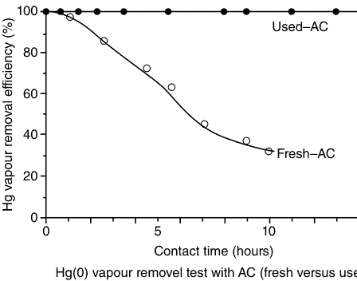

图 9.16 汞蒸气去除效率（%）随时间的变化。

个人通讯）。ReACT™ 先进多污染物控制的优势可总结如下：

- 副产品收入——硫酸是世界上第一大商品化学品，市场价值为 $50 200/T。ReACT™ 不是产生废弃石膏或粉煤灰/石膏废物，而是产生可销售的副产品。
- 避免处置成本——传统的烟气脱硫（FGD）每控制一吨 SO₂，约产生三吨固体废物。如果飞灰是 FGD 废物流的一部分，则更多。
- 近零用水——ReACT™ 使用极少的水，与 FGD 系统形成鲜明对比。对于 500 MW 电厂，湿法烟气脱硫（WFGD）系统每年需要 275 000 000 加仑水，而 ReACT™ 几乎为零。

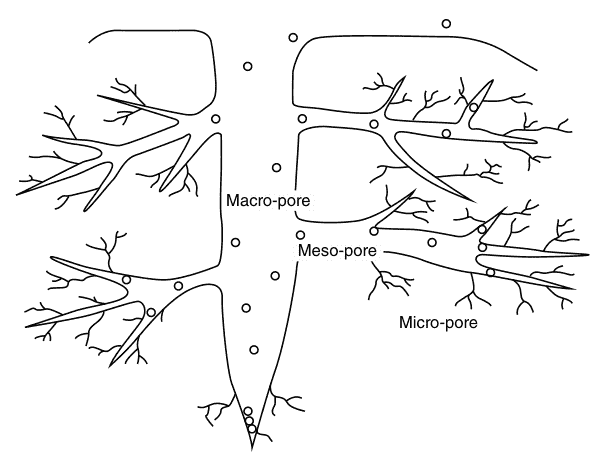

## 表 9.3 先进多污染物脱除的典型性能

| 污染物 | 排放许可 | 效率（%） | 入口浓度 | 出口浓度 |
|---|---|---|---|---|
| SOₓ | 10 ppm (0.025 lb/MMbtu) | >98 | <410 ppm <0.85 lb/MMbtu | <1 ppm <0.002 lb/MMBtu |
| NOₓ | 13 ppm (0.02 lb/MMbtu) | 10–50 | <20 ppm 0.03 lb/MMbtu | <7 ppm <0.011 lb/MMbtu |
| 颗粒物 | 5 mg/Nm³ (0.004 lb/MMbtu) | >95 (>99.9 w/ESPs) | <100 mg/Nm³ <0.1 lb/MMbtu | <3 mg/Nm³ <0.002 lb/MMbtu (w/后端 ESP) |
| Hg | -- | >90 | 2.5 µg/Nm³ | <0.25 µg/Nm³ |

- 极少的工厂改造——ReACT™ 可通入现有烟囱，无需更换内衬材料。ReACT™ 位于现有设备下游，无需改造上游设备。
- NOₓ 减排选项——ReACT™ 系统可设计为多种 NOₓ 还原选项，从 30% 的协同效益水平到通过替代设计达到 80%。

它强调过程的统一性，大致可分为质量集成和能量集成两个类别。Parthasarathy 和 Dunn（2005）提供了能量和热交换网络，并附有关于热交换网络的微型案例研究，简要介绍了质量集成，并对质量集成的概念进行了详细探讨。

## 9.6 制造过程集成

为应对制造设施相关的惊人环境与能源问题，化工及相关过程工业投入了大量关注和资源，以减轻对环境的负面影响、节约资源并降低能源使用强度。这些努力已逐渐从基于单元的方法转向系统级范式。过去十年，工业界和学术界投入大量精力，开发从系统角度着眼于节能和减废的整体过程设计方法。然而，整体方法的内涵在于需要认识到，某个单元或物流的变化通常会在整个过程中传播，并可能对过程的可操作性和盈利能力产生重大影响。此外，各种过程目标（如技术、经济、环境和安全）必须加以整合与协调。这些挑战要求开发和应用一种系统化方法，该方法超越过程的具体情况，从整体角度看待环境、能源和资源节约问题。这种方法称为过程集成（Parthasarathy 和 Dunn 2005；Smith 2016）。

### 9.6.1 过程集成技术的几种可能应用

1) 一种整体性的过程设计方法，从一开始就强调过程的统一性并考虑不同单元操作之间的相互作用，而不是分别优化它们。这也可称为集成过程设计或过程综合。Smith（2016）很好地描述了这一方法。重要的第一步通常是产品设计，即制定满足产品预期用途的规格。

2) 夹点分析是一种用于设计过程以最小化能耗和最大化热回收的技术，也称为热集成、能量集成或夹点技术。该技术计算给定过程在热力学上可达到的能量目标，并确定如何实现这些目标。一个关键见解是夹点温度，即过程中受约束最多的点。Parthasarathy 和 Dunn（2005）详细解释了这些技术。这一定义反映了过程集成的第一个重大成功是解决能源问题的热夹点分析。随后，针对质量交换网络、水最小化和物料循环等应用开发了其他夹点分析。一个非常成功的扩展是“氢夹点”，已应用于炼油厂氢气管理。这使得炼油厂能够最大限度降低氢气供应的资本和运营成本，以满足日益严格的环境法规，同时提高加氢处理装置的产率（Hallale 2001）。

用于反应器设计的过程集成技术已取得快速进展，但仍处于早期阶段。第三，新一代软件工具有望出现。过程集成商业软件的出现对其在过程设计中的更广泛应用至关重要。

在化学工程背景下，过程集成可被定义为一种过程设计和优化的整体方法，它利用不同单元之间的相互作用，以有效利用资源并最大限度地降低成本。过程集成不仅限于新工厂的设计，还涵盖改造设计（例如在旧工厂中安装新单元）以及现有系统的运行。Hallale（2001）解释说，通过过程集成，工业界在变得更清洁和更可持续的同时，还从原材料和资本资产中赚取更多利润。

## 9.7 利用过程集成与强化从黑液气化中获取新型可持续化学品与能源

过程集成的主要优势在于将系统作为一个整体来考虑（即集成或整体方法），以改进其设计和/或操作。相比之下，分析方法试图分别改进或优化过程单元，而不一定利用它们之间的潜在相互作用。

例如，利用过程集成技术，可能会发现某个过程可以使用另一个单元排出的热量，从而降低总能耗，即使这些单元本身并未在最佳条件下运行。而分析方法会错过这种机会，因为它会寻求优化每个单元，之后就不可能实现内部热量再利用。

在化学品及相关产品和能源过程工程领域，尤其值得关注的是设计低能耗要求（能源密集型）的过程（最好使用可再生材料，如生物质），并使用最少的原料或将副产品作为原料（材料密集型）以及最少的设备数量（即精益制造）。这正是过程集成（PI）领域产生的基础。PI 的主要目标是提出尽可能小的工厂中的生产和制造过程，并具有较低的总能量、材料、水和其他资源消耗。为减小工厂规模，必须缩小设备尺寸或减少过程中的操作数量，或在过程中采用多功能。由于工业过程的能量需求通常由蒸汽满足，而蒸汽生产需要燃烧某种燃料（通常是化石燃料），因此降低能量需求可直接减少对环境的影响（例如温室气体、碳氧化物、氮氧化物和硫氧化物以及颗粒物）。在本扩展案例研究中，黑液（制浆过程的副产品）被用于制造化学品和生物燃料，特别是甲醇、二甲醚和合成气。文中讨论了不同的原料、副产品及替代品的使用以及 PI 的原理（Gómez-Castro 等，2016）。

通常，过程集成技术在项目开始时（例如新工厂或现有工厂的改进）用于筛选有前景的方案，以优化工厂的设计和/或运行。同时，它也经常与模拟和数学优化工具结合使用，以识别机会，更好地集成（新建或现有）系统并降低资本和/或运营成本。

### 9.7.1 引言

大多数过程集成技术采用夹点分析或夹点工具来评估多个过程作为整体系统。因此，严格来说，这两个概念并不相同，尽管在某些情况下它们可以互换使用。Hallale（2001）的综述指出，未来该领域有望出现若干趋势。未来，目标与设计之间的界限似乎可能会模糊，并且这些将基于有关过程网络的更多结构信息。其次，我们很可能会看到更广泛的过程集成应用。在分离领域仍有大量工作要做，不仅涉及复杂的精馏系统，还涉及混合类型的分离系统。这包括涉及固体的过程，如浮选和结晶。使用

美国纸浆和造纸工业目前是美国最大的生物质能源生产者和使用者，几乎所有生物质都来自可持续种植的树木。纸浆厂使用的可再生资源包括树皮、木材废料和黑液，黑液是纤维素纤维提取过程中富含木质素的副产品。

凭借可直接利用的大量可再生能源资源，以及长期内可能更为广泛的资源，美国纸浆和造纸工业具有为解决气候变化和美国能源安全担忧做出重大贡献的潜力，


同时提高其全球竞争力。实现这些目标的关键要求是突破性技术的商业化，尤其是气化技术，以实现生物质向有用能源形式（包括电力和交通燃料）的清洁高效转化。

气化技术能够将低质量的固体燃料如生物质以低污染的方式转化为主要由氢气（H₂）和一氧化碳（CO）组成的燃料气（合成气或“syngas”）。合成气可以在燃气轮机中清洁高效地燃烧以发电。它可以经过适当的催化剂合成清洁的液体交通燃料或化学品。它也可以高效地转化为纯 H₂ 燃料。

虽然美国今天大多数造纸厂不出口电力且没有一家出口交通燃料，但它们收集和处理生物质资源的既有基础设施为未来基于气化的“生物炼制厂”提供了坚实的基础，这些生物炼制厂可能与纸浆和纸张产品一起生产多种可再生燃料、电力和化学品（图 9.17）（Perlack et al. 2005）。

如果为此类生物炼制厂生产能源载体的生物质资源是可持续种植和收获的，那么与生物炼制厂及其产品相关的 CO₂ 全生命周期排放将很少。如果生物炼制厂产品取代了原本来自化石燃料的燃料或化学品，那么整个能源系统的 CO₂ 排放将净减少。

如果生物炼制厂产生的副产物 CO₂ 被捕获并送往长期地下储存，则减排效果将更加显著（Larson et al. 2006b）。化石燃料的碳捕获与储存目前备受关注。多个大规模 CO₂ 储存项目（储存 >1 百万吨/年 CO₂）正在运行，全球范围内还有更多项目正在开发中以证明其可行性（USDOE 2006）。

与解决国家能源安全和全球变暖问题的潜力相耦合的是，美国纸浆和造纸行业迫切需要进行重大资本投资，以更换目前用于从黑液中回收能源和制浆化学品的 Tomlinson 回收锅炉的老化机队。美国运行的大多数 Tomlinson 锅炉建于 1960 年代末至 1970 年代。服务寿命为 30–40 年的 Tomlinson 机队在 1980 年代中期开始进行寿命延长改造。在未来 10–20 年内，经过改造的锅炉将接近需要更换的年龄，典型工厂的资本投资将在 1 亿至 2 亿美元之间。欧洲纸浆工业也存在类似情况。这种情况为引入黑液气化器作为 Tomlinson 锅炉的替代品提供了难得的经济机遇。目前，美国和瑞典正在 concerted 努力开发商业化黑液气化技术（Ekbom et al. 2005; Larson et al. 2006a; Swedish Forest Agency 2008）。

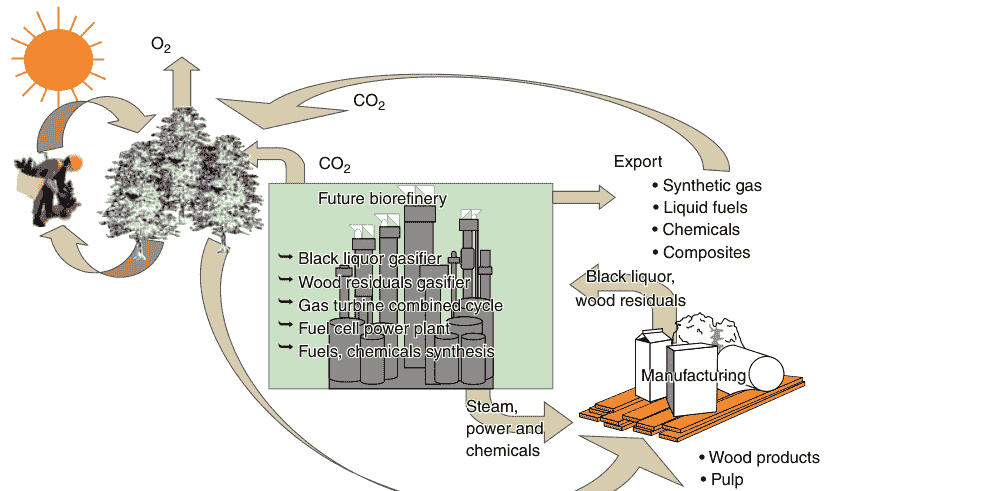

**Figure 9.17** 基于纸浆和造纸制造厂（kraft）的“生物炼制厂”概念。*Source:* From Perlack et al. (2005)。

## 9.7.2 Black Liquor Gasification (BLG): Introduction

黑液是一种具有独特气化适用性的生物质原料（Ådahl et al. 2004; Andersson and Harvey 2004; Bajpai 2008, 2013; Berglin et al. 2002; Dahlquist et al. 2009; Grigory 2009; Marklund 2006; Salomonsson 2013; Sricharoenchaikul 2009, 2001; Waldner and Vogel 2005; Wikipedia 2016）。首先，它以大量存在于现有工业现场。其次，它是液态的。这使得它可以通过泵送轻松地送入加压气化炉。液态还使黑液易于雾化成细雾，在气化炉中反应非常快。第三，黑液焦炭的气化速度比任何其他原料都快，因为黑液中固有的高钠和钾含量起催化作用。这些特性使得黑液能够应用高温、悬浮流气化原理。这种类型的气化工艺相对于替代气化技术具有许多优势。它是一种非常快速的单段气化工艺，具有反应器体积小、排放低（包括颗粒物和有臭味的 TRS 气体）、功耗低等优点。

### 9.7.2.1 Black Liquor Properties

黑液是木质素残渣、半纤维素和工艺中使用的无机化学品的水溶液。黑液通过一系列蒸发器以增加固体含量，使其适合燃烧。在蒸发器中，BLS 含量从约 15 wt% 增加到约 70–75 wt%。进入回收锅炉的浓缩黑液由约 30% 水、30% 有价值的无机制浆化学品和 40% 从木材中分离出的木质素和其他有机物组成。较高的热值约为 14,000 kJ/kg 固体。通常，大型纸浆厂每天生产约 200 t 黑液，相当于约 300 MWh（Bajpai 2014）。

黑液中的有机物由木材的水/碱可溶降解组分组成。木质素降解为较短的片段，硫含量为 1–2%，钠含量约为干固体的 6%。纤维素和半纤维素降解为脂肪族羧酸皂和半纤维素片段。提取物产生松香皂和粗松节油。皂中约含 20% 钠。表 9.4 列出了黑液的一些性质。

**Table 9.4** Properties of black liquor.

| Property | Value |
|---|---|
| Density (50% solids) at 93 °C | 1.26 g/cm³ |
| Viscosity (50% solids at 121 °C) | 5.0 cP |
| Viscosity (70% solids at 125 °C) | 100.0 cP |
| Specific heat (40% solids) | 2.0 kJ/(kg·K) |
| Heating value (35% lignin and 70% solids) | ~14,000 kJ/kg |

### 9.7.2.2 BLG Technologies

BLG 可以在低温或高温下进行，具体取决于工艺是在废制浆化学品的熔化温度范围（650–850 °C）之上还是之下进行（Sricharoenchaikul 2001）。

低温气化 – 低温气化炉在 600–850 °C 下运行，低于无机物的熔点，从而避免熔盐-水爆炸。高温气化 – 高温气化装置通常在 900–1000 °C 范围内运行并产生熔融熔盐。

在低温气化中，凝相中的碱盐仍以固体产物存在，而在高温气化中则产生熔融盐。低温气化相对于高温气化具有优势，因为低温气化可实现更好的钠和硫分离。此外，由于产物为固体，低温气化对材料构造的要求较少。然而，低温气化产生的合成气可能含有较大量的焦油，这会污染气净化操作并污染气化炉下游的燃气轮机。这些污染问题可能导致气化炉燃料产品的损失（Patrick and Siedel 2003; Sricharoenchaikul 2001）。

多家公司已进行试验以开发 BLG 的商业可行工艺。Whitty and Baxter (2001) 和 Whitty and Verrill (2004) 对 BLG 的发展历史进行了非常详细的描述。在寻找回收制浆化学品的替代方法的过程中，气化技术已被多次彻底研究。总共已有超过 20 种不同的技术在过去几年中被研究过（Swedish Energy Agency 2008）。最有趣的低温黑液气化（LTBLG）和高温黑液气化（HTBLG）工艺尝试在表 9.5 中列出。目前只有两种技术正在商业化推进：MTCI（Manufacturing and Technology Conversion International Company，低温）和 Chemrec（高温）技术。Chemrec，一家瑞典公司，正在开发一种加压、氧气吹入的 HTBLG 技术，如图 9.18 所示（Chemrec 2006; Whitty 2006; Whitty and Nilsson 2001）。表 9.6 给出了这两种技术的差异。


**表9.5** 黑液气化工艺。

- SCA-Billerud工艺
- Copeland工艺
- Weyerhaeuser“干热解”工艺
- St. Regis加氢气化工艺
- Texaco焦化工艺
- VTT循环流化床气化工艺
- Babcock & Wilcox鼓泡流化床气化工艺
- NSP或Ny Sodahus工艺
- DARS工艺（直接碱回收系统）
- ABB循环流化床气化工艺
- MTCI/TRI流化床蒸汽重整工艺
- Kellogg、Brown和Root的喷动和输送流化床气化器
- Paprican的AST工艺
- 加利福尼亚大学“热解、气化、燃烧”工艺
- Champion–Rockwell熔盐气化工艺
- SKF等离子体黑液气化器
- Ahlstrom悬浮气化器
- Tampella气流床气化器
- Noell气流床气化器
- Champion–Rockwell熔盐气化工艺
- Chemrec气流床气化工艺
- 黑液催化水热气化

来源：摘自Whitty和Verrill（2004）、Grigoryan（2009）、Naqvi等（2010）以及瑞典能源署（2008）。

**表9.6** 低温黑液气化（LTBLG）与高温黑液气化（HTBLG）的区别。

| 性质 | 低温（TRI） | 高温（Chemrec） |
|---|---|---|
| 加热方式 | 间接（合成气） | 直接（黑液） |
| 回收化学品 | 固相 | 熔融物 |
| 硫分配（气相/熔融物） | 90/10 | 50/50 |
| 合成气组成 | 高H₂浓度 | 中等H₂浓度 |
| 合成气能量含量 | 高 | 低 |

来源：摘自瑞典能源署（2008）。

## 9.8 纸浆和造纸厂的化学品回收与动力/蒸汽热电联产

### 9.8.1 纸浆和造纸工业

纸浆和造纸工业是世界上最大的工业之一，也是许多国家重要的就业来源。可持续管理的纸浆和造纸工业可以为当地经济和人民带来诸多好处，尤其是在农村地区。该工业以北美、北欧和日本等东亚国家为主。拉丁美洲和大洋洲也有重要的纸浆和造纸工业。预计在未来几年，印度和中国将成为该工业增长的关键。

纸浆和纸主要由来自天然森林或纸浆材种植园的木材纤维制成。回收纤维以及其他纤维来源（如农业残留物）也被利用，并且回收纤维在纸浆和造纸中的使用越来越普遍。现有两种在工艺上差异很大的重要制浆技术，即机械制浆和化学制浆。欧盟约30%的纸浆总产量来自机械制浆，其余通过化学制浆生产（Das 2005；Das和Houtman 2004；瑞典森林署2008）。北美拥有重要的纸浆和造纸工业；约21%的纸浆总产量来自机械制浆，其余为化学制浆。

生产漂白硫酸盐浆的纸浆厂每生产1吨纸浆会产生1.7–1.8吨黑液（以干物质计）。因此，黑液代表了每座工厂250–500兆瓦的潜在能源。由于现代硫酸盐浆厂有能源盈余，它们可能成为未来能源系统中可再生燃料的关键供应者。如今，黑液是生物质能最重要的来源。因此，将黑液中的一次能源转化为高价值的能源载体具有重大意义。表9.7给出了几种主要燃料的相对年产量（Farmer和Sinquefield 2009）。与生物燃料和化石燃料相比，黑液的一个关键优势是它已经在工厂内；处理基础设施已经存在，并且没有收集和运输成本。

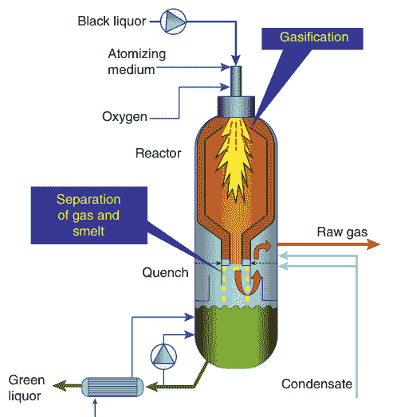

**图9.18** 瑞典Chemrec公司正在开发的加压、吹氧高温黑液气化（HTBLG）技术。来源：摘自Chemrec（2006）、Whitty（2006）以及Whitty和Nilsson（2001）。

**表9.7** 几种燃料的年产量。

| 产品 | 百万吨/年 |
|---|---|
| 黑液固形物 | 200 |
| 纸和纸板 | 180 |
| 原油 | 4,000 |
| 硬煤 | 5,000 |

来源：摘自Farmer和Sinquefield（2009）。

在全球范围内，纸浆和造纸工业目前每年处理约1.7亿吨黑液（以干固形物计），总能量含量约为2艾焦（EJ），这使得黑液成为一种非常重要的生物质来源（IEA生物能源报告2009）。与其他用于化学品生产的潜在生物质来源相比，黑液的一大优势是它已经被部分加工，并且以可泵送的液态形式存在。在生物精炼厂中利用黑液作为生产液体或气体生物燃料的原料有许多优点：由于燃料生产的原料在纸浆和造纸厂范围内处理，生物质物流被极大简化；该过程易于加压，从而提高了燃料生产效率；由于木材被加工成纸浆，所产生的合成气甲烷含量低，从而优化了燃料产率；当纸浆厂实现产品多样化时，其经济性对纸浆价格的敏感度会降低；并且气化资本成本由无机化学品回收、蒸汽生产和合成气生产共同分担。总体而言，如果全球黑液产量用于生产交通生物燃料，则相当于约4800万吨甲醇，而目前世界基于化石燃料的甲醇产量约为3200万吨，这将产生重大影响。

### 9.8.2 黑液气化联合循环动力/回收

气化黑液使其能够用作燃气轮机联合循环中的燃料，这是一种比Tomlinson锅炉蒸汽轮机技术高效得多的发电选择。在图9.19所示的典型“工厂规模”黑液气化联合循环（BLGCC）中，黑液被气化，合成气产物经过冷却、净化、脱除H₂S（使用Selexol®装置），然后在燃气轮机中燃烧。涡轮排气通过“管道燃烧器”进入余热回收蒸汽发生器（HRSG），在其中产生蒸汽以驱动蒸汽轮机。管道燃烧器中燃烧少量天然气，以生产工厂运行所需的必要工艺蒸汽。蒸汽以两种不同压力从蒸汽轮机中抽出。HRSG的蒸汽产量由假设参考工厂已存在的树皮燃料锅炉提供的蒸汽加以补充。BLGCC分析中的一个设计约束是现有树皮燃料锅炉的尺寸，这限制了这些锅炉可提供的蒸汽量。正是这一限制导致在管道燃烧器中使用少量天然气（黑液，维基百科，2016）。

### 9.8.3 生物精炼厂

图9.20展示了二甲醚（DME）生物精炼厂的示意图。在DME生物精炼厂中，由空气分离装置提供氧气，黑液气化器为液相DME反应器提供全部合成气。未转化的合成气与产品DME分离，其中97%循环回合成反应器以提高DME产量。从循环回路中取出的3%吹扫气流可防止惰性气体过度积累。吹扫气被送往树皮燃料锅炉，与选定量的木材残余物一起燃烧，以产生足够的蒸汽满足工厂全部工艺蒸汽需求。从黑液和合成气处理区域回收的热量集成到锅炉中，以增加蒸汽产量并最大限度地减少所需木材残余物的量。蒸汽通过背压式涡轮机膨胀，产生部分电力，用于满足工厂的工艺电力需求。为了完全满足工厂的电力需求，必须从电网输入部分电力。由于黑液主要转化为液体燃料而非电力，与传统Tomlinson系统相比，所需输入的电力更多（ETC 2011；Larson等2006a）。

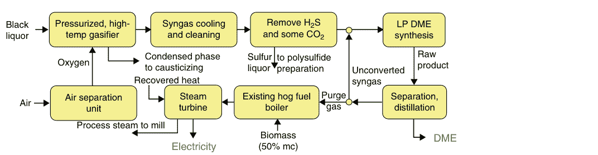

**图9.20** DME生物精炼厂示意图。关键特征包括回收未转化的合成气以提高DME产量，以及利用蒸汽动力。来源：摘自Larson等（2006a）。

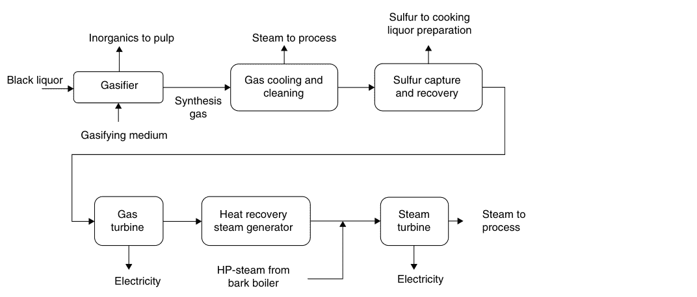

**图9.21** 纸浆厂BLGCC动力/回收系统流程图。来源：摘自Naqvi等（2010）。

利用气化黑液生产氢气也已被研究。Andersson和Harvey（2004）评估了在化学纸浆厂中集成化利用黑液气化（BLG）生产氢气的能耗和净二氧化碳排放后果。该纸浆厂的基础产能为每天2000风干吨（ADt）纸浆。在参考KAM纸浆厂生产氢气需要进口21万吨生物质用于蒸汽生产和0.43太瓦时/年的电力。如果瑞典所有纸浆厂的黑液都被气化来生产氢气，则预计生物质进口量为4.9太瓦时/年，电力进口量为2.3太瓦时/年。结果表明氢气生产潜力巨大，即每天可生产188吨氢燃料，相当于261兆瓦[低热值（LHV），120兆焦/千克]（KAM报告2003）。

Larson等人（2006a，b）对美国硫酸盐浆厂将BLG用于液体燃料生产与BLGCC用于发电进行了“从油井到车轮”（WTW）比较环境评估。在美国引入BLGCC系统，有可能在25年内净减少多达3500万吨CO₂、1.6万吨SO₂和10万吨NOx（Naqvi等2010）。


(600°C, 300 bar)。催化水热气化过程涉及三个步骤：

- 1) *Heat up phase*（分解单元）：在此阶段，由于木质素的存在，黑液中的大分子水解形成醇。木质素中的纤维素在约 250°C 时在水中迅速分解。
- 2) *Salt separation*：在盐分离器中，黑液中存在的无机盐沉淀并返回造纸厂。
- 3) *Catalytic reactor*：这是实际的甲烷合成单元，其中较小的有机分子，如羧酸、醇和醛，被转化为 CH₄、CO₂、H₂ 和 CO。

羧酸被转化为甲烷、二氧化碳和氢。由于超临界条件和催化剂的存在，焦油形成被避免。

Sricharoenchaikul（2009）研究了超临界水氧化技术将黑液转化为增值燃料产品并回收制浆化学品的可行性。实验是在基于重要操作参数的流化床反应器中加热的石英毛细管中进行的，这些参数为压力、温度、进料浓度和反应时间。研究人员发现，220 至 400 bar 之间的压力对合成气和碳转化的影响不显著。但将温度和停留时间提高到 375–650°C 和 5–120 秒，可实现高碳转化率、更高的合成气产量和更高的能源效率。

## 9.8.8 Fischer–Tropsch 液体

商业 Fischer–Tropsch 催化剂包括铁基和钴基材料。钴催化剂产生大量重蜡馏分，可以通过随后的加氢裂化（在富氢环境中将大烃分子分解为所需最终产品的过程）以高选择性轻松精炼成所需的较轻产品。FT 合成形成的长链直链烃的加氢裂化可以在比常规石油化工精炼中芳香分子加氢裂化所需的条件更温和的温度条件下进行（裂解至 C5–C18 范围烃为 350–400°C）。铁基催化剂产生更广的产品混合物，需要比钴催化剂更高的精炼水平。此外，与钴催化剂不同，铁催化剂促进水煤气变换活性（CO + H₂O → H₂ + CO₂），使其非常适合用于 H₂/CO 比低于 FT 合成化学计量值 2.2 的合成气。

## 9.8.9 混合醇

与 FTL 或 DME 合成相比，甲基-、乙基-和丙醇混合醇（MA）合成技术的商业化程度明显较低，且缺乏可用于基于详细反应器性能估计的已发表文献。过去研究的催化剂可分为四类（Liu et al. 1997）：钌基催化剂、改性甲醇催化剂、改性 Fischer–Tropsch 催化剂和硫化钼基催化剂。其中，MoS₂ 基催化剂（最初由 1980 年代 Dow 和 Union Carbide 的研究人员发现）因其对含硫合成气的高耐受性、水煤气变换活性以及对线性醇的高活性和选择性而受到近期大量关注。选择性是一个特别重要的特性，因为如果允许 CO 和 H₂ 之间所有可能的化学反应在没有限制的情况下竞争，合成更高醇以外的反应在热力学上将超过合成更高醇的反应。特别是，CO 和 H₂ 形成 Fischer–Tropsch 烃（α-烯烃和正烷烃）在热力学上比形成更高醇更有利。因此，为了最大化醇合成催化剂的性能，高选择性是必不可少的特征。

采用的更高醇简化反应方案如下：

```
CO + H₂O ↔ CO₂ + H₂

CO + 2H₂ ↔ CH₃OH

CH₃OH + 2H₂ → C₂H₅OH + H₂O

2CH₃OH + CO + 2H₂ → C₃H₇OH + 2H₂O
```

## 9.8.10 “WTW” 黑液气化环境影响

除了前面讨论的生物炼制系统能源方面外，我们还研究了环境属性。水排放物、空气排放物和固体废物都可能成为关注点。在评估生物炼制系统相对于汤林森动力/回收系统所发现的水平对这些排放物的影响时，可以考虑直接排放物和电网电力生产以及常规石油基机动车燃料替代所相关排放物的变化。特别是，为了有效估计生物炼制的全部环境影响，当前分析涉及从资源开采到最终使用的排放影响估计。这种所谓的 WTW 分析是比较不同替代和常规燃料的有意义比较的常用方法。这种方法之所以必要，是因为不同上游生产和转换过程、不同燃料的不同下游车辆/发动机类型以及燃料特性和燃烧特性的显著差异。

由 BLG 工艺生产的生物燃料在 WTW 二氧化碳排放减少和能源效率方面表现出色。此外，由 BLG 路线生产的林业收获残留物合成柴油和 DME 也显示出最高的 WTW 温室气体减排和能源效率。美国可用的黑液总量按该工艺的转化效率计算相当于每年约 50 亿加仑乙醇当量。可再生燃料标准要求到 2022 年生产 160 亿加仑纤维素生物燃料。因此，该路线可以为实现这一目标做出重大贡献。

美国的造纸公司目前正面临海外低成本生产商以及包装和印刷媒体替代解决方案的激烈竞争。工厂运营商及其投资者现在选择将纸浆厂转变为使用林业燃料工艺的生物炼制厂。这种转变完全改变了纸浆厂的竞争地位，通过典型的 25–40% 内部收益率增加 30–50% 的盈利收入。它还使必要的再投资成为可能，通过用高维护成本和低性能的老化回收锅炉替换来实现。燃料厂投资还可用于提供额外的回收能力，在许多情况下可提高纸浆产量。仅生产 500 t BLS/天的工厂作为燃料-林业生物炼制厂是可行的，采用该方法。大多数工厂规模明显更大。这样的生物炼制厂在最低产能下每年可生产超过 800 万加仑绿色机动车燃料，按汽油当量计算。在投资第二代生物燃料技术的工厂中，就业不仅得以保留，而且还创造了额外的就业机会，主要是从森林中提取生物质以及运营和维护生物燃料厂。其他经济和社会效益也很重要，例如可能的税收优惠和空气排放减少（Bajpai 2014）。

使用林业燃料的生物炼制项目典型的资本投资为 2 亿至 4 亿美元，具体取决于工厂规模和与工厂互联的成本。BLG 行业正在积极寻求联邦和州的赠款和贷款担保，以尽快将该技术提升到大规模商业化能力。作为超清洁、可再生机动车燃料的来源，将纸浆和造纸厂转变为炼油厂的 BLG 路线正经受作为生产替代、可再生能源的切实可行且实用方式的严格审查，同时合理利用土地并对环境温和（Bajpai 2014）。

利用气化在 BLGCC 配置中而非汤林森锅炉的森林生物炼制厂预计会产生显著更少的污染物排放，这是由于 BLGCC 技术固有的特性。合成气净化调理去除大量污染物，燃气轮机燃烧比锅炉燃烧更高效、更完全。由化石能源资源制造的化学品和燃料的更清洁生产也可能导致污染物排放和危险废物减少。此外，一般认为，从生物质资源生产电力、燃料、化学品和其他产品产生的二氧化碳净生成量为零，因为植物是可再生的碳汇。森林生物炼制概念的一个关键组成部分是可持续林业。森林生物炼制概念利用先进技术将可持续木质生物质转化为电力和其他有价值的产品，并将支持森林土地的可持续管理（Farmer 2005）。此外，森林生物炼制为可再生资源如木材疏伐和林业残留物以及城市废物提供了富有成效的增值用途（Mabbe et al. 2005; Miller et al. 2005）。

无论是在高温还是低温下进行的 BLG，仍优于当前的回收锅炉燃烧技术（Bajpai 2008, 2012）。气化器的热效率估计为 74%，而现代回收锅炉为 64%，而集成气化和联合循环（IGCC）发电厂有可能产生相同数量的燃料（Dance 2005; Farmer and Singlefield 2003）。而常规回收锅炉发电厂的电力生产比为 0.025–0.10 MW/tMWt，IGCC 发电厂可估计产生 0.20–0.22 MW/tMWt（Farmer and Singlefield 2003; Sricharoenchakul 2001）。这种电力效率的提高足以使纸浆和造纸厂成为可再生电力的潜在出口商。或者，纸浆厂可以通过成为生物炼制厂来成为生物基产品的制造商。此外，新技术有可能每年节省超过 100 万亿 Btu 的能源消耗，并在实施 25 年内可节省多达每年 360 万亿 Btu 的化石燃料能源（Larsen et al. 2003）。新技术还提供了改进纸浆产量的好处，如果包括替代制浆化学品，以及减少固体废物排放。此外，该工艺本质上更安全，因为气化器不像回收锅炉那样含有用于焦油熔融的床，从而降低了致命的熔渣-水爆炸风险（Argonne National Laboratory 2006; Sricharoenchaikul 2001）。


## 9.8.11 水和固体废物

水质、水温和水消耗都是生物炼制厂的潜在关注点。随着对有限淡水资源需求的上升，这些问题很可能变得更加重要。简而言之，这些问题如下：

- 水量：任何节水都会给造纸厂带来直接的财务效益，同时也能解决对其他用途淡水可用性日益增长的担忧（例如农业、人类消费）。
- 水质：对于稀有和濒危物种、休闲活动以及对下游其他使用者（如市政）的影响而言，水质是主要关注点。
- 热排放：冷却水排放的温度对其对动植物的影响也是关注点。

根据配置（生产的燃料和电力量），生物炼制厂会对造纸厂的水量和热排放产生不同的影响，但总体而言，转向生物炼制厂预计不会显著影响水质，尤其是在考虑被取代电网电力的影响时（Larson et al. 2003）。此外，IGCC 发电厂将减少造纸厂的冷却水和补水排放，并且由于高效的气化炉会减少电网电力需求，发电厂的冷却水需求也将大幅减少（Larson et al. 2003）。总体而言，IGCC 发电厂的实施将导致冷却水需求净节约和废水排放净减少。另一个好处是避免了传统燃料生产中的用水，但尚未量化。此外，石油和石油产品运输泄漏的后果也减少了。此外，一些生物燃料，尤其是 DME 和 MA，在燃料泄漏或溢出时（例如在加油站）对地下水污染的风险要低得多。FT 液体由于芳香烃含量极低，也应比传统柴油和汽油的风险更低。

固体废物问题与必须处置的固体的数量和毒性有关。在这方面，预计生物炼制厂不会在造纸厂造成显著变化，部分原因是产生的固体（主要是生物质灰）处理起来并不成问题。需要定期更换催化剂和保护床，例如氧化锌（用于 H₂S）和活性炭（用于其他痕量污染物）。尽管如此，与用水情况一样，被取代电网电力（特别是该电网电力中的煤炭部分）和传统运输燃料使用的影响很可能导致固体废物产生量大幅减少（Larson et al. 2003）。

## 9.8.12 与造纸厂相关的空气排放

生物炼制厂与汤林森系统之间最显著的排放差异预计出现在空气排放方面。在 WTW 情况下尤其如此。如下面所述，生物炼制厂和汤林森动力/回收系统的空气排放已进行了详细估算。为了比较，我们还展示了之前研究中的 BLGCC 案例，并采用了与当前分析一致的更新假设（例如电网电力排放）。现代汤林森系统的实际空气排放数据是可用的。由于 BLGCC 或生物炼制厂系统不存在排放数据，因此估算以煤炭 IGCC 和天然气联合循环动力系统的数据为起点并进行适当调整。需要注意的是，相对于 BLGCC 配置，生物炼制厂的空气排放源预计相似，即动力岛。生物燃料本身的生产并不会在生物炼制厂产生显著的额外空气排放源。

下面提出的空气排放分析并非旨在作为生物炼制厂排放的完整生命周期分析。相反，这些估算提供了生物炼制厂选项相对于造纸业“照常营业”的潜在影响的指示性结果。例如，未包含电网电力的上游排放（即燃料生产和运输到发电厂），但这些排放与发电厂本身的排放以及传统机动车燃料链的总排放相比相对较小。在大多数生物炼制厂配置产生的被取代电网电力多于汤林森案例的程度上，本研究估算的排放效益可以被认为是保守的，因为它们没有同时考虑与发电厂燃料供应相关的排放减少。

空气排放可分为三类：标准污染物、危险空气污染物（HAPs）和温室气体。本研究对标准污染物进行了定量估算：二氧化硫（SO₂）、氮氧化物（NOₓ）、一氧化碳（CO）、挥发性有机化合物（VOC）、PM 和总还原硫（TRS）。还对主要的温室气体二氧化碳（CO₂）进行了估算。HAPs 和其他排放问题进行了定性讨论。

## 9.8.13 汤林森锅炉空气排放

现代汤林森锅炉的特征是标准污染物排放总体上与电网电力相似（有些更高，如 CO 和 PM，而有些更低，如 SO₂ 和 NOₓ）。就环境影响和汤林森锅炉的相对排放率而言，最重要的污染物是 NOₓ 和颗粒物。虽然许多炉子已安装颗粒物控制装置，但没有有效的 NOₓ 后处理形式。炉子重建和更换会触发新源审查（NSR）流程，通常会导致采取工艺修改以减少 TRS 排放。安装更高效的颗粒物控制装置在 NSR 后也很常见，通常现代炉子的设计和控制比旧炉子更好，从而导致总体排放更低。表 9.8 提供了不同造纸厂排放的相对环境影响的定性分析，以及受控和不受控汤林森炉和生物炼制厂技术的相对排放率（Argonne National Laboratory 2006；USEPA 2002）。

术语、能源和其他源自生物质的产品。在全国范围内，这些影响可能很小，但在某些地区或州（尤其是东南、美国上中西部），影响可能非常显著。然而，如果生物炼制厂有助于催化一个更大、新的生物能源产业，经济影响在国家层面也会更[content]

## 9.8.11 水和固体废物

水质、水温和水消耗都是生物炼制厂的潜在关注点。随着对有限淡水资源需求的上升，这些问题很可能变得更加重要。简而言之，这些问题如下：

- 水量：任何节水都会给造纸厂带来直接的财务效益，同时也能解决对其他用途淡水可用性日益增长的担忧（例如农业、人类消费）。
- 水质：对于稀有和濒危物种、休闲活动以及对下游其他使用者（如市政）的影响而言，水质是主要关注点。
- 热排放：冷却水排放的温度对其对动植物的影响也是关注点。

根据配置（生产的燃料和电力量），生物炼制厂会对造纸厂的水量和热排放产生不同的影响，但总体而言，转向生物炼制厂预计不会显著影响水质，尤其是在考虑被取代电网电力的影响时（Larson et al. 2003）。此外，IGCC 发电厂将减少造纸厂的冷却水和补水排放，并且由于高效的气化炉会减少电网电力需求，发电厂的冷却水需求也将大幅减少（Larson et al. 2003）。总体而言，IGCC 发电厂的实施将导致冷却水需求净节约和废水排放净减少。另一个好处是避免了传统燃料生产中的用水，但尚未量化。此外，石油和石油产品运输泄漏的后果也减少了。此外，一些生物燃料，尤其是 DME 和 MA，在燃料泄漏或溢出时（例如在加油站）对地下水污染的风险要低得多。FT 液体由于芳香烃含量极低，也应比传统柴油和汽油的风险更低。

固体废物问题与必须处置的固体的数量和毒性有关。在这方面，预计生物炼制厂不会在造纸厂造成显著变化，部分原因是产生的固体（主要是生物质灰）处理起来并不成问题。需要定期更换催化剂和保护床，例如氧化锌（用于 H₂S）和活性炭（用于其他痕量污染物）。尽管如此，与用水情况一样，被取代电网电力（特别是该电网电力中的煤炭部分）和传统运输燃料使用的影响很可能导致固体废物产生量大幅减少（Larson et al. 2003）。

## 9.8.12 与造纸厂相关的空气排放

生物炼制厂与汤林森系统之间最显著的排放差异预计出现在空气排放方面。在 WTW 情况下尤其如此。如下面所述，生物炼制厂和汤林森动力/回收系统的空气排放已进行了详细估算。为了比较，我们还展示了之前研究中的 BLGCC 案例，并采用了与当前分析一致的更新假设（例如电网电力排放）。现代汤林森系统的实际空气排放数据是可用的。由于 BLGCC 或生物炼制厂系统不存在排放数据，因此估算以煤炭 IGCC 和天然气联合循环动力系统的数据为起点并进行适当调整。需要注意的是，相对于 BLGCC 配置，生物炼制厂的空气排放源预计相似，即动力岛。生物燃料本身的生产并不会在生物炼制厂产生显著的额外空气排放源。

下面提出的空气排放分析并非旨在作为生物炼制厂排放的完整生命周期分析。相反，这些估算提供了生物炼制厂选项相对于造纸业“照常营业”的潜在影响的指示性结果。例如，未包含电网电力的上游排放（即燃料生产和运输到发电厂），但这些排放与发电厂本身的排放以及传统机动车燃料链的总排放相比相对较小。在大多数生物炼制厂配置产生的被取代电网电力多于汤林森案例的程度上，本研究估算的排放效益可以被认为是保守的，因为它们没有同时考虑与发电厂燃料供应相关的排放减少。

空气排放可分为三类：标准污染物、危险空气污染物（HAPs）和温室气体。本研究对标准污染物进行了定量估算：二氧化硫（SO₂）、氮氧化物（NOₓ）、一氧化碳（CO）、挥发性有机化合物（VOC）、PM 和总还原硫（TRS）。还对主要的温室气体二氧化碳（CO₂）进行了估算。HAPs 和其他排放问题进行了定性讨论。

## 9.8.13 汤林森锅炉空气排放

现代汤林森锅炉的特征是标准污染物排放总体上与电网电力相似（有些更高，如 CO 和 PM，而有些更低，如 SO₂ 和 NOₓ）。就环境影响和汤林森锅炉的相对排放率而言，最重要的污染物是 NOₓ 和颗粒物。虽然许多炉子已安装颗粒物控制装置，但没有有效的 NOₓ 后处理形式。炉子重建和更换会触发新源审查（NSR）流程，通常会导致采取工艺修改以减少 TRS 排放。安装更高效的颗粒物控制装置在 NSR 后也很常见，通常现代炉子的设计和控制比旧炉子更好，从而导致总体排放更低。表 9.8 提供了不同造纸厂排放的相对环境影响的定性分析，以及受控和不受控汤林森炉和生物炼制厂技术的相对排放率（Argonne National Laboratory 2006；USEPA 2002）。

术语、能源和其他源自生物质的产品。在全国范围内，这些影响可能很小，但在某些地区或州（尤其是东南、美国上中西部），影响可能非常显著。然而，如果生物炼制厂有助于催化一个更大、新的生物能源产业，经济影响在国家层面也会更

## 9.8.14 经济开发机会

生物炼制厂可能具有重要的经济开发效益，源于增强造纸/纸浆行业的竞争力。财务分析说明了相对于汤林森系统而言具有吸引力的财务回报和显著增加的现金流的潜力。相关的经济开发效益包括在该行业保留和增加就业，并可能通过增加对纸张生产和生物质供应原材料的需求，在农村和半农村地区增加就业，并在更长

采用 BLG 专门取代锅炉并生产更多电力的制浆厂可以盈利（Larson et al. 2003, 2006a）。但目前，具有多样化产品范围的高度开发的生物炼制厂增加了许多新的选择，如果 BLG 技术能解决几个技术挑战，这些选择可能在经济上变得有吸引力（Bajpai 2008）。当前的 BLG 技术重新激发了人们对生物炼制厂的兴趣，并具有将 BLG 扩展到广泛产品组合的能力，可改造为不同类型的工厂，包括面临关闭的中型工厂。Chemrec 在瑞典皮特奥的开发工厂是发展最成熟的 BLG 模型，具有强大的行业势头。Volvo Technology Transfer AB 及其附属公司现持有多数股份。生物炼制厂旨在生产纸浆（和纸张）并利用 BLG 合成气生产 DME 燃料。DME 燃料清洁燃烧且优于柴油。Chemrec 已在皮特奥成功实施了 DME 演示。Chemrec 2020 计划预计有五座大型和三座小型 BLG DME 和 BLG MF 工厂。

表 9.8 不同造纸厂排放的相对环境影响的定性指示，以及受控和不受控汤林森炉和生物炼制厂技术的相对排放率。

| 污染物/排放物 | 污染物相对环境影响 | 汤林森炉相对排放率（不受控） | 汤林森控制后相对排放率 | 生物炼制厂预期相对排放率 |
|---|---|---|---|---|
| SO₂ | H | L | L（非必需） | VL |
| NOₓ | H | M | Mᵈ | VL |
| CO | L | M（可高度变化） | Mᵈ | VL |
| VOC | H | L | Lᵈ | VL |
| PMᵇ | H | Hᶜ | L–M | VL |
| CH₄ | L–M | L | Lᵈ | VL |
| HAPs | M–H | Lᶜ | Lᶜ | VL |
| TRSᵉ | L | L | Lᵈ | VL |
| 废水ᶠ | M–H | L | L | VL–L |
| 固体ᵃ | L | L | L | L |

来源：引自 Larson et al.（2006b）。
VL，非常低；L，低；M，中等；H，高。
ᵃ 一般重要性，非特指 P&P 行业。
ᵇ PM，颗粒物。对 PM 排放最关注的是直径小于 10 和 2.5 µm 的细颗粒物（分别为 PM10 和 PM2.5）。
ᶜ 当前 MACT II 规则预计会使 HAPs 减少约 10%，PM 适度减少。
ᵈ 除维持良好的燃烧效率外，通常不采用。
ᵉ 总还原硫。
ᶠ 对于动力系统，主要问题是冷却水（数量和排放温度）。


经济预测颇具吸引力，这主要归功于DME的回报（Ekbom 等，2003、2005；Connor，2007）。如果生物精炼厂进入市场的速度缓慢而非迅速，累计（25年）能源节约量将减少约2–12 quads。假设化石燃料的粗略平均价格范围为5–10美元/MMBtu（相当于29–58美元/桶原油或1.7–3.4美分/千瓦时电力），则在此期间相应的额外能源成本将达到100–1200亿美元（Larson 等，2006a, b）。

对于某些排放物，由于存在现有的总量管制与交易市场，也可以估算其市场价值。按625美元/吨（近期SO₂配额的的价格）计算，并假设实际价格保持在这一水平，那么在生物精炼厂商业化引入后的25年内，SO₂减排的累计价值最高可达3.01亿美元。（在某些配置中，由于预计电网电力SO₂排放量将大幅下降（如前所述），SO₂净效益为负。）如果按同期2100美元/吨计算NOₓ，在“积极市场渗透”情景下，其市场价值最高可达15–26亿美元。如果建立了CO₂交易体系，在“积极市场渗透”情景下，按25美元/吨CO₂计算，CO₂价值最高可达370亿美元。虽然生物精炼厂可能难以获得所有这些额外收入流，但这些估算表明生物精炼厂实现的减排对国家的价值。因此，除了能源成本节约外，由于市场渗透放缓而损失的SO₂、NOₓ和CO₂减排价值也可能高达数十亿美元（Larson 等，2006b）。

## 9.8.15 成本效益分析

Larson 等人（2006a）和 Consonni 等人（2009）研究了牛皮纸浆造纸厂中基于BLG的生物精炼成本效益分析。该研究假设BLG系统在技术上与Tomlinson回收锅炉相当。因此，BLGCC或生物精炼系统可以集成到牛皮纸浆厂中，替代传统的回收技术。

参考工厂的基础产能为每天2458 TBLS，是一家综合纸浆厂，使用65/35的硬木和软木混合原料生产未涂布胶版纸。LTBLG的DME生产与输入相同黑液的HTBLG进行了比较。LTBLG集成中的DME能量流估计为137.4 MW，HTBLG情况为168 MW。在LTBLG案例中，动力锅炉消耗的燃料（未转化的合成气和木材残渣）比HTBLG案例多，但产生了多64%的背压式汽轮机发电量。根据初步计算，似乎

在DME纸浆厂生物精炼集成中，LTBLG产生的DME将比HTBLG生物精炼少15–20%，两种配置都需要进口电力。此外，LTBLG案例需要的生物质进口量大约是HTBLG的两倍，石灰窑的燃油进口量高出约25%。表9.9比较了各种研究中的潜在电力或燃料生产。

## 9.9 结论

我们可以将现代纸浆造纸厂视为第一代森林生物精炼厂，在生产的各种纸张产品（我们通常与该行业联系在一起）的同时，还生产蒸汽、电力和其他产品。黑液和生物质气化是实现未来森林生物精炼的关键技术平台。目前的研究和开发表明，基于气化的纸浆厂生物精炼技术一旦完全商业化，就有潜力带来有吸引力的投资回报。它们还有潜力为国家石油节约、减排、能源安全改善和农村经济发展做出重要贡献——这些贡献可能是现有美国玉米-乙醇行业贡献的两倍或更大。在美国引入BLGCC系统，有可能在25年内减少（替代）多达3500万吨净CO₂、1.6万吨净SO₂和10万吨净NOₓ。

这些潜在的私人利益和公共利益，从根本上说，源于生物精炼与纸浆和造纸生产的集成，使得生物精炼厂除了输出液体燃料（FTL、DME、MA）以及可能输出一些电力外，还提供化学品回收服务、工艺蒸汽和工艺电力。我们详细分析了一系列涵盖广泛产品方案的集成纸浆/造纸厂生物精炼设计。一个总体的发现是，与非集成生物燃料生产相比，集成可以有效地提高生物质资源用于液体生物燃料生产的效率。集成还可以有效地将单位生物燃料生产所需的资本投资降低到与煤制油设施投资相当的水平，而这些煤制油设施的规模比预期的纸浆厂生物精炼厂大一个数量级或更多。最后，集成可以有效地将基于气化的生物燃料生产成本降低到约1美元/加仑乙醇当量，这将使其与国家可再生能源实验室分析人员为酶解/发酵工艺利用木质纤维素生物质生产乙醇所制定的当前成本目标具有竞争力。

## 表 9.9 基于BLG研究的生物精炼估计，例如BLGCC和用于生物燃料生产的BLG。

| 参数 | BLGCC | 用于生物燃料生产的BLG |
| --- | --- | --- | --- | --- | --- | --- |
| 参考文献 | Larson et al. (2003) | Eriksson and Harvey (2004) | Ekbom et al. (2003) | Andersson and Harvey (2004) | Larson et al. (2006b) | Naqvi et al. (2010) |
| 产品 | 电力 | 电力 | 甲醇 | DME | H₂ | DME | FTI | MA | CH₄ |
| 纸浆产量 (ADt/天) | 1600 | 2000 | 2000 | 2000 | 2000 | 1600 | 1600 | 1600 | 1000 |
| 黑液固体流量 (tDS/天) | 2724 | 3420 | 3420 | 3420 | 3420 | 2724 | 2724 | 2724 | 1700 |
| 黑液固体流量 (MW) | 350.7 | 487 | 487 | 487 | 487 | 350 | 350 | 350 | 243.5 |
| 生物质进口 (MW) | 27.1 | 21.3 | 129 | 125 | 123.5 | 77.4 | 102 | 89.2 | 107 |
| 电力进口/出口 (~c) (MW) | 15.2 | 86.5 | 45.9 | -48.7 | -56.7 | 99.6 | 12.4 | 8.2 | 11 |
| 燃料生产 (MW) | — | — | 272 | 275 | 261 | 168 | 112 | 60 | 240.2 |

*资料来源：Naqvi 等人（2010）。*

*燃料值基于低位热值（LHV）。*

## 参考文献

Adachi, Y., Komoto, M., Watanabe, I. et al. (2000). Effective Utilization of Remote Coal Through Dimethyl Ether Synthesis. Fuel 79: 229–234.

Ádállh, A., Harvey, S., and Bernstom, T. (2004). Process industry energy retrofits: the importance of emission baselines for greenhouse gas reduction. Energy Policy 32: 1375–1388.

Ade, A., Spath, P., and Atherton, B. (2005). The potential of thermochemical ethanol via mixed alcohols production. Milestone completion report, National Renewable Energy Laboratory, Golden, CO, 31 October.

AGU, American Geophysical Union (2012). Water-Energy Nexus: Solutions to Meet a Growing Demand. Washington, DC: AGU.

Air Products and Chemicals, Inc. (1993). Synthesis of Dimethyl Ether and Alternative Fuels in the Liquid Phase from Coal-Derived Synthesis Gas, Report DOE/ PC/89865-T8. Pittsburgh, PA: US Department of Energy, Pittsburgh Energy Technology Center.

Air Products and Chemicals, Inc. (2001). Liquid Phase Dimethyl Ether Demonstration in the LaPorte Alternative Fuels Development Unit. Prepared for US Department of Energy by APCI, Allentown, Pennsylvania, January.

Air Products and Chemicals, Inc. (2002). Market Outlook for Dimethyl Ether (DME). Prepared for US Department of Energy by APCI, Allentown, Pennsylvania, April.

Allen, D.T. and Rossetlo, K.S. (1997). Pollution Prevention for Chemical Processes. Hoboken, NJ: Wiley.

Allen, D.T. and Shonnard, D.R. (2012). Sustainable Engineering: Concepts, Design, and Case Studies. Hoboken, NJ: Wiley.

Altenby, B. (2006). The ontologies of industrial ecology. Progress in Industrial Ecology: An International Journal 3 (1/2): 28–40.

Andersson, E. and Harvey, S. (2004). Pulp-mill integrated bio-refineries: a framework for assessing net CO₂ emission consequences. Proceedings, AIChE 2004 Fall Annual Meeting, Austin, TX (7–12 November 2004), 203–208.

Argonne National Laboratory (2006). Greenhouse Gases, Regulated Emissions, and Energy Use in Transportation (GREET) Model, version 1.7 (beta), released January 18.

Ashton, W. (2009). The structure, function, and evolution of a regional industrial ecosystem. Journal of Industrial Ecology 13 (2): 228–246.

Bajpai, P. (2008). Chemical Recovery in Pulp and Paper Making, 166 pp. Leatherhead: PIRA International.

Bajpai, P. (2012). Biotechnologie in Pulp and Paper Processing. New York, NY: Springer-Verlag.

Bajpai, P. (2013). Biorefinery in the Pulp and Paper Industry, 114 pp. London: Elsevier Inc.

Bajpai, P. (2014). Black Liquor Gasification, 92 pp. London: Elsevier Inc.

Bechtel Group, Inc. (1990). Slurry Reactor Design Studies. Slurry vs. Fixed-Bed Reactors for Fischer-Tropsch and Methanol: Final Report, US Department of Energy Project No. DE-AC22-89PC59867. Pittsburgh: Pittsburgh Energy Technology Center.

Benyus, J. (2003). Biomimicry: Innovation Inspired by Nature. New York: HarperCollins.

Berglin, N., Lindblom, M., and Ekblom, T. (2002). Efficient production of methanol from biomass via black liquor gasification. TAPPI Engineering Conference, San Diego, CA (7–11 September 2002).

Bielenberg, J. and Bryner, M. (2018). Realize the potential of process intensification. Chemical Engineering Progress 114 (3): 41–45.

Blok, K., Hoogzaad, J., Ramkumar, S. et al. (2018). Implementing Circular Economy Globally Makes Paris Targets Achievable. Circle Economy. Circle Economy. Ecosystem (accessed 12 April 2018).

Brown, D.M., Bhatt, B.L., Hsiung, T.H. et al. (1991). Novel technology for the synthesis of dimethyl ether from syngas. Catalysis Today 8: 279–304.

Calzavara, Y., Joussot-Dubien, C., Boissonnet, G., and Sararde, S. (2005). Evaluation of biomass gasification in supercritical water process for hydrogen production. Energy Conversion and Management 46: 615–631.

CFR-40 (2009) Protection of Environment.

Chemrec (2006). Chemrec pressurized BLG (black liquor gasification): status and future plans. Paper presented at the 7th International Colloquium on Black Liquid Combustion and Gasification, Jyväskylä, Finland (2 August 2006).

Chertow, M.R. (2000). Industrial symbiosis: literature and taxonomy. Annual Review of Energy and the Environment 25: 313–337.

Clark, C.E. and Veil, J.A. (2009). Produced Water Volumes and Management Practices in the United States. Argonne, IL: Argonne National Laboratory.

Clift, R. and Allwood, J. (2011). Rethinking the Economy. The Chemical Engineer, March.

Commission of European Communities (COM) (2014). Towards a Circular Economy: A Zero Waste Program for Europe, Communication No. 398. Brussels: Commission of European Communities.

Connor, E. (2007). The integrated forest biorefinery: the pathway to our bio-future. Proceedings of the International Chemical Recovery Conference: Efficiency and Energy Management, Quebec City, QC (29 May to 1 June 2007), pp. 323–327.


- Consonni, S.、Katofsky, R.和Larson, E.（2009年）。基于气化的纸浆与造纸工业生物精炼厂。*化学工程研究与设计* 87（9）：1293–1317。
- Dahlquist, E.、Avelin, A.和Yan, J.（2009年）。循环流化床气化炉中的黑液气化：系统解决方案。*第一届应用能源国际会议论文集（ICAE09）*。香港（2009年1月5–7日）。
- Dance, M.（2005年）。高温硫酸盐法制浆黑液气化过程中氢氧化物的形成和碳物种分布。硕士学位论文。佐治亚理工学院。
- Das, T.K.（2005年）。纸浆和造纸工业中的过程污染防治。载于：*迈向零排放：过程污染防治的创新方法和技术*。新泽西州霍博肯：Wiley-InterScience出版社。
- Das, T.K.（2017年）。优化、可持续和综合的水资源管理。载于：*可持续水资源管理技术*，第1卷（D. Chen编辑），397–414页。佛罗里达州博卡拉顿：CRC出版社。
- Das, T.K.和Cabezas, H.（2018年）。粮食-能源-水关系中环境可持续性的工具和概念：化学工程视角。*环境进展与可持续能源* 37（1）：73–81。
- Das, T.K.和Houtman, C.J.（2004年）。使用生命周期评价评估化学制浆、机械制浆和生物制浆工艺及其可持续性特征。*环境进展与可持续能源* 23（4）：347–357。
- Das, T.K.和Jain, A.K.（2001年）。纸浆和造纸加工中的污染防治进展。*环境进展* 20（2）：87–92。
- Das, T.K.、Sharma, M.P.和Butler, S.（2001年）。生态工业园的概念：工业生态学的解决方案。在美国化学工程师学会春季会议“工业生态学与零排放制造”专题会议上发表的论文，论文编号18c，德克萨斯州休斯敦（2001年4月）。
- Eastman Chemical和Air Products and Chemicals（2003年）。关于伊士曼化工公司位于田纳西州金斯波特的煤制化学品联合体的项目数据。为美国能源部编制（根据合作协议DE-FC22-92RF90543）。
- 荏原公司，日本东京（2010年）。我们零排放挑战的进展。*年度报告摘要*。
- 生态创新观测站（EIO）（2012年）。方法论报告。生态创新观测站。由欧盟委员会环境总司资助，布鲁塞尔。
- Ekbom, T.、Berglin, N.和Lögdberg, S.（2005年）。黑液气化与发动机燃料生产——BLMGF-II：催化费托合成柴油生产与甲醇和二甲醚作为运输燃料相比的技术经济可行性研究。P21384-1，Nykomb Synergetics AB公司，斯德哥尔摩。
- Ekbom, T.、Lindblom, M.、Berglin, N.和Ahlvik, P.（2003年）。黑液气化同时生产甲醇/二甲醚作为汽车发动机燃料的技术和商业可行性研究：BLMGF。合同号4.1030/Z/01-087/2001的报告。
- 艾伦·麦克阿瑟基金会（2012年）。*迈向循环经济：循环经济的经济和商业原理*，第1卷。考斯：艾伦·麦克阿瑟基金会。
- 艾伦·麦克阿瑟基金会（2013年）。*迈向循环经济：消费品行业的机遇*，第2卷。考斯：艾伦·麦克阿瑟基金会。
- 艾伦·麦克阿瑟基金会（2014年）。*迈向循环经济：加速全球供应链的规模化*，第3卷。考斯：艾伦·麦克阿瑟基金会。
- 艾伦·麦克阿瑟基金会（2015年）。*迈向循环经济：加速转型的商业理由*。考斯：艾伦·麦克阿瑟基金会。
- 艾伦·麦克阿瑟基金会（2016年）。*新塑料经济：重新思考塑料的未来*。考斯：艾伦·麦克阿瑟基金会。
- 艾伦·麦克阿瑟基金会、SUN、麦肯锡公司（2015年）。*内部增长：竞争性欧洲的循环经济愿景*。伦敦：麦肯锡商业与环境中心。
- EPRI，电力研究所（2011年）。*发电和其他部门的用水：近期变化（1985–2005年）和未来预测（2005–2030年）*。加利福尼亚州帕洛阿尔托：EPRI。
- Eriksson, H.和Harvey, S.（2004年）。黑液气化：对工业和社会的影响。*能源* 29：581–612。
- ETC（2011年）。黑液气化。*BLG II项目2007–2010年科普报告*。
- 欧洲化学工程联合会（EFCE）（2015年）。*欧洲过程强化路线图*。
- Farmer, M.C.（2005年）。适用于现有纸浆厂的可适应性综合生物精炼厂。在TAPPI工程、制浆和环境会议上的报告，宾夕法尼亚州费城（2005年8月28–31日）。
- Farmer, M.C.和Sinquefield, S.（2003年）。*黑液气化的外部效益研究。最终报告*。亚特兰大：佐治亚理工学院，6月15日。
- Farmer, M.C.和Sinquefield, S.（2009年）。*黑液气化：商业化的路径与障碍*。英国萨里：Pira行业洞察。
- Frosch, R.和Gallopoulos, R.（1989年）。制造业战略。*科学美国人*（1989年9月），第144–152页。
- Fujimoto, K.、Shikada, T.和Yamakawa, Y.（1995年）。生产二甲醚的方法。美国专利5,466,720，1995年11月14日。
- Geissdoerfer, M.、Savaget, P.、Bocken, N.和Hultink, E.J.（2017年）。循环经济：一种新的可持续性范式？*清洁生产杂志* 143：757–768。
- Gómez-Castro, F.I.、Cano-Rodríguez, I.C.和Gamiño-Arroyo, Z.（2016年）。液体生物燃料生产中的过程强化：最小化环境影响的策略。载于：化学工程中的过程强化：设计优化与控制（J.D. Segovia-Hernández和A. Bonilla-Petriciolet编辑）。查姆：施普林格出版社。
- Grigoray, O.（2009年）。黑液气化作为增加硫酸盐纸浆厂发电量的途径。硕士论文。拉彭兰塔理工大学技术学院化学技术学位项目。
- Hallale, N.（2001年）。燃烧明亮：过程集成趋势。化学工程进展 97（7）：30–41。
- Hansen, J.和Sato, M.（2004年）。温室气体增长率。美国国家科学院院刊 101（46）：16109–16114。
- Hein, A.M.、Jankovic, M.、Farel, R.和Yannou, B.（2015年）。生态工业园的概念框架。ASME 2015国际设计工程技术会议暨计算机与信息工程会议（IDETC/CIE）论文集，马萨诸塞州波士顿（2015年8月2–5日）。
- 政府间气候变化专门委员会（IPCC）（2007年）。气候变化2007：面向决策者的物理科学基础摘要。日内瓦：联合国环境规划署和世界气象组织。
- 国际能源署（2009年）。国际能源署生物能源执行委员会第54届研讨会黑液气化总结与结论。生物能源报告。
- Jensen, P.D.（2011年）。重新诠释工业生态学。工业生态学杂志 15（5）：680–692。
- KAM最终报告（2003年）。生态循环纸浆厂：KAM项目。报告编号A100，瑞典斯德哥尔摩：STFI。www.stfi-packforsk.se
- Lancaster, M.（2002年）。可持续和绿色化学原理。载于：绿色化学与技术手册（J. Clark和D. Macquarrie编辑）。牛津：Blackwell Science出版社。
- Landälv, I.、Granberg, F.和Nelving, H.（2010年）。利用硫酸盐黑液生产用于重型卡车的二甲醚。国际化学品回收会议论文集，弗吉尼亚州威廉斯堡（3月29日–4月1日），第2卷，第179–186页。
- Landälv, I.（2010年）。从木材到车轮：Chemrec公司在Smurfit Kappa纸厂的BioDME示范装置。国际浆纸。
- Larson, E.D.、Consonni, S.和Katofsky, R.E.（2003年）。纸浆和造纸工业生物质气化发电的成本效益评估，最终报告。新泽西州普林斯顿：普林斯顿环境研究所。
- Larson, E.D.、Consonni, S.、Katofsky, R.E.等（2006a）。纸浆和造纸工业生物质气化发电的成本效益评估，最终报告。新泽西州普林斯顿：普林斯顿环境研究所。
- Larson, E.D.、Williams, R.H.和Jin, H.（2006b）。通过碳捕集与封存从生物质生产电力和燃料。第八届温室气体控制技术国际会议论文集，挪威特隆赫姆（2006年6月19–22日）。
- Lewandowski, M.（2016年）。为循环经济设计商业模式：迈向概念框架。可持续性 8（1）：43。
- Lienig, J.和Bruemmer, H.（2017年）。回收要求与环境合规设计。载于：电子系统设计基础，第193–218页。纽约：施普林格出版社。
- Lindblom, M.（2012年）。Chemrec公司历史与未来工厂。Chemrec公司向ETF所做的销售演示。Nenet http://www.nenet.se/.../Chemrec_biodme_motor_fuels_from_the_forest_matsli...（访问于2019年2月27日）。
- Liu, Z.、Li, X.、Close, M.R.等（1997年）。用于合成气制醇的碱促进气相合成硫化钼催化剂的筛选。工业与工程化学研究 36：3085–3093。
- Lowe, E.和Warren, J.（1996年）。价值的源泉：工业生态学高管简报与资料集。华盛顿特区：太平洋西北国家实验室。
- Lowe, E.A.（1995年）。生态工业园：可持续未来的商业环境。在“设计、融资和建设未来工业园区研讨会”上发表的论文，加利福尼亚州圣迭戈。
- Lowe, E.A.（2001年）。亚洲发展中国家生态工业园手册。提交给亚洲开发银行的报告。环境部，Indigo Development，加利福尼亚州奥克兰。
- Mabee, W.E.、Gregg, D.J.和Saddler, J.N.（2005年）。评估加拿大新兴的生物精炼行业。应用生物化学与生物技术 121–124：765–777。
- Marklund, M.（2006年）。加压气流床高温黑液气化基于CFD的反应器放大方法和喷雾燃烧器表征。博士学位论文。吕勒奥理工大学。
- McDonough, W.和Braungart, M.（2002年）。从摇篮到摇篮：重塑我们的制造方式。北角出版社。
- Miller, M.、Justiniano, M.和McQueen, S.（2005年）。美国纸浆和造纸工业的能源与环境概况。马里兰州哥伦比亚：Energetics公司。
- Milne, G.和Reardon, C.（2005年）。隐含能量。载于：您的住宅技术手册：澳大利亚环境可持续住宅指南。澳大利亚阿德莱德：澳大利亚联邦。
- Murray, A.、Skene, K.和Haynes, K.（2015年）。循环经济：概念及其在全球背景下应用的跨学科探索。商业伦理杂志 127（3）：525–536。


Naqvi, M., Yan, J., and Dahlquist, E. (2010). 黑液气化集成于纸浆和造纸厂：一项批判性综述. Bioresource and Technology 101: 8001–8015.
NCASI (1993). 反映纸浆和造纸工业在减少废水、纸浆和废水处理污泥中TCDD/TCDF含量方面进展的数据摘要. New York: NCASI, June.
NREL (2011). 发电技术运行耗水量和取水系数综述, TP-6A20-50900. Golden, CO: NREL.
Ohno, Y. (2006). 二甲醚在全世界中的作用：一个展望. 第二届国际二甲醚会议论文集, London (2006年5月15–17日).
Parthasarathy, G. and Dunn, R. (2005). 通过过程集成实现环境排放最小化. 载于：迈向零排放：过程污染预防的创新方法和技术 (主编 T.K. Das), 597–645. Hoboken, NJ: Wiley-InterScience.
Patrick, K. and Siedel, B. (2003). 随着北美三家新工厂的投产，气化技术更接近商业现实. PaperAge 119 (Part 7): 30–33.
Pearce, D.W. and Turner, R.K. (1989). 自然资源与环境经济学. Baltimore MD: Johns Hopkins University Press.
Pearce, J.M. (2008). 超大规模光伏制造业的工业共生. Renewable Energy 33: 1101–1108.
Perlack, R.D., Wright, L.L., Turhallow, A. 等 (2005). 生物质作为生物能源和生物产品行业的原料：每年十亿吨供应的技术可行性, ORNL/TM-2005/66, 为美国农业部和美国能源部编制, 4月. Oak Ridge, TN: Oak Ridge National Laboratory.
Pitt, J. and Heinmeyer, C. (2015). 引入循环经济理念. 载于《环境、伦理与文化：设计和技术教育对可持续全球未来的贡献》. London, UK: University of London. ScienceDirect.com.
Prentice, I.C., Farquhar, G.D., Fasham, M.J. 等 (2001). 碳循环和大气二氧化碳. 载于：《气候变化2001：科学基础》。政府间气候变化专门委员会第三次评估报告第一工作组的贡献 (主编 J. Houghton 等). Cambridge: Cambridge University Press.
Reay, D., Ramshaw, C., and Harvey, A. (2013). 过程强化：面向效率、可持续性和灵活性的工程, 第2版. Oxford: Butterworth-Heinemann.
Richards, D.J., Allenby, B.R., and Frosch, R.A. (1994). 工业生态系统的绿化：概述与展望. 载于：《工业生态系统的绿化》 (主编 B.R. Allenby 和 D.J. Richards), 1–19. Washington, DC: National Academy Press.

Salomonsson, P. (2011). BIOMED 项目. 第七届亚洲二甲醚会议论文集, Niigata, Japan (2011年11月).
Salomonsson, P. (2013). 欧洲BioDME项目最终报告. 第五届国际二甲醚会议论文集, Ann Arbor, MI (2013年4月18日).
Smith, R. (2016). 化工过程设计与集成, 第2版. Hoboken, NJ: Wiley.
Smol, M., Kulczycka, J., and Avdiushchenko, A. (2017). 欧洲地区循环经济指标与生态创新的关系. Clean Technologies and Environmental Policy 19 (3): 669–678.
Smol, M., Kulczycka, J., Henclik, K. 等 (2015). 污水处理污泥灰（SSA）在建筑行业中的可能利用，作为迈向循环经济的一种途径. Journal of Cleaner Production 95: 45–54.
Sricharoenchaikul, V. (2001). 硫酸盐黑液气化中含碳化合物的去向及随后对可冷凝有机物的催化调控. 博士论文. 佐治亚理工学院.
Sricharoenchaikul, V. (2009). 超临界水中黑液气化的评估. Bioresource Technology 100: 638–643.
Stahel, W.R. (2015). 循环经济的商业视角：更高的竞争力、更高的资源安全性和材料效率. Stockholm: EMF.
Staniškis, J.K. (2012). 可持续消费和生产：如何使其成为可能. Clean Technologies and Environmental Policy 14 (6): 1015–1022.
Stankiewicz, A.I. and Moulijn, J.A. (2000). 过程强化：变革化学工程. Chemical Engineering Progress 96 (1): 22–34.
Swedish Energy Agency (2008). 黑液气化的系统方面：现有报告综述. Eskilstuna: Swedish Energy Agency ISSN 1403-1892.
Swedish Forest Agency (2008). 林业统计. Jönköping, Sweden: Swedish Forest Agency.
Tampier, M., Smith, D., Bibeau, E., and Beauchemin, P.A. (2004). 识别生物质资源在环境上更优的用途. 第一阶段报告：识别从原料到产品的线索. 为加拿大自然资源部、环境合作委员会和加拿大国家研究委员会编制. Envirochem Services Inc., Vancouver, BC.
Thomé, A.M., Scavarda, A., Ceryno, P.S., and Remmen, A. (2016). 可持续新产品开发：纵向综述. Clean Technologies and Environmental Policy 18 (7): 2195–2208.
USDOE (2006). 第五届碳捕获与封存年度会议论文集, Alexandria, VA (2006年5月8–11日) 和第八届温室气体控制技术国际会议论文集, Trondheim, Norway (2006年6月19–22日).

USDOE (2013a). 气候变化对联邦水电的影响：提交给国会的报告. Washington, DC: DOE. http://www1.eere.energy.gov/water/pdfs/hydro_climate_change_report.pdf (访问于2018年4月10日).

USDOE (2013b). 美国能源部门对气候变化和极端天气的脆弱性. Washington, DC: DOE. http://energy.gov/sites/prod/files/2013/07/t2/20130716-Energy%20Sector%20Vulnerabilities%20Report.pdf (访问于2019年2月28日).

USDOE (2014a). 水-能源关系：挑战与机遇. USDOE, Pacific Northwest National Laboratory.

USDOE (2014b). 能源对水资源的需求. USDOE提交给国会关于能源与水相互依赖的报告.

USEPA (2002). AP-42，空气污染物排放因子汇编，第1.6节：锅炉中木材残余物的燃烧. Research Triangle Park, NC: U.S. Environmental Protection Agency, 3月.

Van der Ryn, S. and Cowan, S. (1996). 生态设计. Washington, DC: Island Press.

Vogel, F., DiNaro, J., Marrone, P. 等 (2005). 超临界水中甲醇氧化动力学数据的关键综述. Journal of Supercritical Fluids 34: 249–286.

Waldner, M. and Vogel, F. (2005). 通过催化水热气化从木质生物质可再生生产甲烷. Industrial and Engineering Chemistry Research 44 (13): 4543–4551.

Weetman, C. (2016). 商业和供应链的循环经济手册：修复、再制造、再设计、再思考. London: Kogan Page.

Weyerhaeuser Company (2000). 生物质气化联合循环. 根据合同DE-FC36-96GO10173向美国能源部提交的最终报告, Federal Way, WA, 160页.

Whitty, K. (2006). 黑液在流化床蒸汽重整器中的转化. 在第七届黑液燃烧与气化国际研讨会上提交的论文, Jyvaskyla, Finland (2006年8月2日).

Whitty, K. and Baxter, L. (2001). 黑液气化技术的最新技术水平. 联合国际燃烧研讨会论文集, Kauai, Hawaii (2001年9月9–12日).

Whitty, K. and Nilsson, A. (2001). 高温加压黑液气化中试装置的运行经验. Tappi国际化学品回收会议论文集, Whistler, BC (2001年6月11–14日). Atlanta: Tappi Press, pp. 655–662.

Whitty, K. and Verrill, C.L. (2004). 替代性黑液回收技术发展的历史回顾及黑液气化炉设计的评估. 国际化学品回收会议论文集, Charleston, SC (2004年6月6–10日).

Wikipedia (2016). 黑液, 2016年2月2日. https://en.wikipedia.org/wiki/Black_liquor (访问于2019年8月6日).

Williams, P. and Onwudili, J. (2006). 纤维素、淀粉、葡萄糖和生物质废物的亚临界和超临界水气化. Energy Fuels 20: 1259–1265.

Zhong (2018). 收紧循环经济的回路：利用回收机器人和RepRap 3D打印实现分布式回收与制造耦合. Resources, Conservation and Recycling 128: 48–58.


