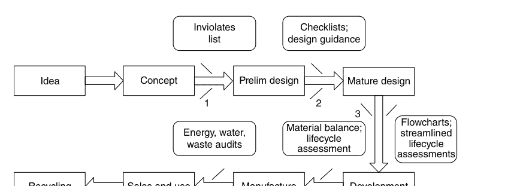

# 10

# 质量工业环境管理

可持续制造工程

## 10.1 引言：工业与全球环境问题

环境问题正受到国际社会的高度关注。气候变化、水资源可用性、污染，以及废物的产生与处置都是其中的主要挑战。作为原材料和能源的主要使用者，以及污染物和废物的主要来源，工业是其中的重要参与者。过去几十年来，在多个方面已在更系统地应对这些问题方面取得进展，工业在应对当前和新兴问题方面发挥了更积极的作用。20世纪80年代末和90年代，环境事务的机构得以建立，国际合作和公众意识增强，私营部门行动变得更为普遍（UNEP 1997）。与此同时，法律框架和经济手段被引入，而技术进步有助于推动清洁生产。最后，各国政府在追求发展目标时变得更加审慎，全球范围内强制性的环境影响评估变得更为普遍（IGEL 2012；Western Governors’ Association 2004）。

尽管在机构、方法和技术的发展方面取得了进展，环境退化仍然是一个重要问题。联合国在其对全球环境的最新分析中指出，在许多领域存在全面性的紧急状况，环境管理落后于经济和社会发展（UNEP 1999）。例如，许多大城市的空气污染已处于危机点。此外，温室气体排放的增加被认为使得防止全球变暖变得不可能，尽管已在《京都议定书》和《巴黎协定》中采取了努力（见图 5.18）。关于资源利用也存在重要问题需要解决。自然资本在若干关键领域正在下降，这意味着资源利用效率必须提高，或必须开发替代品以满足未来的消费需求（Hohen 2000）。

### 10.1.1 工业作用与趋势

工业在应对环境以及相关的社会和经济挑战方面所能发挥的积极作用已得到一定时期的认可。它在《21世纪议程》中得到强调，《21世纪议程》是联合国环境与发展大会（1992年）通过的可持续发展全球计划。例如，更高效的生产过程、预防性策略、清洁技术，以及贯穿产品生命周期的程序，都可以成为减少资源利用和环境影响的重要机制。从实际角度来看，这首先意味着识别和推广可持续实践。事实上，这在工业中已日益得到实施，反映了政府政策的变化以及工业在识别和应对环境挑战方面的参与度提高。如论坛上所讨论的，工业正从一种以“末端治理”为重点的被动策略转变，该策略侧重于捕获和处置制造过程中产生的污染物，转向一种更全面的方法，该方法在更广泛的企业职能范围内更有效地整合环境考量——包括产品设计和采购实践，以及生产过程。

联合国在其《全球环境展望-2000》报告中指出，工业在多个领域做出了令人印象深刻的回应（UNEP 1999）。为减少资源使用和废物而采取的自愿行动被视为积极的一步，对环境而言是好兆头。鼓励工业继续推进这些举措，特别关注如何将这些努力扩大到包括更广泛的中小企业。

技术至关重要，以通过材料和能源优化将设计对人类健康和环境的影响降至最低。该原则还传达了不转移风险的重要性（例如，减少向一种环境介质的释放可能会增加对另一种介质的风险和/或增加工人暴露的可能性并危及工人安全）（Abraham 2006；Shonnard et al. 2007）。转移风险后果的一个著名例子是使用甲基叔丁基醚（MTBE）作为汽油添加剂。MTBE被添加到汽油中以减少汽车尾气排放的一氧化碳，从而保护人类健康。然而，其在土壤和水环境中的更大迁移性意味着MTBE泄漏比汽油泄漏更容易迁移到水源并在其中扩散（更多细节请参阅 http://www.epa.gov/otaq/consumer/fuels/oxypanel/blueribb.htm）。

## 原则 2：保护人类健康和福祉，同时保护和改善自然生态系统。

该原则表达了工程师在设计化学品、汽车、建筑物和其他制成品时理解环境过程的重要性。有许多例子表明，缺乏理解导致了严重的环境破坏，并提高了对人类和其他生命形式的健康风险。例如，氯氟烃（CFCs）曾被认为是最理想的制冷剂。它们取代了像氨这样危险的制冷剂液，并使食品储存和建筑消除控制变得更安全。它们对人类健康和福祉的好处是明确的；然而，一旦弄清了CFC在平流层臭氧破坏化学中的作用，就变得清楚CFC使用与人类健康危害相关。并非每个工程师都需要成为环境过程和健康影响方面的专家，但设计人员应意识到可能造成的危害，并与跨学科专家合作以实现更可持续的解决方案（Allen and Shonnard 2012；Das 2005e）。

## 原则 3：在所有工程活动中采用生命周期思维。

该原则补充原则 1。每个工程产品都被创造出来，在使用寿命期间发挥功能，最终被处置到环境中。生命周期思维有助于避免对环境、社会和经济问题的狭隘看法，并有助于做出明智的决策。纳入设计的生命周期思维将有助于识别在各个生命周期阶段最小化环境影响的设计替代方案。同样的思维也可以考虑经济和社会方面。生命周期思维的重要性可以得到说明（见第 6 章）。

## 原则 4：确保所有材料和能源输入和输出在本质上尽可能安全和无害。

该原则补充原则 3。这些材料和化学品的特性必须适用于产品生命周期的所有阶段，从提取到使用和处置。以下是必须在生命周期每个阶段提出的一些问题：材料有毒吗？是否存在可作为替代品的本质上无害（就毒性而言）的材料？制造过程中暴露是否会对工人健康造成问题？产品在回收和处置期间是否影响最小？材料意外释放后是否会在环境中迅速降解？与安全性相关的材料特性，除毒性外，也必须考虑，例如易燃性、爆炸性和腐蚀性。

## 原则 5：最大限度地减少自然资源的消耗。

随着世界人口持续增长并变得更加富裕，自然资源将被以越来越快的速度使用，这一原则的重要性得以提升。第 1 章提供了材料、能源和水使用的概述。高效利用不可再生能源资源是主要关注点，而在工程设计中应优先考虑开发能源和材料的再生替代品。

## 原则 6. 努力防止废物产生。

废物不仅代表占用垃圾填埋场空间的材料，更重要的是代表了一个包含许多投入材料和能源来源的生产系统效率的损失。当通过设计避免废物时，与投入材料和生产被丢弃产品所消耗的能源相关的环境影响也会被避免。设计期间必须提出以下一些问题：是否有方法（例如程序、工程）可以提高原材料产量或效率？如何将释放物或废物进行回收和再利用？产品在其正常商业寿命结束后能否被再利用，从而最大限度地减少制造新产品所需的原材料？关于最小化废物的方法，特别是在化学过程中，已在各种教科书中进行了详细讨论，包括《绿色工程：化学过程的环境意识设计》（Allen and Shonnard 2002）。

## 原则 7：在开发和应用工程解决方案时，注意当地地理、愿望和文化。

工程设计旨在满足个人人类和社会需求，为了更好地实现这一目标，了解设计的社会背景至关重要。一种社会中的工程设计，例如快速公共交通系统，可能无法满足另一种社会的愿望和需求，即使该设计实现了环境目标。主要观点是通过工程设计推动每个社会实现资源的更可持续利用，以实现该社会或个人的愿望（Allen and Shonnard 2012）。

原则 8：创造超越当前或主流技术的工程解决方案：改进、创新和发明（技术）以实现可持续性。可持续性可以成为工程设计、技术、工艺和产品变革的有力动力。该原则强调在新技术开发中具有创新性（即“跳出框框”思维）的重要性。通过考虑可持续性的多重维度所获得的知识，应体现在工程设计如何实现社会目标上。

原则 9：积极让社区和利益相关者参与工程解决方案的开发。在广泛的活动中，包括城市规划、基础设施开发和制成品生产，都存在利益相关者和社区参与工程解决方案开发的诸多实例。一个说明性的例子是采矿矿物可持续发展北美项目（IISD 2002），该项目已被该行业的关键成员采纳。社区参与从项目开始到矿山关闭是这些采矿项目问题的核心。在此参与过程中，拟议矿山开发周边社区表达了他们对管理经济开发以及对当地环境后果的任何担忧的愿望。

下面以 Anastas 和 Zimmerman（2003）以及 Allen 和 Shonnard（2012）提出的 12 项绿色工程原则作为第二组工程设计原则。

## 绿色工程原则

- 原则 1：设计人员需要努力确保所有材料和能源输入和输出尽可能固有地无害。
- 原则 2：防止废物产生优于废物形成后进行处理或清理。
- 原则 3：分离和净化操作应设计为尽量减少能源消耗和材料使用。
- 原则 4：产品、工艺和系统应设计为尽量减少质量、能源、空间和时间效率。
- 原则 5：产品、工艺和系统应通过材料和能源的使用实现“以输出为导向”而非“以输入为导向”。
- 原则 6：嵌入式熵和复杂性在做出关于回收、再利用或有益处置的设计选择时必须被视为一种投资。
- 原则 7：目标耐用性，而非不朽，应是设计目标。
- 原则 8：设计不必要的容量或能力（例如“一种尺寸适合所有”）解决方案应被视为设计缺陷。
- 原则 9：多组分产品中的材料多样性应最小化以促进拆卸和价值保留。
- 原则 10：产品、工艺和系统的设计必须包括与可用能源和材料流的集成和互联。
- 原则 11：产品、工艺和系统应设计为在商业“后世”中具有性能。
- 原则 12：材料和能源输入应可再生而非耗竭。

原则 1：设计人员需要努力确保所有材料和能源输入和输出尽可能固有地无害。该原则认识到，材料和能源来源的选择会导致重大的成本和危害。在生产、使用和处置过程中，需要额外的控制系统来捕获和销毁有毒材料，所有这些都会增加设计的成本。如果系统输入固有地危害性更小，则故障风险将降低，用于控制、监测和 containment 的资源量也会减少。

原则 2：防止废物产生优于废物形成后进行处理或清理。工程系统中的废物产生增加了设计的复杂性、努力和费用。对于需要对其控制、监测、运输和处置采取特殊措施的有害废物尤其如此。为了减少废物产生，设计必须努力将尽可能多的输入材料纳入最终产品中。该策略可在多个尺度上应用，例如在化学反应设计中在分子层面、在零件加工等较大尺度上，以及在离散零件组装中。产生的任何废物都应被视为可再次用于当前产品系统或作为另一产品系统输入的原材料。

原则 3：分离和净化操作应设计为尽量减少能源消耗和材料使用。在化学和矿物加工工业中，大规模分离过程是能源消耗最大的单元之一，并产生

保留。该设计原则与原则 6 有共同之处。产品中材料多样性的增加会使回收变得更加困难和昂贵，因为随着材料多样性的增加，回收选项的数量及其复杂性也会增加。不同种类的材料以及不同添加剂的使用对回收方法和成本有很大影响。

原则 10：产品、工艺和系统的设计必须包括与可用材料和能源流的集成和互联。该设计原则指出，产品、工艺和整个工程系统应设计为使用现有的材料和能源流基础设施。集成可发生在单元操作、生产线、制造设施或工业园区等规模。利用现有的材料和能源流将最大限度地减少产生能源和/或获取和加工原材料的需求。该原则的应用包括回收和利用放热化学反应的热量、热电联产，以及在混合动力汽车中通过再生制动回收电能。

原则 11：产品、工艺和系统应设计为在商业“后世”中具有性能。为第二、第三甚至更长寿命设计组件是产品设计中的重要策略。当组件被回收并在下一代产品中再利用时，原材料从原生资源获取和转换的环境影响将被消除。整体生命周期环境影响也会降低。该策略对于在组件失效前就变得过时的产品尤其重要，例如手机和其他电子设备。该原则的重要例子还包括回收和再利用废弃复印机碳粉盒、工业建筑改造用于住房以及德国的做法，即将饮料容器再利用为瓶子，这些瓶子在结构上更坚固，以便收集、清洗、消毒、重新填充和重新贴标签。

原则 12：材料和能源输入应可再生而非耗竭。工程系统设计中使用来自自然的不可再生原材料，会使地球系统逐步走向有限资源的枯竭，因此按定义是不可持续的。所有可再生资源（另见图 7.9）都源于太阳的效用和能量，因此如果以与可再生资源再生速率一致的水平使用，这些系统输入可以是可持续的，如果使用与可再生资源再生速率一致的水平，则这些系统输入可以是可持续的，在可再生资源方面，它不仅可以作为能源来源，还可以作为设计材料产品的原料（AIChE, CWRT 2000；

Das 2005g）。生物质产品的一种重要形式是液体运输燃料。生物燃料在相对较短的时间尺度上可再生，并且生物燃料碳在大气、生物质/生物燃料之间以及再次回到大气的循环很容易整合到自然循环中，而不会导致大气中 CO₂ 的累积。该原则的一个分支是设计产品和系统以在整个生命周期中与元素自然循环良好整合的重要性，从原材料获取到生命周期结束过程。

这些工程设计原则，加上本节开头提到的其他原则，为设计更可持续的产品和工艺建立了框架。起初，工程设计的改变可能只是对固有不可持续的产品和系统的改进，但随着时间的推移，希望这些原则能推动行业和消费者走向固有可持续的产品和生产系统。然而，应用这些原则时会存在紧张关系。如果使工艺固有更安全需要更多能源怎么办？如果最小化用水需要更多能源怎么办？工程师习惯于处理目标之间的权衡，但这样做需要绩效衡量指标。在大多数工程设计中，衡量指标是成本。在提供产品、技术或服务的指定性能水平时，目标是最小化成本。

## 10.1.4 环境友好型设计

资源消耗和产品生产的环境和健康影响最小化的缓解策略。这些面向环境的设计（DfE）实践已改编自 USEPA（2017）、Spangenberg 等（2010）、Allen 和 Shonnard（2012）以及 Allenby（2012）。

以下是在 DfE 伞下包含的五个主要概念。

- 1) 面向环境加工和制造的设计：这确保了原材料开采（采矿、钻探等）、加工（加工可重复使用材料、金属熔炼等）和制造使用对环境或从事这些工艺的员工无害的材料和工艺。这包括最小化废物和有害副产品、空气污染、能源消耗和其他因素。
- 2) 面向可靠性的设计（DFR）：在产品可能使用的各种环境中以及使用方式下，它是否可靠且安全？例如，在静电风险高的地方使用的电子设备必须设计为避免在

暴露于静电放电。从可持续工程的角度来看，DFR可以延长产品寿命，这通常（尽管并非总是）是一件好事。需要注意的是，在这种情况下，可持续工程将环境价值与社会价值相一致：客户喜欢可靠且安全的产品，而环境则因减少浪费而受益，同时产品确保了可靠性和安全性。

3）环保包装设计：这确保包装中使用的材料是环境友好的，这可以通过重复使用运输产品、消除不必要的纸张和包装产品、有效利用材料和空间、使用再生和/或可回收材料来实现。

4）处置或再利用设计：产品的报废阶段非常重要，因为某些产品在被填埋处置后会向空气、地面和水体中释放危险化学物质。规划产品的再利用或翻新将改变所使用的材料类型、这些材料日后如何被拆卸和再利用，以及此类材料对环境的影响。

5）能效设计：在产品整个生命周期内通过产品设计来降低整体能耗。

LCA被用于预测所讨论产品不同（生产）方案的影响，从而能够选择最环保的方案。在确定产品或工艺的环境影响时，生命周期分析可以作为一个工具。恰当的LCA可以帮助设计人员根据多种类别比较几种不同的产品，例如能源使用、毒性、酸化、二氧化碳排放、臭氧消耗、资源消耗等等。通过比较不同的产品，设计人员可以决定应重点关注哪些环境危害因素，以使产品更加环保。

## 10.1.5 企业为何要进行环境设计？

现代企业都致力于在保持质量的同时以低成本生产商品，在全球市场中保持竞争力，并满足消费者对更环保产品的偏好。为帮助企业应对这些挑战，美国环保署鼓励企业将环境因素纳入设计过程。纳入环境设计的益处包括节省成本、降低商业和环境风险、扩大商业和市场机会，以及满足环境法规要求（USEPA 2001）。

## 10.1.6 企业如何进行环境设计？

企业可以通过以下方式进行环境设计：

- 评估其工艺和产品对人体健康和环境影响。
- 确定做出人体健康和环境决策所需的信息。
- 对替代方案进行评估。
- 考虑跨介质影响以及替代化学品的益处。
- 通过创新使用更安全化学品的清洁技术，减少有毒化学品的使用和释放。
- 实施污染预防、能源效率和其他资源保护措施。
- 制造可重复使用和可回收的产品。
- 监测与每种产品或工艺相关的环境影响和成本。
- 认识到虽然变革可以迅速发生，但在许多情况下需要评估和持续改进的循环（USEPA 2017）。

## 10.1.7 环境设计

环境设计是一种设计方法，旨在减少产品、工艺或服务对整个生命周期内人体健康和环境的总体影响。已开发出不同的软件工具来帮助设计人员找到优化的产品或工艺/服务。环境设计也是美国环保署一个项目的原名，该项目创建于1992年，致力于防止污染以及污染给人类和环境带来的风险。该项目提供有关清洁产品和其他产品更安全化学品配方的信息。美国环保署于2017年将其项目更名为“更安全选择”（USEPA 2017）。

环境设计方法的初始指导方针于1990年由总部位于纽约的非政府组织“东西方相遇”编写。它成为一场全球性运动，针对设计倡议，并将环境动机融入产品设计改进中，通过从设计阶段一直到制造过程的全过程融入，以最大程度地减少健康和环境的影响。环境设计策略旨在改进技术和设计策略，以扩大产品的范围。通过将生态效率纳入设计策略，环境设计考虑了产品的整个生命周期，同时仍使产品可用但最大限度地减少资源使用。环境设计的重点是在关注产品生命周期框架的同时，最大限度地减少消费者面临的环境经济成本。通过平衡客户需求以及环境和社会影响，环境设计旨在“改善消费者和生产者的产品使用体验，同时对环境的影响降到最低”（Luttropp and Lagerstedt 2006）。

## 10.1.8 法规遵从性设计

有目的性、成本效益高、安全的产品设计支持可持续环境，在持续关注再利用、维护灵活性和环境约束的同时，成为多种工程应用可行性的催化剂。工程研究分析在已知的法律参数范围内扩展产品应用。从适度到重大的产品工程变更包括可互换零件、可移动的制造地点、副产品利用和替代包装。所有符合现行制造方法且持续关注预期法规变化的方法，都在其工程设计和设计支持中保持完整性，从而减少附带损害。

## 10.1.9 可测试性设计

产品设计的定量分析和定性分析在确定产品是否成功制造方面不可或缺。对原材料来源、再生材料和共享生产设施的了解在生产设计测试和产品质量中发挥着作用。对竞争的预期促使生产方法的改进以及随着时间推移所需的新型测试。制造灵活性对试点和推断用途的应用测试有助于重新定义产品。最坏的情况是创造出一种过于复杂的产品，以至于没有合适的测试可用，从而完全成为废品。

## 10.1.10 服务与维护的设计和测试

人类使用、制造使用和设备使用因素结合了许多不同的测试。文化测试很重要，从产品的名称到易用性和可维修性。产品的可靠性包括承诺的服务期限和期望的服务时长。如果重复使用概率高且应用范围广，那么测试应包括升级因素、资源再利用因素和开发因素。如果换油和滤芯、汽车刹车维修或马桶冲水维修套件易于获取、能够通用安装，并且具有简单正确的拆卸和安装说明，那么它很可能获得更大的市场。大型产品必须考虑运输和适用于该特定产品的维护工人，例如塔式起重机。

产品设计最好是当产品出现故障时，消费者维修它比购买新的更便宜。这也将有助于减少固体废物流。

## 10.1.11 可制造性设计

产品制造过程中所用的工艺遵循已知的生产准则，并遵守环境规则和法规，其实现难易程度包括设计人员整合现有设计、改进和调整产品组合，以及巧妙地操控产品以使用相同或改进的工装来创造互补产品的能力。产品符合严格的货币准则，这些准则致力于负责任的材料选择、清洁生产、监控过程以避免在地方和全球范围内产生浪费。

可制造性设计（有时也称为可制造性设计或DFM）是一种通用工程实践，即以易于制造的方式设计产品。这一概念几乎存在于所有工程学科中，但其具体实施因制造技术的不同而差异很大。DFM描述了设计或工程化一个产品以促进制造过程、从而降低其制造成本的过程。DFM能够在设计阶段（解决问题成本最低的阶段）修复潜在问题。其他因素也可能影响可制造性，例如原材料类型、原材料形态、尺寸公差以及精加工等二次加工。

DFM过程会提出一些典型问题：产品是否易于制造？它是否通过例如拥有无需有毒材料即可清洁的组件来促进环境和社会负责任的制造？它是否能减少不符合质量标准的产品生产，从而减少制造浪费？从可持续工程的角度来看，制造过程中许多环境和社会影响不仅可以通过适当的生产线设计来改善，也可以通过良好的产品设计来改善（Allenby 2012）。

根据各种不同类型的制造工艺，存在一套DFM实践指南。这些DFM指南有助于精确定义与DFM相关的各种公差、规则和常见制造检查。虽然DFM适用于设计过程，但许多组织也实践一个类似的概念，称为六西格玛设计。

## 10.1.12 可装配性设计

面向装配的制造可以向车辆制造中所做的工作致敬，这些工作最初使用了以下所有三种方法

组装以生产高质量产品；人工、机械以及人工与机械相结合的组装。生产的目的是利用深思熟虑的创造，以快速且无错误的方式生产产品，这包括使用人体工学、技术对机械制造的监督以及定期的维护。组装时不会过热、冻结或容易损坏，在服务寿命和更高利润方面都获得高分。

### 10.1.13 设计以便于拆卸

组装在一起的东西需要设计成可以在不造成损害的情况下拆开。关注的领域范围从升级，到产品的重建；用于制造产品的机器的修改和改编；产品制造的灵活性以满足不断变化的标准；以及通过能够逆转流程来改善废物和制造成本的减少。

在做出最初制造产品的决定时，会制作模型并投入试生产，产品会进行严格测试，工程部门还承担拒绝重复单一案例场景的任务，可靠性包括意外情况以及如何修复。

### 10.1.14 设计可持续制造

可持续制造可以定义为通过对工厂和产品可持续性产生的效果进行持续改进来创造制造产品。可持续制造的概念要求对生产系统进行重新设计，以便将相关可持续性与产品生命周期和工厂运营相联系。

设计可持续生产系统一方面意味着分析和优化与制造工厂相关的厂内方面。此类方面可能涉及资源消耗的限制、重复使用来自之前产品的废弃资源而不是继续使用原生材料以提高流程效率、工厂工人的人体工学、消除有害物质、最小化工厂排放和废物以及内部排放、生产设施中信息的集成管理，以及机器和工厂的技术更新。

其他厂间方面涉及制造产品的可持续设计、产品链去物质化、背景和前台供应链的管理、支持循环经济范式以及可持续性标签。

### 10.1.15 设计可持续性

设计可持续性（也称为环境可持续设计、环境意识设计等）是设计物理对象、建造环境和服务以符合社会、经济和生态可持续性原则的哲学。

可持续设计的意图是“通过熟练、细致入微的设计完全消除负面环境影响。”可持续设计的体现需要可再生资源、对环境影响最小，并将人们与自然环境联系起来。

伟大的设计就是可持续设计：建筑师不应将绿色建筑设计视为外部因素，而应将其视为伟大设计的原则集合。这包括更好的用户体验和舒适度，通过做得更多来实现建筑轻松达到最佳性能，以及最大化耐用、高质量材料的功效。不要再遵循众所周知的格言“形式追随功能”，而是时候思考“形式追随环境”了。

在“消除负面环境影响”之外，可持续设计必须创造有意义的创新项目，能够改变行为。经济与社会之间动态平衡旨在在使用人与物体/服务之间建立长期关系，并最终尊重和关注环境和社会差异（McLennan 2004）。

可能使用更多模块，具体取决于部分产品和与其相关的特定设计问题。此外，这些类型的产品设计流程需要在非常不同的领域拥有专业知识，这也是现代产品设计通常由团队完成的一个原因（AIChE, IFS 2004; Allenby 2012; Sikdar 2003）。例如，法务部门会就适用法规和应解决的潜在责任提供意见，而环境、健康和安全小组（或公司等同部门）则提供有关产品设计和制造选项的环境影响的技术专业知识。在工程团队成员中，很可能有些人是制造工艺设计专家，有些人是产品设计专家，有些人是材料科学专家，而且越来越多的人是流程和产品影响和性能生命周期评估专家。需要注意的是，设计始终是一个平衡过程，有许多不同的约束和目标；最终结果必须反映现实条件，而不是一厢情愿。因此，例如，可持续性活动人士可以自由要求从复杂产品中消除所有有毒物质，但工程师能够做到这一点同时满足所有其他相关条件的设计确实很少见。同样，活动团体通常并不反映市场上所有消费者群体的特征；企业可以引领，但至少在自由市场中，它们也必须对消费者需求做出响应（Allenby 2012）。

## 10.2 将 LCA 整合到可持续产品设计与开发中

那么产品在真正进入市场之前可能经历什么流程？图 10.1 绘制了一条典型路线，决策点，通常称为“门”，以数字标出（Allenby 2012; Graedel and Allenby 2003）。在每个门处，由负责产品的团队进行正式或非正式审查，该团队可能不仅包括设计团队成员，还包括来自市场营销、采购、物流、外部事务（一个负责代表公司面向外部受众并向公司通报可能影响产品的即将出现的发展，例如材料禁令）的成员。会评估产品的持续商业可行性，鉴于产品特征在设计过程中不断锁定。持续评估的原因很明确：越早识别并淘汰不具竞争力的产品，浪费的时间、金钱和资源就越少。因此，每个门不仅为设计流程的下一阶段提供信息，而且是确保稳健设计的重要的治理机制。从可持续工程的角度来看，这些门变得更加重要，因为它们是管理利益相关者和非政府组织对企业及其产品和全球活动的不断增加需求的现有机制。良好的门流程可以成为制度化可持续工程的重要组成部分。相反，不充分的流程——例如，忽视重要市场或强大活动利益相关者的要求，或未能在设计早期阶段识别重要可持续性问题以便解决——会使设计效率降低、成本更高，甚至可能不充分（Allenby 2012）。

LCA 的内部应用之一是在流程或产品设计和开发中。最近，一种名为生命周期产品/流程设计（LCPPD）的 LCA 相关工具开始出现，作为生命周期思维的延伸，以及在可持续产品和流程设计与开发方面的辅助。LCPPD 程序概述在图 10.2 中。

LCA 在整个开发程序中被使用，最初参考现有流程或产品。这种整体方法具有动态性，涉及设计团队内部和外部的持续信息交流，以系统地探索改进的可能性。LCA、绿色化学、绿色工程、环境设计、工业生态学以及化学工程和环境工程的其他新兴领域为开发可持续和创新的流程和产品提供了更大的机会（Azapagic 2000; Bare 2003; Bhander et al. 2003; Biswas et al. 1998; Brandão et al. 2010; Cooper 2003; Curran 2003, 2012, 2015; Das 2002; Das et al. 2001, 2003; Gonzalez and Smith 2003; ISO 1997; Linke et al. 2003; SETAC 1991, 1993; UNEP-SETAC 2000）。

一旦主要环境影响被量化，就确定潜在改进，随后的设计集中于这些改进。改进是通过选择材料和技术来实现的，以便在仍满足效率、技术性能、成本、法规以及客户和供应商需求等其他参数的同时最小化环境影响。当满足所有这些要求后，再次进行 LCA，以识别和量化已实现的改进。

图 10.1 产品实现过程中的环境与可持续性。

绿色化学利用其掌握的所有化学原理和技术，在源头上防止污染。绿色化学工程同样如此，但还包括工艺的设计与运行，以及产品的设计与制造，以最大限度地减少污染以及对人类健康和环境的风险。在寻求使用更少有毒化学品、产生更少废物且所需能源更少的工艺方面已取得了进展（Dewulf et al. 2000; Matlack 2003）。

绿色化学与绿色化学工程致力于实现所谓的“三重底线”目标，即企业的经济繁荣与持续发展、社区和员工的社会福祉，以及环境保护与资源节约。目前正在开发经济、财务和环境核算与风险管理工具，以评估绿色技术，包括LCA（见第6章）、总成本评估（TCA；见第5章）和生态风险评估（ERA；见第4章）。实现绿色和可持续化学品制造的目标已得到许多政府和非政府组织的认同（Mathew 2003）。

## 10.3.1 绿色化学原理

完全绿色产品和工艺的设计与实施是一项巨大的挑战。由于化学合成途径数量庞大，没有一种系统性的、万无一失的方法能够确保所实施的化学过程是绿色的。事实上，更恰当的做法是询问某个拟议的化学制造工艺是否只是比其他替代方案“更绿色”。因此，绿色化学认识到渐进式改进的重要性。Anastas和Warner（1998）提出了一套原则来定义和指导绿色化学的范畴。

### 1) 预防废物

预防废物比在废物产生后再加以处理或清理更好。过去，地球及其河流、海洋、大气和土壤被视为污染物和废物的无限消纳场所。“命令与控制”理念意味着，只要废物得到安全处理、处置或储存，产生废物是可以接受的。绿色化学的最高原则是根本不应产生废物。从经济角度看，废物是一种需要支付两次的成本：第一次是购买原材料的成本，第二次是管理或处置废物的成本。

### 2) 在可行时采用原子经济性

合成方法的设计应最大限度地使过程中使用的所有原料都进入最终产品。因此，即使目标产品的产率达到100%，如果合成过程还产生副产物，那也是不够的。更可取的是将原料中的所有原子都纳入产品中。Trost（1991）所讨论的原子经济性，以及由Sheldon（2000）创造的术语“原子利用率”，体现了相同的概念，但定义略有不同。原子经济性定义为目标产品的式量除以所有反应物按化学计量加权的式量。原子利用率是目标产品的式量与所有产品和副产物的式量之比。在难以确定所有副产物确切组成的情况下，原子经济性是更实用的指标。Sheldon（2000）还定义了E因子，即废物与目标产品的质量比。大宗化学品的E因子通常小于5，往往小于1。相比之下，精细化学品和药品通常每单位产品产生大量废物，E因子可能超过100。原子效率或E因子都不能提供废物产品对人类危害潜力的任何定量度量。

### 3) 使用危害最小的化学合成方法

在可行的情况下，合成方法的设计应使用和生成对人类健康和环境具有很小或没有毒性的物质。这一原则提倡使用毒性较小的试剂和中间体，并生成毒性较小的副产物。使用毒性较小的原料推动了可再生原材料等领域的发展。更好的催化剂和化学反应器设计对于开发危害较小的合成方法也至关重要。

### 4) 设计更安全的化学品

化学产品的设计应在实现其预期功能的同时最大限度地降低其毒性。这一原则要求将给定化合物的预期功能与其化学结构相匹配。它还要求具备预先预测给定化学物质可能产生的毒性效应的能力。因此，建立结构-性质关系方法的研究与开发促进了这一原则。在决定开发和销售特定产品时，行业应超越传统性能属性（蒸气压、颜色、稳定性等）的考虑，并加入诸如降低毒性和致癌性等有利的环境属性作为性能指标。

### 5) 使用更安全的溶剂和助剂

应尽可能避免使用辅助物质、溶剂、分离剂和其他添加剂，如果必须使用，则应使其无害。水、醇类、超临界二氧化碳或可生物降解的表面活性剂溶液等更安全的溶剂优于氯化溶剂。液液萃取等分离过程需要使用质量分离剂，但通过膜反应器进行反应性分离（见第8章）等替代方案可能提供更环保的选择。

### 6) 为能源效率而设计

应认识到各种化学工艺的能源需求对环境和经济的影响，并将这些影响降至最低。如果可能，合成方法应在环境温度和压力下进行。自20世纪70年代的石油禁运和能源短缺以来，化学工业已大幅减少了制造中的能源使用。热集成和其他工程工具在化学工业中已很成熟，并可应用于特定工艺。然而，制造过程中相当大一部分能源消耗仍可归因于化学工业。因此，能够从根本上改变产品制造所需能源使用的进步是绿色化学的一个关键方面。

### 7) 为水的优化与集成而设计

在化学和相关制造过程中的各种物质中，水是至关重要的，并在多个行业广泛使用。水是一种相对便宜且有用的溶剂，易于处理，毒性和安全方面的担忧极小。在典型的化学工艺中，水可能扮演多种角色，包括以下方面：
- 它可作为反应的溶剂（如在单相或多相反应中）。
- 它可作为分离的溶剂（如在分液器和液-液萃取系统中）。
- 它可用于除热操作（如冷凝器中的非接触物流）。
- 它可用于生产后操作（如在洗涤操作中，最终产品可能被洗涤以去除不希望存在的溶剂、副产物和未反应的原料）。
- 它可用于环境系统（如处理通风口和工艺装置气体排放的洗涤器）。
- 它可用于安全系统（如提供密封、底液和泵密封系统）。
- 它可用于在工艺中产生公用工程（如蒸汽发生）。

废水减少和水资源节约在过程工业中正变得越来越重要。更严格的环境法规、对人类和自然长期健康影响的担忧，以及未来“清洁”水资源的可用性，只是推动制造业在水资源节约和废水减少方面改进的少数几个因素。随着这些问题持续受到政府的严格审查，并引起社区组织的环保团体的关注，未能令这些外部利益相关者满意的行业可能会发现其现有运营受到威胁，未来运营的可持续性也存疑。过去十年中，这些关键关切促使人们重新聚焦于确定具有成本效益的废水减少和水资源节约工艺设计，涉及可在各种制造过程工业中实施的直接循环和水回用。如果工业界在先进的物理-化学-生物处理后将废水回用，全球淡水资源的不可持续压力可以得到减轻。

### 8) 使用可再生原料

在技术和经济上可行的情况下，原材料或原料应是可再生的，而不是可耗竭的。从农业原料制造化学品的过程被称为“农业化学（Chemurgy）”。源自生物质的燃料可能包括种植的燃料，如玉米制乙醇，或来自废弃生物质的燃料。甲壳素和纤维素等天然聚合物因其在制造工程材料中的用途而受到关注。特别令人关注的是使用CO2作为C1化学的原料。

### 9) 减少或避免使用衍生物

在封闭基团、保护-脱保护以及物理-化学过程的临时改性中不必要地使用衍生物，应尽可能减少或避免，因为这些步骤需要额外的材料、增加溶剂用量和更大的能源需求。这一原则与原则2和原则5相关。

### 10) 使用催化试剂

尽可能选择性地使用催化试剂优于化学计量试剂。使用催化剂，无论是非均相还是均相，对于实现原则2和原则3至关重要。Anastas等人（2001）将催化剂的使用称为绿色化学的基柱，因为催化剂有助于实现绿色化学的众多目标，包括减少材料用量、提高原子效率和降低能源需求。

### 11) 为降解而设计

化学产品的设计应使其在功能结束时可分解为无害的

那些能够降解且不会在环境中持久存在的产品。这一原则显然与DfE的概念相交织（见10.1.7节）。产品设计涉及沿着一条由不同利益相关者组成的链条进行沟通：客户、销售代表、工程师和材料科学家、合成化学家以及其他人员。因此，绿色化学要求化学家与这些其他利益相关者紧密合作。

## 12) a) 采用实时分析以实现污染预防

需要进一步发展分析方法，以便在危险物质形成之前进行实时、过程中的监测和控制。废物的产生并不总是合成化学的结果；有时仅仅是过程监测和控制不良的结果。目前使用的分析方法通常依赖于在生产线的末端对产品进行取样，这可能在几分钟内完成，但也可能耗时数小时。在这种情况下，等到产品分析完成时，通常已经来不及调整生产过程以达到最佳性能。因此，对温度、压力、进料速率、进料组成和产品组成进行实时过程监测和控制，对于绿色化学工程至关重要。

## b) 选择本质上更安全的化学工艺以预防事故

应选择化学过程中使用的物质及其形态，以最大限度地降低化学事故（包括泄漏、爆炸和火灾）的可能性。这一原则与关于更安全溶剂和辅助物质的第5条原则有一定重叠：例如，超临界二氧化碳是氯化溶剂的一种本质上无毒的替代品。涂料和汽油中铅化合物的替代品也是第5条和第12(a)条原则的实例。这一原则同样适用于一些策略，例如消除危险中间体的大量运输和储存，转而支持在现场生成这些中间体。虽然绿色化学的最终目标是完全消除危险物质，但通过在现场生成而非依赖大量储存，可以减少或消除危险化合物大规模释放的可能性。

这些原则解决了实现绿色技术目标所必需的一个重要标准——在各条战线上预防污染。这包括节约材料（原料、试剂和溶剂）和能源（通过减少副产物形成和提高转化率，进而减少工艺步骤数量）、使用改良的催化剂或催化过程替代非催化过程，以及设计更安全的化学品和化学反应。

当一项新技术超越了最初的实验室规模开发阶段时，研究人员应着手处理Winterton（2001）提出的绿色化学的12项补充原则，内容如下：

- 1) 识别副产物；如有可能则进行量化
- 2) 报告转化率、选择性和生产率
- 3) 为整个过程建立完整的质量平衡
- 4) 量化催化和溶剂损失
- 5) 研究基础热化学以识别放热反应（安全性）
- 6) 预判其他潜在的质量和能量传递限制
- 7) 咨询化学或工艺工程师
- 8) 考虑整个工艺对化学选择的影响
- 9) 帮助开发和实施可持续措施
- 10) 量化并尽量减少公用工程和其他投入的使用
- 11) 认识到操作人员安全与废物最小化可能不相容的场合
- 12) 监测、报告并尽量减少实验或过程中排放到空气、水和固体废物中的废弃物。

## 10.4 汉诺威原则

### 10.4.1 能源与环境设计先锋（LEED）

能源与环境设计先锋（LEED）项目是一项国际公认的建筑认证项目，面向建筑师、承包商、业主和运营商（见附录H）。它为建筑设计、施工、运营和维护提供了一个框架，以实现减少环境影响和改善建筑 occupants 的条件。为了指导建筑可持续性设计，将采用美国绿色建筑委员会（USGBC）LEED认证项目的设计标准（USGBC 2011a）。

LEED自1998年以来不断发展，以更准确地代表和纳入新兴的绿色建筑技术。试点版本LEED新建筑（NC）v1.0，催生了LEED NCv2.0，2005年的LEED NCv2.2（USGBC 2011b），以及2009年的LEED 2009（以前称为LEED v3）。LEED v4于2013年11月推出。直到2016年10月31日，新项目可以在LEED 2009和LEED v4之间选择。2016年10月31日之后注册的新项目必须使用LEED v4。

将其活动的环境、经济和社会需求融为一体，类似于“三重底线”的概念。

可持续商业，或绿色商业，是一种对全球或本地环境、社区、社会或经济没有负面影响的企业——一种努力实现三重底线的企业。通常，可持续企业具有进步的环境和人权政策。一般来说，如果一家企业符合以下四项标准，则被描述为绿色企业：

- 1) 它将可持续性原则纳入其每项业务决策中。
- 2) 它提供的环保产品或服务取代了对非绿色产品和/或服务的需求。
- 3) 它比传统竞争者更绿色。
- 4) 它在业务运营中对环境原则做出了持久的承诺。可持续企业是指任何参与环保或绿色活动以确保所有流程、产品和制造活动在维持利润的同时充分解决当前环境问题的组织。换句话说，它是一个“既满足当代人的需求，又不损害后代人满足其自身需求的能力”的企业。这是一个评估如何设计产品以利用当前环境状况以及公司产品在可再生资源方面的表现如何的过程。

布伦特兰报告强调，可持续性是一个由人、地球和利润组成的三腿凳子。可持续企业利用供应链，试图通过三重底线概念来平衡这三者——利用可持续发展和可持续分销来影响环境、企业增长和社会（Cooney 2009; Rennie 2008a, b; WCED 1987）。

### 10.5.1 生态效率

“生态效率”一词由世界可持续发展工商理事会（WBCSD 1992, 2000）在其1992年出版物《改变航向》中创造并定义。它基于这样一种理念：使用更少的资源并产生更少的废物和污染，同时创造更多的商品和服务。生态效率是通过提供“满足人类需求并带来生活质量的有竞争力的价格商品和服务来实现的，同时在整个生命周期内逐步减少商品的环境影响和资源强度，使其达到与地球估计承载能力相适应的水平”（Carvalho et al. 2017）。

### 10.5.2 可持续供应链系统

诸如飞机、汽车和计算机等产品，在供应链中涉及一系列离散的制造和装配过程，可能在材料、能源和土地利用以及工业废物和排放方面产生巨大的生态足迹。制造商使用了各种设计技术来降低其制造和物流系统的资源强度。这些技术包括：简化产品架构以减少不同零件和装配操作的数量（这也便于维护和拆卸）；利用回收材料或翻新组件；避免使用具有不良特性的物质，如致癌性、毒性、易燃性、臭氧消耗或环境持久性；通过工艺改进或运输效率降低电能和热能的使用（例如，改进产品几何形状以利于托盘装载）；利用质量改进和“精益”制造技术（例如，准时制库存补充以减少在制品和废料）；以及与客户和供应商合作以简化供应链并最大限度减少浪费（Bag et al. 2017; Clift 2003; Clift and Wright 2000）。

### 10.5.3 可持续绿色经济

每个人都以某种方式影响着市场和地球的可持续性。企业内部的可持续发展可以为客户、投资者和环境创造价值。可持续企业必须满足客户需求，同时善待环境。绿色经济为增长和发展提供了一种替代愿景，在这种愿景中，经济增长和人民生活水平的提高是以符合可持续发展的方式实现的。虽然对绿色经济涵盖范围存在不同看法，但这一概念引起了政策制定者和企业的兴趣，因为它带来了新的经济增长机会的可能性。因此，绿色投资公司正吸引着前所未有的关注。例如，英国的绿色投资银行专门支持可再生国内能源。然而，英国和整个欧洲在绿色发展方面正落后于发展中国家所设定的惊人步伐（Das 2005f; The CERES Principles n.d., Harvey 2011）。因此，绿色投资公司正在创造越来越多的机会来支持新兴经济体的可持续发展实践。通过提供小额贷款和更大规模的投资，这些公司帮助发展中国家的中小企业主，他们寻求

# 10.6 六大核心特征

Tueth（2010）重申了 Paul Hawken（《商业生态学》和《自然资本主义》）、Bill McDonough 和 Michael Braungart（《从摇篮到摇篮：重塑我们制造事物的方式》）以及 Janine Benyus（《仿生学》）等作者提出的观点，他提出一个成熟且真正的可持续企业包含六大核心特征。

## 1) *三重顶线（TTL）价值创造*

“TTL 确立了可持续商业活动三个同时的 *要求* —— 公司获得财务收益、自然环境得以改善，以及员工和当地社区成员获得社会利益——这三者被同等看待。” 与许多企业使用的三重底线相比，“三重顶线”强调初始设计的[content]

# 10.6 六大核心特征

Tueth（2010）重申了 Paul Hawken（*《商业生态学》* 和 *《自然资本主义》*）、Bill McDonough 和 Michael Braungart（*《从摇篮到摇篮：重塑我们制造事物的方式》*）以及 Janine Benyus（*《仿生学》*）等作者提出的观点，他提出一个成熟且真正的可持续企业包含六大核心特征。

## 1) *三重顶线（TTL）价值创造*

“TTL 确立了可持续商业活动的三个同时 *要求* —— 公司获得财务收益、自然世界得以改善，以及员工和当地社区成员获得社会优势 —— 这三者被视为地位平等。” 与许多企业使用的三重底线相比，“三重顶线”强调初始设计的重要性，是一个可归因于 Braungart 和 McDonough（2002）的术语。

## 2) *仿生学 – 基于自然的知识和技术*

“这一基于仿生学的原则涉及有意识地模仿自然世界的精妙之处，以种植我们的食物、利用我们的能源、建造事物、开展业务、治愈自身、处理信息和设计我们的社区”（Benyus 1997）。

## 3) *服务型产品与消费型产品*

“*服务型产品* 是客户常规租赁的耐用品，由技术材料制成，使用完毕后退回制造商并再加工成新一代产品。（这些产品对人类和环境健康大多无毒，但所使用的有毒材料将被置于封闭循环型系统中，无法逸入环境）。*消费型产品* 是仅由可生物降解材料制成的寿命较短的物品。产品失去用途后会被分解者生物体分解。（这些对人类或环境健康也无害）。这一原则要求我们只制造这两种类型的产品，并需要在技术进步允许的情况下，逐步但持续地减少服务型产品，并用消费型产品取而代之”（Braungart 和 McDonough 2002）。

## 4) *太阳能、风能、地热能和海洋能*

“这一原则主张只采用可持续的能源技术——太阳能、风能、海洋能和地热能——这些技术能够在不产生对地球生命负面影响的情况下无限期满足我们的能源需求。” 其他作者将其称为利用当前的太阳收入（Hawken 1999）。

## 5) *地方型组织和经济*

“这一要素包括拥有耐用、美丽和健康的社区，拥有当地所有和运营的企业以及当地管理的非营利组织，以及与区域公司和股东一起在密集的伙伴关系和协作网络中共同工作”（Tueth 2010）。

## 6) *持续改进过程*

“成功组织的内部运营流程包括为公司开展业务时不断进步和升级提供保障。持续的监测、分析、重新设计和实施过程被用来随着条件变化和新机遇出现而强化 TTL 价值创造”（Tueth 2010）。

企业可持续性还要求企业遵守上述可持续发展原则（WCED 1987）。因此，要使工业发展更可持续，就必须在宏观层面解决重要问题，例如经济效率（创新、繁荣、生产力）、社会公平（贫困、社区、健康和福祉）、人权以及环境问责（气候变化、土地利用和生物多样性）。有许多最佳实践促进企业可持续性，并帮助组织从落后者走向领先者。这些实践包括以下内容：

- 利益相关者参与：组织可以从客户、员工及其周边社区学习。参与不仅是传播信息，还包括理解反对意见、寻找共同点，并让利益相关者参与联合决策。
- 环境管理体系：这些体系提供了结构和流程，帮助将环境效率嵌入企业的文化并减轻风险。全球最广为人知的标准是 ISO 14001，但还存在许多其他行业特定和国家特定的标准。
- 报告与披露：衡量和控制是建立可持续实践的核心。组织不仅可以收集和整理信息，还可以对外部完全透明。全球报告倡议是众多规范的报告标准中的一个例子。
- LCA：希望取得长足进步的组织应通过 LCA 系统地分析其使用和生产的产品、流程或活动或服务的环境和社会影响，LCA 可更准确地衡量影响（Das 2005d）。

# 10.7 社会服务

组织通过员工志愿服务或慈善捐赠回馈社区，通常被认为具有社会可持续性。组织还可以通过培训员工并为社区年轻成员提供实习机会来鼓励社区教育。这些做法提高了社区的教育水平和生活质量。为了使企业真正可持续，它必须维持的不仅是必要的环境资源，还包括其社会资源，包括员工、客户（社区）及其声誉（Earth Charter Principles 2019；Hahn 2008）。

# 10.8 环境监管法：命令与控制、市场导向和反思型

环境法和政策至关重要且极富魅力。只要想象一下，如果没有联邦对空气和水质、农药使用以及固体和危险废物处置的监管，今天的美国会是什么样子，就能看出其重要性。尽管国家在解决环境问题方面已取得很大进展，但在环境可持续性方面仍有许多工作要做。联邦和州法律仅开始解决全球气候变化、点源和非点源水污染、环境和室内空气污染、地下水污染和地下水枯竭以及渔业崩溃等重要环境问题。科学不确定性、市场失灵、风险权衡、认知偏差和根本性的政策分歧使得就许多这些剩余问题达成解决方案变得极其困难。诸如控制全球变暖气体排放、气候变化、臭氧层破坏和跨境废物处置等国际污染问题需要与其国内对应问题相整合。此外，关于 WTO、GATT 和 NAFTA 的日益有争议的贸易与环境辩论，以及国际危险化学品贸易问题也需要探讨。环境法和政策已经摘到了低垂的果实。剩余的问题仍然挑战着即使是最睿智和最有耐心的政策专家（Salzman 和 Thompson 2010）。

Orts（1995）列出了三种环境监管法律类型：命令与控制、市场导向和反思型。这三种监管类型都旨在保护环境，但每种都通过强化和从属于不同的伦理和经济价值观及关系来实现。

命令与控制法为污染设定标准，并对超过标准的公司处以罚款和处罚。从监管者的角度来看，这种监管可以被视为严格执行公众对清洁环境渴望的伦理授权。然而，从企业家的角度来看，这种监管可能具有压迫性和不切实际性，并侵犯了企业管理者和所有者的自由。Orts 提出了对命令与控制环境法方法的四点反对意见。

- “命令与控制过于依赖行政机构，而这些机构容易受到政治影响。” 例如，如果总统任命不关心环境的主管，环境保护可能会严重削弱。
- “命令与控制过于静态。” 技术在变化，监管机构无法跟上步伐。另一个问题是如何设定污染的适当标准。我们如何知道什么是正确的污染量？
- “命令与控制变得过于复杂和难以管理。” 监管机构不断出台更多规则，以至于几乎不可能跟踪它们。
- “命令与控制过于严厉和惩罚性。” 它不是奖励和鼓励良好的环境行为，而是惩罚不良的环境行为。

Orts（1995）指出，在某些情况下，命令与控制法规是合适的。例如，如果我们处理的是汞等高毒性物质，这种物质在极小剂量下就能杀死人类，那么保护人类生命的价值显然超过了我们将汞处置在垃圾填埋场或水道中的自由。在其他领域，例如控制燃煤发电厂的排放，Orts 指出命令与控制方法已让位于市场导向方法。这种方法强化了自主和自由的价值，但也存在局限性。Orts 对四个问题提出了担忧。

1) “污染收费和税收。” 公司必须为污染环境的特权付费。这可以使市场更有效率。这种方法的一个问题可能是如何确定适当的收费和税率水平。
2) “将自然环境纳入财产权。” 如果我们能为濒危环境界定财产权，我们就可以利用现有的控制手段，如法院，来保护环境。不幸的是，一些环境问题，如空气污染，并不容易以财产权的形式重新表述。
3) “可交易的污染权。” 公司可以在公开市场上交易其购买的污染权，从而允许

环境可持续发展（CPHA 1992）。什么才构成社会可持续发展？有人认为它是满足

-   食物、住所、教育、工作、收入以及安全的生活和工作条件等基本需求；
-   公平，确保发展的利益在社会各界公平分配；
-   增强，或至少不损害人口的身体、精神和社会福祉；
-   促进教育、创造力和全民的人类潜能发展；
-   保护我们的文化和生物遗产，从而加强我们与历史和环境的联系感；
-   促进相处融洽，人们和谐共处并相互支持；
-   民主，促进公民参与和参与，以及
-   可宜居，联系“城市公共场所的形式与城市居民的社会、情感和身体福祉。”

我们为实现这些目标而建立的制度和流程可以被视为社区的“软基础设施”，这一术语由加州大学伯克利分校公共卫生学教授兼城市规划学教授 Len Duhl 提出，用来描述社区中促进社会福祉的要素。这种“软”基础设施包括正式的人类服务（健康、教育、社会服务、休闲和文化等），以及社区的非正式结构——由志愿组织和社会关系组成的网络即社区。城市规划需要将其这些要素整合到其所有工作中，对软基础设施给予与硬基础设施同等的重视，如果我们要创造一个运作良好的社区。

## 10.13 结论

-   LCA 是表征产品、工艺或活动环境可持续性的有效工具。
-   工业生态学和零排放是未来许多制造业、化学及相关工艺的关键方法论。生态工业园区能够交换废物和材料的能力核心在于能够将前废物制备用于其他用途的转化或分离技术。
-   对环境的未来关注将会增长，资源将变得更加稀缺且不可靠，对质量和成本竞争力的需求将会增加。为应对这些挑战，需要一种新的商业和工业组织范式，将多样化的个体社区、企业和其他利益相关者聚集在一起，考虑如何共同更明智地使用资源。
-   希望，也许是要求，这个不断演进的世纪的可持续经济将以产品材料和能源含量的节约和减少以及其知识含量的增加为特征。
-   企业和政府面临的挑战将是确保持续的经济发展在环境、生态、伦理和社会上都是可持续的。政府需要指导的领域包括改变消费和生产模式；对文化多样性和传统的欣赏；健康社会系统的开发；以及对可持续性和可持续发展的广泛教育和意识。
-   一些专家已将可持续发展描述为二十一世纪工业的主要驱动力。工程师、科学家、企业和行业所有者、律师、政府和政策制定者以及教育工作者将在这一事业中发挥关键作用。
-   可持续性和可持续发展是一段旅程，而非终点。

### 10.13.1 商业

最广泛接受的企业可持续性标准构成了一个公司对自然资本的高效利用。这种生态效率通常被计算为公司创造的经济价值与其总体生态影响之比。这一概念由 WBCSD 普及，其定义如下：“生态效率是通过提供满足人类需求并带来生活质量的具有竞争力的商品和服务来实现的，同时在整个生命周期中逐步减少生态影响和资源强度，使其至少与地球承载能力保持一致”（DeSimone and Popoff 2000）。与生态效率概念相似但迄今探索较少的是企业可持续性的第二个标准。社会效率描述了公司价值增值与其社会影响之间的关系。尽管可以假设大多数公司对环境的影响是负面的（除极少数例外，如植树），但这对社会影响并不成立。这些影响可以是正面的（例如企业捐赠、创造就业）或负面的（例如工伤事故、员工欺凌、人权侵害）。因此，根据影响类型，社会效率要么试图最小化

Development, Development of Baseline Metrics. http://www.aiche.org/cwrt/projects/sustain.htm (accessed 5 June 2019).
Anand, S. and Sen, A.K. (1996). Sustainable Human Development: Concepts and Priorities, Office of Development Studies Discussion Paper, vol. 1. New York: United Nations Development Programme.
Anastas, P.T., Kirchhoff, M.M., and Williamson, T.C. (2001). Catalysis as a foundational pillar of green chemistry. Applied Catalysis A, General 221: 3.
Anastas, P.T. and Warner, J.C. (1998). Green Chemistry: Theory and Practice. New York, NY: Oxford University Press.
Anastas, P.T. and Zimmerman, J.B. (2003). Design through the 12 principles of green engineering. Engineering Science and Technology 37 (5): 94A–101A.
Azapagic, A. (2000). Life cycle assessment: a tool for innovation and improved environmental performance, Part VI 35. In: Science, Technology and Innovation Policy: Opportunities and Challenges for the Knowledge Economy (eds. P. Conceição, D.V. Gibson, M.V. Heitor and S. Shariq), 519–530. Westport, CT: Quorum Books.
Bag, S., Anand, N., and Pandey, K.K. (2017). Green Supply Chain Management model for sustainable manufacturing practices. In: Green Supply Chain Management for Sustainable Business Practices (eds. M. Khan, M. Hussain and M. Ajmal), 153–189. Hershey, PA: IGI Global.
Bare, J.C. (2003). The tool for the reduction and assessment of chemical and other environmental impacts (TRACI), USEPA, 2003. TRACI is available on the Internet at no cost at http://epa.gov/ORD/NRMRL/std/sab/iam_traci.htm (accessed 11 May 2019).
Benyus, J.M. (1997). Biomimicry. New York, NY: William Morrow and Co.
Bhander, G.S., Hauschild, M., and McAloone, T. (2003). Implementing life cycle assessment in product development. Environmental Progress 22 (4): 255–267.
Biswas, G., Clift, R., Davis, G. et al. (1998). Ecometrics: identification, categorization and life cycle validation. The International Journal of Life Cycle Assessment 3: 183–190.
Blewitt, J. (2008). Understanding Sustainable Development. London, UK: Earthscan.
Blewitt, J. (2014). Understanding Sustainable Development, 2e. London, UK: Routledge.
Brandão, M., Clift, R., Canals, M.L., and Basson, L. (2010). A life-cycle approach to characterizing environmental and economic impacts of multifunctional land-use systems: an integrated assessment in the UK. Sustainability 2: 3747–3776.
Canadian Public Health Association (CPHA) (1992). Human and Ecosystem Heath, Ottawa.
Carvalho, H., Govindan, K., Azevedo, S.G., and Cruz-Machado, V. (2017). Modelling green and lean supply chains: an eco-efficiency perspective. Resources, Conservation and Recycling 120: 75–87.
Clift, R. (2003). Metrics for supply chain sustainability. Clean Technologies and Environmental Policy 5: 24–247.
Clift, R. and Wright, L. (2000). Relationship between environmental impacts and added value along the supply chain. Technological Forecasting and Social Change 65: 281–295.
Common Dreams (2010). True sustainability needs an ethical revolution. www.commondreams.org (accessed 21 May 2019).
Cooney, S. (2009). Build a Green Small Business: Profitable Ways to Become an Ecopreneur. New York: McGraw-Hill.
Cooper, J.S. (2003). Life cycle assessment and sustainable development indicators. Journal of Industrial Ecology 7 (1): 12–15.
Curran, M.A. (2003). Do bio-based products move us toward sustainability? A look at three USEPA case studies. Environmental Progress 22 (4): 277–292.
Curran, M.A. (ed.) (2012). Life Cycle Assessment Handbook: A Guide for Environmentally Sustainable Product. Salem, MA/Hoboken, NJ: Scrivener Publishing LLC/Wiley.
Curran, M.A. (ed.) (2015). Life Cycle Assessment Student Handbook. Salem, MA/Hoboken, NJ: Scrivener Publishing LLC/Wiley.
Das, T.K. (2002). Evaluating the life cycle environmental performance of chlorine disinfection and ultraviolet technologies. Clean Technologies and Environmental Policy 4: 32–43.
Das, T.K. (2005a). Toward Zero Discharge: Innovative Methodology and Technologies for Process Pollution Prevention. Hoboken, NJ: Wiley Interscience.
Das, T.K. (ed.) (2005b). Sustainability and sustainable development. In: Toward Zero Discharge: Innovative Methodology and Technologies for Process Pollution Prevention, 191–222. Hoboken, NJ: Wiley Interscience.
Das, T.K. (ed.) (2005c). Zero discharge industries. In: Toward Zero Discharge: Innovative Methodology and Technologies for Process Pollution Prevention, 11–32. Hoboken, NJ: Wiley Interscience.
Das, T.K. (ed.) (2005d). Fundamentals of life cycle assessment. In: Toward Zero Discharge: Innovative Methodology and Technologies for Process Pollution Prevention, 35–87. Hoboken, NJ: Wiley Interscience.
Das, T.K. (ed.) (2005e). Eco-industrial parks: model zero discharge communities. In: Toward Zero Discharge: Innovative Methodology and Technologies for Process Pollution Prevention, 252–259. Hoboken, NJ: Wiley Interscience.
Das, T.K. (ed.) (2005f). Economics of pollution prevention: toward an environmentally sustainable economy. In: Toward Zero Discharge: Innovative Methodology and Technologies for Process Pollution Prevention, 161–189. Hoboken, NJ: Wiley Interscience.

Das, T.K. (ed.) (2005g). Sustainable economy and the Earth. In: Toward Zero Discharge: Innovative Methodology and Technologies for Process Pollution Prevention, 183–188. Hoboken, NJ: Wiley Interscience.
Das, T.K., Sharma, M., and Butner, S. (2001). The concept of an eco-industrial park: a solution to industrial ecology. Presented at the AIChE Spring Meeting Topical Conference: Industrial Ecology and Zero-Discharge Manufacturing, Houston, TX (9 April 2001).
Das, T.K., Tsoka, C., Johns, W., and Kokossis, A. (2003). Sustainability metrics and practice: an evaluation of industrial practice. Presented at the AIChE National Meeting Topical Conference: Sustainability and Life Cycle, San Francisco, CA (7 November 2003).
DeSimone, L.D. and Popoff, F. (2000). Eco-Efficiency: The Business Link to Sustainable Development. Cambridge, MA: MIT Press.
Dewulf, J., van Langenhove, H., Mulder, J. et al. (2000). Illustrations towards quantifying the sustainability of technology. Green Chemistry 2: 108–114.
Dienhart, J. (2000). Business, Institutions, and Ethics. Oxford University Press.
Donaldson, T. and Werhane, P. (1979). Ethical Issues in Business. Englewood Cliffs, NJ: Prentice-Hall.
Dylick, T. and Hockerts, K. (2002). Beyond the business case for corporate sustainability. Business Strategy and the Environment 11: 130–141.
Earth Charter Principles (2019). http://www.earthcharterusa.org/earth_charter.html (accessed 25 September 2019).
Elkington, J. (2004). Enter the triple bottom line. In: The Triple Bottom Line: Does It All Add Up? (eds. A. Henriques and J. Richardson). Earthscan.
Enderle, G. (1999). International Business Ethics. University of Notre Dame Press.
Finn, D. (2009). Our Uncertain Future: Can Good Planning Create Sustainable Communities? Urbana, IL: University of Illinois.
Friedman, M. (1970). The social responsibility of business is to increase profit. The New York Times Magazine (13 September 1970), pp. 1–6.
Gonzalez, M.A. and Smith, R.L. (2003). A methodology to evaluate process sustainability. Environmental Progress 22 (4): 269–276.
Graedel, T.E. and Allenby, B.R. (2003). Industrial Ecology, 2e. Upper Saddle River, NJ: Prentice Hall.
Hahn, K. (2008). What is sustainable business? http://en.verteeblog.com/what-is-sustainable-business/200847 (accessed 28 May 2019).
Harvey, F. (2011). Europe “falling behind” in green investment race. The Guardian (7 July 2011).
Hawken, P., Lovins, A., and Hunter Lovins, I. (1999). Natural Capitalism: Creating the Next Industrial Revolution. New York: Little, Brown and Company.

Hohen, P. (2000). Presentation at the OECD Business and Industry Policy Forum on Environmental Management: Challenges for Industry (27 September 2000).
Initiative for Global Environmental Leadership (IGEL) (2012). Special Report: The Pathways to Sustainability in Emerging Economies, The Wharton School. The University of Pennsylvania.
International Institute for Sustainable Development (IISD), Towards Change: The Work and Results of Mining, Minerals and Sustainable Development, Final Report, September 2002.
International Organization of Standardization (ISO) (1997). Environmental Management: Life Cycle Assessment – Principles and Framework, ISO/FDIS 14040, ISO TC 207. London: BSI.
Kahle, L.R. and Gurel-Atay, E. (eds.) (2013). Communicating Sustainability for the Green Economy. New York: Routledge.
Leadership in Energy and Environmental Design (LEED) (2010). Application Guide for Multiple Buildings and on Campus Building Projects, USGBC, 11 October 2010.
Linke, P., Kokossis, A., Das, T.K., and Tsoka, C. (2003). Environmental informatics: tools and technologies to monitor trends and changes. Paper presented at the AIChE Topical Conference: Sustainability and Life Cycle, San Francisco, CA (7 November 2003).
Luttropp, C. and Lagerstedt, J. (2006). EcoDesign and The Ten Golden Rules: Generic advice for merging environmental aspects into product development. Journal of Cleaner Production 14 (15–16): 1396–1408.
Mathew, M.A. (2003). Green chemistry. In: Kirk-Othmer Encyclopedia of Chemical Technology (ed. A. Seidel). New York, NY: Wiley.
Matlack, A. (2003). Some recent trends and problems in green chemistry. Journal of the Royal Society of Chemistry 5: G7–G12.
McDonough, W. and Braungart, M. (2002). Cradle to Cradle: Remaking the Way We Make Things. New York: North Point Press.
McLennan, J.F. (2004). Philosophy of Sustainable Design, 4e. Ecotone Publishing.
National Society of Professional Engineers (NSPE) (2019) Code of ethics. https://www.nspe.org/resources/ethics/code-ethics (accessed 27 September 2018).
Orts, E. (1995). A reflexive model of environmental regulation. Business Ethics Quarterly 5 (4): 779–794.
Rennie, E. (2008a). Growing Green, Boosting the bottom line with sustainable business practices. APICS Magazine 18 (2).
Rennie, E. (2008b). Painting a Green Story. APICS Extra 3 (2).
Salzman, J. and Thompson, B. (2010). Environmental Law and Policy, 3e. Foundation Press.

## Table A.1 (Continued)

1 Btu (British thermal unit) = 778 ft-lb_f = 1.055 kJ = 2.93×10⁻⁴ kWh
1 kilowatt hour (kWh) = 3.60×10³ kJ = 8.60×10⁵ cal = 3413 Btu
Power
1 Btu/h = 2.93×10⁻⁴ kW = 3.93×10⁻⁴ hp = 0.216 ft-lb_f/s
1 horsepower (hp) = 550 ft-lb_f/s = 2545 Btu/h = 745.7 W
1 kilowatt (kW) = 1.341 hp = 737.6 ft-lb_f/s = 3412 Btu/h
Pressure
1 atmosphere (atm) = 101 325 N/m² = 14.70 lb_f/in.² (psi) = 760 mm mercury = 406.8 in. H₂O
1 N/m² (Pascal) = 9.869×10⁻⁶ atm = 1.45×10⁻⁴ psi = 0.0075 mm Hg = 0.00402 in. H₂O
in. H₂O = 0.002458 atm = 0.03614 psi = 1.868 mm Hg = 249 Pa (N/m²)
