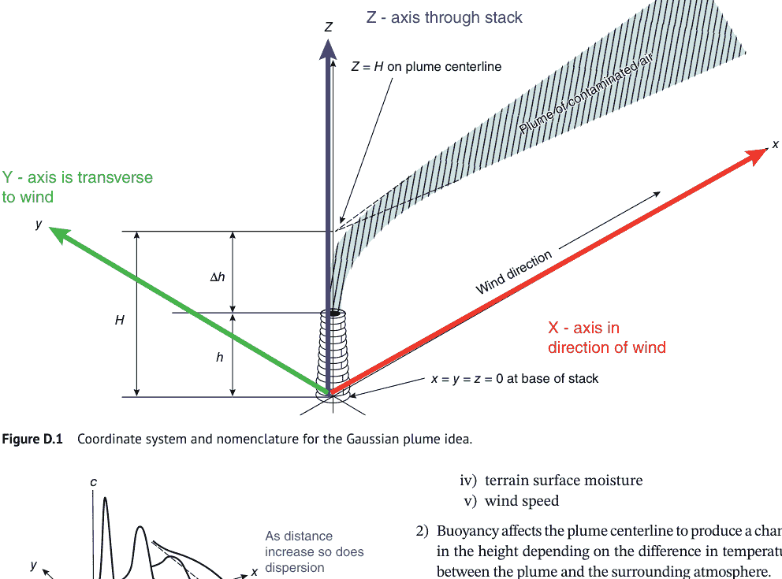
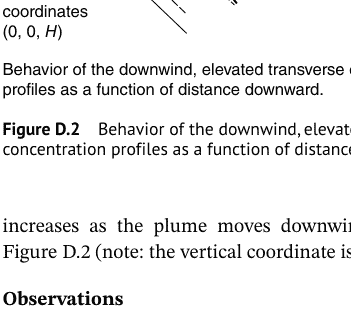
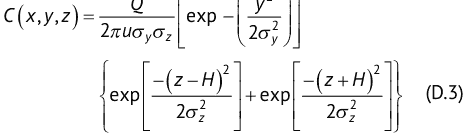
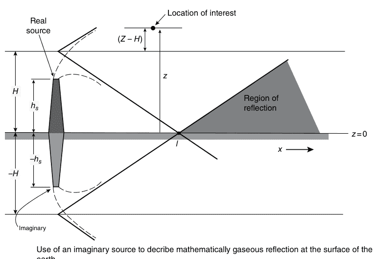
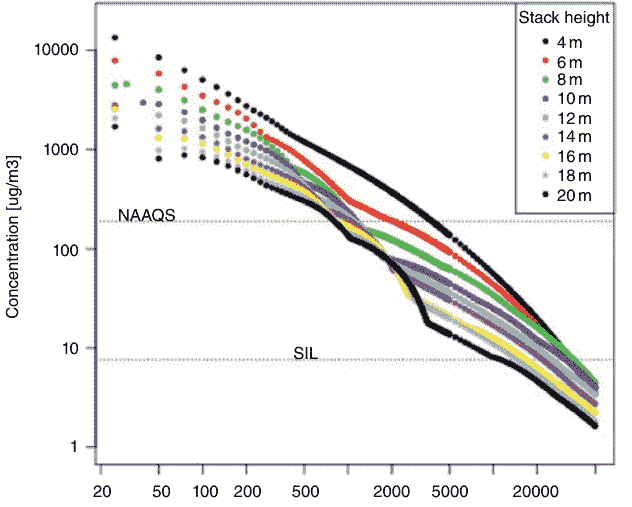
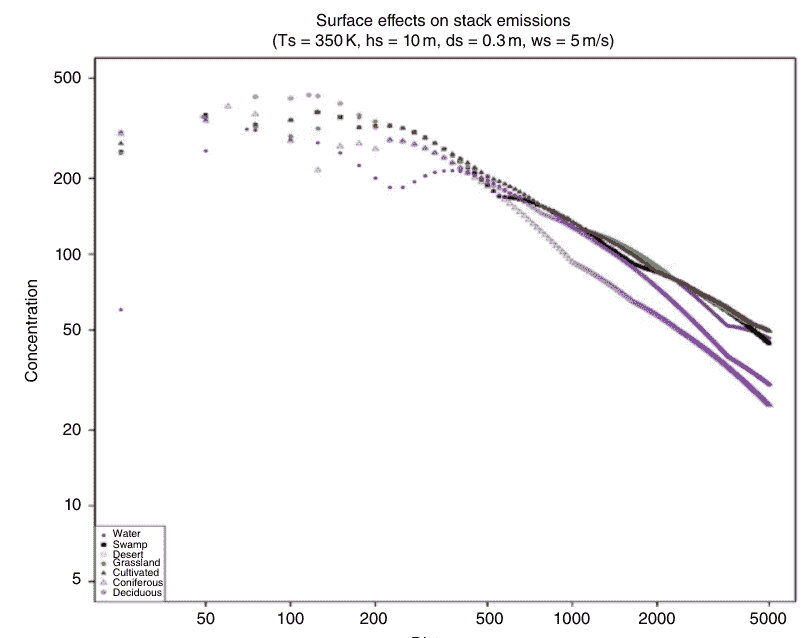

## 附录 D

## 常见问题解答

水质模型、扩散模型和许可

### D.1 用于 POTWs 的交接单示例

工业废水监测计划
取样员（签名）
分析
行业代码 | 时间 | 日期 | 来源描述 | 瞬时/混合 | G/P | 备注/防腐剂
移交人： | 日期/时间 | 接收人： | 日期/时间 | 备注：
移交人： | 日期/时间 | 接收人： | 日期/时间
移交人： | 日期/时间 | 接收人： | 日期/时间

### D.2 水质模型

- Cornell Mixing Zone Expert System (CORMIX)：“User’s Manual for CORMIX: A Hydrodynamic Mixing Zone Model and Decision Support System for Pollutant Discharges into Surface Waters”，由 Jirka, G.H., Donekar, R.L., 和 Hinton, S.W. School of Civil and Environmental Engineering, Cornell University, Ithaca, N.Y. 14853 编写

CORMIX，用于预测和分析湖泊、河流和河口中水下单口排放的环境影响。

CORMIX2，可用于预测水下多口排放羽流特征。

美国环境保护署

TMDL 建模工具箱

流域和水质建模技术支持中心

美国 EPA – NERL

Athens, GA 30605

- 水动力学和水质的一维动态模型（EPRiv1）
- 河流水质模型：QUAL2K：TMDL 开发

### D.3 常见问题

拟议的工业/市政废水排放者一般 NPDES 许可，用于在排放点满足目标/标准

1. **什么类型的排放或设施有资格在一般 NPDES 许可下获得覆盖？**

处理生活污水并在排放点或“末端排放”处满足水质目标/标准的处理设施。

2. **“在排放点”是什么意思？**

排放点是指设施排放物排放物与受纳水体相遇之前的点。根据本一般许可，设施需要在排放到受纳水体之前满足其所有排放限值——即“在排放点”。

3. **与个人 NPDES 许可相比，在一般 NPDES 许可下获得覆盖的潜在优势是什么？**

以下是在一般 NPDES 许可下获得覆盖与个人 NPDES 许可相比的一些优势：

- 简化的申请
- 简化的许可流程（持续时间缩短三至六个月）
- 在后续一般 NPDES 许可下简单重新登记

4. **我如何申请一般 NPDES 许可？**

申请将包括提交一份意向通知（NOI），在问题 5 的答复中讨论。

5. **什么是 NOI？**

NOI 包括有关所有者/运营商/授权代表和设施的信息（例如表格）。排放者希望区域委员会考虑的额外数据和/或信息也可以提供。

6. **什么是适用性通知（NOA）？**

NOA 是由执行官签署的正式文件，授予排放者在 NPDES 排放方面在一般 NPDES 许可下的监管覆盖范围。NOA 将至少包括：设施描述和适用的最终排放限值、排放和受纳水监测要求、有益用途、预处理计划要求以及次要土地排放规范。

7. **获得一般 NPDES 许可覆盖的审批流程是什么？**

在提交 NOI 后，区域委员会工作人员将审查申请并对数据进行合理潜能分析。工作人员可能会要求提供额外信息以确定是否符合一般 NPDES 许可覆盖的资格。工作人员将制定 NOA 以供执行官批准。在执行官签发 NOA 后，相关排放将受一般 NPDES 许可的监管覆盖。

8. **排放者是否有机会审查 NOA 草案？**

是的。NOA 草案将在 NOA 被执行官考虑批准之前提供给排放者进行审查。

9. **NOA 批准前是否会有公众审查 NOA？**

否。公众审查流程将在一般 NPDES 许可的制定和批准流程中完成。公众将通过张贴公众听证会通知收到通知，并有机会提交书面意见和建议，涉及拟议的一般 NPDES 许可。中央谷地水委员会将在公众听证会上考虑所有及时收到的公众意见。在公众听证会上，中央谷地水委员会将考虑证词以及是否采纳拟议的一般 NPDES 许可。如果中央谷地水委员会采纳一般 NPDES 许可，执行官将

有权向属于一般 NPDES 许可覆盖范围内的特定 NPDES 排放点签发个人 NOA。

## 10. 申请和审批流程需要多长时间？

由于这将是一项新的一般 NPDES 许可，完整的流程时间尚不确定。但是，工作人员估计，从申请人提交完整的 NOI 到签发 NOA，整个流程大约需要三到四个月。

## 11. 一般 NPDES 许可的覆盖期限是多久？

一般 NPDES 许可的有效期为五年。每当一个新的排放点获得 NOA 并在一般 NPDES 许可下注册，其覆盖范围将在一般 NPDES 许可到期时到期。当一般 NPDES 许可续期时，已有注册者的覆盖范围将自动续期至续期后的一般 NPDES 许可的下一个五年期限，前提是 NOA 的条款和条件仍然适用。

## 12. 该许可是否适用于受排放物主导的排放？

是的。一般 NPDES 许可可用于排放物主导和非排放物主导的情况。

## 13. 工程研究中的信息有效期多久？

只要工程研究中的信息适用于处理设施的现有运营和条件，并且对工作人员在分析排放是否符合资格时有用，则工程研究应为有效。

## 14. 具有稀释信用额的排放是否符合一般 NPDES 许可的条件？

否。如果需要稀释信用额才能满足排放限值，则该排放不符合一般 NPDES 许可覆盖的条件。

## 15. 我们目前未达到末端排放限值，但正在对设施进行升级，升级完成后可在排放点实现合规——我们现在可以申请一般 NPDES 许可，还是必须等到升级完成？

设施升级正在进行中且升级完成后能够在排放点满足适用排放限值的排放者，可在中央谷地水务委员会通过一般 NPDES 许可后申请一般 NPDES 许可。区域委员会工作人员将在收到 NOI 时进行审查，并在适当情况下制定 NOA 提交执行官批准。现有的合规时间表将被修改，以反映 NOA 授权该设施的排放受一般 NPDES 许可管辖。

## 16. 美国环保署是否参与了一般 NPDES 许可的制定？

是的。工作人员将在制定过程中继续征求美国环保署的意见。

## 17. 一般 NPDES 许可对依赖硬度、pH 或温度的特定场地组分如何运作？

每种组分的标准计算基础和排放限值将在一般 NPDES 许可中说明。特定设施适用的场地特定细节和最终排放限值将包含在 NOA 中。

## 18. 如果硬度监测数据发生变化，对应的排放限值是否会发生变化（即是否会签发浮动限值）？

否，不会签发浮动限值。一般 NPDES 许可将包括确定场地特定限值的程序，适用于排放者的最终排放限值将包含在 NOA 中。

## 19. 我何时可以提交 NOI 申请？

中央谷地水务委员会通过一般 NPDES 许可后，工作人员将开始接受 NOI。

## 20. 我可以在哪里获取有关 NOI 所需内容的资料？

将制定一份申请清单，列出完整的 NOI 所需的所有必要信息。一旦可用，该清单将包含在一般 NPDES 许可中，并发布在区域委员会的网站上。

## 21. 如果一般 NPDES 许可不适合我，我可以获得个人 NPDES 许可吗？

由一般 NPDES 许可授权的排放者可通过提交废物排放报告申请个人许可并说明支持该请求的理由，从而请求退出一般 NPDES 许可。如果个人许可的理由足以支持该请求，将准备个人许可（另见问题 27）。

## 22. 除排放者之外，还有其他团体或个人被通知参与一般 NPDES 许可的制定过程吗？

是的。所有 NPDES 许可持有者以及对中央谷地区域水务委员会 NPDES 计划表示兴趣的利益相关方，包括个人、利益相关者和非政府组织，均已收到通知。

## 23. 一般 NPDES 许可下的注册者是否按地区分组？

一般 NPDES 许可仅适用于中央谷地地区的排放者。区域内不会对特定类型的项目进行分组。

## 24. 我们的处理厂升级在一般 NPDES 许可可用之前无法完成。我们会错过申请窗口吗？

不会。您不会错过申请窗口。请参阅问题/答案 15 和 19。只要该命令有效，您可在任何时候申请一般 NPDES 许可的覆盖。

## 25. 一般 NPDES 许可对紫外线系统的运行规定会有多严格？

一般 NPDES 许可将包括区域委员会的标准紫外线规范，该规范基于国家水研究机构指南。然而，就像个人许可一样，如果饮用水司批准的《第 22 题工程报告》中包含详细的紫外线规范，一般许可允许在 NOA 中包含场地特定的紫外线规范。

## 26. 其他一般命令包含比我们的个人 NPDES 许可更严格的监测。这一一般 NPDES 许可是否包含限制性监测？

目标不是包含比目前个人命令中更严格的监测。然而，一般 NPDES 许可将制定为适用于多个排放点，因此监测可能与您当前个人 NPDES 许可中的不同。

## 27. 排放者能否在一般 NPDES 许可和个人 NPDES 许可之间进行选择以覆盖其排放？

符合一般 NPDES 许可覆盖条件的排放者可以选择在一般 NPDES 许可或个人 NPDES 许可下获得覆盖；然而，个人 NPDES 许可中的条款和条件可能与一般许可中的类似。

## 28. 我的个人 NPDES 许可在 180 天后才到期。我何时需要申请一般 NPDES 许可？

一般 NPDES 许可一经可用，您即可申请其排放的覆盖。然而，您可根据加州法规第 23 篇的规定，最迟在现有 NPDES 许可到期前 180 天提交申请。

## 29. 这一一般 NPDES 许可适用于我的设施吗？

中央谷地水务委员会已确定 25 家似乎可立即获得一般 NPDES 许可的设施。然而，并无意保证名单上的 25 家设施获得一般 NPDES 许可的覆盖，也无意将名单上未列出的任何设施排除在申请一般 NPDES 许可覆盖之外。

## 30. 如果排放者有多于一个排放点，排放者能否就不同排放点分别获得一般 NPDES 许可和个人 NPDES 许可的监管覆盖？

可以。排放者可就符合条件的排放获得一般 NPDES 许可的监管覆盖，并就不符合一般 NPDES 许可条件的排放获得个人 NPDES 许可的监管覆盖。

## 31. 排放到土地的排放是否在一般 NPDES 许可的覆盖范围内？

一般 NPDES 许可将包括标准土地排放规范（例如无异味、无公众接触等）。如果土地排放需要更复杂或场地特定的规范以确保水质保护，排放者可能需要就土地排放获得单独许可的监管覆盖。

## 32. 谁负责确定来自地表排放系统的污染物排放是否会进入美国水域？

以下是来自对评论回复文件中的回复，该回复回答了此问题并提供了有关美国水域的额外信息。该回复指出，房主负责做出此决定。美国环保署预计房主将根据进行土壤调查的人员提供的信息做出决定。对评论回复文件中的回复如下：

国会在《清洁水法》第 502 条中将“可航行水域”广泛定义为涵盖所有“美国水域”。美国环保署已在 40 CFR § 122.2 中发布了“美国水域”一词的法规定义。美国环保署的定义包括，除其他外，传统可航行水域、传统可航行水域的支流，以及与传统可航行水域或其支流相邻的湿地。最高法院已在数项意见中确定了国会监管“美国水域”范围的意图

37. 关于30天的等待期，如果申请人未收到美国环保局的任何通知，则申请人即知道其可以安装地表排放系统，且当地县级卫生部门可以颁发施工/安装许可证。如果美国环保局在收到意向通知（NOI）后30天内作出批准或拒绝覆盖的决定，美国环保局是否会提前致电当地卫生部门？

虽然许可证中未作规定，且最终许可证也未要求，但美国环保局将向申请人发送覆盖函，并抄送适用的当地县级卫生部门。美国环保局将通过电话和/或电子邮件通知申请人和适用的县级卫生部门，随后就该决定发出正式函件。如果美国环保局在收到意向通知后30个日历日内作出决定，则将在作出决定时通知申请人和适用的县级卫生部门。

38. 我们县的一些房产非常小，唯一的选择是安装曝气装置。在这些特殊情况下，为什么有必要经过意向通知程序？

是否申请通用许可证所涵盖的范围由申请人自行决定，但如果申请人选择通用许可证，则必须遵守既定的申请/意向通知程序。美国环保局的NPDES通用许可证不允许在特定场地经粗略检查后看似不足以支持地表排放系统替代方案的情况下，采用简化申请程序。简化程序可能导致对场地支持地表排放系统替代方案的能力作出过早裁决。要求每位申请通用许可证覆盖的申请人都提交意向通知和所需的补充信息，可确保每个场地无论大小、土壤类型或其他限制性特征如何，都能根据最终许可证中确定的技术和经济标准进行一致评估。

## D.4 常见问题解答

## 美国环保局重大恶化预防许可证

1. 什么是PSD？

PSD是“重大恶化预防”（Prevention of Significant Deterioration）规则的缩写。当公司在达标区新增排放源或修改现有源时，需要遵守这些规则。对于该区域被归类为符合国家环境空气质量标准（NAAQS）的污染物，需要适用PSD规则。PSD规则旨在使空气“良好”的区域保持符合NAAQS。PSD规则的策略假设，小型新源和小型修改不会显著影响空气质量。PSD的特色要求包括最佳可行控制技术（BACT）、空气质量分析——模拟（允许增量），以及项目对能见度、植被和土壤的影响分析。在PSD下，如果某一源因任何一种污染物被归类为主要源，则任何污染物的显著增加（即使该源并非该污染物的主要排放源）都会触发PSD审查。

2. 什么是PSD增量？

PSD增量防止达标区的空气质量恶化到NAAQS设定的水平。PSD增量是允许在污染物基线浓度之上出现的最大浓度增加量。所评估的环境空气质量是次要源基线日期确立时的环境空气质量。增量定义为在基线日期确立时，允许在现有条件之上增加的最大环境空气质量增量。在设定增量时，各州允许新的和修改的固定源消耗100%的可用NAAQS。国会通过1977年联邦《清洁空气法》（CAA）修正案，美国环保局将增量设定为NAAQS的特定百分比，以界定相对于现有空气质量的最大恶化增量。增量限制了空气质量的恶化，并且在限制排放减少方面比NAAQS更为严格。超出（即过度消耗）增量不会像超出NAAQS那样产生相同的后果，因为它不会触发未达标状态。相反，一旦发现增量被过度消耗，联邦法规51.16(a)要求各州制定计划来纠正增量的过度消耗。该计划是州实施计划（SIP）的修正案。PSD增量载于40 CFR 51.166(c)和40 CFR 52.21(c)。联邦《清洁空气法》允许除年增量以外的任何增量每年被超过一次，且不触发任何解决增量过度消耗的要求。基线浓度针对每种污染物定义，是在影响该区域的首次完整PSD许可申请提交时存在的环境浓度。当出现以下情况时，即认为发生重大恶化：

不是。通常，超过两年的停运被视为永久性停运。但如果业主证明该停运并非旨在永久性，则停运可被视为临时性停运。如果停运被视为临时性，则重新启动无需接受PSD审查。关键考验在于停运是否永久。在任何情况下，该增加将被视为实际排放的增加，用于未来净增量的计算和增量消耗的目的。

## 23 一个次要源以主要量（如果属于28个列出的源类别之一，则为100吨/年；如果未列出，则为250吨/年）增加某种污染物的排放，作为新的主要源，而非作为修改，需接受PSD审查。净额计算概念仅用于主要修改的定义，而不用来定义主要固定源。这似乎表明，增加主要排放单元的次要源不能通过考虑先前因净增量低于主要源阈值而减少的排放来逃避PSD审查。是这样吗？

是的。例如，假设一个排放200吨/年的次要源在2010年实际排放量减少了50吨/年，剩下150吨/年。2012年，拟增加260吨/年。如果可以利用这50吨/年的削减来抵消260吨/年的增加，则增加量仅为210吨/年，该源将逃避审查。但是，这50吨/年的削减不能使用，因此260吨/年的增加需作为新的主要固定源接受审查。
参考：40 CFR §52.21(b)(1)

## 24 一个现有源仅因其二氧化硫排放量为120吨/年而被视为主要源。该源拟增加60吨/年的颗粒物排放。同时，该源愿意接受一项新的、联邦可执行的限制，将其二氧化硫排放量降至90吨/年。拟增加的60吨/年颗粒物是否需要接受PSD审查？

不需要。由于该源在变更后不再是主要源，该行为无需接受PSD审查。
参考：40 CFR §52.21(b)(2)(i)

## 25 PSD基线空气质量基于现有源的实际排放。实际排放定义为以吨/年表示的平均排放率。在使用空气质量模拟时，生态部门如何解释这一点来确定短期（24小时、3小时）基线空气质量水平？

3小时和24小时平均值的基线应分别使用现有源在确定年排放率期间出现的最大3小时平均或24小时平均排放率来设定。例如，如果某源的年排放率通过平均1978年的400吨/年和1979年的460吨/年确定为430吨/年，则3小时基线排放率应为1978年和1979年期间出现的最大3小时平均排放率。
对于短期PSD模拟，仅对新的和现有设备进行建模。利用率增加的设备不在短期建模范围内。

## 26 一台环境监测器运行了一年（如果代表最高值，也可运行更短时间），然后关闭。拟建源希望将该数据用于其PSD申请。除了时间间隔外，该数据代表拟建地点的当前空气质量，质量良好，且完全在该源提交申请之前的三年内收集。即使监测器已关闭，这些数据是否可以使用？

只要申请所需的所有数据按顺序收集，并且所有数据均在过去三年内的某个时间收集，时间要求即得到满足。例如，假设某机构在某个臭氧季节（该机构确定是2010年4月至9月）期间运行了一台臭氧监测器，随后该监测器被关闭。这些数据可被用于2013年4月1日之前任何时间提交的PSD申请，前提是该数据仍能代表当前状况，且满足所有其他要求，如质量保证和监测器位置。
参考：40 CFR §52.21(m)；45 FR 52724

## 27 一个次要源位于一个已触发基线的PSD区域。在附近的另一个PSD区域中，该次要源开始运行后基线仍未触发。该源的排放影响这一邻近区域。这些排放是否消耗增量？

不。基线空气质量是指基线日期在基线区域实际存在的空气质量，减去新主要源的贡献。因此，在邻近区域的某个未来基线日期，基线空气质量必须包括该次要源的实际贡献。由于这些排放已包含在该区域的基线中，因此不消耗增量。如果情况相反（次要源位于未触发基线的区域，但影响到已触发基线的区域），则排放将消耗邻近区域的增量，但不会消耗该源所在区域的增量。

**图 D.1** 高斯烟羽概念中的坐标系与命名。

下风向高架横向浓度剖面随下风向距离的变化行为。

**图 D.2** 下风向高架横向浓度剖面随下风向距离的变化行为。

随着烟羽向下风向移动，该值逐渐增大，如图 D.2 所示（注意：纵坐标为浓度）。

## 观测结果

+   1) 水平和垂直扩散的速率均取决于大气条件。
+      a) 大气条件取决于
+         i) 入射的短波辐射，例如阳光
+         ii) 出射的长波辐射，主要受云量影响
+         iii) 地形表面粗糙度
+         iv) 地形表面湿度
+         v) 风速

+   2) 浮力会影响烟羽中心线，使其高度发生变化，变化幅度取决于烟羽与周围大气之间的温差。

位于高度 *H* 的高架源下风向任意点的理想化浓度由“污染物排放速率、风速、距离以及水平和垂直方向上的烟羽标准差”决定。

### 高度 H 处的点源

- 假设任何方向上的扩散均不受干扰或限制

\[
C(x,y,z)=\frac{Q}{2\pi u\sigma_y\sigma_z}\exp\left[-\frac{(y-y_0)^2}{2\sigma_y^2}\right]\exp\left[-\frac{(z-z_0)^2}{2\sigma_z^2}\right]
\tag{D.2}
\]

*x₀* 和 *z₀* 为烟羽中心线的位置  
*y₀* 取为烟囱底部的位置  
*z₀* 等于 *H*  
*Q* = 源的排放强度（质量/时间）——克/秒  
*u* = 穿过烟羽的平均风速——米/秒  
*C* = 浓度——克/立方米（注意这不是 ppm）  
*σᵧ* 和 *σ𝓏* 分别为水平和垂直方向的标准差，单位为米

然而，许可决策基于呼吸高度处的浓度，这必须考虑地面对烟羽扩散的影响。由于气体和大多数相关颗粒物的沉积速度与大气湍流的垂直速度相比很小，地球表面表现为反射面，从而修正了扩散方程。这种效应通过一个虚拟（假想）源来模拟，如图 D.3 所示。

## 考虑地面反射、高度 H 处的点源

回顾高斯分布可由两个参数定义，即其最大值和扩散程度的度量，我们可以通过估算这两个参数来计算任意位置的浓度。显然，最大值与排放速率有关，而扩散程度取决于大气参数，包括时间。维基百科有很好的综述：[https://en.wikipedia.org/wiki/Outline_of_air_pollution_disposition](https://en.wikipedia.org/wiki/Outline_of_air_pollution_disposition)。

## 高斯扩散模型

+   - 适用于局部点源——烟囱
+   - 一般形态
+   - 烟羽在高度 $h_{s}$ 处离开烟囱
+     - 额外上升一段距离 $\Delta h$
+       - 热气团的浮力作用
+         或称为烟羽抬升
+         或上升到浮力与向上动量消失的距离
+   - 出口速度 $V_{s}$
+   - 烟羽表现为从高度 $H = h_{s}+\Delta h$ 处排放的点源
+   - 排放速率 Q（克/秒）
+     - 假设风向沿 x 方向，风速为 u
+       - u 与时间、高度或位置无关（实际上并非如此）

除了点源（烟囱）之外，重要的污染物源更像是线源（如道路）、面源（如沉淀池、未铺砌的停车场）或体源（污染物在大型建筑物的影响范围内排放）。线源和面源的方程通过对前述方程进行一维或二维积分推导得出。体源具有影响扩散方程的初始尺寸。

**图 D.3** 使用假想源在数学上描述气体在地球表面的反射。

## D.5.2 排放扩散模拟所需信息

+   - 描述源的类型
+   点源、线源、面源、体源
+   - 描述排放温度
+   垂直方向的出口速度
+   初始尺寸，例如烟囱直径
+   所关注污染物的排放速率
+   - 描述源周围邻近区域
+   孤立源/附近建筑物
+   平坦/附近显著地形
+   土地利用分类，例如农业用地、森林、沙漠
+   - 描述气象风速和风向
+   垂直温度梯度，即递减率
+   - 所关注污染物的现有（背景）环境浓度
+   - 制定预测该源产生的地面浓度的计划，通常称为模拟方案
+   从相关实体获得方案批准

美国目前用于评估地面浓度的公认稳态扩散模型是 AERMOD。以下内容摘自《AERMOD 模型公式与评估报告》，EPA-454/R-17-001，2017 年 5 月。

下文中的 AERMIC 代表 AMS/EPA 监管模型改进委员会，由美国气象学会（AMS）和美国环境保护署（EPA）的科学家组成。

AERMOD 建模系统由两个预处理程序和扩散模型组成。AERMIC 气象预处理程序（AERMET）为 AERMOD 提供表征边界层（PBL）所需的气象信息。AERMIC 地形预处理程序（AERMAP）既表征地形，又为扩散模型（AERMOD）生成受体网格。

AERMET 使用气象数据和地表特征来计算 AERMOD 所需的边界层参数（如混合层高度、摩擦速度等）。这些数据无论是在场外还是场内测得，都必须代表模拟区域内的气象状况。AERMAP 使用模拟区域的网格化地形数据来计算与每个受体位置相关的代表性地形影响高度。网格化数据以数字高程模型（DEM）数据的格式提供给 AERMAP。地形预处理程序还可用于计算离散受体和受体网格的高程。

AERMOD 是一个稳态烟羽模型。在稳定边界层（SBL）中，它假设浓度分布在垂直和水平方向上都呈高斯分布。在对流边界层（CBL）中，水平分布也假设为高斯分布，但垂直分布则用双高斯概率密度函数（pdf）来描述。此外，在对流边界层中，AERMOD 处理“烟羽抬升”现象，即从浮力源释放的部分烟羽质量上升到边界层顶部并停留在其附近，然后才混合进入对流边界层。AERMOD 还追踪穿透进入上部稳定层的任何烟羽质量，并在适当的时候允许其重新进入边界层。对于对流边界层和稳定边界层中的源，AERMOD 都会处理由烟羽摆动引起的侧向扩散增强。

AERMOD 采用相对简单的方法，整合了当前关于复杂地形中气流和扩散的概念。在适当的情况下，烟羽被模拟为冲击地形和/或沿地形运动。这种方法设计得既物理上真实又易于实现，同时避免了像其他监管模型那样需要区分简单、中等和复杂地形。因此，AERMOD 无需定义复杂地形区域。

## D.5.3 筛选模拟

美国环保署目前认可的筛选扩散模型是 AERSCREEN。与过去四十年的筛选方法保持一致，AERSCREEN 为单个排放点计算多个平均时段（从 1 小时到年）的预期最大地面浓度。它使用 AERMOD 建模系统的主要组件，但使用附加程序 MAKEMET 来生成已被证明能产生来自源和土地分类/土地利用特征的最大地面浓度的气象条件。一轮快速的筛选模拟通常足以证明符合空气质量标准。

MAKEMET 程序有着悠久而复杂的历史，可以追溯到 10 多年前。简而言之，AERSCREEN 附带的 MAKEMET 版本按以下方式运行。如前所述，MAKEMET 生成一系列气象条件矩阵，以筛选模式应用于 AERMOD，并将结果以 AERMOD 可直接读取的地面气象数据文件和剖面气象数据文件的形式输出。该矩阵是基于对一系列风速、云量、环境温度、太阳高度角和对流速度尺度（w*，仅适用于对流条件）进行循环遍历而生成的，用于

用户指定的表面特征（Z₀, B₀, r）。对于稳定情况，机械混合高度（Zₘ）是基于摩擦速度 u* 计算的。还包括通过 Zₘ 因子（乘以由 u* 计算的初始值）的循环，以考虑使用精炼 AERMET 数据时 Zₘ 的平滑。太阳角度大于零但小于临界太阳角度（ACRIT）的稳定过渡情况也包含在矩阵中。

AERSCREEN 是 AERMOD 建模系统的交互式包装器，根据用户对屏幕上打印的提示提供的数值计算输入值。

在运行 AERSCREEN 之前，用户应查阅并熟悉以下内容：

- AERMOD 用户指南（USEPA 2016a）
- AERMAP 用户指南（USEPA 2016b）
- AERMET 用户指南（用于表面特征表）（USEPA 2016c）
- BPIPPRM 用户指南（USEPA 2004）– 与建筑物对扩散的影响相关
- AERSURFACE 用户指南（USEPA 2008）
- AERMOD 实施指南（USEPA 2016e）

尽管接下来的两个参考资料专门针对美国，但其中包含的信息可能对扩散建模总体而言很重要。

空气质量模型指南（附录 W）（USEPA 2016d）

估算固定源空气质量影响的筛选程序（USEPA 1992）

下面提供了 AERSCREEN（版本 16216）代码的链接，包括最新的 MAKEMET 代码（版本 16216），以及文档和测试用例。MAKEMET 程序与 AERSCREEN 接口，根据用户输入生成基于站点的筛选气象条件矩阵，用于输入 AERMOD。

AERSCREEN 代码和可执行文件（v16216） (ZIP)(759 K)
MAKEMET 代码和可执行文件（v16216） (ZIP)(355 K)

请注意，在使用 AERSCREEN 之前，用户必须拥有最新的 AERMOD 可执行文件（18081）以及 AERMAP 地形预处理器和 BPIPPRM 可执行文件。这些程序可以从 AERMOD 建模系统部分下载。

## D.5.4 AERSCREEN 示例

图 D.4 是针对用于生产甲烷发电的厌氧消化器排放物分析而产生的。分析表明，甲烷中还含有硫化合物。它提供了烟囱高度对地面水平

改变烟囱高度时的筛选浓度
（10 吨/年 SO2 排放）

图 D.4 随高度变化的 SO₂ 浓度。

浓度的效应示例。它还表明，一个非常小的、10 TPY 的 SO 2 源，如果烟囱很短，可能在距离烟囱数千米处超过美国标准。空气质量影响分析（AQIA）从每个污染物的初步建模开始，以确定申请人是否可以免除详细分析和建设前监测。如果给定污染物的预测环境浓度增幅低于每个平均时段的 PSD 显著影响水平（SILs），则无需对该污染物的环境影响进行进一步分析。对于具有平均时段且影响大于 SIL 的污染物，使用完整的环境影响分析（考虑其他消耗增量的源）来证明符合 PSD 增量和

NAAQS（国家环境空气质量标准）。许多 SO 2 源排放数千吨，但烟囱高度可达 300 m。AERSCREEN 可以快速提供最大地面水平影响和对环境浓度有显著贡献的距离的估计。请注意，浓度轴为对数。

图 D.5 显示了土地利用，例如水域、森林、草地，对相同 10 TPY 源的地面水平浓度的影响。它也是经验法则的一个很好的演示，即最大地面水平浓度出现在距离源大约十倍烟囱高度处，例如对于这个 10 m 烟囱高度，最大地面水平浓度出现在源下风向约 100 m 处。

图 D.5 堆栈排放和土地利用的影响。

## 参考文献

- **Max/Min Temperatures**
- http://www.wrcc.dri.edu/summary/Climsmwa.html

- **Population**
- http://www.ofm.wa.gov/pop/april1/poprends.pdf

- **AERSCREEN User's Guide**
- http://www.3pa.gov/tcr/scram/dispersion_screening.htm
- http://lar.wsu.edu/nw-airquest/lookup.html

- **Background Concentration**
- http://lar.wsu.edu/nw-airquest/lookup.html

- **National Land Cover Database**
- http://www.mrlc.gov/viewerjs

- **National Elevation Database**
- http://viewer.nationalmap.gov/basic
- Also includes NLCD access

- **EPA** Support Center for Regulatory Atmospheric Modeling (SCRAM)
- https://www.epa.gov/scram/air-quality-dispersion-modelingscreening-models

USEPA (1992). Screening Procedures for Estimating the Air Quality Impact of Stationary Sources. Research Triangle Park, NC: USEPA.

USEPA (2004). User's Guide to the Building Profile Input Program, EPA-454/R-93-038. Research Triangle Park, NC: USEPA.

USEPA (2008). AERSURFACE User's Guide, EPA-454/B-08-001. Research Triangle Park, NC: USEPA.

USEPA (2016a). User's Guide for the AMS/EPA Regulatory Model – AERMOD, EPA-454/B-16-011. Research Triangle Park, NC: USEPA.

USEPA (2016b). User's Guide for the AERMOD Terrain Preprocessor (AERMAP), EPA454/B-16-012. Research Triangle Park, NC: USEPA.

USEPA (2016c). User's Guide for the AERMOD Meteorological Preprocessor (AERMET), EPA-454/B-16-010. Research Triangle Park, NC: USEPA.

USEPA (2016d). Guideline on Air Quality Models (Appendix W of 40 CFR Part 51). Research Triangle Park, NC: USEPA.

USEPA (2016e). AERMOD Implementation Guide, EPA-454/B-16013. Research Triangle Park, NC: USEPA.

USEPA (2016f). AERSCREEN User's Guide, EPA-454/B-16-004. Research Triangle Park, NC: USEPA.

## 参考文献

Crowl, D.A. and Louvar, J.F. (2011). *Chemical Process Safety*, 3e. Upper Saddle River, NJ: Prentice Hall.
