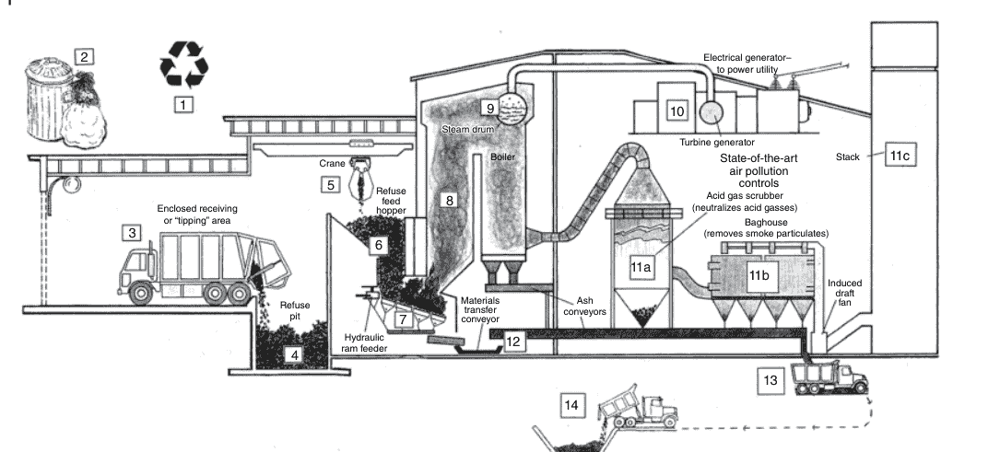

## 附录 G

## 资源回收

华盛顿州斯波坎市废物能源设施，美国

## G.1 设施描述

位于华盛顿州斯波坎的资源回收和废物能源设施（WTE）可处理 800 T 市政固体废物（MSW）每日：有两个锅炉，每个额定 400 T/日。该设施每年使用约 255 000 T 垃圾。有 1 台蒸汽轮机发电机，额定 13.8 kV，30 MVA，25.8 MW，功率因数为 0.86。该设施的发电合同按季节变化，从 $38 到 $48 MWh（毛 ~1 500 000 MW/年）（C. Averyt，个人交流）。MSW 通常由卡车直接倾倒到垃圾坑中。 overhead 垃圾吊车然后将垃圾从坑中移至每个锅炉的进料漏斗。MSW 在坑中由吊车操作员混合和分拣。灰渣残留物以约 6000 T/月的速率产生。平均垃圾衍生燃料组成见表 G.1。资源回收的示意图如图 G.1 所示。

管道。斯波坎市 WTE 设施配备了两台相同的锅炉，每台锅炉都有单独的喷雾干燥吸收器（SDA）和单独的布袋过滤器（FF）。石灰制备、稀释水、灰渣去除和雾化空气系统对两台锅炉是共用的。空气污染控制系统中的主要流动路径始于锅炉省煤器处的烟气排放。烟气离开锅炉，含有多种污染物，主要是二氧化硫（SO₂）、液压酸（HCl）和颗粒灰。这些受污染的气体通过管道流向 SDA 的入口。气体进入 SDA 顶部并向下流经一系列折流板分布网络。折流板用于将气体均匀分布在 SDA 横截面上，在那里它与雾化石灰浆接触。石灰浆吸收大部分酸性气体。清洁气体流向 SDA 容器底部，在那里转向并流出 SDA 容器侧面。

### G.1.1 技术

垃圾焚烧锅炉燃烧系统设计用于以受控速率将垃圾引入炉膛，并提供必要的过火和欠火燃烧空气，以实现垃圾和可燃气体的适当燃烧。它还设计用于将灰渣惰性残留物输送到灰渣处理系统进行处置，并从换热表面去除烟灰和灰尘颗粒。垃圾焚烧锅炉燃烧系统的燃烧空气处理部分包含必要的设备和控制装置，以提供和调节供给锅炉炉膛用于垃圾燃烧的空气量。它还包含必要的设备和控制装置，以从锅炉炉膛中去除燃烧气体。燃烧系统的空气供给侧由一次和二次鼓风机、蒸汽盘管空气加热器、容积控制挡板和相关管道组成。气体去除侧由诱导通风机和相关

为消除储存大量无水氨的需要，使用尿素水解器产生用于 NOₓ 控制的 NH₃ 蒸汽。该过程使用 40–50% 重量比的尿素溶液生产氨。尿素溶液由由变频驱动电机驱动的隔膜式计量泵送入水解器。尿素溶液以可变流速泵送以保持水解器中的恒定液位。烟气在离开 SDA 时含有大量粉尘（灰渣和石灰）颗粒。该气体进入 FF，在那里分配到各个模块（或隔间）。FF 设计为六个隔间。五个隔间对于 100% 负荷是必要的，而六个隔间可在维护时离线。脉冲喷射使用压缩空气脉冲来清洁袋子。清洁周期可以由压降信号或时间周期启动。压降信号是通常的方法。总共使用了四套 Aldora Technologies, Inc. 提供的连续监测系统（CEMS）来测量来自两台市政废物焚烧炉（MWC）

## 表 G.1 废物组成：详细结果

| 材料 | 估计百分比 | ± (%) | 材料 | 估计百分比 | ± (%) |
|---|---|---|---|---|---|
| 纸包装 | 11.2 |  | 纸制品 | 14.6 |  |
| 报纸 | 0.3 | 0.5 | 报纸 | 1.3 | 0.4 |
| 纸板/牛皮纸包装 | 5.1 | 2.0 | 纸板/牛皮纸 | 0.0 | 0.0 |
| 其他地木包装 | 0.3 | 0.2 | 杂志 | 1.2 | 0.6 |
| 混合/低等级包装 | 3.3 | 0.9 | 高级纸张 | 1.4 | 0.6 |
| 可堆肥包装 | 0.1 | 0.1 | 其他地木 | 0.3 | 0.3 |
| R/C 纸包装 | 2.0 | 1.3 | 混合低等级 | 2.2 | 0.7 |
| 塑料包装 | 7.7 |  | 可堆肥产品 | 7.1 | 4.3 |
| #1 PET 瓶 | 0.7 | 0.2 | 纸加工污泥 | 0.0 | 0.0 |
| #2 PET 非瓶 | 0.4 | 0.1 | R/C 纸 | 1.2 | 1.7 |
| #3 HDPE 天然瓶 | 0.3 | 0.1 | 塑料制品 | 3.3 |  |
| #2 HDPE 有色瓶 | 0.5 | 0.2 | #1 PET | 0.0 | 0.0 |
| #2 HDPE 罐和桶 | 0.2 | 0.1 | #2 HDPE | 0.0 | 0.0 |
| #3 PVC 包装 | 0.0 | 0.0 | #3 PVC | 0.0 | 0.0 |
| #4 LDPE 包装 | 0.0 | 0.0 | #4 LDPE | 0.0 | 0.0 |
| #5 PP 包装 | 0.5 | 0.1 | #5 PP | 0.0 | 0.0 |
| #6 PS 包装 | 0.5 | 0.2 | #6 PS | 0.0 | 0.0 |
| #7 其他包装 | 0.7 | 0.1 | #7 其他 | 1.3 | 0.6 |
| 商品包装薄膜 | 0.7 | 0.1 | 垃圾袋 | 1.1 | 0.2 |
| 非工业/包装薄膜 | 2.7 | 0.8 | 薄膜制品 | 0.2 | 0.1 |
| 工业/包装薄膜 | 0.2 | 0.2 | R/C 产品 | 0.7 | 0.5 |
| R/C 包装 | 0.2 | 0.1 | 消费品 | 4.0 |  |
| 玻璃 | 1.3 |  | 电视 – 阴极射线管 | 0.0 | 0.0 |
| 透明容器 | 0.3 | 0.1 | 电视 – LCD | 0.0 | 0.0 |
| 绿色容器 | 0.3 | 0.3 | VCR、DVD、DVR | 0.0 | 0.0 |
| 棕色容器 | 0.4 | 0.2 | 计算机显示器 – 阴极射线管 | 0.0 | 0.0 |
| 平板玻璃 | 0.0 | 0.0 | 计算机显示器 – LCD | 0.0 | 0.0 |
| 玻璃器皿 | 0.1 | 0.1 | 计算机 | 0.0 | 0.0 |
| R/C 玻璃 | 0.2 | 0.2 | 计算机外设 | 0.4 | 0.3 |
| 金属 | 6.4 |  | 音频设备 | 0.0 | 0.0 |
| 铝饮料罐 | 0.5 | 0.1 | 游戏设备 | 0.0 | 0.0 |
| 铝箔/容器 | 0.2 | 0.1 | 其他消费电子产品 | 0.1 | 0.2 |
| 其他铝 | 0.1 | 0.1 | 纺织品 – 有机 | 1.6 | 0.8 |
| 其他有色金属 | 0.0 | 0.0 | 纺织品 – 合成 | 1.6 | 0.6 |
| 食品罐 – 镀锡 | 0.7 | 0.2 | 鞋、包、腰带 | 0.2 | 0.2 |
| 食品罐 – 涂层 | 0.2 | 0.1 | 轮胎和橡胶 | 0.0 | 0.0 |
| 白色家电 | 0.0 | 0.0 | 家具 | 0.0 | 0.0 |
| 其他铁质 | 2.4 | 1.7 | 床垫 | 0.0 | 0.0 |
| R/C 金属 | 2.3 | 1.3 | R/C 消费品 | 0.1 | 0.2 |
| 有机物 | 24.0 |  | 危险废物 | 3.5 |  |
| 食物 – 蔬菜类 | 7.1 | 1.1 | 杀虫剂/除草剂 | 0.0 | 0.0 |
| 食物 – 非蔬菜类 | 3.8 | 1.0 | 水银蒸气照明 | 0.0 | 0.0 |
| 树叶和草 | 9.6 | 3.2 | 紧凑型荧光灯 | 0.0 | 0.0 |

## 表 G.1 （续）

| 材料 | 估计百分比 | ± (%) | 材料 | 估计百分比 | ± (%) |
|---|---|---|---|---|---|
| 修剪物 | 0.4 | 0.5 | 荧光灯管 | 0.0 | 0.0 |
| 动物粪便 | 2.3 | 1.4 | 石棉 | 0.0 | 0.0 |
| 动物尸体 | 0.0 | 0.0 | 乳胶漆 | 0.9 | 1.0 |
| 农作物残渣 | 0.0 | 0.0 | 溶剂基胶水 | 0.0 | 0.0 |
| 水果废物 | 0.0 | 0.0 | 乳胶基胶水 | 0.0 | 0.0 |
| R/C 有机物 | 0.8 | 0.7 | 油基漆和溶剂 | 0.0 | 0.0 |
| 木材废物 | 8.2 |  | 腐蚀性清洁剂 | 0.0 | 0.0 |
| 处理木材 | 0.1 | 0.1 | 干电池 | 0.0 | 0.0 |
| 涂漆木材 | 3.0 | 1.9 | 湿电池 | 0.0 | 0.0 |
| 规格木材 | 2.0 | 0.6 | 汽油/煤油 | 0.0 | 0.0 |
| 工程木材 | 2.1 | 1.0 | 机油 | 0.0 | 0.0 |
| 托盘和箱子 | 0.3 | 0.5 | 防冻液 | 0.0 | 0.0 |
| 其他未处理木材 | 0.1 | 0.2 | 其他车辆液体 | 0.0 | 0.0 |
| 木材副产品 | 0.2 | 0.3 | 机油滤清器 | 0.0 | 0.0 |
| R/C 木材 | 0.4 | 0.5 | 爆炸物 | 0.0 | 0.0 |
|  |  |  | 医疗废物 | 0.1 | 0.1 |
| 建筑材料 | 15.8 |  | 药品/维生素 | 0.1 | 0.1 |
| 天然木材 | 1.9 | 3.1 | 一次性尿布 | 2.3 | 0.7 |
| 隔热材料 | 0.1 | 0.1 | 其他清洁剂和肥皂 | 0.0 | 0.0 |
| 沥青铺路 | 0.0 | 0.0 | 其他危险品 | 0.0 | 0.0 |
| 混凝土 | 0.0 | 0.0 | 其他非危险品 | 0.0 | 0.0 |
|  drywall | 0.3 | 0.2 | 残留物 | 0.0 |  |
| 地毯 | 3.4 | 3.6 | 灰烬 | 0.0 | 0.0 |
| 地毯衬垫 | 0.3 | 0.4 | 灰尘 | 0.0 | 0.0 |
| 土壤、岩石、沙子 | 8.0 | 2.8 | 细粉 | 0.0 | 0.0 |
| 沥青屋面 | 0.2 | 0.1 | 污泥/特殊工业 | 0.0 | 0.0 |
| 塑料地板 | 0.2 | 0.2 |  |  |  |
| 陶瓷和砖 | 0.8 | 0.5 | 合计 | 100.0 |  |
| R/C 拆除 | 0.4 | 0.3 | 样本数量 | 12 |  |

置信区间在 90% 置信水平下计算。由于四舍五入，材料类型的百分比可能总和不为 100%。

单位。每个喷雾 SDA 入口和每个 FF 出口各安装一个 CEMS。每个 CEMS 由一台带集成锆氧气分析仪的 Perkin Elmer MCS 100E 多组分分析仪和 Aldora Technologies 提供的热/湿采样输送和调节系统组成。每个 MWC 单元的 SDA 入口和 FF 出口 CEMS 连接到一台单一的 Environmental Systems Corporation (ESC) 8816 数据记录仪。两台 ESC 数据记录仪将所有 CEMS 数据发送到位于工厂控制室的中央 UNIX-based、ESC 提供的中央数据采集系统。每个 FF 出口 CEMS 测量氮氧化物 (NOx)、一氧化碳 (CO)、氧气 (O2)、受控二氧化硫 (SO2) 和水分 (H2O) 浓度。排放物按湿基测量，并使用 MCS 100E 的水分测量结果校正为干基。

锅炉过热器出口的蒸汽通过管道输送到 900 psig 蒸汽总管，该总管为直径 10 英寸的管道段，充当 900 psig 和 830°F 蒸汽的中央接收和分配装置。每个锅炉的底部灰/转移系统收集来自两个锅炉的底部灰，对其进行处理，然后将其排放到主进料皮带上。每个锅炉的飞灰系统收集来自锅炉产生层料斗、SDA 和 FF 的灰。

- 1. 回用和回收市政固体废物
- 2. 废物收集
- 3. 封闭回收或倾倒区
- 4. 垃圾坑
- 5. 起重机
- 6. 垃圾进料料斗
- 7. 液压往复进料器
- 8. 锅炉/焚化炉
- 9. 蒸汽鼓
- 10. 汽轮发电机/向公用事业供电
- 11a. 灰收集
- 11b. 飞灰收集袋式除尘器
- 11c. 烟囱
- 12. 材料/灰输送输送机
- 13. 诱导通风机将烟气吹入烟囱
- 14. 灰回收、运输和填埋

图 G.1 美国华盛顿州斯波坎市市政固体废物能源化设施示意图。
