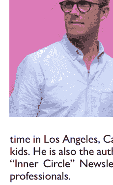

## 关于作者

怀着对技术、市场营销和销售的热情，阿隆·莱文（Aron Levin）共同创立了 Relatable，旨在赋能全球数百万内容创作者。客户包括 Adobe、Google、Volvo、Ralph Lauren、Chiquita、Heineken 等大型消费品牌，也包括 Lifesum、bioClarity、MVMT Watches 等勇于直面消费者的初创公司。

阿隆的履历还包括 King Digital Entertainment（《糖果传奇》Candy Crush 及 100 多款其他游戏的开发商），他曾在那里领导广告运营；他也曾担任音乐流媒体服务 Spotify 的增长总监。他在美国加利福尼亚州洛杉矶和瑞典斯德哥尔摩两地生活，与妻子和两个孩子共度时光。他还是《内容营销日历》（The Content Marketing Calendar）的作者，并主笔 Relatable 的“内圈”快讯，每周发布给超过 10 万名营销专业人士。

## 引言

网红营销死了吗？有效吗？值得吗？合乎道德吗？可持续吗？它是内容营销？付费媒体？公关？还是被过度炒作的潮流？它比数字广告更好吗？

全球最受欢迎的搜索引擎拥有“整合全球信息……”的企业使命，其自动补全功能让我们得以一窥世界在任何一个时间点对任何主题提出的问题。这些搜索建议，或者说预测（本段开头那些），让我思考网红营销行业的复杂性。

问题如此之多，答案也五花八门。然而，毫无疑问，我们生活在一个一切日益复杂的世界里，你无法跟上触手可及的所有信息——仅靠知识已经不够了。我们真正需要的是提炼后的智慧，而不是更多的信息过载。

如果你从事市场营销工作（无论是在品牌方还是代理机构），你读这本书很可能是因为你认为网红营销可以在你的业务中发挥重要甚至关键的作用。你很可能是一位营销专业人士、创始人或社交媒体创作者，亲眼目睹了网红营销的兴起，以及这种新的数字媒体格局如何改变了整个行业。

Revolve、Gymshark、Vanity Planet 等直面消费者的品牌，其精明的营销团队将这一转型化为优势，乘着网红营销的浪潮创造了数亿美元的收入。像 Color Factory、Museum of Ice Cream、Egg House 这样的艺术展览（或者，如果愿意的话，也可以称之为博物馆），几天内就能售出数十万张门票，而且要想在巨大的樱桃和棉花糖云背景前拍照，还得排队等上 6 个月。就连 Adobe、Volvo、Samsung 等传统品牌也在迅速跟进，重新考虑其媒体组合的分配方式，以赢得下一代消费者。

尽管这些公司和其他许多公司确实改变了整个行业，改变了我们对营销的思考方式，但它们完美的时机把握不应被误认为是运气。它们必须像其他人一样克服同样的障碍和挑战，提出同样的问题，而这些问题也把你带到了此时此刻。

考虑到这一点，我在接下来的八章中的目标是解构网红营销真正有效的原因，带你走进幕后，向你展示已经被证明在创作者与品牌之间的数千次合作中行之有效的精确方法论、结构和策略——从只有少数员工的初创公司到全球最大的品牌。

### 一万小时的实践

就个人而言，我一直很重视来自那些言行一致者的建议。在这一点上，值得注意的是，你读到的一切以及随之而来的所有策略都是基于第一手经验。我的公司 Relatable 已在 40 个不同国家、每一个你能想见的垂直领域³完成了超过 10,000 次网红营销合作（触达人数远超 5 亿）。

³ 如果你曾认为网红营销仅限于时尚或美妆品牌，你很快就会明白，这个领域远比想象中要深。

其中一些见解，是其他机构和行业专家可能不想让你知道的。可以说是行业专属的看家工具。把自己知道的一切都记录下来然后拱手送人，并不是标准的操作流程。尤其当你认为自己的业务优势有一部分就建立在掌握这些知识之上时，更是如此。甚至有人指责我透露太多，暗示这可能导致业务减少而不是增加。显然，我相信事实恰恰相反。此外，如今有很多关于透明度重要性的讨论。不幸的是，说出来的多，做到的少。相反，更常见的情况是，品牌方因合作伙伴过度承诺和使用行业术语而吃亏，这些合作伙伴没有对他们进行足够的教育。

在这样的时代，正确的做法是分享你知道的、希望能对他人有价值的东西，目的是尽可能帮助更多的人。这就是为什么从今往后，你只会得到全面、彻底的透明。如今，你通过向世界分享你所知道的来获胜，而不是通过保守秘密。这将加速我们行业的发展，并帮助创作者和品牌双方。

然后，在第三章“影响力是结果，而非职业”中，我们将剖析影响力真实且常被误解的内涵。我们会拆解影响力的三个关键杠杆；你将学会如何为你的品牌找到合适的意见领袖和创作者，以及为什么拥有你自己的达人资源库至关重要。

人们常说，没有策略的创意是艺术，而有策略的创意才叫广告。就我个人而言，我愿意相信伟大的广告一半是艺术，一半是科学，在第四章“创意的艺术与科学”中，你将学会如何使用一套经过验证的创意策略，应用于 Instagram 和 YouTube，打造强有力的营销活动。你将了解口碑传播的七大原则，以及撰写完美创意简报的秘诀。这是一章非常实用的内容，其中包含同样实用且强大的工具箱。在掌握了许多基础知识之后，我们在第五章“以创作者为中心的策略”中将事情提升一个档次。这一章中的概念不一定更高级，但它们确实为 influencers 营销提供了一个全新的视角，即完全聚焦于创作者在与品牌合作时想要什么，而不是反过来。

至此，我们已经走了很远，构建成功的影响者营销项目所需的许多组成部分和策略开始各就各位。不幸的是，品牌和创作者在准备加大活动规模时，也常常饱受由此产生的诸多限制之苦。第六章“规模化的一对一关系”揭示了七种强大的策略，它们将减少你80%的运营开支，并消除那些阻碍你前进的约束。在第七章“影响者营销四步框架”中，你将获得一个逐步指导的框架，将影响者营销转变为可扩展的媒体渠道，并与你的其他营销活动完全对齐。这个框架非常强大，尤其是在你希望将影响者营销项目与其他传统广告渠道进行比较时。

最后，在第八章“衡量重要之事”中，你将学会如何打击欺诈，如何利用付费媒体放大你的影响者营销效果，以及两个强有力的概念，它们将永远改变你对投资数字广告的思考方式：“未被追踪的大多数”和“YouTube 上的长期价值”。

## 对拿锤子的人来说，一切看起来都像钉子

最后，在继续之前，有件事我想说明一下。作为营销人员，你有一个工具箱。影响者营销是你可以使用的工具之一，但在你知道要建造什么（你的营销目标）之前，就挑出工具（渠道）是有风险的。这是营销专业人士中常见的错误。他们会在确定实际营销目标之前，就决定自己的目标是开展影响者营销项目。

尽管我会大力倡导你将影响者营销变成你最有价值的营销渠道，但不幸的是，没有一刀切的解决方案。人们很容易得意忘形，用类比或他人的例子来推理，但不要犯在知道要建造什么之前就挑选工具的错误。

因此，本书的很大一部分结构旨在帮助你理解影响者营销应用于你的媒体组合的各种方式，为何、如何以及何时对你适用和相关，以及何时不适用。

也许你读过这样的说法：“影响者营销的 ROI 高达 11 倍”，“你在影响者身上每花 1 美元就能赚回 7 美元”，或者“影响者营销比其他任何媒体渠道都能带来更好的结果。”

这些陈述和承诺绝对是真实的。有人，甚至很多品牌，确实获得了这些结果。但它们对你来说相关或适用吗？它们当然可能适用，但在你评估具体情况之前，我们不应该立即假设它们适用。事实上，任何具有巨大上行空间的策略都不完全无风险。即使你是顶尖选手，在取得巨大成功之前，你很可能会失败几次。这只是游戏的一部分！

## 致阅读本书的众多自由职业者、创作者和意见领袖

2017 年 10 月，Upwork 和自由职业者联盟发布了他们的“美国自由职业”⁵ 研究（由独立研究机构 Edelman Intelligence 进行）结果，发现超过 50% 的千禧一代工人在过去 6 个月内以某种自由职业的形式参与了经济活动。

如果你是一名设计师、摄像师、摄影师、作家、艺术家、模特或类似职业，按小时或项目出售作品或服务，而不是为单一雇主领取固定薪水工作，那么你就是自由职业者。如果你在 YouTube 或 Instagram 上为品牌创作内容，你也参与了这个快速增长的全球自由职业经济。根据目前的增长轨迹预测，到 2027 年，自由职业者预计将成为美国劳动力的主体。在不久的将来，“自由职业者”这个头衔将比其他任何工作的总和还要普遍。但不仅如此。Upwork 的研究还观察到，近一半（47%）的在职千禧一代已经是自由职业者，这一参与率高于任何其他代际。

归根结底：你作为多任务处理的自由社交媒体创作者的看似奇怪的工作，很快就会比找一份“正经工作”更常见。如果你属于这个群体，本书的内容将帮助你更好地理解当你与品牌合作时幕后发生的事情，以及他们的主要挑战和问题是什么。

你将比以往任何时候都更理解他们的观点，并变得更加以客户为导向。品牌会喜欢与你合作，不仅因为你创作了正确类型的内容，传递了正确的信息，面向了正确的受众，还因为你比他们见过的任何人都更理解整个流程。

你将成为一个宝贵的合作伙伴，同时始终领先于其他 1000 万争夺这个价值数十亿美元的影响者营销蛋糕份额的内容创作者。
