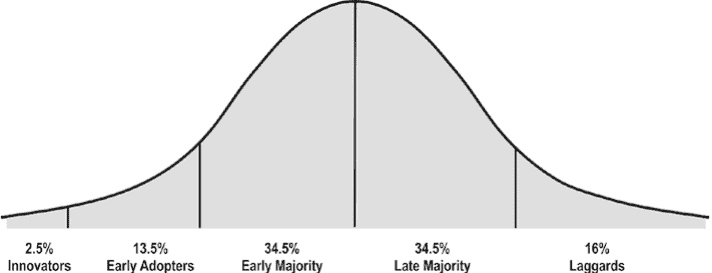
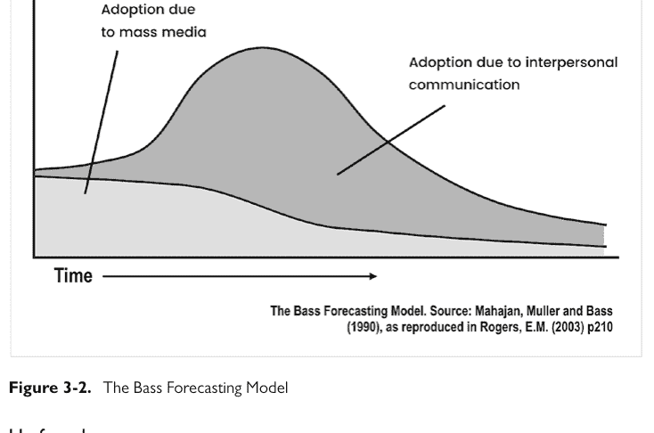
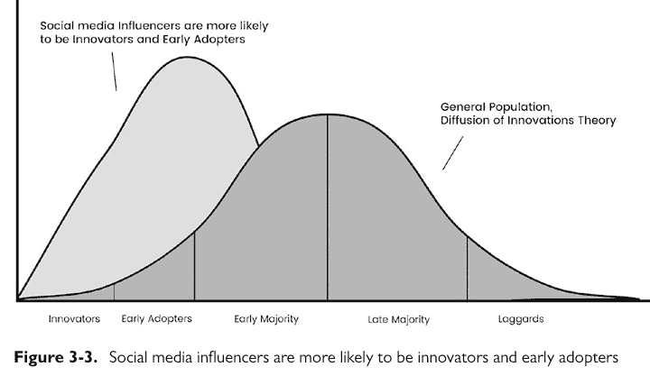
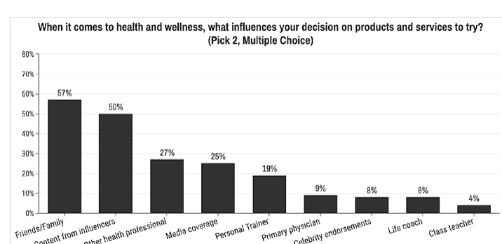
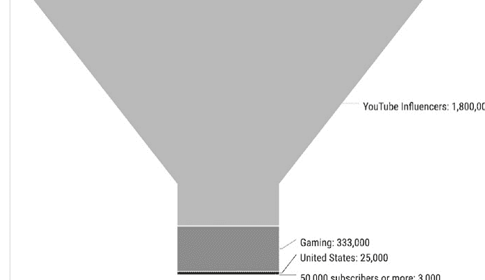
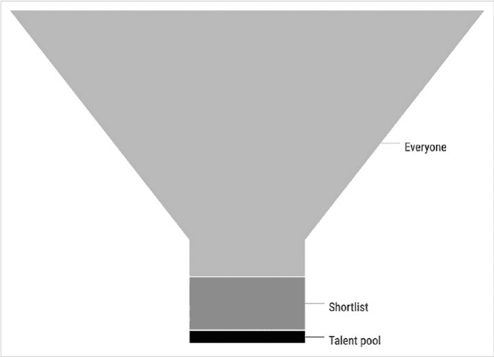
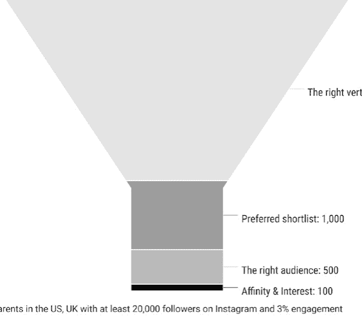
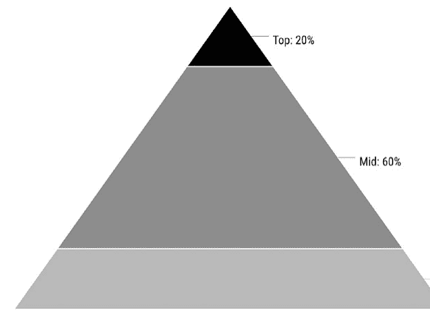
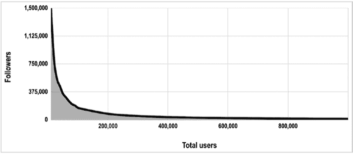
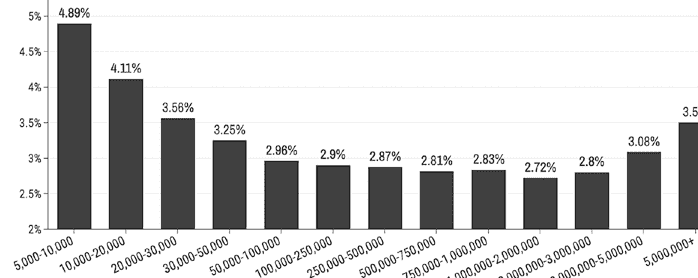

## 影响力是一种结果，而不是一种职业

语境、采用、影响力杠杆，以及如何为你的品牌找到合适的创作者

> *在一个选择无限的世界里，语境——而非内容——为王。*
>
> ——克里斯·安德森¹

**关键问题**  
我如何为我的品牌找到合适的影响者？识别合适的影响者时应该看重哪些特质？影响者是早期采用者吗？什么样的互动率才算好？

**核心原则**  
- 1. 影响力是一种结果，而不是一种职业。
- 2. 社交媒体创作者是早期采用者。
- 3. 拥有你自己的达人池。
- 4. 长尾的力量。
- 5. 创新的扩散。

¹ *长尾理论：为什么商业的未来是销量少而种类多*  
© Aron Levin 2020  
A. Levin，*品牌影响者营销*，  
https://doi.org/10.1007/978-1-4842-5503-2_3

影响你的决策。为什么？专业知识和可信度，是影响力的*第一个*杠杆。*第二个*杠杆是你与对方关系的强度。你们越了解彼此，效果就越好。我们信任朋友、家人以及与我们关系牢固的人。我们也与在线上关注或订阅的对象有着不同强度的关系。那位私人教练的受众规模，以及她能够触达的人数，起到了乘数的作用。这就是影响力的*第三个*杠杆。

### 公式

影响力 = 受众触达 × 亲和力（专业知识、可信度） × 受众关系强度（互动）

- 1. **受众触达**指受众的规模以及他们是谁。可以是订阅者、关注者或好友网络。
- 2. *亲和力（专业知识、可信度）*是确保你的信息或品牌具有亲和力、天然的喜爱或共鸣。它同样关乎专业知识和可信度，专业知识指“在特定领域的知识”，可信度指“被信任和被信服的品质”。我们将在第5章“以创作者为中心的策略”中更深入探讨创作者在与品牌合作时看重的特质。
- 3. *受众关系强度（互动）*关注的是受众与你有多亲近。如果关系较弱，受众就不会关注，信息获得的注意力和影响力也会很低。

当你为优化这三点而布局时，就更有可能打造出结果更好的影响者营销活动。

### 受众规模

*策略：受众优先*

确保你合作的创作者拥有与你的受众重叠的受众。确保你了解在特定关注者区间内有多少创作者，以及你所处市场的状况。

**关键问题：** *我们的目标受众是谁？谁的受众能帮助我们触达这一受众？我们合作的每个人应该拥有多大的受众规模？*

### 亲和力

*策略：人才独立*

YouTube上有超过200万个订阅者超过500人的频道。Instagram上有超过1000万拥有1000位关注者的创作者。与一个能够挖掘这整个潜在创作者群体，并帮你找到那些对你的品牌具有亲和力、专业知识和可信度的人选的伙伴合作。

关键问题：亲和力：我的品牌或营销信息是否有天然的喜爱或共鸣？专业知识：这个人是否在我所在的特定领域知识渊博？可信度：为什么这个人的受众会信任或相信他？在营销信息或你的承诺中，“值得相信的理由”是什么？

除非你完全独立运作，否则你很难为你的营销活动找到合适的人选。多频道网络（MCN）或艺人经纪公司只会推荐自己旗下的签约者，因而局限于他们代理的人；有时他们与你的品牌完美匹配，但有时并非如此。这并不一定意味着他们不好，但确实限制了他们帮助你建立专属于自己业务的人才库的能力（本章后面会深入讨论这一点）。

通过一种人才独立的方法来识别和引入合适人选，我们确保每次都能毫不妥协地让正确的人加入。

### 关系强度

*策略：优化互动*

互动是衡量关系强度的绝佳指标。它也是客观评估受众是否在关注你信息的好方法。要与互动水平出众的创作者合作。如何制定策略和策划活动，以实现出色的互动水平？这将在第4章“创意的艺术与科学”中更详细地讨论。目前，只需记住：互动将是一个

在寻找具有影响力的社交媒体创作者时，这是一个重要的变量。

关键问题：*我应该设定多少目标互动率？结合前两种策略来看，这个数字是否合理？*

与你的活动互动的人数，比你可能触达的人数更为重要。如果你的总体目标是尽可能触达更多人，这一点尤其正确。为什么呢？除非他们真正关注，否则你不太可能改变品牌偏好、购买意向、品牌提升度，或看到任何实际影响。只与那些拥有极高互动受众的创作者合作，你的活动将会产生更显著的影响。一份涵盖15个主要国家的综合互动率基准报告可在 rlt.to/engagement-countries 免费获取。利用报告中的洞察来帮助回答本节概述的关键问题。

## 领导者与追随者：作为早期采用者的社交媒体影响者

在20世纪60年代初，传播理论家、俄亥俄大学助理教授埃弗雷特·罗杰斯注意到，思想、创新和新技术在文化和社会中传播时，会遵循相似的模式。

罗杰斯提出了他的*创新扩散*理论，并在1962年出版的著作《创新扩散》中发表了他的研究发现。在这本书（现已出版至第5版）中，罗杰斯解释了新思想和技术如何、为何以及以何种速度被社会吸收，以及*创新*如何在人群中扩散³。对于许多（如果不是*大多数*）营销人员来说，开发能在社会或特定人群中广泛传播的新想法，正是我们工作的定义。因此，埃弗雷特·罗杰斯发表的研究成果中，蕴含着几条宝贵的营销经验。

其中几条很可能已在你的组织内部被广泛*采用*（明白了吗？）。罗杰斯提出，任何新创新的采用者可分为五个不同阶段：创新者（2.5%）、早期采用者（13.5%）、早期多数（34%）、晚期多数（34%）和落后者（16%），在数学上呈钟形曲线分布。见图3-1。

³ 定义为某事物更广泛传播的过程或状态

# 第3章 | 影响力是结果，而非职业

**图3-1.** 产品采用与创新扩散

不同细分群体有不同的需求，每个采用者接受你创意的可能性，取决于你对他们独特特征、需求、态度、推理方式等的理解。例如，罗杰斯发现，*创新者*和*早期采用者*往往会传播信息，促使更多人接受该创意，直到创意最终达到临界规模，或市场饱和点。

不同群体及其关键特征描述如下：

### 创新者（2.5%）

创新者是热衷者和冒险者，他们接受高度不确定性。他们行动迅速，欣赏技术、创新、新想法等，并因其本身而重视它们。他们被成为变革推动者的想法所激励，几乎痴迷于冒险精神，受鲁莽、大胆和风险欲望的驱动。

创新者通常不被当地系统中的其他成员所尊重。创新者是新想法的守门人，因此在采用过程中扮演着重要角色。

### 早期采用者（13.5%）

通常是远见者、榜样和潮流引领者。根据埃弗雷特·罗杰斯的说法，这一采用者类别拥有最高程度的意见领导力。他们是“需要咨询的人”，其他人通常会向这一群体寻求有关创新或新想法的建议和信息。虽然创新者受冒险欲望（以及可能犯错的风险）驱动，但早期采用者知道，在为新想法盖章认可之前，他们需要无可挑剔的判断力。

早期采用者通常是试用新创新的绝佳测试对象，因为他们在创新性上不会领先于普通人太远。

### 早期多数（13.5%）

早期多数群体的成员比早期采用者更为谨慎，他们通过采用已被他人验证的解决方案来避免风险。他们倾向于避免复杂性，可靠性是一个重要考虑因素。他们关注（并追随）趋势，但他们的采用过程更为深思熟虑。这并不意味着早期多数不喜欢新产品——只是他们不像前两个群体那样对其感到兴奋。

罗杰斯通过研究得出结论，属于早期多数的人不太可能担任意见领袖职位。很容易理解为什么营销人员和品牌痴迷于吸引早期多数：他们占据你整个市场的三分之一，并且更有可能坚持使用他们喜欢的产品，反复购买。从这个意义上说，他们不同于早期采用者，后者喜欢尝试新事物。

### 晚期多数（34%）

当向这一群体营销时，你面对的是总潜在市场的后一半。晚期多数成员较为保守，会在整体群体的平均成员之后才采用新想法。他们对创新者和早期采用者持怀疑态度，需要在感到足够安全做出决定之前获得完全的确定性。他们的决策过程比前几个群体更慢，受必要性、价格敏感性和社会中他人的同伴压力驱动。

### 落后者（16%）

落后者对创新持怀疑态度（并且抗拒创新）。从他们的角度看，这是一个理性的观点，因为他们的资源有限，必须确信新想法不会失败才能采用。他们的参照点往往是过去（“我们一直都是这样做的！”），并且他们倾向于与意见领袖隔绝。

落后者重视可信度、可得性和简单性——进一步研究表明，这一群体与较低收入和较低教育水平之间存在强相关性。因此，价格（以及等待降价或促销活动）在他们的决策过程中很重要。

这些内容看起来应该很熟悉，甚至很基础，因为这些研究结果已经存在并被大多数营销专业人士广泛接受超过50年。然而，深入探究创新扩散理论，你会开始看到它与影响者营销的有趣相似之处。他书中一个重要（且适用）的观点是点对点网络的重要性，以及传统大众媒体是传播*信息*的有效方式，而个人之间的对话则传播*采用*。见图3-2。

图3-2. 巴斯预测模型

## 他发现：

> 虽然大众媒体渠道通常是告知潜在采用者群体某项创新存在的最快速、最有效的途径，但人际渠道在说服个人接受新想法方面更为有效，尤其是当该渠道连接两个或更多在社会经济地位、教育或其他重要方面相似的个体时。

罗杰斯继续写道：“大多数人主要依赖于从其他与他们相似的、已经采用了该创新的个体那里获得的关于创新的主观评价。”⁴

*同伴网络*的概念是创新扩散理论的基本要素，也解释了影响者营销为何以及如何如此有效。创新者和早期采用者实际上成为意见领袖（或*有影响力的个体*），点燃了最初的“起飞”采用过程，推动创意的采用以达到临界规模。

⁴埃弗雷特·M·罗杰斯，《创新扩散》，第5版（自由出版社，2003年）

那么，如何识别与你的营销目标相关的关键意见领袖呢？罗杰斯提出，通常有七个关键特征能将意见领袖区分开来：

- 1. 意见领袖比其追随者更频繁接触大众媒体。
- 2. 意见领袖比其追随者更“国际化”。他们是“边缘人物”，能够将社交群体之外的新想法带给群体成员。
- 3. 意见领袖比其追随者与变革推动者有更多接触。
- 4. 意见领袖比其追随者有更高的社会参与度。
- 5. 意见领袖比其追随者拥有更高的社会经济地位。
- 6. 意见领袖比其追随者更具创新性。
- 7. 当社会系统的规范支持变革时，意见领袖更具创新性；但当系统规范不支持变革时，意见领袖并非特别创新。

## 什么是“变革推动者”？

变革推动者是指影响客户创新决策、使其朝着变革机构所期望方向发展的个人。变革推动者通常寻求确保新想法的采用，但也可能试图减缓扩散过程，并阻止某些具有不良影响的创新被采用。

> ——《创新扩散》，第5版（2003年）

思考这些特征如何与影响者营销以及为你的品牌或营销信息识别合适的创作者、社交媒体影响者和大使相关联，但注意不要将创新者误认为意见领袖。意见领袖有追随者，而创新者是最先采用新想法的人，且常常被视为偏离常规者。

如果网红确实是早期采用者，那么他们更有可能属于创新者和早期采用者类别，而不太可能属于早期大众、晚期大众和落后者类别。表 3-2 显示了我们的发现。

## 表 3-2. 采用情况比较（网红、普通人群）

| 组 | 网红 | 普通人群 | 差异 |
|---|---|---|---|
| 创新者 | 29% | 2.5% | +1040% |
| 早期采用者 | 48% | 13.5% | +255% |
| 早期大众 | 21% | 34% | -37% |
| 晚期大众 | 1% | 34% | -97% |
| 落后者 | 1% | 16% | -93% |

钟形曲线突然向左压缩，有 29% 的网红将自己识别为创新者，48% 将自己识别为早期采用者（图 3-3）。在分布曲线的另一侧，他们不太可能属于晚期大众或落后者阶段，高达 96%（2% 对 50%）。

## 图 3-3. 社交媒体网红更有可能成为创新者和早期采用者

与人口平均水平相比，以及导致发现创新扩散理论的研究，社交媒体网红另一方面更有可能成为创新者 10 倍，更有可能成为早期采用者 2.5 倍。

这很 remarkable，并表明网红营销不仅可以复制传统大众媒体渠道传播信息的特征，还可以推动个人之间的对话，从而推动采用。

简而言之，社交媒体网红是早期采用者。既然如此，如果你相信创新扩散理论，他们对早期大众的影响程度大于晚期大众或落后者的成员。同一研究项目还揭示了一些其他有趣的见解，其中包括另一个重要问题的答案：谁影响那些有影响力的人？

## 你信任你的医生吗？

“比任何其他香烟，更多的医生吸 Camel” 是一则标志性（而且极具误导性）的 1946 年印刷广告，在美国总共刊登了 8 年。

在这段时间里，从 1930 年代到 1950 年代后期，医生、医师和穿着白大褂的模特经常被主要烟草公司聘请，宣称他们的致命产品“正是医生所开的！”同时在包装上贴上“医生推荐”的标签。

幸运的是，烟草巨头现在不允许在广告中使用任何此类做法，并且被禁止使用某些广告手段，并受到 FDA 和其他监管机构的严格监管。很明显，使用医生或医师等权威人物在当时为何如此有效，但这让我想知道——在当今的这些职业中，权威人士是否对趋势制定者、网红、创新者和早期采用者所采用的产品或服务具有重大影响？如果是，影响程度如何？

回到上一节提到的研究项目，问卷的下一部分专注于一个特定类别：健康与 wellness。选择这个特定垂直领域的原因是有一个假设：除非参与者置身于适用的情境中，否则他们很难正确识别什么会影响他们的决定。影响毕竟是非常情境化的。

例如，你可以假设你的医生对你对音乐的偏好影响有限，而在你的健康情境中影响更大，等等。

但这正是调查结果令我们惊讶的地方。见图 3-4。

## 图 3-4. 影响产品采用的因素

虽然影响是情境化的，但我们的朋友、家人，以及值得注意的是，其他社交媒体网红的排名超过了健康专业人士、个人教练和主治医师的总和！

## 到底发生了什么？

自 1960 年代以来，世界发生了很多变化。虽然烟草巨头的“医生推荐”标签已被外科医生总署的癌症警告所取代，但 1962 年《创新扩散》首次发表的见解今天比以往任何时候都更相关。影响可能是情境化的，信任在其方程式中发挥着重要变量的作用，但你还记得本章上一节中关于点对点网络重要性的摘录吗？

早期大众依赖于他们从与他们相似的人那里获得的信息，这些人已经采用了创新，而正如你所学到的，社交媒体网红很可能成为创新者和早期采用者——不仅在他们之间推动采用，而且特别是在早期大众中。你想影响那些有影响力的人吗？推动那些推动早期采用的人的采用吗？与他们的朋友、家人和他们关注的其他创作者保持联系。

请记住，这些见解特定于回答调查的人群（平均而言，该人是社交媒体用户，平均拥有 75,000 名粉丝），不一定反映普通人群，以帮助你了解如何影响那些有影响力的人。

## 找到合适的创作者

> “我该如何为我的品牌找到合适的网红？”

有大量平台和工具可以帮助你找到适合营销需求的合适创作者或网红。那么为什么这仍然是一项具有挑战性的任务呢？早在 2016 年，我的公司就着手发现 Instagram 和 YouTube 上到底有多少才华横溢、富有创造力、有影响力的人。

以与 Google 构建其搜索引擎技术类似的方式爬取网络，我们确定了 Instagram 上拥有超过 1,000 名粉丝的约 1000 万创作者，以及拥有 500 名订阅者或以上的 200 万 YouTube 频道。现在，1000 万人听起来很多，但在拥有超过十亿活跃用户的 Instagram 平台上，你实际上是在一个位于前 1% 的干草堆中寻找一根针。

而且，这 1000 万潜在创作者（或 200 万 YouTube 频道）中的大多数与你的品牌无关。考虑一下表 3-3 中 YouTube 频道类别的这个细分。

| 频道类别⁵ | 频道 | (%) |
|---|---|---:|---:|
| 人物和博客 | 411,296 | 24% |
| 游戏 | 333,997 | 19% |
| 娱乐 | 246,981 | 14% |
| 音乐 | 206,981 | 12% |
| 电影和动画 | 122,273 | 7% |
| 喜剧 | 75,269 | 4% |
| 教育 | 66,267 | 4% |
| 如何做和风格 | 66,121 | 4% |
| 体育 | 51,481 | 3% |
| 科学和技术 | 35,315 | 2% |
| 汽车和车辆 | 32,647 | 2% |
| 旅行和活动 | 28,110 | 2% |
| 新闻和政治 | 26,335 | 2% |

表 3-3. 按类别划分的 YouTube 频道

YouTube，2019 年 9 月

⁵ 由该特定 YouTube 频道的拥有者定义

## 表 3-3.（续）

| YouTube，2019 年 9 月 |
| 频道类别⁵ | 频道 | (%) |
| 非营利组织和行动主义 | 19,834 | 1% |
| 宠物和动物 | 17,700 | 1% |
| 节目 | 1,061 | 0% |
| 电影 | 119 | 0% |
| 预告片 | 116 | 0% |
| 分析数据集中总计 | 1,741,903 | 100% |

如果你想与游戏类别的 YouTube 创作者合作，你突然将潜在人才库缩小了 80%。想要该特定类别中的频道位于特定市场，例如美国？突然间，你将其缩小到另外只有 25,000 个频道或所有游戏频道的 8%。按至少 50,000 名订阅者筛选后，只剩下 3,000 个频道。见图 3-5。

## 图 3-5. 自上而下的漏斗，YouTube 频道

好吧……3,000 个 YouTube 游戏频道，位于美国，至少拥有 50,000 名订阅者。从绝对值来看，这仍然很多，但相对于我们开始的地方，你已经消除了 99.9%。这种自上而下的方法是衡量机会规模和评估识别符合你标准的才华可能性的非常有效的方式。

作为参考，我在此包含了 Instagram 的相同数据集，这里显示的是拥有超过 1,000 名粉丝且公开资料的账户，见表 3-4。

表 3-4. Instagram 上的类别

Instagram，2019 年 9 月

| 类别 | 计数 | 份额 |
|---|---|---|
| 时尚 | 1,151,290 | 14% |
| 摄影 | 731,203 | 9% |
| 美容/化妆 | 555,295 | 7% |
| 旅行 | 527,974 | 6% |
| 健身 | 504,017 | 6% |
| 名人 | 469,046 | 6% |
| 奢华生活方式 | 384,767 | 5% |
| 商业 | 383,835 | 5% |
| 食物 | 375,525 | 5% |
| 商业和企业家 | 370,686 | 5% |
| 学院 | 322,869 | 4% |
| 模特 | 305,284 | 4% |
| DJ/音乐 | 302,139 | 4% |
| 品牌 | 295,482 | 4% |
| 父母 | 292,896 | 4% |
| 体育 | 187,704 | 2% |
| YouTuber | 168,967 | 2% |
| 舞者/表演者 | 150,269 | 2% |
| 室内设计 | 122,015 | 1.5% |

（续）

6 请注意，这些不是 Instagram 官方认可或使用的类别，而是基于常见内容类型的分析和分类。尽管如此，我认为该表在方向上应被认为高度准确。

表 3-4. *（续）*

**Instagram，2019年9月**

| 类别⁶ | 数量 | 占比 |
|---|---:|---:|
| 纹身 | 117,272 | 1.4% |
| 婚礼 | 103,394 | 1.3% |
| 动物 | 99,460 | 1.2% |
| 糕点 | 57,127 | 0.7% |
| 冲浪 | 32,209 | 0.4% |
| 赛车运动 | 26,331 | 0.3% |
| 滑板 | 22,610 | 0.3% |
| 房地产 | 21,291 | 0.3% |
| 表情包/搞笑 | 19,238 | 0.2% |
| 园艺 | 12,338 | 0.2% |
| 真人秀 | 12,190 | 0.1% |
| 手工艺 | 9,329 | 0.1% |
| 语录/励志 | 6,664 | 0.1% |

考虑到这一点，本节其余部分将重点帮助您尽可能找到最适合品牌的人才。我们将聚焦于您在为营销活动寻找合适人才时需要关注的变量、特征、方法论和问题——然后您可以寻找能够满足您需求的合适工具、平台或合作伙伴。

## 建立属于您的人才库

如您所见，YouTube和Instagram等平台上有着数以百万计的有才华、有影响力的内容创作者。尽管通过使用相关的筛选条件（如类别、触达范围、互动率、人口统计特征、受众，甚至品牌亲和力）来缩小搜索范围，您仍不禁会怀疑这是否是一种可持续的长期策略。结果本身没有问题，但这种方式意味着您每次都要从零开始，非常耗时且效率低下。那么，您如何在这场浩如烟海的数据中大海捞针的游戏中取胜呢？

您需要玩一种不同的游戏。

与其为某个特定的营销目标或活动踏上寻找创作者和意见领袖的征途，您的短期和长期目标应该是建立自己的达人资源池。不要将其误认为大使计划（尽管这确实可能是结果之一），人才库就是一组您可以长期和短期激活的个人，以满足您的业务和营销目标。这种方法还有几个额外的好处（如下所述），并将降低您在影响者营销上的整体成本、时间和精力。

自上而下的漏斗方法与前面提到的方法类似，但结果截然不同（图 3-6）。

**图 3-6.** 自上而下的漏斗，人才库

## 人才库框架

人才库策略的最终目标是*提升*您的执行速度、质量、竞争优势和商业影响力，并实现规模经济。同时，您将*减少*内部政治斗争、风险，以及来自其他品牌争抢同一批创作者的直接和间接竞争。最棒的是什么？在我看来，这项工作可以而且应该在一切具体的上市策略和营销活动之前，甚至在任何已批准的媒体预算之前就充分展开。您的最终目标是在任何潜在活动或营销计划之前，建立一个由有才华的创作者或意见领袖组成的人才库。这可以与实际活动结合，但并非必须如此。我将通过一个虚构但真实的例子，带您走完整个过程。

## 直营母婴产品品牌

市场：美国、英国
目标受众：千禧一代父母
潜在目标：内容创作、用户考量、网站销售
目标：在Instagram上建立100位创作者的人才库

我想先从研究最终目标开始。我了解我的品牌、市场、受众、目标和指标。在这个例子中，我希望在Instagram上建立一个100位创作者的人才库，可以短期或长期激活。

## 研究最终目标

- [ ] 人才初选名单已获得所有相关利益方的批准。
- [ ] 为每一位人选制定好了薪酬结构。
- [ ] 他们的价值观、风格和内容与我的公司或营销目标一致。
- [ ] 互动率、触达范围和其他相关关键绩效指标与我们的潜在目标相符。
- [ ] 人才库的受众是正确的目标受众。
- [ ] 响应性和亲和力——明确表达了与我们合作的兴趣。
- [ ] 专有的漏斗洞察（例如，谁带来了销售、品牌提升、内容贡献等）。

如果目前觉得这一切难以实现，不要担心如何落实，我们稍后会详细讨论。我们要做的第一件事是识别整体机会。与我们之前关于YouTube上游戏频道的例子类似，这是一种自上而下的方法。不一定非得如此，但我发现这种模式比相反的方式更有效。见图 3-7。

*美国、英国的父母，在Instagram上拥有至少2万名粉丝和3%的互动率

## 图 3-7. 自上而下的漏斗，Instagram示例

如您所见，在我们的垂直领域中，总共识别出2,665位潜在创作者。他们是位于我们目标市场的父母，拥有可观的粉丝数量和互动积极的受众。他们不一定与我们的价值观和受众群体完全契合，甚至不一定有兴趣与我们合作，但这仅仅是个起点。

这可能一开始让人望而生畏（特别是如果您从未与合作伙伴、软件即服务或在线平台合作过），但请相信我——您会比想象中更快速地将广泛的选择范围缩小为一份精炼的入围名单。而且您正在为长期与这个人才库合作奠定基础，因此前期的投入是值得的。您正在解决第一个瓶颈，以解锁一种有效且可扩展的影响者营销方法——不仅仅是针对一场活动，而是着眼于未来多年。

在微观经济学和商业中，规模经济的概念是指当公司增加生产或产出时，应能实现单位成本的降低。这个概念同样可以应用于影响者营销，以提高您的效率。单位成本的降低源于总产出的增加。规模化通过诸如与顶尖表现人才建立长期合作等策略来降低成本，而构建可持续人才库的长期方法（而非一次性的活动）会降低您的整体成本。

当您缩小选择范围时，特别是如果您的团队不止一个人，您必须确保对风格、多样性、情感倾向、价值观等方面有明确的定义。没有什么比团队中一半人反对另一半人认为完美的方案更糟糕的了。如果其他团队的利益相关者也提出意见，请确保他们的反馈得到客观评估。

在这个虚构的例子中，我的下一步是分析我更倾向的入围名单的受众。为此，我会使用一家专门分析和描绘社交媒体受众及人口统计特征的第三方公司或工具。比如Demographics Pro⁷、HypeAuditor⁸，以及我自己公司提供的受众洞察工具⁹。

值得祝贺。我们已经确定了一大群我们愿意合作的有才华的意见领袖和创作者。您的其他内部利益相关者已经批准了您的入围名单（呼！）——一个常见的瓶颈和耗时点，在可预见的未来被消除了。您和您的团队现在可以比以前更快地执行。但请记住，我们的最终目标是建立一个100位创作者的人才库，既要提升影响力，又要减少摩擦。事情已经在推进，但最好的还在后头。

## 双向选择

2019年8月，我的公司对来自67个国家的2,000多名意见领袖进行了调查，以了解他们在寻求与品牌合作时的决定因素。

**表 3-5.** 品牌合作的决定因素

| 因素 | 受访者比例 |
|---|---:|
| 报酬多少 | 14% |
| 我了解他们的产品/服务有效 | 27% |
| 我之前听说过他们的品牌 | 3% |
| 他们的核心价值观与我的相符 | 34% |
| 他们给予我创作自由 | 23% |

诸如金钱、名气甚至创作自由等因素，都被拥有共同核心价值观这一因素所超越。这并不意味着其他因素可以被忽视，但这恰恰表明，为您的品牌寻找合适创作者的严格筛选过程，其成败同样取决于一个同样严格的……

vetting process of your brand. Additionally, you’ll create a massive unfair advantage for your company if you can demonstrate to influencers and creators that you understand their point of view, something we’ll cover in depth in Chapter 5: Creator-Centric Strategies.

Thus far, we’ve narrowed down our selection by roughly 80%, from 2,665 to 500 creators. They fit the criteria of our talent pool to perfection. Let’s see if the same can be said about our brand. If you examine the top-down funnel numbers outlined in the beginning of our fictitious example, you’ll notice that we’ve planned for a final steep drop-off. As outlined in our previous checklist, you’ll want to identify who’s responsive and share your core values along with a clearly expressed interest in working with your brand. We took a pass on roughly 80%, so it’s only fair to assume that 80% of creators will do the same with us. It’s perfectly understood if the process of reaching out to hundreds of influencers just to have them qualify you may seem overwhelming or even impossible, especially with all the previous work leading up to this stage. We’ll cover exactly how to engineer each step of the way in Chapter 6: Relationships at Scale. You’ll probably be surprised when you realize how easy this part actually is.

Remember, the goal is to have those on your final shortlist raise their hand and let you know if they want to work with your brand as much as you’d like them to work with you. This is also an opportunity to identify other variables that can’t be assessed without their input. Do they work out at a local gym? Go to festivals? Like their current smartphone? Own a smartwatch? Use Cannabis? Drink alcohol? Eat meat? Plan to renovate their bathroom? Yes, these are all real examples. And when you know the answer, and they’ve raised their hand and confirmed that your values are aligned with theirs, you’ll never have to look for a needle in a haystack ever again.

## From commodity to valuable asset

By narrowing your search from millions, to thousands, to hundreds, you’re playing a different kind of game. You now have a talent pool of creators, or influencers, “owned” by your company. Rightfully, these amazing individuals don’t “belong” to you in any shape or form, but you’ve transformed a commodity into a valuable asset. But this is just the starting point.

Let’s assume that you activate all 100 influencers in your talent pool for a campaign where the goal is to drive sales on your website. Each campaign participant is given a promotional code that their followers can use when they shop on your website. After a week, you analyze the outcome of your campaign. Suddenly, you have a data point and insight that nobody on the planet had last week. You know who sold products and who didn’t. You know who the bottom 20% are (that you likely shouldn’t engage for a second similar campaign with a similar objective), who the middle 60% are (that help you establish an average benchmark), and who your top performers, the top 20%, are (most valuable distribution, undervalued assets). See Figure 3-8.

Figure 3-8. From commodity to valuable asset

The same principle can be applied to measure other marketing funnel KPIs like reach, brand lift, website traffic, engagement, lead generation, or app installs. If you were to replicate the very same campaign, with the very same structure, and change nothing but to exclude the bottom 20%, you’ve suddenly skewed the odds to somewhat in your favor. Double down on the top 20%, and you’re Billy Beane in Moneyball.¹⁰

## The power of the long tail

Amazon, Spotify, and Google have all built their companies on the premise of the long tail. The concept, in the context of business, was popularized in 2004, when Wired editor-in-chief Chris Anderson published an article entitled “The Long Tail.”¹¹

In his article, Anderson argues that our culture and economy is shifting away from a focus on a relatively small number of hits (the head of the demand or distribution curve) toward an infinite, or at least rapidly expanding, number of niches in the tail (collectively with a larger market share than the head). He expanded his reasoning and published a book in 2006, The Long Tail: Why the Future of Business Is Selling Less of More. The book entered the New York Times bestseller list the same year, and the theory of the long tail has since been commonly adopted in business, economics, and marketing to explain how a sufficiently large number of niche players (books on Amazon, songs on Spotify, and web pages on Google) can compete with the large powerful few—in a world where markets are decentralized to match unlimited variety of both supply and demand.

I’ve been fascinated by the long tail since Anderson first published his book, and his theories have personally given me an edge more than once, specifically in web development, e-commerce, and search engine optimization. As such, when co-founding our business in 2016, some 10 years after the book made the bestseller list, I couldn’t help but wonder if the very same reasoning could be applied to the world of influencer marketing.

Likely, there’d be a small number of *hits* (social media creators with millions of followers) and a collectively larger number of niches in the tail (social media creators with tens of thousands of followers). Tables **3-6** and **3-7** are based on analysis conducted across the 12,000 most popular social media accounts on Instagram¹² and validate this thesis. There’s a clear head (500 creators with more than 10 million followers) and tail (12,000 creators with more than 1 million followers), and that’s just the tip of the iceberg. Go further down the tail, and it’s evident that the market share of the tail clearly outweighs the head (detailed in Figure **3-9**)—and this makes all the difference in the world for us marketing professionals.

**Table 3-6.** Distribution of creators with more than 1 million followers on Instagram

| Followers | Total Creators |
|---|---:|
| 10,000,000 | 500 |
| 9,000,000 | 600 |
| 8,000,000 | 700 |
| 7,000,000 | 800 |
| 6,000,000 | 1,000 |
| 5,000,000 | 1,300 |
| 4,000,000 | 1,800 |
| 3,000,000 | 2,700 |
| 2,000,000 | 5,000 |
| 1,000,000 | 12,000 |

**Table 3-7.** Distribution of creators with between 10,000 and 1 million followers on Instagram

| Followers | Total Creators |
|---:|---:|
| 1,000,000 | 12,000 |
| 900,000 | 13,500 |
| 800,000 | 15,500 |
| 700,000 | 18,000 |
| 600,000 | 22,000 |
| 500,000 | 27,000 |
| 400,000 | 35,000 |
| 300,000 | 50,000 |
| 200,000 | 80,000 |
| 100,000 | 160,000 |
| 90,000 | 190,000 |
| 80,000 | 210,000 |
| 70,000 | 250,000 |
| 60,000 | 300,000 |
| 50,000 | 350,000 |
| 40,000 | 450,000 |
| 30,000 | 550,000 |
| 20,000 | 820,000 |
| 10,000 | 1,500,000 |

**Figure 3-9.** The power of the long tail

See, consumers didn’t just turn their back on the old model of one-size-fits-all mass appeal—they turned toward something they liked better, something they welcomed with open arms. For the very first time in their lives, unlimited variety of supply meant that there was that *perfectly tailored something* for *everyone*. When consumers have the option to choose what they paid attention to, they naturally pay more attention.

Between 2015 and 2018, several marketing research companies, influencer marketing agencies, and social media platforms reported that the real power of influencer marketing sits with social media creators on Instagram with a smaller following, loosely referred to as “micro-influencers.”

> “Micro-Influencers Are More Effective With Marketing Campaigns Than Highly Popular Accounts” reads the headline of an article published by Adweek in 2017.[^13]

During the same time, around 2017, I drew the same conclusion. The fewer followers you have on social media, the more engaged the audience. It makes sense when you think about it, as per the theory of the long tail and unlimited variety of supply. This meant two things for marketers. First, there’s a greater supply of content creators found in the long tail. Secondly, their audiences are paying closer attention to what they’re doing. On the flipside, you’d have to collaborate with a much larger collective of creators to make up for the limited reach and sheer size of each individual audience.

But then, that very same year, something happened: Instagram and its parent company Facebook began, quite literally, to *move things around*. With its most recent update, the order of the posts on a user’s feed would no longer show up in chronological order. Instead, their algorithm would switch the order of the posts on a user’s feed into what they think each account would like. It sparked some controversy at the time (changing the familiar seems to have that tendency), but came with intentions to improve the way its users experienced their product. The official announcement from Instagram, accurately titled “See the Moments You Care About First,” explained that as Instagram had grown, its users had begun to miss out on as much as 70% of their feeds, including posts they’d actually care about the most.[^14]

With complex algorithms in charge of serving its users with engaging content, something interesting happened with the long tail. Suddenly, content creators and influencers with both smaller and larger following began (at an aggregated average, I should note) to see greater attention[^15] from their audiences. See Figure 3-10.

¹⁰ Billy Beane, the baseball general manager whose story was the subject of Michael Lewis’ bestselling book Moneyball: The Art of Winning an Unfair Game

¹¹ www.wired.com/2004/10/tail/

[^13]: https://www.adweek.com/digital/micro-influencers-are-more-effective-with-marketing-campaigns-than-highly-popular-accounts/

[^14]: https://instagram.tumblr.com/post/141107034797/160315-news

[^15]: Engagement rate measured by total comments and likes divided by followers

## Instagram 互动率基准，2019年2月

图 3-10. Instagram 互动率基准，2019年2月

正如图 3-10 左侧所示的图表所指出的那样，你的受众规模与其参与度之间存在明显的关联，但这只是真相的一半。看向图表的右侧，互动不仅趋于稳定，而且有所增加。这就是 Instagram 算法的运作方式，它为用户提供他们最关心的帖子。那么，长尾失去了它的力量吗？头部是否突然比尾部更有力量？根据图表来看，与拥有 500 万粉丝的网红合作——其受众的参与度与拥有 50,000 粉丝的人一样高——似乎是不言而喻的。矛盾的是，这一结论会让你走上错误的道路。乍看之下似乎矛盾，长尾的力量比以往任何时候都更大。但请记住，这些数字是汇总的平均值。可能有更多拥有更大粉丝群且受众高度参与的社交媒体创作者，但他们并不多。考虑以下内容：

| 组别 | 粉丝数 | 平均互动率 | 总创作者数 |
|-------|-----------|--------------------|----------------|
| A | 5,000,000+ | 3.5% | 1,300 |
| B | 50,000–100,000 | 3% | 175,000 |

平均而言，如果你忽略每个组别的创作者总数，A 组将是明显的赢家。但忽略了群体的规模，你就无法认识到尾部的规模大于头部。更好的问题是，在 B 组中，互动率至少为 3.5% 的创作者有多少？答案超过 48,000 名。也许这是一种不公平的操纵统计数据的方法，但请记住，我们是营销人员，而不是数学家。

10% 互动率如何？仍然有 8,700 名创作者可供使用。与此同时，全球范围内拥有 500 万粉丝和 10% 互动率的用户只有 59 个。互动仍然存在于长尾中；你只需要看得更仔细。

### 关键问题

- 如何为你的网红营销活动挑选合适的创意策略？
- 有效简报的关键要素是什么？
- 如何创建更有可能产生口碑传播的活动？

### 核心原则

- 1. 优秀的营销既是科学也是艺术。
- 2. Instagram 上经过验证的创意执行。
- 3. 创意策略评分卡。
- 4. YouTube 上经过验证的创意执行。
- 5. 17 个用于高度有效的简报的问题。
- 6. 口碑传播的七大原则。

创造力——以及将新颖而富有想象力的想法变为现实的行为——是一种罕见的艺术形式。在营销中，它往往是区分一个想法能超越其创造者与一个想法从未见天日的界限。而出色的营销虽然是一种真正的艺术形式，但它也是一种科学。

很难为创意工作勾勒出一个万无一失的框架，因为这个词本身的定义就是“想象原创想法”。考虑到这一点，我在本章中的任务将是概述科学（策略）和艺术（灵感）两方面。你的任务是将它们融合起来创造魔力。

你将学习 14 种适用于 Instagram 的经过验证的活动策略，以及在 YouTube 上创建内容的 9 种不同方式。我甚至会给你一个科学模型，告诉你如何每次都挑选正确的活动策略。我们将在第 7 章《四步网红营销框架》中重返这些创意策略，你将在那里看到一切如何融合在一起。你将学习口碑传播的七大原则——以及如何将每个原则与你的创意策略结合起来。然后，我将分解我们在公司内部使用的简报模板的组成部分，该模板在网红与品牌之间超过 10,000 次合作中使用。准备好了吗？

## 导致创造力的七个问题

以下问题（详见第 7 章《四步网红营销框架》）可以帮助激发你的创造力，并确定一条能与创作者、他们的社区和你的客户产生共鸣的信息。

- 1. 你对目标受众或你的行业有什么独特的见解吗？
- 2. 基于这些见解，机会是什么？
- 3. 现在文化中流行的、相关的事物是什么？
- 4. 什么能与你的受众在更深层次上建立联系并跨越文化界限？
- 5. 什么能与公众建立情感联系？
- 6. 什么能成为讨论话题，因为它具有共鸣和意义？
- 7. 什么能吸引、两极化、挑衅或娱乐创作者的受众？

## Instagram 上 14 种经过验证的创意执行

你可以在 Instagram 上让某人发布一张与产品植入和折扣代码的自拍的日子并不一定已经结束——但它肯定没有 2012 年那么有效了。那一年，Instagram 有 1000 万用户。快进到 2018 年中期，这个数字已增长到 10 亿月活跃用户¹。平台发生了演变，品牌利用该平台与最有才华、最有影响力的创作者合作的方式也随之演变。

我亲眼目睹了这一转变对我们客户来说是多么具有挑战性和压倒性。即使是我们自己的业务开发和活动运营团队，也因功能部署的快速节奏而苦不堪言，在不到一年的时间里，Instagram 就推出了 Stories、Shopping、Polls 和 Live Video。

与此同时，活动变得更加复杂，最初相对直接的执行很快变得难以管理。起初，客户提出的要求相对简单，比如他们能否挑选创作者用来推广产品发布时使用的标签。但随后，他们会突然要求通过 Instagram Live 进行品牌体验，或通过故事投票推动产品偏好。变得不可能跟上，情况必须迅速改变。

另一方面，在处理过数百个活动、数千名创作者和网红之后，一个模式开始浮现。事实证明，大多数活动会部署一种或几种相同的策略。经过仔细检查和分析，我们确定了 Instagram 网红营销的 14 种不同的活动策略。十次中有九次，这些策略几乎涵盖了任何活动目标、创意角度或策略，每种策略都有其各自的示例用途、主要优势，有时还有缺点。

到你阅读本文时，很可能有一两件事发生了变化或演变，但它们在这一点上已经保持了两年以上，在线世界中相当于十年。

> ¹ https://techcrunch.com/2018/06/20/instagram-1-billion-users/

你的品牌、产品、受众、信息、目标和活动目标都是变量，它们将决定这些策略中的哪一种有效。常见的是，同一活动会应用其中几种（两到五种）。

Instagram 网红营销的 14 种不同的创意执行或策略如下：

- 1. 单条 Feed 帖子活动
- 2. 仅限 Story 活动
- 3. Feed 帖子与 Story 搭配
- 4. 多帖子活动（大使计划）
- 5. 放大品牌体验
- 6. 爆发式活动
- 7. 直播以实现最大真实性
- 8. 支持品牌主推活动
- 9. 通过投票推动考虑
- 10. 超本地化活动
- 11. Swipe-Up 潜在客户生成
- 12. 实时招募
- 13. 为广告创建内容
- 14. 将网红用作人才

我们将介绍每种策略包含的内容以及示例用途和主要优势。为了进一步帮助，你将在本节末尾得到一个评分卡提供额外支持——但你必须熟悉每种策略的特征并相信你的直觉。

### 创意策略 1：单条 Feed 帖子活动

单条 Feed 帖子活动允许品牌在预算范围内与最大数量的人合作。

示例用途：

- 围绕新产品推动大规模认知
- 包含品牌/产品的优质美容摄影

- 利用网红快速创作高质量内容，以填满品牌社交媒体内容日历

主要优势：

- 这是试水网红营销最具成本效益的方式。
- 与不同的人合作开展活动，可以有多种不同的方式来展现品牌形象。
- 如果目标是内容创作，则可以创作出大量高质量的信息流内容供选用。

## 创意策略 2：纯快拍活动

纯快拍活动以一种不加修饰的方式传递品牌信息，没有信息流帖子那种精致感，对某些品牌来说，这正是他们想要的。而且，在相同预算下，这类活动可以合作最多的网红。

示例用途：

- 展示网红如何使用产品
- 引导用户点击进入落地页
- 制造新产品的抢先预览
- 推广现场体验

主要优势：

- 与不同的人合作开展活动，可以有多种不同的方式来展现品牌形象。
- 不加修饰的叙事形式会让人感觉更真实。
- 点击率明显高于信息流帖子。

重要注意事项：

- 一条快拍中堆入太多内容会让受众划走。

## 创意策略 3：将信息流帖子与快拍结合

将幕后快拍内容与高质量的信息流帖子内容相结合，可以讲述一个更完整的品牌故事。

## 创意策略 5：放大品牌体验

品牌体验现在被刻意设计得让所有参与者都愿意发到 Instagram 上；然而，有时这些精美的装置本身并不能讲述完整的品牌故事。经过充分简报的网红可以补上这段缺失的故事。

示例用途：

- 网红可以在活动前、活动中和活动后制造兴奋感，同时通过 Instagram 快拍与信息流帖子的组合传递各种品牌信息——快拍讲述原始真实的故事，信息流帖子捕捉活动的高光镜头。
- 网红可以被用作品牌体验的“街头摄影师”，为轮播图创作内容，讲述活动的多个侧面，同时也为品牌社交媒体信息流生成高质量内容。

主要优势：

- 让品牌能够将活动影响力扩展到更广泛的受众。
- 接受简报的网红会准确讲述你想讲的故事，而不是仅仅“希望”人们理解活动的意义，甚至知道它在庆祝什么。
- 网红创作的内容看起来就是人们喜欢并愿意分享的内容（这正是他们能成为网红的原因）。这与品牌社交媒体渠道天然完美契合。

## 创意策略 6：爆发式活动

单个网红获得触达，一群网红获得关注。爆发式活动的要义在于借助一群网红制造影响力，从而有效铺满目标用户的 Instagram 信息流。

示例用途：

- 爆发式活动非常适合产品发布，因为 30 至 300 位网红在同一天发布内容，必然能在数字噪音中脱颖而出。
- 爆发式活动也可以通过一群网红的集体行动来呼应大型品牌活动的信息，为活动提供有力支持。

主要优势：

- 在这种情况下，整体大于部分之和。因为这类活动的频次会让消费者产生一种错失感——所有网红都在谈论某件事，而自己却错过了——从而提升购买考虑度。
- 将所有内容集中在同一天发布，影响力清晰可见，而不会在数周或数月间被稀释。

## 创意策略 7：直播，呈现最大真实感！

Instagram 直播不过是未经剪辑的真实，这既让它有趣，又有点可怕！

示例用途：

- 与网红一起进行的持续直播时刻（例如晨间日常）
- 突出品牌活动的高光时刻
- 捕捉消费者的实时互动

主要优势：

- 无可比拟的真实感

重要注意事项：

- 无法为无脚本时刻做计划
- 需要为“直播活动”做宣传，让受众知道准时收看

## 创意策略 8：支持品牌主打活动

品牌主打活动通常源于一个能反映品牌个性与理念的大创意，而不仅仅是产品信息。网红可以在这个理念与生活息息相关的语境中将其生动呈现，成为品牌活动执行中极其强大的一环。

示例用途：

- 邀请网红诠释他们自身与品牌活动主张之间的关联
- 让网红对品牌活动做出反应，并谈论活动对他们意味着什么
- 将网红融入活动核心创意，让他们既创作内容，也分发内容

主要优势：

- 在多个触点强化同一品牌信息，是强势营销的核心原则之一。
- 将网红营销定位为活动媒体策略的核心部分，而不是事后才追加的补充手段。

## 创意策略 9：通过投票提升购买考虑

只要你开口问，世界给你的回应会让你惊讶。Instagram 快拍投票通过直接与受众互动，成为任何渠道上最有效的营销工具之一。

示例用途：

- 让消费者在两种产品之间做出选择，从而提升品牌考虑度——他们在做出选择时，内心自然会形成偏好。
- 在一个包含多条帖子的互动活动中，于第一条帖子创建快拍投票，询问消费者对品牌的看法，然后在最后一条帖子中再次发起投票，看看品牌考虑度发生了怎样的变化。

主要优势：

- Instagram 快拍投票不仅能带来非常强的互动，还能为品牌产出有价值的信息。
- 基准数据显示，其互动率接近 10%，是 Instagram 信息流帖子平均互动率的 4 倍。

## 创意策略 10：超本地化活动

有些产品与特定地点密切相关，例如餐厅、旅游景点或限量供应的产品。让有才华的创作者前往这些地点，你所讲述的故事和创作的内容自然既真实又吸引人。

示例用途：

- 希望推广某家门店菜单上特定菜品的餐厅
- 希望推广该地点特定特色的酒店或度假村
- 希望强调产品在特定地点有售的品牌或产品

主要优势：

- 这是一种网红独有的营销方式——它是真实的线下口碑，再被社交媒体放大。
- 网红会讲述自己在该地点的真实体验，因此内容极其真实。

## 创意策略 11：上滑式线索收集

Instagram 活动的主要 KPI 通常是触达和互动，而非直接销售。不过，也可以设置活动来为营销漏斗的其他环节输送流量，并通过每线索成本、网红引荐线索与其他方式获取线索之间的成本差异来衡量成功。

示例用途：

- 网红内容可以引流到品牌页面，让品牌通过现有的 Facebook 或展示广告活动漏斗对这些消费者进行再营销。
- 或者，也可以引流到邮件注册页面，让品牌把这些线索纳入邮件营销活动。

主要优势：

- 对于高价商品或快消品牌而言，如果他们希望从网红那里获得的不仅仅是触达和互动，这种设置让他们能够通过 Instagram 进行效果营销，而不只是和直接销售挂钩。
- 没有人在第一次看到某件商品时就会购买，因此这种方法让我们从营销中最强大的触发因素——口碑——开始，为营销漏斗的其余环节提供动力。

## 创意策略 12：实时招募

品牌热衷于讲述自己参与重大文化时刻的故事，并愿意投入资源把品牌大使带到这些活动中，以宣传品牌的参与。实时招募是一种让花在网红身上的预算发挥最大效用的方式，而不是把钱花在机票和酒店上。

示例用途：

- 招募身处高影响力音乐节或夏日度假胜地的网红，代表品牌发布内容。

主要优势：

- 如果现场已经有网红，何必还要花钱把网红送到活动现场？关键在于用技术找到他们。

## 创意策略 13：为广告创作内容

网红之所以能积累大量粉丝，靠的是创作高度相关、鼓舞人心且引人入胜的内容——这正是品牌需要创意代理商来完成的创作类型。可以让网红用自己的方式演绎品牌信息，然后品牌再协商商业复用的授权。

示例用途：

- 为新产品的社交媒体创作极具吸引力的内容，重复使用并推广；只推广获得较高自然触达的内容，确保营销支出得到高效分配。

主要优势：

- 网红营销在生成品牌内容方面已经是一种极具成本效益的方式。当内容已经制作完成并受到受众欢迎后，将其用于更广泛的受众自然是顺理成章的。

## 创意策略 14：将网红作为出镜人才

时尚和生活方式领域的网红已经拥有定义时代潮流的造型。在制作品牌自有内容时，将网红用作出镜人才，不仅能让您获得镜头前表现力出色的人才，还能借助网红在谈论拍摄过程时带来的传播力。这是我们尚未尝试过的做法；不过，这是一个很有吸引力的想法。

应用示例：

- 在电视广告或社交媒体拍摄中选用前景或背景人才
- 安排摄制组在网红参与品牌体验等其他活动时对其进行拍摄

主要优势：

- 可以通过合同约束网红发布关于拍摄的内容（尽管许多网红会自发发布）。
- 网红的粉丝会希望看到品牌内容，以便在其中找到自己喜爱的网红。

## 创意策略评分卡

如您所见，每种创意执行和营销活动类型都有各自的优势、应用示例，有时甚至还有不足之处。为了理清头绪，您可以根据它们的不同特征，结合特定品牌的环境或条件或您独特的营销活动目标，按相关性顺序对其不同优势进行排名。图 4-1 展示了一张评分卡。

| | A. 您是否正在推出新产品？ | B. 您是否希望将网红营销整合到更大的品牌营销活动中？ | C. 您是否正在策划品牌体验或活动？ | D. 您是否在 Facebook 上投放广告？ | E. 您是否会赞助或整合营销与当下文化相关的事件，例如节日或特定地点活动？ | F. 您的产品/服务是否依赖于特定地点的可用性（例如零售店、健身房、活动）？ | G. 您对网红筛选是否有非常具体的标准，以至于历来很难识别潜在人才，或者您认为情况会如此？ | H. 您是否在线直接向消费者销售产品？ | I. 您现有营销中是否有很大一部分是由自然口碑驱动的？ | J. 您是网红营销新手吗？ | K. 您的产品是 App Store 或 Google Play 上的应用吗？ | L. 您的产品是否复杂，或需要深度叙事才能被欣赏或理解？ |
|---|---|---|---|---|---|---|---|---|---|---|---|---|
| 1. 单篇信息流帖子营销活动 | > | > | | | | > | > | | | | > | > |
| 2. 仅快拍营销活动 | > | > | | > | > | > | > | | | > | | > |
| 3. 信息流帖子与快拍搭配 | > | > | | > | > | | > | > | | > | | > |
| 4. 多帖营销活动（大使合作） | | | | | | | > | | > | | | |
| 5. 放大品牌体验 | > | > | | > | | | | | | | | |
| 6. 爆发式营销活动 | > | > | | | | | | > | > | | | |
| 7. 直播以获取最大真实感 | | > | | | | > | | | | | | > |
| 8. 支持主力品牌营销活动 | > | | | | | | | | | | | |
| 9. 通过投票推动用户考量 | > | | | | | | | | | | | > |
| 10. 超本地营销活动 | | > | | > | > | | | | | | | |
| 11. 向上滑动引导获客 | | | | | | | | > | | | > | |
| 12. 实时招聘 | | | | > | | | | | | | | |
| 13. 为广告制作内容 | | | > | | | | | > | | | > |
| 14. 将网红作为出镜人才 | | | | | | > | | | | | | |

### 图 4-1. 创意策略评分卡

如您所见，不同的问项（A–L）现在已映射到适用的创意执行方式。

假设您正在推出新产品（问项 A）。如果答案是肯定的，那么爆发式营销活动（列表中的 #6）、投票（#9）和单篇信息流帖子（#1）通常都会是相关的创意策略。您的产品是否复杂，是否需要深度叙事才能被充分理解（问项 M）？那么，仅快拍营销活动（#2）、信息流帖子与快拍搭配（#3）、直播以获取最大真实感（#7）以及通过投票推动用户考量（#9）都将适用。

我非常鼓励使用评分卡来评估每个适用策略的相关性水平。您还可以使用一个免费的在线工具²，它将帮助您评估每个策略，同时提供印刷图表的高分辨率版本。³

## YouTube 上九种行之有效的创意执行方式

YouTube 和 Google 已经发布了他们自己的官方指南和建议⁴，概述了九种不同的、行之有效的创意执行方式，供品牌与他们视频平台上数百万才华横溢的创作者合作时使用。

在 YouTube 上，品牌、创作者及其经纪人或代理商通常会区分专题视频和植入视频。专题视频是创作者与品牌之间的品牌合作，您的产品或服务是视频中唯一被展示的内容。示例包括教程、开箱、穿搭指南、品牌叙事、产品演示或短剧。植入视频会提及您的品牌，但也会展示其他内容、产品或品牌。使用示例包括购物分享、⁵ 最爱产品、开箱或与上下文相关的品牌提及/口头推荐。

让我们来看看 YouTube 上九种常见的内容创作类型，以及如何利用它们来建立品牌与创作者之间的合作。

以 YouTuber iTwe4kz 将耳机制造商 KANOA 推向破产为例。¹⁰ 该公司据称试图贿赂 Cody（即 iTwe4kz）以获得正面报道，而他对此的回应是向他的 60 万订阅者发布了一段长达 27 分钟的毫不留情的视频。¹¹

在与这位知名科技评测 YouTuber 的合作中，KANOA 寄了一副耳机给这位科技 YouTuber 进行评测，但他收到的耳机无法使用，于是他联系对方要求寄一副新的。你会想，这很合理吧。然而，他们非但没有答应，反而提出支付他 500 美元换取一篇正面评测。他没有接受这个提议，反而被这一提议激怒了：

> 你想让我拿自己的诚信冒险，就为了让你卖掉这些破玩意儿（耳机）？你在开玩笑吗？五百美元？不，你不能给我五百美元然后我就发一篇好评。这就是垃圾！

请注意，问题不在于合作、报酬，甚至也不在于产品有缺陷，而在于缺乏透明度和真实性。消费者期望品牌与创作者合作，也期望创作者展示他们的产品——但请记住他们最初关注这些频道的原因：

因为他们相信他们的观点。要求对一款无法正常工作的产品给出诚实评测，那么你得到的就会是你所要求的。

## 穿搭指南

穿搭指南（Lookbook）是一种风格化的视频，创作者在其中展示来自同一品牌的多个产品——通常属于时尚、服装和彩妆领域。将您的合作融入即将到来的相关文化日历事件和主题，例如返校季、春季或秋季。或者，您也可以将穿搭指南视频的主题定为特定受众或场景，例如职场、大码或约会之夜。所有这些例子都来自 YouTube 上最热门的搜索建议——这是一种有助于生成更有可能引起特定受众共鸣的视频创意的策略。这种方法还有另一个好处，即 YouTube 创作者非常重视能够引起他们受众共鸣的视频创意，并且更倾向于与那些深刻理解如何吸引新老订阅者的品牌合作。

## 梗与喜剧短剧

“梗”（meme）一词最初由英国科学家理查德·道金斯在其 1976 年出版的《自私的基因》一书中提出，定义为“文化传播的单位”。¹²

他写道：“梗（知识、八卦、笑话等的离散单位）之于文化，就像基因之于生命。正如生物进化是由基因库中最适基因的生存所驱动，文化进化可能是由最成功的梗所驱动的。”

如今，梗通常指那些在社交媒体和网络上像病毒一样被复制和传播的有趣图片、视频或动图，往往带有细微变化——但这个词的起源实际上来自希腊语 mimēma，意为“被模仿之物”。

当然，当您想到梗时，会想到暴躁猫、瑞克摇和成功小孩。但梗的概念——对文化中相关观念的模仿——也可以作为创意策略的核心基础。这不同于制作一个“病毒式传播”的视频（顺便说一句，那是一个愚蠢的策略），而是要在文化中流行的东西上构建，或者以不同的变化形式复制，并取得不同程度的成功。

例如，2016 年，健身行业的几位 YouTuber 加入了“10,000 卡路里挑战”。顾名思义，这一挑战涉及记录摄入推荐每日卡路里量 5 倍的过程。在 YouTube 上搜索这个词，您会发现成千上万的视频，总观看量达数百万，整个创作者群体都在互相模仿，这为品牌创造了明确的机会，既可以制作植入视频，也可以制作专题视频，参与文化的传播。

创意概念也可以被设计成允许模仿的形式。2018 年，直达消费者品牌 BURST Oral Care 首次与科勒·卡戴珊合作，在 Instagram 上发布了一系列快拍和视频，展示其电动牙刷的效果。但她并没有刷牙，而是用一根裹满咖啡渣的玉米棒来演示产品。

当您看到科勒·卡戴珊、克莉丝·泰根或此后参与“Burst 玉米挑战”的众多名人和 YouTuber 的视频缩略图时，他们拿着牙刷和裹满咖啡的玉米棒摆姿势，您不禁会好奇发生了什么。一个可以被反复复制和模仿的创意概念，一项始于品牌合作的挑战，此后已被客户和其他 YouTuber 自发复制传播。

## 游戏实况

这类视频在游戏社区中非常流行，原因显而易见。在这类视频中，玩家会通关多个关卡或整款游戏，通常会配合对自己体验的解说和评价。

## 品牌/产品宣传

在视频开头和结尾提及你的品牌、产品或服务，例如：“我与[品牌名]合作，为你带来这支视频。”

## 最爱推荐

创作者围绕一个他们热衷且当下热门的话题制作整支视频，例如：“我最爱的返校好物。”与穿搭展示视频类似，你可以利用YouTube的搜索建议来生成视频主题创意。

## 撰写有效的简报

成功开展网红营销活动或项目的基石之一，是向网红和创作者撰写一份有效的简报。以下是一份问题清单，你需要回答这些问题，以帮助合作方理解你对他们有何要求。更多信息，请参阅第6章“规模化的一对一关系”中的“受沟通约束”部分。

- 1. 你和你的公司是谁？（介绍）
- 2. 你的公司、产品或服务是做什么的？（背景）
- 3. 你为什么联系我？（背景语境）
- 4. 你期望我做什么？（简报）
- 5. 什么时候要完成？（承诺）
- 6. 我们将如何合作？（流程）
- 7. 我会得到多少报酬？（酬劳）
- 8. 你希望我接下来做什么？（行动号召）
- 9. 这将如何帮助我为我的受众创作内容？（益处）
- 10. 这会不会损害我的事业或个人品牌？（风险）
- 11. 对我还有哪些我应该知道的额外好处吗？（益处）
- 12. 我怎么知道我可以信任你？（风险）
- 13. 你们还和谁合作过？（社会证明和社群）
- 14. 这会花费我多少时间？（承诺）
- 15. 我什么时候能拿到报酬？（条款）
- 16. 你的营销目标是什么？（目标）
- 17. 你的产品/服务有什么特别之处？（独特卖点）

## 简报模板

在过去的三年里，我的公司开发了一套久经考验的简报模板，成功应用于Instagram上数千次合作，几乎涵盖你能想到的所有品类和垂直领域。以下是我们使用的确切邮件模板、简报各部分的组织方式，以及如何回应上述17个问题。

主题：受邀参与与[品牌名]的Instagram付费合作

嗨，@创作者，

我是来自[你的公司]的[你的名字]。

[简短的两句话介绍，以引发足够的兴趣让对方继续读下去。你可以在此提及你合作过的其他创作者或网红，但要尽量简短。]

如果你感兴趣，请继续阅读所有信息。在底部你会看到一个按钮，点击即可报名参与。如果你有任何问题，欢迎随时联系。

/亚伦

—与[品牌]合作邀请—

### 关于[品牌]

用两句话简要介绍你的品牌。如果你在推广某个特定产品，请描述其核心优势和独特卖点。

# 第4章 | 创意的艺术与科学

### 关于这次活动

用两段话说明活动内容。活动的背景是什么？这是否是更大营销计划的一部分？概括来说，创作者需要做什么？（你将在简报的后续部分提供详细说明。）这一部分应该有效地“推销”活动理念，帮助创作者判断你所提议的内容是否足够相关和有趣，值得他们继续读下去。

### 活动目标

说明活动的目标，以及你希望通过合作达成什么成果。你将如何定义活动的成功？

### 你的任务说明

这些信息是针对Instagram账号@创作者的所有者量身定制的。

### 你需要做到

- 创作者需要做什么来实现活动的创意简报？使用你的产品？安装应用？访问特定地点？等等。
- 按照以下指南创建[#]条快拍和[#]条帖子的内容。
- 在[日期]之前将内容发送给我们审批。
- 在[日期]发布已批准的内容。
- 在你的帖子中包含以下内容：#合作 #活动 @提及。
- 任何信息流帖子需在你的账号上保留30天。任何快拍需保留完整的24小时。
- 你不得在此活动发布日期前后24小时内为其他品牌发布任何赞助帖子或快拍。
- 你的文案应使用你平时发帖所用的语言。
- 遵循以下指南非常重要。👇👇👇

### 作为交换，你将获得

- 参与此次活动，你将获得[金额]报酬。你需要自行承担社交平台费用和其他税费。请联系当地税务部门了解具体方式。
- 当我们确认你已遵循所有指南后，将支付这笔金额。届时你也会收到所有关于如何收款的信息。
- 请允许最多14天到账。

### 你的[总数量]条帖子指南

信息流帖子

- 在项目符号中包含详细说明，以提供创意指南。
- 提及图片中应包含什么、避免什么。

文案

- 以#广告或同等内容开头。
- 提及[话题点]。
- 强调[重要注意事项]。
- 行动号召：鼓励你的粉丝[行动号召]。

快拍（4段以上视频片段，或你要求的任何形式）

- 创意方向是什么？示例：展示一些“幕后花絮”，比如你如何[创意方向...]。
- 行动号召：鼓励你的粉丝[行动号召]。
- 请务必在所有片段中包含话题标签和上滑链接。

### 灵感

附上一个文案示例或之前成功合作的链接。

最后，附上一张包含九张灵感图片的3×3灵感板。

要加入活动，[点击此处/回复我/或其他行动号召]。

这个邮件模板（当然会根据每场活动的具体情况进行不同程度的调整）已成功应用于Instagram和YouTube上超过10,000次合作。它还能进一步改进吗？当然可以，但它每次都能完成任务。

我知道当品牌方和营销专业人士看到这个模板时，可能会觉得简报过于详细、过长，没人会读，等等。首先，这是错误的。我亲眼目睹了这个模板在数千次合作中的使用情况。其次，创作者经常表达他们的感激之情，因为他们的疑问能在第一时间得到清晰完整的解答。为什么？因为它以结构化、易读的格式回应了全部17个问题。

请记住，一旦有人确认想与你合作，你可以补充关于产品的额外信息以及活动的详细注意事项；只要确保活动的范围保持不变即可。

## YouTube创作者创意简报

YouTube在其官方品牌和创作者指南中，发布了一份六步指南，用于撰写有效的创作者创意简报，可在其网站上查阅。¹³ 他们建议品牌包含以下基本要素：目标、洞察、风格与信息、交付物、包含内容以及创意控制。

### 目标

活动的目的是什么？你希望达成什么？第一个要素的关键考量包括你的挑战、目标，以及用于制定策略的洞察。YouTube建议你尽可能清晰具体，并聚焦于创作者在整体活动中所扮演的角色。此外，提供竞争基准并定义你用来衡量活动是否成功的指标也会有所帮助。

### 洞察

你能提供什么关键洞察，以便创作者为其视频开发引人入胜的故事线？如果可能，请包括洞察、数据、市场或消费者洞察，以及你的品牌具体希望触达的人群。

### 风格与信息

你的品牌个性是什么？是否有你希望创作者在视频中包含的话题点、关键信息、措辞或词语？简报的这一要素将有助于确保品牌一致性。

## 交付物

创作方要求的最终交付物是什么？视频将在哪里发布？你要求获得哪些权利？

## 包含内容

你的视频中是否有某些必须具备的内容，或者需要避免的内容？此外，YouTube 建议品牌方明确品牌安全要求、变现设置、FTC 合规要求以及品类排他性。在签署合同或启动内容制作之前，处理好所有要求非常重要。

## 创意控制权

最后，创作方拥有什么样的创意控制权？在前期和内容审核期间提供详细的反馈，避免重拍或漫长的反馈周期。

## 口碑传播

SpaceX、比特币、Spotify、Uber、Slack、Flappy Bird（你还记得 Flappy Bird，对吧？）和 Amazon Prime 有什么共同点？

令人难以置信的增长——主要由口碑驱动。

它们的用户、客户、忠实粉丝和品牌大使似乎都无法闭上嘴——这是件好事！但究竟是什么让像前面那些例子中的产品或服务值得被谈论？在这些例子中，是否存在一些共同的特征，使它们更有可能成功？

如果确实如此，作为营销人员，我们能否拆解这些要素，并将其原则融入我们的创意开发（甚至产品开发）中，从而更有可能取得成功？

你还记得朋友向你推荐那个应用的时候吗？按下按钮，几分钟内就有专属司机到达。¹⁴ 那种可以随时免费点播任何歌曲的音乐流媒体服务呢？¹⁵ 还有那个简单得恼人却又让人上瘾的、有只拍打翅膀的小鸟的移动小游戏？¹⁶ 那只让所有人——包括它的创作者——都抓狂的小鸟。

## 口碑传播的七个原则

Flappy Bird 征服了世界；它的越南创始人阮哈东精神崩溃，将该应用从 App Store 下架。但你还记得它最初在 Twitter 上爆火、然后席卷新闻的时候吗？这些事情看似随机，其实并非如此。

我在音乐流媒体服务 Spotify 工作了五年多，专门负责用户增长（在加入 Spotify 之前，我在 King Digital Entertainment——即《糖果传奇》的开发商，另一个可以列入前述成功产品名单的绝佳例子——工作）。我拥有一种不公平的优势，能够亲身研究这些事情，在它们发生的同时，接触到外人无法获得的所有相关数据和洞察。

当我开始剖析是什么让某些产品或服务比其他产品或服务更常被谈论时，我发现你能够应用以下原则越多，你的品牌、产品或服务（或营销活动）就越有可能通过口碑获得动力。

要知道，世界上最好的营销（尤其是网红营销）不一定非要过度创意才能引发非凡的热议或口碑。相反，它可以被简化到这样一个程度：你是在放大市场上已经存在的、与你目标受众产生共鸣的信息。

这当然不是万能的解决方案，也不总是一帆风顺，但如果应用得当，它可能非常强大。

说到应用洞察，你可能会想，这与网红营销以及本书的背景和内容有什么关系？简而言之，如果你的活动核心信息能够满足这些条件，那么你的活动参与度、赢得媒体效应和放大后的口碑传播都将显著提升。

因此，你可以通过问自己以下七个问题，来判断自己是否开发出了一个人们会谈论的创意、价值主张或传播策略。你不必对每个问题都回答“是”，但这些问题契合度越高，你的成功机会就越大。这些问题如下：

- 1. 它是否解决了一个问题？
- 2. 它是否容易被谈论？
- 3. 分享它是否会让人感觉良好？
- 4. 它是否激发了一种“世界真奇妙”的感觉？
- 5. 它是否能开启对话？
- 6. 它是否与我们的核心目标受众相关？
- 7. 一旦体验过，它是否超出了你的预期？

在这里，“它”指的是你的产品、服务、价值主张、创意或创意活动。回到本节开头列出的名单（SpaceX、Spotify、Uber、比特币、Slack、Flappy Bird 和 Amazon Prime），问自己这七个问题，你会发现答案很多时候都是“是”。

那么商业信息和广告呢？搜索“21 世纪顶级广告活动”¹⁷，你会看到 AdAge 的榜单上有这样的活动：

- 《蠢蠢的死法》
- 苹果：《买台 Mac》
- 红牛：《Stratos 平流层计划》
- 多芬：《真美行动》
- Old Spice：《你男人闻起来像这样的男人》

去看看这些案例，再回到这些问题上，你会发现这些原则可以应用于一些有史以来最具标志性的广告（它们似乎也是被分享最多的广告）。那么，现在已经成为经典的 Old Spice 广告¹⁸（以 Isaiah Mustafa 骑着白马为特色）解决了什么问题（问题 #1）？

它面向女性说话，同时又不让男性感到被排斥。

与此同时，红牛 Stratos¹⁹ 活动确实激发了一种“世界真奇妙”的感觉，或者用他们自己的话来说，“为了人类的利益，推进航空航天领域的科学发现。”²⁰

分享《蠢蠢的死法》视频²¹ 是否让人感觉良好？事实上，它太有趣了，以至于被做成了不止一款、而是两款手机游戏。经典的《买台 Mac》²² 活动是否开启了与其核心目标受众相关的对话？当然，它帮助苹果卖出了更多电脑，并提高了市场份额。²³

这些创意解决了问题，容易被谈论，分享起来感觉良好，激发“世界真奇妙”的感觉，开启对话，与核心目标客户群体相关，并且超出了我们作为消费者的预期。

需要注意的是，在这些例子中，解决问题的程度、开启对话的程度以及带来好感觉的程度自然各不相同——但重要的是让你的信息和创意尽可能多地与这些原则保持一致，以产生更大的影响力。

让我们拆解口碑传播的七大核心原则，看看每一条如何应用到你自己创意开发中。

### 原则 1：解决问题

比任何其他产品都更好地解决问题的产品和服务，自然会获得有机的新用户增长。Uber 是一个绝佳的例子；Slack 是另一个。SpaceX 在解决拯救人类的问题，而 Spotify 则让全世界的人都能听到世界上的音乐。

但这也可以以娱乐的形式出现（Flappy Bird、《糖果传奇》），或者以你传达某个问题或文化相关话题的方式出现（Old Spice：《你男人闻起来像这样的男人》，多芬：《真美行动》²⁴）。

具体到网红营销，我们有一些例子可以分享：

我们的一位客户在 YouTube 上制作了一百多个视频，每个由创作者制作的视频都突出了他们特别喜欢该移动应用的某个特定功能，以及它如何为他们解决问题。

我们最近为 Adobe 制作并分发了一系列 60 秒视频（“咖啡休息教程”），幕后揭秘了世界上一些最有才华的摄影师如何编辑他们的照片。

事实上，我们已经为 Adobe 制作了几个围绕这一理念的营销活动：在 Instagram 上关注才华横溢的摄影师的人们渴望学习他们如何创作内容，带他们走进照片制作的幕后。

### 原则 2：让内容容易被谈论

成功的一半往往在于将一个想法浓缩和简化到从内容创作者和内容消费者的角度来看都容易谈论的程度。保持简单，它就会容易且更有可能被谈论。简而言之，如果你不能在餐桌上用几句话分享出核心想法，那么它很可能不会在人群中传播开来。

一个概念、想法、产品或体验易于谈论的另一个好处是，它最终会缩短病毒式传播周期。关于病毒式传播已经有很多论述，所以我不会对这个主题进行深入探讨，但“病毒式传播周期时间”本质上是指从你的信息被某人接收到的那一刻起，到那个人将消息传给下一个人的时间。

病毒式传播周期时间越短，传播得越快。

## 原则 3. 分享起来感觉良好

我最近发现了哈佛商业评论 1966 年的一篇文章，作者是 Ernest Dichter。 在这篇 52 年前的文章《口碑广告是如何运作的》中，这位美国心理学家和营销专家，被誉为动机研究的之父，概述了他研究发现的结果：一个人如果“从中得到好处”，就更有可能谈论一个品牌。

但这如何与我们分享感觉良好可分享的东西的原因联系起来呢？

他的研究揭示，我们从传播感觉良好可分享的东西中获得自我满足感，具体来说是从确认我们对产品、服务或体验的所有权和喜悦的角度——更具体地说，是我们对其的发现。 不妨回想一下最近在餐厅、音乐会或度假时的经历，让你感觉非常好，以及你如何回到经历后立即告诉朋友们。 它帮助你重温并获得当时感受到的美好感觉，也让另一个人感觉良好。

## 原则 4. 唤起世界是一个令人惊叹的地方的感觉

> 世界上有许多负面的事情——同时发生着很多可怕的事情，有很多问题需要解决——但生活不能仅仅是解决一个又一个可悲的问题。 需要有能激励你的事物，让你高兴地在早晨醒来并成为人类的一部分…
> 
> —Elon Musk

成功唤起世界是一个令人惊叹的地方的感觉的想法——尤其是表现良好的品牌、服务和产品——往往会唤起 precisely 这些感受。 这也延伸到小规模和宏大规模的人。

肯尼迪通过宣布他将把人类送上月球，唤起了世界是一个令人惊叹的地方的感觉。 Elon Musk 继承了他的脚步，并宣称他的目标是在火星上建立一个自给自足的城市。

唤起世界是一个令人惊叹的地方的感觉这一原则不仅仅适用于那些要去太空的人——这个想法也可以从个人、品牌和讲故事的角度在微观尺度上应用。 不妨看看 Instagram 上的 People Are Awesome，你就会看到数百万人如何参与、产生共鸣并分享围绕第四原则构建的故事。

## 原则 5. 开始一场对话

最好的口碑是在办公室饮水机旁、与朋友共进晚餐时或在早晨通勤时被 overheard 的话题。 会引发讨论、挑起辩论，甚至使受众两极分化的对话话题。

围绕开始对话以放大其获得的媒体和口碑而构建的产品、服务和创意广告活动不计其数——当我想到这一第五原则时，浮现在我脑海的是我 2016 年与团队一起从事的一个营销项目。 一个相当不寻常的公关活动，带有影响者营销的元素。 对话的开端和话题是什么？

> “由避孕套材料制成的长跳服能否让运动员表现更好？”

SKYN 避孕套的宣传噱头和营销活动恰逢 2016 年奥运会。 受 Speedo 创纪录的高性能泳衣的启发，该泳衣因模仿鲨鱼皮而闻名（后来被奥运会禁止），SKYN 设法利用了已经发生的对话。

而且虽然该活动并没有推广其核心产品或避孕套的独特卖点，但它在每个人都在谈论奥运会的时候，开始了关于性能和替代材料设计（非乳胶产品，适合过敏或敏感人群）的对话。

> “当运动员跃入空中时，[跳服上的] 翻边会打开，产生向上的升力，有助于长跳运动员在空中停留更长时间，”他在接受 Complex 采访时解释道。 “这件服装尚未正式测试过

看，我们不会告诉朋友我们喜欢的产品和服务。 我们谈论的是我们无法想象的更伟大的事物。

“你看到了吗”，“你听说过吗”，“你不会相信”，“看看这个”，和“你能想象吗”才是会出现在餐桌上的话题。 而这很重要，因为 90% 的口碑发生在离线。³¹

如果你能将你的活动、品牌、产品或服务（通常只是上述内容的其中一个方面）转变为餐桌话题，因为它超出了预期，你会通过口碑看到爆炸性增长。 而且，这里是如何做到这一点的。

## 放大已经进行的对话

在核心层面，超越客户期望的关键在于弄清楚你的消费者到底在说什么（他们的朋友又会与他们的朋友分享），并放大该信息。

一旦你理解了口碑循环，你就会理解如何将产品营销转变为口碑的地点、方式和原因。

Pepsi Max 在 2017 年的一项影响者营销活动中应用了这一原则，其中每位参与者都分享了 Pepsi 和姜令人惊讶的绝佳组合——以及它如何超出他们的预期。 一个大胆的承诺，结果与那些喜欢 Pepsi Max 和姜味的人产生了很好的共鸣（原则 #7）。

回到我在 Spotify 的亲身经历，我想分享一种我用来逆向工程这一第七原则的方法。

现在，应该指出的是，有一些事情我可以透露，而另一些我不能，但应该不会让人感到惊讶的是，像 Spotify 这样的订阅业务和像 King Digital Entertainment 这样的游戏发行公司的增长并不是随机的。

然而非常强大的是，我敦促你为你的品牌、产品或服务所做的，是深入研究驱动口碑的定性和定量方面，以了解它如何应用于你的核心产品、服务或品牌，或应用于特定活动、产品发布、重新定位的开发，或在进入新的目标细分市场或市场时。

例如，在 2014 年，Spotify 用户增长的很大一部分是由口碑驱动的——虽然可以追踪推荐和流量来源，但更强大的方法是问你的用户为什么他们购买了你的产品，订阅了你的服务，或下载了你的应用。
你希望超越用户或客户的来源，了解如何和为什么。

## 如何确定驱动你有机增长的因素

为自己设置一个调查平台，如 SurveyMonkey³² 或 Typeform³³，并向过去 30 天内购买了你产品的用户或客户发送电子邮件。

电子邮件应简短扼要，并回答你为什么进行调查以及调查参与者能获得什么好处（例如，改善他们的体验或使其更相关并与他们的期望保持一致）。

你的第一步是弄清楚你的客户来自哪里。 第一个问题的三个示例：
- 1. “是什么让你注册我们的服务？”
- 2. “是什么让你购买我们的产品？”
- 3. “是什么让你下载我们的应用？”

列出最常见的推荐来源，并让调查受访者选择一个主要来源。 几个示例（根据你的产品进行调整）：
- 1. 我看到了你的产品的广告。
- 2. 一个朋友推荐了你的产品。
- 3. 我在 Google 上找到了你。
- 4. 我在新闻中读到过你。
- 5. 其他（简短的文本答案）。

如果你第一次运行这种调查，你希望在此处包含第五个选项，以了解是否有你遗漏的推荐来源（或以与消费者在脑海中感知的方式不同的方式表述你的选项）。

不用担心，你的目标不是建立一个可靠或科学的归因模型。 你的目标是识别用户如何感知他们对你的产品的发现和首次体验。

# 第4章 | 创意的艺术与科学

现在，你需要做的是，找出所有选择了选项2（好友推荐）的用户，并通过后续提问来了解他们是如何以及为何这样选择的。同样，你会问三个问题（注意措辞，使其符合你的具体业务场景）：

记住，只有在“好友推荐了你的产品”这一答案为真时，才会继续问这些问题。

1. 你的朋友当时说了什么，让你决定购买我们的产品/安装我们的应用/光顾我们的门店（等等）？
2. 以1-10分为标准，你有多大可能向认识的人推荐我们的服务/产品/品牌？
3. 你会如何向朋友描述我们的服务？

当你向客户开展这类调查时，你会发现的结果绝对会令人震惊。

第一个问题是最强有力的，因为它会精准地揭示你的产品在市场上是如何被认知的。你需要逐一分析每个回答，寻找反复出现的主题和关键词。关注这些答案。这可能会让你感觉是一项艰巨且耗时的任务……但请花时间去做，你将比地球上任何人都更快速地了解你的客户。

你会发现你的客户向朋友做出了什么样的承诺，而通过跟进第二个问题，你就会知道这些承诺是否被兑现。这些对话正发生在餐桌旁、电子邮件里、咖啡时间、学校、工作场所，以及清晨的通勤途中——无论你是否喜欢。如果你看到你的增长很大一部分来自朋友推荐，并且许多被推荐者也表示他们会向朋友推荐你的服务，那你就是走在了正确的道路上。第三个也是最后一个问题将帮助你了解他们对你服务的哪些方面印象深刻。

你还会发现，会存在多个群体和细分市场，代表着不同的需求、问题和解决方案。这正是我在Spotify所做的（以及最近为其他几个客户所做的），来精准揭示不同细分市场、年龄段、国家和用户群体中的客户是如何谈论他们所推广的服务、产品或体验的。将这些反复出现的共同主题融入你下一次的影响力营销活动中，你将放大已有的口碑效应。额外的好处是，它将帮助你现有的客户清晰地表达那些你知道能与他们谈论你品牌或服务的方式产生共鸣的内容。
