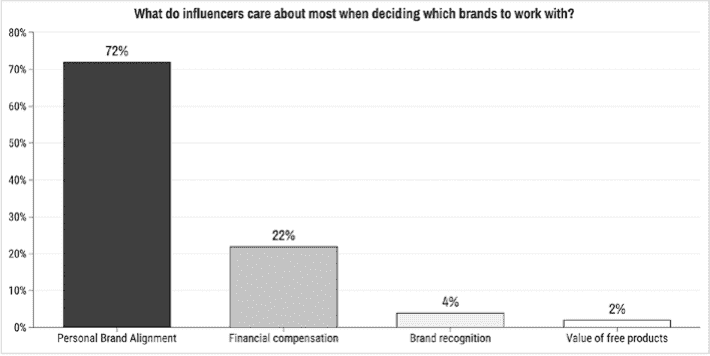
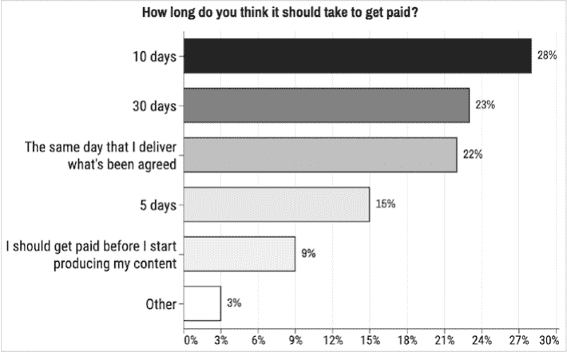
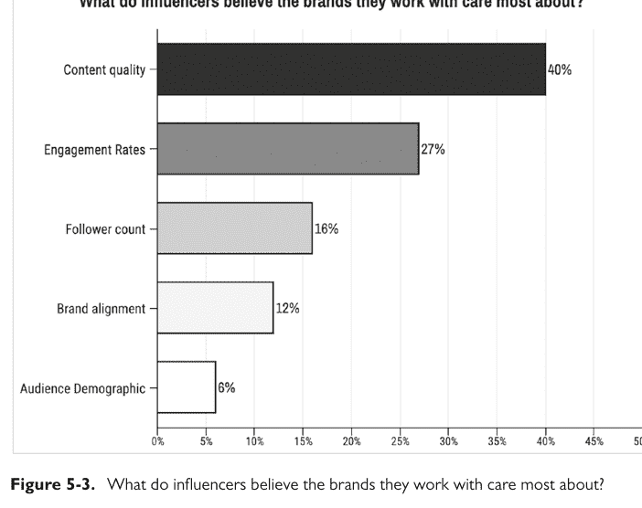

## 以创作者为中心的策略

将你的价值扩展到金钱之外，并以创作者为中心的视角来提高影响力营销的投资回报率

> 营销不是一个部门的功能，而是从客户视角看到的整个业务。
>
> ——彼得·德鲁克¹

### 关键问题

- 为什么10个影响者中有9个会在社交媒体上关注品牌？
- 品牌在Instagram上创建内容时犯的头号错误是什么？
- 作为在线创作者或影响者，最大的十个挑战是什么？
- 在决定想与哪些品牌合作时，影响者最关心什么？
- 合理的金钱报酬水平是多少？

### 核心原则

1. 金钱之外的价值。
2. 成为以创作者为中心。
3. 一致性、创造力和社区。
4. 品牌自我评估。
5. 没有免费的午餐。

我有好消息和坏消息。先说好消息，好吗？在Instagram上，10个影响者和内容创作者中有9个会关注他们喜欢并想合作品牌。你已经吸引了他们的注意力！在注意力经济中，这是一种稀缺货币——争夺注意力的竞争正呈指数级增长。准备好听坏消息了吗？你很可能正在让他们大失所望，而且是极度失望。

在筹备撰写这本书的过程中，我与Instagram上的200多位影响者²进行了交流，以了解他们对当前社交媒体格局的看法。这项研究揭示了几个相关的深刻见解，可以用来解决问题，并为创作者和品牌双方创造新的机会。

贯穿本章的主要论点是：通过以创作者为中心的视角来进行影响力营销，你将增加他们与你合作的价值——而不是相反。作为交换，你将创造杠杆作用，从而提高你的投资回报率。但我们所说的“以创作者为中心”是什么意思呢？简单来说就是，每个问题、挑战和机会都应该首先通过你所合作的创作者和影响者的眼睛来观察。也就是说，当你从他们的参考框架来看待事物，并接纳他们的视角时，你将完全了解设身处地为他们着想是什么感觉。

### 创作者的期望

让我们更深入地看看我们提到的好消息和坏消息。研究发现，87%的受访者（每位都是在Instagram上拥有至少10,000名粉丝的创作者）在Instagram上至少关注一个品牌。这显然是好消息，但他们对这些企业及其社交媒体存在有什么期望呢？在第一个问题的后续中，每位创作者都被要求分享他们对这些品牌的期望³，以及（从创作者的角度来看）他们最大的错误是什么⁴。检查一下对第一个问题的200个不同回答，四个清晰的主题浮出水面。

### 你为什么要关注Instagram上的品牌？

1. 灵感：我关注他们是寻求灵感（28%）、新闻/潮流（10%）。
2. 喜爱：我喜欢这个品牌及其产品（21%）。
3. 合作：我已经与他们合作过（16%）或希望与他们合作（6%）。
4. 发现：发现品牌的新产品（17%）。

所以，你的品牌被影响者关注，他们向你寻求*灵感*、新闻和*潮流*，因为他们喜爱你的*品牌*和*产品*。他们想要发现新事物，并且要么与你合作过，要么希望在未来某个时候与你合作。

### 品牌自我评估

在进入下一节之前，请先回答这些问题，我们将在下一节中找出品牌在Instagram上犯的最大错误——以及如何达到前面所提及的期望。

1. 你在Instagram上的存在是否具有启发性，包含来自你所在行业的产品新闻和潮流？
2. 你的关注者是否能轻松发现新产品？
3. 你是否让创作者能够轻松地联系到你？

接下来，同样的一批受访者被问了一个不同的问题。200个不同的回答被整理成33个不同的组别，其中80%的回答可以归入以下六个主题之一。

### 品牌在Instagram上创建内容时犯的头号错误是什么？

1. 过于以产品为中心
2. 不一致或没有清晰的主题
3. 没有互动或在评论区回答问题
4. 没有故事性、个性或真实性
5. 过于商业化、交易化，而且……无聊！
6. 你的内容看起来像杂志广告！

我向每个分享这份列表的营销团队展示时，他们的反应都是“哎哟！他们说的就是我们！”确实是坏消息。是时候再进行一次自我评估了。

### 品牌自我评估

根据Instagram上社交媒体影响者的说法，回答这些问题来评估你的品牌是否犯了这些最常见的错误。

1. 你的内容是否主要关注产品，通常有产品特写？（过于以产品为中心）
2. 你是否有一个创造性的主题并始终坚持如一？（不一致或没有清晰的主题）
3. 你是否有专门的团队或个人来回应问题，并在评论区或私信中与关注者互动？（没有互动或在评论区回答问题）
4. 你是否在讲述一个有趣或能体现个性的引人入胜的故事？（没有故事性、个性或真实性）
5. 你是否主要关注业务的商业层面，并使用社交媒体渠道来销售产品？（过于商业化、交易化，而且……无聊！）
6. 你是否使用为其他营销渠道制作的内容，比如杂志和/或广告？（你的内容看起来像杂志广告！）

所以，好消息——吸引到了注意力。坏消息——期望未得到满足。无论如何，或多或少都取决于你在第二次自我评估中的回答。无论情况如何，我认为这六个清晰的主题是构建一个创作者和影响者喜爱的社交媒体存在的指导原则。

这些见解中还隐藏着另一个重要的教训。这些反馈是基于数百位才华横溢的创作者的集体经验，而不是某一位行业专家或社交媒体顾问的意见。这数百位影响者，代表了数百万创作者，他们已经掌握了内容制作、分发和粉丝参与的艺术。他们首先是一线的实践者。在一个传统营销学者难以跟上步伐的世界里，他们正蓬勃发展——每个人都有一套自己的方法论，并随着他们适应不断变化的数字格局而持续演变。他们花在内容、语气和受众上的时间越多，就越倾向于凭直觉行事。创作者社区是一个关系紧密的群体。他们相互交流，分享建议，并向同行们寻求下一步的动向。

那么，对于那些希望创作更优质内容、建立更大受众群并吸引社区参与的其他创作者和品牌来说，他们能从中得到什么启示呢？

## 一致性、创造力与社群

这些专家小组成员是根据一个重要标准精心挑选出来的：拥有极高参与度的受众——至少高出平均水平 50%。换句话说，这些创作者不仅建立了庞大的粉丝群，而且他们的受众更有可能关注他们的内容。

当被问及对其他创作者最重要的建议是什么时，有两个建议反复出现。

保持一致性（或者找到自己的细分领域）以及与社群互动。

回顾之前提到的常见错误清单，这些建议似乎是同一枚硬币的两面。关于一致性，一位创作者这样建议：“我建议他们首先把重心放在内容和质量上，而不是其他任何事情。人们点击你的主页时，第一眼就会决定是否关注你，因此维护一个形象或‘品牌’会让你的作品展示得更加井井有条，而如果人们 1）明确知道能从你这里得到什么；2）欣赏你的质量和一致性，他们就更有可能关注你。”

研究中经常提到的另一个常见错误是缺乏社群建设。“很多品牌会在推文中向粉丝提问，却无视粉丝向他们提出的问题。这是一个巨大的错误，表明他们根本不关心用户，”一位网红评论道。

现在你已经站在他们的角度思考过，也更清楚地了解了创作者群体喜欢和不喜欢所关注品牌的哪些方面，是时候更进一步，揭示他们最大的问题是什么了。

还记得我们的论点吗？提升创作者从与你的品牌合作中获得的价值，你就能提高自己的投资回报。但除了显而易见的额外金钱报酬之外，你如何提升他们的价值？解决他们的问题和挑战。当你做到这一点时，你交换的东西比金钱更有价值。作为你创造价值的回报，你将成为一个无价的合作伙伴。

## 超越金钱的价值

作为在线内容创作者/网红，你面临的头号挑战是什么？如果你知道这个问题的答案，并能围绕解决他们的问题来制定你的网红营销策略，你将赢得创作者群体的心，并进而有机会将网红营销转化为你最有价值的分销渠道。为了省去你的麻烦，我们在过去几年里采访了数百位创作者和网红，并整理出了以下清单（按相关性排序）。

### 作为在线内容创作者/网红，你面临的头号挑战是什么？

1. 创作高质量内容
2. 击败 Instagram 算法
3. 与粉丝互动
4. 触达更广泛的受众
5. 想出新点子
6. 找到时间
7. 获得与品牌的合作
8. 脱颖而出、保持原创
9. 创造真实且引人入胜的合作
10. 频繁发布（每天发布）

仔细观察，会发现两个清晰的主题浮现出来——内容策略（第 1、5、8、9 项）和受众互动（第 2、3、4、10 项）。换言之，如果你能构建一个以帮助网红创作高质量内容、构思新想法、脱颖而出并保持真实与吸引力为核心的内容策略，你就创造了远比金钱报酬更有价值的东西，而由此，你们双方都会看到这段合作关系的更大价值。同样，如果你能制定一个极具吸引力的创意简报或活动方案，例如通过交叉推广或分发（受众互动）来带来更多曝光，你就是在围绕几乎所有人都公认的首要痛点来构建策略。

你注意到其中两个挑战不属于这两个主题吗？第 6 项“找到时间”和第 7 项“获得与品牌的合作”。我们来谈谈这两项。

通过遵循第 6 章“规模化的一对一关系”中概述的步骤，你将掌握高效的艺术并消除限制——你会主动表明自己尊重合作对象的时间和精力。第二个挑战显然可以通过与你的品牌合作来实现，但还不止于此。如果你能展示出与你的品牌合作可能会带来额外的合作机会，你就能立即提升你们关系的价值。

## 品牌自评

回顾这份清单。按 1 到 10 分打分，评估你的品牌在解决每项挑战方面的可能性——无论是总体而言，还是针对某个特定的活动简报。是什么会改变这个分数？

## 品牌与活动案例

为了将这些洞察置于营销背景中，你现在将看到五个不同的公司案例，它们在产品、品牌和活动中实施了以创作者为中心的策略，以提升超越金钱的价值。

### Sugar Bear Hair

www.sugarbearhair.com

**业务内容：** 电商、头发矿物质产品

**营销挑战：** 商品化，缺乏故事性

**解决的痛点：** 高质量内容、真实合作、想出新点子

**以创作者为中心的策略：** 通过以允许参与网红以不同创意方式表达对产品喜爱的方式设计产品，Sugar Bear Hair 得以挖掘庞大的创意人才库，并给予他们自由去构思新想法和创作高质量内容——即使这些内容都以他们的产品为核心。

### YouTube Music

music.youtube.com

**业务内容：** 优质音乐流媒体服务

**营销挑战：** 市场饱和，用户对直接竞争产品有强烈偏好

**解决的痛点：** 脱颖而出、保持原创、与粉丝互动、找到时间

**以创作者为中心的策略：** YouTube Music 让艺术家和网红邀请他们的粉丝参加独家发布活动。这创造了一种体验，让参与者忍不住去传播真实的故事，并将所见所闻告诉其他人。

### Museum of Ice Cream

**以创作者为中心的策略：** Museum of Ice Cream 是为 Instagram 而生的。与传统博物馆不同，展览的每个部分都经过设置，邀请参观者创作富有创意且高质量的内容。由于门票供不应求，Museum of Ice Cream 创造了一个让参观者（以及网红）能够创作独特内容和故事的场景。

## 创作者想要什么：品牌合作的决定因素

以创作者为中心的拼图的几个部分开始各就各位。在本节中，我们将深入探讨以创作者为中心的网红营销方法的另一个重要方面，即创作者对你的品牌有什么期望、在寻找什么！*获得与品牌的合作*在网红的常见挑战清单中排名第七——但事实证明，并不是来自任何品牌的任何合作都可以。在 2017 年的一个系列采访⁵中，我们采访了 81 位有影响力的社交媒体创作者，以了解他们每月会收到多少个品牌的合作邀约。结果呢？每月 10 到 100 个提案，平均 20 个。显然，机会并不缺乏。然而，这些品牌邀约大多无人回应。这是为什么？

### 价值观与个人品牌契合

品牌安全，以及确保你的品牌内容在一个规避风险、语境适当的环境中展示，是从事网红营销的营销人员经常提到的担忧。因此，品牌理所当然地投入时间和资源，以确保他们与正确的人合作。

但请注意，这扇门是双向的，*个人品牌契合度*实际上是网红决定是否与你的品牌合作的首要考虑因素⁶。见图 5-1。

**图 5-1.** 网红在决定与哪些品牌合作时最看重什么？

网红营销公司 AspireIQ 的研究发现，在对其平台上的 200 位网红进行调查后，个人品牌契合度（72% 的受访者）比金钱报酬、品牌知名度和免费产品价值加起来都更重要。这一洞察也反映在我自己公司发布的《2020 年网红健康报告》中——我们发现*核心价值观一致*是与品牌合作的首要决定因素。见表 5-1。

**表 5-1.** 品牌合作的决定因素

| 因素 | 受访者比例 |
|---|---:|
| 他们付多少钱 | 14% |
| 我知道他们的产品/服务有效 | 27% |
| 我之前听说过他们的品牌 | 3% |
| 他们的核心价值观与我的一致 | 34% |
| 他们给我创作自由 | 23% |

两项研究彼此独立，却都揭示了另一个有趣的洞察：*你的品牌价值观比你有多出名更重要。* AspireIQ 的调查中只有 4%，2020 年《网红健康报告》中只有 3%。这是个好消息

# 第5章 | 创作者中心策略

你是否听过“便宜没好货”这个说法？这句谚语的意思是，如果你支付的报酬很低，就只能吸引到能力不足或技能不高的工人（因为更优秀的工人可以去别处赚取更高的薪水）。当你制定网红营销策略时，情况也是如此。

正如AspireIQ的研究所示，金钱报酬的价值比免费产品的价值高出10倍（22%对比2%）。因此，你的产品在创作者眼中的感知价值通常非常低。我们公司基于Instagram和YouTube上超过10,000次合作进行的内部研究，包括对数千名网红的访谈和调查，进一步表明，只有8%的人对仅以免费产品作为报酬的合作持积极回应。用你的产品作为唯一报酬来补偿网红的实际后果是，你需要付出10倍的努力才能达到同样的效果。

显然，产品赠送几乎没有价值，那么创作者如何决定合适的金钱报酬水平以及自身的价值呢？在2018年至2019年间，从YouTube和Instagram上的839位网红收集的数据表明，最常见的决定因素是“我的受众规模以及品牌要求我做的事情。”¹¹ 那么，创作者期望获得多少报酬呢？

### 行业费率

近年来，网红营销领域发生了巨大变化，而且没有任何迹象表明该行业的增长轨迹会放缓。这些快速发展导致了格式、最佳实践和行业费率的不断变化。

这正是媒体出版行业的本质——它一直由供需的良性循环所主导。最初，广告库存非常充足。由于供应过剩而需求不足，广告成本很低，几乎免费。因此，广告主像大雁一样蜂拥而至，利用这一新发现的机会，而供应的短缺最终为出版商或任何拥有广告库存的人创造了提高收费的机会。数字媒体中的广告成本因季度、行业和市场而异。在大多数平台和网络上，变化是即时的、实时的，更不用说新的创意格式、定向能力和广告技术了。

> ¹¹ 内部研究，Relatable。2018–2019年。N=839（多选题：“你如何知道与品牌合作应该收取多少费用？”）

我很想提供一份经得起时间考验的全面网红营销费率表——但无论我写下什么，很可能在你读到的时候已经过时了。然而，我们能做的是阐明“我的受众规模以及品牌要求我做的事情”真正意味着什么。

暂且不论你认为正确的媒体规划和衡量营销效果的方式，当社交媒体创作者在品牌合作中提到他们的受众规模时，要么是指他们在Instagram上的粉丝数（而不是他们内容将获得的实际触达），要么是指YouTube上的预估观看量（而不是订阅者数量或实际观看次数）。

在广告和网红营销中，CPM（“每千人成本”¹²）通常用于衡量和估算品牌为其广告中的1000个单位支付的费用，通常是触达、观看或曝光。在Instagram上，这个单位是粉丝。

在YouTube的创作者社区中，CPV（“每次观看成本”）经常用于估算合作关系的成本或价值。但在这里，这个数字既不是基于频道订阅者（相当于Instagram上的粉丝），也不是基于已交付的观看量（实际曝光或触达），而是对未来观看量的预估。该预估通常基于发布后前30天内最近五到十个视频的平均或中位观看量。

当然，两个平台上还有其他关键变量会影响每千名粉丝成本或每次观看成本。在Instagram上，这包括内容格式、工作量、内容版权、帖子或快拍数量以及季节性。对于YouTube来说，决定制作专属视频还是整合视频（参见第4章“创意的艺术与科学”中的“YouTube上九种经过验证的创意执行方式”）将比其他任何因素都更能影响你的每次观看成本——其中完全专属的视频比整合提及你的产品或品牌的视频成本高出1.5倍到3倍。

### 不多不少，恰到好处

虽然报酬过低或完全不付报酬会产生实际影响，但支付过高也是如此。当你支付过高时，你会遇到另一个挑战：结果。毕竟你的营销预算有限（而且你的老板对这笔媒体预算能实现什么目标抱有不切实际的期望）。

你如何平衡这两者？应用第6章“规模化的一对一关系”中概述的参与率概念，并记住15%–25%的网红接受你的条件是完全合理的。

### 设定明确的付款条款

互联网创作者协会于2017年6月发布的研究报告《品牌合作现状》发现，29%的受访者曾经历过与品牌的合作中难以获得报酬的情况。每三个人中就有一个——这太疯狂了！我们对如此大比例的在线创作者会证实这种负面经历感到惊讶，于是调查了更大范围的社交媒体网红，得出了相同的结论。26%的人表示，他们做过赞助合作，被承诺付款，但最终根本没有收到报酬。

这意味着很简单：你接触的每三个人中就有一个人过去曾在报酬上被骗过——如果没有，他们几乎肯定认识被骗过的人。那么，建议是什么？立即设定明确的付款条款，不留任何疑问的余地。你可以使用下面的图表（图5-2）来指导你的付款条款，并设定与预期一致的条款。

**图5-2.** 你认为获得报酬需要多长时间？

本章前面引用的CreatorIQ调查揭示了另一个有价值的见解：网红认为与他们合作的品牌最关心什么。内容质量是最常见的答案（40%），其次是互动率（37%）、粉丝数量（16%）、品牌契合度（12%）和受众人口统计特征（6%）。

图5-3. 网红认为与他们合作的品牌最关心什么？

虽然这些都是任何网红营销活动中明确定义的目标和重要的考虑因素，但创作者和品牌之间的期望保持一致也很重要——但情况并非总是如此。网红营销公司Activate在并行调查网红和营销专业人士时得出了同样的结论¹⁶，以了解每个群体如何看待品牌/创作者合作的目标。在品牌方面，78%的人将品牌知名度列为首要目标，而创作者中只有37%。他们的结论为品牌和创作者提供了一个很好的建议：“*如果网红对营销者的目标有更好的理解，他们就能更好地优化内容以帮助实现这些目标。*”

第7章“四步网红营销框架”将准确展示如何为你的活动选择正确的营销目标和成功定义。但首先，在撰写有效的创作者中心简报时，还有一件同样重要的事情：创意的艺术与科学。
