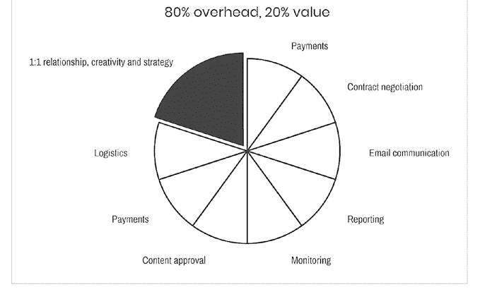
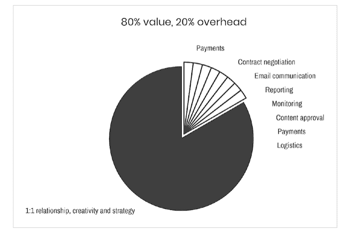

## 规模化的一对一关系

### 约束理论以及如何扩展你的网红营销

> 你所学到的是，工厂的产能等于其瓶颈的产能。
> 
> ——艾利·高德拉特

关键问题 如何在扩展网红营销时消除带宽和时间限制？如何在减少80%工作量的同时，保持与创作者的一对一关系？如何将电子邮件沟通转化为你的优势，而不是瓶颈？活动参与率、邮件送达率、邮件打开率、邮件回复率和点击率的良好基准是什么？如何建立一个动态的创作者报酬模型并摆脱不必要的谈判？哪五种最有价值的第三方软件服务能让你的网红营销实现自动化？


核心概念
1. 约束理论。
2. 80-20-80-20 策略。
3. 大规模下的 1:1 关系。
4. 活动参与率。
5. 创作者薪酬的动态模型。

当世界上最大书店的创始人推荐一本读物时，值得认真对待。市值达万亿美元²，杰夫·贝佐斯打造了地球上最大且最复杂的公司之一，从亚马逊“只是”一家书店起步至今已走得很远。贝佐斯及其组织成功识别出运营中的最大约束，并建立了结构以最大化利用这些约束。所推荐的读物《目标》是一部商业小说，由埃利亚胡·戈德拉特于 1984 年出版，被打造亚马逊履约网络的团队视为圣经。³

## 约束理论

这本书是对约束理论（TOC）的介绍——由戈德拉特博士提出的管理概念，旨在帮助公司和经理系统地将精力、能量和注意力集中在系统的约束上。约束通常是一个瓶颈，限制了产出，阻止组织增加吞吐量，而增加吞吐量本可以带来更好的客户交付、减少救火、缩短周期时间、减少团队成员之间的冲突、增加产能或提高净利润。

你明白我的意思了吗？

TOC 的关键流程简而言之，是专注于消除阻碍各部分作为一个整体协同工作的障碍。而且尽管名字如此，“约束理论”并不特别理论化。相反，它有助于为企业内部的挑战找到实用、有效的解决方案。

本章致力于消除营销组织在尝试扩大影响者营销时面临的众多瓶颈。我当时并未意识到，但我们公司在过去几年帮助客户扩大影响者营销项目所采取的方法，与约束理论中的几个关键组成部分非常相似。尤其是其主要论点——与其试图降低成本，TOC 认为提高利润（和投资回报率）最强大且可持续的方法是提高你的吞吐量。在第 4 章《创造力的艺术与科学》中，我们涵盖了为你的品牌识别合适的网红以及如何为你的品牌建立人才库的诸多方面。我们已经涵盖的许多概念都建立在提高吞吐量的前提之上，在本章中，我将进一步揭开面纱，向你展示一套实用解决方案，帮助你和你的组织消除一直阻碍你的瓶颈。

## 80-20-80-20 策略

2019 年的一项全球调查，涵盖了超过 350 个参与的营销团队，显示带宽和时间限制几乎与寻找合适的网红一样常见。⁴ 此外，同一调查的受访者还表示在“管理合同和截止日期”以及“向网红支付款项”方面存在问题。只要问任何在我们行业稍有经验的营销人员，你就会听到他们关于电子邮件沟通、合同谈判、内容提交、内容审批、物流、付款、法规、付款、追踪链接、促销代码和报告的挑战。

更糟糕的是，在另一端还有创作者在经历同样的障碍。这对所有各方来说都令人沮丧，原因很简单；它并没有创造任何*真正的*价值。这些事情成为实现目标的手段，消耗了你高达 80% 的时间，只剩下 20% 的时间用于关系建立、创造力和战略（图 6-1），而这些，最终将带来 100% 的差异。

⁴ Relatable 2019 State of Influencer Marketing Report (www.relatable.me/the-state-of-influencer-marketing-2019)



图 6-1. 80% 开销，20% 价值

另一方面，尽管耗时且令人沮丧，但大多数在影响者营销方面取得成功的营销团队都看到了与他们合作的创作者和网红建立一对一关系的重要性。它使价值超越了纯粹的交易性，并允许你更具创造性和战略性。看起来对他们成功至关重要的东西也正是阻碍他们的。那么，当你的约束（建立一对一关系）对你的成功至关重要时，你如何提高吞吐量（高效扩展你的影响者营销）？答案是你不这样做。你把其他一切都去掉。

与其花费 20% 的时间创造价值，80% 的时间用于开销，你将自己置于一个花费 80% 的时间在创造价值的事情上，20% 的时间用于开销（图 6-2）的地位。但怎么做？通过工作流程、技术和系统思维。以精明工程师的心态，加上一点来自约束理论的灵感，我将带你完成需要做出的转变，以永久消除大量开销。并且请记住——你即将学到的所有内容都已在过去 3 年中在数千次合作、数百个不同品牌中彻底实施和测试。因此，我有信心这些建议和提示不仅在理论上有效，更重要的是在实践中有效。



图 6-2. 80% 价值，20% 开销

最好的是？你不会写一行代码，即使你恰好拥有数学或计算机科学博士学位，我恐怕也用处不大。

## 大规模实现 1:1 关系，工作量减少 80%

最终目标有三重：首先，减少你花费在贡献很少或没有价值的因素上的时间，如前文所述。其次，将时间和资源用于关系建立（从而带来战略和创造力）。我再强调一次——目标是增加你在创造最大价值的因素上花费的时间。第三，建立系统（同样，无需编程或博士学位），让你能够将吞吐量从今天的水平扩大 10 倍甚至 100 倍。如果你刚刚起步，我理解同时运营 100 位创作者的影响者营销项目的想法可能看起来很遥远，但请记住：你的约束（80% 开销）最好从第一天就消除。我们遵循完全相同的流程，并在同一系统中运营，以运行拥有 5、50 或 500 名参与者的影响者营销项目，这都要归功于我们多年前实施的方法，其中工作流程、技术和系统思维是我们运营和执行的核心。正因为如此，被调查的 100 位网红中有 97 位强烈推荐与我们以及我们代表的品牌合作，并经常提到这是他们与品牌合作时经历过的最顺畅、最愉快的体验。

## 受沟通限制

电子邮件沟通（总体上，尤其是在影响者营销的背景下）是真正的耗时黑洞。不仅在你建立人才库时（如第 4 章《创造力的艺术与科学》所述），而且尤其因为它是一个将触及阻碍你的大部分约束的沟通平台——从外联、简报、谈判到入职。幸运的是，这也是你能以相对较低的投入（投资）看到高影响（回报）的地方。

老式的电子邮件也是创作者和网红无论社交媒体平台、国家或行业都偏好的沟通方式——只要使用得当。

## 第 1 步：设置专用电子邮件地址

所需时间：5–10 分钟

努力程度：低

影响：N/A（但是一个必不可少的第一步）

你需要做的第一件事（以优化本章中概述的其余步骤）是设置一个仅用于与网红沟通的专用电子邮件地址。尽管这看起来简单且显而易见，但在继续之前解决这个问题至关重要。毕竟，链条的强度取决于其最薄弱的环节。

电子邮件地址应来自贵公司负责沟通的实际人员，并且重要的是它仅用于该目的。我的工作邮箱是 aron@relatable.me（说你好！），所以我会再设置一个带别名的邮箱，比如 aron.levin@relatable.me（不是我的主要收件箱！）。如果你使用真实姓名而不是 hello@yourcompany.com 或 collaborations@yourcompany.com 这样 impersonal 的别名，你会看到更好的打开率、点击率和回复率。设置账户名称为你的全名，并不要忘记上传个人资料图片。

### 人们真的会读邮件吗？

基于发送给超过 100,000 名网红和内容创作者的电子邮件数据集，我可以向你保证，如果使用得当，这是一种非常有效的沟通形式。以下基准可以帮助你检查是否达到了正确的效果。


就像客服团队一样高效，他们可以并行管理数百甚至数千条消息——但最妙的是：在另一端，从与你沟通的个人角度来看，这将是一场个性化的一对一对话。

要实现这一点，你需要一个第三方软件即服务（SaaS）平台。我所在的公司使用Intercom⁶，他们的服务大约每月30–40美元即可满足你的初始需求。很可能有免费试用版，你可以利用它来试验你的新工作流程。Zendesk是另一个行业领导者，但我没有亲身体验过他们的平台，无法实施或试用。无论如何，都要避免使用公司现有的任何系统或平台，因为你的需求（和使用场景）与客户服务部门截然不同。由于我有使用Intercom的经验，我将以他们的服务为例，带你完成这些步骤。⁷ 实施后，你将获得以下功能：

1. 当有人向jane.doe@yourcompany.com（你新建的、未在其他地方使用的专属邮箱地址）发送电子邮件，或回复从该地址发出的邮件时，该邮件会自动转发到你的Intercom收件箱。
2. 你无需登录邮箱，而是在他们的网页客户端（也有移动应用）中收到新消息。界面类似于Facebook Messenger，非常易于使用。
3. 回复收件箱消息就像发送聊天消息一样简单。根据我的经验，速度也会更快，因为你可以获得之前对话的完整上下文，而且界面组织得更好。你可以选择关闭对话、将其分配给其他同事，甚至可以根据上下文将消息路由给不同的团队成员。

但对于另一方——你正在沟通的影响者或创作者——体验如何呢？他们是否需要大费周折，感觉自己像是被转接到了一个客服平台？恰恰相反。这种沟通感觉就像普通的邮件往来，但由于系统允许你更快、更精准地回复，你会被认为响应更迅速，甚至更容易合作。花在事务性工作上的时间？减少了。一对一关系？改善了。

### 步骤3：你到底想问什么？

所需时间：几小时

投入：中等

影响：中到高

有了一个专门的平台来处理与你联系的影响者（以及你正在积极合作的那些人）的谈判、讨论和日常沟通，你就构建了一个系统，使得沟通吞吐量（即你合作的内容创作者数量）不再制造额外的瓶颈。与1个、10个或100个人同时进行对话都遵循同样的流程，杂乱无章的收件箱不再是你链条上最薄弱的一环。艾利·高德拉特博士会为此感到自豪。但我们还没有完成。

说到持续对话，你要做的第三件事是减少与每个人之间发送和接收的消息数量。

首先，我们需要破除营销人员中一个常见的迷思：人们不阅读或不喜欢长篇幅内容，尤其是电子邮件。我完全不同意这一前提。这完全取决于内容是什么——以及是否与读者相关。而且你要知道——大多数创作者和影响者对于无法提供足够信息的机构、品牌和营销人员感到非常沮丧，他们不禁要问：你到底想要什么？

以下问题，正如第四章《创造力的艺术与科学》中所提到的，无论你试图邀请对方参与何种形式的合作、伙伴关系、人才库或大使计划，这些问题都会不可避免地出现在对方脑海中（顺序不分先后）：

1. 你和你的公司是谁？（介绍）
2. 你的公司、产品或服务是做什么的？（背景）
3. 你为什么联系我？（背景信息）
4. 你们对我有什么期望？（任务简报）
5. 什么时候需要完成？（承诺）
6. 我们将如何合作？（流程）
7. 我会得到多少报酬？（报酬）
8. 你希望我接下来做什么？（行动号召）

此外，如果你能回答上述问题，你还会面临后续问题，例如（同样，顺序不分先后）：

9. 这将如何帮助我为我的受众创作内容？（好处）
10. 这有没有可能损害我的职业或个人品牌？（风险）
11. 还有什么我应该知道的其他好处吗？（好处）
12. 我怎么知道你是否值得信任？（风险）
13. 你还与谁合作过？（社会证明和社区）
14. 这会花费多少时间？（承诺）
15. 我什么时候能收到报酬？（条款）
16. 你的营销目标是什么？（目标）
17. 你的产品/服务有什么特别之处？（独特卖点）

这些都是完全合理的问题，任何人在决定你的提议是否有趣时都会想到。你的最终目标：通过预先尽可能多地提出并回答这些问题，来减少异步对话——也就是说，在对方甚至决定是否想与你合作之前。当你这样做时，会发生三件事：*第一*，双方之间的对话减少。*第二*，由于对话减少，你的周期时间得到改善。无需在你解决完每个相关问题之前来回发送多条消息（如果运气不好，可能需要数小时甚至数天的日历时间），事情可以瞬间推进。*第三*，由于沟通清晰，你与对方的关系会突飞猛进。

可能还有其他针对你的任务简报、活动甚至产品的常见问题需要解答，但当你开始发现规律时，最好在稍后的阶段再处理这些问题。

### 步骤4：现金主宰一切

*所需时间：* 几小时

*投入：* 中等

*影响：* 中等

> “我会得到多少报酬？”

在这个例子中，你只是增加了一笔额外固定费用，但降低了动态费率。为什么要这样做？因为在这个例子中，你可能不得不这样做。看看例子中的创作者C。固定费用确保即使是粉丝较少的人，绝对报酬也是合理的。你也可以根据参与度和互动率来构建报酬结构，如下所示：

**示例 3**

- 输出：一条Instagram信息流帖子，针对互动进行优化
- 动态模型：按近期帖子每次互动$0.30计费
- 公式：[平均互动率 x 粉丝数] x $0.45

| 创作者 | 互动率 | 粉丝数 | 预计互动次数 | 预算 |
| --- | --- | --- | --- | --- |
| 创作者A | 3% | 100,000 | 3,000 | $1,350 |
| 创作者B | 5% | 50,000 | 2,500 | $1,125 |

一种模式比另一种更好吗？这完全取决于你的营销活动目标是什么。让我们来看YouTube上的第四个也是最后一个例子。

**示例 4**

- 输出：一条推广你产品的YouTube视频
- 动态模型：每1,000次观看$150⁹，按最近视频的平均观看次数计算
- 公式：[平均视频观看次数]/1000 x $150
- 最低报酬：$2,000
- 最高报酬：$6,000

| 创作者 | 每视频平均观看次数 | 预算 |
| --- | --- | --- |
| 创作者A | 30,000 | $4,500 |
| 创作者B | 50,000 | $6,000\* |
| 创作者C | 10,000 | $2,000\* |

在这个例子中，请注意最低和最高报酬。我们为什么要这样做？你并非必须这样做，但这是一种在两端降低风险的方法。在较低的一端，我们知道绝对报酬（最低）太低没有吸引力。一个愿意花一周时间为你拍摄视频的人，会为自己的付出要求一定的基本报酬。在另一端，你的内部目标可能受限于视频的总数量，如果每个创作者获得过多报酬，就可能无法实现。

> ⁹这完全是一个虚构的例子，并不构成关于你应该支付多少报酬的建议。


报酬。再说一次，你不必以这种方式来设计报酬结构，但我加入这些示例是为了说明，如果你愿意，可以做得更精细。

需要注意的是，这是你在内部完成的工作。你不需要向任何人透露你使用的模型。只需说明你的预算建议即可。

显然，你的总体预算和行业平均费率也会在决定你付给合作者多少报酬方面发挥关键作用。¹⁰ 一张费率卡或一套计算公式，用来确定你在营销活动中合作的创作者应得的报酬，将成为重要的基石，减少你在每一次合作和对话中从零开始谈判的必要性。此外，报酬也是对方决定是否愿意与你合作的重要考量因素，因此，你最好尽可能早地、主动地保持透明。

提出一个预算建议，而不是去谈判一个预算。这样，你的合作对象可以选择接受或拒绝你的建议。一旦你有了计算公式，就可以用 Numbers、Excel 或 Google Sheets 制作一个简单的电子表格，自动计算报酬。表 6-1 使用了前面的示例 1。

## 表 6-1：计算报酬的动态模型

|   | A | B | C |
|---|---|---|---|
| 1 | Instagram | 粉丝数 | 报酬 |
| 2 | CreatorA | 100,000 | =sum(B2/1000*30) |
| 3 | CreatorB | 50,000 | =sum(B3/1000*30) |

如你所见，这些条目可以复制成成百上千行，而你无需额外工作。

## 不要过少，也不要过多

就像雇主招聘新员工一样，如果工资太低，你吸引不到具备合适技能的人才。虽说市场上肯定存在长尾人才（如前几章所述），但供应并非无限。如果建议的报酬太低，你会发现没有创作者或网红愿意与你的品牌合作。反过来，支付超出必要的报酬显然也不明智。

> ¹⁰本节不会讨论这些费率是多少，或者如何为你的整个营销活动制定媒介计划，而是聚焦于一种必要转变，以确保围绕报酬的谈判或讨论不会成为制约因素。

那么，你该如何让自己在这两者之间取得平衡呢？

在我们机构内部，我们以*营销活动参与率*为优化目标。创作者会根据报酬以外的其他因素接受或拒绝合作，但过去几年里，这一指标已成为我们很好的代理指标。公式很简单：

### 计算你的参与率

[接受你提议的创作者数量] / [你联系的创作者数量]

大约 15%–25% 是一个很好的基准。低于 15%，你就会遇到约束。超过 25%，你很可能支付了过高的报酬。请记住第 5 章“以创作者为中心的策略”中的这张表（出自“创作者想要什么：品牌合作的决定因素”一节）。

## 表 6-2：品牌合作的决定因素

| 因素 | 受访者占比 |
|---|---|
| 报酬高低 | 14% |
| 我知道他们的产品/服务有效 | 27% |
| 我之前听说过他们的品牌 | 3% |
| 他们的核心价值观与我的相符 | 34% |
| 他们给我创作自由 | 23% |

很明显，还有其他决定因素会影响你的参与率——有些比*支付多少报酬*更重要。考虑到这一点，如果你发现虽然支付的报酬合理，但参与率仍然很低，请确保你已经处理了表中列出的其他因素。反过来也一样：如果你们的价值观一致，有创作自由，你也证明了自己拥有出色的产品，那么你很可能降低报酬，同时仍能维持不错的参与率。

## 第 5 步：启动引擎

*所需时间：几小时*

*投入：中等*

*影响：高*

这一切都在为这一刻做准备。我们已经设置了一个专用电子邮件地址，作为单一联系点；实施了一套系统，以便与多人并行高效对话；并处理了常见问题，以缩短周期、建立更好的 1:1 关系。你已拥有计算报酬的数学公式（五年级数学水平），并依赖参与率而非逐一个体谈判。

如果你跳过了其中任何一步，一旦你开始提高吞吐量，整个工作流就会崩溃。这就是约束理论（Theory of Constraints）的运作方式——无论在理论上还是实践中都是如此。

还记得第 4 章“创意的艺术与科学”中关于人才库的练习吗？同时将一百人引入一项营销活动、大使计划或人才库，可能看起来令人生畏——但正如承诺的那样，我现在将引导你完成所需的步骤，让你不费吹灰之力就能实现目标。就像客户服务类比和 Intercom 一样，我们将使用两个你的组织中很可能已经存在的工具（95% 左右的概率）：电子表格和电子邮件营销。你可能听说过 MailChimp¹¹、Sendgrid¹² 或 Drip¹³ 等邮件服务平台。我个人曾大量使用过这三家，并且都推荐。和 Intercom 的情况一样，我建议你使用一个独立的账户或服务，不要和你平时用于与客户沟通或其他相关邮件营销活动的账户混在一起。

你对上述这类电子邮件营销平台的经验可能各不相同，因此本步骤的某些部分要么看起来非常简单，要么非常复杂，具体取决于你的经验。不过别担心——只要牢记最终目标：我们想要实现的转变，是让你不再一个接一个地联系网红和创作者，同时建立更牢固的 1:1 关系。

接下来，你需要一个电子表格软件（如 Numbers、Excel 或 Google Sheets），以及前面提到的某一家电子邮件营销服务的账户。在下面的分步说明中，我们将使用 Google Sheets 和 MailChimp，让你只需按下一个按钮，就能联系 500 位创作者。请注意，这个数字可以是 50 或 5,000。同样的步骤，同样的工作流，没有任何限制。准备好了吗？

### 第 1 步：创建表格

首先打开一个空白电子表格。你的表格将为每位创作者保留一行，并为我们需要在电子邮件中包含的每个变量保留一列（表 6-3）。列数没有限制——但我们会保持简单，只使用这六个必要的列。

## 表 6-3：创作者示例表

| ID | Instagram | 名字 | 邮箱 | 粉丝数 | 报酬 |
|---|---|---|---|---|---|
|  |  |  |  |  |  |

为了清晰起见，我在表 6-4 中列出了每一列的简要说明，并附带一行示例。

## 表 6-4：含各列说明的示例表

| ID | Instagram | 名字 | 邮箱 | 粉丝数 | 报酬 |
|---|---|---|---|---|---|
| 唯一的数字标识符，每新增一行就递增 | 创作者的 Instagram 用户名，不包含任何其他字符 | 你联系对象的名字 | 电子邮件地址 | 我加入这一列是为了展示如何利用之前的例子自动计算报酬 | 你将为这次合作、网红营销活动或项目向创作者支付的金额 |
| 1 | aronlevin | Aron | aron@relatable.me | 20,000 | $1,000 |

你的第一步就是在这张表中填入你想要联系的创作者或网红。我在表 6-5 中填入了三个虚构的用户名。

## 表 6-5：已填充数据的示例表

| ID | Instagram | 名字 | 邮箱 | 粉丝数 | 报酬* |
|---|---|---|---|---|---|
| 1 | aronlevin | Aron | aron@relatable.me | 50,000 | $5,000 |
| 2 | janedoe | Jane | jane@example.com | 100,000 | $10,000 |
| 3 | johndoe | John | joe@example.com | 75,000 | $7,500 |

> 注意：如需了解如何自动计算此数值的示例，请返回上一节。上表使用三个虚构示例仅作演示之用。


你可以用同样的结构填充表格，填入成百上千行——每一行代表一位创作者。大多数电子表格软件甚至提供了一些函数和功能，可以用来删除重复项、验证电子邮件地址、将数字（如报酬）四舍五入到最接近的整数，以及按特定值排序或筛选。

## 第 2 步：导入到你的电子邮件服务商

完成后，就该导出你的表格了（在 Google Sheets 中，你只需前往主菜单，选择*文件*、*下载*、*逗号分隔值（.csv，当前工作表）*）。然后，前往你的电子邮件营销服务商处导入文件。每家服务商都会有相应的简单教程或说明来指导你操作。不过大致思路上，应该有一个导入联系人/受众或列表的功能。MailChimp 将其称为*受众*。

当你导入联系人表格时，你需要将每一列映射到电子邮件营销平台中的一个变量。MailChimp 将这些变量称为 Audience fields 和 *|MERGE|* 标签。*受众字段（Audience fields）*或*合并标签（Merge tags）*是与每个联系人（每位*影响者或创作者*）相关联的变量及其值。当你导入表格时，请确保将每一列（例如粉丝数）分配给名称相同或相似的对应受众字段。我们将在下一步中使用这些字段来个性化我们的电子邮件沟通。

## 第 3 步：创建并发送你的电子邮件

还记得我们电子表格中的列和受众字段吗？现在它们将被充分有效地利用起来。最后一步是撰写你的外联邮件。前面的章节已经涵盖了你在第一封邮件中需要解决的问题，以及如何构建一份有效的简报。因此，本节仅包含一个简短示例，用来演示这些变量的使用。

```
From: Your First And Last Name
To: @*|INSTAGRAM|*
Subject: Instagram collaboration with @*|INSTAGRAM|*

Hi *|NAME|*,

We're such and such and are reaching out because of so and so. Would you be interested in a collaboration on @*|INSTAGRAM|* and @ourbrand? You'd be asked to do this and that, and your compensation is *|PAY|*.
```

# 第 6 章 | 规模化的一对一关系

如果你愿意参与，请直接回复，我会分享更多关于该项目的细节。如有任何疑问，我可以通过电子邮件和 555-123 联系你。

谢谢，
你的名字

许多电子邮件服务都提供预览功能，允许你在联系人之间切换，并检查你的邮件是否看起来不错、所有变量是否准确就位。当你准备好后，可以安排立即发送，或在你偏好的日期和时间发送。而且，因为你遵循了前面的步骤，每封外联邮件的回复都会发送到 Intercom（或类似的同等工具）。

## 重要的电子邮件注意事项

当你使用诸如 MailChimp 之类的服务平台进行设置时，你可能希望咨询在事务性邮件和促销邮件的自动化与营销方面都有经验的人，以完成以下重要且关键的步骤。

- 1. 验证你的域名。这将确保你的邮件不会被标记为垃圾邮件，也不会看起来像是从电子邮件营销服务商发送的。
- 2. 移除所有 HTML 格式，将邮件布局精简到最简。你希望邮件看起来像一封普通电子邮件，而不是营销通讯。
- 3. 将发件人和回复地址设置为你的电子邮件地址。请注意，这应该是你在本章第一步中创建的那个专属电子邮件地址。
- 4. 咨询你的法律团队或电子邮件营销专家，以确保你遵守所有电子邮件营销法规。例如，根据你所在地区的不同，可能需要提供退订或选择退出链接。

你已经构建了一个可扩展的工作流程，它再现了以前完全手动的流程。准备好对我们的工作流程进行最后一项改进了吗？

## 第 6 步：谁会来参加你的派对？敬请回复！¹⁴

*所需时间：* 几个小时

*投入程度：* 中等

*影响程度：* 中等

在你实施第 1-5 步时，你会很快遇到一个限制吞吐量的瓶颈。虽然这一步并非严格必要，但它会为你和与你共事的人节省大量时间。回顾我们目前构建的系统，它有一个重大缺陷，会限制我们规模化扩展的能力——一个在解决之前会拖住一切后腿的瓶颈。

那个瓶颈就是*你*。

你看，随着每位创作者回复你的初始外联邮件，你很快会难以跟踪谁参与、谁不参与。最初这不是问题——但我们的目标是提前消除将来道路上可能出现的障碍。我们需要扫清道路，让引擎始终全速运转。毕竟，还有预算、时间表和营销目标需要达成。为了消除这个瓶颈，我们将使用另一种经过验证的方法。不过这次是来自工作时间之外的方法：派对时间到了！

如果你在举办派对，跟踪谁打算来参加庆祝活动至关重要，尤其是举办大型活动时。你可以让客人打电话或发短信告诉你他们是否会来——但想象一下，如果你邀请了数百位客人，这种方法会造成多大的麻烦。简直一团糟！不，更好的方式——对双方来说也是更好的体验——是引导客人访问一个网站，在那里他们可以回复自己的出席状态。

我们的目标是让你邀请到活动、项目或人才库中的众多创作者和影响者，不是通过电子邮件回复参与状态，而是访问一个网站，在那里告知你是否参加。

### 敬请回复

实施这个小而意义重大的改进所需的两步，简直和举办生日派对一样简单。首先，我们需要构建一种收集回复的方式；其次，我们需要将活动参与者引导到你的页面。

> ¹⁴ 法语中意为“请回复”，简称 *RSVP*

## 第 1 步：收集回复

虽然你当然可以自己构建，但有一系列在线服务可以为你完成所有工作——无需设计、Web 开发或 Web 托管。我将带你逐步了解使用我的另一项钟爱服务——Typeform¹⁵——所需的步骤。（其他选项包括 Jotform、¹⁶ Formstack、¹⁷ Wufoo、¹⁸ Formsite、¹⁹ 或 Google Forms。²⁰）

注册账户，登录他们的界面，从零开始创建一个新表单。如果你需要帮助，他们提供了帮助板块、示例表单和教程。就我们消除瓶颈的目标而言，你的整个表单可以只包含一个复选框或下拉字段，用来回复“是”或“否”，或对你初始外联邮件进行 RSVP 回复。

但如果只有一个下拉菜单，你怎么知道回复者是谁呢？问得好！Typeform 允许你创建他们所说的隐藏字段。在这些隐藏字段中，你可以将其他相关变量传递给收集的回复，例如联系人的电子邮件地址、Instagram 用户名、粉丝数量或报酬。还记得之前的受众字段或合并标签吗？如果你将这些值作为隐藏字段包含进去，你就能确切知道每个回复者是谁。这里我不打算提供完整的表单构建教程，而是推荐你参考 Typeform 的官方教程。²¹

专业提示：如果你要向影响者寄送实体产品，你可以使用同一个表单来收集他们的收货信息，以及产品偏好和尺码。

当你的表单准备好后，你会获得一个任何人都能访问并填写的链接。这个链接需要包含在你的初始外联邮件中。链接中还会包含一串字符，称为“查询字符串”，它们会被附加到链接上。

```
https://relatable1.typeform.com/to/typeformid?id=xxxxx&name=xxxxx&followers=xxxxx&instagram=xxxxx&compensation=xxxxx
```


我知道这对某些人来说乍看之下可能令人望而生畏——一堆与号、问号和等号——但仔细看看你就会明白，这离火箭科学还远得很。在这个示例中，我们将五个参数放入表单内的五个不同的隐藏字段中，分别是：

```
id=xxxxx
name=xxxxx
followers=xxxxx
instagram=xxxxx
compensation=xxxxx
```

请注意 xxxxx 将会被每个受访者的实际值替换。去 Typeform 上获取你表单的唯一链接吧。我们已准备好进行第二步，也是最后一步。还有一件事情我们必须做。

## Step 2: Call to action

还记得第 5 步中的个性化邮件吗？我们将为它做一点小小的改头换面，加上一些新文案和来自 Typeform 的动态个性化链接。以下是一封示例邮件：

> From: Your First And Last Name
> To: `@*|INSTAGRAM|*`
> Subject: Instagram collaboration with `@*|INSTAGRAM|*`
>
> Hi `*|NAME|*`,
>
> We’re such and such and are reaching out because of so and so. Would you be interested in a collaboration on `@*|INSTAGRAM|*` and @ourbrand? You’d be asked to do this and that, and your compensation is `*|PAY|*`.
>
> If you’d like to participate, head over to this link and confirm your participation:
>
> **Yes, confirm my participation**
>
> Once you’ve confirmed your participation, I’ll be following up with the information you need. I’m available on email and 555-123 if you have any questions.
>
> Thank you,
> Your Name

本章显然是从你自行处理整个流程的角度撰写的。市场上也有多种自助式网红营销工具，以及代理合作伙伴，他们可以在你选择这条路径时从头到尾处理整个流程。无论如何，本章中的步骤都很有用，可以演示如何将你的方法从 80% 的开销和 20% 的价值转变为相反的情况。在我共同创立的公司 Relatable 中，我们起步时——并且取得了长足的进步——就是将多个平台服务拼接在一起，在若干情况下与本章概述的流程完全相同——同时也在编写自己的软件。最终，我们建立了一整套网红营销操作系统。

有一点可以肯定——如果没有系统思维和 *Theory of Constraints*，我们今天绝不会取得如此成就。
